# F. The soft loop: definitions, controls, and the result

This section is written to be unambiguous. Every mode below is the *same* forward pass with the *same* weights, batch layout and prompt; they differ only in **what is fed in at the next position**.

## F.1 The algorithm, in full

One run processes a batch of $K+1$ rows in parallel:

* **row 0** is the *reference*: the prompt is unperturbed.
* **rows $1\ldots K$** are $K$ independent perturbation *directions*: each row has the same prompt with a different sparse perturbation of norm $r$ added to the prompt embeddings ($K$ = 8 in the 2026‑11 campaign, 256 in the v3 campaign).

A **step** is one generated position, i.e. one forward pass that produces the logits for the next token. There is no separate notion of "layer steps"; layers are inside the forward pass.

```
E_prompt = embed(prompt_ids)                      # (P, d)
E_rows   = E_prompt.repeat(K+1, 1, 1)
E_rows[1:] += r * direction_k                     # perturb rows 1..K only

fed[0] = last prompt embedding                    # start of the generated sequence
for t in 0 .. T-1:
    z      = model(fed[0..t])[:, -1, :]           # (K+1, V)  logits at position t
    p      = softmax(z / T)                       # (K+1, V)
    e_ref[t] = fed[0][t]                          # what row 0 actually received
    fed[t+1] = RULE(p, e_ref[t], t)               # <-- the ONLY difference between modes
```

| mode | `RULE`: what every row feeds at the next position | what it is |
|---|---|---|
| **soft** (closed loop) | $e = \sum_v p_k(v)\,E_v$ — row $k$ feeds **its own** expected embedding | mean feedback from its own distribution |
| **replay** (network only) | $e = e_{\rm ref}[t]$ — the recorded input of row 0 | the feedback is removed; only the prompt perturbation remains |
| **CRN** | sample one token $v^\*$ from $p_0$ (the **reference** row), feed $E_{v^\*}$ to **every** row | hard token, sampling noise identical across rows |
| **independent** | each row samples its own token $v_k\sim p_k$, feeds $E_{v_k}$ | ordinary sampled generation |
| **teacher forcing (A1)** | hard token ids from a greedy run, fixed in advance | no feedback, no sampling at all |

**What "readout" means.** The readout is the map from the last hidden state to the vocabulary: $z=W_U\,\mathrm{norm}(h_L)+b$ (the unembedding). "The instability lives in the readout" means: the *hidden* perturbation $\delta h_L$ is harmless by itself; it matters because it changes $z$, hence $p$, hence (in the soft loop) the vector $e$ that is fed at the next position. The readout is the *gate* through which a hidden perturbation re-enters the input stream. "Gate open" ($m_t<T$, with $m_t$ the top1$-$top2 logit margin) means $\mathrm{softmax}$ is sensitive to that change; "gate closed" ($m_t\gg T$) means the same logit change barely moves $p$.

**What each control removes, and what it therefore licenses you to conclude:**

| comparison | difference | if the loop grows and this does not, you learn |
|---|---|---|
| soft vs **replay** | where the fed vector comes from (own distribution vs frozen reference) | the growth needs the perturbation to reach the readout *and* to change the input; the network alone is innocent |
| soft vs **CRN** | mean feedback vs one hard token shared by all rows | the growth is not caused by the *sampling* of a token; it needs the *mean* (the full distribution) |
| **CRN** vs **independent** | shared vs per-row sampling noise | whether sampling noise alone can separate rows (it can, but only to $O(1)$, not $10^2$) |
| soft vs **teacher forcing** | closed feedback vs a fixed greedy token stream | the same contrast as replay, but with hard tokens at every $T$ — this is the standard "autoregressive generation" baseline |

Note the axes are independent: *what is fed* (expected embedding vs token), *where it comes from* (own row vs reference), and *how it is chosen* (mean vs sampled). The closed soft loop is the only cell that has **all three** of: own row, expected embedding, deterministic mean.

**Do we compare against non-looped autoregressive / teacher-forced generation?** Yes — that is the whole D series: A1 feeds the model a *fixed* greedy token stream (teacher forcing) and perturbs only the prompt; it never loops. Replay is its soft-token analogue. The claim "autoregressive and teacher-forced generation do not amplify" is exactly those runs; the loop runs are the contrast.

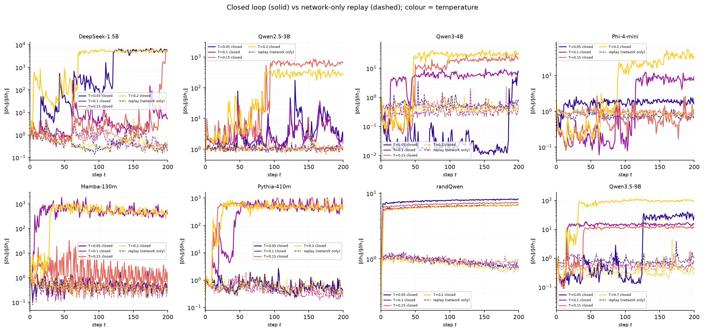

**Fig. F1 — the closed loop vs the replay, all temperatures (old 200-step version, kept).** Response for the soft loop (solid) and the replay (dashed), colour = temperature. **Read:** closed loops grow by $10^2$–$10^4$; replays stay at 1 or decay. **Superseded by F2 below** (3000 steps, matched pairs, per-direction bands).

## F.2 The result: the loop amplifies, the network alone does not

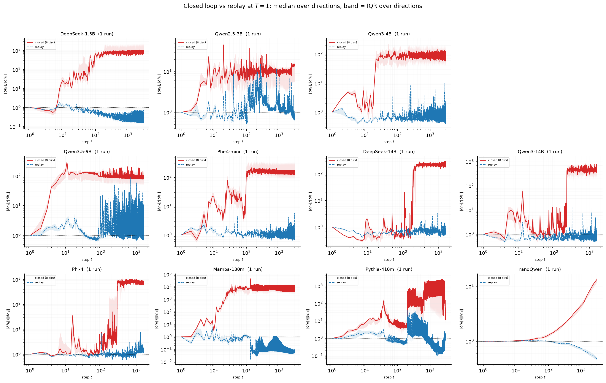

**Fig. F2 — closed loop vs replay, every model, $T=1$, 1600–3000 steps.** Median over directions (solid = closed, dashed = replay), band = IQR over directions, log–log. **Data:** `results/longloop/*` (8 dirs) plus `results/longloop_v3/*` (256 dirs, arriving); the code pools every matched loop/replay pair and reports how many directions it used. **Read:** the closed loop rises by $10^1$–$10^4$ and *saturates*; the replay decays to $0.03$–$1$. Every trained model does this; the random control does it too, but 2–3 orders of magnitude less and without saturation inside the run. **Note the first point is exactly 1** — both curves are normalised at $t=1$, so the earlier apparent offset was a smoothing artefact and is fixed (no smoothing is applied here).

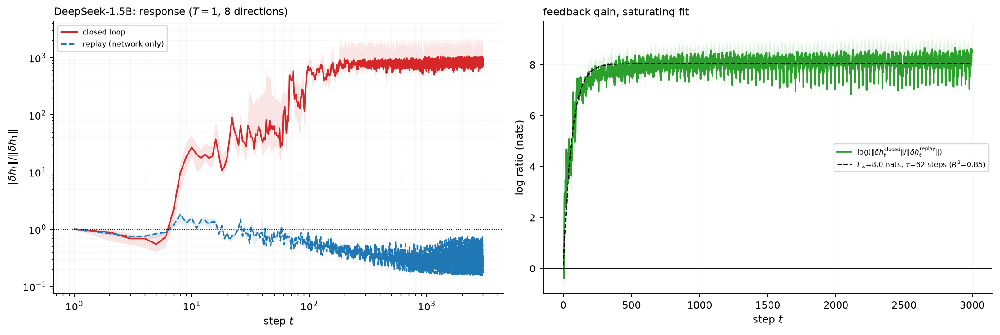

**Fig. F2b — one model in full: DeepSeek-1.5B.** Left: response, closed vs replay, with IQR over directions. Right: the feedback gain $L(t)=\log(a_{\rm closed}/a_{\rm replay})$, computed **per direction** and then summarised (green = median, band = IQR over directions), with the fit $L(t)=L_\infty(1-e^{-t/\tau})$. **Read:** $L$ starts at exactly 0 (both curves are 1 at $t=1$), rises with $\tau\approx56$ steps, and saturates at $L_\infty=7.8$ nats ($\times2400$). **About the fit:** there is no free offset $y_0$ — it is 0 by construction, and allowing it only absorbs the first few points. The estimated parameters are $L_\infty$ (how much) and $\tau$ (how fast); $R^2$ is reported.

*The same figure for every model* — the per-model versions are `pack_loop_<tag>.png` in `update_figures/`: DeepSeek-1.5B (above), Qwen2.5-3B, Qwen3-4B, Qwen3.5-2B, Qwen3.5-9B, Phi-4-mini, DeepSeek-14B, Qwen3-14B, Phi-4, Mamba-130m, Pythia-410m, randQwen. They all have the log-ratio panel now (the earlier missing panels were a directory-matching bug, fixed by pairing each loop with the replay from the *same* directory).

| model | directions | steps | $L_\infty$ (nats) | $\tau$ (steps) | $R^2$ | $\times$ at end |
|---|---|---|---|---|---|---|
| Mamba-130m | 8 | 3000 | 11.3 | 32 | 0.41 | 12 400 |
| DeepSeek-1.5B | 16 | 3000 | 7.8 | 56 | 0.92 | 2 400 |
| DeepSeek-14B | 8 | 1600 | 6.0 | 209 | 0.77 | 220 |
| Qwen3-14B | 8 | 1600 | 6.5 | 228 | 0.77 | 600 |
| Phi-4 | 8 | 1600 | 6.7 | 255 | 0.77 | 530 |
| Phi-4-mini | 8 | 3000 | 5.3 | 60 | 0.69 | 173 |
| Pythia-410m | 8 | 3000 | 6.4 | 357 | 0.48 | 85 |
| Qwen3-4B | 16 | 3000 | 4.8 | 17 | 0.46 | 76 |
| Qwen3.5-9B | 40 | 1600 | 2.4 | 2 | 0.02 | 35 |
| randQwen | 8 | 3000 | 3.8 | 1480 | 1.00 | 13 |
| Qwen2.5-3B | 16 | 3000 | 1.3 | 5 | 0.06 | 15 |
| Qwen3.5-2B | – | – | – | – | – | (fp16 cuDNN failure; fp32 run queued) |

The $R^2$ column matters: for Qwen2.5-3B, Qwen3-4B and Qwen3.5-9B the growth is *not* a clean saturating exponential (they jump in a few steps), so $L_\infty$ and $\tau$ are only indicative there.

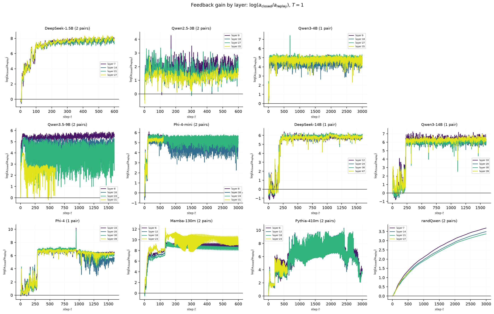

**Fig. F2c — the same gain, layer by layer.** $L(t)$ computed at each saved layer (first, middle, last, plus intermediates). **Read:** for the transformer LLMs the curves **lie on top of each other** — the feedback amplification is *depth-independent*. That is what you expect if the perturbation is re-injected at the input of each step and then carried through the same stack: every layer sees the same injected offset. Mamba, Pythia and the random control are the exceptions (their layers separate). **Consequence for the paper:** the loop instability is a *token-level* effect, not a layer-level one; "where in the stack" is the wrong question for the loop (it is the right question for the prompt perturbation, §B).

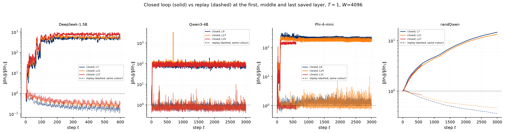

**Fig. F2d — the closed-loop response at the first, middle and last saved layer (the loop analogue of D3b).** Solid = closed loop, dashed = replay, colours = layers, $W=4096$. **Read:** same message as F2c: all layers move together. Qwen3-4B and Phi-4-mini show a brief overshoot at the earliest layer, then collapse onto the common curve.

## F.3 Why it saturates: gates, and what the loop ends up generating

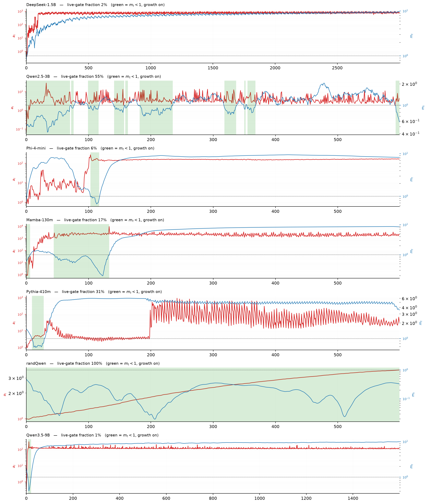

**Fig. F3 — the gate picture (no shading now).** Red, left axis: response $a_t$; blue, right axis: the reference row's top1$-$top2 margin $m_t$ (21-step median), $T=1$. **Read:** growth happens while $m_t\lesssim T$; when the margin rises above $T$ and stays there, the growth stops. DeepSeek-1.5B: rises for ~300 steps, then the margin sits at ≈10 nats and $a_t$ is flat for 2700 steps. Phi-4-mini and Mamba lock in after a single episode. **The random control never locks in** (margin 0.09 nats), which is why it is the only model whose gain keeps growing over the whole 3000 steps. **Important caveat:** the gate state predicts *when growth happens*, but it does not undo growth that already happened — see F3b.

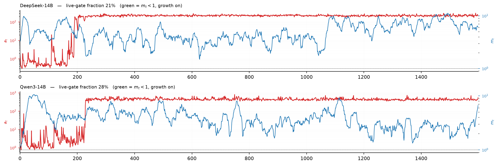

**Fig. F3b — the same at 14B.** **Read:** a single gate episode at $t\approx200$ lifts the response to $\times200$–$350$ and it stays there for the remaining 1400 steps, even though the margin later falls below $T$ many times. So the amplified state is not undone when the gate reopens; the orbit has moved to a different self-consistent trajectory and the perturbation rides at that trajectory's amplitude. I previously called this a "one-shot ratchet"; plain language: **the loop switches to a different regime and stays there.**

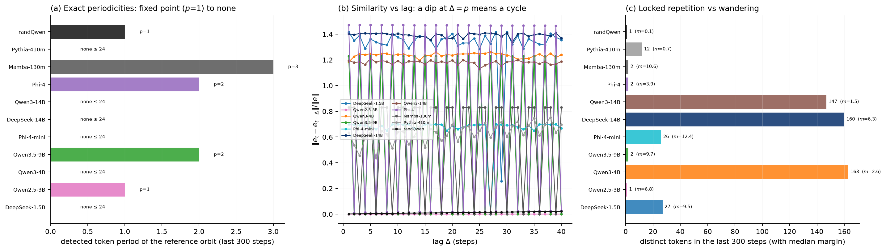

**Fig. F4 — what the loop generates once it saturates.** (a) exact token period of the reference orbit over the last 300 steps ($p=1$ = the same token forever, "none" = no period ≤ 24); (b) $\|e_t-e_{t-\Delta}\|$ vs lag — dips at $\Delta=p$ are cycles; (c) number of distinct tokens in the last 300 steps, with the median margin. **Data:** `top1_ref` and `e_ref` saved by `run_softloop.py`; decoded with each model's tokenizer (`results/loop_repetition_tokens.json`). **Read:**

| model | period | what it repeats (decoded) | distinct tokens |
|---|---|---|---|
| Qwen2.5-3B | 1 (fixed point) | `" propulsion"` ×100 | 1 |
| randQwen | 1 (fixed point) | `"orse"` ×100 | 1 |
| Mamba-130m | 3 | `"\nA\n"` | 2 |
| Phi-4 | 2 | `"acja uw"` | 2 |
| Qwen3.5-9B | 2 | `":\n\n"` | 2 |
| Phi-4-mini | none ≤24 | repeats a 40-token paragraph: *"…The current propulsion systems for interstellar travel are still in development, but they have the potential to revolutionize our understanding of the universe…"* | 26 |
| DeepSeek-1.5B | none ≤24 | re-writes the prompt's instruction: *"…in terms of safety, technological, and other factors. Also, if you can, include a discussion of the potential benefits of each propulsion system…"* | 27 |
| Qwen3-4B | none | **keeps writing coherent text**: *"4. **Communication and Control** — 20-year round-trip to Proxima → no real-time control…"* | 163 |
| DeepSeek-14B | none | coherent-ish markdown summary, mildly degenerate | 160 |
| Qwen3-14B | none | semi-coherent, drifting | 147 |
| Pythia-410m | none | newlines and punctuation | 12 |

**So "the loop saturates because it repeats" is only half true.** Seven of eleven models collapse to a token fixed point or a short cycle ($p\le3$); the others keep producing text (Qwen3-4B even coherent text) while the *gain* still saturates. The saturation is therefore not caused by literal repetition; both are consequences of the orbit landing on a self-consistent trajectory. **If you want one sentence for the paper:** the closed loop is a dissipative system that converges to an attracting orbit (often a token cycle); the perturbation saturates at the size of the offset between the perturbed and reference orbits on that attractor.

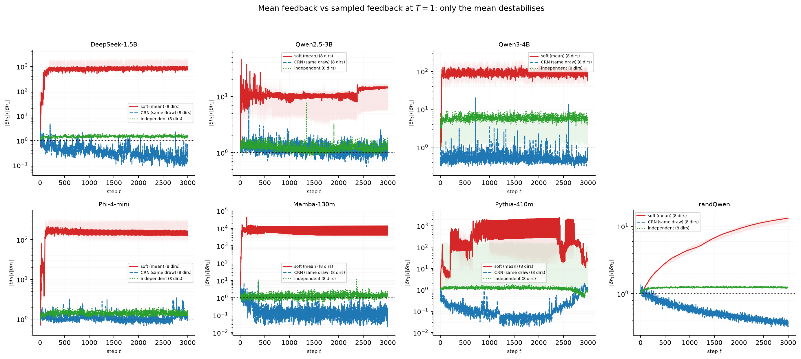

**Fig. F5 — mean feedback vs sampled feedback, 3000 steps.** Soft (mean, red), CRN (same sampled token for every row, blue), independent (green). **Read:** soft grows by $10^1$–$10^4$; CRN stays at or below 1 (0.03–1.3); independent stays within 0.8–6. **Conclusion:** the instability is produced by the *mean* feedback — by feeding the full distribution back — not by the fact that a token is sampled. CRN is the clean control: every row receives the *identical* token stream, so any difference between rows is pure state dynamics, and there is none.

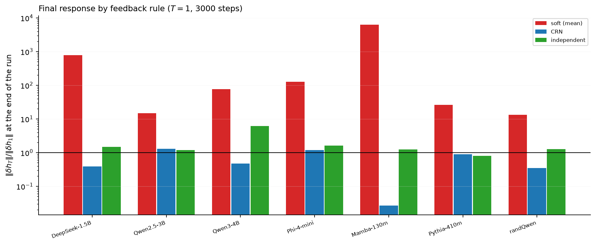

**Fig. F5b — the same as end-of-run bars.** Soft 13–6215×, CRN 0.03–1.3×, independent 0.8–6×. Note that independent sampling does separate rows somewhat (up to $\times6$ for Qwen3-4B) — ordinary sampled generation is not perfectly stable — but it is 2–3 orders of magnitude below the mean-feedback effect.

## F.4 Temperature and window

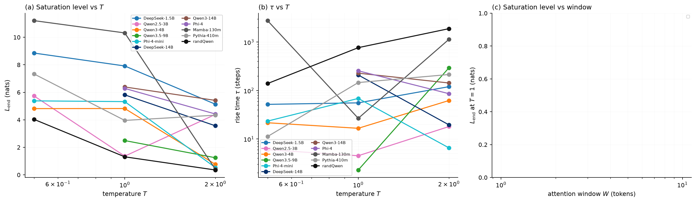

**Fig. F6 — does $L_\infty$ or $\tau$ depend on $T$ or $W$?** (a) $L_\infty$ vs $T$; (b) $\tau$ vs $T$; (c) $L_\infty$ vs attention window $W$ (from the W-sweep runs). **Read:** $L_\infty$ is roughly flat from $T=0.5$ to $1$ for most models but **drops at $T=2$** for several (Phi-4-mini 5.3→0.6, Mamba 11.2→0.4, Qwen3-4B 4.8→1.1, randQwen 4.0→0.35), consistent with the gate strength $\sigma_{\max}\propto1/T$ at fixed margin. $\tau$ is not monotone in $T$. The window dependence is the weakest of the three (the prompt is 63 tokens; $W$ only matters after $t\gtrsim W$).

**Correction to an earlier claim.** The previous version said "any soft feedback gives the same gain; greed does not" (old F21). That was based on a tail statistic at 600 steps for one model. With matched pairs and a proper fit, the picture is: $T\to0$ gives $L=0$ (the loop becomes greedy and equals teacher forcing), and for $T\ge0.5$ the gain is **model-dependent in $T$**, with a clear decline at $T=2$ for about half the models. The DeepSeek-1.5B statement (8.9 / 7.8 / 6.0 nats at $T=0.5/1/2$) survives; the generalisation does not.

