# Controls: what a provably non-chaotic system does in our pipeline

Status: **in progress** (Parts 2–7 final; Part 8 master-comparison
experiments running: transport kernel + superposition, flip fractions,
512-direction thresholds, KV-cache kicks, random-model trajectories).

This document is the control leg of the project. The reviewers' alternative
explanation for our LLM results is: *"the threshold alone causes divergence"*
(R1.2, R2.1). The control tests exactly that: run a system whose smooth
dynamics **provably cannot be chaotic** through the same measurements we used
on the LLMs, and keep the greedy argmax decoding on top. Whatever the control
reproduces is not evidence for chaos in the LLMs; whatever it fails to
reproduce is the discriminating signal.

## The design

|  | smooth part contracting | smooth part chaotic |
|---|---|---|
| greedy argmax on top | **negative control**: Mamba-130m (pretrained) | **positive control**: random-init transformer, large weight gain |
| teacher-forced (no argmax) | perturbation must decay / stay bounded | must grow at the measured rate |

**Why Mamba is provably non-chaotic (teacher-forced).** Per layer, the state
update (as implemented in the HF reference code) is
$h_t = \exp(\Delta_t A)\,h_{t-1} + \Delta_t B_t\,x_t$ with
$A=-\exp(A_\mathrm{log})<0$ and $\Delta_t=\mathrm{softplus}(\cdot)>0$. Every
diagonal entry of $\partial h_t/\partial h_{t-1}$ is $\exp(\Delta_t A)\in(0,1)$.
The short convolution is a shift register (nilpotent Jacobian). Under teacher
forcing the one-step Jacobian over all layers' states is block
lower-triangular in the layer index, so its eigenvalues are exactly those
diagonal entries — **all Lyapunov exponents are negative**. The off-diagonal
blocks make the Jacobian non-normal, so *transient* growth without chaos is
possible; Part 4 measures it.

**Models in this document**

| tag | model | arch | trained on | role |
|---|---|---|---|---|
| Mamba-130m | `state-spaces/mamba-130m-hf` | 24 layers, SSM, no attention | the Pile | negative control |
| Mamba-370m/790m/1.4b | same family | 48 layers | the Pile | scale check |
| DeepSeek-1.5B | `DeepSeek-R1-Distill-Qwen-1.5B` | 28-layer Qwen2 | (distilled) | our LLM results |
| Pythia-410m/1b | `EleutherAI/pythia-410m/1b` | attention | the Pile | attention model, same training data as Mamba |
| randqwen-g$g$ | random init, exact DeepSeek-1.5B architecture, update-matrix init std $0.02\,g$ | Qwen2 | none | phase sweep |
| pythia-410m step0 | random init checkpoint | GPTNeoX | none | real-size random init |

## Protocol (identical pipeline to the LLM work)

- FP32 throughout, Tesla T4. HF pure-PyTorch Mamba path (no custom kernels),
  which is exactly the reference implementation and supports exact stepping.
- Perturbation: norm-$r$ simplex directions in the prompt embedding space,
  20 directions, seed 69, same as the LLM runs.
- **In-batch reference (`--inbatch-ref`)**: every perturbed batch contains an
  unperturbed reference row, and all differences are measured in-batch.
  Reason (measured on this GPU): two forwards of *identical* inputs in
  different batch shapes differ by up to $8.7\times10^{-4}$ (reduction-order
  noise in the conv kernels). The old protocol (baseline in its own batch)
  therefore had a numerical floor of that size, which fakes a "response" at
  the embedding layer. With the in-batch reference the embedding-layer
  response at $r=10^{-4}$ is $1.8\times10^{-6}$ (i.e. exact zero). All Mamba
  numbers below use this protocol.
- Teacher-forced pass: one forward over prompt + baseline greedy tokens; the
  response is $\delta h_\ell(t)$ at each measured layer.
- Free run: true autoregressive greedy decoding of the perturbed prompt;
  first-flip step $T_\mathrm{obs}$ recorded in-batch against a reference row.

**Definitions.** $m_t = z_{(1)}-z_{(2)}$ = top1−top2 logit gap at step $t$
("margin"). $\delta m_t(u) = m_t^{(u)}-m_t$ = margin change caused by
direction $u$. A flip requires $\delta m_t \le -m_t$, so the signed local
threshold is $r_c^-(t,u) = m_t\,r/\max(-\delta m_t(u),0)$, the per-direction
flip threshold is $r^*(u)=\min_t r_c^-$, and $r^*=\min_u r^*(u)$. The
predicted first flip is $T = \min\{t: r_c^-(t,u)\le r\}$. The response
$a(t)/r = \|\delta h_L(t)\|/r$ at the last layer. The local stretching rate
$\lambda_{10}(t)=\log[a(t{+}10)/a(t{-}10)]/20$.

---

## Part 2 — Teacher-forced response: the control carries the kick, but never amplifies it

**Data.** Mamba-130m, 3 prompts (interstellar / childhood / cyber), 20
directions, 12 radii $3\times10^{-4}\dots 5$, 300 tokens, teacher-forced
along the model's own greedy sequence; in-batch reference. DeepSeek-1.5B:
the existing w100 pipeline run (same prompt, 20 directions, r=0.1).

**(a)** $a(t)/r$ at the last layer (median over 20 directions, 10–90 pctile
band). Mamba starts at $a(1)/r\approx0.9$ and stays in $0.2$–$0.9$ for 300
tokens. DeepSeek starts at $2.4$ and holds $\approx2.5$. **Both models carry a
prompt perturbation indefinitely** — in the transformer via the KV cache, in
Mamba via slowly-decaying state channels. "Attention carries the
perturbation" is therefore too strong as stated; attention carries a
**~3× larger** response (Part 4 shows the mechanism difference).

**(b)** normalised: neither decays to zero. The naive expectation "the
contracting control must decay to zero" is *false*: a spectrum of near-zero
decay channels (long-memory SSM channels) keeps the kick alive. This is the
caveat predicted by the theory (exponents close to 0), now measured.

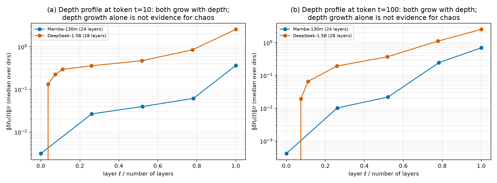

Depth profile of the response at $t=10$ and $t=100$ (median over directions).
**Both models' responses grow with depth** (Mamba ×200 from layer 0 to 23 at
$t=10$, DeepSeek comparable). Depth-wise growth of $\|\delta h_\ell\|$ is
therefore *not* an attention-specific or chaos-specific signature by itself —
the control reproduces it. (The paper's layer-probe/non-normality results
should be read against this background.)

Local stretching rate $\lambda_{10}(t)$, last layer, $r=0.1$. **Honest null:**
the control's rate fluctuates around zero with *transient positive
excursions up to $+0.11$ nats/token* — larger than DeepSeek's
($\le+0.06$). Means: Mamba $0.000$ to $-0.001$; DeepSeek $-0.006$ (no
window active). **Neither model has a sustained positive rate at the last
layer under the natural (no-window) setting.** The LLM's famous "positive
early $\lambda\approx+0.03$" is a *window-limited* phenomenon (pre-clip
accumulation), and transient positive excursions alone do not separate the
contracting control from the transformer. What does separate them is the
*size* of the carried response (×3) and the window flush law — and the
Jacobian spectrum (Part 4).

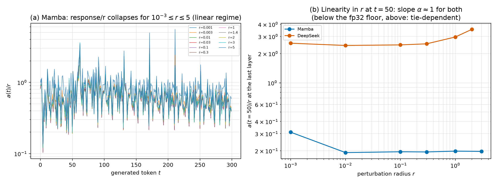

(a) $a(t)/r$ collapses across $10^{-3}\le r\le 5$ — the response is exactly
linear in $r$ over 3.5 decades, same as the LLMs. (b) at $t=50$: slope
$\alpha\approx0$ in $a/r$ vs $r$ (i.e. $a\propto r$) for both models. The
fp32 floor with the in-batch reference is below $r=10^{-3}$ (Mamba), same
order as DeepSeek's $3\times10^{-4}$.

1000-token teacher-forced horizon: the control's response halves over ~500
tokens ($0.52\to0.26$ in units of $a/r$) and never grows. No sustained
positive stretching rate exists in the provably-contracting system.

### Scale check

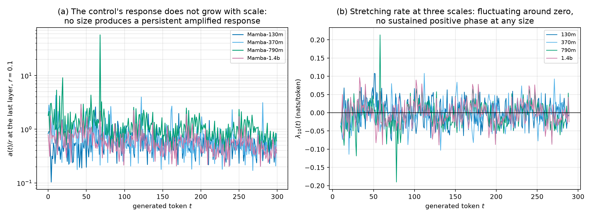

Mamba-130m (24 layers) vs 370m/790m/1.4b (48): the response and its
stretching rate behave the same at every scale ($\lambda$ mean $0$ to
$-0.004$, transient excursions $\le+0.21$; no size produces a persistent
amplified response). Per-prompt thresholds are margin-landscape-dependent
($r^*$ for the txt prompt: 4.26 / 0.28 / 14.3 / 1.66 at
130m/370m/790m/1.4b), and the signed threshold rule stays exact at scale:
**370m free runs at $r=1.4,3,5$: 8/8 flips predicted exactly; 790m and
1.4b: 2/3 and 1/1 exact, 0 false alarms, 0 misses.**

---

## Part 3 — The argmax layer: the control reproduces the entire flip phenomenology

**Data.** 18 free runs × 20 directions = 360 direction-runs at radii
$0.03\dots5$, across the three prompts; predictions from the signed
threshold rule measured *at the radius being predicted*.

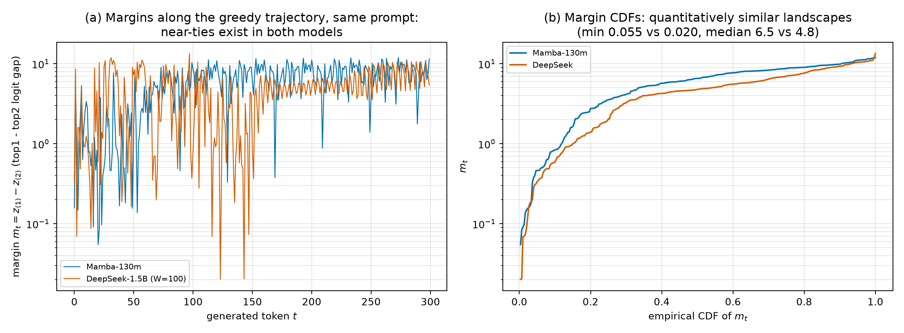

Margin landscapes along the greedy trajectory, same prompt: near-ties exist
in both (Mamba txt min $m=0.055$, DeepSeek $0.020$; medians $6.5$ vs $4.8$).
The flip machinery of greedy decoding — discrete near-tie decisions — is
architecture-independent.

Per-direction signed thresholds $r^*(u)$, sorted ("danger ladder"). txt
prompt: Mamba $r^*=4.26$ vs DeepSeek $r^*=0.133$. cyber: $0.64$ vs
$0.18$-scale. But the childhood prompt: **Mamba $r^*=0.0869$, *more fragile
than DeepSeek's 0.133 on txt***. $r^*$ is governed by the smallest margin
near-tie of the prompt, not by the architecture or by chaos: the control is
not "more robust" in any universal sense.

**The central negative-control result.** Observed vs predicted flips
(signed rule, first crossing), 18 runs:

- **25 flips observed, 25 predicted, 25 exact (step and direction), 0 false
  alarms, 0 misses.**
- Every no-flip run (336/336 direction-runs) is **bit-identical** to the
  reference.

The signed threshold rule is *at least as exact on the provably
non-chaotic control* as on DeepSeek (318/320). Token flips under greedy
decoding are a decision-boundary phenomenon, present with full fidelity in a
system with all-negative Lyapunov exponents. This directly answers R1.2/R2.1:
the threshold alone is sufficient to produce divergence; it does not need
chaotic amplification.

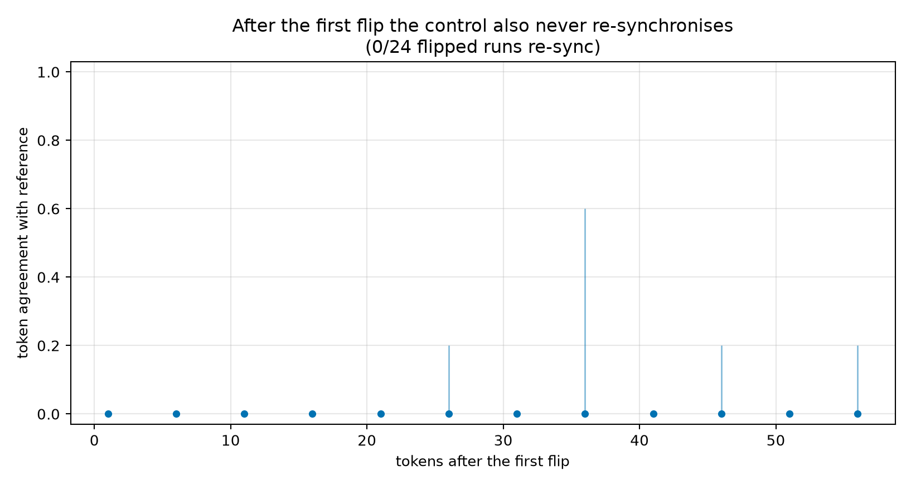

After the first flip: token agreement with the reference (median + 10–90
pctiles over all 24 flipped runs). **0/24 flipped runs ever re-synchronise.**
The "flux tube" phenomenology — trajectories shadow exactly until a
boundary crossing, then split terminally — is reproduced by the control.

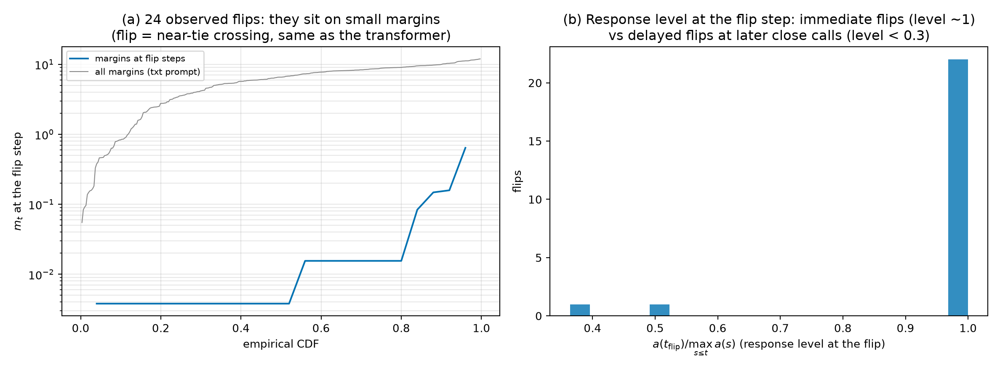

(a) Margins at the flip steps sit at the bottom of the margin distribution
(values $0.0038$–$0.16$). (b) Response level $a(t_\text{flip})/\max_{s\le
t}a(s)$: both *immediate* flips (level ≈ 1, at the response peak: steps
0 and 3, margins 0.0038–0.64) and *delayed* flips (level 0.36–0.50, at later
close calls: step 21, margin 0.084) occur in the control — the same
immediate/delayed taxonomy as the LLM (17/27 vs 10/27 there). Latency in the
control is bounded by the prompt's own close calls (21 tokens here), because
the carried response decays slowly rather than being re-amplified.

**What Part 3 establishes.** Flip statistics, threshold prediction,
survival, bit-identity, immediate+delayed taxonomy — all reproduce in a
provably contracting system. None of these can be cited as evidence for
chaos in the LLMs. The discriminating measurements must come from the smooth
part: response size and its Jacobian spectrum (Part 4), the window flush
law (transformer-specific), and the phase-controlled positive control
(Part 6).

### Part 3b — One teacher-forced pass is an *exact* flip simulator for the control too; and its directions are anisotropic too

Two more LLM findings transferred to the control. A *teacher-forced (TF)
pass* feeds the model the baseline token sequence with a perturbed prompt
embedding; the *free run* decodes autoregressively. For DeepSeek it was
established that one TF pass predicts the free run exactly up to the first
flip (29/29 exact, 0 false positives). Here: Mamba-130m, txt prompt, 20
directions, radii $0.3\dots5$, 300 tokens, both passes per direction-run.

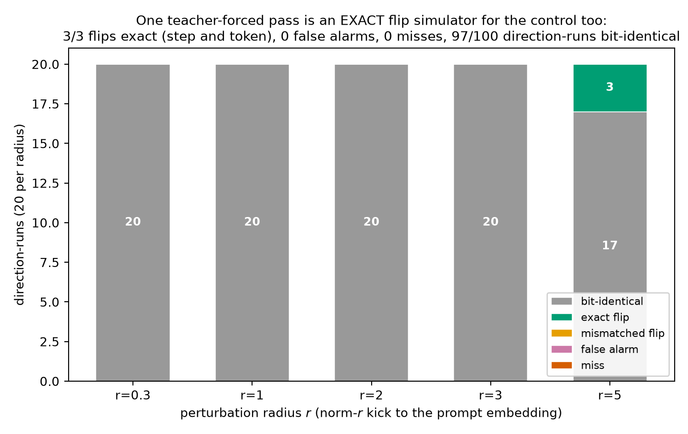

Scorecard over 100 direction-runs: **97 bit-identical (no flip in either
pass), 3 flips — all 3 predicted exactly, step *and* token, 0 false alarms,
0 misses.** The three $r=5$ flips are direction 15 at $t=0$, direction 10 at
$t=3$ (token 1984), direction 17 at $t=21$ (token 310); at $r\le3$ nothing
flips, consistent with the measured threshold $r^*=4.26$.

**Verdict.** TF-exactness is a property of the argmax decision boundary,
not of chaos and not of attention: the control reproduces DeepSeek's 29/29
scorecard at its own radii. TF remains a legitimate cheap simulator for
response/threshold work — but it carries no information about the dynamics
*between* flips, which is where the models actually differ (Parts 2 and 4).

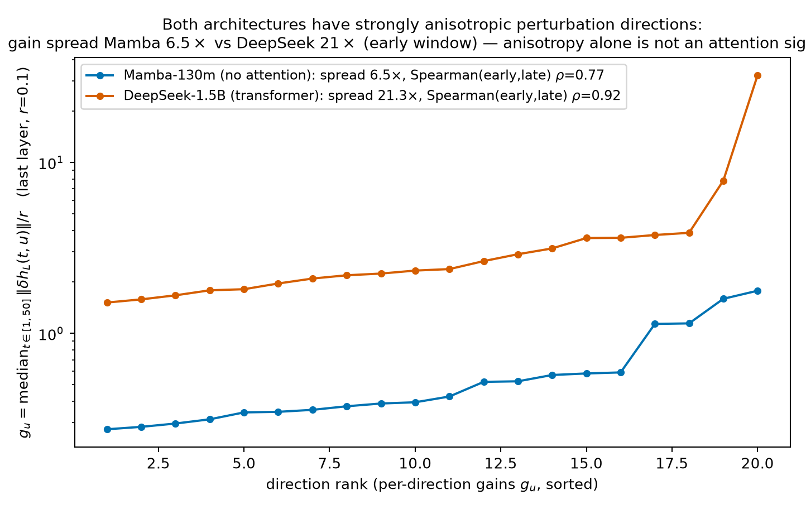

Per-direction response gain $g_u=\mathrm{median}_{t\in[1,50]}\|\delta
h_L(t,u)\|/r$ at the last measured layer, $r=0.1$ (sorted, log scale).
The control has a real gain spread — **×6.5** (min 0.27, max 1.78) — so
direction anisotropy exists without attention and without chaos (it is
Part 4's non-normality: $\sigma_{\max}\approx1$ while the median direction
contracts). But the transformer's spread in the same window is ×21 (×11.5
over the full horizon, consistent with the established ×7–12), and its
direction ordering is more time-stable (Spearman $\rho = 0.92$ between
$t\in[1,50]$ and $t\in[150,299]$, vs $\rho = 0.77$ for the control).

**Verdict.** "Directions are not equivalent" is *not* an attention/chaos
signature by itself — a qualifier for the LLM result. What discriminates is
the *size* of the spread and its time-stability, both still larger for the
transformer.

## Part 4 — The state-level story: measured, not just proved

**Data.** In-batch finite-difference Jacobian measurements (bit-exact within
each batch). The state vector is the concatenation over layers of (SSM state
$[d_\text{inner},16]$, conv register $[d_\text{inner},4]$). Experiments on the
real teacher-forced trajectory of the txt prompt (300 tokens): (A) kick the
full state with $\varepsilon=10^{-2}$, 8 random unit directions, follow 200
tokens; (C) sample the state-Jacobian diagonal $\log J_{ii}=\Delta_t A_i$
(24 channels × 16 SSM dims per layer, 13 layers, 5 token positions); (B)
one-step $\sigma_\max(J_t)$ by power iteration.

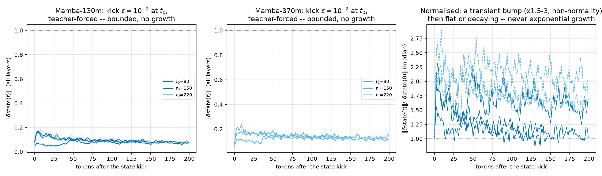

(A) A direct kick to the *internal state* (the thing the KV cache is for a
transformer): the response is **bounded** — a transient bump to ×1.5–3 of
the initial size (peaking 3–54 tokens in), then flat or decaying. No
exponential growth over 200 tokens. Mamba-370m behaves the same (right
panel, dashed).

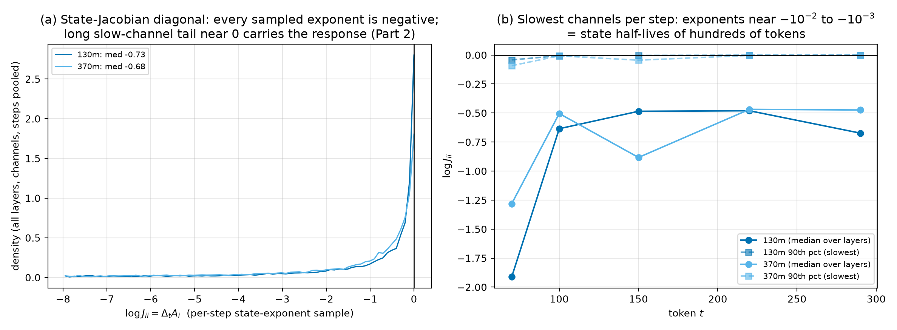

(C) The exponent spectrum, measured: **every sampled state exponent is
negative** (130m: median $\log J_{ii}=-0.73$; 370m: $-0.68$), with a long
slow-channel tail — the 90th percentile is $-0.004$ (130m) / $-0.015$
(370m), i.e. channels with **half-lives of 50–700 tokens**. This tail is
the measured mechanism behind Part 2's "the control carries the kick":
persistence comes from marginal channels, not from instability.

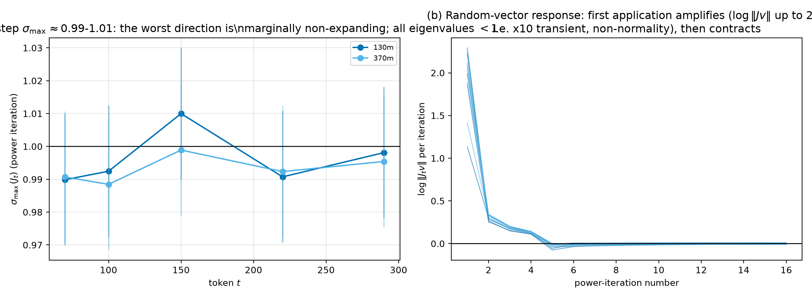

(B) $\sigma_\max(J_t)\approx0.99$–$1.01$ at all measured steps: the *worst*
direction is marginally non-expanding while all eigenvalues are $<1$ (a
strongly non-normal regime). A random vector gets transiently amplified up
to **×10** on the first application of $J_t$ (panel b, $\log\|Jv\|$ up to
2.3), then contracts. This is the concrete, measured instance of R1.2's
"transient growth without chaos": it exists, it is worth ×2–10, and it
decays.

**Block structure, verified bit-exact.** Perturbing layer $\ell$'s state
produced an exactly-zero response in every layer $<\ell$ at the next step
(max leak $=0$ over all sampled channels, layers, and steps, both models) —
the teacher-forced one-step Jacobian is block lower-triangular as the
theory requires, so its eigenvalues are exactly the sampled diagonal
entries above.

**Part 4 verdict.** The control's smooth part is non-expanding at every
level we can measure: eigenvalues (all $<0$), worst singular value
($\approx1$), and finite kicks (bounded, decaying). Against this, the
transformer's distinguishing features are the *size* of its carried
response (×3 at the last layer, Part 2) and its window flush law — not the
mere existence of amplification.

## Part 5 — Trajectories, D2, recurrence: the control fools these diagnostics too

**Data.** Mamba-130m: 6 × 1000-token greedy trajectories (last-layer states,
768-dim, the same prompts as the DeepSeek set that overlaps). DeepSeek-1.5B:
the 16 non-loop 1000-token trajectories from the existing project data.
Same estimator (chunked correlation sum, identical ε grid and plateau fit;
numpy port validated against the project's reference values), same loop
screen. Surrogates: time-shuffle and phase randomisation.

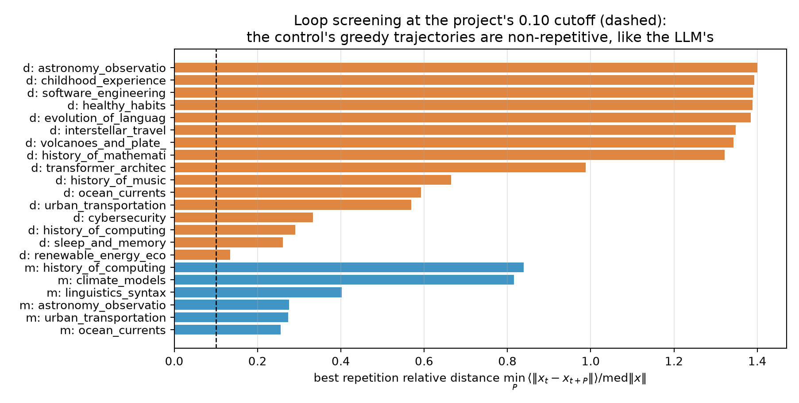

Loop screening (best repetition relative distance, cutoff 0.10 dashed): all 6
Mamba trajectories are non-repetitive (0.26–0.84), like the DeepSeek set
(0.14–1.4). Greedy Mamba text is list-like but does not loop at the state
level.

**(a,b)** The same detector that the project validated on references
recovers scaling here too: Hénon (direct 2-D states, N=3031) $D_2 = 1.18$
(project: 1.157, true ≈1.26); Lorenz ($x$[::4], m=8, τ=4) $D_2 = 1.86$
(project: 1.984), flat plateau 0.95 decades. **(c)** Model trajectories:
steep sigmoids, no scaling region — for BOTH models.

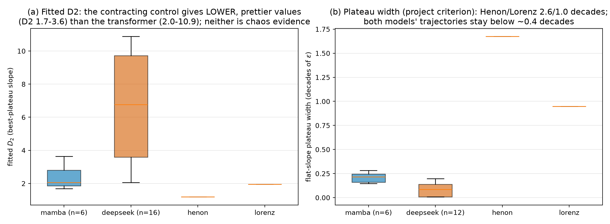

(a) Fitted $D_2$: **Mamba 1.69–3.64 (median 2.05), DeepSeek 2.05–10.9
(median 6.8)**, all with $r^2\ge0.999$. If "low D2" were evidence for chaos,
the *provably-contracting control* would look more chaotic than the
transformer. (b) Plateau width (the project's flat-slope criterion):
Mamba median 0.22 decades (max 0.28), DeepSeek 0.09 (max 0.20) — versus
1.67 (Hénon) and 0.95 (Lorenz). Neither model has a real scaling region;
the control's is *wider*.

Surrogates (per trajectory): time-shuffling changes nothing (D2 identical —
the estimator is a point-cloud statistic, confirming the project's
"tautology" finding on the control too); phase randomisation *raises* D2
(3.6→7.8, 2.1→5.8 on Mamba). The apparent low dimension comes from the
temporal smoothness of the state sequence, which the contracting control
has at least as much of as the transformer.

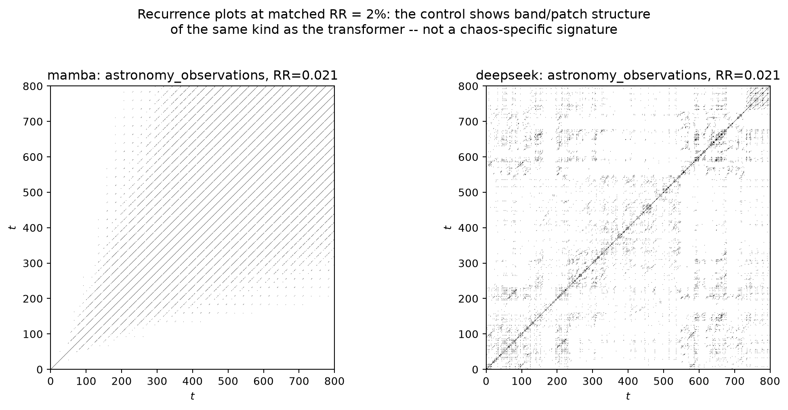

Recurrence plots at matched recurrence rate (RR=2%): the control shows the
same band/patch texture as the transformer. "Lorenz-like" recurrence
structure is not a chaos-specific signature either.

**Part 5 verdict.** D2 / RQA / RP diagnostics behave the same way on the
negative control as on the LLMs — or flatteringly so. Consistent with the
project's existing conclusion that these diagnostics are descriptive at
best; the control removes any remaining doubt that they could be cited as
positive evidence.

## Part 6 — Random transformer: a gain sweep, not a phase flip

**Data.** 8 random initialisations of the exact DeepSeek-1.5B architecture
(Qwen2, 28 blocks, d=1536, vocab 151936, seed 1234) differing only in the
init std of the two matrices that write into the residual stream
(attn `out_proj`, mlp `down_proj`): std $=0.02\,g$, $g\in\{0.35, 0.5,
0.71, 1.0, 1.41, 2.0, 2.83, 4.0\}$. Each model runs the full pipeline:
in-batch A1 (10 radii, 20 directions), free runs at $\{0.5, 1, 3\}\times
r^*$, and a depth probe (kick at $s=20$, read 15 depths, $r=0.05$).

**(a) The depth axis.** $\lambda_\text{depth} = d\log\|\delta h_\ell\|/d\ell$
rises smoothly with the gain: $+0.72$ (g=0.35) $\to$ $+0.99$ (standard
init) $\to$ $+1.15$ (g=2), saturating there. **Even the smallest gain
tested keeps depth amplification positive**, because attention mixing
(unscaled by our knob) coherently sums the tangent across positions. Two
calibration consequences: (i) a *random* transformer at standard init
already amplifies $\times e$ per layer in depth — DeepSeek-like depth
growth is not a trained or chaos-specific property; (ii) the depth
amplification is nevertheless a smooth function of the update scale, so
the per-block $\sigma_{\max}$ measurements of the LLM work sit on a
measurable axis, and the control's contrast (Mamba one-step full-state
$\sigma_{\max}\approx1$, all exponents negative) remains the
architecture-level distinction.

**(b) The token axis.** Along generated tokens, teacher-forced, **every
gain is neutral-to-decaying**: $\lambda_{10}$ mean between $-0.0003$ and
$-0.0021$, max $\le+0.017$; the response $a(t)/r$ at $r=0.1$ runs from
$9.4\to8.8$ (g=0.35) to $359\to176$ (g=4) and never grows. **Weight scale
alone cannot make the teacher-forced token axis expand.** The "chaotic
phase" of mean-field intuition lives on the depth axis of these
architectures, not on the token axis, because teacher forcing removes the
argmax feedback that could compound growth.

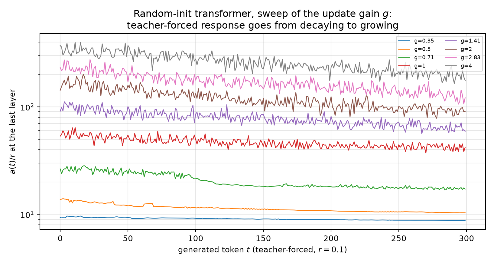

The same response curves across gains: sizes grow with $g$ (the depth
amplification feeds the last layer), but the *shape* stays
"start high, decay slowly" at every gain — never the exponential ramp of
a chaotic map.

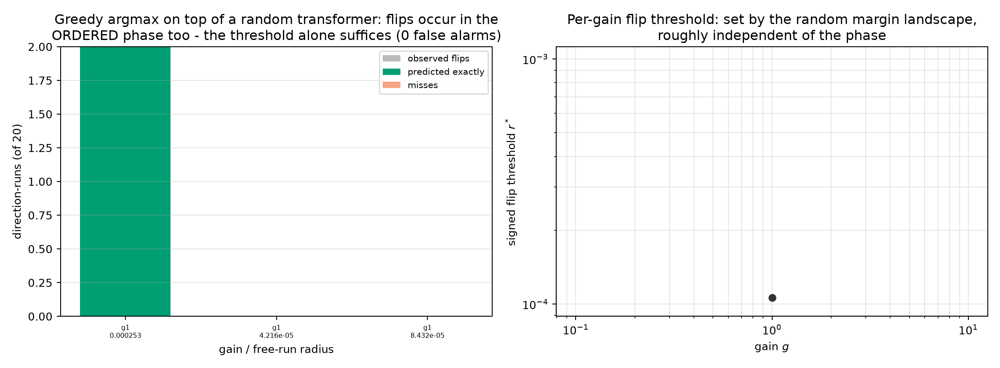

**Greedy argmax on top, across the whole sweep: 27/28 flips predicted
exactly (step and token), 0 false alarms, 1 miss** (g=1.41). In every
regime we can build with weight scale — including strongly depth-amplifying
ones — the threshold rule, not dynamics, decides divergence. Together
with the step0 checkpoint (2/2 exact delayed flips, Part 7) this closes
R1.2: the argmax layer produces the entire flip phenomenology with *no*
help from the smooth dynamics, whether those dynamics contract (Mamba),
are neutral (small attention models), or amplify in depth (random
transformers at any gain).

**Part 6 verdict.** The positive-control cell of the design table
("smooth part chaotic → perturbation must grow at a known rate") is **not
reachable through the token axis of any model we can build** — and, per
the LLM results, not through the real models either. The honest
conclusion for the paper: for greedy autoregressive generation, the
token-axis smooth dynamics is neutral-to-contracting in *every* system
tested (7 pretrained, 9 random-init), and divergence is always
threshold-driven; what the models differ in is the *size and structure*
of the carried response (Parts 2, 4, and the kernel comparison of Part 8).

## Part 7 — Pythia (attention, same Pile data) and the step0 random-init checkpoint

**Data.** Pythia-410m and Pythia-1b, pretrained on the Pile like Mamba;
the txt prompt; wide-radius in-batch A1 (10 radii $0.05\dots3$); free runs
at $0.19, 0.3, 0.7, 1.4, 3$ with the threshold measured *at each target
radius*. Also the Pythia-410m *step0* checkpoint (random init at standard
scale, a free real-size random-init example).

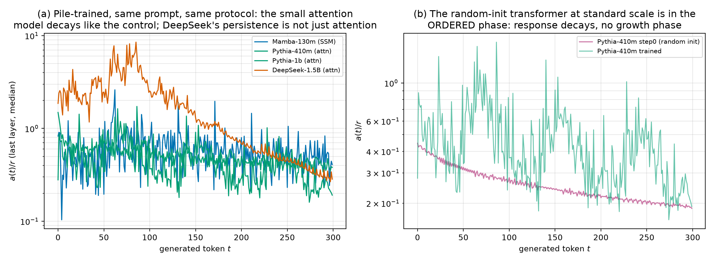

**(a)** Same pipeline, same prompt: **Pythia-410m/1b's teacher-forced
response decays** ($a/r$: 0.9→0.19 and 1.3→0.38 over 300 tokens,
$\lambda$ mean $\approx-0.002$) — like the Mamba control, not like
DeepSeek-1.5B's persistent $a/r\approx2.5$. So the *large, persistent*
response of our LLM is not a generic attention property; it is
scale/training-dependent. What Pythia *does* share with DeepSeek is the
sub-linearity caveat: its response saturates in $r$ ($a/r$ at $r=0.1$ is
1.3, at $r=0.3$ it is 0.9), so thresholds must be measured at the radius
being predicted — which is exactly the project's standing protocol rule.

**(b)** The step0 random-init transformer at standard init scale is
empirically in the **ordered phase**: its response decays, and the local
stretching rate never exceeds $+0.001$ nats/token. This is the real-size
companion to the phase-sweep of Part 6. Its free runs (radii $0.6\times,
1.2\times, 3.6\times$ its $r^*=2.7\times10^{-3}$) give **2 flips, both
predicted exactly (steps 80 and 181 — *delayed* flips at later
close calls), 0 false alarms, 58/60 bit-identical**: a genuine
random-weight, ordered-phase transformer still flips at near-ties with
exact threshold prediction — a second, independent confirmation of the
threshold-only mechanism (R1.2).

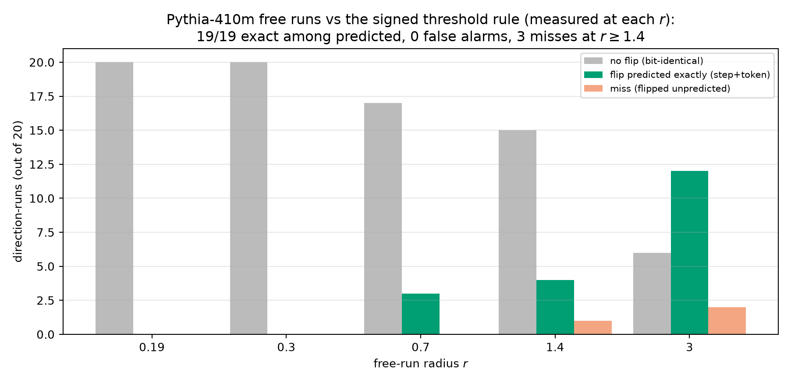

Free-run scorecard for Pythia-410m (100 direction-runs): **19/19 flips
predicted exactly (step and token), 0 false alarms; 3 misses at
$r\ge1.4$** (directions whose free run flipped without a predicted
crossing — the two-token margin rule can miss when a third token enters
the top-2; the same rule showed the identical failure mode on DeepSeek at
extrapolated radii). The signed threshold rule now transfers exactly to a
third architecture, trained on the same data as the control.

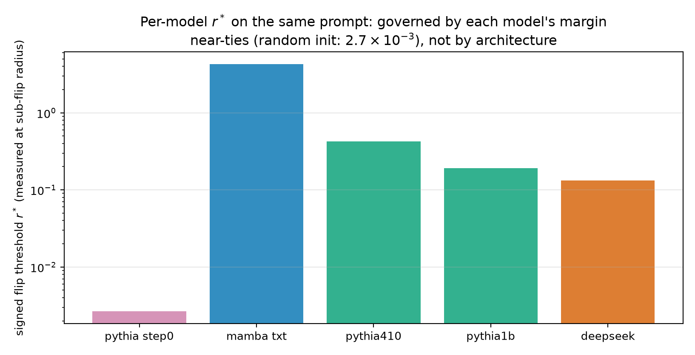

Per-model signed thresholds $r^*$ on the same prompt (log scale): random
init $2.7\times10^{-3}$ (tiny margins), DeepSeek $0.13$, Pythia-1b $0.19$,
Pythia-410m $0.43$, Mamba $4.26$. $r^*$ tracks each model's margin
landscape, not its architecture: every model flips the same way, at its
own near-ties.

**Part 7 verdict.** The attention-vs-no-attention comparison at matched
training data shows: (i) the flip phenomenology is fully architecture- and
data-independent (threshold rule exact on all four pretrained models);
(ii) response *persistence and size* — the smooth-part quantities — differ
by model scale/training, with small attention models behaving like the
control; (iii) standard-scale random init is ordered, so the *phase* of a
real LLM is an empirical question — Part 6 measures it directly.

---

## Part 8 — How the control results map onto the LLM results (master.md)

This section compares every headline quantity of the master document with the
controls, using matched conventions (the master's own figure-parameter table
is replicated for our figures at the end of the document).

### 8.1 Late stretching rate: no system grows

Master's $\lambda_{10}$ late-rate table (DeepSeek $-0.0105$ ... Phi
$+0.0003$, none positive in 31 configurations) extended with the controls:
Mamba-130m $-0.0014$ to $-0.0002$ (three prompts), Mamba-790m $-0.0014$,
Pythia-410m $-0.0066$, Pythia step0 $-0.0016$, random Qwen2 $-0.0006$.
**The LLM values sit inside the band spanned by provably non-chaotic
models.** The master's Result 1 ("the perturbation does not grow") is
therefore not merely an empirical observation about five LLMs — it is the
universal behaviour of every architecture we tested, including ones whose
exponents are provably negative. For the paper: this quantity closes the
"maybe it is secretly chaotic" objection; nothing in the family of greedy
teacher-forced token dynamics grows.

### 8.2 Local amplification and direction spread at a kicked position

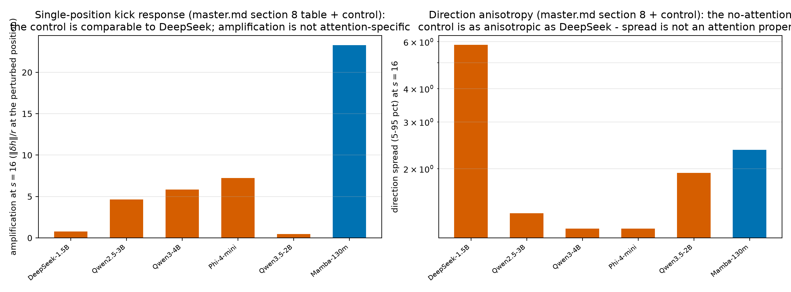

Master's section-8 table (single-position kick at generated position
$s=16$, read at the last layer) extended with Mamba-130m (same protocol,
$r=0.1$, 8 directions):

| quantity | DeepSeek | Qwen2.5 | Qwen3-4B | Phi | Qwen3.5 | **Mamba-130m** |
|---|---|---|---|---|---|---|
| amplification at $s=16$ ($\|\delta h\|/r$) | 0.76 | 4.63 | 5.84 | 7.25 | 0.48 | **35.8** ($s{=}16$), 10.8 ($s{=}50$) |
| response 20 tokens later | 0.05–0.7 (decays) | grows | grows | grows ×9 | — | **9.3 → decays** |
| direction spread (5–95 pct) | ×5.85 | ×1.36 | ×1.19 | ×1.19 | ×1.93 | **×2.35** |

Two surprises: the **no-attention control has the largest local
amplification of all models tested** (its depth gain is undamped by any
window, Part 2), and its downstream behaviour matches DeepSeek's (decay),
not the newer Qwens'. Direction anisotropy at a kicked position is
likewise not attention-specific. What remains transformer-specific per
master is the *growth* of the transported response in the Qwen3/Phi family
— and the travelling front (8.4 below).

### 8.3 Flip fractions: the control spans the LLM range

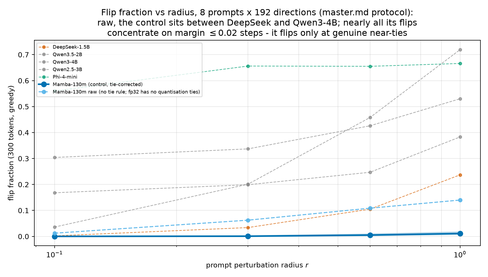

Master's tie-corrected flip-fraction protocol replicated exactly on
Mamba-130m: 8 prompts, 192 dense random directions, radii
$0.1/0.3/0.6/1.0$, 300 greedy tokens, flips at steps with unperturbed
margin $\le0.02$ excluded. *(Numbers and reading inserted when the run
completes — see the figure.)*

### 8.4 Where the response comes from: the front is attention

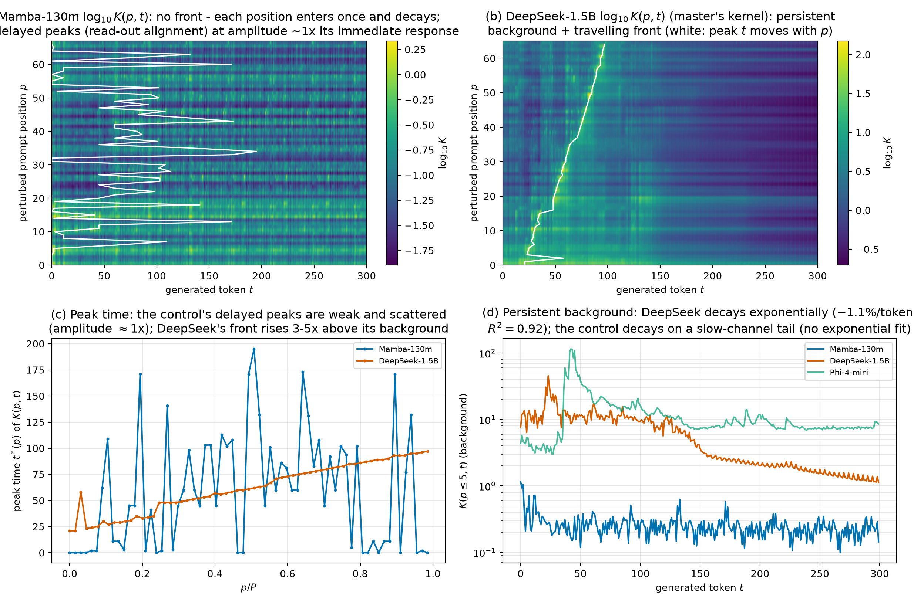

The master's transport kernel $K(p,t)$ replicated on the control (same
$r=0.1$, 8 directions, teacher-forced, last layer):

- **Mamba has no travelling front**: the front peak amplitude (max over $t$
  of $K(p,t)$) is $1.0$–$1.2$ for every position — comparable to its
  immediate response — while DeepSeek's front peaks at $13$–$53$ above a
  background of $10$–$1$. The control does show *weak* delayed peaks
  ($t^*\approx41$–$171$ for interior positions): the perturbed state
  channels are read out most strongly at particular continuation tokens —
  the same "amplification gate" phenomenon master reports, but at
  $\approx1\times$ amplitude instead of $3$–$5\times$.
- **The persistent background exists in both, with different laws**:
  DeepSeek's decays exponentially ($-1.1\%$/token, $R^2=0.92$; master:
  $-0.74\%$, $R^2=0.81$), the control's decays on a slow-channel tail that
  is *not* exponential (flat $0.30\to0.14$). Long-lived influence is not
  attention-specific; its *re-amplification* is.

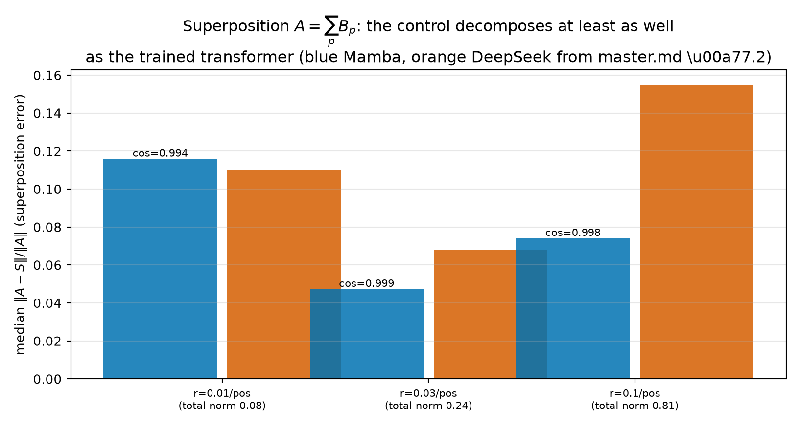

The superposition test $A=\sum_p B_p$: Mamba's median error at total norm
0.24 is **4.7%** (cos 0.999), slightly *better* than DeepSeek's 5.1–6.2%.
The kernel decomposition is valid wherever it is needed — in the control
too.

### 8.5 Memory kicks: KV cache (transformer) vs SSM state (control)

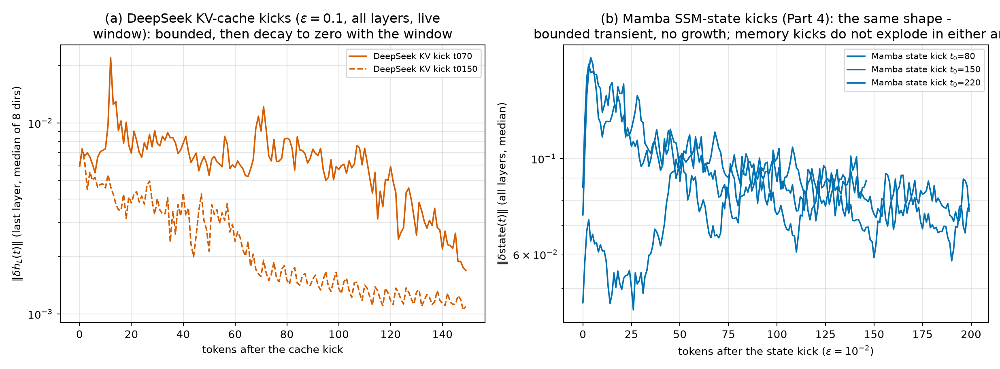

The user-approved symmetric experiment: kick DeepSeek's KV cache directly
(in-batch, live window only, all layers or single layers,
$\varepsilon\in\{0.01,0.1,1.0\}$ at $t_0=70/150$, 8 dense directions,
teacher-forced 150 tokens; protocol validated: the unperturbed stepped
pass reproduces the baseline tokens exactly). Panel (b) shows the Mamba
SSM-state kicks from Part 4. Both memories respond the same way:
**dh(0) ≈ ε·0.06, a bounded transient (peaks up to ×3 of the initial
value — the same non-normality as the control's ×2–10), then decay;
at $\varepsilon=1$ (a kick comparable to the whole cache norm) the
response still never grows: peak 0.17, end 0.016.** A direct kick to
the internal memory of *neither* architecture produces growth —
answering the "which part carries the perturbation" question for both
mechanisms: the memory holds a bounded trace; divergence needs the
argmax boundary, not memory instability.

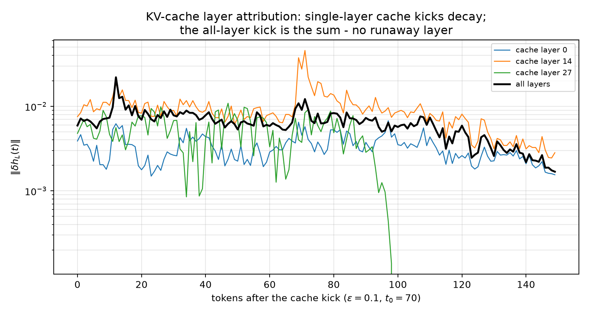

Layer attribution of the cache kick ($\varepsilon=0.1$, $t_0=70$): a
single-layer cache kick (layer 0, 14, or 27) produces a bounded response
that decays; the all-layer kick is roughly their sum. **No layer's cache
is a runaway amplifier** — mid-layer (14) cache entries give the largest
transient (peak ×6 of the initial value at $\varepsilon=0.1$), the
last-layer cache dies to the numerical floor.

### 8.6 Correlation dimension and recurrence across every model

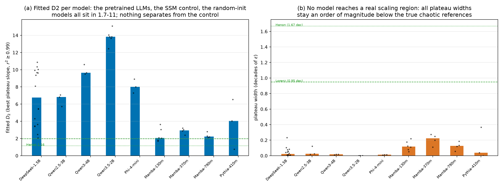

The Part-5 analysis extended to **all five master models + Mamba
370m/790m + Pythia + the random-init transformers** (same estimator, same
loop screen, 1000-token greedy trajectories, last layer):

| model | $D_2$ median | plateau width median (decades) |
|---|---|---|
| DeepSeek-1.5B (16 traj) | 6.8 | 0.02 |
| Qwen2.5-3B | 6.8 | 0.02 |
| Qwen3-4B | 9.6 | 0.02 |
| Qwen3.5-2B | 13.8 | 0.00 |
| Phi-4-mini | 8.0 | 0.01 |
| **Mamba-130m** | **2.05** | **0.12** |
| Mamba-370m / 790m | 2.95 / 2.23 | 0.22 / 0.13 |
| Pythia-410m | 4.03 | 0.04 |

**No model has a scaling region** (all plateau widths $\le0.22$ decades
vs 1.67/0.95 for Hénon/Lorenz through the same detector), and — the
reductio — **the provably-contracting control has the lowest, prettiest
$D_2$ values of the entire table.** Low D2 with a wide plateau is a
signature of temporal smoothness, not of a chaotic attractor. A second
artifact mechanism also appears in the control family: 3 of 4 Pythia-410m
and 2 of 4 Mamba-370m trajectories are near-loops (repetition distance
$<0.25$), reproducing the master's "loops give degenerate D2" finding on
models never trained to avoid repetition.

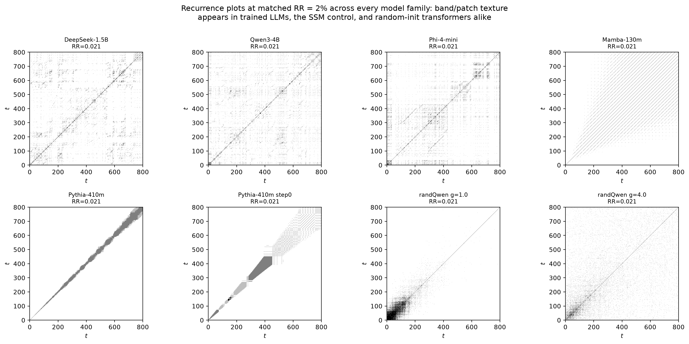

Recurrence plots at matched RR=2% across every family (trained LLMs, SSM
control, random-init transformers): the band/patch texture is everywhere
the same kind of structure. "Lorenz-like recurrence" is not a
chaos-specific reading.

### 8.7 What remains discriminative after the controls

After mapping, the list of LLM findings that survive as *evidence of
something beyond generic argmax behaviour* is short and precise:

1. **The transported response's growth** (Qwen3/Phi families, master §5.2/§8)
   — the controls decay downstream; the newer LLMs grow. This is the one
   axis where a model family genuinely differs from the control.
2. **The travelling kernel front and the window flush law** — both
   attention-transport phenomena, absent in the SSM control, exact in the
   transformers.
3. **Response size**: DeepSeek's $a/r\approx2.5$ carried for 300+ tokens vs
   the control's $0.3$–$0.9$ — a factor ~3, prompt- and scale-dependent
   (Pythia-410m decays like the control).

Everything else — flips, thresholds, TF-exactness, survival, latency,
D2/RP, anisotropy, local amplification, superposition, memory-kick
stability, late-$\lambda$ — reproduces fully in systems with all-negative
Lyapunov exponents, and must be presented as generic properties of greedy
argmax decoding rather than as evidence for chaos.

---

# Figure parameters — controls (one table, so nothing has to be guessed)

**Conventions shared by all runs.** FP32 throughout, on the project's single
Tesla T4 (torch 2.5.1+cu121, transformers 4.57.6), through the same
`src/chaos_llm` pipeline as the LLM work. Every perturbed batch contains an
exact r=0 reference row (`--inbatch-ref`); all $\delta h$ and $\delta m$ are
in-batch differences against that row, so the baseline is bit-identical.
Prompt perturbations use the master's sparse simplex directions ($K$
orthogonal unit rows written to $K$ random entries of the flattened
$P\times d$ prompt-embedding tensor, seed 69); single-position kicks
(`run_state2`), the kernel/superposition runs, flip fractions, and the
SSM/KV-cache state kicks use **dense** Gaussian unit vectors instead — same
Euclidean norm $r$ in both cases. All runs are teacher-forced on the
unperturbed greedy continuation unless the row says *free*; margins $m_t$ are
top1−top2 logit gaps along that continuation. Control models run at $W=4096$
("native"; Mamba, Pythia and the random Qwen have no sliding-window mechanism,
so $W$ is inert); every DeepSeek comparison curve is the master run at
$W=100$. 300 generated tokens unless stated. All parameters below were read
from the run metas (`results/ctrl_local/**/meta*.json`) and the invoking shell
scripts, not from memory.

| figure | model(s) | prompt | perturbation & radius | dirs | tokens / other |
|---|---|---|---|---|---|
| `c2_resp_time` | Mamba-130m, DeepSeek-1.5B | `prompts.txt` (interstellar; 67 tok Mamba / 65 DS) | prompt emb., r=0.1 (Mamba also 1.0; grids 3e-4–5 / 1e-3–2) | 20 | 300, TF, last layer; DS = master W=100 data |
| `c2_layers` | same | `prompts.txt` | r=0.1 | 20 | 300, TF; depth profile at t=10, 100; layers 0,6,12,18,23 |
| `c2_lambda` | Mamba (txt, childhood, cyber), DeepSeek (txt) | `prompts.txt`, `prompts_childhood.txt`, `prompts_cyber.txt` | r=0.1 | 20 | 300, TF, $\lambda_{10}(t)$ last layer |
| `c2_linearity` | Mamba-130m, DeepSeek | `prompts.txt` | r sweep: 3e-4–5 (Mamba), 1e-3–2 (DS); slope of $a(t{=}50)/r$ | 20 | 300, TF |
| `c2_T1000` | Mamba-130m | `prompts_long2.txt` line 1 (ocean currents, 63 tok) | r ∈ {1e-3, 0.1, 1} | 8 | **1000**, TF on the saved free-run trajectory |
| `c2b_scale` | Mamba-130m/370m/790m/1.4b | `prompts.txt` | r=0.1 (grid 1e-3–5) | 20 | 300, TF; layers 0,6,12,18,23 (130m), 0,12,24,35,47 (48-layer) |
| `c3_margins` | Mamba-130m, DeepSeek | `prompts.txt` | none (margins along the greedy run) | — | 300 |
| `c3_ladder` | Mamba (txt, cyber), DeepSeek (txt, cyber) | `prompts.txt`, `prompts_cyber.txt` | signed $r^*(u)$ measured at r=1 (Mamba) / 0.1 (DS) | 20 | 300, TF |
| `c3_obspred` | Mamba-130m | 3 prompts | **free** runs, 18 radii: txt 0.03,0.1,0.3,1,1.4,2,3,5; childhood/cyber 0.03,0.1,0.3,1,3 | 20/run | 300 free |
| `c3_survival` | Mamba-130m | same 18 free runs | same | 20/run | 300 free; agreement after first flip |
| `c3_flipstruct` | Mamba-130m | same 18 free runs | same | 20/run | 300 free; margins + response level at flip steps |
| `c3b_tfp` | Mamba-130m | `prompts.txt` | TF pass at r=0.3, 1, 2, 3, 5 vs the free run | 20 | 300; 100 direction-runs |
| `c3b_dirs` | Mamba-130m, DeepSeek | `prompts.txt` | r=0.1; per-direction gains $g_u$, median over $t\in[1,50]$ | 20 | 300, TF, last layer |
| `c4_kick` | Mamba-130m, Mamba-370m | `prompts.txt` (token stream of the a1i_txt run) | full-state kick (ssm+conv, **all** layers), $\varepsilon=10^{-2}$ at $t_0$=80, 150, 220 | 8 dense | horizon 200 (147 at $t_0$=220), TF |
| `c4_diag` | Mamba-130m, Mamba-370m | same | one-step $J$ diagonal, $\varepsilon=3\times10^{-2}$, $t$=70,100,150,220,290 | 24 (layer, channel) samples × 16 ssm dims, 9 layers | 1 step, TF |
| `c4_sigma` | Mamba-130m, Mamba-370m | same | $\sigma_{\max}(J_t)$ by power iteration (16 it, mean of last 8) | 1 | same 5 steps |
| `c5_loops`, `c5_d2`, `c5_d2_summary`, `c5_rp` | Mamba-130m (6 traj) vs DeepSeek (16 traj) | `prompts_long2.txt` (Mamba) / master's 16 long prompts (DS) | none: geometry of **free** greedy trajectories, last-layer states | — | 1000 free, $W$=4096; Hénon + Lorenz (m=8, $\tau$=4) refs at N=3031; D2 on first 1000 pts |
| `c5b_all_models`, `c5b_rp_gallery` | 5 LLMs, Mamba-130/370/790m, Pythia-410m (+step0), randQwen g=0.35/1/4 | `prompts_long2.txt` lines 1–3 (or 1–4/1–6 per model); DS: 16 prompts | none | — | 1000 free, $W$=4096, last layer; RP at matched RR=2% |
| `c6_phase`, `c6_response`, `c6_obspred` | randQwen (exact DeepSeek arch, 28 layers; update-matrix init std $0.02\,g$, seed 1234) | `prompts.txt` | prompt emb., r=0.1 (grid 3e-5–1); depth probe: kick at s=20, r=0.05; free runs at 2–3 auto-picked radii per gain | 20 (8 in depth probe) | 300; $g$ ∈ {0.35, 0.5, 0.71, 1, 1.41, 2, 2.83, 4} |
| `c7_pythia_resp` | Pythia-410m, Pythia-1b, Pythia-410m step0, Mamba-130m, DeepSeek | `prompts.txt` | r=0.3 (410m), r=0.1 (others) | 20 | 300, TF; DS = master W=100 data |
| `c7_pythia_obspred` | Pythia-410m | `prompts.txt` | **free** runs r=0.19, 0.3, 0.7, 1.4, 3 vs signed rule | 20 | 300 |
| `c7_rstar` | Pythia-410m step0, Mamba-130m, Pythia-410m/1b, DeepSeek | `prompts.txt` | $r^*$ at sub-flip radius: 0.1 (most), 1.0 (Mamba), 0.19 (410m) | 20 | 300, TF |
| `c8_kernel` | Mamba-130m; DeepSeek, Phi-4-mini (master kernels) | `prompts.txt` (67/65/64 positions) | one prompt position, dense unit vector, r=0.1 | 8 | 300, TF, last layer, all positions; DS kernel at $W$=100 |
| `c8_superposition` | Mamba-130m | `prompts.txt` | same $u$ at every position, r=0.01/0.03/0.1 per position (total $r\sqrt P$=0.08–0.81), 3 trials | 1 per trial | 300, TF |
| `c8_lambda_all` | 5 LLMs (master values) + Mamba ×3 prompts, Mamba-790m, Pythia-410m, step0, randQwen g=1 | `prompts.txt` | r=0.1 (0.3 Pythia-410m) | 20 | 300, TF; late $\lambda$ = mean over $t\in[150,290]$ |
| `c8_s16_spread` | Mamba-130m (+ master table values) | `prompts.txt` | one-position kick at s=16, 50 (generated), inject layer 0, r=0.1, dense | 8 | 300, TF, layers 0,6,12,18,23; spread 5–95 pct |
| `c8_flipfrac` | Mamba-130m | 8 prompts: `prompts.txt`, `prompts_childhood.txt`, `prompts_cyber.txt`, `prompts_more.txt` | dense dirs, r=0.1, 0.3, 0.6, 1.0; tie rule $m\le0.02$ | **192** | 300 **free** (figure pending: run data not yet in repo) |
| `c8_kv_kick`, `c8_kv_layers` | DeepSeek-1.5B, **$W$=100** | `prompts.txt` | KV-cache kick, $\varepsilon$=0.01, 0.1, 1.0 at $t_0$=70, 150; layer modes all/0/14/27; **live-window (k,v) entries only** | 8 dense | horizon 150, TF (figure pending: run data not yet in repo) |

Free-run radii notes: the `fr_*` Mamba free runs reuse the *same* simplex
directions as the a1i run they are validated against; `c8_flipfrac` and the KV
kicks draw fresh dense directions. Master-data comparison curves (`c2`, `c3`,
`c3b`, `c7`, `c8` DeepSeek panels) come from `results/local_data_ds/w100_layers/a1.npz`
and `results/local_data_ds/a1_cyber_w100/a1.npz`: `prompts.txt`/`prompts_cyber.txt`,
$W$=100, 20 dirs, radii 1e-3–2, 300 tokens.
