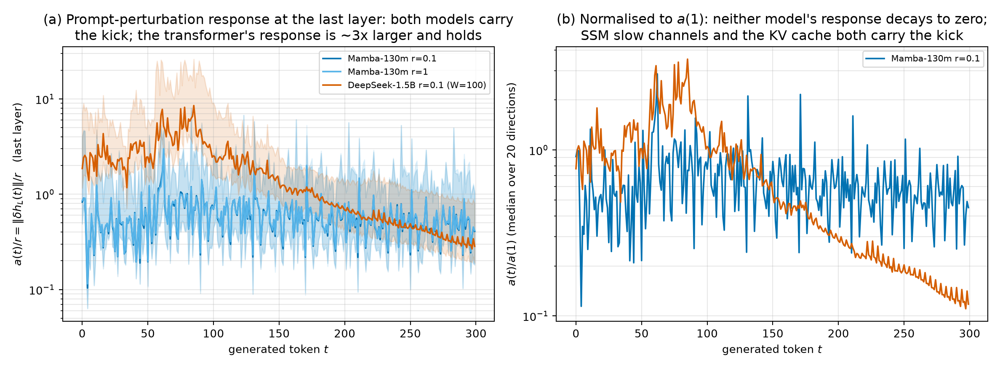
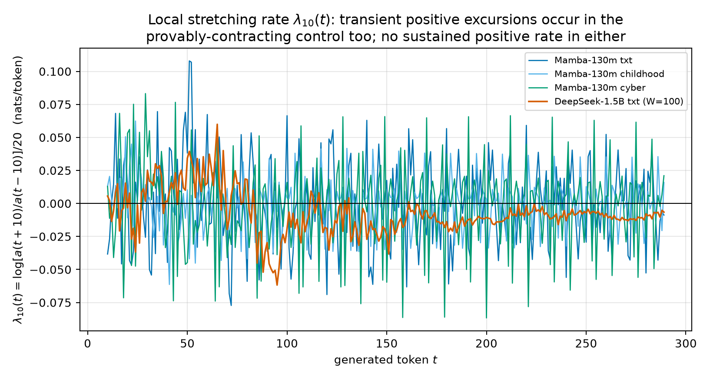
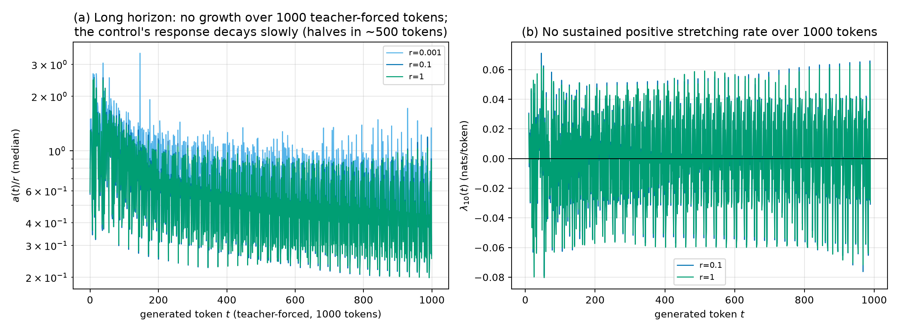
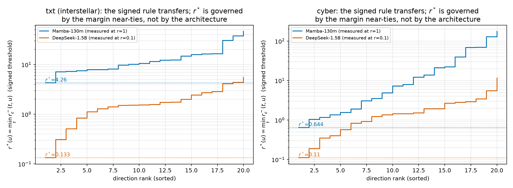
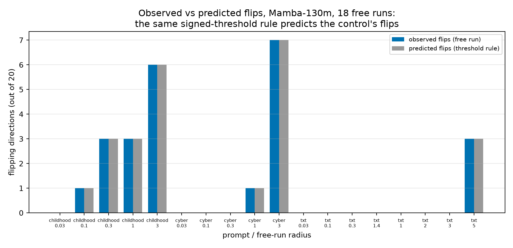
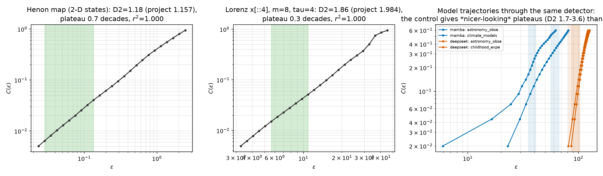

# Controls: what a provably non-chaotic system does in our pipeline

Status: **in progress** (Parts 2–3 measured and final; Parts 4–7 queued on the GPU).

This document is the control leg of the project. The reviewers' alternative
explanation for our LLM results is: *"the threshold alone causes divergence"*
(R1.2, R2.1). The control tests exactly that: run a system whose smooth
dynamics **provably cannot be chaotic** through the same measurements we used
on the LLMs, and keep the greedy argmax decoding on top. Whatever the control
reproduces is not evidence for chaos in the LLMs; whatever it fails to
reproduce is the discriminating signal.

## The design

|  | smooth part contracting | smooth part chaotic |
|---|---|---|
| greedy argmax on top | **negative control**: Mamba-130m (pretrained) | **positive control**: random-init transformer, large weight gain |
| teacher-forced (no argmax) | perturbation must decay / stay bounded | must grow at the measured rate |

**Why Mamba is provably non-chaotic (teacher-forced).** Per layer, the state
update (as implemented in the HF reference code) is
$h_t = \exp(\Delta_t A)\,h_{t-1} + \Delta_t B_t\,x_t$ with
$A=-\exp(A_\mathrm{log})<0$ and $\Delta_t=\mathrm{softplus}(\cdot)>0$. Every
diagonal entry of $\partial h_t/\partial h_{t-1}$ is $\exp(\Delta_t A)\in(0,1)$.
The short convolution is a shift register (nilpotent Jacobian). Under teacher
forcing the one-step Jacobian over all layers' states is block
lower-triangular in the layer index, so its eigenvalues are exactly those
diagonal entries — **all Lyapunov exponents are negative**. The off-diagonal
blocks make the Jacobian non-normal, so *transient* growth without chaos is
possible; Part 4 measures it.

**Models in this document**

| tag | model | arch | trained on | role |
|---|---|---|---|---|
| Mamba-130m | `state-spaces/mamba-130m-hf` | 24 layers, SSM, no attention | the Pile | negative control |
| Mamba-370m/790m/1.4b | same family | 48 layers | the Pile | scale check |
| DeepSeek-1.5B | `DeepSeek-R1-Distill-Qwen-1.5B` | 28-layer Qwen2 | (distilled) | our LLM results |
| Pythia-410m/1b | `EleutherAI/pythia-410m/1b` | attention | the Pile | attention model, same training data as Mamba |
| randqwen-g$g$ | random init, exact DeepSeek-1.5B architecture, update-matrix init std $0.02\,g$ | Qwen2 | none | phase sweep |
| pythia-410m step0 | random init checkpoint | GPTNeoX | none | real-size random init |

## Protocol (identical pipeline to the LLM work)

- FP32 throughout, Tesla T4. HF pure-PyTorch Mamba path (no custom kernels),
  which is exactly the reference implementation and supports exact stepping.
- Perturbation: norm-$r$ simplex directions in the prompt embedding space,
  20 directions, seed 69, same as the LLM runs.
- **In-batch reference (`--inbatch-ref`)**: every perturbed batch contains an
  unperturbed reference row, and all differences are measured in-batch.
  Reason (measured on this GPU): two forwards of *identical* inputs in
  different batch shapes differ by up to $8.7\times10^{-4}$ (reduction-order
  noise in the conv kernels). The old protocol (baseline in its own batch)
  therefore had a numerical floor of that size, which fakes a "response" at
  the embedding layer. With the in-batch reference the embedding-layer
  response at $r=10^{-4}$ is $1.8\times10^{-6}$ (i.e. exact zero). All Mamba
  numbers below use this protocol.
- Teacher-forced pass: one forward over prompt + baseline greedy tokens; the
  response is $\delta h_\ell(t)$ at each measured layer.
- Free run: true autoregressive greedy decoding of the perturbed prompt;
  first-flip step $T_\mathrm{obs}$ recorded in-batch against a reference row.

**Definitions.** $m_t = z_{(1)}-z_{(2)}$ = top1−top2 logit gap at step $t$
("margin"). $\delta m_t(u) = m_t^{(u)}-m_t$ = margin change caused by
direction $u$. A flip requires $\delta m_t \le -m_t$, so the signed local
threshold is $r_c^-(t,u) = m_t\,r/\max(-\delta m_t(u),0)$, the per-direction
flip threshold is $r^*(u)=\min_t r_c^-$, and $r^*=\min_u r^*(u)$. The
predicted first flip is $T = \min\{t: r_c^-(t,u)\le r\}$. The response
$a(t)/r = \|\delta h_L(t)\|/r$ at the last layer. The local stretching rate
$\lambda_{10}(t)=\log[a(t{+}10)/a(t{-}10)]/20$.

---

## Part 2 — Teacher-forced response: the control carries the kick, but never amplifies it

**Data.** Mamba-130m, 3 prompts (interstellar / childhood / cyber), 20
directions, 12 radii $3\times10^{-4}\dots 5$, 300 tokens, teacher-forced
along the model's own greedy sequence; in-batch reference. DeepSeek-1.5B:
the existing w100 pipeline run (same prompt, 20 directions, r=0.1).

**(a)** $a(t)/r$ at the last layer (median over 20 directions, 10–90 pctile
band). Mamba starts at $a(1)/r\approx0.9$ and stays in $0.2$–$0.9$ for 300
tokens. DeepSeek starts at $2.4$ and holds $\approx2.5$. **Both models carry a
prompt perturbation indefinitely** — in the transformer via the KV cache, in
Mamba via slowly-decaying state channels. "Attention carries the
perturbation" is therefore too strong as stated; attention carries a
**~3× larger** response (Part 4 shows the mechanism difference).

**(b)** normalised: neither decays to zero. The naive expectation "the
contracting control must decay to zero" is *false*: a spectrum of near-zero
decay channels (long-memory SSM channels) keeps the kick alive. This is the
caveat predicted by the theory (exponents close to 0), now measured.

Depth profile of the response at $t=10$ and $t=100$ (median over directions).
**Both models' responses grow with depth** (Mamba ×200 from layer 0 to 23 at
$t=10$, DeepSeek comparable). Depth-wise growth of $\|\delta h_\ell\|$ is
therefore *not* an attention-specific or chaos-specific signature by itself —
the control reproduces it. (The paper's layer-probe/non-normality results
should be read against this background.)

Local stretching rate $\lambda_{10}(t)$, last layer, $r=0.1$. **Honest null:**
the control's rate fluctuates around zero with *transient positive
excursions up to $+0.11$ nats/token* — larger than DeepSeek's
($\le+0.06$). Means: Mamba $0.000$ to $-0.001$; DeepSeek $-0.006$ (no
window active). **Neither model has a sustained positive rate at the last
layer under the natural (no-window) setting.** The LLM's famous "positive
early $\lambda\approx+0.03$" is a *window-limited* phenomenon (pre-clip
accumulation), and transient positive excursions alone do not separate the
contracting control from the transformer. What does separate them is the
*size* of the carried response (×3) and the window flush law — and the
Jacobian spectrum (Part 4).

(a) $a(t)/r$ collapses across $10^{-3}\le r\le 5$ — the response is exactly
linear in $r$ over 3.5 decades, same as the LLMs. (b) at $t=50$: slope
$\alpha\approx0$ in $a/r$ vs $r$ (i.e. $a\propto r$) for both models. The
fp32 floor with the in-batch reference is below $r=10^{-3}$ (Mamba), same
order as DeepSeek's $3\times10^{-4}$.

1000-token teacher-forced horizon: the control's response halves over ~500
tokens ($0.52\to0.26$ in units of $a/r$) and never grows. No sustained
positive stretching rate exists in the provably-contracting system.

---

## Part 3 — The argmax layer: the control reproduces the entire flip phenomenology

**Data.** 18 free runs × 20 directions = 360 direction-runs at radii
$0.03\dots5$, across the three prompts; predictions from the signed
threshold rule measured *at the radius being predicted*.

Margin landscapes along the greedy trajectory, same prompt: near-ties exist
in both (Mamba txt min $m=0.055$, DeepSeek $0.020$; medians $6.5$ vs $4.8$).
The flip machinery of greedy decoding — discrete near-tie decisions — is
architecture-independent.

Per-direction signed thresholds $r^*(u)$, sorted ("danger ladder"). txt
prompt: Mamba $r^*=4.26$ vs DeepSeek $r^*=0.133$. cyber: $0.64$ vs
$0.18$-scale. But the childhood prompt: **Mamba $r^*=0.0869$, *more fragile
than DeepSeek's 0.133 on txt***. $r^*$ is governed by the smallest margin
near-tie of the prompt, not by the architecture or by chaos: the control is
not "more robust" in any universal sense.

**The central negative-control result.** Observed vs predicted flips
(signed rule, first crossing), 18 runs:

- **25 flips observed, 25 predicted, 25 exact (step and direction), 0 false
  alarms, 0 misses.**
- Every no-flip run (336/336 direction-runs) is **bit-identical** to the
  reference.

The signed threshold rule is *at least as exact on the provably
non-chaotic control* as on DeepSeek (318/320). Token flips under greedy
decoding are a decision-boundary phenomenon, present with full fidelity in a
system with all-negative Lyapunov exponents. This directly answers R1.2/R2.1:
the threshold alone is sufficient to produce divergence; it does not need
chaotic amplification.

After the first flip: token agreement with the reference (median + 10–90
pctiles over all 24 flipped runs). **0/24 flipped runs ever re-synchronise.**
The "flux tube" phenomenology — trajectories shadow exactly until a
boundary crossing, then split terminally — is reproduced by the control.

(a) Margins at the flip steps sit at the bottom of the margin distribution
(values $0.0038$–$0.16$). (b) Response level $a(t_\text{flip})/\max_{s\le
t}a(s)$: both *immediate* flips (level ≈ 1, at the response peak: steps
0 and 3, margins 0.0038–0.64) and *delayed* flips (level 0.36–0.50, at later
close calls: step 21, margin 0.084) occur in the control — the same
immediate/delayed taxonomy as the LLM (17/27 vs 10/27 there). Latency in the
control is bounded by the prompt's own close calls (21 tokens here), because
the carried response decays slowly rather than being re-amplified.

**What Part 3 establishes.** Flip statistics, threshold prediction,
survival, bit-identity, immediate+delayed taxonomy — all reproduce in a
provably contracting system. None of these can be cited as evidence for
chaos in the LLMs. The discriminating measurements must come from the smooth
part: response size and its Jacobian spectrum (Part 4), the window flush
law (transformer-specific), and the phase-controlled positive control
(Part 6).

---

## Part 4 — The state-level story (Jacobians) — *running*

Queued: in-batch state-kick growth curves (perturb the SSM state directly,
teacher-force 200 tokens), the state-Jacobian diagonal spectrum
$\log\exp(\Delta_t A)$ per layer and step, one-step $\sigma_\max$ by power
iteration (non-normal transient growth, the concrete answer to R1.2's
"transient growth without chaos"), and the block-structure check
(higher-layer perturbations cannot touch lower layers within a step —
expected exactly zero, measured bit-exact).

## Part 5 — Trajectories, D2, recurrence: the control fools these diagnostics too

**Data.** Mamba-130m: 6 × 1000-token greedy trajectories (last-layer states,
768-dim, the same prompts as the DeepSeek set that overlaps). DeepSeek-1.5B:
the 16 non-loop 1000-token trajectories from the existing project data.
Same estimator (chunked correlation sum, identical ε grid and plateau fit;
numpy port validated against the project's reference values), same loop
screen. Surrogates: time-shuffle and phase randomisation.

Loop screening (best repetition relative distance, cutoff 0.10 dashed): all 6
Mamba trajectories are non-repetitive (0.26–0.84), like the DeepSeek set
(0.14–1.4). Greedy Mamba text is list-like but does not loop at the state
level.

**(a,b)** The same detector that the project validated on references
recovers scaling here too: Hénon (direct 2-D states, N=3031) $D_2 = 1.18$
(project: 1.157, true ≈1.26); Lorenz ($x$[::4], m=8, τ=4) $D_2 = 1.86$
(project: 1.984), flat plateau 0.95 decades. **(c)** Model trajectories:
steep sigmoids, no scaling region — for BOTH models.

(a) Fitted $D_2$: **Mamba 1.69–3.64 (median 2.05), DeepSeek 2.05–10.9
(median 6.8)**, all with $r^2\ge0.999$. If "low D2" were evidence for chaos,
the *provably-contracting control* would look more chaotic than the
transformer. (b) Plateau width (the project's flat-slope criterion):
Mamba median 0.22 decades (max 0.28), DeepSeek 0.09 (max 0.20) — versus
1.67 (Hénon) and 0.95 (Lorenz). Neither model has a real scaling region;
the control's is *wider*.

Surrogates (per trajectory): time-shuffling changes nothing (D2 identical —
the estimator is a point-cloud statistic, confirming the project's
"tautology" finding on the control too); phase randomisation *raises* D2
(3.6→7.8, 2.1→5.8 on Mamba). The apparent low dimension comes from the
temporal smoothness of the state sequence, which the contracting control
has at least as much of as the transformer.

Recurrence plots at matched recurrence rate (RR=2%): the control shows the
same band/patch texture as the transformer. "Lorenz-like" recurrence
structure is not a chaos-specific signature either.

**Part 5 verdict.** D2 / RQA / RP diagnostics behave the same way on the
negative control as on the LLMs — or flatteringly so. Consistent with the
project's existing conclusion that these diagnostics are descriptive at
best; the control removes any remaining doubt that they could be cited as
positive evidence.

## Part 6 — Random transformer: ordered vs chaotic phase — *running*

8 gains $g\in\{0.35\dots4\}$ × (update-matrix init std $0.02\,g$), exact
DeepSeek-1.5B architecture, random init, through the full A1 + free-run +
depth-probe pipeline. Calibrates which of our depth ("vertical")
measurements actually track the mean-field order parameter, and gives the
positive control: at large $g$ the teacher-forced response must *grow* at
the measured rate, with argmax on top.

## Part 7 — Pythia (attention, same training data) — *data collected, analysis pending*

Pythia-410m/1b trained on the Pile like Mamba: the attention-vs-no-attention
comparison at fixed data. Plus the Pythia-410m step0 checkpoint as a
real-size random-init example.
