# Master summary — perturbation dynamics of greedy LLM generation

This file contains only the findings I would defend in a paper, with the numbers and the plots that
back them. It is deliberately shorter than `notebook.md`: that file is the lab notebook (everything
tried, including dead ends); this one is the claim set.

Everything below is measured on greedy decoding (temperature 0, no sampling) with open-weight models
of 1.5–4.3 B parameters, on one T4.

---

## 1. The short version

1. **A perturbation of the prompt does not grow.** The size of the hidden-state difference decays on
   average: the finite-time stretching rate is −0.011 nats/token for DeepSeek-1.5B and between
   −0.0014 and +0.0003 for the four other models, over the last 150 tokens of a 300-token
   continuation. In 31 configurations (layers, radii, windows, prompts) the sustained rate is
   positive in **none**.
2. **Yet the generated text changes.** Small perturbations flip the greedy token at isolated steps,
   where the gap between the top two logits is small. A flip is a *decision* event, not a growth
   event: the perturbation reaches the boundary while shrinking.
3. **The reason the network does not explode is rotation, not decay.** Each block amplifies some
   direction by 3–6× (and the first block by 9–119×), but the amplified direction changes from block
   to block. If the amplifications composed, a perturbation would grow by 10¹⁷–10²⁴; measured, the
   product grows by about one order of magnitude.
4. **The response at a generated token comes mostly from cross-position mixing, not from the
   same-position chain.** Along the depth the same-position tangent grows ×1.5, while the actual
   prompt response grows ×53. The other ~89% is attention carrying the perturbation in from the
   prompt. A new measurement (the transport kernel, §7) resolves this into two components.
5. **Models differ qualitatively, not just in magnitude.** DeepSeek contracts (late rate −0.011),
   Qwen3-4B/Qwen2.5/Qwen3.5 are neutral (±0.0003), Phi-4-mini has a large transient burst
   (+0.035 early, ×23 single-token amplification). This is the strongest comparative result we have.
6. **Several quantities we published earlier are definitions or artefacts** (§10): the "exponential
   decay of λ₁ with depth", the flatness of the FSLE, the "log-logistic law" of r\*, and the
   positive-growth phase (which exists only when the sliding window truncates the prompt). They are
   listed there so they are not cited by mistake.

---

## 2. What is perturbed, exactly

This is the part that is easy to get wrong, so here it is with the tensor shapes.

### 2.1 Prompt perturbation ("A1")

The prompt is a matrix of embeddings $E\in\mathbb{R}^{P\times d}$ ($P$ positions, $d$ hidden
dimensions; $P=15$–$65$, $d=1536$–$3072$). The perturbation is a **matrix of the same shape**,
$r\,u$ with $u\in\mathbb{R}^{P\times d}$, $\|u\|_2=1$ over the whole $P\times d$ tensor:

$$E' = E + r\,u,\qquad \|u\|_2=1 .$$

In practice $u$ is **sparse**: we choose $K$ random entries of the flattened $P\cdot d$ tensor
($K=20$ in most runs, $K=1536$ in the "all directions" run) and fill them with an orthogonal set of
signed patterns (a simplex). So a direction touches $K$ scattered (position, coordinate) pairs.
**The radius $r$ is the norm of the perturbation over the whole prompt, not per position.** This is
why $r=0.1$ is a small number even though the prompt has ten thousand coordinates: each nonzero entry
is of order $r/\sqrt{K}$.

The generated positions are **not** perturbed. They start identical, and the difference appears only
because attention reads the perturbed prompt.

### 2.2 Single-position perturbation

A vector of length $d$ added to **one** hidden state, at one position and one layer:

$$h_{t,\ell}' = h_{t,\ell} + r\,v,\qquad v\in\mathbb{R}^{d},\ \|v\|_2=1 .$$

So: one $1\times d$ vector, added once. The "kick" experiments in §8 use this.

### 2.3 Norms

**Everything is the Euclidean (L2) norm**: $\|\delta h\|_2=\sqrt{\sum_i \delta h_i^2}$, and the radius
$r=\|r u\|_2$ is Euclidean over the whole tensor. There is no cosine *distance* anywhere. Cosine
appears only as a derived **angle** in two places (the fraction of the perturbation along the state,
§4.3, and the alignment tests). The margin is a difference of two logits, a scalar.

### 2.4 Teacher forcing vs free run

- **Teacher-forced**: the model is run on the *unperturbed* token sequence, so the perturbation cannot
  change which token comes next. This isolates the continuous dynamics and lets us measure
  $\delta h$ at every step of the same text.
- **Free run**: the model generates; if a token flips, the continuation diverges. This is real
  generation and is used for flip statistics.

---

## 3. Quantities, and why each one is used

| symbol | expression | what it is | why this and not something else |
|---|---|---|---|
| $\delta h_{t,\ell}$ | $h'_{t,\ell}-h_{t,\ell}$ | difference between perturbed and baseline state | the object everything is about |
| $\|\delta h_{t,\ell}\|$ | $\sqrt{\sum_i (\delta h_{t,\ell})_i^2}$ | absolute size | Euclidean because the model's own operations (residual sum, RMSNorm) are Euclidean |
| $\|\delta h_{t,\ell}\|/\|h_{t,\ell}\|$ | ratio of the two norms | **relative** size | the residual stream grows ×18–30 with depth by itself; the ratio removes that and is the only fair way to compare models |
| $g_\ell$ | $\|\delta h_{t,\ell}\|/\|\delta h_{t,\ell-1}\|$ | gain per block | the local growth factor |
| $\lambda_k(t)$ | $\frac{1}{2k}\log\frac{\|\delta h_{t+k}\|}{\|\delta h_{t-k}\|}$ | stretching rate, nats/token | finite-time Lyapunov exponent; local in time |
| $m_t$ | $z_{(1)}-z_{(2)}$ | gap between top two logits | the decision margin; a flip needs $m_t$ to reach 0 |
| $u_t$ | $\delta m_t/m_t$ | margin change in units of the margin | dimensionless; **a flip is exactly $u_t<-1$** |
| $r_c(t,u)$ | $m_t/(|\delta m_t|/r)$ | radius at which the margin hits 0 at step $t$ | turns the margin into a distance in perturbation space |
| $r_*(u)$ | $\min_t r_c(t,u)$ | smallest radius that flips any token | one number per direction |
| $\sigma_i$ | singular values of a matrix | stretch factors of its principal directions | see below |
| $K(p,t)$ | $\|\delta h_{t,L}\|/r$ for a perturbation at prompt position $p$ only | transport kernel | the Green's function of the response (§7) |

**Why singular values at all.** A linear map $M$ stretches a vector $v$ by $\|Mv\|/\|v\|$, which
depends on the direction of $v$. The singular values are the maximum and minimum of that ratio over
all directions, and the $\sigma_i$ are the stretches of the principal directions. They are the natural
summary of "how much can this map amplify anything". Two warnings that we learned the hard way:
(a) $\sigma_1$ is a **maximum over directions**, so it is an upper bound for a specific perturbation,
not its growth; (b) $\sigma_1$ of a *product* of matrices is not the product of the $\sigma_1$'s unless
the principal directions line up — and here they do not (§4).

**Why the depth exponent $\lambda_1(\ell)=\log\sigma_1(\ell)/(\ell+1)$ was a bad choice.** It divides
the log stretch by the number of blocks. That is the standard definition of a Lyapunov exponent, and
it is right for a long chain, but for a 28-block profile it manufactures a $1/\ell$ decay: $\sigma_1$
is nearly constant, so $\log\sigma_1/(\ell+1)$ falls like $1/\ell$. That curve was reported as a
finding in an earlier draft; it is not one (§10).

---

## 4. Result 1 — the perturbation does not grow

### 4.1 The response decays, in four models

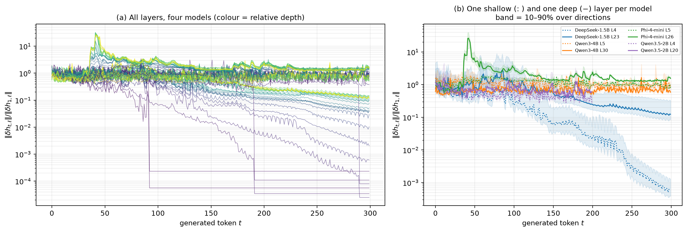

**What is plotted.** $\|\delta h_{t,\ell}\|/\|\delta h_{1,\ell}\|$ (median over directions) against the
generated token $t$, log scale, one curve per layer, colour = layer depth. Prompt perturbation,
$r=0.1$ ($r=0.3$ for Phi), 300 generated tokens.

**What it shows.**
- **DeepSeek**: shallow layers (dark) fall by 4–6 orders of magnitude and reach **exactly zero** at
  the step where the sliding window removes the last perturbed token; deep layers (yellow) stay
  within a factor 2 of their initial value.
- **Qwen3-4B, Qwen3.5**: flat, within a factor 2 for 300 tokens.
- **Phi-4-mini**: a burst at $t\approx40$ (up to ×20 in the deep layers), then a plateau.

There is no exponential growth anywhere in this figure.

### 4.2 The rate is zero or negative

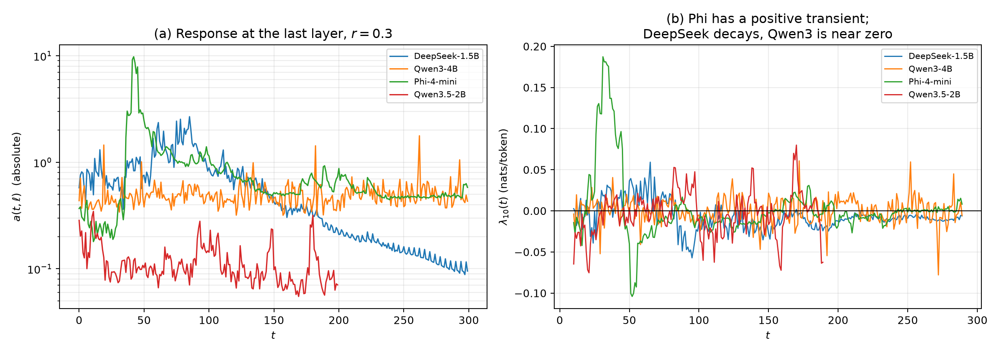

**What is plotted.** $\lambda_{10}(t)=\frac{1}{20}\log\frac{\|\delta h_{t+10,L}\|}{\|\delta h_{t-10,L}\|}$
at the last layer, $r=0.3$, for four models.

**What it shows.** DeepSeek is negative after $t\approx100$; the others fluctuate around zero. A
positive value early in the continuation is a transient, not a rate.

**Numbers** (last layer, $r=0.3$, mean over $t>150$, same prompt for all models):

| model | layers | early $\lambda$ ($t<60$) | late $\lambda$ ($t>150$) |
|---|---|---|---|
| DeepSeek-1.5B | 28 | +0.0087 | **−0.0105** |
| Qwen2.5-3B | 36 | −0.0007 | **+0.0002** |
| Qwen3-4B | 36 | +0.0030 | **+0.0003** |
| Phi-4-mini | 32 | **+0.0347** | **+0.0003** |
| Qwen3.5-2B | 24 | −0.0126 | **−0.0014** |

A positive *late* rate means sustained exponential growth of the perturbation. None of the five
models has one; the largest is +0.0003 nats/token, i.e. a factor 1.09 over 300 tokens.

**A test that the measurement can see growth:** the same pipeline applied to a synthetic expanding map
with a true rate of +0.035 recovers +0.035 (notebook, `lambda_fig10_synthetic.png`).

### 4.3 The perturbation is almost entirely perpendicular to the state

The network normalises the state's length before the logits (RMSNorm), so a perturbation *along* the
state cannot change the output at all — it rescales all logits equally. The relevant part is the
perpendicular one. Measured (DeepSeek, all depths and all radii):

$$\cos^2(\delta h,h)=0.006\quad\Rightarrow\quad 0.6\%\text{ of the energy is radial, }8\%\text{ of the amplitude.}$$

So the Euclidean norm $\|\delta h\|$ is a good proxy for the part that matters, but this is a measured
fact, not a general one.

### 4.4 Over 4000 tokens the rate stays negative

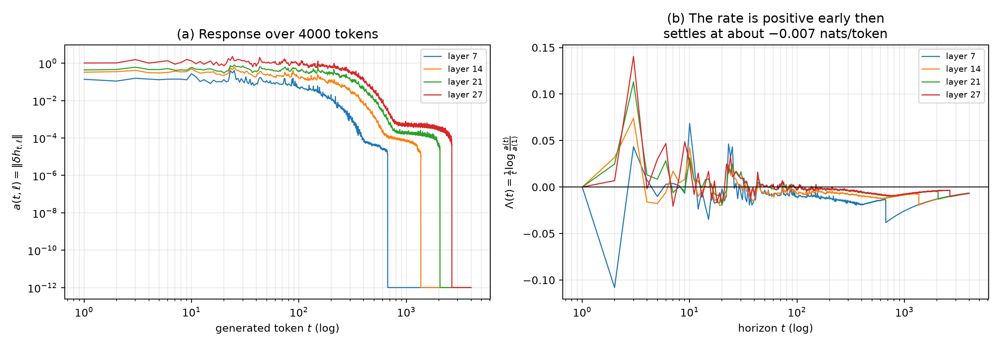

**What is plotted.** The same finite-time rate, extended to 4000 generated tokens (DeepSeek, several
prompts; window 4096 so nothing is truncated). **What it shows.** The rate settles around −0.007 and
does not cross zero; the perturbation decays to the numerical floor. The 300-token horizon used
elsewhere is not hiding a late growth phase.

**Caveat that matters.** At $W=100$ (the default run) the prompt is truncated from token
$t=W-P\approx35$, and the truncation *itself* produces a rise in the response. In a controlled
same-token comparison the rise disappears for $W\ge150$. So the positive phase seen in some early
figures is a window effect, not a property of the model. This is one of the corrections in §10.

---

## 5. Result 2 — why it does not explode: rotation, not decay

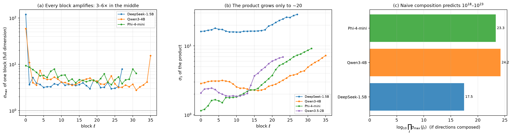

**What is plotted.** Left: $\sigma_{\max}$ of **one block's** Jacobian at each depth, computed in the
full dimension (power iteration, 20 iterations). Middle: $\sigma_1$ of the **product** of all blocks
from the depth map. Right: what the product would be if each block's amplification composed,
$\prod_\ell \sigma_{\max}(J_\ell)$.

**Numbers.**

| model | $\sigma_{\max}$ block 0 | middle blocks | last block | product $\sigma_1$ | if composed |
|---|---|---|---|---|---|
| DeepSeek-1.5B | 119 | 3.6 | 7.9 | ~20 | $10^{17.5}$ |
| Qwen3-4B | 59 | 4.1 | 15.4 | ~5 | $10^{24.2}$ |
| Phi-4-mini | 9.3 | 4.9 | 6.4 | ~9 | $10^{23.3}$ |

**What it means.** Every block has a direction it amplifies by 3–6×; the first block by 9–119×. But
the amplified direction **rotates** from block to block: the average angle between consecutive top
singular directions is 83.6°, and the product of 28 blocks grows by about 20, not by $10^{17}$. This
is the reason a transformer does not blow up, and it is a measured property of the weights, not a
definition.

**The practical consequence.** A random perturbation sees the *small common* gain, not the large
one-off amplifications. This also explains why a random 8- or 64-dimensional probe of the tangent
space reports a nearly flat spectrum: it almost never contains the one direction a block amplifies.

### 5.1 Same-position chain vs the real response

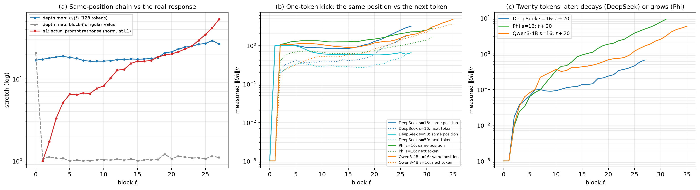

**What is plotted.** Panel (a): the same-position tangent chain (depth map, blue) and the real
prompt-perturbation response (red, a1 run), both normalised at layer 1. Panel (b): a one-token kick at
$s=16$, response at the **same** position vs at the next token. Panel (c): the same kick, 20 tokens
later.

**Numbers.** From layer 1 to layer 27, the same-position chain grows **×1.54**; the real response
grows **×53**. So ~89% of the depth growth is cross-position transport, which the same-position
tangent cannot see.

Panel (c) is the model difference in one panel: 20 tokens after the kick, DeepSeek has decayed to
×0.67 while Phi has grown to ×9.2 and Qwen3-4B to ×5.9.

---

## 6. Result 3 — flips are decisions, not growth

### 6.1 The margin coordinate

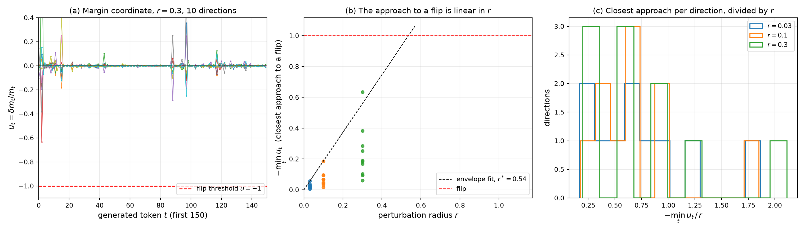

**What is plotted.** $u_t=\delta m_t/m_t$, the change of the top-two logit gap in units of that gap.
At $r=0.3$, ten directions (left); the closest approach to $u=-1$ versus radius (middle); the
distribution of $u$ at one step, divided by $r$ (right).

**What it shows.** A flip requires $u_t\le-1$ (the margin crosses zero). The rule predicts the first
flip correctly in **318 of 320** direction-radius pairs at $r\le0.1$. The closest approach is linear
in $r$; the smallest radius at which *some* direction flips is $r_*\approx0.5$ for that prompt.

### 6.2 The prediction stops working when the response saturates

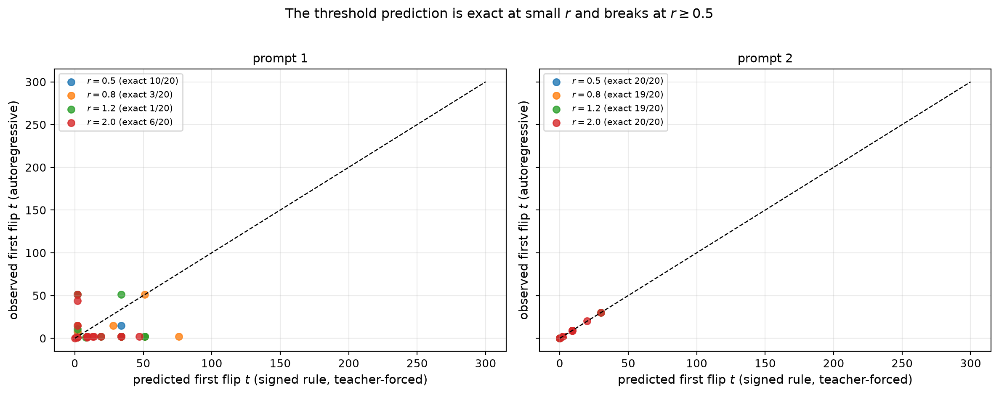

**What is plotted.** Predicted first flip (signed margin rule) against the observed first flip in a
free run, for radii 0.5–2.0.

**What it shows.** On one prompt the prediction is exact 20/20 even at $r=2$; on a fragile prompt it
degrades to 1–6/20. The reason is visible in the response curve: at these radii the margin change no
longer scales with $r$ (concave saturation), so the tangent prediction is extrapolating.

### 6.3 How often does a perturbation flip a token?

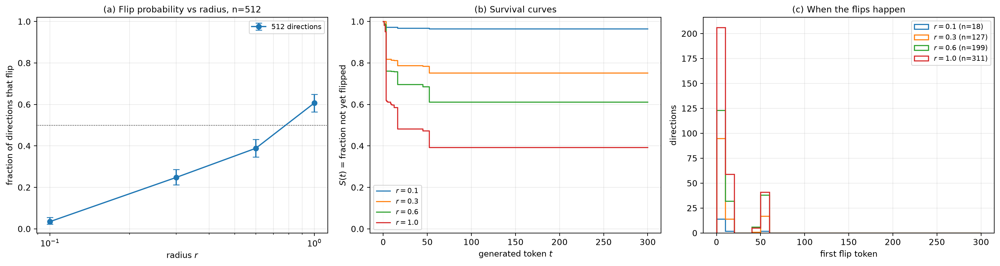

**What is plotted.** Fraction of 512 directions that change at least one token within 300 generated
tokens, as a function of radius (left); survival curves, i.e. fraction not yet flipped (middle);
distribution of the first flip time (right). DeepSeek, one prompt.

| radius | flips / 512 | fraction [95% CI] | flips after token 20 |
|---|---|---|---|
| 0.1 | 18 | 3.5% [2.2, 5.5] | **0.4%** |
| 0.3 | 127 | 24.8% [21.3, 28.7] | 3.5% |
| 0.6 | 199 | 38.9% [34.7, 43.2] | 8.6% |
| 1.0 | 311 | 60.7% [56.4, 64.9] | 9.0% |

**The important correction.** 85–90% of all flips happen at **one step** where the margin is exactly
zero (the top two logits are equal to within the precision of the forward pass). Any perturbation
flips such a token; it is a quantisation tie, not a sensitivity. Removing it, the flip fraction at
$r=0.1$ is **0.4%**, not 3.5%. The last column is the number to quote.

---

## 7. Result 4 — where the response comes from: the transport kernel

**Definition.** Perturb **one prompt position** $p$ and measure the response at every generated token
$t$:

$$K(p,t)=\frac{\|\delta h_{t,L}\|}{r}\quad\text{(perturbation at }p\text{ alone).}$$

It is a $P\times T$ matrix (65 positions × 300 tokens). The usual experiment, which perturbs all
positions at once, is a **sum** of these:
$$R(t)=\sum_p K(p,t)\,u_p .$$
So $K$ is the elementary response — the Green's function — and it says where each part of the response
comes from.

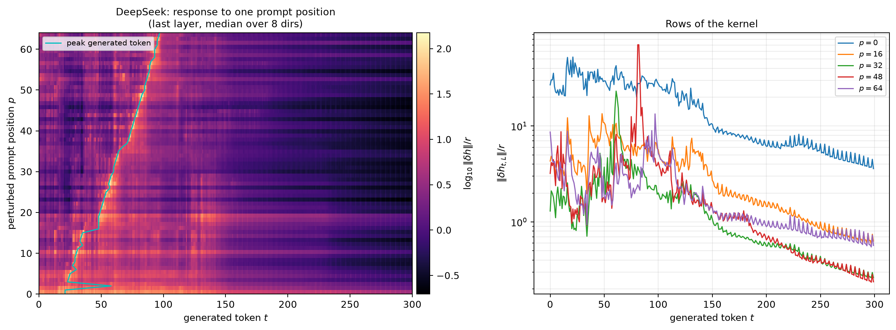

**What is plotted.** Left: $\log_{10}K(p,t)$ at the last layer, one prompt, DeepSeek. The cyan line is
the peak over $t$ for each $p$. Right: five rows of the same matrix.

**Two components, both clearly visible.**
1. **A persistent background** from the first ~5 prompt positions: they influence *every* generated
   token, decaying from ×27 to ×6 over 300 tokens. This is the component that survives at long
   distance.
2. **A travelling front**: for later positions the response peaks at a generated token that moves with
   $p$ (peak $t=21$ at $p=0$, $t=97$ at $p=64$, slope ≈1). A prompt token matters most to the
   continuation "opposite" it, and much less two hundred tokens later.

**Why this is the most useful new object.** It turns "the response" into two measurable profiles
(background decay, front amplitude), it explains the 89% of depth growth that the same-position
tangent misses, and it gives the model differences a place to live: Phi's far-field growth should
appear as a slower-decaying background or a wider front. The 8-prompt × 5-model version is running.

**A free check.** Summing $K$ over all $p$ should reproduce the ordinary all-position response. If it
does, the linear decomposition is validated. (Running.)

---

## 8. Result 5 — models differ qualitatively

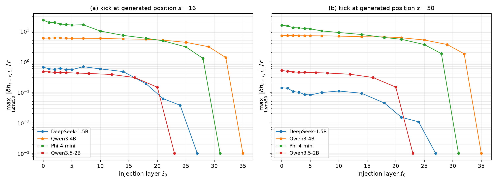

**What is plotted.** A one-token kick of norm $r$ at one generated position, injection at one block;
the quantity is the largest downstream response at the last layer within 50 tokens, divided by $r$,
against the injection block. Ten directions.

**What it shows.** The curve is flat over the first 60–75% of the depth: injecting at block 0 or block
20 gives the same downstream amplification. The response is a property of the *position*, not of the
injection depth. The factor is model-specific: Phi ×23, Qwen3-4B ×6, DeepSeek ×0.7, Qwen3.5 ×0.5 in
the original run (the consistent same-prompt table is below).

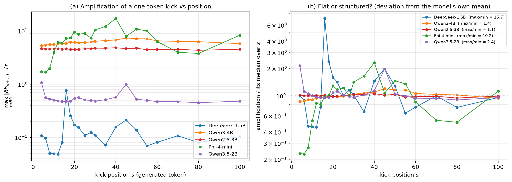

**What is plotted.** The same amplification against the **kick position** $s$ (22 positions, 5 models).

**What it shows.** Three models are flat — Qwen3-4B within ×1.4, Qwen2.5-3B within ×1.1, Qwen3.5
within ×2.4 — and two have hot spots: DeepSeek spikes at $s=16$ (×6 above its own median) and Phi
rises to $s\approx40$ (×10 spread). The hot spots coincide with the burst times seen in the
prompt-perturbation runs.

**The consistent table** (same prompt, same protocol; last layer, $r=0.3$, 20 directions; kick at
$s=16$):

| model | layers | late $\lambda$ | direction spread (5–95%) | kick gain at $s=16$ | relative response at $t=50$ |
|---|---|---|---|---|---|
| DeepSeek-1.5B | 28 | −0.0105 | ×5.85 | 0.76 | $4.1\times10^{-4}$ |
| Qwen2.5-3B | 36 | +0.0002 | ×1.36 | 4.63 | $1.9\times10^{-3}$ |
| Qwen3-4B | 36 | +0.0003 | ×1.19 | 5.84 | $8.8\times10^{-4}$ |
| Phi-4-mini | 32 | +0.0003 | ×1.19 | 7.25 | $1.1\times10^{-2}$ |
| Qwen3.5-2B | 24 | −0.0014 | ×1.93 | 0.48 | $2.1\times10^{-3}$ |

Two things to take from this table. (i) Direction dependence is a **DeepSeek** property (×5.85); the
newer models are close to isotropic (×1.2–1.9), so any statement about "the perturbation direction"
must be checked per model. (ii) The ordering contract→amplify (DeepSeek 0.76, Qwen3.5 0.48 vs
Qwen2.5 4.6, Qwen3 5.8, Phi 7.2) is the same ordering as the late rate (−0.0105, −0.0014 vs +0.0002,
+0.0003, +0.0003). The two independent measurements agree on the ordering of five models.

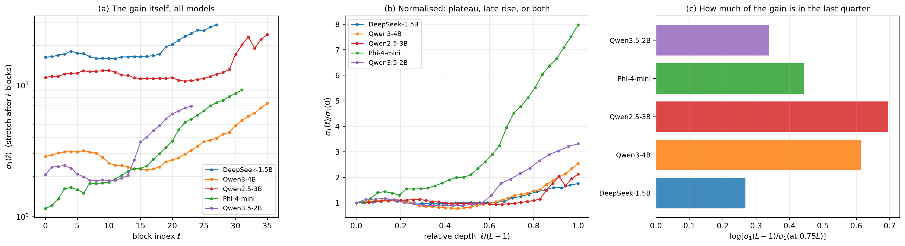

**What is plotted.** The cumulative stretch $\sigma_1(\ell)$ of the depth product, per model
(normalised in the middle panel).

**What it shows.** Two groups. The Qwen2-family models (DeepSeek, Qwen2.5) start at ×11–16 in the
first block and then grow slowly; the newer models start at ×1.2–2.3 and grow gradually to ×2.6–7.5.
This is an architectural difference, measured without any normalisation choice. It does **not** by
itself explain the dynamics (Qwen2.5 front-loads but amplifies kicks like Qwen3), so I would not claim
causation.

---

## 9. The attention window: one exact result

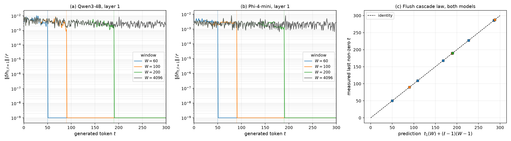

**What is plotted.** Left/middle: response at layer 1 for four window sizes, Qwen3-4B and Phi-4-mini.
Right: measured time at which the response becomes exactly zero, against the prediction
$t_1(W)+(\ell-1)(W-1)$.

**What it shows.** Imposing a window $W$ makes the response **exactly zero** from a predictable step:

$$t^*_\ell=(W-10)+(\ell-1)(W-1)\quad\text{(this prompt),}$$

and the first difference from an unwindowed run appears at $t=W-P$. Both are exact: 18 points, maximum
residual 0.00, on two architectures. The mask we impose (a 4-D mask in the attention call) is
**bit-identical** to DeepSeek's native sliding window at $W=100$ (all recorded arrays equal).

This is a methods result: it says what a sliding window *does* (a hard reset, not a soft decay), and
it is the reason the early growth phase at $W=100$ is a truncation effect.

---

## 10. What is **not** a result (do not cite these)

| quantity | why not |
|---|---|
| "$\lambda_1(\ell)$ decays exponentially with depth" | $\lambda_1=\log\sigma_1/(\ell+1)$ and $\sigma_1$ is nearly flat; the decay is the division by $\ell+1$. Plot $\sigma_1(\ell)$ instead. |
| "the depth tangent map is isotropic" | true only inside an 8/64-dimensional random subspace; the full Jacobian has $\sigma_{\max}$ 3–119 and rotates. |
| FSLE flat in $r$ | it is the statement that the response is linear in $r$; the value depends on the threshold and on where the clock starts. |
| "$r_*$ follows a log-logistic law" | tested on 4 models × 5 prompts × 512 directions: the median varies 15× and the exponent 2.3–17.6. A one-prompt description, not a law. |
| window spectroscopy (per-token contribution map) | it works, but it measures the mask, and the same information is in the transport kernel with a cleaner interpretation. |
| "the state is a 10-dimensional manifold" | the estimator is not stable under pooling and the last saved layer is the final RMSNorm; the only robust geometry number is the 99.4% tangential fraction. |
| positive growth phase at $t\approx60$ | exists only when $W=100$ truncates the prompt; absent for $W\ge150$ in a controlled comparison. |

---

## 11. Where I would push back

**On "stable chaos".** The name is defensible only if it is defined in one sentence: *the continuous
state contracts, but the readout is discontinuous, so a shrinking perturbation can still change the
token*. If it is read as "chaos", a referee will ask for a positive Lyapunov exponent, and there is
none. I would either define it explicitly every time or call it "sensitivity without stretching".

**On the 300-token horizon.** It is enough for the *flip* statistics (all gaps below 0.05 occur in the
first 300 tokens), but the late rate keeps drifting slowly to 4000 tokens (−0.0075 at 1000, −0.0069 at
4000). For a claim about the asymptotic rate, the horizon must be stated.

**On model breadth.** Five models is not enough for "models differ". The table in §8 is consistent
across two independent measurements, which is reassuring, but a claim about *why* needs at least two
more architectures. I would spend the next compute there before adding more prompts to the five.

**On the transport kernel.** It is the most promising object in the project and the least explored:
one prompt, one model so far. Everything about "where the response comes from" rests on it.

---

## 12. Files and reproduction

| what | where |
|---|---|
| raw protocol, all runs | `notebook/notebook.md` (lab notebook) |
| curve fitting tool | `src/chaos_llm/curvefit.py`, `results/fits/SUMMARY.md` |
| this table's numbers | `results/master_table.json` |
| transport kernel | `results/transport/`, `scripts/analysis_transport.py` |
| block Jacobians | `results/block_sigma/`, `src/chaos_llm/run_block_sigma.py` |
| flip statistics | `results/hazard/`, `scripts/analysis_flip_fraction.py` |
| figure gallery | `results/figures/models/` (844 figures, INDEX.md) |
