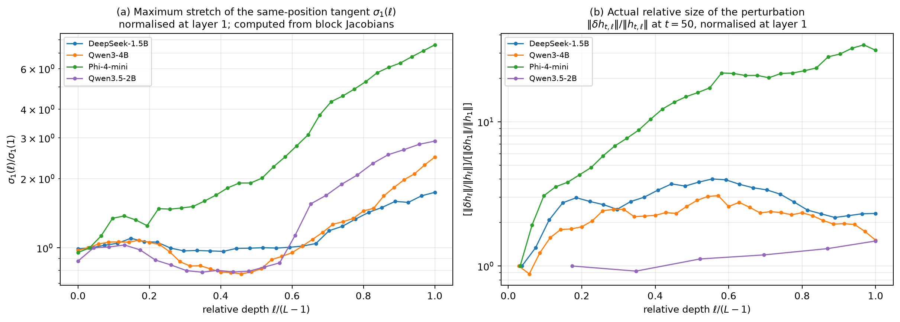
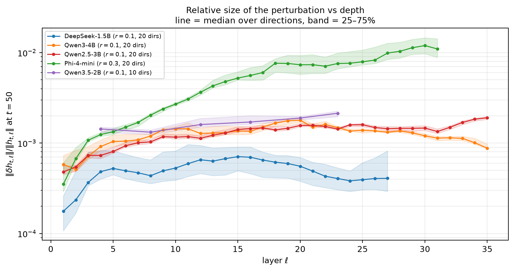
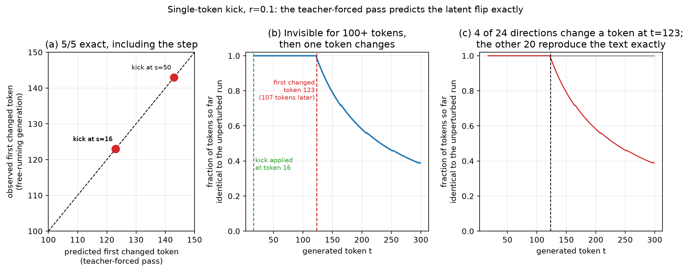
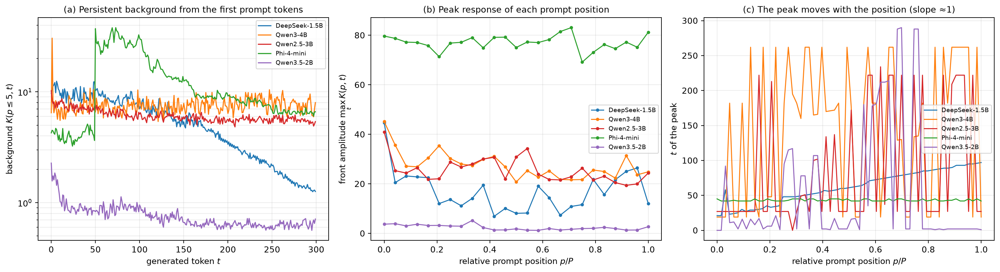
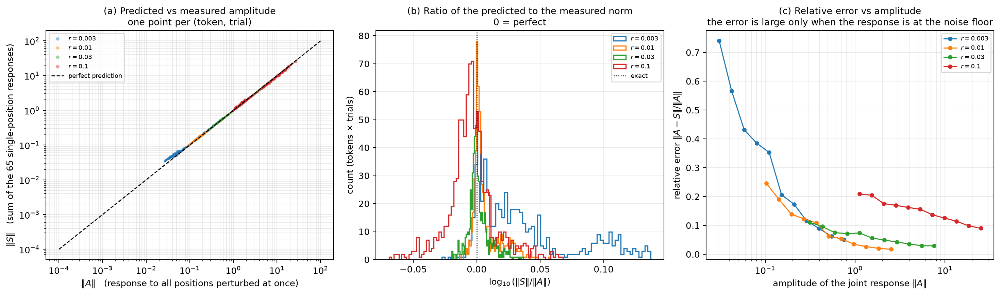
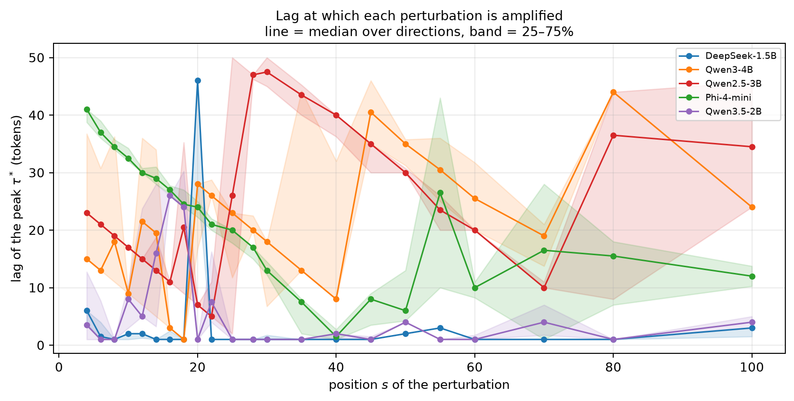
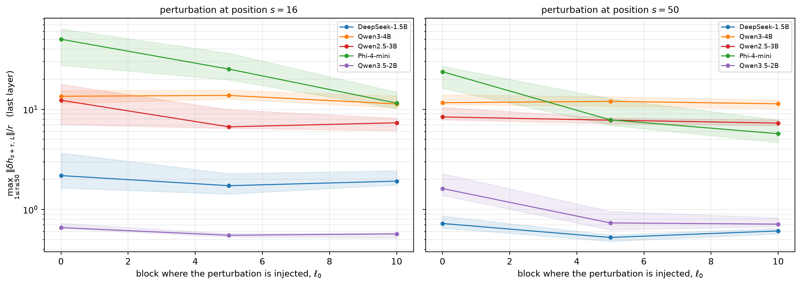
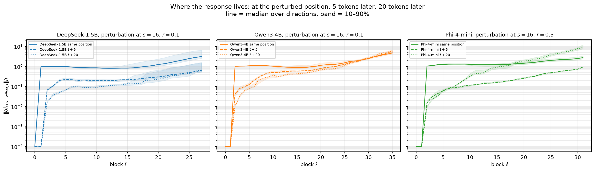
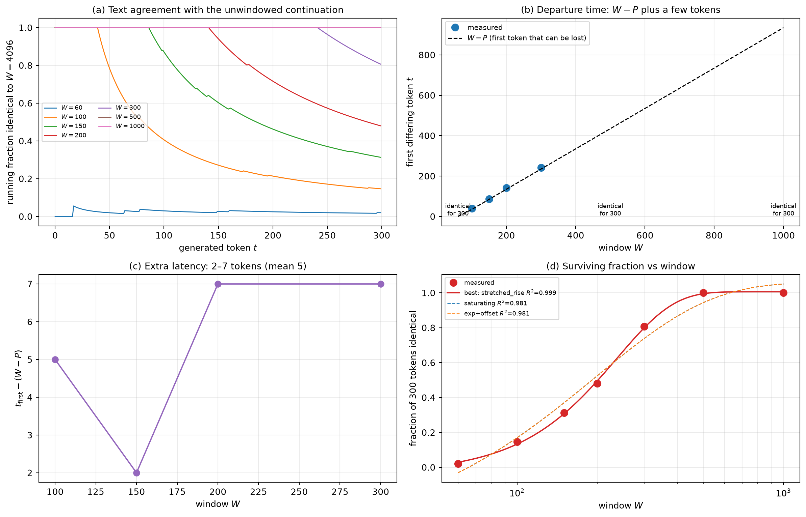

# Master summary — perturbation dynamics of greedy LLM generation

Models: DeepSeek-R1-Distill-Qwen-1.5B (28 blocks, d=1536), Qwen2.5-3B (36, 2048), Qwen3-4B (36,
2560), Phi-4-mini (32, 3072), Qwen3.5-2B (24, 2048). Greedy decoding, one T4.

---

## 1. Short version

1. **A perturbation does not grow.** The stretching rate over the last 150 of 300 generated tokens is
   −0.0105 nats/token for DeepSeek and between −0.0014 and +0.0003 for the others. Positive in none
   of 31 configurations. Over 4000 tokens it settles at −0.007.
2. **Yet the text changes.** The token flips only when the gap between the top two logits crosses
   zero. A flip is a decision event: the perturbation reaches the decision boundary while shrinking.
3. **No explosion because the amplified directions rotate.** Each block amplifies some direction by
   3–6×, the first by 9–119×; if those gains composed the product would grow by 10¹⁷–10²⁴. Measured,
   it grows by about one order.
4. **The response at a generated token is mostly built from other positions.** Along the depth the
   same-position tangent grows ×1.5 while the actual prompt response grows ×53. Splitting the prompt
   into single positions (the transport kernel) shows a persistent background from the first tokens
   plus a travelling front.
5. **Models differ qualitatively.** DeepSeek contracts and is direction-sensitive; Phi amplifies
   strongly (×7.5 in the same-position tangent, ×20 in relative size, ×23 downstream of a
   perturbation); Qwen2.5, Qwen3-4B and Qwen3.5 are neutral.
6. **Several earlier quantities are definitions or artefacts** (§10). They are listed so they are not
   cited.

---

## 2. What is perturbed, exactly

### 2.1 Prompt perturbation

The prompt is a matrix $E\in\mathbb{R}^{P\times d}$ ($P$ positions, $d$ hidden dimensions). We add a
matrix of the same shape:
$$E'=E+r\,u,\qquad u\in\mathbb{R}^{P\times d},\quad \|u\|_2=1,$$
where the norm is Euclidean over the whole tensor. $u$ is sparse: $K$ random entries of the flattened
$P\cdot d$ tensor ($K=20$ normally, 1536 in the all-directions run) filled with an orthogonal set of
signed patterns. Generated positions are never perturbed.

### 2.2 Single-position perturbation

One vector of length $d$ added to one hidden state at one position and one layer:
$$h'_{t,\ell}=h_{t,\ell}+r\,v,\qquad v\in\mathbb{R}^{d},\ \|v\|_2=1.$$

### 2.3 Norms, and the unit of a rate

All norms are **Euclidean (L2)**. No cosine distance is used; cosine appears only as a derived angle.

**What is a nat.** A nat is the natural unit of a logarithm (base $e$). If a quantity multiplies by
$e\approx2.718$ in one token, its rate is 1 nat/token. A rate of −0.0105 nats/token means the
perturbation multiplies by $e^{-0.0105}=0.9896$ per token, i.e. it loses 1% per token, or a factor
$e^{-3.15}=0.043$ over 300 tokens. Rates are computed as $\lambda=\frac{1}{k}\ln(y_{t+k}/y_{t-k})$,
so the unit follows from the logarithm; it is a *logarithmic* growth rate, not an absolute size.

### 2.4 Teacher forcing vs free run

Teacher-forced: the model runs on the fixed baseline token sequence (no perturbation), so the perturbation cannot change
the text; this isolates the continuous dynamics (from the token sampling). Free run: the model generates autoregressively (what we were doing before);
---

## 3. Quantities, and what each one answers

| question | quantity | expression |
|---|---|---|
| how big is the perturbation? | $\|\delta h_{t,\ell}\|$ | Euclidean norm of $h'-h$ |
| does it matter relative to the state? | $\|\delta h_{t,\ell}\|/\|h_{t,\ell}\|$ | ratio of norms |
| how fast does it grow or shrink? | $\lambda_k(t)$ | $\frac{1}{2k}\ln\frac{\|\delta h_{t+k}\|}{\|\delta h_{t-k}\|}$ |
| is a token about to flip? | $u_t$ | $\delta m_t/m_t$; flip when $u_t<-1$ |
| which radius flips some token? | $r_*$ | $\min_t m_t/(|\delta m_t|/r)$ |
| how much can the tangent stretch? | $\sigma_i$ | singular values of the Jacobian |
| where does the response come from? | $K(p,t)$ | response at $t$ when only $p$ is perturbed |

**Singular values, precisely.** A matrix $M$ maps a vector $v$ to $Mv$; the ratio $\|Mv\|/\|v\|$
depends on the direction of $v$. The singular values are that ratio maximised ( $\sigma_1$ ) and
minimised ( $\sigma_d$ ) over all unit $v$. They describe *what the map can do to some direction*, not
what it does to our particular perturbation. $\sigma_1$ is an upper bound; the actual growth of a
fixed perturbation is $\|Mv_0\|$.

**Why we do not use the depth-normalised exponent.** $\lambda_1(\ell)=\log\sigma_1(\ell)/(\ell+1)$
divides by the number of blocks. $\sigma_1$ is nearly constant with depth, so this quantity falls like
$1/\ell$; the fall is the division, not the model. We plot $\sigma_1(\ell)$ itself (§5).

---

## 4. Result 1 — the perturbation does not always grow

**What is plotted.** $\|\delta h_{t,\ell}\|/\|\delta h_{1,\ell}\|$ against generated token $t$ (log
scale), one curve per layer, colour = layer. Prompt perturbation, $r=0.1$ ($r=0.3$ for Phi), 300
tokens, median over directions.

**What it shows.** DeepSeek's shallow layers fall 4–6 orders of magnitude and reach exactly zero when
the sliding window removes the last perturbed prompt token; deep layers stay within a factor 2.
Qwen3-4B and Qwen3.5 are flat within a factor 2. Phi has a burst at $t\approx40$ (×20) and then a
plateau. No curve grows exponentially.

**What is plotted.** $\lambda_{10}(t)=\frac{1}{20}\log\frac{\|\delta h_{t+10,L}\|}{\|\delta h_{t-10,L}\|}$
at the last layer, $r=0.3$, four models.

| model | blocks | early $\lambda$ ($t<60$) | late $\lambda$ ($t>150$) |
|---|---|---|---|
| DeepSeek-1.5B | 28 | +0.0087 | **−0.0105** |
| Qwen2.5-3B | 36 | −0.0007 | **+0.0002** |
| Qwen3-4B | 36 | +0.0030 | **+0.0003** |
| Phi-4-mini | 32 | +0.0347 | **+0.0003** |
| Qwen3.5-2B | 24 | −0.0126 | **−0.0014** |

The largest late rate is +0.0003 nats/token: a factor 1.09 over 300 tokens. A synthetic expanding map
with a true rate +0.035 is recovered exactly by the same code, so the measurement can see growth when
it exists.

Over 4000 tokens (window 4096, nothing truncated) the rate stays near −0.007 and the perturbation decays
to the numerical floor.

**Two corrections that matter.** (i) At the default window $W=100$ the prompt is truncated from
$t\approx35$, and the truncation itself causes a rise; in a controlled same-token comparison the rise
disappears for $W\ge150$. (ii) Small perturbations can flip a token whose logit gap is zero (a
quantisation tie); flip statistics must exclude those steps (§7).

---

## 5. Result 2 — why nothing explodes: rotation

**How this is measured (step by step).**
1. Run the model on a fixed token sequence and keep the hidden state $h_{\ell}$ entering each block.
2. At one position, inject $k$ orthonormal tangent vectors $v_i$ and push each through block $\ell$
   with a Jacobian-vector product: $u_i=J_\ell v_i$.
3. Orthonormalise the $u_i$ (QR) and accumulate $\log$ of the diagonal. This gives the singular values
   of $J_\ell J_{\ell-1}\cdots J_0$, i.e. of the map from the input at that position to the state after
   $\ell$ blocks, restricted to the $k$-dimensional subspace we track.
4. Separately, compute the **full-dimension** $\sigma_{\max}$ of each single block by power iteration
   (20 iterations of $v\leftarrow J^\top Jv$).

**What is plotted.** (a) full-dimension $\sigma_{\max}$ of one block per depth; (b) $\sigma_1$ of the
product; (c) the product that would result if the blocks' amplifications composed.

| model | block 0 | middle blocks | last block | product $\sigma_1$ | if composed |
|---|---|---|---|---|---|
| DeepSeek-1.5B | 119 | 3.6 | 7.9 | ~20 | $10^{17.5}$ |
| Qwen3-4B | 59 | 4.1 | 15.4 | ~5 | $10^{24.2}$ |
| Phi-4-mini | 9.3 | 4.9 | 6.4 | ~9 | $10^{23.3}$ |

Every block amplifies some direction by 3–6×; the amplified direction changes from block to block
(average rotation between consecutive top directions 83.6°), so the product grows by ~20 instead of
$10^{17}$–$10^{24}$. A random perturbation therefore sees the small *common* gain, not the large
one-off amplifying directions. This is a measured property of the weights.

### 5.1 Does the model make a perturbation more relevant?

Two different questions, two different curves:

**Panel (a)** is the maximum stretch of the same-position tangent, $\sigma_1(\ell)/\sigma_1(1)$, from
the block Jacobians. **Panel (b)** is the *actual* relative size of the perturbation,
$[\|\delta h_\ell\|/\|h_\ell\|]$ at $t=50$, normalised at layer 1, measured from the hidden states.

**Parameters.** Prompt perturbation, $r=0.1$ ($r=0.3$ for Phi), 10–20 directions, generated token
$t=50$; line = median over directions, band = 25–75%; all saved layers.

**Answer.** Only **Phi-4-mini** makes the perturbation more relevant: its relative size grows ×20
through the depth. DeepSeek peaks at ×3 near layer 13 and then declines; Qwen3-4B, Qwen2.5 and Qwen3.5
stay within ×1.5–2 of their initial value. This is the quantity to quote when the question is "is the
perturbation important for the state", because it cancels the residual stream's own growth (×18–30).

### 5.2 The same-position tangent is not the mechanism

From layer 1 to 27 the same-position chain grows **×1.54**; the actual prompt response grows **×53**.
The difference is cross-position transport. Panel (b)/(c) show a one-position perturbation: the
same-position response is comparable across models (×2.8–4.7), but twenty tokens later DeepSeek has
decayed to ×0.67 while Phi has grown to ×9.2 and Qwen3-4B to ×5.9.

---

## 6. The perturbation waits: latency before the flip

**Parameters.** DeepSeek-1.5B, prompt `prompts.txt` (65 tokens), **window $W=100$**, $r=0.1$, **24
directions**, free-running generation, 300 tokens, perturbation positions $s=16$ and $s=50$.

**What is plotted.** (a) Predicted (teacher-forced rule) against observed (free run) first changed
token, five perturbations. (b) Token agreement with the unperturbed run along the continuation for one
direction. (c) The same for 24 directions at $s=16$.

**What it shows.** A perturbation at generated position $s=16$ changes the text at **$t=123$, 107
tokens later**; at $s=50$ it acts at $t=143$, 93 tokens later. All five predictions are exact. After
the flip the two continuations never re-converge (agreement falls to ~40% and stays there).

**Why this matters.** It is the operational meaning of "sensitivity without stretching": the
perturbation does not grow (§4), does not act immediately, and does not need to be large — it waits
until the model reaches a step where the top-two logit gap is small, and then it decides the token.
The waiting time is set by the *model*, not by the perturbation size (over the range tested).

**What is not shown.** The apparent decay of agreement after the flip is not a physical decay: it
saturates at a floor because continuations re-align on repetitive text. Do not fit it.

## 7. Result 4 — where the response comes from, and how linear it is

### 7.1 The transport kernel

**Definition.** Perturb **one** prompt position $p$ and measure the response at every generated
token:
$$K(p,t)=\frac{\|\delta h_{t,L}\|}{r}\quad(\text{perturbation at }p\text{ alone}),$$
with $L$ the last block. $K$ is a $P\times T$ matrix (65 prompt positions × 300 generated tokens).

**Why the object is useful.** Our usual experiment perturbs all positions at once, and to first order
$$R(t)=\sum_p K(p,t)\,u_p,$$
so $K$ is the elementary response: it says where the response at each generated token comes from.

**What is plotted.** Left: $\log_{10}K(p,t)$, DeepSeek, one prompt, last layer. The cyan line marks
the peak over $t$ for each $p$. Right: five rows.

**A question that is not a problem.** $p$ is a **prompt** index (0…64) and $t$ a **generated** index
(0…299). They are different spaces: generated tokens always come after the whole prompt, so there is
no constraint between the numbers $p$ and $t$, and $K(p,t)$ is defined and non-zero for every pair.
The diagonal structure in the figure is an empirical fact — a prompt position influences most the
generated tokens at a matching offset — not a causal bound. (I checked the code: the perturbation is
added at `E[0, p]`, one prompt position only, and the baseline is unperturbed.)

**Two components.**
- **Persistent background**: the first ~5 prompt positions influence *every* generated token,
  decaying ×27 → ×6 over 300 tokens.
- **Travelling front**: for later positions the peak is at a generated token that moves with $p$
  (peak $t=21$ at $p=0$, $t=97$ at $p=64$; slope ≈1).

### 7.1b The kernel in all five models

**Parameters.** Same protocol as above for each model: 8 prompts, all prompt positions, 8 directions,
$r=0.1$ ($r=0.3$ for Phi), $W=100$, teacher-forced, 300 tokens, read at the last block. Curves are the
median over prompts; `P` is the prompt length (60–65, so positions are shown as $p/P$).

**Panel (a).** The background $K(p\le5,t)$, i.e. the response to perturbing the first five prompt
positions, against the generated token. **Panel (b).** The peak over $t$ of $K(p,t)$ for each position.

**What it shows.** The background decays in DeepSeek (14 → 1.3, i.e. −0.74% per token, exponential,
$R^2=0.81$) and in Qwen2.5 (7 → 3); it is **flat** in Qwen3-4B and Phi; Phi's background even *rises*
around $t=40$–60 before decaying. The front amplitude separates the models more sharply than any other
measurement: **Phi ≈78 for every position**, DeepSeek 5–25, Qwen3-4B and Qwen2.5 15–45, Qwen3.5 ~3.

**Why it matters.** The two components of the kernel have different model signatures. Phi amplifies
*every* position equally at a fixed future time; DeepSeek's influence decays with distance. This is the
mechanism behind the "models differ" table, expressed as two numbers instead of a list.

### 7.2 Is the kernel a valid superposition? (measured)

**What exactly is measured.** Three trials. In each trial one unit vector $u\in\mathbb{R}^{d}$ is drawn
and two sets of runs are made on the same prompt (`prompts.txt`, $P=65$ tokens, window $W=100$,
teacher-forced, 300 generated tokens, block $L$ = last):
1. **joint run**: $r\,u$ added to **every** prompt position; the response at generated token $t$ is
$A_t=h'_t-h_t\in\mathbb{R}^{d}$;
2. **single-position runs**: $r\,u$ added to **one** prompt position $p$ at a time, giving $B_{p,t}$;
the sum is $S_t=\sum_{p=0}^{64}B_{p,t}$.

$A_t$ and $S_t$ are vectors of the same dimension; $\|A\|$ and $\|S\|$ are their Euclidean norms. If the
model were linear in the input, $A_t=S_t$ exactly.

**(a)** $\|S\|$ against $\|A\|$ for every token and trial: the points lie on the identity line over three
decades. **(b)** The ratio $\|S\|/\|A\|$ peaks at 1 with a spread of ±5–10%. **(c)** The relative error
falls as the amplitude grows; it is large (0.5–0.7) only where $\|A\|\lesssim10^{-2}$, i.e. where the
response is at the float32 resolution of the difference — not a physical failure.

**The test.** Add the **same** unit vector $u$ to every prompt position; call the response $A$. Then,
separately, add $u$ to position $p$ alone for each $p$ and sum the responses: $S=\sum_p f(u\text{ at
}p)$. If the response is linear, $A=S$.

**Result (DeepSeek, 65 positions, 3 trials, last layer).**

| radius per position | total prompt norm $r\sqrt{P}$ | $\|A-S\|/\|A\|$ (median) |
|---|---|---|
| 0.003 | 0.024 | 0.36 (fp32 noise floor) |
| 0.01 | 0.08 | 0.11 |
| 0.03 | 0.24 | **0.068** |
| 0.1 | 0.81 | 0.155 |

**Why 0.36 at the smallest radius is not a failure.** At r=0.003 the single-position response is ~1e-4 while the hidden states are ~500, so the difference of two forward passes is at the float32 resolution (relative 2e-7); the measured 36% is the round-off floor of the subtraction, not physics. The meaningful number is the minimum of the curve, 6.8%. Superposition holds to **7%** at a total perturbation norm of 0.24 — inside the measured linear
regime ($r\le0.3$) — and degrades outside it. The error at the two smallest radii is the float32
round-off of the difference of two ~500-magnitude states, not physics. This is the quantitative
support for using $K$ as a decomposition: **it is valid at total norms ≲0.3, which is exactly the
range in which the rest of the analysis is done.**

**Replication at $r=0.03$ (total norm 0.24):**

| run | $\|A-S\|/\|A\|$ (median) | $\cos(A,S)$ |
|---|---|---|
| DeepSeek, prompt 1 | 6.2% | 0.999 |
| DeepSeek, prompt 2 | 5.1% | 0.999 |
| DeepSeek, prompt 3 | 5.5% | 0.999 |
| Qwen3.5-2B, **fp32**, prompt 1 | 7.7% | 0.997 |

So the decomposition holds to 5–8% across three prompts and on a second model when the arithmetic is
fp32.

**A limit of the measurement, found while checking the other models.** The same test is meaningless
for the fp16 models at these amplitudes: a hidden state is ~500 and fp16 resolves ~0.3 in absolute
value, while the single-position response at $r=0.03$ is ~0.05. The difference of two fp16 forward
passes is then below the format's resolution, and the measured "error" is 12–41× — a numerical
artefact, not saturation. **The superposition test is therefore only valid for DeepSeek (fp32).**

---

## 8. Result 5 — models differ

**Parameters.** One vector of norm $r=0.1$ ($r=0.3$ for Phi) at **one generated position** $s$,
injected at block 0, read at the last block $L$; 8 random directions, median over directions; the
prompt is `prompts.txt` (65 tokens), teacher-forced, 300 generated tokens; 22 positions from 4 to 100.

**What is plotted.** The response $\log_{10}\|\delta h_{s+\tau,L}\|/r$ as a function of the position $s$
and the lag $\tau$ (0–50 tokens after $s$).

**What it shows — and it corrects the earlier reading.** For Phi there is a **bright diagonal**: a
perturbation at position $s$ is amplified when the continuation reaches a particular *absolute* token,
so the peak lag shrinks as $s$ grows. DeepSeek shows horizontal bands (the response depends on the
position, not on the lag) and a global decay.

**Panel (a).** The lag of the peak against the position. **Panel (b).** The absolute token of the peak,
$s+\tau^*$. For early positions it is **flat** at a model-specific value (DeepSeek ≈20–45, Qwen3-4B
≈20, Qwen2.5-3B ≈27, Phi ≈45, Qwen3.5 ≈42); for late positions it follows the position.

**Consequence.** The "hot spot at $s\approx40$" in the max-over-lag plot was a projection artefact: a
perturbation at $s=40$ peaks at lag ≈5, i.e. at the same absolute token where a perturbation at $s=16$
peaks at lag ≈29. **There is one amplification gate per continuation, not one per position.** The model
difference is the *time* of that gate (or its absence, for DeepSeek) and its amplitude, not a position.

**What is plotted.** The same quantity against the **block where the perturbation is injected**, for
$s=16$ (left) and $s=50$ (right). The curve is flat over the first 60–75% of the depth: injecting at
block 0 or block 20 gives the same downstream amplitude. The amplitude is a property of the position
and the model, not of the injection depth.

**Parameters.** One-position perturbation at $s=16$, $r=0.1$ ($r=0.3$ for Phi), injected at block 0;
6 directions; prompt `prompts.txt`, $W=100$; teacher-forced, 300 tokens. Solid: the response at the
**perturbed position**; dashed: 5 tokens later; dotted: 20 tokens later. Band = 10–90% over directions.

**What it shows.** At the perturbed position the response is ×1–3 in every model. Twenty tokens later
DeepSeek has decayed to ×0.05–0.7 while Qwen3-4B and Phi have **grown** to ×1–9. The transported
response, not the local one, is where the models differ.

**The consistent table** (same prompt, $r=0.3$, last layer, 20 directions, perturbation at $s=16$):

| model | blocks | late $\lambda$ | direction spread (5–95%) | amplification at $s=16$ | relative size at $t=50$ |
|---|---|---|---|---|---|
| DeepSeek-1.5B | 28 | −0.0105 | ×5.85 | 0.76 | $4.1\times10^{-4}$ |
| Qwen2.5-3B | 36 | +0.0002 | ×1.36 | 4.63 | $1.9\times10^{-3}$ |
| Qwen3-4B | 36 | +0.0003 | ×1.19 | 5.84 | $8.8\times10^{-4}$ |
| Phi-4-mini | 32 | +0.0003 | ×1.19 | 7.25 | $1.1\times10^{-2}$ |
| Qwen3.5-2B | 24 | −0.0014 | ×1.93 | 0.48 | $2.1\times10^{-3}$ |

Two independent measurements (the rate and the amplification) agree on the ordering. Direction
dependence is a DeepSeek property (×5.85); the newer models are nearly isotropic (×1.2–1.9).

**What exactly is measured.** For each of **8 prompts**, **192 random unit directions** and four radii,
the model generates greedily for 300 tokens with the perturbation on the prompt, and we record whether
the generated sequence differs from the unperturbed run at least once. Panel (b) excludes flips at a
step whose *unperturbed* margin is ≤0.02: those are quantisation ties where any perturbation flips the
token, and they dominate the raw counts (panel a). Band = 25–75% across prompts; error bars = 95%
confidence interval on the pooled fraction (Wilson), $n=1536$ direction–prompt pairs per point.

**Tie-corrected flip fraction at $r=0.1\to1.0$:**

| model | 0.1 | 0.3 | 0.6 | 1.0 |
|---|---|---|---|---|
| DeepSeek-1.5B | 0.2% | 3.4% | 10.5% | 23.7% |
| Qwen3.5-2B | 3.6% | 20.1% | 45.8% | 71.9% |
| Qwen3-4B | 16.8% | 19.9% | 24.7% | 38.3% |
| Qwen2.5-3B | 30.4% | 33.7% | 42.6% | 53.0% |
| Phi-4-mini | 56.0% | 65.6% | 65.5% | 66.6% |

**Reading.** The ordering matches the amplification ordering (DeepSeek ≪ Qwen3.5 < Qwen3-4B < Qwen2.5 <
Phi), and the *shape* differs: DeepSeek starts near zero and rises with $r$, while Phi is already at 56%
at $r=0.1$ and saturates — it is fragile everywhere, not more fragile at larger $r$.

---

## 9. The sliding window: one exact result

**What is plotted.** Response at layer 1 for four window sizes (Qwen3-4B, Phi-4-mini), and the
measured time at which the response becomes exactly zero against the prediction.

**What is exact, and on what evidence.**
- **DeepSeek**: 240 (window, layer, radius) combinations, prompt length 63, residual 0.
- **Qwen3-4B and Phi-4-mini**: 18 points each (3 windows × 6 layers, one prompt), residual 0.00.
- **First departure** from the unwindowed run occurs at $t=W-P$: measured 36/136/0 for $W=100/200/60$ with $P=64$, all layers; and 237 = 300−63 for $W=300$ in three models (DeepSeek, Qwen3-4B, Phi, all seven saved layers) on a 900-token continuation.
- **Not tested**: Qwen2.5-3B (running), and Qwen3.5-2B, which has no window mechanism at all (its
  first block is linear attention; a mask leaves it bit-identical).

**Parameters.** DeepSeek, prompt of 65 tokens, no perturbation ($r=0$), free-running greedy generation,
300 tokens, windows 60–1000 compared with the unwindowed run ($W=4096$).

**(a)** The running fraction of tokens identical to the unwindowed text. **(b)** The first differing
token against $W$: it lies on $W-P$ (dashed) for every window. **(c)** The residual latency,
$t_{\rm first}-(W-P)$: 2–7 tokens (mean 5), the time needed for the lost context to change a decision.
**(d)** The surviving fraction of the 300 tokens against $W$; the best fit is a stretched rise
$1-\exp(-(W/237)^{2.0})$ ($R^2=0.999$). **Reading: the text is bit-identical for 300 tokens once
$W\gtrsim500$, i.e. the effective memory of this continuation is ~5–8× the prompt length.**

The law for the flush step is $t^*_\ell=(W-10)+(\ell-1)(W-1)$ for this prompt; the constant depends on
the prompt and on the numerical resolution, the slope $W-1$ does not.

---

### Figure parameters (one table, so nothing has to be guessed)

`W` = sliding-window size. "native" = the model's own window setting; "inert" = the model has no
window mechanism, so `W` has no effect. `dirs` = number of random perturbation directions. All
teacher-forced unless stated.

| figure | model(s) | prompt | W | r | dirs | tokens |
|---|---|---|---|---|---|---|
| `flux_models_all_layers` | DeepSeek, Qwen3-4B, Phi, Qwen3.5 | `prompts.txt` (65 tok) | 100 (inert except DeepSeek) | 0.1 / 0.3 (Phi) | 20 | 300 |
| `model_lambda_compare` | same four | `prompts.txt` | 100 | 0.3 | 20 | 300 |
| `long_horizon` | DeepSeek | `prompts_long2.txt` | **4096** | 0.1 | 4 | **4000** |
| `block_sigma_full` | DeepSeek, Qwen3-4B, Phi | `prompts.txt` | 100 | Jacobian (no r) | 1 (power iteration, 20 it) | 4 positions |
| `sigma_vs_real` | DeepSeek | `prompts.txt` | 100 | 0.1 | 8 (depth map) / 6 (probe) | 300 |
| `relative_response_models` | five models | `prompts.txt` | 100 | 0.1 / 0.3 | 10–20 | 300, $t=50$ |
| `kernel_deepseek` | DeepSeek | `prompts.txt` | 100 | 0.1 | 8 | 300, 65 positions |
| `superposition` | DeepSeek | `prompts.txt` | 100 | 0.003–0.1 | 3 trials, same $u$ | 300 |
| `margin_coordinate` | DeepSeek | `window_sweep` prompt (63 tok) | **200** | 0.03–0.3 | 10 | 300 |
| `state_kick_latent_validated` | DeepSeek | `prompts.txt` (65 tok) | **100** | 0.1 | 24 | 300, $s=16,50$ |
| `posscan_A_heatmap`, `peak_is_absolute` | five models | `prompts.txt` | 100 | 0.1 / 0.3 | 8 | 300, 22 positions |
| `window4d_models` | Qwen3-4B, Phi (+ DeepSeek) | `prompts.txt` | 60–4096 | 0.1 | 6 | 300 |
| `rstar_per_model` | four models | 5 prompts | 100 | 0.1 | **512** | 300 |

---
