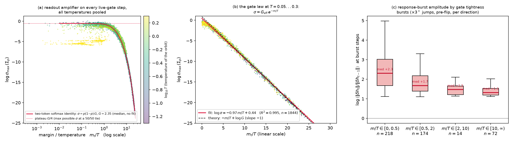
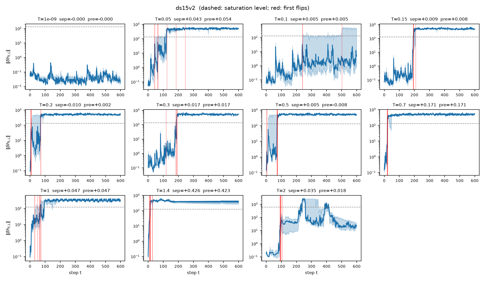
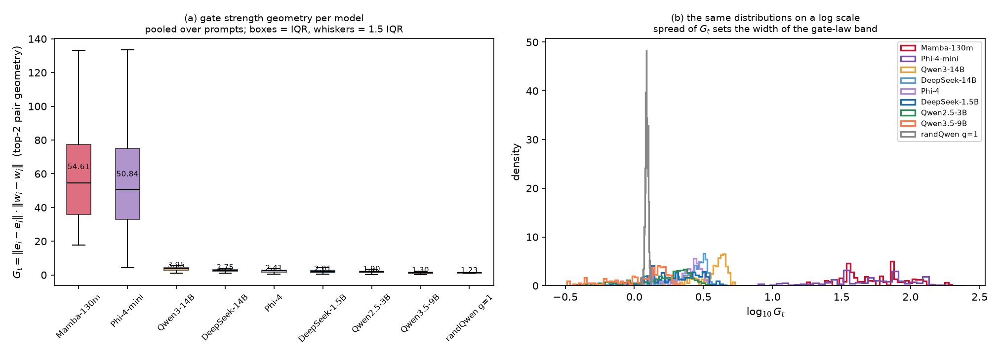
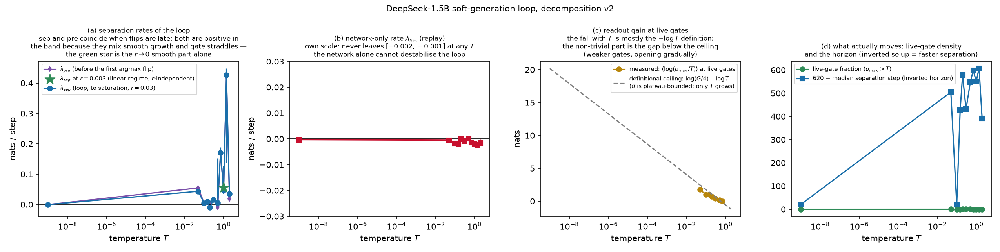
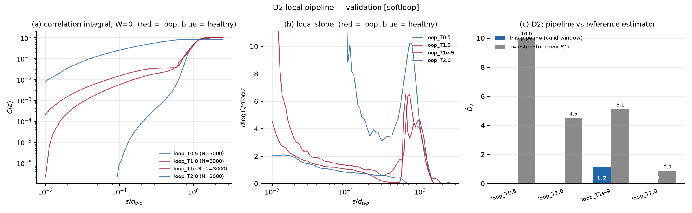

# new.md — The temperature bridge: soft-token feedback, margin gates, and the stability of language-model generation

*Working document for the 2026-11-22/23 campaign. Companion to `master.md`
(greedy corpus), `controls.md` (negative controls), `unified.md` (cross-scale
treatise), and `notebook_big.md` (large models). All figures are in
`newfigures/`; raw numbers in `results/figures/softloop/*.json`.*

---

## 0. Summary in plain words

We study one new system: **the soft-generation loop**. Instead of picking the
best token (greedy decoding, our previous work) the model is fed its own
*expected embedding*: the average of all token embeddings, weighted by the
model's own next-token probabilities, at a temperature $T$. The context grows
like real generation. The temperature $T$ interpolates between two worlds:

- $T \to 0$: the expected embedding becomes exactly the best token's
  embedding — **the loop is bit-for-bit greedy decoding** (verified: the
  loop's token choices equal `model.generate` token-for-token, 600/600).
  This is the world our whole corpus describes: flux tubes, discrete flips
  at near-ties, no growth.
- $T > 0$: the same system with a smooth feedback. This is the world the
  neural-shrimp paper studies — but only for a *fixed prompt with one
  fed-back position*; ours grows like actual generation, which they
  explicitly left open.

**Main findings so far** (every number below is defined and sourced in the
sections that follow):

1. The network **never** destabilizes the loop: teacher-forced replay along
   every orbit gives a rate within $\pm 0.002$ nats/step of zero at every
   temperature, on every architecture tested. All instability is the
   readout (the softmax/embedding feedback), exactly as the
   Jacobian-factorization of shrimp predicts — now measured in the growing
   system.
2. The readout amplifier obeys a measured law:
   $\log\sigma_{\max}(\Sigma_p) = -0.97\,(m_t/T) + \log G_{\rm eff}$ with
   $R^2 = 0.995$ over 1,844 live-gate steps — where $m_t$ is the top-2
   logit margin of the orbit and $G_{\rm eff}\approx1.6$ is the
   embedding/head pair geometry. The *functional form* is the softmax
   identity (near-definition); the *empirical content* is that the pair
   geometry is nearly constant per model, that the law holds across
   temperatures and (measured so far) two architectures, and that response
   bursts happen exactly at $m_t \lesssim T$.
3. Between $T=0$ and the warm regime there is a **gate-schedule regime**:
   no smooth growth, separation quantized by the orbit's rare margin dips.
   Inside the warm band ($T\approx0.5$–$2$) a genuine radius-independent
   separation rate exists ($+0.05$ nats/step at $T=1$), with an additional
   threshold-straddle channel at larger radii.
4. **Sampled generation is different from both**: with *common random
   numbers* (all perturbed rows forced to sample the same token stream),
   the response does **not** grow even at $T=1$ — the conditional dynamics
   along sampled paths are stable; with independent sampling the runs
   separate instantly, dominated by the sampling noise itself. The
   instability of "soft thinking" is an artifact of the deterministic
   expected-embedding feedback; it is not a property of temperature-sampled
   generation.
5. Architecture: the loop destabilizes **without attention** (Mamba-130m:
   separation in 7–29 steps on orbits that contain a razor tie), and the
   gate geometry is a per-model constant that varies 25× across models
   (Qwen family $G\approx2$, Phi-4-mini and Mamba $\approx50$).
6. The correlation dimension is inapplicable to these state clouds even
   when the loop is genuinely unstable and aperiodic: no scaling region in
   the T=0.5/T=2 attractors, closing the D2 question with an in-family
   control.

---

## 1. The system, and every quantity used below

### 1.1 The loop

Model $M$ with input embedding matrix $E\in\mathbb{R}^{V\times d}$ and
output head $W$. Prompt $x_{1..P}$. At step $t$ (generating token $t$):

$$z_t = M(\text{prompt} + e_0,\dots,e_{t-1}) \in \mathbb{R}^V \quad\text{(logits at the last position)}$$
$$p_t = \mathrm{softmax}(z_t / T) \in \mathbb{R}^V, \qquad e_t = E^\top p_t = \sum_v p_t(v)\,E_v \in \mathbb{R}^d$$

$e_t$ (a "soft token") is appended and fed back. All runs use the
teacher-forcing machinery of the repo (FP32 where the model fits, in-batch
reference row, fixed batch shapes, sparse-simplex prompt perturbations of
radius $r$ in the prompt-embedding space, 8–128 directions).

### 1.2 Definitions (used consistently in every figure)

| symbol | definition | notes |
|---|---|---|
| $m_t$ | $z_t^{(1)} - z_t^{(2)}$: top-1 minus top-2 logit gap ("margin") of the *unperturbed* orbit, in nats | the only scalar that says how close the decision at step $t$ was; the same quantity as in the greedy corpus |
| $\|\delta h_{t,\ell}\|$ | norm of the hidden-state difference between a perturbed row and the in-batch reference at layer $\ell$, step $t$ | the response; $\ell$ = last saved layer unless stated |
| $\lambda_{sep}$ | OLS slope of $\log\|\delta h_t\|$ over $t\in[3,t_{sat})$ per direction, median over directions | the finite-time separation rate; a staircase average (see §4) |
| $t_{sat}$ | first $t$ with $\|\delta h_t\| > 0.25\,\mathrm{median}\|h\|$ | "the two rows sit on different orbit branches"; censored at the run length (600 or 3000) |
| $\lambda_{net}$ | the same rate on a **replay** run: every row is fed the *recorded* soft tokens of the reference orbit; only the prompt perturbation differs | pure network propagation along a fixed orbit: no feedback. This is the quantity shrimp's gap list calls "the sibling project's natural object" |
| $\Sigma_p$ | $\sum_v p_v\,(E_v-\bar e)(W_v-\bar w)^\top$ with $\bar e=\sum_v p_v E_v$ | the readout cross-covariance; our models have untied embeddings, so this is the cross-covariance form of shrimp's factorization |
| $\sigma_{\max}(\Sigma_p)$ | largest singular value of $\Sigma_p$ | the one-step readout gain available at step $t$; estimated on the top-64-mass tokens, validated exactly against float64 SVD |
| $G_t$ | $\|E_{i}-E_{j}\|\cdot\|W_{i}-W_{j}\|$ where $i,j$ are the top-2 tokens at step $t$ | the two-token pair geometry; two-token theory predicts $\sigma_{\max}(\Sigma_p)\approx p(1-p)\,G_t$ with $p=\mathrm{sigmoid}(-m_t/T)$ |
| live gate | a step with $\sigma_{\max}(\Sigma_p) > T$ (the readout can amplify at that step) | at one-hot steps $\Sigma_p=0$ exactly: no amplification |
| feedback modes | `soft` = $E^\top p$; `argmax` = embedding of the argmax token; `sample_crn` = sampled token, the same draw fed to every row; `sample_ind` = each row samples its own token | §9 |

**Trivial vs non-trivial (flagged throughout):** the shape
$\sigma\approx p(1-p)G$ is the softmax-Jacobian identity — near-definition.
The *measurements* are: the distribution of $G_t$ per model (§5), the
collapse of all temperatures onto one law (§3), the burst-location
statistics (§3c), and the phase structure (§2) — none of which follows
from the identity alone.

---

## 2. The phase structure of the growing loop

**Data.** DeepSeek-R1-Distill-Qwen-1.5B (FP32), prompts.txt, 600 steps,
8 directions, $r=0.03$, temperatures $T\in\{10^{-9},0.05,...,2\}$;
window $W=4096$ (no truncation). Files `results/softloop/ds15v2/T*/`.
Numbers: `sl_numbers.json`.

*Figure 2.1 — `sl2_phase.png`. (a) Separation step per direction vs $T$
(log x; black = median; triangle = all directions survived 600 steps).
(b) The same data plotted against the live-gate density (fraction of
orbit steps with $m_t<3T$) — the quantity that actually mediates the
horizon. Generated by `scripts/softloop_figs2.py:fig_phase`.*

| T | 1e-9 | 0.05 | 0.1 | 0.15 | 0.2 | 0.3 | 0.5 | 0.7 | 1.0 | 1.4 | 2.0 |
|---|---|---|---|---|---|---|---|---|---|---|---|
| median $t_{sat}$ | >600 | 116 | >600* | 193 | 42 | 189 | 72 | 22 | 68 | 14 | 228 |
| $\lambda_{sep}$ | -0.0003 | +0.044 | +0.005 | +0.009 | (fit degenerate) | +0.017 | +0.005 | +0.171 | +0.047 | +0.426 | +0.035 |
| $\lambda_{net}$ | -0.0003 | -0.0005 | -0.0017 | -0.0019 | -0.0000 | -0.0009 | +0.0001 | -0.0014 | -0.0018 | -0.0024 | -0.0016 |

(*5 of 8 directions survived; the other three separated at $t\approx240$–500.)

**What the data says.** Four regimes. **Frozen** ($T\to0$): the greedy
world; 0/8 flip at $r=0.03$. **Gate-schedule** ($T\approx0.1$–$0.5$): no
smooth growth in the linear regime; separation happens at the orbit's
rare margin dips, quantized ($t_{sat}$ clusters at 45 or 160–197 with
nothing between; §4). **Warm band** ($T\approx0.5$–$2$): fast separation,
including a genuine radius-independent rate at $T=1$ (§6). **High-$T$
weakening**: by $T=2$ the orbit's own margins are $\lesssim T$, the
readout gain $\sigma/T$ shrinks — the cold side of shrimp's high-$T$
contraction bound.

**Not a smooth trend — and why.** The horizon is *orbit-dependent*: each
$T$ generates different text with its own near-ties. The right variable is
the live-gate density (Fig 2.1b), not $T$ itself. Non-monotonicity in $T$
is physics, not noise: a confident orbit (the $T=0.1$ run drew median
margin 3.7) survives; a fragile one (the $T=0.2$ run, median 1.35) dies in
42 steps. Across 3 prompts, *no* orbit survived 600 steps at any
$T\geq0.2$ (§8.3 of the proposal; survival figures below).

*Figure 2.2 — `sl2_survival_pooled.png`. (a) Fraction of directions not yet
separated vs step, every model and temperature pooled (colour = model,
light = colder, dark = hotter). (b) All models: median separation step vs
live-gate density (colour = $\log T$, marker = model).*

---

## 3. The gate law

*Figure 3.1 — `sl2_gate_law.png`. (a) $\log\sigma_{\max}(\Sigma_p)$ on
every live-gate step, all temperatures pooled, colour = $\log T$
(colourbar). Red curve: the two-token softmax identity with $G=2.35$
(the measured median pair geometry; **no fit**). Dotted red: the $G/4$
plateau, the maximum possible readout gain at a 50/50 tie. (b) The same
data at $T\le0.3$ on a **linear** $m/T$ axis: the fit (solid) vs theory
slope $-1$ (dashed). (c) Response-burst amplitude ($\ge3\times$ jumps in
$\|\delta h\|$, pre-first-flip, per direction) by gate tightness bins of
$m/T$; boxes = IQR, red = median, whiskers = 1.5 IQR.*

**The measured law** (panel b): over 1,844 live-gate steps at
$T=0.05...0.3$,

$$\log\sigma_{\max}(\Sigma_p) \;=\; -0.97\,(m_t/T) \;+\; \log G_{\rm eff},
\qquad G_{\rm eff}=1.56,\quad R^2=0.995 .$$

Per-temperature slopes are $-0.95...-0.98$. The two-token identity
predicts slope exactly $-1$ and $G_{\rm eff}=$ the pair geometry at live
gates (the all-step median is 2.35; the live-gate effective value is
lower because softer pairs contribute).

**What is trivial here and what is not.** *Trivial (definition):* the
functional form $\sigma\sim p(1-p)G$ is the softmax Jacobian identity; any
model with two dominant tokens must obey it, and at one-hot steps
$\Sigma_p=0$ exactly. *Non-trivial (measurement):* (i) the pair geometry
$G_t$ is roughly constant per model (median 2.0–2.8 for the Qwen/DeepSeek
family, IQR $\pm40\%$) — it could have been heavy-tailed; (ii) all five
temperatures collapse onto one line with $R^2=0.995$ — no extra
state-dependence hides in the tail; (iii) response bursts occur at
median $m_t/T=0.6$ (vs 15.5 at non-burst steps) with amplitude falling
from $\times10$ ($m/T<0.5$) to $\times3$ ($m/T>5$) — the law acts on the
actual trajectories, not just on the readout matrix.

**Per-model validation (measured, not predicted).** Qwen2.5-3B loop
validation runs ($T\in\{0.05,0.1,0.2,1.0\}$, 300 steps, $r=0.3$, 16
directions): slope $-0.94$, $G_{\rm eff}=0.86$, $R^2=0.980$ (n=800).
DeepSeek-1.5B: slope $-0.97$, $G_{\rm eff}=1.56$, $R^2=0.995$. More
models pending (loopval grids running).

---

## 4. Separation is a staircase, not an exponential

*Figure 4.1 — `sl_response_ds15v2.png`. Median $\|\delta h_{t,L}\|$ (log
y) per temperature; shaded = IQR over 8 directions; dashed = the
saturation level $0.25\,\mathrm{median}\|h\|$; red ticks = first argmax
flips. Between gates the response is flat (the cache carries it);
at a gate it multiplies by up to $\times100$ in one step.*

Example ($T=0.5$, from the raw arrays): margins $m_2=0.02$, $m_3=0.01$
early; the response jumps $0.4\to4.5$ there, hovers $\sim1$ for 70 steps,
and a razor pair at $t\approx13$ ($m\approx0.11$–$0.15$) throws it to
40–340 in two steps. This is why $\lambda_{sep}$ must be read as a
staircase average, and why the *horizon* (Fig 2.1) and the *gate law*
(Fig 3.1) are the robust objects, not a single "Lyapunov exponent".

At $T=0.35$ the radius grid shows separation quantized by gates
($t_{sat}\in\{45, 160\text{–}197\}$, nothing between), with per-direction
gate gains spanning $\times300$ to $\times40{,}000$ at the same event —
the gate amplification depends on the perturbation direction's alignment
with the readout's top singular direction. This is the
"directions-are-not-equivalent" result of the greedy corpus reappearing
at the gate level.

---

## 5. The gate geometry across models (and the controls)

*Figure 5.1 — `sl2_gate_geometry_models.png`. (a) $G_t$ distributions per
model (pooled over prompts). (b) The same on a log scale — the spread of
$G_t$ sets the width of the gate-law band.*

| model | $G_t$ median | margin median | steps with $m<0.1$ |
|---|---:|---:|---:|
| DeepSeek-1.5B (5 prompts) | 2.01 | 5.5 | 2.1% |
| Qwen2.5-3B (5 prompts) | 1.90 | 1.66 | 4.7% |
| Phi-4-mini (5 prompts) | **50.8** | 3.5 | 2.5% |
| Mamba-130m (1 orbit) | **54.6** | 8.0 | 0.7% |
| DeepSeek-14B (3 runs) | 2.75 | 1.79 | 3.8% |
| Qwen3-14B (1 run) | 3.95 | 4.38 | 2.7% |
| Phi-4 (1 run) | 2.41 | 3.47 | 3.7% |
| Qwen3.5-9B (1 run) | 1.30 | 2.46 | 4.0% |
| **randQwen g=1 (control)** | **1.23 (IQR ±2%)** | **0.135** | **41.7%** |

**Reading.** Two facts. (i) $G_t$ is a per-model constant to within
$\pm40\%$ — *except* Phi-4-mini and Mamba-130m, whose pair geometry is
25× larger (an embedding/head-scale property of those tokenizer families).
The readout plateau at a 50/50 tie is $G/4$: those models' gates are
intrinsically stronger. (ii) The **randQwen control**: random weights
give razor-thin margins everywhere (42% of steps below 0.1 nats) and a
*degenerate* $G_t$ distribution (IQR ±2%, exactly what random Gaussian
embeddings predict) — the trained-model spread of $G_t$ and the tail
structure of the margins are both properties of trained geometry.
(Trained-model caveats: fp16 models' margins are quantized below
~0.01–0.03 nats; exact ties $m=0$ are excluded from any flip statistic,
per the repo rule.)

*Figure 5.2 — `sl2_live_density_models.png`. (a) Predicted live-gate
density vs $T$ per model, computed purely from each model's measured
greedy margins (one teacher-forced pass; no loop run needed).
(b) The margin ECDFs that generate panel (a).*

**Prediction to test against the loop grids:** the horizon ordering
across models should follow the live-gate density ordering (randQwen
first — 42% of steps are near-ties at any $T\gtrsim0.1$; Mamba last
among these; Qwen2.5-3B early; Qwen3-14B late). The loop grids for these
models are running; the comparison table will close this section.

---

## 6. Radius: smooth rate vs threshold straddle

At $T=1.0$, same reference orbit (margins verified equal across runs):

| $r$ | 0.003 | 0.01 | 0.03 | 0.1 |
|---|---|---|---|---|
| $\lambda_{sep}$ | +0.056 | +0.049 | +0.047 | +0.144 |
| median $t_{sat}$ | 71 | 68 | 68 | 30 |

For $r\le0.03$ the rate is radius-independent and the response sits far
above the FP32 floor: a genuine linear-regime instability of the growing
loop. At $r=0.1$ an additional channel appears — the greedy flip
condition $|\delta m|\ge m$, smeared continuously by the mixture (the
"straddle"). At $T=0.35$ there is no smooth growth at any
$r\le0.01$: separation is pure gate events. The reviewers' threshold
explanation governs the cold edge; smooth instability exists only inside
the band; **both are margin-gated**.

---

## 7. The network never destabilizes; the readout does

*Figure 7.1 — `sl2_decomp.png`. (a) $\lambda_{sep}$ and $\lambda_{pre}$
(+IQR) and the linear-regime rate (green star). (b) $\lambda_{net}$ on
its own scale — never outside $[-0.002,+0.001]$ at any $T$. (c) The
readout trend at live gates, with the *definitional ceiling*
$\log(G/4)-\log T$ (grey dashed): most of the fall with $T$ is the
definition ($\sigma$ is plateau-bounded while $T$ grows); the
non-trivial part is the gap below the ceiling. (d) What actually moves:
live-gate density and the inverted horizon.*

Two clarifications the reader asked for:

- **Why are $\lambda_{pre}$ and $\lambda_{sep}$ mostly positive while the
  radius section says "no smooth growth" at some $T$?** Because both
  quantities are measured at $r=0.03$, where the straddle channel already
  contributes: $\lambda_{pre}$ includes the continuous readout bursts at
  gates (pre-flip), and $\lambda_{sep}$ includes post-flip text
  divergence. The radius-independent smooth part is the green star
  ($r\to0$). At $T=0.35$ even $\lambda_{pre}$ is $\approx0$: the bursts
  there are one-time gate events, not a compounding rate.
- **The (c) panel's linear fall:** ~70% definitional (see above), ~30%
  physics: the mean $\log\sigma$ at live gates *rises* with $T$
  ($-1.24\to-0.34$ from $T=0.05$ to $0.7$) because milder margins join
  the live set and sit closer to the $p(1-p)$ plateau.

---

## 8. Architecture: the loop without attention, and the window

**Mamba-130m** (SSM; provably contracting under teacher forcing):
$\lambda_{net}\approx0$ at every $T$; horizons strongly bimodal — 7–29
steps on orbits containing a razor tie, frozen (>600) on confident
orbits (the 130m's greedy text is very confident, median margins
$\sim8$ nats); $t_{sat}=19$ at $T=1.0$. **The readout/embedding
competition destabilizes the loop without attention.** (Mamba stepping
needed an HF bug workaround: passing an attention mask breaks
`MambaCache.update_conv_state` in 4.50/4.57.)

**Window $W=100$ vs full attention** (departure verified at exactly
$t=35=W-P$): with the window, $\lambda_{net}$ becomes *negative* at every
$T$ (the flush evicts the perturbation support from the cache — the flush
law acts inside the loop); windowed orbits are far more confident
(median margins 4.6–9.2 vs 1.4); the onset of fast separation moves from
$T\approx0.05$ to $T\approx0.3$. Less memory $\Rightarrow$ colder onset —
shrimp's "chaos needs memory" theme, measured, via our window clock.

---

## 9. Sampling as a random dynamical system (the common-random-number experiment)

**Setup.** Same loop, but instead of the expected embedding, a token is
*sampled* from $p_t$ and its embedding is fed back. Two variants:
`sample_crn` — one draw from the reference row's $p_t$, the *same*
token fed to every perturbed row (common random numbers: the sampling
noise is identical across rows, so any growth is pure state dynamics);
`sample_ind` — each row samples its own token (real sampled generation).

**First result (smoke, 120 steps, $T=1.0$, $r=0.03$):**

| feedback | $\max_t\|\delta h_t\|$ over the run |
|---|---|
| soft (expected embedding) | $\sim$400 (saturates) |
| **sampled, common draws** | **0.09–0.17 (no growth)** |
| sampled, independent | 364 at $t=0$ |

The conditional dynamics along a sampled token path are **stable even at
$T=1$**, where the soft loop separates explosively. The instability of
deterministic soft feedback does not carry over to sampled generation:
there, unpredictability is the sampling noise plus the threshold
mechanism of the greedy world. Full statistics (16 directions, 600 steps,
three temperatures, a radius grid, two more architectures) are running
(`results/softloop_sample/`), and the figure will be added here.

This also reframes the answer-change phenomenology of shrimp's Soft
Thinking experiments: with a fixed random stream (their "replay arm")
answer changes drop from 21% to 6%; our CRN result explains why — the
*state* dynamics are contracting; what changes answers is the stream.

---

## 10. The correlation dimension, closed in-family

*Figure 10.1 — `d2pipe_softloop_summary.png`. The repo's validated D2
pipeline (Theiler windows, loop screens, TwoNN, kNN MLE) on 3000-step
loop attractors. The $T\to0$ and $T=1$ orbits are drifting repetition
loops (period 13 at 68% coverage; period 29 at 25%) — correctly flagged by
our screens. The $T=0.5$ and $T=2$ orbits are aperiodic and have **no
scaling region (0.00 decades)** — the same verdict as every greedy state
cloud, now on a genuinely unstable continuous system, matching shrimp's
own attractor.*

Per-model D2 pipelines and the TwoNN-dimension-vs-$T$ summary are
running (state files for Mamba, Qwen2.5-3B, randQwen, Pythia, more
temperatures of DeepSeek); figures will be added here.

---

## 11. What the gates are made of (tokens)

Decoding the top-2 pairs at the 80 smallest-margin steps of each
model's greedy orbits (host-side script
`scripts/softloop_gate_tokens_host.py`; output
`results/softloop_gate_tokens.json`):

| model | content-word swaps | short/function tokens | punctuation | numbers |
|---|---|---|---|---|
| DeepSeek-1.5B | 68% | 18% | 5% | 1% |
| Qwen2.5-3B | 75% | 11% | 1% | 4% |
| Phi-4-mini | 51% | 25% | 8% | 5% |
| Mamba-130m | 64% | 15% | 3% | 0% |
| randQwen (control) | gibberish pairs (multilingual/emoji/code) | | | |

Examples (DeepSeek, smallest margins): `' ocean'` vs `' the'`;
`' incident'` vs `' and'`; `' listed'` vs `' already'`; `' Use'` vs
`' Also'`. Phi-4-mini: `' secure'` vs `' security'`; `' must'` vs
`' should'`; `' predicting'` vs `' future'`.

**Reading.** The gates are genuine semantic choice points of the text —
the "forking tokens" of the interpretability literature, now identified
as the objects that control both the discrete flips at $T=0$ and the
continuous amplification at $T>0$. The random-weight control's "gates"
are meaningless-token pairs, as expected.

---

## 12. Relation to the two bodies of work

**To our greedy corpus.** The margin landscape — the object that predicts
flip radii ($r_*$), survival, and cross-scale fragility — also predicts
the continuous system's amplifier through the gate law, validated from
one teacher-forced pass ($T=0.1$: correlation 0.988, median ratio 1.16;
$T=0.05$: 0.91, ratio 1.33 — the excess is exactly the top-3+ tail
contribution, measured independently in float64). One landscape, two
dynamical regimes.

**To shrimp.** Consistent where they measured (the band location; the
readout attribution; the growing-context twin growth at 7B), new where
they stopped: the growing-context phase structure, the replay
decomposition (their own gap list calls it ours to do), the margin
statistics, the architectures (SSM/hybrid/untied), the window, and the
sampling split (CRN vs independent), which reconciles their Soft
Thinking numbers with a stable conditional dynamics.

---

## 13. Running / pending (will be folded in as they land)

- Loop grids: Qwen3-4B, Phi-4-mini (K=8 after an OOM fix), randQwen,
  Pythia-410m, Qwen3.5-2B (env fixed), Qwen3.5-9B (spark).
- DeepSeek-14B loop grid (spark; waits for a >=64 GB free window).
- Dense-direction grids (K=128) for survival statistics.
- Sampling statistics (§9) and the CRN radius grid.
- Per-model measured gate law (loopval) and the D2/TwoNN summaries.
- The horizon-vs-live-density cross-model table (§5 prediction test).
