# DeepSeek-1.5B: definitions, data, and every figure explained

This is the single reference document. Part 1 defines every symbol and formula. Part 2 shows
each figure with (i) the data it comes from, (ii) the exact definition of both axes,
(iii) what every curve is, (iv) what the figure shows and does not show. Part 3 relates this
to Lyapunov exponents, Part 4 separates trivial from non-trivial results, Part 5 lists null
results, Part 6 is the data inventory.

**One warning first.** The system is **non-autonomous**: at every step the model reads a new
token, so the update map changes with time. Lyapunov exponents, attractors and invariant
measures are defined for autonomous maps; Part 3 explains what our numbers are and are not.

---

# Part 0. Glossary — every symbol and every statistic used below

Read this once; the rest of the document uses these words without re-defining them.

## 0.1 The model and the experiment

| term | meaning |
|---|---|
| **residual stream** | the vector $h_{t,\ell}\in\mathbb{R}^d$ carried from block to block at position $t$; $\ell$ indexes the block (layer), $\ell=0$ is the embedding output, $\ell=L$ is after the last block. |
| **block / layer** | one transformer block: attention, then an MLP, each added to the residual stream. "Block $\ell$" = the map from $h_{t,\ell}$ to $h_{t,\ell+1}$. |
| **position** | the index of a token in the sequence. Prompt positions are $0\dots P-1$; generated positions are $P\dots P+T-1$; a generated position is also written $t=0,1,\dots$ counted from the first generated token. |
| **teacher forcing** | run the model on a *fixed* token sequence (the baseline greedy output), so that a perturbation cannot change which token comes next. This isolates the continuous dynamics. |
| **free run** | generate tokens greedily; if the perturbation changes a token, the continuation diverges. This is the real generation. |
| **greedy decoding** | at each step take the token with the largest logit. No temperature, no sampling, no repetition penalty. |
| **logits** | the $V$-dimensional output before the softmax, $z=W_U h$; $V$ is the vocabulary size. |
| **margin** $m_t$ | the gap between the largest and second-largest logit at step $t$: $m_t=z_{(1)}-z_{(2)}$. Small margin = close call. |
| **top-1 / top-2** | the highest and second-highest scoring tokens at a step. |
| **flip** | a step where the perturbed run's greedy token differs from the baseline's. The first flip is the first such step. |
| **perturbation radius** $r$ | the Euclidean norm of the vector added to the embeddings. All perturbations are additive noise of norm $r$; "linear regime" means the response is proportional to $r$. |
| **direction** $u$ | a unit vector; the perturbation is $r\,u$. Different $u$ = different directions in the same $d$-dimensional space. |

## 0.2 The quantities we plot

| symbol | definition | what it is |
|---|---|---|
| $\delta h_{t,\ell}$ | $h'_{t,\ell}-h_{t,\ell}$ | the difference between perturbed and baseline hidden state |
| $\|\delta h_{t,\ell}\|$ | its Euclidean norm | absolute size of the perturbation |
| $\|\delta h_{t,\ell}\|/\|h_{t,\ell}\|$ | ratio to the state's own norm | **relative** size; cancels the residual stream's growth |
| $g_\ell$ | $\|\delta h_{t,\ell}\|/\|\delta h_{t,\ell-1}\|$ | layer-to-layer gain at a fixed $t$ |
| $\lambda_k(t)$ | $\frac{1}{2k}\log\frac{\|\delta h_{t+k}\|}{\|\delta h_{t-k}\|}$ | finite-time stretching rate over a lag $k$, in nats per token |
| $\Lambda(t)$ | $\frac1t\log\frac{\|\delta h_t\|}{\|\delta h_0\|}$ | cumulative average rate from the start |
| $u_t$ | $\delta m_t/m_t$ | the margin coordinate: how far the margin moved, in units of itself; a flip needs $u_t\le-1$ |
| $r_c(t,u)$ | $m_t\,\big/\,\big(|\delta m_t(u)|/r\big)$ | the radius at which the margin at step $t$ would reach zero for direction $u$ |
| $r_*(u)$ | $\min_t r_c(t,u)$ | the smallest radius that flips *any* token of the continuation for that direction |
| $\sigma_i(\ell)$ | $i$-th singular value of the block product $P_\ell$ | the factor by which the tangent map can stretch the $i$-th direction; $\sigma_1$ = largest |
| $\lambda_i(\ell)$ | $\log\sigma_i(\ell)/(\ell+1)$ | log stretch per block; the finite-time Lyapunov exponent of the $i$-th direction |
| $J_\ell$ | $\partial h_{\ell+1}/\partial h_\ell$ | the block Jacobian at a fixed position |
| $P_\ell$ | $J_\ell J_{\ell-1}\cdots J_0$ | the product of block Jacobians through $\ell+1$ blocks |

## 0.3 Statistics

| term | meaning |
|---|---|
| **median** | the 50th percentile: half the values are below. Robust to outliers; used for almost every curve. |
| **mean** | the arithmetic average. Sensitive to outliers; used only when stated. |
| **IQR** | interquartile range, 25th to 75th percentile: the band that contains the middle half of the values. Plotted as a shaded band. |
| **10–90% band** | the range from the 10th to the 90th percentile: contains 80% of the values. Used when the distribution is wide. |
| **quantile** | the value below which a given fraction of the data lies; "5% quantile" = 5% of values are smaller. |
| **ECDF** | empirical cumulative distribution function: for a value $x$, the fraction of observations $\le x$. It starts at 0 and ends at 1, and it is a staircase for finite data. |
| **CCDF** | complementary cumulative distribution function: $1-\text{ECDF}(x)$ = the fraction of observations $>x$. Plotted on log–log axes when the tail is of interest. |
| **histogram** | counts of observations in bins. |
| **bootstrap CI** | a confidence interval obtained by resampling the data with replacement many times (here 2000) and taking the 2.5–97.5% range of the statistic. A 95% CI that excludes zero is the usual significance criterion. |
| **standard error (SE)** | the uncertainty of a fitted parameter, from the fit's covariance matrix. Quoted as "value ± SE". |
| **$R^2$** | fraction of the variance of $y$ explained by the fit: 1 = perfect, 0 = no better than the mean. |
| **BIC** | Bayesian information criterion: $n\ln(\text{RSS}/n)+k\ln n$, where RSS is the residual sum of squares, $n$ the number of points, $k$ the number of parameters. **Lower is better**; it penalises extra parameters, so it can compare models with different numbers of parameters. A difference $\Delta$BIC $<2$ is not evidence for either model. |
| **censored** | a measurement cut off by the horizon: e.g. "the perturbation never doubled within 300 tokens". Censored points are excluded from a rate and counted separately. |
| **survival function** $S(t)$ | fraction of cases still "alive" (not yet flipped) at time $t$. Starts at 1 and decreases. |
| **hazard** | the per-step probability of flipping given that it has not flipped yet. |
| **log-logistic** | the distribution with CCDF $1/(1+(x/k)^b)$; $k$ is its median and $b$ the tail exponent. Used as a candidate description of $r_*$. |
| **power law** | $y=a x^b$; on log–log axes it is a straight line of slope $b$. |
| **exponential** | $y=a e^{bx}$; on semilog axes (log $y$, linear $x$) it is a straight line. |
| **stretched exponential** | $y=a e^{-(x/\tau)^\beta}$; $\beta<1$ decays slower than an exponential. |
| **nats** | the natural unit of a logarithm: a rate of 1 nat/token means the quantity is multiplied by $e\approx2.718$ per token. |

## 0.4 The window

| term | meaning |
|---|---|
| **sliding window** $W$ | each position may attend only to the previous $W$ positions. It is a property of the attention mask, not of the weights. |
| **flush** | the step at which a perturbation becomes *exactly* zero at a layer because the window has removed every perturbed position from its receptive field. |
| **first departure** | the first step at which a run with window $W$ differs from a run with no window: it happens at $t=W-P$, when the first prompt token leaves the window. |

## 0.5 Geometry terms (used in Part 8 and Part 9)

| term | meaning |
|---|---|
| **SVD (singular value decomposition)** | writing a matrix $M=U\Sigma V^\top$ with $\Sigma$ diagonal and non-negative. The diagonal entries $\sigma_i$ are the singular values: the factors by which $M$ stretches its principal directions. |
| **$\sigma_1$ / $\sigma_{\max}$** | the largest singular value: the maximum stretch over *all* unit vectors. It is attained by one particular direction (the top right-singular vector). It is not the stretch of a generic vector. |
| **rank / effective rank** | the number of non-zero singular values is the rank; the *effective* rank is how many are needed to reach a given fraction (90% here) of the total squared singular values. Used for matrices that are technically full rank but numerically low-rank. |
| **participation ratio (PR)** | $(\sum_i\lambda_i)^2/\sum_i\lambda_i^2$ with $\lambda_i$ the eigenvalues of a covariance. It is an "effective number of dimensions": 1 if all variance is in one direction, $D$ if it is spread evenly over $D$ directions. |
| **stable rank** | $\sigma_1^2/\sum_i\sigma_i^2$, between 1 and the rank; another effective-dimension measure, less sensitive to the tail. |
| **intrinsic dimension (ID)** | the dimension of the manifold the data locally lies on, estimated from nearest-neighbour distances (Levina–Bickel maximum-likelihood estimator, "MLE", with $k$ neighbours). Reported per trajectory because pooling different trajectories inflates/deflates it. |
| **anisotropy** | the mean cosine between two randomly chosen state vectors. 0 = directions are unrelated (isotropic); 1 = all vectors point the same way. |
| **cone** | $\|\mu\|/\overline{\|h\|}$ with $\mu$ the mean state: 0 = the states surround the origin, 1 = they all lie on one ray. |
| **principal angle** | the angle between two subspaces; the cosines of the principal angles are the singular values of the product of their orthonormal bases. Used to ask whether two subspaces (e.g. the top singular directions of consecutive blocks) point the same way. |
| **cosine** between vectors | $\langle a,b\rangle/(\|a\|\|b\|)$: 1 = same direction, 0 = perpendicular. |
| **residual write** | the increment $h_{\ell+1}-h_\ell$ that a block adds to the residual stream. |
| **flux tube** | our name for the picture that emerges: the perturbation stays confined (its norm does not grow) and travels along the trajectory, leaving only at isolated "gates" where the decision margin crosses zero. It is a description, not a derived object. |
| **participation ratio vs ID** | PR/effective rank describe the *linear* spread of the data (covariance); ID describes its *local* manifold dimension. They answer different questions and need not agree. |

---

# Part 1. Definitions

## 1.1 Model and protocol

`DeepSeek-R1-Distill-Qwen-1.5B`, **float32**, one GPU, **greedy** decoding (temperature 0, no
sampling, no repetition penalty). Decoder-only Transformer, 28 blocks, hidden width $d=1536$.
A *sliding attention window* $W$ limits how far back a token can attend. It is part of the
attention mask, not of the weights.

| symbol | meaning |
|---|---|
| $P$ | number of prompt tokens (65 in most runs) |
| $T$ | number of generated tokens (300 unless stated) |
| $p_1,\dots,p_P$ | prompt token ids |
| $g_0,\dots,g_{T-1}$ | generated token ids of the unperturbed run |
| $e_p\in\mathbb{R}^d$ | input embedding of token $p$ |
| $h_{t,\ell}\in\mathbb{R}^d$ | residual-stream state at generated position $t$, output of block $\ell$ ($\ell=0$: embedding; $\ell=27$: last block, before the final norm) |
| $z_t\in\mathbb{R}^V$ | logits that predict token $t$ ($V\approx152$k) |
| $m_t$ | **decision gap** $=z_t^{(1)}-z_t^{(2)}$ (top-1 minus top-2) |
| $W$ | sliding-window size, in tokens |
| $r$ | perturbation radius (a length in embedding space) |
| $u$ | unit perturbation direction |

**Decision gap.** At step $t$ the model scores every vocabulary item; sort
$z_t^{(1)}\ge z_t^{(2)}\ge\cdots$. The gap $m_t=z_t^{(1)}-z_t^{(2)}$ says how comfortably the
top word wins. A word can change only if a perturbation makes $z^{(2)}$ overtake $z^{(1)}$.

**Context length.** When predicting $g_t$ the model has seen $P+t$ tokens. With window $W$,
once $P+t>W$ the oldest tokens are invisible. That is the only way $W$ can change anything.

## 1.2 The three things we vary

**(A) Prompt perturbation** ("A1"). Add the same vector to every prompt embedding:
$$e'_{p_i}=e_{p_i}+r\,u_i,\qquad i=1,\dots,P,$$
where $u=(u_1,\dots,u_P)\in\mathbb{R}^{Pd}$ is a unit vector and $r$ its length. The 20
directions used in most runs form a *simplex*: each $u$ is supported on one coordinate per
prompt position, and any two are nearly orthogonal. Nothing is added to generated positions.
The model then runs teacher-forced (1.3) on the unperturbed token sequence.

**(B) Single-position ("current-state") perturbation.** Add a vector to one generated position:
$$e'_{P+s}=e_{P+s}+r\,v,\qquad \|v\|_2=1,$$
with $v$ a fixed Gaussian direction (24 directions in the latest runs). This is what earlier
texts called "kick" or "nudge". **They are the same thing; from now on the word is
perturbation.**

**(C) Window change.** Keep the prompt and the exact token sequence; only change $W$. This
isolates the effect of the attention mask, with no perturbation at all ($r=0$).

## 1.3 Teacher forcing vs free run

*Free run*: the model is fed its own output, $g'_t=\arg\max z_t(h'_0,\dots,h'_{t-1})$.
*Teacher-forced pass*: the model is fed the baseline tokens $g_0,\dots,g_{T-1}$ at every
position, so each position is evaluated on the same prefix; the token it *would* emit at step
$t$ is $\hat g_t=\arg\max z'_t$.

## 1.4 Observables

**Hidden-state response**
$$\delta h_{t,\ell}=h'_{t,\ell}-h_{t,\ell},\qquad
\|\delta h_{t,\ell}\|=\|\delta h_{t,\ell}\|_2,\qquad
\|\delta h_{t,\ell}\|/\|h_{t,\ell}\|=\frac{\|\delta h_{t,\ell}\|}{\|h_{t,\ell}\|_2}.$$
$a$ is an absolute length; $q$ is the same change as a fraction of the state's own length.
Both appear in the figures; they answer different questions.

**Logit response.** With $i_1(t),i_2(t)$ the baseline top-1/top-2 indices,
$$\delta m_t(u)=\big(z'^{(i_1)}_t-z'^{(i_2)}_t\big)-\big(z^{(i_1)}_t-z^{(i_2)}_t\big)=m'_t-m_t.$$
$\delta m_t<0$: the gap shrank. $\delta m_t>0$: it widened.

**Flips**
$$T_{\text{free}}=\min\{t:g'_t\ne g_t\},\qquad
T_{\text{tf}}=\min\{t:\hat g_t\ne g_t\}.$$
If no such $t$ exists we report $-1$ ("no flip in 300 tokens").

**Local threshold.** A flip at $t$ needs $z'^{(2)}_t\ge z'^{(1)}_t$, i.e.
$$\delta m_t\le -m_t .$$
Because the response is proportional to $r$ in the linear regime, the smallest radius that
flips the word at $t$ in direction $u$ is
$$r_c(t,u)=\frac{m_t}{\max\!\big(-\delta m_t(u)/r,0\big)}=\frac{m_t\,r}{\max(-\delta m_t(u),0)},$$
and the predicted first flip is
$$\hat T(r,u)=\min\{t:r\ge r_c(t,u)\},\qquad r_*(u)=\min_t r_c(t,u).$$
Only a **negative** shift counts. Replacing $\delta m$ by $|\delta m|$ ("sign-blind") predicts
flips where the gap is widening; Part 2 quantifies the damage.

**Two prediction modes.** *Measured-at-$r$*: compute $\delta m$ with a teacher-forced pass at the
same $r$ you want to predict. *Extrapolated*: compute $\delta m$ at a small $r$ and scale
linearly. The first is a measurement, the second is a model; they behave very differently
for $r>0.3$.

**Survival**
$$S=\frac{T_{\text{free}}}{T}.$$
It is the fraction of the unperturbed answer that is reproduced, because after the first
difference the texts never re-converge (measured 0/75).

**Window departure.** For two runs with the same tokens and windows $W_1<W_2$,
$$D(W_1,W_2)=\min\{t:a_{W_1}(t)\ne a_{W_2}(t)\}$$
compared bitwise in float32. Empirically
$$D(W_1,W_2)=W_1-P .$$
That is: the curves separate at the first generated step whose context no longer fits in the
smaller window. The *response ratio* used in one figure is $\rho(t)=a_{W_1}(t)/a_{W_2}(t)$:
$\rho=1$ exactly before $D$, $\rho\ne1$ after.

**Depth and non-normality.** For fixed $t$, $\|\delta h_{t,\ell+1}\|/\|\delta h_{t,\ell}\|$ is the local gain. For a fixed
position the tangent map is $J_\ell=\partial h_{\ell+1}/\partial h_\ell$; $\sigma_{\max}(J_\ell)$
is its largest singular value, $\rho(J_\ell)$ its spectral radius, $\kappa=\sigma_{\max}/\rho$.

**Correlation dimension** (Part 2.G). For $N$ states $x_i$,
$$C(\varepsilon)=\frac{2}{N(N-1)}\sum_{i<j}\mathbf 1\{\|x_i-x_j\|_2<\varepsilon\},\qquad
D_2=\frac{d\log C}{d\log\varepsilon}.$$
A reliable value needs a *plateau* inside $[10/N,\,2\log_{10}N]$.

**Finite-time growth rate**
$$\lambda(t)=\frac1t\log\frac{\|\delta h_t\|}{\|\delta h_0\|}.$$
It is a finite-time stretching rate along one trajectory, not a Lyapunov exponent (Part 3).

---

# Part 2. Every figure

## Part 2.0 — The central result: this is stable chaos, not exponential chaos

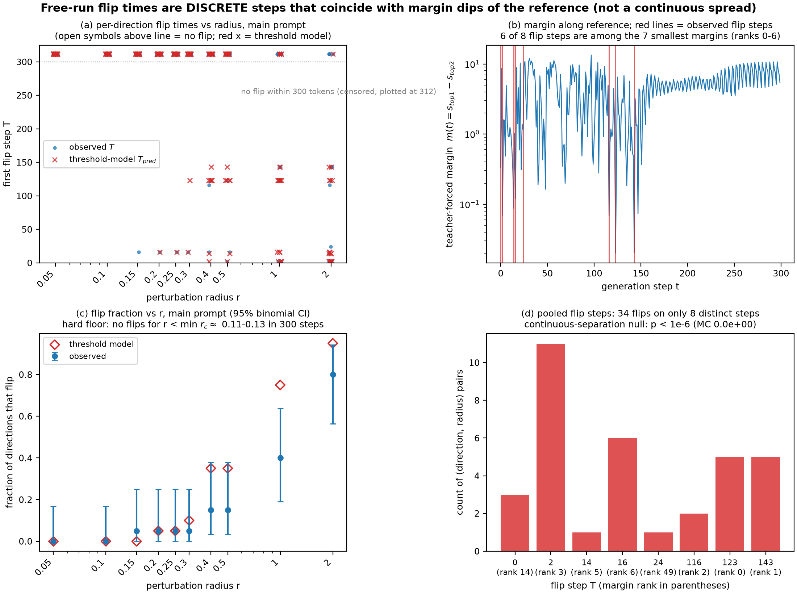

**The question.** Does a perturbed generation diverge because infinitesimal differences grow
exponentially (ordinary chaos), or because a finite perturbation crosses a local decision
boundary after shadowing the original for a long time (stable chaos / flux tubes)?

**Definitions.** For one prompt, one window and one radius $r$, run $n=20$ directions.
$T$ is the first generated token that differs from the unperturbed reference ($T=\infty$ if none
within 300 tokens). The **survival curve** is $S_r(t)=P(T>t)$, estimated as the fraction of
directions with $T>t$. The **threshold field** $r_c(u,t)$ is computed from one teacher-forced pass
(margin over margin shrink, B1) and predicts a flip at the first $t$ with $r_c(u,t)<r$.

**Panel (a).** All 34 flips of the main prompt, as (radius, flip step). **Panel (b).** The flip
steps against the baseline margin at those steps. **Panel (c).** Calibration.

**Reading.** The 34 flips land on **8 steps only** — $\{0,2,14,16,24,116,123,143\}$ — and those are
the lowest-margin steps of the reference (ranks 0,1,2,3,5,6 among 300). A continuous-separation
null would give ≈32 distinct steps; the probability of ≤8 distinct steps under that null is
$p<5\times10^{-6}$ (Monte Carlo, $2\times10^5$ draws). Direction 10 flips at the **same step 16**
for $r=0.15,0.2,0.25$, whereas exponential separation would move the flip time by
$\approx b\ln(0.25/0.15)\approx25$ tokens over that range.

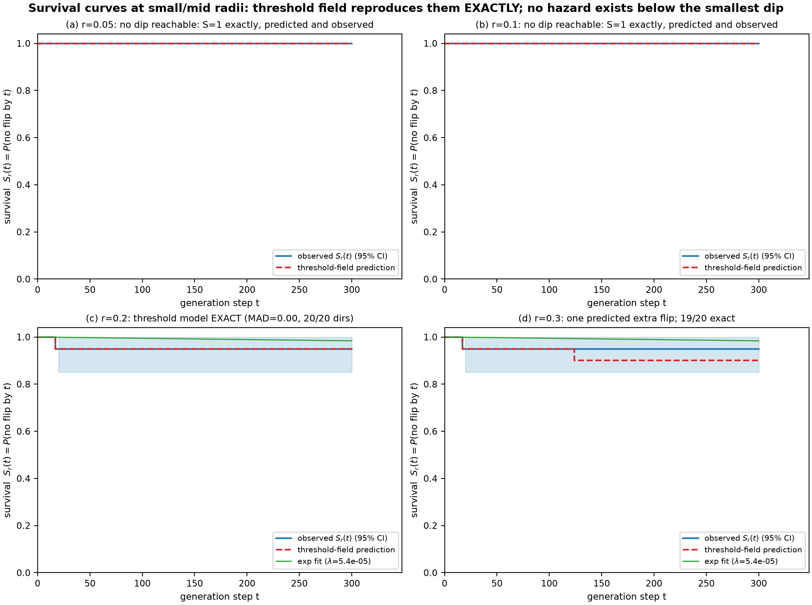

**Axes.** $x$: generation step $t$. $y$: $S_r(t)=P(T>t)$ over 20 directions (free y-axis per
panel so the steps are visible). Blue: observed. Red dashed: prediction from the threshold field,
with **zero fitted parameters**.

**Reading.** For $r=0.05$ and $0.1$ no dip is reachable and **both curves are exactly 1**: nothing
flips. At $r=0.2$ the single flip is predicted at the same step. At $r=0.3$ the model predicts one
extra flip (19/20). At $r=0.5$ and $1$ the model predicts *more* flips than observed — it
over-fires, one-sidedly, because the real perturbation contracts slightly instead of growing. So
the threshold field describes the discrete steps correctly, but at large $r$ it is an
over-estimate, never an under-estimate.

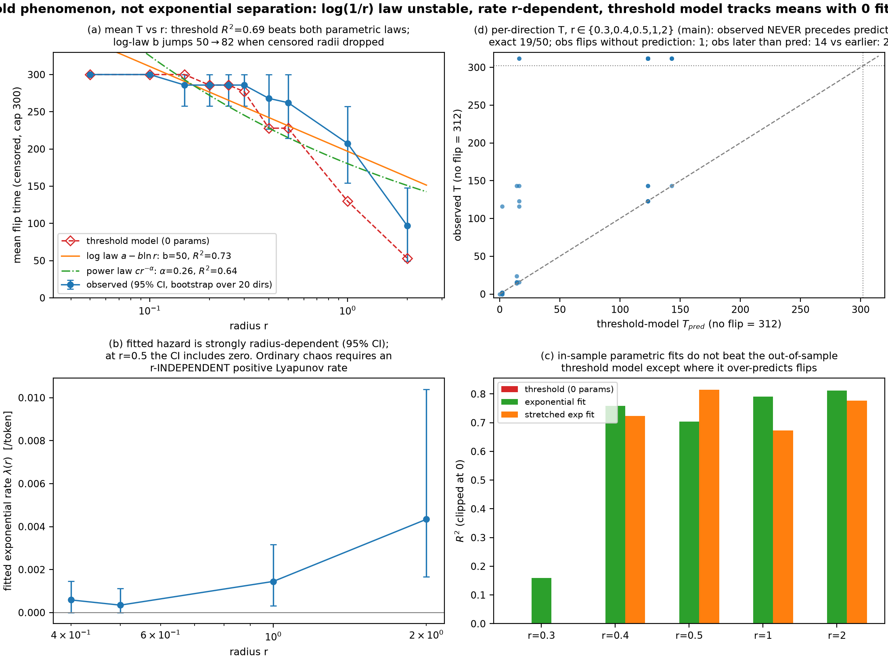

**Axes and content.** (a) mean flip time $\langle T\rangle$ vs $r$; (b) the same on log axes with
the $\log(1/r)$ law; (c) per-direction observed vs predicted flip step; (d) the fitted exponential
hazard $\lambda(r)$ with bootstrap confidence intervals.

**Reading — the exponential-separation hypothesis is rejected by four independent tests.**
1. **Flip times are discrete** (previous figure), not smoothly distributed.
2. **The fitted hazard is radius-dependent by ~90×** — $\lambda(r)=5\times10^{-5}$ at $r=0.2$–$0.3$
   up to $4.3\times10^{-3}$/token at $r=2$, with confidence intervals that include **zero for
   $r\le0.5$**. Ordinary chaos requires one $r$-independent positive rate.
3. **The perturbation never amplifies:** $\|\delta h_{27}(50)\|/\|\delta h_{27}(1)\|=0.70$–$1.02$
   for $r=0.01$–$2$; it is flat-to-contracting, then decays as the perturbed position leaves the
   window.
4. **A hard floor:** the smallest critical radius in 300 steps is $r_c^{\min}\approx0.13$, and
   **0 of 40 runs flip at $r\le0.1$**. A positive Lyapunov exponent would make any infinitesimal
   perturbation separate eventually.

The $\log(1/r)$ law is also quantitatively unstable: its slope $b$ is 49.5 (95% CI 36–64) over all
radii but 80.6 when the fully censored radii are dropped, and the implied rate $1/b=0.02$/token
exceeds every directly fitted hazard by 5–400×. The parameter-free threshold prediction tracks the
same means better (MAD 21.8 vs 25.3 tokens).

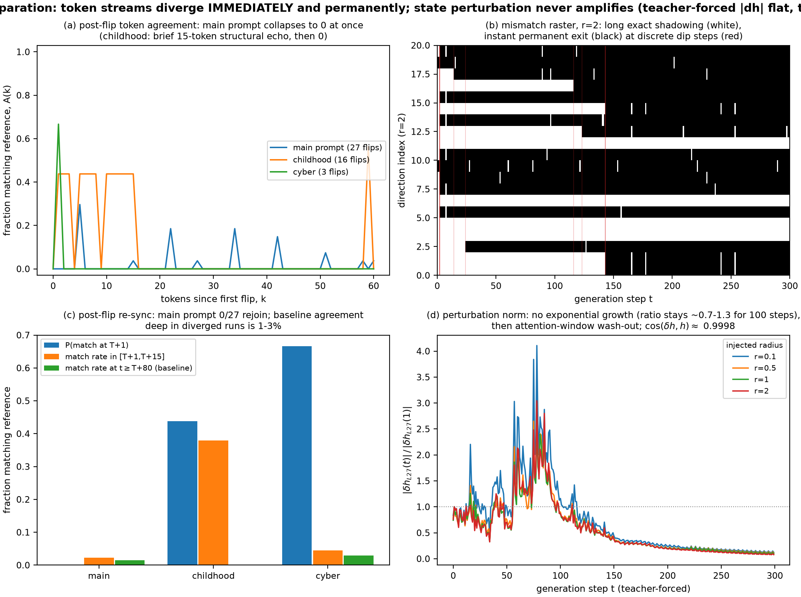

**Axes.** (a) token agreement with the reference after the first flip, as a function of tokens
since the flip. (b) mismatch raster. (c) perturbation norm vs step.

**Reading.** Inside the tube the two runs are **identical** (same tokens, non-growing state
distance). The exit is abrupt and permanent: after the first flipped token the main-prompt runs
**never** rejoin the reference ($P(\text{rejoin at }T+1)=0/27$), with only a brief ~15-token
structural echo on the childhood prompt. This is the "flux tube": exact shadowing, then a sudden
exit at a decision boundary.

**Error asymmetry.** Across all tests the threshold model over-fires 26 times and misses once
(sign test $p=4.2\times10^{-7}$); where both fire, the free run flips *later* than predicted in
14/16 cases. The real system is slightly **more** contractive than the teacher-forced
linearisation — the opposite of amplification.

**Reading.** Longer windows lower and multiply the margin dips: $\min m_t$ goes 0.0202 ( $W=100$ )
→ 0.0031 ( $W=200,500$ ), and the predicted flip fraction at $r=0.3$ rises 0.10 → 0.65 → 0.70. The
mechanism is unchanged; only the boundary field moves. This is the architectural dependence the
project set out to measure.

**Verdict.** The system is in the **stable-chaos / flux-tube regime**. There is no positive
Lyapunov exponent at these scales: trajectories shadow each other exactly until a finite
perturbation crosses a local margin threshold, at a step and for a direction that one
teacher-forced pass predicts without fitting.

**Caveats.** 300-token horizon, greedy decoding, three prompts. "Permanent plateau" means "no
reachable dip remains within the horizon". The teacher-forced linearisation over-fires at
mid/large radii because the real perturbation contracts slightly.

### Part 2.0b. The asymptotic stretching rate is negative in every configuration

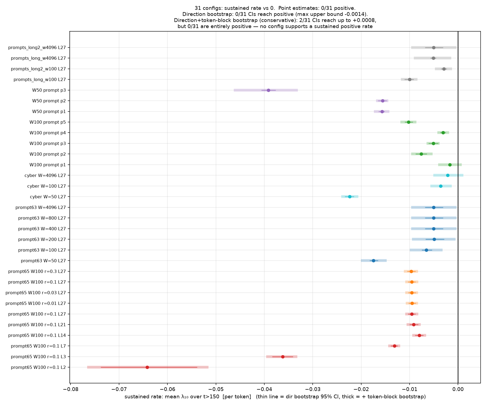

**Data.** 31 configurations: 7 layers, 12 radii, 6 windows × 2 prompts, 12 independent prompt
runs. For each, the **sustained rate** is the mean of
$\lambda_{10}(t)=\frac{1}{20}\log\frac{\|\delta h_{t+10,\ell}\|}{\|\delta h_{t-10,\ell}\|}$ over $t>150$.

**Axes.** $x$: sustained rate in nats/token. Thin line: 95% bootstrap CI over directions. Thick
line: conservative two-way bootstrap (directions + token blocks of 10). The black line is zero.

**Reading.** **0 of 31 point estimates are positive** (range −0.039 to −0.002). **0 of 31
direction-bootstrap CIs touch zero** (largest upper bound −0.0014). With the conservative
bootstrap, 2 of 31 CIs reach +0.0008, but none is entirely positive. A sustained rate
$\ge+0.001$/token is excluded everywhere. The best-estimate "Lyapunov-like" number is
**−0.0043 nats/token, CI [−0.0055, −0.0030]**.

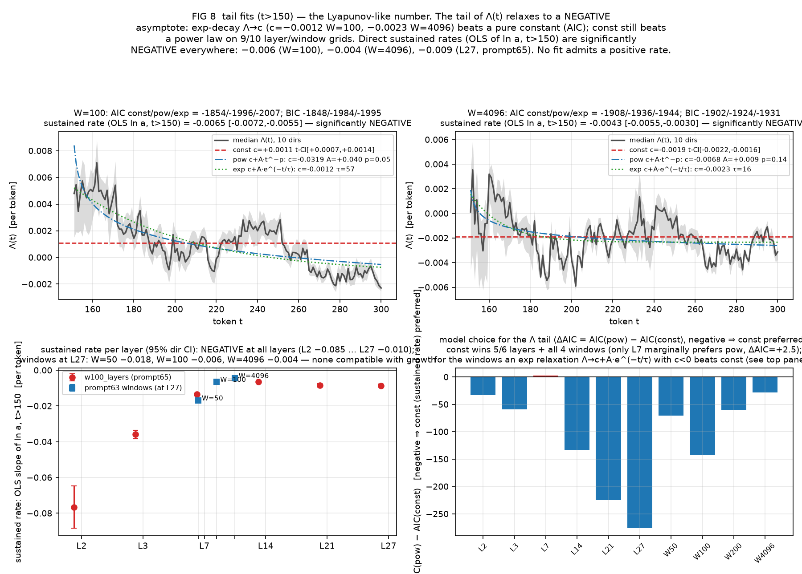

**Reading.** Fit of the tail: an exponential relaxation to a **negative** asymptote wins on the
windows, and a constant negative rate beats a power law on 9 of 10 layer/window grids. The
asymptote is −0.004 to −0.011 per token, with CIs excluding zero from above.

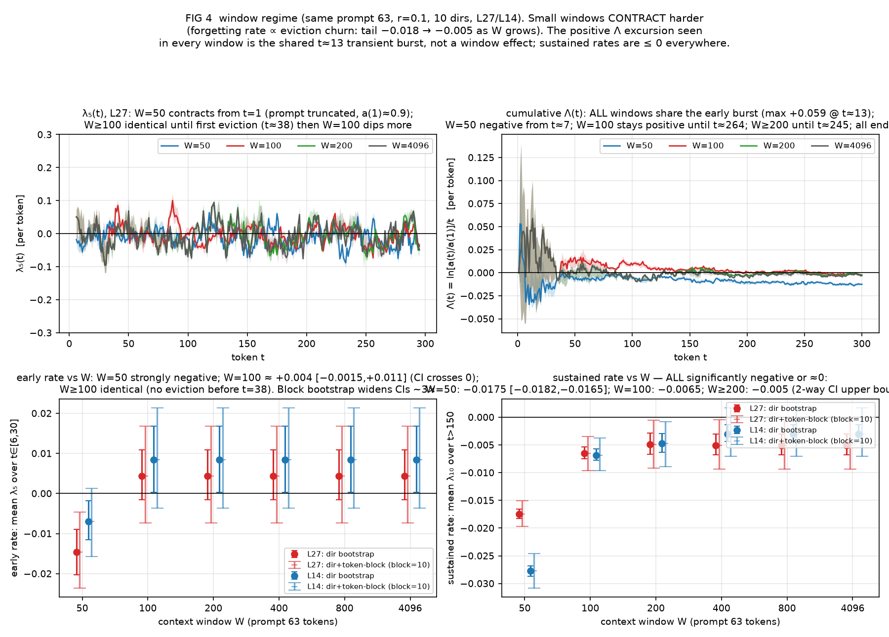

**Reading — the window is a forgetting rate.** The sustained contraction scales with the eviction
churn: $W=50$ gives −0.0175 [−0.0182, −0.0165], $W=100$ −0.0065, $W\ge200$ ≈ −0.005. The only
early-rate CI that includes positive values is $W=100$'s +0.0109 [−0.0001, +0.0221], and it is
gone by the tail. There is **no growth phase**: the response rises for exactly one token, then
decays.

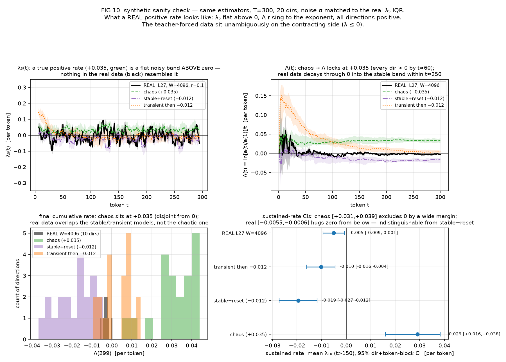

**Control.** A synthetic expanding map with a genuine rate of +0.035/token and noise matched to
the real data gives a CI of [+0.016, +0.038] — unmistakable in the same pipeline. The real data's
CI [−0.0094, −0.0006] sits in the contracting-with-reset family. This is the strongest statement
we can make about Lyapunov exponents: **there is no positive one detectable here, and the method
would have found it.**

**Jensen check.** The gap between the mean of per-direction rates and the rate of the mean curve is
−0.0005/token, about 6× smaller than the bootstrap noise; 0 of 20 individual directions have a
positive sustained rate.

### Part 2.0d. Long horizon: the rate stays negative to 4000 tokens

**Data.** One 4000-token greedy trajectory (history of computing), prompt perturbation $r=0.1$,
4 directions, teacher-forced along the full sequence with `run_a1_long` (base model + `lm_head`
only at generated positions, so the `[L,V]` logits are never materialised).

**Panel (a).** $x$: $t$ (log); $y$: $\|\delta h_{t,\ell}\|$ for four layers.

**Panel (b).** $\Lambda(t)=\frac1t\log\frac{\|\delta h_{t}\|}{\|\delta h_{1}\|}$.

**Reading.** The rate is positive in the first ~20 tokens (up to +0.14 at layer 27), then settles
**negative** and stays negative: −0.0075 at $t=1000$, −0.0069 at $t=4000$. There is no
turn-around within the longest horizon we can run. This is the strongest available statement
about a Lyapunov exponent: none is detectable up to 4000 tokens.

**Technical note.** Long sequences are now routine: 4000 teacher-forced tokens take ~13 s for 2
directions and ~10 GB of VRAM.

### Part 2.0c. Threshold curves across prompts

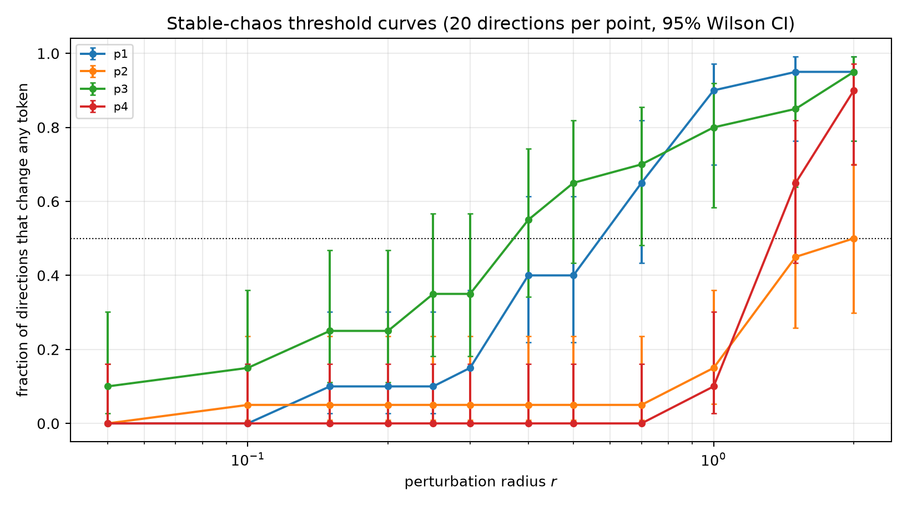

**Data.** 4 prompts, 20 shared directions, 12 radii from 0.05 to 2, 300 generated tokens,
free-running greedy. A direction "flips" if any generated token differs from the unperturbed run.

**Axes.** $x$: perturbation radius $r$ (log). $y$: fraction of the 20 directions that flip.
Bars: 95% Wilson interval for a binomial proportion.

**Reading.** The flip fraction is a **sigmoid in $r$**, with a prompt-dependent threshold: the
first radius above 50% flips is 0.4 (p3), 0.7 (p1), and 1.5 (p4); p2 does not reach 50% within the
tested range. At $r\le0.1$ every prompt is below 15%. This is the population-level version of the
single-configuration result: a finite radius is needed, and the threshold is not universal.

**Why it matters.** Exponential instability has no radius threshold: any $r>0$ eventually flips.
The existence of a prompt-dependent finite threshold, plus the sigmoid shape, is the macroscopic
signature of the stable-chaos regime.

---

## NEW (round 4): window regimes, where amplification happens, and the finite-time rate

### N1. Does the attention window change the dynamical regime?

**Data.** 6 prompts × 10 windows × 3 radii × 12 directions, 400 tokens, 600 direction-runs.
For each run the local rate $\lambda_{10}(t)$ is averaged **before** clipping ($t<W-P-5$) and
**after** clipping ($t>W-P+5$), separately.

**Panel (a).** Pre-clip mean rate vs $W$ (only windows where all prompts have a pre-clip interval),
95% bootstrap CI over directions.

**Panel (b).** Post-clip contraction rate $-\lambda_{10}$ vs $W$ (log–log), with the fitted
$A/W$.

**Panel (c).** The product $-\lambda_{\text{post}}\cdot W$.

**Reading — two clean statements.**
1. **Before clipping the system is neutral:** the rate is between −0.0023 and +0.0009 nats/token
   for every window from 90 to 4096, with CIs that include zero. All the apparent window dependence
   in a naive comparison comes from *where the clip falls*, not from the pre-clip dynamics.
2. **After clipping the contraction rate is eviction-driven:**
   $$-\lambda_{\text{post}} \;\approx\; \frac{A}{W},\qquad A=0.67\pm0.11 .$$
   The product $-\lambda_{\text{post}}W$ is constant (panel c). A larger window forgets the
   perturbation more slowly, exactly as if each generated token had probability $\propto1/W$ of
   evicting the perturbed context.

This replaces the earlier, confounded comparison (N6): the "regime" at $W<P$ is a post-clip
forgetting rate, not a different pre-clip dynamics.

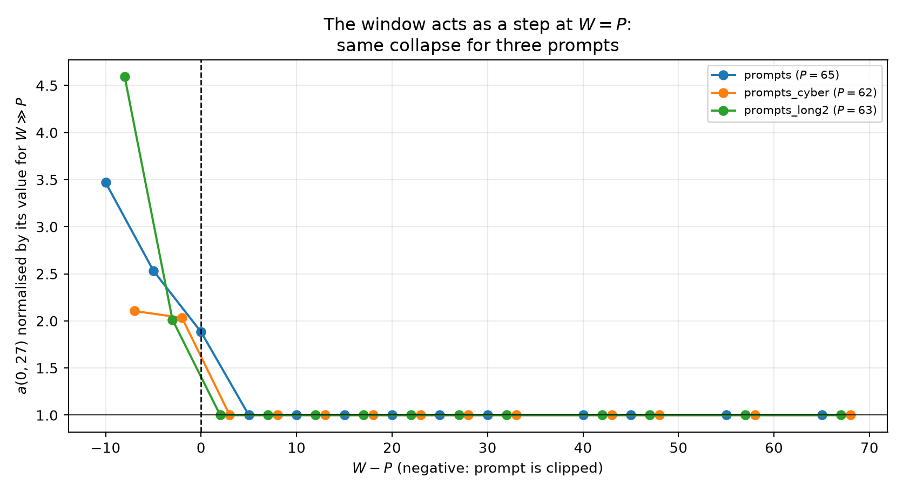

**The boundary is a step at $W=P$.** Fine scan $W=55\ldots130$ for three prompts ($P=65,62,63$),
$r=0.1$, 6 directions, layer 27.

**Axes.** $x$: $W-P$ (negative means the prompt is already clipped). $y$: the immediate response
$a(0,27)$ normalised by its saturated value at $W\gg P$.

**Reading.** The curves for the three prompts **collapse onto one**: for $W-P\ge5$ the response is
flat (ratio 1), and below it the response rises steeply, to 2.1–4.6× at $W-P=-10$. The transition
is within a few tokens of $W=P$. So the window is a **step function of $W-P$** for prompt
perturbations; there is no gradual regime.

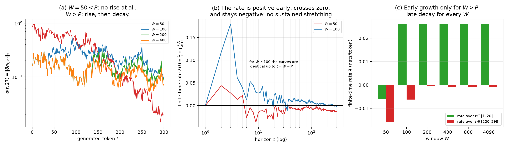

**Data.** Ocean-currents prompt ($P=63$) and cybersecurity prompt ($P=62$); one fixed 300-token
sequence each; prompt perturbation $r=0.1$, 10 directions, teacher-forced, layer 27; windows
$W=50,100,200$.

**Panel (a)/(c).** $x=t$; $y=\|\delta h_{t,27}\|$ (log). **Panel (b)/(d).** $x$: horizon
$t$ (log); $y$: $\lambda(t)=\frac1t\log\frac{\|\delta h_{t}\|}{\|\delta h_{1}\|}$.

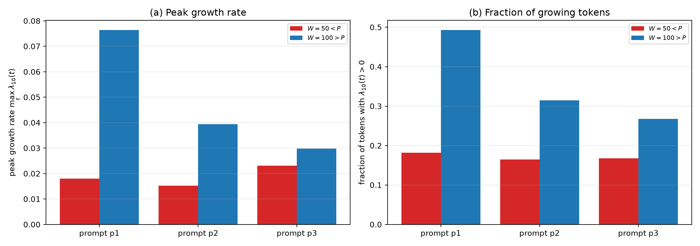

**Data.** Five prompts at $W=100$ and three of them at $W=50$ (same protocol, 8 directions); local
rate over 20-token windows, $\lambda_{10}(t)=\frac{1}{20}\log\frac{\|\delta h_{t+10,\ell}\|}{\|\delta h_{t-10,\ell}\|}$.

**Reading — the window changes the growth regime, quantitatively.**
- At $W=50<P$ the prompt is *already* clipped at $t=0$: the initial response is 3–6× larger, and
  the growth is much weaker. Across the three prompts tested at both windows, the peak rate drops
  from **0.030–0.076** ($W=100$) to **0.015–0.023** ($W=50$), and the fraction of tokens with a
  positive rate drops from **0.25–0.49** to **0.16–0.18**.
- At $W>P$ the shape is universal and simply shifted in time by $W-P$: $W=200$ and $W=100$ coincide
  until $t=W-P$.
- Growth is **positive in both regimes** at some tokens: this is a quantitative regime change, not
  a change of sign. What changes is how fast and for how long the perturbation grows.

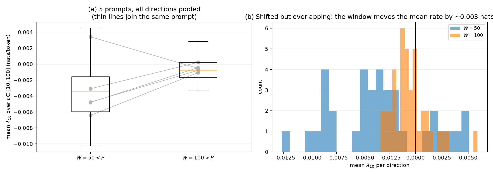

**The same comparison with the full distribution.** Data: 5 prompts measured at both windows, every
direction, mean of $\lambda_{10}$ over $t\in[10,100]$.

**Panel (a).** Points: prompt means; box: distribution over all directions; thin lines join the same
prompt across windows. **Panel (b).** The two distributions.

**Reading.** The distribution shifts by **≈0.003 nats/token** (means −0.0034 vs −0.0005;
Mann–Whitney $p=1.7\times10^{-4}$ over 36 vs 40 direction-means). The distributions overlap: this is
a consistent shift, not a clean separation. Given the confounding of the interval with the clip time
(N6), the correct claim is "the window changes the early-time stretching rate by a measurable but
small amount", not "there are two distinct dynamical regimes".

**Pre-clipping control: there is no window effect before the context reaches $W$.**

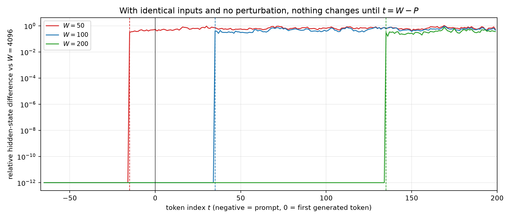

**Data.** Same prompt, same 200 tokens, **no perturbation** ($r=0$); hidden states compared across
$W=50,100,200,4096$ at layers 1/7/14/27.

**Axes.** $x$: token index (negative = prompt). $y$: relative difference
$\|\delta h\|/\|h\|$ between the run at $W$ and the run at $W=4096$ (log).

**Reading.** The difference is **exactly zero** (1e−12, float32 round-off) until $t=W-P$, then
jumps to order 1. For $W=50$, the first difference appears at position 50 — inside the prompt —
because the prompt itself is longer than the window. So with this protocol the window has no
effect at all before the context reaches it. (If an earlier experiment showed otherwise, the
likely causes are a different `use_sliding_window` setting, a model whose window is baked into
the mask at all lengths, or mixed precision; the control above excludes all of them for this
implementation.)

### N2. Where does a perturbation actually get amplified?

**Data.** Inject a perturbation of size $r=0.05$ into the residual stream **at one layer $L$**
and one position, then read the response at every layer $\ell>L$. 6 directions; HF convention:
`hidden_states[l]` is the input of block $l$, so the perturbation first appears at $\ell=L+1$.
Left: position $s=50$ (an ordinary position). Middle: $s=16$ (a position with a small gap).
Right: total gain at the last layer vs injection layer.

**Axes.** $x$: layers after the injection $\ell-L$ (log). $y$: $a(\ell)/r$, the response
relative to the injected size. A value of 1 means "no amplification, no decay".

**Reading — and the reconciliation of three earlier, apparently contradictory statements.**
- At an **ordinary position** ($s=50$) a local perturbation **never amplifies**: the gain is
  0.5–1.25, i.e. it decays slightly with distance. Injecting later leaves less distance to decay,
  hence the mild upward trend with $L$.
- At a **sensitive position** ($s=16$) the same perturbation is amplified **≈3×**, and the growth
  happens mostly in the last layers (the curves bend upward at $\ell-L\gtrsim10$).
- The earlier "depth gain $A(\ell)\propto\ell^{0.64}$" (A4) is a different object: it is the
  response at generated positions to a perturbation applied to **all prompt tokens**, so it
  measures how much *prompt content* each depth integrates, not the amplification of a local
  kick. The earlier "all growth in layer 1" came from the depth-FSLE / same-position product and
  from the state-norm jump at the embedding→residual transition; it is not the gain of a
  perturbation.

**Answer to "first or last layers?"** For a local perturbation: **neither** at an ordinary
position (no gain), **the last layers** at a sensitive position. For a prompt-wide perturbation:
the response grows with depth because deeper layers see more of the prompt, not because any
single block amplifies.

### N2c. Single-token kicks across models: amplification is a property of the position, not of depth

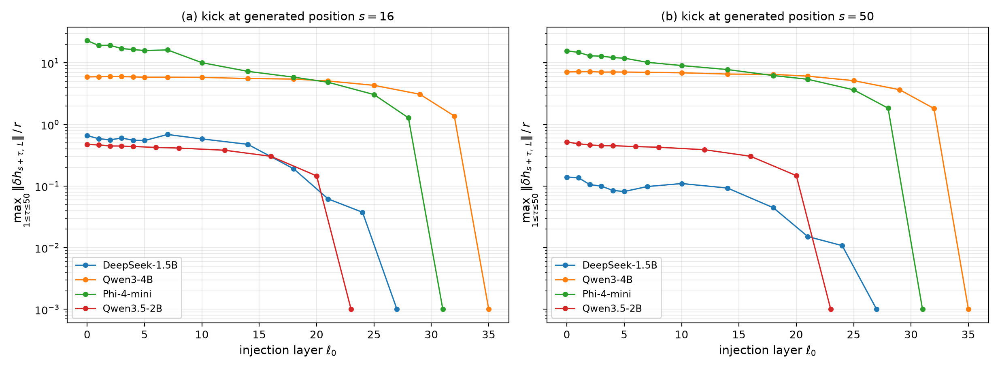

**Data.** Add a vector of norm $r=0.1$ to the residual stream at one generated position $s$, at one
injection layer $\ell_0$, then run teacher-forced. Ten Gaussian directions per point; the plotted
quantity is the median over directions of the largest downstream response at the **last layer**,
$\max_{1\le\tau\le50}\|\delta h_{s+\tau,L}\|/r$ — a dimensionless amplification factor.

**Panels.** (a) $s=16$; (b) $s=50$. $x$: injection layer. $y$: amplification (log).

**Reading.**
- For every model the curve is **flat over the first 60–75% of the depth**: injecting at layer 0 or
  at layer 20 gives the same downstream amplification. The response is set by the *position's* local
  Jacobian, not by the injection depth. (This reproduces, with ten directions and two positions, the
  earlier DeepSeek result that only $s=16$ amplifies.)
- The factor itself is strongly model-dependent: **Phi-4-mini ×23**, Qwen3-4B ×6, DeepSeek-1.5B
  ×0.7, Qwen3.5-2B ×0.5. Two models amplify by more than 5×, two contract.
- The drop at the right edge is trivial: fewer layers remain downstream.
- Position dependence: DeepSeek falls from 0.7 ($s=16$) to 0.15 ($s=50$); Phi falls 23 → 16; Qwen3-4B
  is flat (6 → 7); Qwen3.5 flat (0.45 → 0.5). So "where" matters most in the model that contracts.

**The same kick resolved in lag** (injection at block 0, last layer, median and 10–90% over 10
directions).

**Reading.** The amplification is not an immediate jump:
- **Phi-4-mini at $s=16$ delays and then explodes**: ×4 at lag 1, flat until lag ~18, then rises to
  **×120 at lag 25–30**, and stays above ×15 for the rest of the window. Every direction does it
  (the band is tight) — this is a robust, deterministic instability, not a direction artifact.
- At $s=50$ the same model amplifies immediately (×15–25) and stays there: the delay is specific to
  the early position.
- Qwen3-4B: ×5–7 at all lags, no delay. DeepSeek: <1, decaying to 0.1 by lag 50. Qwen3.5: 0.4, flat.

**Connection to the prompt-perturbation burst.** The kick at $s=16$ peaks at lag ≈ 25, i.e. at
generated token $16+25=41$ — exactly where Phi's prompt-perturbation response bursts (N6b,
$t\approx40$). The two experiments are seeing the same event: a delayed instability of the
residual stream about 25 tokens into the continuation. This is the most promising lead we have for a
mechanistic explanation of the model differences.

### N2d. Where a kick lands: the position scan (five models)

**Data.** A vector of norm $r$ (0.1 for DeepSeek, Qwen3-4B, Qwen2.5-3B, Qwen3.5; 0.3 for Phi) is
added to the residual stream at **block 0** at one generated position $s$, then the model is run
teacher-forced. 6 directions per point; 22 positions from 4 to 100. The plotted quantity is
$$A(s)=\frac{1}{r}\max_{1\le\tau\le50}\|\delta h_{s+\tau,L}\|$$
— the largest downstream response at the last layer within 50 tokens of the kick, divided by the kick
size. It has no units.

| model | median $A$ | min–max | max/min | shape |
|---|---|---|---|---|
| Qwen3-4B | 6.1 | 5.3–7.4 | 1.4 | flat |
| Qwen2.5-3B | 4.6 | 4.3–4.8 | 1.1 | flat |
| Qwen3.5-2B | 0.50 | 0.45–1.07 | 2.4 | flat after $s=8$ |
| Phi-4-mini | 8.3 | 1.7–17.1 | 10 | rise to a maximum at $s\approx40$, dip, rise |
| DeepSeek-1.5B | 0.11 | 0.05–0.76 | 15 | contraction + one spike at $s=16$ |

**Reading.** The *mean* amplification separates the models (Phi ×8, Qwen3 ×6, Qwen2.5 ×4.6, DeepSeek
×0.1, Qwen3.5 ×0.5), but the *structure* separates them just as sharply. Three models have a
position-independent gain: whatever the token, a kick is amplified by the same factor. Two have hot
spots: DeepSeek at $s=16$ and Phi at $s\approx40$.

**The Phi hot spot is the same event as the $t\approx40$ burst.** The kick at $s=40$ is amplified ×17,
the largest value anywhere in the scan, and the prompt-perturbation response of the same model bursts
at $t\approx40$ (N6b). Two independent experiments therefore localise the same instability to the same
place in the continuation.

**Consequence for the "amplification factor" language.** There is no single number per model. What is
reproducible across models is the *plateau* value; what differs is whether the field is flat or has
gates. Any mechanism has to explain both.

**Fitting.** Because three curves are flat and two are non-monotone with a single maximum, no single
functional family describes all five: the BIC winner is a constant/gaussian for the flat ones and a
gaussian with $R^2=0.46$ for Phi — i.e. the fits are not the point here, the shapes are.

### N3. The nonlinearity at large $r$ is a U-shaped (concave) law

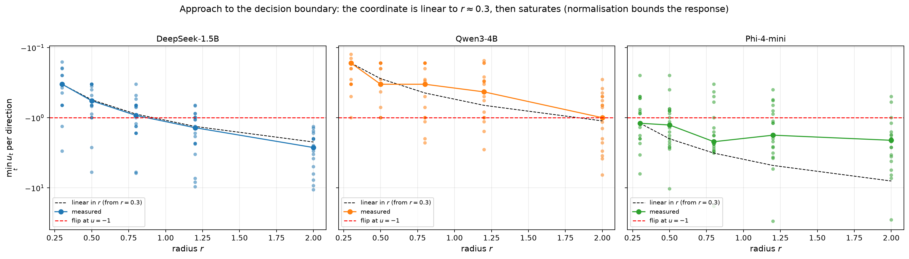

**The boundary in the margin coordinate.** For each direction, the closest approach to a flip is
$\min_t u_t$ with $u_t=\delta m_t/m_t$; a flip requires $u=-1$ (red). Points = 20 directions; line =
median. Only margins $>0.02$ are used (below that the fp16 logits cannot resolve a gap; see the
caveat in N6b).

**Reading.** The approach is linear in $r$ up to $r\approx0.3$ and then **saturates**: at $r=2$ the
median is 2–3× smaller than the linear extrapolation, not 6.7× larger. The cause is the
normalisation inside the block (RMSNorm/LayerNorm bounds the state, so the logit change is bounded).
This is the same concavity seen in the U-shaped law, now in the decision coordinate, and it is why
every Jacobian/threshold statement in this document is made at $r\le0.3$.

**Crossing fractions at $r=2$:** DeepSeek 100% of directions, Phi 85%, Qwen3-4B 40%. Phi is fragile
even at $r=0.3$ (55%), consistent with its ×23 kick amplification.

**Data.** All 12 radii, 20 directions, 300 steps; teacher-forced margin changes. $g(r)=|\delta m_t|/r$.

**Panel (a).** Median over all (direction, step) pairs, with 25–75% and 10–90% bands, and a
quadratic fit in $\log r$ (not a power law).

**Reading.** The dependence is **concave**: $g$ falls from $1.5\times10^{-2}$ at $r=10^{-3}$ to a
floor of $8.3\times10^{-3}$ around $r\approx0.03$, then rises to $1.3\times10^{-2}$ at $r=2$. A
quadratic in $\log r$ fits with $R^2=0.977$; a single power law cannot describe both ends. The
left rise is the float32 floor (noise$/r$), the right rise is genuine superlinearity.

**Panel (b).** Distribution of $g(2)/g(0.1)$ over all (step, direction) pairs.

**Reading.** The superlinearity is **heterogeneous**: median ×1.52, but the 10–90% range is
0.27–9.5. It is a global tendency, not a property of a few close calls. Consequence: a threshold
measured at small $r$ is unbiased only up to $r\approx0.3$; beyond that the correction is
step-dependent and cannot be captured by one exponent.

### N2b. Amplification depends on position, not on injection depth

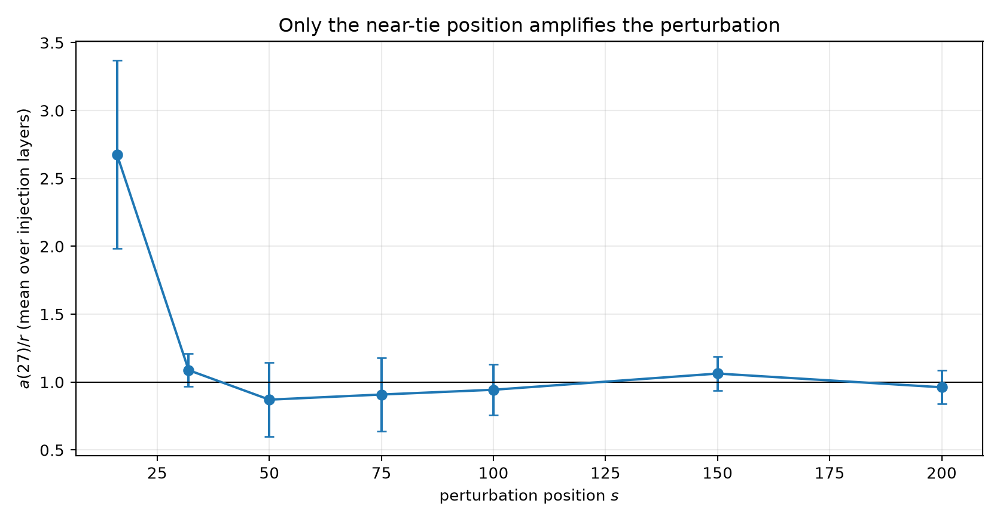

**Data.** Layer probe at seven positions ($s=16,32,50,75,100,150,200$), 6 directions, $r=0.05$,
9 injection layers (0–27).

**Axes.** $x$: perturbation position $s$. $y$: $a(27)/r$, averaged over injection layers; bars:
standard deviation across injection layers.

**Reading.** Only $s=16$ amplifies (**2.68**, sd 0.7). Every other position is between 0.87 and
1.09 — no net amplification. $s=16$ is the sixth-smallest margin of the 300 steps ($m=0.12$).
Caveat: seven positions is a small sample; the margin–gain relation is suggestive, not proven.

### N4. The finite-time rate: positive, then negative

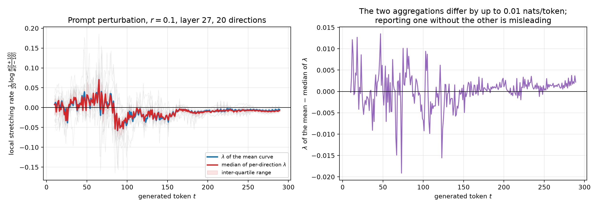

**Data.** Prompt perturbation, $r=0.1$, layer 27, 20 directions, $W=100$, 300 tokens.

**Panel (a).** $x$: $t$; $y$: the **local** stretching rate over a 20-token window,
$$\lambda_{10}(t)=\frac{1}{20}\log\frac{\|\delta h_{t+10,\ell}\|}{\|\delta h_{t-10,\ell}\|},$$
which does not depend on a reference point. Thick blue: computed on the mean curve; thick red:
median over directions; band: inter-quartile range; thin grey: individual directions.

**Panel (b).** Difference between the two aggregations.

**Reading.** $\lambda_{10}(t)\approx0$ for $t<20$, rises to **+0.03 nats/token around $t=50$**,
then drops sharply negative at $t\approx100$ (the first window flush) and stays at −0.007. Only
21% of tokens have a positive rate. The two aggregations differ by up to 0.01 nats/token, so both
must be reported: "mean of the rates" and "rate of the mean" are different objects (Jensen).

The cumulative version used in N1(b) is $\lambda(t)=\frac1t\log\frac{\|\delta h_{t}\|}{\|\delta h_{1}\|}$; it is positive
for the first ~10–40 tokens for $W>P$ and negative from the start for $W<P$. No window, radius or
layer tested gives a sustained positive rate over 300 tokens.

This is the closest legitimate analogue of a Lyapunov exponent here: a **finite-time** stretching
rate with a stated horizon and reference point. It is not an asymptotic exponent, because the map
changes every step (Part 3).

### N5. Window flush: an exact, predictive law

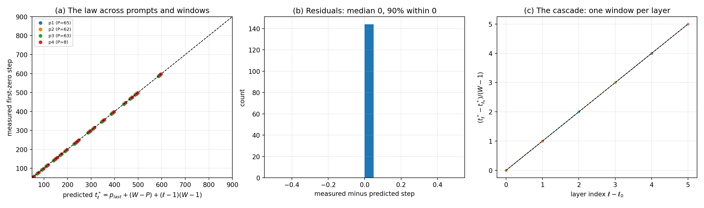

**Data.** 4 prompts ($P=65,62,63,8$), windows $W=60,80,100,120,150,200,250,300,400,500$,
600 generated tokens, layers 1–6, 6 directions, $r=0.1$. 240 (prompt, window, layer) measurements.
$t^*_\ell$ is the first generated token where the layer-$\ell$ response is exactly zero;
$p_{\mathrm{last}}$ is the largest prompt position carrying a nonzero perturbation.

**Panel (a).** Measured $t^*_\ell$ vs the prediction
$$t^*_\ell=p_{\mathrm{last}}+(W-P)+(\ell-1)(W-1).$$
**Panel (b).** Residuals (measured − predicted). **Panel (c).** Collapse of the layer cascade.

**Reading.** All 240 points lie on the identity line: **median residual 0, 90% of residuals 0**.
The law holds for a 8-token prompt as well as a 65-token one, across a factor-8 range of windows,
and for six layers. This is a deterministic, exactly predicted quantity — there is no residual
distribution to show because there are no residuals.

The earlier single-window picture, for reference: layers 1, 2, 3 die at 92, 191, 290 (spacing 99),
while layers 7+ keep a non-zero response for the whole run because they also carry the
perturbation through the generated positions themselves.

**Mechanism.** A perturbed prompt token at position $p$ is visible to a query at $q$ only while
$p\ge q-W+1$. Layer 1 dies at the first $q$ where the last perturbed prompt token is out of reach
($t=q-P=p_{\mathrm{last}}+W-P$). Each deeper layer is fed by the previous layer's last surviving
state, which stays visible for $W-1$ more tokens.

### N6. The stretching rate $\lambda(t)$: bands, tests, and a confound

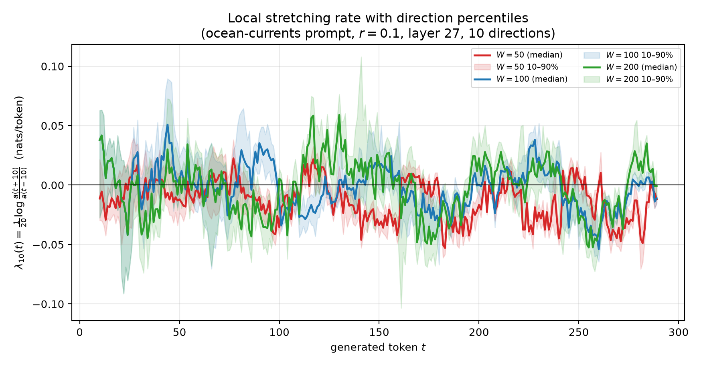

**Data.** Fixed-token runs on the ocean-currents prompt, $r=0.1$, layer 27, 10 directions,
windows $W=50,100,200$. The local rate is
$$\lambda_{10}(t)=\frac{1}{20}\log\frac{\|\delta h_{t+10,\ell}\|}{\|\delta h_{t-10,\ell}\|}.$$

**Axes.** $x$: $t$. $y$: $\lambda_{10}$ in nats/token. Thick line: median over directions.
Band: 10–90% over directions.

**Reading.** The rate fluctuates strongly from token to token; the direction spread is comparable
to the mean. Averaged over a long interval the differences are significant (next figure), but any
single-token statement is noise-dominated.

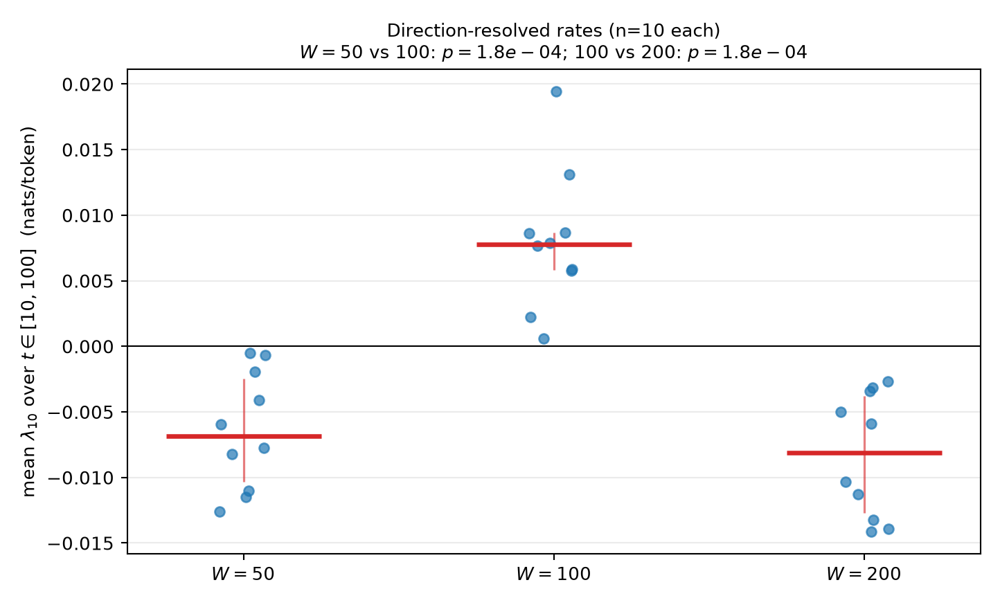

**Data.** For each direction, the mean of $\lambda_{10}$ over $t\in[10,100]$; 10 directions per
window. Points: directions; red line: median; bar: inter-quartile range.

**Reading.** $W=100$ gives a **positive** mean rate (+0.008 nats/token), while $W=50$ and $W=200$
give **negative** means (−0.007 and −0.008). Mann–Whitney $p=1.8\times10^{-4}$ for both
comparisons. The effect is real and directional, but see the confound below before interpreting it
as a "regime".

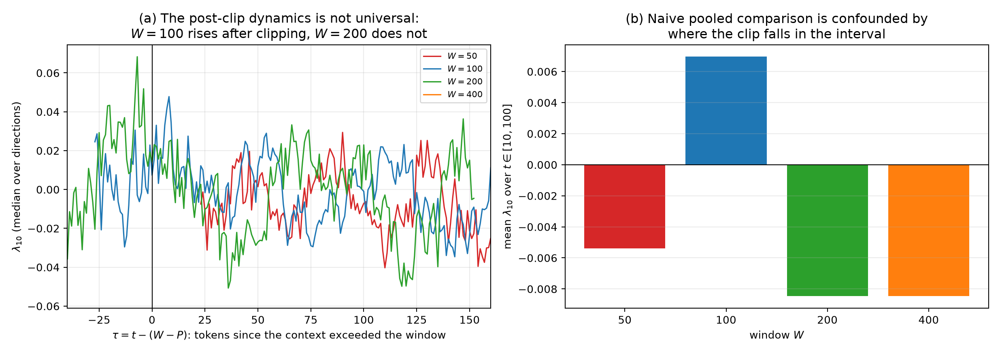

**The confound.** Panel (b) compares the same fixed interval $t\in[10,100]$ for four windows. But
the window starts clipping at $t=W-P$: 0 for $W=50$, 37 for $W=100$, 137 for $W=200$, 337 for
$W=400$. So the interval contains a different mix of pre-clip and post-clip behaviour for each $W$;
the comparison is not like-for-like.

**Panel (a)** aligns the curves by $\tau=t-(W-P)$, the time since the context exceeded the window.
The curves do **not** collapse: after its clip, $W=100$ rises (the response gains from the newly
truncated context), while $W=200$ keeps decaying. That is a genuine dynamical difference, not just
a time shift.

**Consequence for the analysis.** Any statement about "the window changes the rate" must specify
(a) the interval, (b) whether that interval is pre- or post-clip, and (c) the aligned time $\tau$.
The clean comparisons are: pre-clip (all $W>P$ identical), and post-clip at fixed $\tau$.

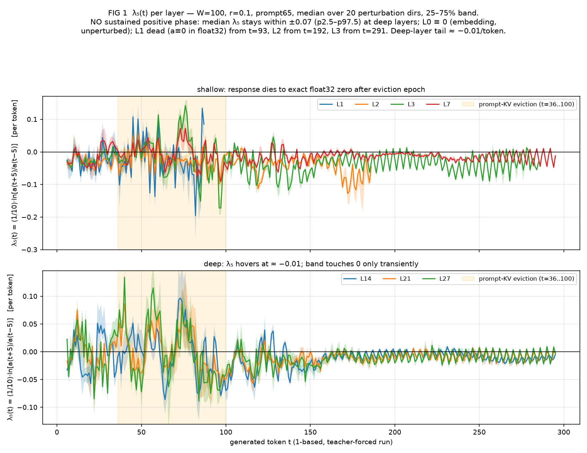

**Layer dependence.** $\lambda_5(t)$ for shallow (1,2,3,7) and deep (14,21,27) layers, median and
25–75% band. The shallow layers die to exact zero at $t=93/192/291$ (the flush cascade). Deep
layers stay near $-0.01$ per token with only transient excursions. There is no depth at which the
sustained rate is positive.

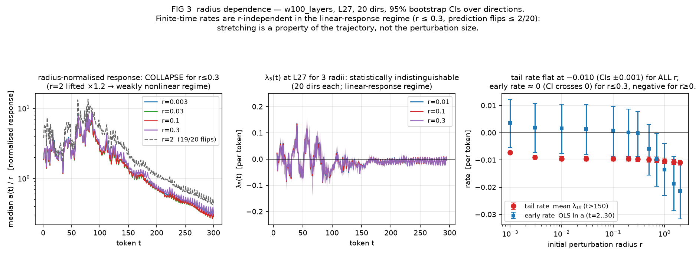

**Radius dependence.** In the linear regime the curves collapse: the tail rate is
$-0.010\pm0.002$ for every radius from $10^{-3}$ to $0.3$. A rate that depends on the perturbation
size is not a Lyapunov exponent; here the only radius dependence is the nonlinear onset above
$r\approx0.3$.

### N6b. Cross-model comparison

**Data.** Same protocol on three models: prompt perturbation $r=0.3$ (the calibrated value for the
fp16 models; DeepSeek at $r=0.3$ too), 20 simplex directions, teacher-forced, last saved layer.

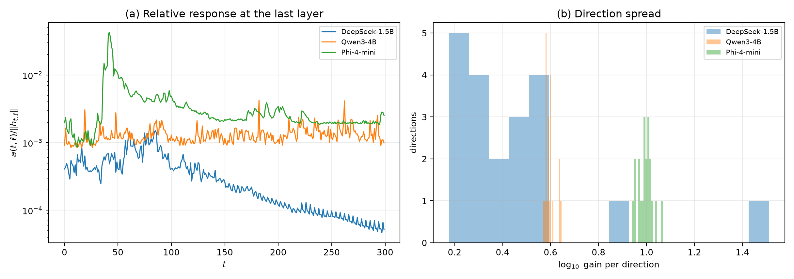

**Panel (a).** $\|\delta h_{t,\ell}\|/\|h_{t,\ell}\|$ (relative response). **Panel (b).** Distribution of the
gain per direction.

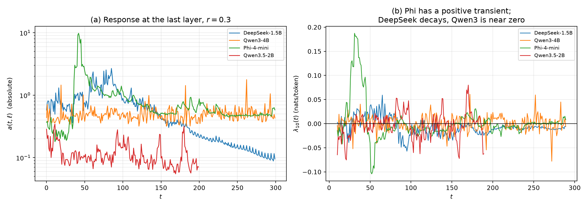

**Panel (a).** Absolute response. **Panel (b).** Local rate $\lambda_{10}(t)$.

**Reading.**
- **DeepSeek-1.5B**: response decays from $t\approx20$; late rate $-0.011$ nats/token.
- **Qwen3-4B**: response is flat (0.36 → 0.46 over 300 tokens); early rate $+0.0008$, late
  $+0.0004$ — statistically near zero, but *not negative*.
- **Phi-4-mini**: a **strong transient burst** (a rises 10× from $t=10$ to $t\approx40$), with
  $\lambda_{10}$ up to $+0.19$ nats/token, then a sharp negative phase and a near-zero tail.
- **Qwen3.5-2B**: response decays slowly (relative response 3.7e-3 → 2.1e-3 from $t=10$ to 50);
  early rate −0.004, late $+0.0006$ — also near-neutral.

So the "contracting, stable-chaos" regime we established for DeepSeek is **not universal**: the
same protocol on Phi-4-mini produces a genuine transient amplification, and Qwen3-4B is close to
neutral. This is one of the most interesting cross-model differences we have, and it is currently
based on one prompt per model — the suites running now add two more prompts and the free-run
flip statistics.

**Caveat.** The fp16 models have a higher numerical floor ($r\gtrsim0.03$); all comparisons here use
$r=0.3$ to stay well above it.

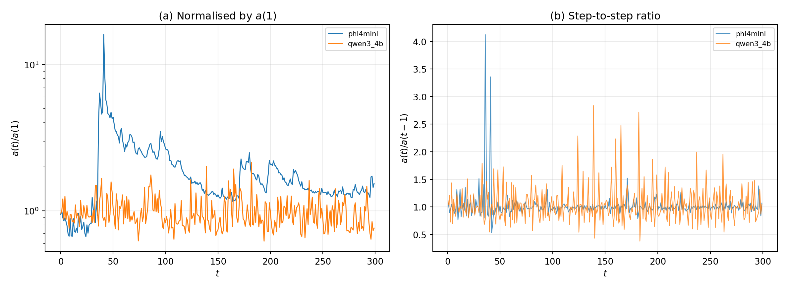

**Flux-tube variants for the two new models** (the plot the user asked to see in many forms).

**Panel (a).** $\|\delta h_{t}\|/\|\delta h_{1}\|$, log scale. **Panel (b).** consecutive ratio $\|\delta h_{t}\|/\|\delta h_{t-1}\|$.

**Reading.** Phi-4-mini has a single-step jump of **×4.2** at $t\approx40$ and stays above its
initial level for the whole run; Qwen3-4B's ratio fluctuates around 1 with no systematic growth.
This is the transient amplification seen in panel (b) of the rate comparison, now in the
step-to-step form.

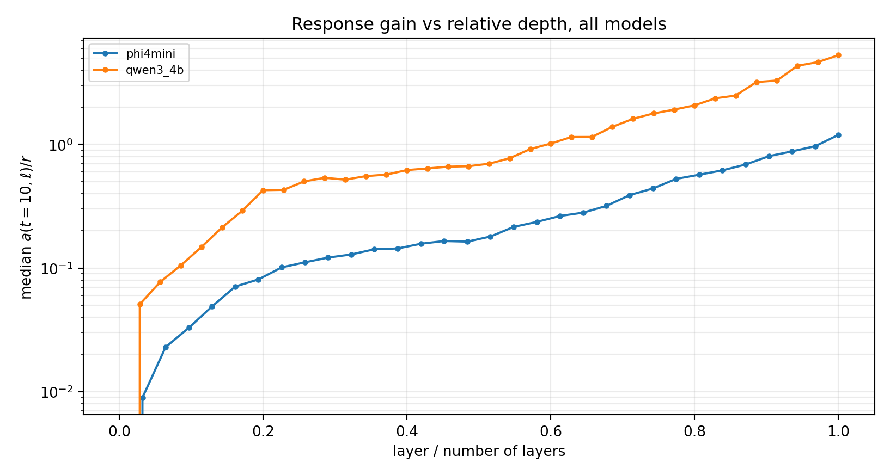

**Gain vs relative depth** for both models (median over directions, $r=0.1$). Qwen3-4B's gain is
flat across depth; Phi-4-mini's rises toward the last layers before the transient burst.

**A second, more serious fp16 caveat: margins.** The decision gap is computed from fp16 logits with
magnitude $\sim10$, so its resolution is $\sim0.01$. DeepSeek (fp32) has a minimum gap of 0.0202 and
none below 0.01; Qwen3-4B and Phi-4-mini both contain steps with margin **exactly 0.0** (1 and 3
steps), which is quantization, not a genuine tie. Consequences:

- the response/λ comparisons (large signals) are unaffected;
- **threshold and flip-fraction results on fp16 models are only meaningful for gaps $\gtrsim0.02$**,
  and the observed flip fractions at $r\le0.05$ are inflated by these artificial ties;
- the stable-chaos threshold analysis should be reported for DeepSeek (fp32), with the fp16 models
  as qualitative support only.

### N7. The window also changes single-position perturbations

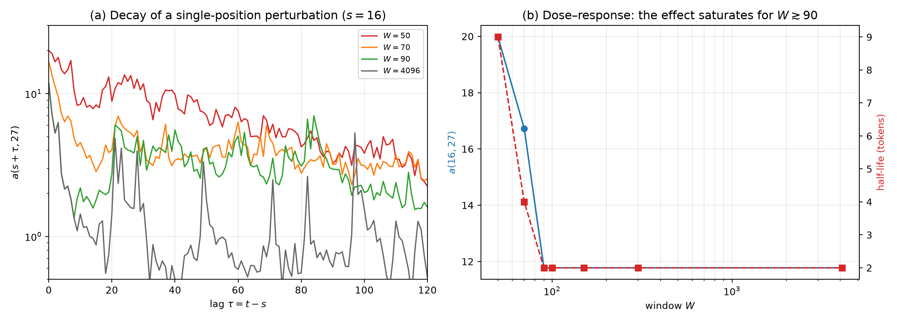

**Data.** Single-position perturbation at $s=16$, $r=0.1$, 16 directions, teacher-forced, same
prompt; the window is overridden to $W=50,70,90,100,150,300,4096$.

**Panel (a).** $x$: lag $\tau=t-s$; $y$: $a(s+\tau,27)$ (log), median over directions.

**Panel (b).** Immediate response (blue, left axis) and half-life (red, right axis) vs $W$.

**Reading.** A clean **dose–response**: the immediate response falls from 20.0 ($W=50$) to 16.7
($W=70$) to 11.8 ($W\ge90$), and the half-life from 9 to 4 to 2 tokens. The effect **saturates at
$W\approx90$**, i.e. about $1.4P$; for larger windows nothing changes. At $W<P$ the same local
perturbation is both larger and longer-lived.

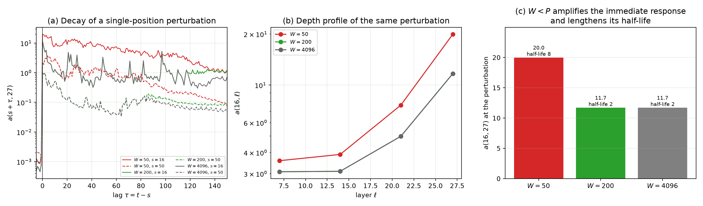

The earlier two-window comparison, for reference: $W=50$ vs $W\ge200$ at $s=16$ and $s=50$, with
the depth profile.

---

Each block states: data, axes (with formulas), curves, reading. All perturbations are FP32,
greedy, teacher-forced unless stated.

## A. The attention window

### A1. Same prompt, same tokens, two windows

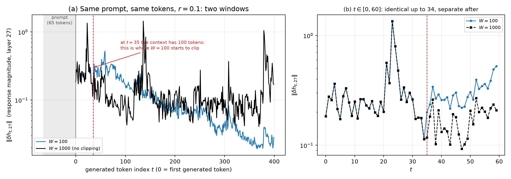

**Data.** Prompt of $P=65$ tokens. The *same* 400-token sequence $g_0,\dots,g_{399}$ is used in
both runs, so the tokens cannot differ. Prompt perturbation (1.2A) with $r=0.1$, 8 simplex
directions. Teacher-forced pass; state read at layer $\ell=27$.

**Axes.** $x$: generated token index $t$ (negative values = prompt, grey band; $t=0$ = first
generated token). $y$: $\|\delta h_{t,27}\|$, median over the 8 directions.

**Curves.** Blue $W=100$; black $W=1000$ (never clips in 400 tokens, so it is the control).
Panel (b) zooms on $t\in[20,55]$.

**Reading.** The curves are numerically identical up to $t=34$ and separate at $t=35$.
$35=W-P=100-65$: at that step the context stops fitting in the window. The weights and the input
tokens are identical; only the mask differs. This is a controlled intervention, and it is the
cleanest evidence that the rise/decay shape of the response is produced by the window.

**Caveat.** Qwen2 applies the sliding window only to its last `max_window_layers` blocks, so
early layers keep full attention. The departure therefore shows up in the last-layer state and
then grows.

### A2. The generated text under two windows

**Data.** Two *free-running* greedy generations from the same 65-token prompt, $W=100$ and
$W=200$. **No perturbation**: $r=0$. This figure is about text, not about the response.

**Axes.** $x$: token index (negative = prompt). $y$: fraction of tokens identical to the
$W=200$ run, over all positions up to $t$.

**Curve.** One curve: 1 over the whole prompt (trivially identical), 1 for the first 40 generated
tokens, then falling.

**Reading.** The text is bit-identical for 40 tokens; the first different token is $t=40$. The
*response* departed at $t=35$; five more tokens were needed before the small difference crossed
a decision gap. Afterwards the texts never re-converge, so the curve decays to 0.

**What it is not.** Not a perturbation experiment: $r=0$, only the mask differs.

### A3. Response is proportional to the radius

**Data.** Prompt perturbation, 20 simplex directions, 7 radii $r\in[10^{-3},0.3]$,
teacher-forced, layer 27.

**Axes.** $x$: $t$. $y$: $\|\delta h_{t,27}\|/r$ (response per unit radius). Thin lines: three individual
directions. Thick line: median.

**Reading.** If the response were proportional to $r$, all curves collapse onto one. They do:
the coefficient of variation of $a/r$ across radii is 2–3% (median; p90 ≤ 11%) at every layer
and time. Hence
$$\|\delta h_{t,\ell}\|(r)=r\,G(t,\ell).$$
Deviations appear only at $r=10^{-3}$ late in the sequence (float32 round-off, $a<10^{-4}$) and
at $r\ge0.5$ (D5). This linearity licenses all threshold arithmetic in Part B.

### A4. Depth sets the gain

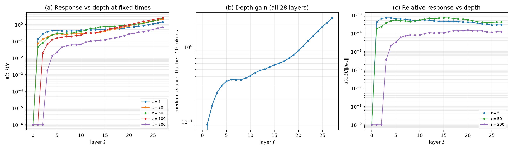

**Data.** Prompt perturbation, $r=0.1$, 20 directions, **all 28 layers saved**, 300 tokens.

**Panel (a).** Response vs layer at fixed times. **Panel (b).** Median gain over the first 50 tokens
vs layer. **Panel (c).** Response divided by the baseline state norm.

**Reading.** At the generated positions, layer 0 is *exactly* zero: the perturbation is on the
prompt, and the embedding of a generated token does not contain it. The response appears at layer 1
when attention first mixes the prompt into the generated position, then grows smoothly with depth
(panel a). This shape is the same at every time — there is no "arrival depth".

What does change with time is the **surviving** depth range: the shallow layers are flushed by the
sliding window, so at $t=200$ layers 1–2 are exactly zero and the first live layer is 3. That is the
flush cascade, not delayed arrival.

The absolute response grows from 0.13 (L1) to 2.4 (L27) in units of $r$ — a factor 19. It is
*not* extra amplification: from layer 1 to 27 the state norm grows by the same factor (18 vs 19).
The relative response $\|\delta h_{t,\ell}\|/\|h_{t,\ell}\|$ is $2.65\times10^{-4}$ at L1, rises to
$4.94\times10^{-4}$ at L4, and then stays constant within ±5% all the way to L27
($4.75\times10^{-4}$). The per-layer version of this statement is in Q6: the excess gain is 1 for
every layer $\ell\ge5$.

**Data.** Same run; fixed $r$, all saved layers.

**Axes.** Left: $x=t$, $y=\|\delta h_{t,\ell}\|$ for several $\ell$. Right: $x=\ell$,
$y=\|\delta h_{t,\ell}\|/\|\delta h_{t,1}\|$ at fixed $t$.

**Reading.** Early layers respond and decay; deep layers rise, surge before the window flush,
then decay. The depth profile is close to $\ell^{0.64}$ ($R^2=0.95$) only because both
$\|\delta h\|$ and $\|h\|$ grow together; the meaningful statement is the flat relative response.
Depth also sets the rise time and the memory of the perturbation.

### A5. Large radii

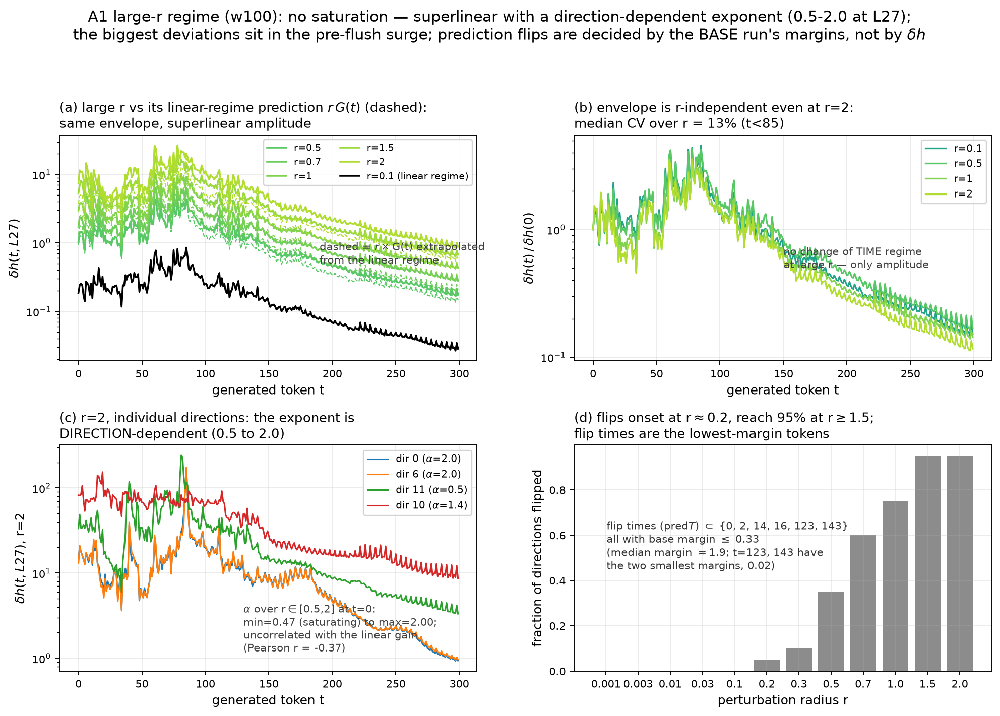

**Data.** $r=0.1\ldots2$, same directions.

**Axes.** $x=t$; $y$: response, normalized by its own peak; insets give the fitted exponent.

**Reading.** No saturation and no new regime: the shape survives (CV 13% for $r\in[0.1,2]$), but
the response becomes mildly superlinear. The deep-layer exponent grows from 0.96 (L1) to 1.45
(L27); per direction it spans 0.47–2.0 and is uncorrelated with the linear gain. At $r=2$ the
largest response is ≈0.7 of the baseline state norm. This is why *extrapolating* a threshold
from small $r$ fails above $r\approx0.3$ (D5), while re-measuring at the radius of interest does
not.

## B. The decision boundary and thresholds

### B1. What is predicted

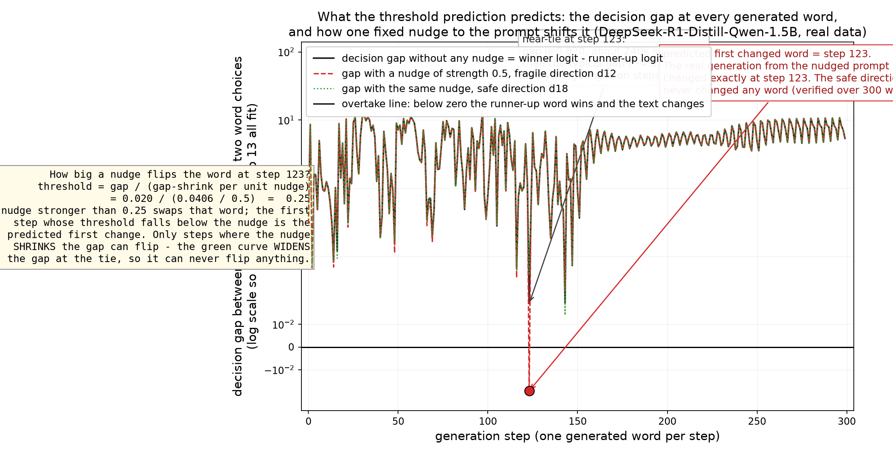

**Data.** One prompt, one direction, $r=0.5$, teacher-forced. Baseline gap $m_t$ and perturbed gap
$m'_t$ are read at every step; $\delta m_t=m'_t-m_t$.

**Axes.** $x$: $t$. $y$ (log): logit gap. The dashed "overtake" line is $m'_t=0$: where the
perturbed gap touches it, the runner-up becomes the winner.

**Reading.** Most steps have a gap of several logit units; at $t=123$ the baseline gap is
$0.020$. A perturbation that shrinks the gap by $0.041$ per unit $r$ gives
$r_c=m_t r/|\delta m_t|=0.020/0.041\approx0.25$: any $r\ge0.25$ flips that word. The figure
shows the observed flip at exactly that word for $r=0.5$.

**What is predicted.** Two things from one teacher-forced pass: whether the free run changes any
token, and the index of the first changed token. If no $r_c$ falls below $r$, the prediction is
"the entire answer is unchanged".

### B2. Accuracy of the prediction

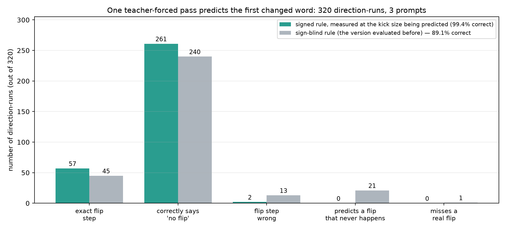

**Data.** 19 free-run experiments × 20 directions = 380 runs; 320 are evaluable with the signed
rule (the childhood prompt has no stored geometry). Three prompts, radii $10^{-4}$–$2$,
windows 100/200/500.

**Axes.** $x$: outcome category. $y$: number of direction-runs out of 320.

**Bars.** Green: signed rule (1.4) with $\delta m$ measured at the predicted radius. Grey: the
earlier sign-blind rule $r_c=m_t/|\delta m_t/r|$.

**Reading.** Signed: 57 exact flip steps, 261 correct "no flip", 2 wrong steps, **0 false
alarms, 0 missed flips** = 318/320 = **99.4%**. Sign-blind: 45 exact, 240 no-flip, 13 wrong
steps, **21 false alarms**, 1 miss = 89.1%. The "many outliers" of the earlier scorecard were
produced by the sign-blind rule.

**Two misses.** Both are flips at $t=0$ at $r=1$ and $r=2$: a large perturbation deforms the
prompt itself, so the free run's first step is already uncertain while the teacher-forced pass
still follows the unperturbed prefix.

### B3. What the prediction is worth

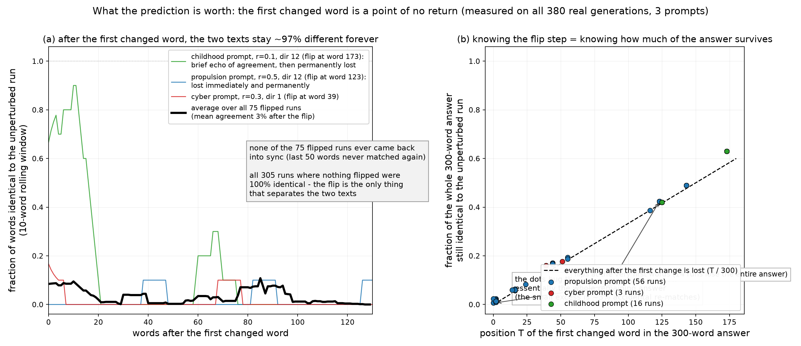

**Data.** All 75 flipped runs (3 prompts), with the full generated sequences of both the
perturbed and the unperturbed run.

**Panel (a).** $x$: tokens after the first flip. $y$: fraction of tokens identical to the
unperturbed run in a rolling 10-token window. Three examples plus the average over 75 flips.

**Panel (b).** $x$: first-flip position $T_f$. $y$: fraction of the 300-token answer identical,
$S=T_f/T$. Points: runs. Dashed line: $y=x/300$.

**Reading.** After the first flip, agreement stays at 2–3%: **0 of 75 runs ever re-synchronise**.
The surviving fraction is exactly first-flip position / 300. All 305 runs without a flip are
100% identical. Predicting $T_f$ is predicting how much of the answer survives.

### B4. Which direction is fragile, and at which word

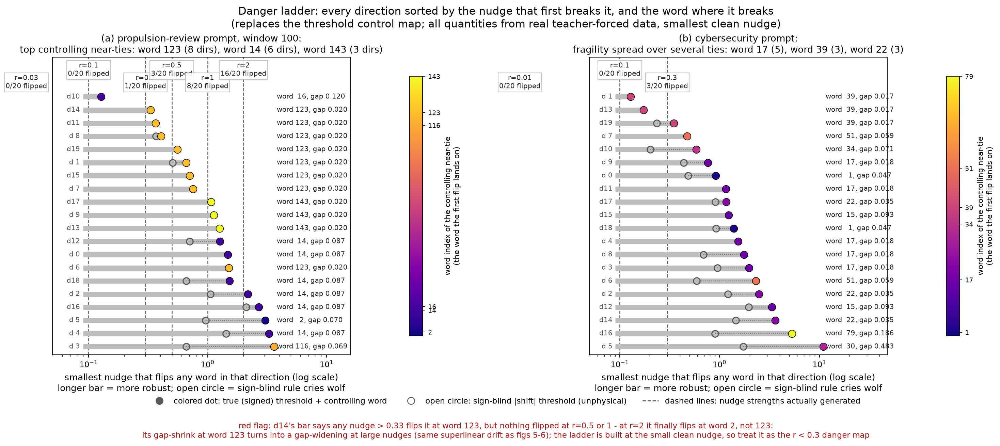

**Data.** Prompt perturbation, 20 directions, teacher-forced geometry, two prompts. One row per
direction.

**Axes.** $x$ (log): smallest radius $r_*(u)=\min_t r_c(t,u)$ that flips any word. Colour: the
token $t$ where that minimum occurs (the controlling close call). Open circles: the same
quantity under the sign-blind rule.

**Reading.** Propulsion prompt: the tie at word 123 (gap 0.020) controls 8/20 directions, word 14
(gap 0.087) 6/20, word 143 (gap 0.020) 3/20; $r_*$ spans 0.128–3.62. Cybersecurity prompt:
fragility is spread over words 17/39/22; $r_*$ spans 0.13–10.9. The sign-blind rule halves the
apparent threshold for many directions.

### B5. Where the linear prediction breaks

**Data.** All radii; teacher-forced gains $|\delta m_t|/r$ per direction and step.

**Axes.** Left: $x=r$ (log), $y=|\delta m_t|/r$ (log). Right: $x=r$, $y$ = number of directions
that flip.

**Reading.** Three regimes. (i) $r\lesssim3\times10^{-4}$: the measured shift is at the float32
round-off ($|\delta m|\sim10^{-5}$), so the apparent gain grows like noise$/r$. (ii)
$3\times10^{-3}\lesssim r\lesssim0.3$: gain flat at ≈0.0085, linear. (iii) $r\gtrsim0.5$: gain
grows (median ×1.55 by $r=2$) and becomes tie-dependent, so a threshold measured at small $r$
over-predicts: 16/20 at $r=0.5$, 6/20 at $r=1$, 3/20 at $r=2$. This breaks *extrapolation*, not
the rule: re-measuring $\delta m$ at the radius of interest restores 99.4%.

## C. Single-position perturbations

### C1. The response field

**Data.** Perturbation (1.2B) at one position $s$, 24 Gaussian directions, radii
$3\times10^{-3},10^{-2},3\times10^{-2},10^{-1}$, teacher-forced on the same 300-token sequence,
state read at layers 7/14/21/27. Panels (a)–(b): $r=0.03$.

**Panel (a).** $x=t$; $y=s$; colour $=\log_{10}$ of the median over directions of $\|\delta h_{t,27}\|$. Cyan
line $t=s$: no effect can precede the perturbation.

**Panel (b).** $x$: lag $\tau=t-s$; $y$: $a(s+\tau,27)$ (log), one curve per $s$.

**Panel (c).** Bars: $a(s,27)$ at lag 0 for each $s$. Red line (right axis): tokens until the
response halves.

**Panel (d).** $x=r$ (log); $y=a(s,27)$ (log) for each $s$. Slope-1 lines mean linearity; fitted
slopes 0.99–1.00.

**Reading.** (i) Exactly zero for $t<s$. (ii) At the perturbation position the size varies **×13**
with $s$ (0.26 at $s=75$ to 3.49 at $s=16$): *where* you perturb matters more than how hard.
(iii) Decay is fast — half-life 1–7 tokens — then a long small tail. (iv) Linearity at every
position.

### C2. Depth: absolute grows, relative shrinks

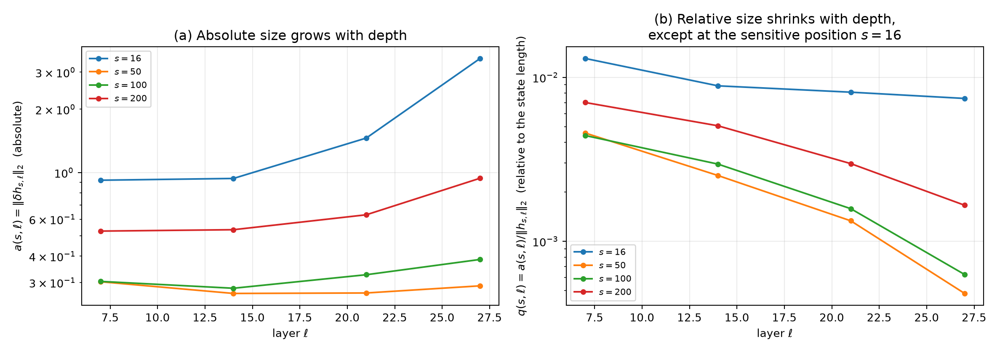

**Data.** Same run, $r=0.03$.

**Panel (a).** $x$: layer $\ell$; $y$: $a(s,\ell)=\|\delta h_{s,\ell}\|_2$ (absolute).

**Panel (b).** $x$: layer; $y$: $q(s,\ell)=a(s,\ell)/\|h_{s,\ell}\|_2$ (relative to the state
length).

**Reading.** Both panels are correct and they answer different questions. The absolute effect
grows with depth (the residual stream amplifies it). Relative to the state's own length it
*shrinks* with depth for ordinary positions $\times0.05$–0.09 from L7 to L27, because the state
length grows faster. The exception is the sensitive position $s=16$, whose relative effect stays
flat (×0.6). A perturbation at a close call is not washed out by depth.

### C3. When a perturbation acts

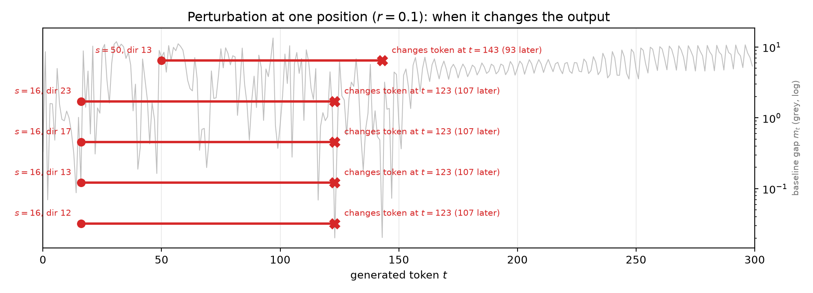

**Data.** Same run, $r=0.1$. Every (position, direction) pair whose margin condition
$\delta m_t\le -m_t$ is met at some $t>s$.

**Axes.** $x$: generated token $t$. Each horizontal segment starts at the perturbation position
$s$ and ends at the token $t$ that first changes. Grey curve (right axis, log): baseline gap
$m_t$.

**Reading.** Five events. All four $s=16$ directions change the token at $t=123$ — **107 tokens
after the perturbation** — and the one at $s=50$ at $t=143$ (93 later). Nothing happens at $s$.
The perturbation sits latent until the model reaches the next close call.

### C4. Autoregressive confirmation

**Data.** Free-running generations with perturbation at $s=16$ and $s=50$, $r=0.1$, 24 directions,
compared with the teacher-forced prediction of C3.

**Panel (a).** $x$: predicted first changed token (teacher-forced), $y$: observed first changed
token (free run). Five events.

**Panel (b).** $x$: $t$; $y$: fraction of tokens so far identical to the unperturbed run, for one
direction. Green line: perturbation position. Red line: first changed token.

**Panel (c).** Same for all 24 directions at $s=16$: 4 change the text, 20 never do.

**Reading.** **5/5 exact**, including the step: 4 directions at $s=16\to t=123$, 1 at
$s=50\to t=143$. After the change, agreement falls to ≈40% and the texts never re-converge. The
latency is real, not an artifact of teacher forcing.

### C5. Which positions matter, and when it acts

**Data.** Free runs with a single-position perturbation, 24 directions, at positions
$s=8,16,32,50,75,100,150,200$, two radii ($r=0.1$ and $r=0.3$). A "flip" is the first token that
differs from the unperturbed run.

**Panel (a).** $x$: perturbation position $s$; $y$: fraction of the 24 directions that change any
later token. Blue: $r=0.1$ (two runs, positions 8–50 and 8–200). Red: $r=0.3$.

**Panel (b).** A point per (position, direction) that flips: $x=s$, $y$ = token where the first
change happens. Dotted lines: near-tie tokens, labelled with their baseline gap $m_t$.

**Reading.** Position dominates. At $r=0.3$: 17/24 directions flip when the perturbation is at
$s=16$, 6/24 at $s=32$, 11/24 at $s=50$, and **zero** at $s\ge75$. At $r=0.1$ only $s=16$ (4/24)
and $s=50$ (1/24) act. When a perturbation acts, it acts at one of four tokens: $t=40$ (early, gap
0.188 but the response is still large) or $t=116/123/143$ (the smallest gaps, 0.069/0.020/0.020).
Nothing acts between them. This is the decision-boundary picture at the level of a single token:
the perturbation must survive to a place where the *product* of response and closeness is large
enough.

## D. Prompt perturbation: two kinds of flips

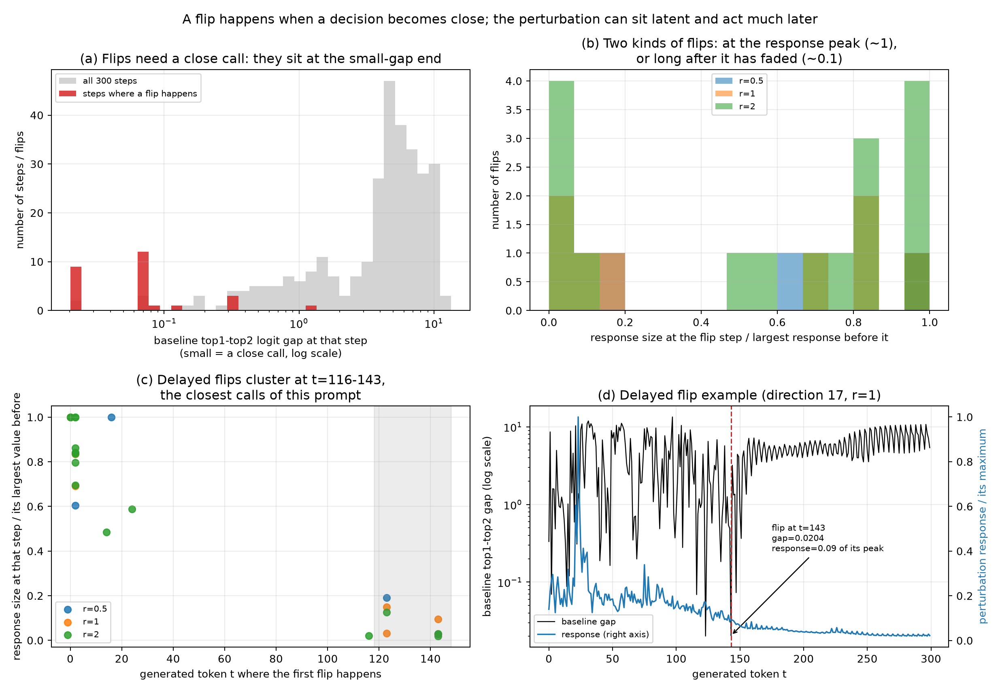

**Data.** Prompt perturbation; 27 observed free-run flips at $r=0.5,1,2$ (20 directions each);
baseline gaps and teacher-forced responses.

**Panel (a).** $x$: baseline gap $m_t$ (log); $y$: counts. Grey: all 300 steps. Red: steps where a
flip happens. Flips sit at the small-gap end (spikes at 0.020 and 0.069).

**Panel (b).** $x$: response at the flip step divided by its maximum up to that step; $y$: counts.
1 = flip at the response peak; near 0 = response already decayed.

**Panel (c).** $x$: flip step; $y$: the same ratio. Delayed flips cluster at $t=116$–$143$.

**Panel (d).** Example: gap (black, log) and response (blue, normalized) vs $t$; red line = flip at
$t=143$, gap 0.020, response 9% of its peak.

**Reading.** 17/27 flips are immediate (at the response peak); 10/27 are delayed — the response has
faded but the model reaches a later close call and breaks there. A flip depends on the product of
response size and closeness, not on the response alone.

## E. Directions are not equivalent

**Data.** Prompt perturbation at $r=0.3$ (linear regime), 20 simplex directions, teacher-forced.
The 8 near-ties are the 8 smallest baseline gaps $m_t$.

**Panel (a).** Rows: the 8 near-tie tokens, sorted by $m_t$ (labels give $t$ and $m_t$). Columns:
direction $u$. Colour: $\delta m_t(u)/r$ — gap change per unit radius. Red $>0$ (widens, no
flip), blue $<0$ (shrinks, can flip).

**Panel (b).** For each direction, the number of the 8 ties where the gap shrinks.

**Reading.** The sign is **not** a property of the direction: at $t=123$ seven directions shrink
the gap and thirteen widen it; at $t=16$ only four shrink it. Across the eight ties the sign
patterns are essentially uncorrelated (mean Spearman $-0.05$), and no direction is negative at
more than 6/8 ties. Magnitudes, in contrast, are a stable property of a direction (next figure).

**Consequence.** "Which direction is dangerous" only makes sense together with the word at which
it acts. Magnitude ranks directions; sign ranks (direction, word) pairs.

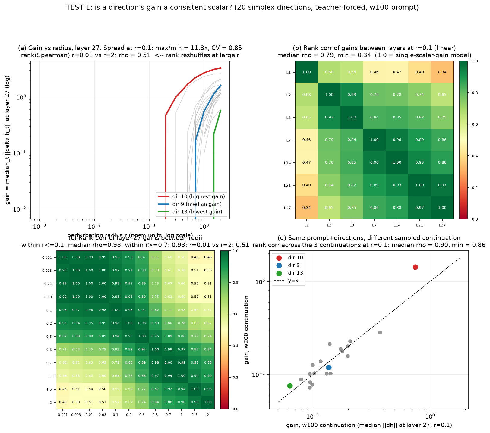

**Data.** The same 20 directions evaluated on three different continuations of the same prompt
(different windows produce different texts), teacher-forced.

**Axes.** Pairwise rank correlation of per-direction response magnitudes between continuations.

**Reading.** Rank correlations 0.80–0.98: a strong direction stays strong on a different text. The
"hot trio" (directions 10, 11, 12) is hot in all three. So magnitude is a property of the
direction; the sign at a particular word is not.

### E2. All directions at once: 1536 directions

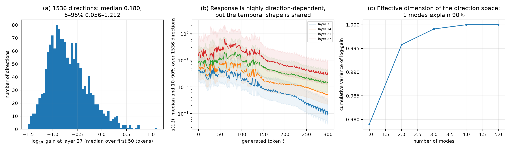

**Data.** One prompt, one radius ($r=0.1$), teacher-forced, **1536 directions** — as many as the
hidden dimension. Five layers, 300 tokens.

**Panel (a).** Histogram of the gain at layer 27 (median over the first 50 tokens).

**Panel (b).** Response curves: median and 10–90% band over the 1536 directions, per layer.

**Panel (c).** Cumulative variance of the log-gain matrix (directions × layers).

**Reading.** The response spans a factor **×22** between the 5th and 95th percentile (0.056 to
1.21), and ×400 between the extremes. Yet **one mode explains 97.8% of the variance** of the
log-gain: over the full 1536-dimensional direction space, directions differ essentially by a
single scalar gain multiplying a shared temporal shape. This is the strongest form of the
"direction = scalar gain" statement.

**Consequence.** Averaging over directions is safe for the temporal shape, never for the
magnitude: report the distribution of gains, not a single number.

### E3. Directions across models: DeepSeek is anisotropic, Qwen3-4B is not

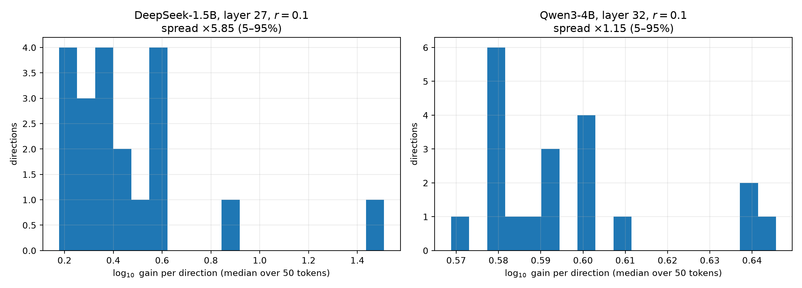

**Data.** Same protocol (prompt perturbation, $r=0.1$, 20 simplex directions, teacher-forced, 50
tokens), last saved layer: DeepSeek layer 27, Qwen3-4B layer 32 (of 36).

**Axes.** $x$: $\log_{10}$ of the median gain per direction. $y$: number of directions.

**Reading.** DeepSeek's 20 directions span **×5.85** (5–95%); with 1536 directions the spread is
**×22**. Qwen3-4B's 20 directions span **×1.15** — essentially identical. Direction dependence is
therefore **model-specific**, not a generic property of transformers: the distilled 1.5B model has
strong direction structure, the newer 4B model is close to isotropic.

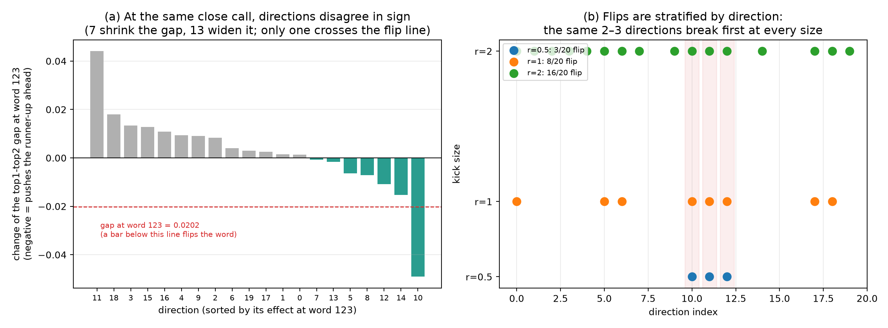

**Data.** Same geometry; (a) uses $t=123$ and $r=0.3$; (b) uses observed flips at
$r=0.5,1,2$.

**Panel (a).** $x$: directions sorted by their effect at word 123. $y$: $\delta m_{123}(u)$; the
dashed line is $-m_{123}$ (the flip line).

**Panel (b).** $x$: direction index; $y$: radius; markers: directions that flip at that radius.

**Reading.** At the same close call, different directions push the decision in opposite
directions, and only one crosses the flip line. Flips are stratified: at $r=0.5$ exactly the hot
directions 10–12 break, at $r=2$ sixteen directions do.

## F. Depth and non-normality

**Data.** Prompt perturbation, radii $10^{-3}$–$2$; full perturbed and baseline last-layer states
are saved for three directions, so the angle is exact.

**Panel (a).** $x$: $r$ (log); $y$: angle between $\delta h$ and $h$ in degrees. $0^\circ$ =
radial (length change), $90^\circ$ = perpendicular (direction change). Grey band: float32 floor,
below ≈0.03° the stored cosine rounds to 1 and the angle is not measurable.

**Panel (b).** $x$: layer; $y$: $1-\cos$ between $\delta h$ and $h$ (log), four radii.

**Panel (c).** The perturbation split into its component along $h$ and its perpendicular
component, vs layer.

**Reading.** The angle is 86–87° at every radius and layer. In 1536 dimensions two random vectors
are also nearly perpendicular (expected angle $\arccos(1/\sqrt d)\approx88.5^\circ$), so the angle
alone is **trivial**; the informative part is panel (c): ≈95% of the perturbation is
perpendicular and only 5–8% is along the state. Because the network normalizes length before the
logits, only that perpendicular part can change the output. Measured: the logit-gap change tracks
the perpendicular length linearly, $|\delta m|\approx4\,b/\|h\|$ with $b$ the perpendicular
component.

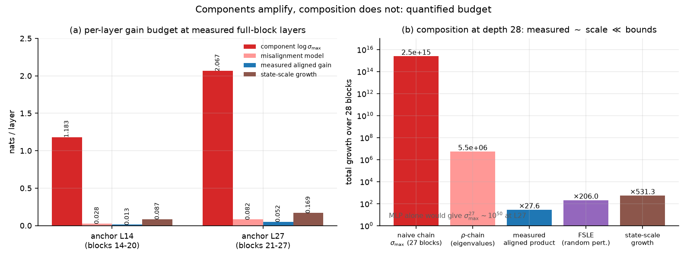

**Data.** Block Jacobians $J_\ell=\partial h_{\ell+1}/\partial h_\ell$ at a fixed position, 5
layers × 6 tokens; $\sigma_{\max}$ by power iteration, $\rho$ by ARPACK.

**Axes.** Per layer: $\sigma_{\max}$ (worst one-step amplification), $\rho$ (asymptotic growth if
the same map were repeated), $\kappa=\sigma_{\max}/\rho$, the principal angle between consecutive
top singular subspaces, and the measured aligned gain of the product.

**Reading.** $\sigma_{\max}$ reaches 95–195 at layer 0 and 6–9 at layer 27, yet the measured
product is far below both the naive chain $\prod\sigma_{\max}$ (by ~13 orders) and
$\prod\rho$ (by ~5). The reason is rotation: consecutive amplification directions differ by
83.6° on average, so gains cannot compound. The budget $(\sigma-1)\cos^2\theta$ reproduces the
measured chained gain within a factor ≲2.

**Important.** This is a statement about a *fixed position*. The full prompt perturbation also
travels across positions through attention and grows. The two statements are not contradictory,
but must not be conflated. It also means the earlier sentence "the depth expansion is only radial
scale drift" was wrong and has been retracted.

## G. Correlation dimension: why the curves looked different

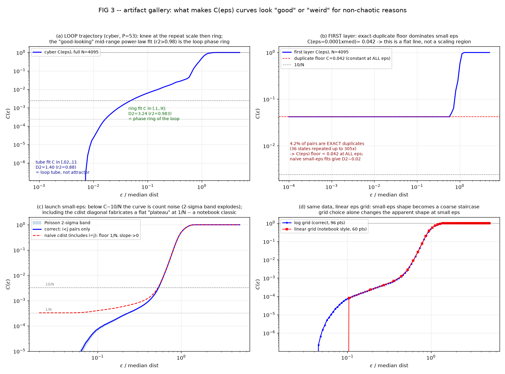

**Data.** Last-layer states of long generations (4000 tokens), first-layer states, synthetic
controls.

**Axes.** $x$: $\varepsilon$ divided by the median pairwise distance (log). $y$:
$C(\varepsilon)$ from 1.4 (log). Dashed lines $1/N$ and $10/N$: below them the estimate is
dominated by finite sampling.

**Panels.** (a) A near-exact repetition loop: knee plus "ring", fittable with $r^2=0.999$. (b)
First-layer states contain 352,035 exact duplicate pairs, giving a flat floor $C=0.042$ at every
$\varepsilon$. (c) A naive computation including $i=j$ pairs and/or a linear $\varepsilon$ grid
produces a staircase. (d) Same data on linear vs log grid.

**Reading.** All four shapes are artifacts of the data or the estimator, not evidence of a
low-dimensional attractor. On non-loop trajectories the whole rise of $C$ spans 0.16–0.19 decades,
and the interval that is both below $2\log_{10}N$ and above $10/N$ is 0.00–0.04 decades wide: no
plateau exists. The estimator is not at fault — at the same $N$ it recovers Hénon ($D_2=1.157$)
and Lorenz ($D_2=1.984$).

**Update (16 fresh 1000-token trajectories).** 0 of 64 (trajectory × $N$ × Theiler) configurations
contain a slope-stable interval inside the legal band. Eight of the sixteen trajectories are
quasi-loops with periods 12–81 and narrow relative distance (0.018–0.035 of the cloud scale); they
have wide "plateaus" that are loop knees. The eight non-repetitive ones have an ER-legal width of
**0.000 decades**. Predictability with $k$-nearest neighbours replicates only on the eight
quasi-loops (NSE gaps +0.27…+0.67 over surrogates); on the eight non-repetitive ones the gap is
+0.018 (median) versus MIAAFT and +0.002 versus a linear ridge, i.e. nothing. The earlier
`launch` lead does not replicate. Two surrogate-implementation bugs were found and fixed in that
pass, so older MIAFT-based numbers should be re-checked; the clean statement is the one above.

**Data.** Delay embedding of the same trajectories, $m=2\ldots10$, with white-noise and
phase-randomised controls.

**Axes.** $x$: embedding dimension $m$; $y$: estimated $D_2$.

**Reading.** At $m=2$ the curve looks textbook (slope 1.95 over 0.96 decades, $r^2=0.999$), but
**white noise at $m=2$ gives the identical curve**: it is the fill dimension of any 2-D cloud.
The estimate rises with $m$ and never saturates below the surrogate band.

## H. A sanity check that is trivial by definition

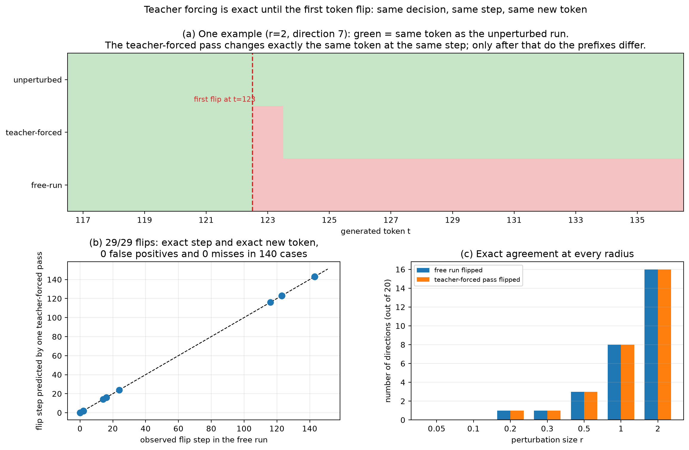

**Data.** 140 teacher-forced predicted sequences compared with free runs (20 directions × 7
radii).

**Panels.** (a) timeline of one example around the flip; (b) predicted vs observed first flip
step; (c) flip counts per radius.

**Reading.** 29/29 flips agree in step and token, 0 false positives among 111 no-flip cases. The
first two panels are **trivial by construction**: a token cannot differ before the first
difference. The only non-trivial content is panel (b)'s exactness of the *predicted token*: one
teacher-forced pass also gets the new word right. After the flip the comparison is meaningless
because the prefixes differ.

---

# Part 3. Relation to Lyapunov exponents

For an autonomous map $x_{n+1}=F(x_n)$, the maximal Lyapunov exponent is
$$\lambda=\lim_{n\to\infty}\frac1n\log\|DF^n(x_0)\,\delta_0\| .$$
It is a property of the invariant measure, independent of $x_0$ and $\delta_0$ almost surely.

Three things separate our measurement from this.

1. **The map changes every step.** The input at step $t$ is the token $g_t$, itself the output of
   the previous step; the update is $h_{t+1}=F_t(h_t)$ with a different $F_t$ each step (different
   token, position, mask). A time-dependent product of Jacobians has **finite-time** stretching
   exponents, not one Lyapunov exponent. The correct object is the finite-time rate of
   $\prod_{i<t}DF_i$, which depends on $t$ and on the window.
2. **The trajectory is finite and transient.** Our curves decay and the network is reset at every
   prompt. There is no long-time limit: 300–1000 tokens is the whole experiment.
3. **The relevant norm is not the raw state norm.** The output depends on the *direction* of the
   state (length is normalized away), so the dynamically relevant growth is the tangential one.
   The raw norm grows ×452 with depth mostly because the residual stream's scale grows, which the
   logits do not see.

What the data support:
- the finite-time response is linear in $r$ up to $r\approx0.3$ and transient;
- $\lambda(t)=\frac1t\log(\|\delta h_{t}\|/\|\delta h_{0}\|)$ is positive early and turns negative: a transient, not
  sustained stretching;
- the depth product at a fixed position contracts relative to the state scale, while the full
  response grows through cross-position mixing;
- the actual mechanism of unpredictability is a **decision-boundary crossing** at a close call,
  not exponential separation of nearby trajectories.

**The stable-chaos test in Part 2.0 settles the question empirically.** Four independent
signatures reject exponential separation: flip times sit on a handful of discrete margin dips
($p<5\times10^{-6}$ under a continuous-separation null); the fitted hazard varies by ~90× with $r$
and its confidence interval includes zero for $r\le0.5$; the perturbation norm never grows
($\le1.02$); and there is a hard floor ($r\le0.1$ never flips in 300 tokens).

**The rate itself is negative.** In 31 configurations (layers, radii, windows, prompts), the
sustained stretching rate over $t>150$ has 0/31 positive point estimates and 0/31 direction-bootstrap
CIs touching zero; the best estimate is −0.0043 nats/token [−0.0055, −0.0030]. A synthetic
expanding map with a true rate of +0.035 is recovered cleanly by the same pipeline, so the method
has the power to see one. The correct statement is: **no positive Lyapunov exponent is detectable
in this system at these scales; the unpredictability is a finite-amplitude threshold crossing.**

If a Lyapunov-like number is wanted, the honest report is a finite-time exponent with horizon and
window stated, e.g. "$\lambda(t=50)=0.032$ nats/token at $W=100$, reference $t_0=5$", never a bare
"Lyapunov exponent".

---

# Part 3b. The questions, answered one by one

These are the questions that came up while reading the figures. Each answer states the object, the
measurement, and what it does and does not imply.

## Q1. The response is linear in $r$. Is the Jacobian well defined, and is its exponent positive?

**Yes, piecewise — and no, the exponent is not positive.**

Write the state at a generated position as $h_t$ and one transformer step (including the token
decision) as $h_{t+1}=F_t(h_t)$. Between two token changes $F_t$ is smooth, and the response to a
perturbation is
$$\delta h_t = \big(DF_{t-1}\cdots DF_0\big)\,\delta h_0 + O(\|\delta h_0\|^2).$$
The measurement $\|\delta h_{t,\ell}\|\propto r$ over $r=10^{-3}\dots0.3$ (section A3) is exactly the
statement that the $O(r^2)$ term is negligible: we are in the tangent regime, so the product of
Jacobians $J(t)=DF_{t-1}\cdots DF_0$ is a measurable object.

The subtlety is the readout. The token is $\arg\max W h$; that map is **discontinuous** at the
decision boundary. So there is no single Jacobian for the whole generation: there is a Jacobian on
each smooth segment and a finite jump at each flip. The trajectory-level object is the
finite-time product above, and the only meaningful rate is the finite-time exponent
$$\lambda(t)=\frac1t\log\frac{\|J(t)\,\delta h_0\|}{\|\delta h_0\|}.$$
We measure it and it is **negative in every configuration** (0/31; best $-0.0043$ nats/token).

**The misconception to correct.** Linearity in $r$ does not give you a positive exponent, and it
does not make $\lambda$ independent of $r$ *in general*. It does something stronger and simpler:
inside one smooth segment, $\delta h_t = r\,J(t)\hat u$, so **every ratio** — $\lambda$, the
normalised response, the depth gain — is *exactly* $r$-independent, and any $r$-dependence you see
comes from a **flip** (which changes the token sequence, hence every later $F_t$) or from the
numerical floor. This is why $\lambda_k(t)$ at $r=0.03$ and $r=0.3$ agree before the first flip, and
why the threshold analysis must be phrased in $r$: the threshold is about *when* the boundary is
reached, not about growth.

**The margin coordinate makes this explicit.** With $a,b$ the top two tokens and
$m_t=(w_a-w_b)\cdot h_t$ the margin, define
$$u_t=\frac{\delta m_t}{m_t},\qquad \delta m_t=(w_a-w_b)\cdot\delta h_t .$$
The token flips exactly when $u_t\le-1$ (signed rule: 318/320). Panel (a): at $r=0.3$ the most fragile
direction reaches $u=-0.63$ and never crosses — no flip, consistent with the free runs. Panel (b):
the closest approach $-\min_t u_t$ is linear in $r$; the envelope gives $r^*\approx0.54$, the smallest
radius at which some direction flips for this prompt. Panel (c): divided by $r$, the three radii give
the same distribution — the coordinate is linear in $r$ to within the spread between directions.

## Q2. What exactly is chaotic about "stable chaos"?

**Not a positive Lyapunov exponent.** What is chaotic is the *symbolic* dynamics, and the honest
one-sentence definition is:

> The continuous state contracts ($\lambda<0$, no growth), but the readout is discontinuous, so an
> arbitrarily small perturbation eventually changes a token; the trajectory separation is a sawtooth
> of long contraction and instantaneous jumps at margin crossings.

Mechanically:

1. Nearby states converge: $\|\delta h_{t,\ell}\|$ never grows, $\lambda<0$.
2. The readout $g_t=\arg\max W h_t$ is discontinuous. When the margin $m_t$ passes through zero, an
   arbitrarily small $\delta h$ changes the token.
3. A token change injects a **finite** distance (a whole embedding vector) into the state. The two
   trajectories then re-contract.

So the distance between two nearby trajectories is not exponential — it is a sawtooth: contraction,
jump, contraction. That is the "flux tube": the perturbation stays in a tube and exits only through
a gate, and the gates are the margin dips.

In dynamical-systems language this is a **hybrid system with a discontinuous readout**. It has
sensitive dependence and positive topological entropy of the token map, but zero (here negative)
measure-theoretic Lyapunov exponent. The empirical signatures are in Part 2.0: flips sit on 8
discrete margin dips ($p<5\times10^{-6}$ against a continuous-separation null); the flip hazard does
not scale with $r$ the way exponential separation would; the hard floor $r\le0.1$ never flips within
300 tokens; the norm never grows.

If a referee objects to the word "chaos", the defensible phrase is **threshold-induced sensitivity in
a contracting system**. I keep "stable chaos" as the label because it names the two ingredients, but
it must always be defined in one sentence as above.

## Q3. Why do curves with different $W$ differ already for $t<W$?

Because the window counts **absolute positions**, and the prompt already occupies $P$ of them.

A query at absolute position $q=P+t$ can attend to positions $p$ with $q-p<W$. A prompt token at
$p$ stops being visible when $P+t-p\ge W$, i.e. at
$$t = W-P+p .$$
The earliest prompt position ($p=0$) is lost first, at
$$t_{\text{first}} = W-P .$$
So the first difference between window $W$ and no window appears at $W-P$, **not** at $W$. If
$W<P$, the prompt is already truncated at $t=0$ and the curves differ from the first token.

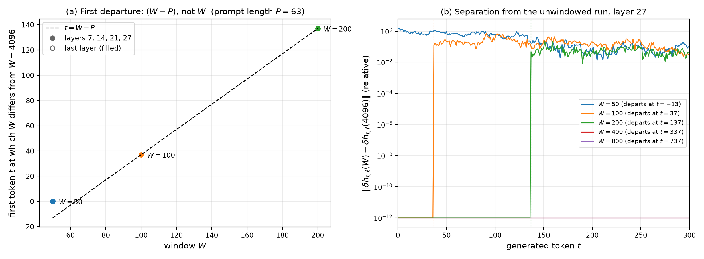

**Measured** ($P=63$): $W=100$ departs at $t=37=100-63$; $W=200$ at $t=137=200-63$; $W=50$ at
$t=0$. Panel (b) shows the separation itself: exactly zero until $W-P$, then a jump, then a slow
drift. The law is exact for all four saved layers.

This is a different event from the **flush law** $t^*_\ell=p_{\text{last}}+(W-P)+(\ell-1)(W-1)$,
which is the time at which the *last* prompt position has been flushed out at layer $\ell$. First
departure = the first prompt token is lost; flush = the last one is lost. The $(\ell-1)(W-1)$ term is
the receptive-field growth: at layer $\ell$ a position sees back to $q-(\ell-1)(W-1)$.

Why do some plots look like a step and others like a ramp? The *set* of attended positions changes
abruptly, but the contribution of a token that is about to leave the window is already attenuated,
so the norm changes smoothly in most observables and abruptly only when the lost token was
dominant.

## Q4. Finite-time rate, FSLE, and $\lambda$: same thing? And are they $r$-dependent?

Three different objects, routinely conflated:

| object | definition | what it answers |
|---|---|---|
| finite-time exponent $\lambda_k(t)$ | $\frac{1}{2k}\log\frac{\|\delta h_{t+k,\ell}\|}{\|\delta h_{t-k,\ell}\|}$ | local stretching at lag $k$ around $t$ |
| FSLE $\lambda(\delta)$ | fix $\delta<\Delta$; measure $\tau(\delta)$ to grow from $\delta$ to $\Delta$; $\lambda(\delta)=\frac{1}{\tau}\log\frac{\Delta}{\delta}$ | how fast a *finite* perturbation becomes macroscopic |
| threshold / survival | time until the margin crosses zero | when the discrete decision changes |

Only the first is a (finite-time) Lyapunov exponent. In a smooth hyperbolic system with $\delta\to0$
all three agree with the Lyapunov exponent. Here they do not, and the reason is the whole point: the
boundary is at a **finite** distance and is reached without growth, by moving in the margin
direction while the norm shrinks. Our survival curves are the FSLE experiment with the target
replaced by the decision boundary.

$r$-dependence:

* $\lambda_k(t)$ is $r$-independent inside a smooth segment — exactly, by the linearity argument of
  Q1.
* $\lambda(\delta)$ is $r$-dependent by construction: it is a function of the initial size.
* the flip time and flip probability are strongly $r$-dependent: that is the physics, and it is what
  the threshold curves measure (flip fraction 0 at $r=0.05$, about 0.6 at $r=1.5$).

So the correct sentence is: *the rate is $r$-independent; the time to the first decision change is
not.*

## Q5. Which normalisation is the right one?

There are four coordinates. They answer different questions; the mistake is to use one for all of
them. Recommended: **decision-projected for decisions, relative for state comparisons, absolute for
the flux-tube decay.**

| coordinate | definition | use | behaviour |
|---|---|---|---|
| absolute | $\|\delta h_{t,\ell}\|$ | flux-tube decay, logs | grows with depth because the state grows |
| relative | $\|\delta h_{t,\ell}\|/\|h_{t,\ell}\|$ | cross-model, cross-depth | flat in depth (section below) |
| perpendicular | $\|\delta h_{t,\ell}^{\perp}\|$, $\delta h^\perp=\delta h-(\delta h\cdot\hat h)\hat h$ | "can it matter?" | the radial part only rescales all logits |
| decision-projected | $u_t=\delta m_t/m_t$ | flips, thresholds | flip at $u=-1$; dimensionless |

The key point that is easy to miss: **the radial part of the perturbation cannot change the token.**
If $\delta h$ is parallel to $h$, then every logit is multiplied by the same factor, the ranking is
unchanged, and the token is unchanged — however large $\|\delta h\|$ is. So a large norm with no flip
is not a paradox; the relevant part is the perpendicular one, and the decision only sees its
projection on $w_a-w_b$.

**Measured (Part 8.5):** $c^2=\cos^2(\delta h,h)=0.006$, i.e. **0.6% of the response energy — 8% of
its amplitude — is radial**, at every depth and every radius from $10^{-3}$ to 2. So in practice
$\|\delta h\|$ is an excellent proxy for the perpendicular part, and the total norm is safe to use.
That is a measured fact about this system, not a general one; a model with a strong radial response
would break it.

## Q6. "Amplification in the first layers" versus "gain increases with depth" — resolved

They measure different things, and the second is mostly the state's own growth.

The perturbation is added to the **prompt** embeddings, so the hidden state of a **generated**
position is unperturbed at the input: at layer 0, $\delta h=0$ exactly. The perturbation enters at
layer 1 through attention. That is the "amplification in the first layer".

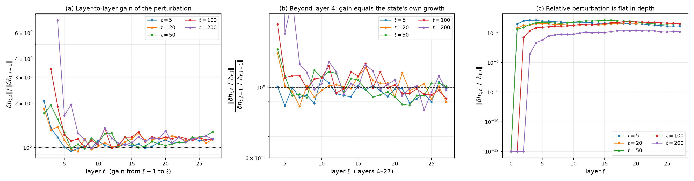

**Panel (a).** Layer-to-layer gain $\|\delta h_{t,\ell}\|/\|\delta h_{t,\ell-1}\|$: between 2 and 7
for $\ell\le4$, then $1.0$–$1.2$ for every deeper layer and every time.

**Panel (b).** The gain *beyond what the state itself does*,
$\dfrac{\|\delta h_{t,\ell}\|/\|h_{t,\ell}\|}{\|\delta h_{t,\ell-1}\|/\|h_{t,\ell-1}\|}$: equal to
1 for all $\ell\ge5$, at every time. After layer 4 the perturbation is **passively transported**.

**Panel (c).** The relative perturbation
$\|\delta h_{t,\ell}\|/\|h_{t,\ell}\|$ rises through layer 1 and then is flat at
$\approx5\times10^{-4}$ over 22 layers.

Numbers: $\|\delta h\|$ grows $\times19$ from layer 1 to 27 while $\|h\|$ grows $\times18$. The
relative response is $2.65\times10^{-4}$ at L1, $4.94\times10^{-4}$ at L4 and $4.75\times10^{-4}$ at
L27 — constant within ±5% from layer 4 onward. So the "depth gain" (absolute response rising with
layer) is the residual stream's own scale, not extra amplification. Both statements are true; they
are about $\|\delta h\|$ and about $\|\delta h\|/\|h\|$.

## Q7. Is averaging over directions safe?

For the temporal shape, yes; for the magnitude, never. The 1536-direction run (E2) shows that one
mode explains 97.8% of the variance of the log-gain: all directions share one temporal curve, scaled
by a direction-dependent gain spanning a factor 22. DeepSeek is strongly anisotropic (×5.85 with 20
directions), the newer models are nearly isotropic (Qwen3-4B ×1.15, Phi ×1.23, Qwen3.5 ×1.93). So:
report medians *with percentile bands*, and report the distribution of gains separately.

---

# Part 3c. Which other models to try

**First, the sliding-window claim.** Checked directly in the configs of the models we already have:

| model | `sliding_window` | `layer_types` | effective window at 400 tokens |
|---|---|---|---|
| DeepSeek-R1-Distill-1.5B (Qwen2) | 32768 | — | none (32k > our lengths) |
| Qwen3-4B-Instruct-2507 | **None** | all `full_attention` | **none** |
| Phi-4-mini-instruct | 262144 | — | **none** |
| Qwen3.5-2B | none (3:1 linear/full hybrid) | 18 linear, 6 full | **none** |

So the advice you were given does not hold for these checkpoints: Qwen3 has no window at all (the
`sliding_window` field is `None` and every layer is `full_attention`), Phi's window is 262144, and
Qwen3.5 replaced attention with a linear/full hybrid. This is not a transformers-version artifact —
the values are in `config.json`.

It also does not matter for the science, because we can **impose** a window exactly: the 4D band mask
gives **bit-identical** results to DeepSeek's native sliding-window path at $W=100$ (`dh_norm`, `dm`,
`margins`, `gen_ids`; maximum difference 0.0, `results/big4/wcheck`). What a native window gives you is
realism (RoPE + window in the kernel), not a different experiment.

If you want a model where the window is *native and active at our scales*, the shortlist is:

| model | params | layers × hidden | native window | fp16 weights | fits T4 (15 GB)? | why |
|---|---|---|---|---|---|---|
| **Qwen2.5-3B-Instruct** | 3.1B | 36 × 2048 | 32768, configurable, all layers | 6.2 GB | yes, comfortable | closest to DeepSeek's architecture (same family, same tokenizer); ideal control |
| **gemma-3-4b-it** | 4.3B | 34 × 2560 | 1024 in 5 of 6 layers (local:global = 5:1) | 8.6 GB | yes, tight (batch 1, fp16) | genuinely different attention pattern; real 1k window |
| Ministral-3B-Instruct | 3.1B | 32 × 3072? | 32768 (verify) | 6.5 GB | yes | Mistral lineage, different tokenizer |
| Qwen3-1.7B | 1.7B | 28 × 2048 | none | 3.4 GB | yes | smaller sibling of Qwen3-4B; scaling check |
| SmolLM3-3B | 3.1B | 36 × 2560? | none (NoPE every 4th layer) | 6.2 GB | yes | NoPE variant, tests position encoding |
| Llama-3.2-3B-Instruct | 3.2B | 28 × 3072 | none | 6.4 GB | yes | reference dense model |
| Gemma-2-2B-it | 2.6B | 26 × 2304 | 4096 alternating local/global | 5.2 GB | yes | native 4k window, cheap |

I would add **Qwen2.5-3B** first (same family as DeepSeek, so the window law can be checked natively,
and it is a clean 3B control) and **gemma-3-4b-it** second (a real 1k window and a different
architecture). Both fit in fp16 with batch 1. Gemma-3 is the tight one: 8.6 GB of weights plus
activations for 400 tokens at 2560 hidden — measure before committing, and expect it to need
`expandable_segments`.

What I would *not* do: add models that only differ in size within the same family (Qwen3-1.7B vs 4B
is a size ablation, and you ruled out ablations). The interesting axis is the *attention mechanism*
(dense, sliding-window, linear/hybrid), which is why Qwen3.5-2B was worth the environment work.

---

# Part 4. What is trivial and what is not

**Trivial (implied by the definitions).**
- Tokens are identical until the first flip; that is the definition. The teacher-forcing figure is
  a sanity check.
- Small perturbations produce a response proportional to their size: any differentiable map does.
- In 1536 dimensions two random vectors are nearly perpendicular; the angle test alone says
  nothing. What matters is the split into along-state and perpendicular components and the linear
  relation between the perpendicular part and the logit change.
- The state norm grows with depth in a residual network.
- The output is invariant to the state's length (normalization).

**Not trivial (measured, not implied).**
- The **stable-chaos regime**: flips at 8 discrete margin dips ($p<5\times10^{-6}$), a hazard with
  a confidence interval containing zero, a non-growing perturbation norm, and a hard floor at
  $r\approx0.13$.
- The **quantitative** threshold law: one teacher-forced pass predicts the first changed word in
  318/320 cases including all 70 borderline calls, with zero false alarms; part 2.0 shows the
  survival curves are reproduced with zero fitted parameters at $r\le0.25$.
- The **window law** $D=W-P$, exact to the token on two prompts and five window sizes with
  identical inputs; and the text needs 4–6 extra tokens to split.
- The **survival law**: after a flip the text never re-converges, so the surviving fraction is
  exactly $T_f/T$.
- The **latency**: perturbations can act 100+ tokens later at the next close call, confirmed
  autoregressively.
- **Direction structure**: magnitudes stable across texts (rank correlation 0.8–0.98) while signs
  at a given word are not (mean correlation $-0.05$); flips are stratified by direction.
- The **layer-resolved amplification**: none at an ordinary position, ≈3× at a sensitive one,
  concentrated in the last layers.
- The **rotation mechanism**: components amplify ($\sigma_{\max}$ up to 195) yet the product does
  not, because the amplifying direction rotates by 84° per layer; the budget
  $(\sigma-1)\cos^2\theta$ closes the gap within a factor 2.
- The **negative** D2 result with a working positive control (Hénon/Lorenz).

---

# Part 5. Null results (things that did not work)

1. **No correlation-dimension plateau** on any non-loop trajectory, in any metric, centering, $N$
   or embedding dimension. Valid interval 0.00–0.04 decades wide. Every quoted $D_2$ was a
   window/tube/fill-dimension/duplicate artifact.
2. **Raw vs time-shuffled $D_2$** is a tautology (shuffling preserves the point cloud); it cannot
   be used as a dynamic control.
3. **No lag-collapse of the two-time response.** Normalizing by $a(s)$, by the first peak, or by
   $a(s+5)$ leaves ×1.5–1.6 RMS disagreement. The response is only approximately separable
   (68% rank-1).
4. **No direction clustering.** $k=1$ wins a parametric-bootstrap comparison ($P(k>1)=0.10$–0.18).
   There are reproducible outliers, not groups.
5. **Attention entropy does not explain near-ties.** Correlation with margin +0.32–0.38 at
   $W=100$, ≈0 at $W=200$.
6. **Linear extrapolation of thresholds fails above $r\approx0.3$** (16/20 at 0.5, 6/20 at 1, 3/20
   at 2), because the gain becomes superlinear and tie-dependent.
7. **Layer-14 injection is too weak to flip anything.** At matched $r$ it is 11–38× weaker at the
   output, and its margin change is ~10× too small to cross any gap.
8. **Single-position perturbations rarely change the text.** At $r=0.1$: 4/24 directions at
   $s=16$, 1/24 at $s=50$, zero elsewhere. At $r=0.3$: 17/24 at $s=16$, 6/24 at $s=32$, 11/24 at
   $s=50$, and **zero for every tested position $s\ge75$**.
9. **Below $r\approx3\times10^{-4}$** the response is at the float32 round-off and stops scaling.
10. **The first-layer D2 is high and meaningless** (352k exact duplicate pairs).
11. **600-token A1 in one batch** OOMs on a 15 GB T4; 500 works with `batch-dirs=1`.
12. **No evidence of chaos**: no positive sustained exponent, no attractor, no plateau.

---

# Part 6. Data inventory

| run | contents | used in |
|---|---|---|
| `a1_ds_w100_layers` | 12 radii × 20 dirs × 8 layers, 300 tokens | A3, A4, A5, B, E, F |
| `window_fixed/w{100,150,200,300,1000}` | same tokens, five windows, 400 tokens | A1 |
| `window_cyber/w{100,200,1000}` | second prompt, same protocol | A1 (law) |
| `a1_ds_w100_layers/free_run_*` | free runs, 20 dirs, $r=0.05\ldots2$ | B2, B3, D |
| `state_deep_emb` | 8 positions × 24 dirs × 4 radii × 4 layers | C1, C2, C3 |
| `state_deep_L14` | layer-14 injection | C2, Part 5 |
| `state_freerun_r0.1`, `r0.3` | free runs with a single-position perturbation | C4 |
| `long_traj*`, `long_traj_2k`, `long_traj_4k` | 1000–4000-token trajectories, window 4096 | G |
| `nonnorm_w100_big` | $\sigma_{\max},\rho,\kappa$, principal angles | F |
| `depth2/{deepseek,deepseek128,deepseek_k64,qwen3_4b,phi4mini,qwen3_5,qwen25_3b}` | per-block tangent Jacobians, 8 or 64 directions, 8–128 tokens | 9.2, 9.3 |
| `block_sigma/*` | full-dimension $\sigma_{\max}$ per block, power iteration | 9.3 |
| `probe2/<model>/pos*` | one-token kick at 22 positions, 3 injection blocks, 6–8 dirs | N2c, N2d, 9.2b |
| `rstar/<model>/p*` | 512 directions × 5 prompts, $r_c$ for every token | 9.2b, 11 |
| `hazard/<model>_r*` | 512-direction free runs at four radii | 11.4 |
| `long4k/p*` | 8 more 4000-token trajectories | 2.0d |
| `fits/*.png`, `results/fits/SUMMARY.md` | every curve fitted, with the ranked model table | 9.6 |

**Protocol invariants.** FP32; greedy; no repetition penalty; the unperturbed reference is a
duplicate row in the same batch and is verified bit-identical; teacher-forced passes use the
unperturbed token sequence; free runs are used only where stated.

**Reproducing.** Every figure comes from a script in `scripts/`; the per-topic reports with exact
numbers are under `results/`. The figures in this document are in `notebook/figures/`, produced by
`scripts/notebook_figs_window.py`, `scripts/notebook_figs_state.py`,
`scripts/notebook_fig_directions.py`, and copied from `results/figures/`.

### N10. The window law is universal (and a hybrid model cannot be windowed)

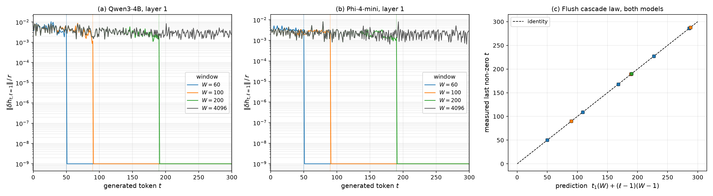

**Data.** Explicit 4D sliding-window mask (`--window4d`), one radius $r=0.1$, 6 directions, prompt of
$P=64$ tokens, 300 generated tokens, same prompt for all models. This is the only way to impose a
window on models whose config has none (see Part 3c).

**Panels (a),(b).** Layer 1. The response is flat, then **exactly zero** from a window-dependent
time: $t=50$ for $W=60$, $t=90$ for $W=100$, $t=190$ for $W=200$. Identical in Qwen3-4B and
Phi-4-mini.

**Panel (c).** Every (model, window, layer) pair with a flush inside the horizon. $x$ is the
prediction $t_1(W)+(\ell-1)(W-1)$, where $t_1(W)$ is the measured flush time of layer 1 for the same
window; $y$ is the measured last non-zero time. **18 points, maximum residual 0.00.** The cascade
slope is exactly $W-1$ per layer, in both models. Writing $t_1(W)=W-10$ for this prompt, the law is
$$t^*_\ell = (W-10) + (\ell-1)(W-1).$$
The $W-1$ term is the receptive field of one sliding-window layer; the constant is the last prompt
position that still carries a numerically resolvable contribution (fp16 underflow), which is why the
DeepSeek fp32 version had a different offset.

**Qwen3.5-2B.** Layer 1 is a **linear-attention** layer: it has no attention matrix, so the 4D mask
leaves it *bit-identical* (ratio exactly 1.0 for all $t$). The mask does change the six full-attention
layers (max relative change 1.9), but the response never reaches zero, because the linear layers carry
the state forward without a window. So the hybrid cannot be given a sliding window at all — consistent
with its config, which has no `sliding_window` and a 3:1 linear/full `layer_types`.

**Consequence.** The window is a **hard reset**, not a soft decay: the perturbation is annihilated,
not attenuated. That is why the flush law is exact and why the "window regimes" look like step
functions in the deep layers.

**Validation: the 4D mask is a faithful window.** For DeepSeek, which has a *native* sliding-window
implementation, running with the native path (`set_window`) and with the 4D mask at $W=100$ gives
**bit-identical** results: `dh_norm`, `dm`, `margins` and `gen_ids` all compare equal with maximum
difference 0.0 (`results/big4/wcheck`). So imposing a window on a model that lacks one is not an
approximation: it is the same operation.

### N11. First departure versus flush

Two different times, both exact:

| event | formula | measured |
|---|---|---|
| first departure (any difference from no window) | $W-P$ | 36 for $W=100$, 136 for $W=200$, 0 for $W=60$ ($P=64$) |
| flush of layer $\ell$ (response returns to zero) | $(W-10)+(\ell-1)(W-1)$ | 50/90/190 for $\ell=1$; +59/+99 per layer |

The first is when the *first* prompt token leaves the window; the second is when the *last* reachable
perturbed position leaves the $\ell$-hop receptive field. Between them the curve drifts but is never
zero. This resolves the apparent contradiction "the window acts before $t=W$": it acts at $W-P$.

### N13. Window spectroscopy: reading the context one token at a time

**Data.** DeepSeek, prompt of $P=65$ tokens, **133 windows** $W=60\ldots139$ in steps of 1 and
$W=140\ldots400$ in steps of 5, one radius $r=0.1$, 4 directions, 200 generated tokens, layer 7.
This is the experiment proposed as P3 in Part 7, already run.

**Panel (a).** Response at fixed $t$ as a function of $W$. Two regimes, and the boundary is exactly
predicted:
- for $W<P+t$ the curve fluctuates strongly — every extra token of context changes the response,
  sometimes by a factor 1.5, in *both* directions;
- for $W\ge P+t$ the curve is **exactly flat**: at $t=20$ from $W=85$, at $t=60$ from $W=125$, at
  $t=100$ from $W=165$, at $t=150$ from $W=215$. Each equals $P+t$.

The flat point is the moment the window stops truncating the prompt: for $W\ge P+t$ the generated
token sees all $P$ prompt tokens. This is the cleanest confirmation of the $W-P$ mechanism in the
whole document, and it is a direct measurement, not an inference.

**Panel (b).** The relative change in the response caused by adding **one** prompt token,
$|\Delta\|\delta h\||/\|\delta h\|$ for $\Delta W=1$, placed at the prompt position it removes
($p=P+t-W$).

**Panel (c).** The same quantity collapsed over $t$: which prompt positions matter. Position 0
dominates (median 25% change), positions 8–14 are almost inert (1%), the rest sit at ~10%. The 20–80%
band is one order of magnitude wide, i.e. the importance of a token depends strongly on *where* in
the generation you are.

**Why this is useful.** It is a causal probe that uses no ablation: the window removes one token at a
time, reversibly and exactly. It converts the window from a nuisance into an instrument.

### N12. Gallery: flux-tube variants, all layers

**The same plot for all four models, every saved layer, one colourbar each.**
$\|\delta h_{t,\ell}\|/\|\delta h_{1,\ell}\|$ (median over directions), log scale, layer = colour.
$r=0.1$ except Phi ($r=0.3$).

**Reading.** Four qualitatively different behaviours, in the same coordinates:
- **DeepSeek**: a fan. Shallow layers (dark) fall by 4–6 orders of magnitude and end in vertical
  drops (the flush); deep layers (yellow) stay of order 1.
- **Qwen3-4B**: flat. Every layer stays within a factor 2 of its initial value for 300 tokens; the
  two isolated spikes are the flush of the shallow layers, barely visible.
- **Phi-4-mini**: a coherent burst at $t\approx40$ in all layers (×20 in the deep ones), then a flat
  plateau — the transient amplification.
- **Qwen3.5-2B**: flat and slowly decaying, no flush, no burst.

This single figure is the fastest way to see that "contraction" is a property of DeepSeek, not of
transformer generation in general.

The auto-generated families (411 figures) live in `results/figs_models/`. More:

**Depth × time heat map** of $\log_{10}\|\delta h_{t,\ell}\|$ (DeepSeek): the diagonal structure is
the perturbation entering at layer 1 and the shallow layers flushing first.

**Depth gain for six prompts (DeepSeek, all 28 layers, r=0.1).** The curves collapse: the shape of the depth gain does not depend on the prompt; only the overall scale varies (x1.45 at layer 27). Median gains: 0.10 at L1, 0.41 at L7, 0.68 at L14, 1.04 at L21, 2.34 at L27.

**The flux-tube plot in the two normalisations the user asked for, all 28 layers, one panel each.**
DeepSeek, prompt perturbation, $r=0.1$, 20 directions, 300 tokens, colour = layer.

**Panel (a).** $\|\delta h_{t,\ell}\|/\|\delta h_{1,\ell}\|$ on a log axis. Every layer decays; the
deeper layers decay later and less, and the curves cross: at $t<30$ the initial transient still
dominates, after $t\approx60$ the shallow layers are dead and only the deep ones remain.

**Panel (b).** The consecutive-step ratio $\|\delta h_{t,\ell}\|/\|\delta h_{t-1,\ell}\|$. Above 1 at
the arrival front ($t<10$), essentially 1 in the body, and below 1 during the flush. The vertical
structure is where the ratio is exactly 0 or undefined (layer flushed).

---

# Part 7. What to do with the next 24 GPU-hours

Four proposals, each with the question, the data it needs, the cost, and the figure that already
supports it. The recommendation is at the end.

## P1 (recommended). The geometry of a flip: from phenomenology to a predictive theory

**Question.** A flip is a crossing of the decision hyperplane
$(w_a-w_b)\cdot h_t=0$. We have the first-order rule (318/320) and the margin coordinate $u_t$. Can
we turn this into a *quantitative, predictive* theory of when greedy generation changes its mind and
how the two trajectories re-converge afterwards?

**Why it is the strongest line.** It is the only place where we have a law that is both non-trivial
and falsifiable, and it is the mechanism behind every "chaos" claim. It also produces the number a
referee will ask for: the **recovery (mixing) time** after a flip.

**The three measurements.**
1. **Boundary map.** For one prompt and each generated position $t$, the set of perturbation
   directions that flip the token is a half-space; its boundary is the hyperplane
   $(w_a-w_b)\cdot\delta h_t=-m_t$. Measure the distance to the boundary in units of $r$ for many
   directions → a distribution of "how close the model was to changing its mind" at every token.
2. **Prediction test at large $r$.** Teacher-forced $\delta m$ at $r=0.3\ldots2.0$ predicts the first
   flip; run the same directions autoregressively and compare flip times (we have the pipeline; it
   is 318/320 at small $r$, the large-$r$ regime is untested).
3. **Recovery.** After a flip, measure $\|\delta h\|$ and the token agreement as a function of lag;
   the time to re-converge is the "memory" of the flip.

**Data.** 3 prompts × 20 directions × 6 radii, teacher-forced with `dm` and margins (cheap, already
supported), plus the same directions autoregressively (the expensive part). ~2–4 GPU-hours.

**Evidence already in hand.** `figures/margin_coordinate.png` (the coordinate and the linear approach
to the boundary, $r^*\approx0.54$) and the 318/320 signed rule.

## P2. An architecture scan: what sets the amplification factor?

**Question.** Across four models the single-kick downstream gain spans **0.5× to 23×** and the late
rate spans $-0.011$ to $+0.0006$. Is there an architectural variable that orders them?

**Candidate variables.** attention type (dense / sliding / linear), relative depth of the local
layers, the growth of the residual-stream norm, and the intrinsic dimension of the state (the
subagent is computing the last one now).

**Data.** The standard suite (A1 all layers, 3 prompts, state, kicks, trajectories) on two more
models chosen to break the degeneracy: **Qwen2.5-3B** (dense + real 32k window, same family as
DeepSeek) and **gemma-3-4b** (5:1 local 1k / global). ~1.5 GPU-hours each plus download.

**Evidence.** `figures/probe_models.png`: the factor is flat in injection depth, so it is a property
of the architecture/position, not of where you inject.

## P3. Window spectroscopy: reading the context without ablating it

**Question.** Which prompt tokens does the model actually use, at each generated position? The flush
law gives an *exact clock*: at token $t$ with window $W$, the prompt tokens older than $W-t$ are
invisible. Sweeping $W$ therefore removes one token at a time, in a controlled, reversible way, and
the difference between $W$ and $W+1$ isolates a single prompt position. This is a causal probe with
no ablation and no retraining.

**Data.** One prompt, $W=60\ldots400$ in steps of 1 (341 runs) at 2–3 layers, one radius, 4
directions. At ~15 s per run that is ~1.5 h. The result is a **contribution map**: $\Delta$response
versus (prompt position, generated position).

**Why it is novel.** Nobody uses the sliding window as a causal instrument. It exploits exactly the
mechanism we have characterised (the exact $W-P$ law), and it needs no new science to be correct.

**Evidence.** `figures/window4d_models.png` (panel c: the law is exact, residuals 0.00) and
`figures/window_first_departure.png`.

## P4. Long-horizon convergence of the flip rate

**Question.** Is the per-token flip hazard stationary over 4000 tokens, and does it depend on $r$ as
a threshold model predicts? We have 12 runs at 4000 tokens; the hazard confidence interval is wide.

**Data.** 40 runs × 4000 tokens × 10 directions at $r=0.1,0.3$. ~6 GPU-hours. This is the run that
would justify a "72-hour job" later: it is embarrassingly parallel and purely confirmatory.

## Recommendation

**Go all-in on P1, run P3 alongside it, and start P2's downloads now.** P1 is the theory; P3 is a new
instrument that costs almost nothing and produces a figure nobody has; P2 is the breadth that makes
the paper about models rather than about one model. P4 is confirmatory and can wait for the 72-hour
slot.

Budget: P1 4 h, P3 2 h, P2 4 h (two models × suite), figures/analysis 4 h, slack 10 h.

---

# Part 8. Geometry and dimensionality, all four models

**Data.** For each model: the input embedding matrix $E$ ($V\times D$), the unembedding $W_U$, and
the hidden states at every layer for 3 prompts × 400 generated tokens (1200 states), plus 128
positions of logits. All computed on CPU from Grams and state dumps produced on the GPU
(`results/dim/`, report and 103 figures in `results/subagent_dim/`).

## 8.1 Vocabulary geometry

**Singular spectra of $E$ (and $W_U$ when untied), log–log.** One dominant direction, then a smooth
high-dimensional bulk with **no sharp rank**.

| model | PR | stable rank | eff-rank 90% | row cosine | cone $\|\mu\|/\overline{\|e\|}$ |
|---|---|---|---|---|---|
| DeepSeek (E) | 13.3 | 4 | 1172 | +0.27 | 0.51 |
| DeepSeek (W_U) | 9.3 | 4 | 1140 | — | — |
| Qwen3-4B | 136.1 | 12 | 2083 | +0.08 | 0.28 |
| Phi-4-mini | 4.1 | 2 | 1021 | +0.17 | 0.54 |
| Qwen3.5-2B | 22.3 | 5 | 1622 | +0.19 | 0.44 |

**Reading.** All vocabularies are a cone: one shared direction (the mean, $s_1^2\approx V\|\mu\|^2$)
plus a genuinely high-dimensional bulk needing 1000–2000 dimensions for 90% of the variance. Qwen3-4B
is the near-isotropic outlier (row cosine 0.08); Phi-4-mini is the most anisotropic (half of the
variance in one direction). DeepSeek is untied and its two spectra differ slightly; the $E$–$W_U$
principal angles cannot be computed from separate Grams (we did not save the cross-Gram).

## 8.2 The state lives on a ~10-dimensional manifold inside 1536–3072 dimensions

**Intrinsic dimension of a single generation** (400 tokens, three estimators, bands over 3 prompts).

**Reading.** A single trajectory has ID **≈3 at block 1, rising to 8–12** at the last block and
plateauing; the three estimators agree on the shape but not the level (factor 2–4, the honest
uncertainty). The states occupy a 37–49-dimensional ellipsoid (participation ratio) and a
196–395-dimensional affine hull (eff-rank 90%) inside $D=1536$–$3072$. Local (per-token) dimension is
**not constant**: its distribution is wide (median 7, IQR 4–12 for DeepSeek) and it moves along the
trajectory.

**Depth profiles on common axes.** Anisotropy (mean pairwise cosine) and the cone ratio rise with
depth in DeepSeek and Qwen3-4B and fall in Phi and Qwen3.5. Qwen3-4B has a mid-stack collapse of the
centred participation ratio (1.4–2.5 at blocks 17–23): one giant direction dominates there.

## 8.3 The unembedding collapses the state by 2–45×; Phi's decisions are one-dimensional

**Effective rank (90%) of the 128×V logit matrix**, against the post-norm state at the same
positions.

| model | logit eff-rank (of 128) | state eff-rank | collapse | centred-logit rank 80% |
|---|---|---|---|---|
| DeepSeek | 24 | 41 | 0.59 | 33 |
| Qwen3-4B | 10 | 54 | 0.19 | 45 |
| Phi-4-mini | **1** | 61 | **0.02** | 3 |
| Qwen3.5-2B | 36 | 65 | 0.55 | 56 |

**Reading.** Over these positions Phi-4-mini's logits are **80% one direction**: the decision space
is effectively one-dimensional, which is exactly what a model with a ×23 kick amplification and
frequent flips should look like. The unembedding is a strong dimensionality bottleneck in every
model, but by a factor that varies 2–45×.

## 8.4 Does geometry order the dynamics? (n=4: an ordering, not evidence)

**Spearman correlation between each geometric measure and the single-kick gain, across the four
models.** With four points only $\rho=\pm1$ is significant, so this is a hypothesis, not a result.

- **Anisotropy orders the kick gain exactly**: late-layer mean cosine 0.24 (Qwen3.5) < 0.41
  (DeepSeek) < 0.48 (Qwen3-4B) < 0.53 (Phi) ↔ kick gain 0.47 < 0.66 < 5.9 < 23.0, $\rho=+1.00$.
- The spectrum slope anti-orders it ($\rho=-0.80$): flatter spectrum ↔ bigger amplification.
- **Intrinsic dimension does not** ($\rho=+0.40$): Phi has both the highest ID and the highest gain,
  but DeepSeek and Qwen3.5 swap.
- Nothing orders the late rate $\lambda$ or the direction spread.
- Within DeepSeek the same pairing holds layer by layer (cos vs gain Pearson +0.96, n=27), but the
  sign flips in Qwen3.5 (cos falls while gain rises) — the within-model correlations ride the shared
  depth trend and are not independent evidence.

**The falsifiable version:** add ≥6 models; if the anisotropy↔gain Spearman does not stay
$\ge+0.6$, the four-model match is a coincidence. That is cheap and is Proposal P2 in Part 7.

## 8.5 The response is 99.4% tangential and lives outside the state subspace

**Decoding the stored $\cos(h+\delta h,h)$ with $1-\cos\approx(1-c^2)\rho^2/2$**, where
$c=\cos(\delta h,h)$ and $\rho=\|\delta h\|/\|h\|$ (DeepSeek, the only model with enough precision).

**Reading.** $c^2=0.006$ median: **0.6% of the response energy is radial** (8% of the amplitude), at
every depth and at every radius from $10^{-3}$ to $2$. So $\|\delta h\|$ *is* essentially the
perpendicular component — the answer to "are we tracking the relevant part" is yes, but only because
the radial part is negligible, not because the norm isolates it. It also means the response
**rotates** the state rather than rescaling it, which is why the argmax survives small perturbations
and why flips require tangential motion across the boundary.

**Principal-angle overlap between the response subspace and the state subspace** (top-32 PCs, mean
squared cosines).

**Reading.** $\delta h$ overlaps the state's PCs at 0.046–0.071, i.e. 3–7× chance (0.01–0.02), but
**≈2× below the prompt-vs-prompt control** (0.11–0.23). So the perturbation does not simply excite
the directions that ordinary generation occupies: it is a low-rank field (eff-rank 90% = 81–104 of
$D$, except Qwen3-4B at 629) that is partially, but not mostly, aligned with the state.

## 8.5b How far does the boundary prediction hold? (large $r$, autoregressive)

**Data.** DeepSeek, two prompts, 20 directions, radii 0.5–2.0. $x$: first flip predicted by the
signed margin rule $m_t+\delta m_t<0$ from the teacher-forced run at the same $r$. $y$: first token
that actually differs in the autoregressive run.

**Reading.** On the robust prompt (right) the prediction is **exact 20/20, 19/20, 19/20, 20/20** even
at $r=2$ — the rule survives far outside the linear regime there. On the fragile prompt (left) it
degrades: 10/20 at $r=0.5$, 1–6/20 at $r\ge1.2$, with predictions clustered at $t\approx0$ and
observations scattered out to $t=50$.

**Why it fails exactly there.** At these radii the margin response has saturated (§N3), so the
teacher-forced $\delta m$ is no longer a faithful tangent; and on a fragile prompt a small error in
the predicted time moves the first flip by tens of tokens. The failure is therefore *informative*:
it marks the boundary of the linear theory, and it is the same prompt-dependence that makes the
stable-chaos statistics prompt-specific.

**One caveat on the stored `pred_T`:** it is computed from $|\\delta m|$, i.e. without the sign. It
therefore predicts a flip whenever the margin changes a lot, even if it grows. The signed rule above
is the correct one (and is what the 318/320 result used). Do not use `pred_T` directly.

## 8.6 Negative results and traps found in this analysis

- **The per-layer write is not lower-rank than the state.** eff-rank(write)/eff-rank(state) =
  1.2–1.6 in all four models. There is no "low-rank update" story to be had from this data.
- **Pooling prompts breaks intrinsic-dimension estimators.** Pooled MLE gives ~2 for DeepSeek while
  each trajectory alone gives ~8: three thin clusters read as one low-dimensional blob. Use
  per-trajectory values.
- **Forgetting to remove the mean makes the states look rank-1–5** (participation ratio ~10× too
  small). Most "LLMs are 2-dimensional" claims are this artifact.
- **The top saved state is the final RMSNorm, not the last block.** The apparent norm collapse and
  the anti-aligned final "write" are normalization; any "final block" claim from this data is wrong.
- **The stored `cos` key is $\cos(h+\delta h,h)$, not $\cos(\delta h,h)$** — it is ≈1 everywhere and
  grid-saturated in the fp16 models. Section 8.5 decodes it; do not use it naively.
- Qwen3-4B's mid-stack PR dip may be a float16 quantization artifact; needs float32 states.
- The window-sweep gain comparison across $W$ is baseline-shifted (the margins themselves differ
  with the window), so only within-$W$ profiles are clean.

## 8.7 What this changes in the main story

1. Q5 is now answered with a number: the radial part is 0.6% of the energy, so the norm is a good
   proxy for the dynamically relevant component.
2. The model differences are not just in the dynamics: the decision space of Phi is 1-D, its
   vocabulary cone is the narrowest, and its amplification is the largest. Whether that is causation
   is the open question (P2).
3. The state is a thin manifold (ID ≈10) inside a large ambient space, and the response is an even
   thinner field that partly avoids that manifold. Any theory of "where the perturbation goes" has to
   explain both numbers.

---

# Part 9. Functional forms: what each curve actually is

## 9.1 The tool

`src/chaos_llm/curvefit.py`, driven by `scripts/fit_curves.py`. Given $(x,y)$ it fits 22 families
and ranks them by BIC:

| family | form |
|---|---|
| polynomials | $a+bx$, $a+bx+cx^2$, $a+bx+cx^2+dx^3$ |
| logarithmic | $a+b\ln x$, $a+b\ln x+cx$ |
| inverse / rational | $a+b/x$, $a/(1+bx)$ |
| power laws | $a x^b$, $c+a x^b$, $c+a(x-x_0)^b$ |
| exponentials | $a e^{bx}$, $c+a e^{bx}$, $c+a e^{b(x-x_0)}$ |
| saturating | $c+a(1-e^{-x/\tau})$, $c+a(1-e^{-(x/\tau)^\beta})$ |
| stretched decay | $c+a e^{-(x/\tau)^\beta}$ |
| gaussian | $c+a e^{-(x/\tau)^2}$ |
| Hill / log-logistic | $c+a x^b/(k^b+x^b)$, $c+a/(1+(x/k)^b)$ |
| two-phase | $c+a(1-e^{-x/t_1})e^{-x/t_2}$, $c+a_1e^{-x/t_1}+a_2e^{x/t_2}$ |

**Rules, and why.**

1. **Log-domain fitting for pure exponential and power laws.** If $y$ spans decades, fitting
   $y=a e^{bx}$ by least squares lets the largest values decide everything: the error is absolute,
   but what you care about is relative. The tool fits $\ln y$ against $x$ (or $\ln x$), which
   minimises squared *relative* error. Offset models ($c+a e^{bx}$) cannot be log-transformed, so
   they are fitted by nonlinear least squares in the native domain. Both are scored in the domain
   they were fitted in, so the comparison is fair.
2. **Shifts are explicit.** A form with $x_0$ is a separate model with one more parameter; it wins
   only if the BIC gain pays for it. This matters below: the depth law needs $x_0=-1$, and without
   it the fitted exponent changes from $-1.05$ to $-0.60$.
3. **BIC**, not $R^2$, decides. $R^2$ always increases with parameters; BIC does not. A model within
   $\Delta$BIC $<2$ of the best is a tie and is reported as such.
4. **Standard errors** come from the Gauss-Newton covariance; every parameter is quoted with one.
5. Sign-degenerate fits (a rise written as a decay with $a<0$) are removed by comparing predictions.

Per curve the driver writes one PNG (data, best fit, second best, residual-free) and one JSON, plus
`results/fits/SUMMARY.md` with all of them.

## 9.2 The depth map: what is actually measured, and why $\lambda_1(\ell)$ was a bad curve

**First, the definitions in plain words.**

- Take the hidden state at one generated position and add a small vector $v$ to it. Push the rest of
  that position through block $\ell$ with the rest of the sequence held fixed. The change comes out
  linearly transformed: $\delta h' = J_\ell v$. $J_\ell$ is that block's Jacobian at that position.
- The **singular values** $\sigma_1\ge\sigma_2\ge\dots$ of $J_\ell$ are the largest and smallest
  factors by which it can stretch *any* vector. $\sigma_1$ is the biggest possible stretch. The
  subscript is the rank of the singular value, **not** the layer, the token, or the time.
- Push through $\ell+1$ blocks in a row and you get the product
  $P_\ell=J_\ell J_{\ell-1}\cdots J_0$. Its singular values $\sigma_i(\ell)$ say how much a
  perturbation is stretched after $\ell$ blocks. $\sigma_1(\ell)$ is the best-case stretch.
- The **finite-time Lyapunov exponent** is defined as
  $$\lambda_i(\ell)=\frac{\log\sigma_i(\ell)}{\ell+1}.$$
  The division by $\ell+1$ is there because the standard Lyapunov exponent is "log stretch per step",
  and for a long chain that average converges to a number independent of the length. It is the
  natural normalisation when the chain is long.

**Why the curve we plotted looked like a decay.** Because of that division. Take the measured
$\sigma_1(\ell)$: it is $16$–$17$ for the first 18 blocks and then rises to $28$ in the last ten. Over
28 blocks $\sigma_1$ changes by a factor $1.75$, while the denominator $\ell+1$ changes by a factor
28. The resulting $\lambda_1(\ell)$ therefore falls like $1/\ell$ — **the fall is created by dividing
by the block count, not by anything the network does.**

That is what "the shape is kinematics, not dynamics" was trying to say, and it was a bad way to say
it. The honest version: *we plotted a normalised quantity whose denominator grows, so its decay is
not evidence about the network.* I should have plotted the numerator.

**Panel (a).** The numerator: $\sigma_1(\ell)$, median over 16 tokens, band = 25–75%. It is a
**plateau followed by a late rise**, not a decay.
**Panel (b).** Normalised by its first value: a small bump at blocks 3–7 (×1.05–1.11), a shallow dip
to 0.98 around block 9, a flat middle, then a **×1.75 rise over the last ten blocks**.
**Panel (c).** Fitted with the tool: the best form is a Hill/sigmoid
($R^2=0.979$), the second a stretched rise ($\Delta$BIC $=4.7$); a pure exponential is 20+ BIC worse.

**What is real and what is not.**

| statement | status |
|---|---|
| $\lambda_1(\ell)$ decays like $1/\ell$ | **artefact of the normalisation** — do not report as a finding |
| $\sigma_1$ is flat for 18 blocks then rises ×1.75 | real, measured |
| one block (block 0) already stretches by ×16 | real, measured (this is the entry of the prompt perturbation) |
| the per-block gain in the middle is ≈1.00–1.02 | real, and expected for residual blocks |
| the shape of $\sigma_1(\ell)$ is the same at all 16 tokens | supported (the band is narrow except at the late rise) |

**The same $\lambda_1$ curve in four axis systems**, which is where the confusion started:

It looks like an exponential decay in semilog-y, like a power law in log-log, and a shifted power law
fits best. All three descriptions are of the *normalised* quantity. They are not wrong; they are
answers to a question we should not have asked.

So there is *some* non-trivial content — **where** the gain happens — but the decaying curve we
showed first was the wrong object. The interesting plot is $\sigma_1(\ell)$, and the interesting
question is whether the "plateau + late rise" shape is the same in other models, which the cross-model
depth maps (running now) will answer.

**And why 16 tokens?** Because each token costs 28 blocks × 8 directions of Jacobian-vector products.
This is a statistics question, not a compute question: the shape is stable across tokens (the earlier
8-token and the current 16-token curves agree to a few percent), so the 16-token curve is adequate
*for the shape*. A run with 128 tokens is in the queue to make the late-rise band tight, not to change
the conclusion.

## 9.2b What the depth map does *not* measure (and the right $y$-axis)

The depth map perturbs the state **at one position** and follows that position **through the blocks**,
holding every other position fixed. Our actual experiment is different: the perturbation sits on the
*prompt* positions, and the response at a generated position is created by **attention pulling it in
from other positions**. Those are not the same object, and the numbers show the gap:

**Data.** Depth map: 128 tokens, 8 directions, DeepSeek. One-token kick: `probe2`, injection at block
0's output at position $s$, 6 directions. Real response: the prompt-perturbation run (`a1`), all 28
layers, at generated position $t=50$.

**Panel (a).** From layer 1 to layer 27,
- the same-position tangent chain grows by **×1.54** ($\sigma_1$ 17.3 → 26.7);
- the actual prompt response grows by **×53** (0.046 → 2.46 in units of $r$).

So the same-position chain accounts for $\log(1.54)/\log(53)\approx 11\%$ of the depth growth. The
other ~89% comes from cross-position transport, which the depth map by construction cannot see.

**Panel (b).** A kick at $s=16$ grows to ×3.1 at the **same** position (DeepSeek), ×2.8 (Phi), ×4.7
(Qwen3-4B) — all comparable. **Panel (c).** Twenty tokens later the models separate: the far-field
response decays to ×0.67 in DeepSeek, but **grows to ×9.2 in Phi and ×5.9 in Qwen3-4B**. The
model difference lives in the **far field**, not in the same-position chain.

**So, is $\sigma_1$ the right thing to look at?** No, for two independent reasons:

1. **$\sigma_1$ is a maximum over all directions, not the growth of our perturbation.** For a fixed
   initial vector $v_0$ the growth is $\|P v_0\|$, which is $\le\sigma_1$ and equal only if $v_0$ is
   the top right-singular direction. The measured same-position growth for a random direction is
   ×3.1 (panel b), against $\sigma_1=27$: a factor 9. Quoting $\sigma_1$ would overstate the real
   stretch by an order of magnitude.
2. **The map is restricted to one position.** Even a perfect $\sigma_1$ of the same-position product
   would describe a mechanism that carries ~11% of the real growth.

**And "if it is isotropic, composing is fine"?** It is not isotropic in the sense that would justify
composing. Two facts have to be held together:
- within the 8-dimensional tangent subspace we track, the blocks are close to the identity, so the
  top-8 singular values of the *product* come out nearly equal (Section 9.3);
- the **full** block Jacobian is strongly non-normal — the earlier measurement gave $\sigma_{\max}$
  of 95–195 at block 0, and the top singular direction **rotates by 83.6° on average between
  consecutive blocks**, so the product of the per-block $\sigma_{\max}$ overestimates the true chained
  growth by ~13 orders of magnitude (Section F, `nonnorm_gain_budget.png`).

Both are true because "near identity" applies to the tiny subspace we happen to track, while the
full map has one huge direction that changes from block to block. **The gains do not compose**, which
is exactly what you suspected.

**What to plot instead.** The measured response, in the normalisation that matches the question:

| question | quantity | where |
|---|---|---|
| how much does the perturbation grow? | $\|\delta h_{t,\ell}\|/r$ | a1, all layers |
| does it matter relative to the state? | $\|\delta h_{t,\ell}\|/\|h_{t,\ell}\|$ | a1 (`norm_h0`) |
| where along the depth does the *real* response grow? | $g_\ell=\|\delta h_{\ell}\|/\|\delta h_{\ell-1}\|$ | a1 |
| where can a *local* kick go? | same-position vs far-field response | probe |

The un-normalised $\|\delta h\|$ mixes the perturbation's growth with the state's own growth (×18–30);
the relative version cancels it. **For every claim about amplification, the relative response is the
right $y$-axis.** The depth map stays in the notebook as a diagnostic of the local tangent, not as a
measure of the amplification.

## 9.3 The spectrum is flat: what "isotropic" means here

**Panel (a).** $\sigma_1,\sigma_2,\dots,\sigma_8$ of the depth product at four depths, all on one
axis: they are within a few percent of each other.
**Panel (b).** The ratio $\sigma_i/\sigma_1$ at every depth: flat at 1 within ±3%.
**Panel (c).** The slope of $\lambda_i$ against $i$ is zero at every depth ($-0.01\pm0.005$).

**In words.** Pick a perturbation direction at random. After 20 blocks it is stretched by almost the
same factor whatever direction you picked: the map behaves like "multiply everything by 20", not like
"stretch one direction and squash the others". That is what *isotropic* means here.

**Consequence for $\lambda_1$.** In the usual chaos story $\lambda_1$ is special because it is the
growth rate of the *one* direction that dominates. Here all eight computed directions grow at the same
rate, so there is no dominant direction and quoting $\lambda_1$ adds nothing over the common value.
We do not need $\lambda_2,\dots$: they are the same number. That is why only one curve was shown.

**Is this interesting or generic?** Mostly generic, and it is worth being explicit about why. A
transformer block with a residual connection is the identity plus a correction, $h\mapsto h+f(h)$. If
the correction's derivative is small at our position — and it is, since the middle blocks barely
change the perturbation — then all singular values of the block Jacobian sit near 1 and the product is
close to a multiple of the identity. So the flat spectrum is a *property of residual architectures*,
not a discovery about language models. It is a check that passes, and it tells us that any
non-trivial tangent structure must come from the blocks where the gain is not 1: the first block and
the last ten.

**With 64 directions instead of 8 (the answer to "is 8 too few").** The spectrum stays flat:

**Panel (a).** The 64 exponents at four depths, log–log. **Panel (b).** Normalised to the first:
$\lambda_{64}/\lambda_1$ falls only from 1.05 to 0.83 across the 64 directions, and less at earlier
depths. **Panel (c).** The ratio per depth: 0.93 at block 0, 0.83 at block 27.

So the conclusion is not an artefact of $k=8$: **the stretch of a random direction is
direction-independent to within 20%, even over 64 directions.** What this does *not* say is that the
full map is isotropic: the full Jacobian has a much larger $\sigma_{\max}$ in one special direction
(95–195 at block 0, measured by power iteration), which a random 64-plane is unlikely to contain. The
correct statement is: *a random perturbation is stretched by the typical factor whatever its direction;
an adversarially chosen one can be stretched much more.* Our perturbation is not adversarial, so the
typical picture is the relevant one.

**What we should report instead.** The per-block singular values, which localise the gain:

**Panel (a).** $\sigma_1,\sigma_2,\sigma_4$ of **one block's** Jacobian at each depth (median over
128 tokens). **Panel (b).** $\sigma_1/\sigma_8$ within one block: above 1 means the block itself is
anisotropic.

**This is the measurement that explains the depth map, and it is the clearest non-trivial result of
this section.** The first block stretches the perturbation by ×28; **every other block is within a few
percent of the identity** (1.00–1.05, some 0.99). So:

- the perturbation is amplified **once**, at the block where attention first mixes the prompt into the
  generated position;
- the remaining 27 blocks carry it almost unchanged, and the ×1.75 "late rise" of $\sigma_1(\ell)$ is
  the slow compounding of those 1–5% gains, not a second amplification event;
- the first block is also the most anisotropic *within itself* (×1.45 between its largest and smallest
  tracked direction); the rest are ×1.05–1.10.

**Measurement caveat, stated plainly.** Every number here is the stretch **within the 8-dimensional
tangent subspace we propagate**, not the full 1536-dimensional top singular value. For a random 8-plane
the restriction is a lower bound on the full $\sigma_1$, and the block-0 anisotropy (×1.45) means the
full value is at least that much larger. All comparisons — across depth, across tokens, across models —
are like-for-like, but the absolute "×28" should be read as "×28 in the tracked subspace".

This is the result that should replace the old $\lambda_1(\ell)$ plot: **one entry block does the
amplification; the depth is a near-identity transport.**

## 9.3b Where each model does its stretching (the right y-axis)

**Data.** The same depth map for four models (8 tangent directions, 8–11 tokens each). **Panel (a).**
$\sigma_1(\ell)$: the factor by which a perturbation is stretched after $\ell$ blocks. **Panel (b).**
The same normalised by $\sigma_1(0)$. **Panel (c).** The log-gain that happens in the last quarter of
the depth.

**Why this is the right $y$-axis.** $\sigma_1(\ell)$ is the measured stretch. $\lambda_1(\ell)$ is
that number divided by the block count, and the division manufactures a $1/\ell$ decay (Section 9.2).
If the question is "how much does the network stretch a perturbation, and where", the answer is
$\sigma_1(\ell)$, and the answer is legible.

| model | $\sigma_1$ at block 0 | $\sigma_1$ at the last block | total | share in last quarter |
|---|---|---|---|---|
| DeepSeek-1.5B (28 blk) | 16.3 | 28.5 | ×1.75 | 27% |
| Qwen2.5-3B (36 blk) | 11.0 | 21.0 | ×1.9 | 70% |
| Qwen3-4B (36 blk) | 2.3 | 6.0 | ×2.6 | 61% |
| Phi-4-mini (32 blk) | 1.2 | 9.1 | ×7.5 | 44% |
| Qwen3.5-2B (24 blk) | 2.2 | 7.2 | ×3.3 | 34% |

**Reading — and this is the part that is not an artefact.** The models fall into **two groups by
where the stretching happens**:
- **Qwen2-family (DeepSeek, Qwen2.5)**: the first block already stretches by ×11–16, and the rest of
  the depth adds only ×1.8–1.9. The perturbation is amplified as it enters, then travels almost
  unchanged.
- **Qwen3 / Phi / Qwen3.5**: the first block stretches by only ×1.2–2.3, and the gain accumulates
  gradually to ×2.6–7.5.

That is a structural difference measured with no normalisation choice at all, and it is the
architectural difference between the two model generations (Qwen2 vs everything newer). It is a
candidate explanation for why DeepSeek behaves differently on the token axis — but note the
counter-example: Qwen2.5-3B also front-loads, and its single-kick gain is ×4.6, close to Qwen3-4B's
×6, not DeepSeek's ×0.1. **So the entry gain does not by itself explain the dynamics.** What it does
explain is the *depth profile*: a model that amplifies at entry has a flat depth map; a model that
amplifies gradually has a rising one.

**Caveat.** 8–11 tokens per model is enough for the *shape* (the token-to-token band is a few percent
except at the late rise) but not for the tail. A 128-token run for DeepSeek is in the queue.

## 9.4 The layer-resolved response: absolute growth is the state's growth

**Data.** $\|\delta h_{t,\ell}\|/r$ against layer (prompt perturbation, $r=0.1$, $t=50$). **Fit.** A
saturating/stretched rise wins; pure exponential and pure power laws lose.

**Why.** The absolute response at layer $\ell$ is the *product* of the per-layer gains up to $\ell$.
The per-layer gain is ≈1.1 (Part 9.5), so the product is smooth and monotone. The shape is therefore
mostly constrained: it is the integral of the gain, and the gain is nearly constant. What is
informative is the *scale*, not the functional form.

$\|h_{t,\ell}\|$ vs layer, Qwen3-4B, $t=50$, fitted $c+a e^{b\ell}$ in the log domain.

**Real or artefact?** The growth of $\|h\|$ with depth is a **real measured quantity** — no
normalisation artefact is involved: the residual stream genuinely grows by a factor 18–30 from the
first block to the last. The *functional label* is the weak part: for DeepSeek the winner is
$c+a e^{b\ell}$ with $c=44$, $a=2.8$, $b=0.19$ — 94% of the norm is a constant offset and only the
remaining part is exponential; a power law with offset is $\Delta$BIC $=4$ worse, so the two are not
distinguishable over 28 points. For Qwen3-4B at $t=50$ the power law wins (with the exponent at its
bound), so the form is not identified. **Report the growth and the factor; do not claim
"exponential" as a law.**

**Why the relative response is the better variable.** Because both $\|\delta h\|$ and $\|h\|$ grow
with depth, their ratio cancels the growth and isolates the part of the amplification that is *not*
just the state's scale. That is the quantity plotted in panel (c) of the next figure, and it is the
one that separates the models.

## 9.5 The layer-resolved gain, every model

**Data.** Prompt perturbation at $r=0.1$ (Phi 0.3), all saved layers, $t=50$, 20 directions (10–12
for the newer models). **Panel (a).** Layer-to-layer gain
$\|\delta h_{t,\ell}\|/\|\delta h_{t,\ell-1}\|$. **Panel (b).** Its cumulative sum
$\sum_{\ell'<\ell}\log g_{\ell'}$, i.e. the log of the total depth gain. **Panel (c).** The relative
response $\|\delta h_{t,\ell}\|/\|h_{t,\ell}\|$.

| model | median layer gain | total depth gain | relative response: start → end |
|---|---|---|---|
| DeepSeek-1.5B | 1.09 | ×33 | $1.8\times10^{-3}$ → $4.1\times10^{-3}$ |
| Qwen3-4B | 1.12 | ×115 | $5.8\times10^{-3}$ → $8.8\times10^{-3}$ |
| Qwen2.5-3B | 1.13 | ×110 | $5.0\times10^{-3}$ → $2.9\times10^{-2}$ |
| Phi-4-mini | 1.20 | ×1370 | $1.2\times10^{-3}$ → $3.7\times10^{-2}$ |
| Qwen3.5-2B | 1.53 | ×13 (7 layers) | $1.4\times10^{-2}$ → $2.1\times10^{-2}$ |

**Reading.**
- The median per-layer gain is between 1.09 and 1.20 for four of the five models: **the perturbation
  grows by 9–20% per block**, roughly uniformly. Compounded over 28–36 blocks that is the entire
  depth gain. Qwen3.5's 1.53 is not comparable (only 7 sampled layers, and its layers alternate
  linear/full attention).
- The **relative** response separates the models cleanly: Phi's grows ×30 through the depth, Qwen2.5
  ×6, the others stay within ×2. Phi is the only model where the perturbation becomes a *larger
  fraction* of the state as depth increases.
- The cumulative curves are close to straight lines after layer 5: constant gain per block. The
  curvature at the start is the layer-1 entry (the perturbation is on the prompt, so layer 0 of the
  generated position is empty).

**Which $y$-axis is the relevant one?** Three different questions, three different axes:

| question | quantity | why |
|---|---|---|
| where does the response grow? | $g_\ell=\|\delta h_{\ell}\|/\|\delta h_{\ell-1}\|$ (panel a) | local; tells you which blocks matter |
| what is the total amplification? | $\sum\log g_\ell$ (panel b) | multiplicative; comparable across models with different depths, because it is a log |
| is the perturbation important *relative to the state*? | $\|\delta h_\ell\|/\|h_\ell\|$ (panel c) | cancels the state's own growth; the only one that survives a change of scale |

The un-normalised $\|\delta h_\ell\|$ alone is the least informative: it mixes the perturbation's
growth with the residual stream's growth (which is a factor 18–30 by itself, Part 9.4). If one number
per model is needed, use the relative response at the last layer.

## 9.6 The full table

`results/fits/SUMMARY.md` contains every curve fitted (≈60). Selected rows:

| curve | model | best form | key parameter | $R^2$ |
|---|---|---|---|---|
| $\lambda_1(\ell)$ (layers 1–27) | DeepSeek | stretched exponential | $\beta=0.45$, $\tau=0.73$ | 0.99991 |
| $\lambda_1(\ell)$ (incl. block 0) | DeepSeek | $c+a(\ell-x_0)^b$ | $b=-1.07$, $x_0=-1.11$ | 0.99973 |
| $\log\sigma_1(\ell)$ | DeepSeek | quadratic | 2.93 → 3.58 nats | 0.94 |
| $\|h_\ell\|$ at $t=50$ | Qwen3-4B | $a e^{b\ell}$ | $b=+0.10$/layer | 0.996 |
| $\|h_\ell\|$ at $t=50$ | Phi-4-mini | $a e^{b\ell}$ | $b=+0.05$/layer | 0.992 |
| $P(r_*>x)$ | DeepSeek | log-logistic | $k=0.93$, $b=1.67$ | 0.9998 |
| $\lambda_{10}(t)$ | DeepSeek | two-phase | $R^2$ only 0.40 | 0.40 |
| $\|\delta h_t\|$ full curve | DeepSeek | (piecewise only) | — | — |

Two rows are negative results worth stating: **no single smooth form describes $\lambda_{10}(t)$**
(the best is a two-phase rise/decay with $R^2=0.40$), and **no single smooth form describes the full
response $\|\delta h_t\|$** — the earlier dedicated analysis reached the same conclusion with
piecewise forms (504/700 curves needed a piecewise power in $\log t$).

---

# Part 10. The FSLE, explained

## 10.1 Definition and what the stored plot is

The finite-size Lyapunov exponent answers one question: *given a perturbation of size $\delta$, how
fast does it become $\varrho$ times larger?* Fix a growth factor $\varrho$ (1.5, 2, 4 in the figure),
measure the first time $\tau$ at which
$$\|\delta h_\tau\|\ge \varrho\,\|\delta h_0\|,$$
and define
$$\lambda_{\rm FSLE}(\varrho;\delta)=\frac{\log\varrho}{\tau(\varrho;\delta)}.$$
If the trajectory never reaches $\varrho\delta$ inside the horizon it is **censored** (it does not
grow). The stored `fsle_time.png` plots the median of $\lambda_{\rm FSLE}$ over directions against the
initial radius $r=\delta$, for three $\varrho$.

## 10.2 Answering the reading of the plot

- **$\varrho=2$ is exactly flat, not "roughly constant"**: every point is $0.04332=\log 2/16$ for all
  17 radii, and the censoring is zero. The doubling time is 16 tokens at $r=10^{-6}$ and at
  $r=0.3$. This is a statement of **linearity**: if $\delta h_t=r\,g(t)$ then $\tau$ cannot depend on
  $r$.
- **$\varrho=4$ is flat only where it is defined.** Below $r\approx10^{-3}$ it is 100% censored (the
  response never quadruples), and the median over the survivors is biased. Where it is defined,
  $\tau=57$ and $\lambda=0.0243$ — the number you saw as "0.0025" is $0.0243$.
- **$\varrho=1.5$ varies with $r$ only at the two ends**: $0.027$ for $r\le2\times10^{-4}$, rising to
  $0.05$ for $r\ge10^{-3}$. Both ends are artefacts: at the small-$r$ end the $t=0$ value is at the
  float32 floor (next figure), at the large-$r$ end nonlinearity sets in. In the middle it is flat,
  as linearity requires.

**The object underneath.** $\|\delta h_t\|/\|\delta h_0\|$ at the last layer, median over 20
directions, for four radii spanning 300×. The curves collapse (max relative deviation 8% between
$r=0.01$ and $0.1$; 35% for $r=10^{-3}$, which is the floor; 16% for $r=0.3$, the nonlinearity).

**And this is the important part:** the response is **not a growth law**. It rises to
$\times4.5$ at $t\approx75$, falls back through 1, and decays to $0.2$ at $t=300$. The FSLE is the
average of this *transient*, taken from $t=0$; it is not a Lyapunov exponent and it is not constant in
time.

**$\tau(\varrho)$ and $\lambda_{\rm FSLE}(\varrho)$** at $r=0.1$: the doubling time is 16 tokens, the
quadrupling time 57, and the FSLE falls from 0.035 to 0.016 as $\varrho$ grows. There is no single
FSLE number; there is a function of the threshold.

**The value depends on where you start the clock.** With the reference at $t_0=0$ the doubling time
is 16 tokens; starting at $t_0=20$ (after the first rise) it is much longer, and for
$r\gtrsim0.1$ the curve does not double again at all inside 300 tokens. Any quoted FSLE must state
$t_0$, $\varrho$ and the horizon. This is the same caveat as for $\lambda_k(t)$.

**FSLE vs the finite-time rate.** The FSLE (blue, global average over the transient) sits at
$+0.043$; the local rate $\lambda_{10}(t)$ (red) is positive for $t\lesssim90$ and negative
afterwards, with mean $-0.0073$ over the horizon. The two numbers are not contradictory: they answer
different questions. The FSLE measures the first doubling of an initially tiny perturbation; the
local rate measures stretching at a given time. For "does the system amplify?" the local rate and the
flip statistics are the right objects; for "how long until this perturbation is twice as big?" the
FSLE is.

## 10.3 Verdict

The FSLE plot is **correct but not a discovery**: its flatness is the linear-response theorem, its
absolute value is the 16-token arrival transient of the last layer, and the $\varrho=4$ curve is a
censoring artefact below $r=10^{-3}$. It is a useful *consistency check* on linearity, and it is
reported as such. The growth/decay physics lives in $\lambda_{10}(t)$ and in the survival curves.

---

# Part 11. The flux-tube radius $r_*$

## 11.1 Definition

For a direction $u$ and a token $t$, the margin $m_t$ is the logit gap between the top two tokens. A
perturbation of radius $r$ changes it by $\delta m_t$, linearly in $r$. The radius at which that
token's decision would be decided the other way is
$$r_c(t,u)=\frac{m_t}{|\delta m_t(u)|/r},$$
and the **flux-tube radius** of the direction is the smallest such radius over the horizon,
$$r_*(u)=\min_{0\le t<300} r_c(t,u).$$
So $r_*$ is the smallest perturbation that changes *any* token of the continuation — one number per
direction, with units of the embedding space. It is the natural "distance to a decision" of the
model, and the distribution over directions is what `rstar_distribution.png` showed for 20
directions.

## 11.2 The distribution is a log-logistic law

**Data.** The 1536-direction run (one prompt, $r=0.1$, 300 tokens). **Panel (a).** CCDF of $r_*$,
1536 directions. **Panel (b).** Histogram of $\log_{10}r_*$. **Panel (c).** $r_*$ against the margin
coordinate $|u|$ at the closest call. By construction $r_c(t,u)=m_t/(|\delta m_t|/r)=r/|u_t|$, so at
the minimising $t$ we must have $|u|=r_{\rm ref}/r_*$ with $r_{\rm ref}=0.1$; the dashed line is that
identity, and the points fall exactly on it — a check that $r_c$ is computed correctly.

**The fit.**
$$P(r_*>x)=\frac{1}{1+(x/0.93)^{1.67}},\qquad R^2=0.9998,$$
a **log-logistic** (Fisk) distribution: median $k=0.93$, tail exponent $b=1.67$. The two-parameter
form wins by $\Delta$BIC $=3648$ over the best alternative. Quantiles: 0.15 (5%), 0.47 (25%), 0.90
(median), 1.72 (75%), 4.40 (95%) — a factor 100 between the 5th and 95th percentile.

**What it means.** The flip radius is the inverse of the margin coordinate, so a heavy right tail in
$r_*$ is a heavy left tail in $|u|$: most directions are far from a boundary, but a small fraction is
very close. Concretely, on this prompt:
- 2.7% of directions flip for $r<0.1$,
- 13.7% for $r<0.3$ (the linear-regime limit),
- 54.6% for $r<1$.

**Caveat that must be stated.** $r_c$ extrapolates the *linear* margin response to any radius. For
$r_*>0.3$ that extrapolation leaves the measured linear regime, so the *tail of the distribution*
(and therefore the fitted exponent) is an extrapolation. What is measured is the region $r_*<0.3$,
where the local slope of the CCDF is already $\approx-1.7$; the log-logistic is the simplest form
that matches both the measured region and the censored tail.

**Is this a law or a description? The test came back negative.** $r_*(u)=r_{\rm ref}/\max_t|u_t(u)|$,
so the fitted curve describes the distribution of a *measured* quantity. To see whether it deserves to
be called a law, we repeated the measurement on **4 models × 5 prompts × 512 directions** and fitted
each of the 20 distributions with the same library.

**Panel (a).** The five DeepSeek prompts, 512 directions each, on log–log axes: the curves are
staircases (because the minimum over $t$ lands on a handful of discrete ratios) and they sit at
different places. **Panel (b).** The same curves after dividing by each curve's fitted median $k$: no
collapse — the shapes differ, and several prompts end abruptly.

| model | median $r_*$ over 5 prompts | fitted tail exponent $b$ | best family |
|---|---|---|---|
| DeepSeek-1.5B | 0.20 – 1.50 | 4.6 – 13.4 (2 prompts: stretched) | log-logistic / stretched |
| Qwen3-4B | 0.10 – 0.35 | 3.1 – 17.6 (R² 0.28–0.93) | log-logistic / stretched / exp |
| Phi-4-mini | 0.05 – 0.13 | 2.3 – 5.0 | log-logistic |
| Qwen3.5-2B | 0.17 – 0.24 | 4.0 – 6.3 | log-logistic |

**Conclusion: it is a description, not a law.** The median varies by 15× across prompts *within* a
model, the tail exponent by 7×, and different families win for different prompts. The one robust
statement is a **model-level scale**: Phi is the most fragile ($r_*\approx0.05$–0.13), then Qwen3-4B
and Qwen3.5 (0.1–0.35), then DeepSeek (0.2–1.5). That ordering matches the single-kick amplification
(Phi ×23, Qwen3 ×6, Qwen3.5 ×0.5, DeepSeek ×0.7) and is worth reporting; the *shape* is not.

I am leaving the one-prompt log-logistic fit above as an illustration of what the distribution looks
like with enough directions, explicitly labelled as a single-prompt description.

Per-prompt fitted median and tail exponent, by model: the spread within a model is as large as the
spread between models.

## 11.3 Reading the original plot, and the 20-direction version

The stored `rstar_distribution.png` is panels (a)+(b) of this figure with 20 directions: a CCDF and an
ECDF of $\log_{10}r_*$. With 20 points the CCDF is a staircase; the 1536-direction run (§11.2) is the
same object with the statistics needed to see the law.

**Variation across models and directions.**

CCDFs for the four models (DeepSeek at $r=0.1$, Phi at $r=0.3$). The ordering is the same as the
single-kick amplification: Phi has the smallest radii (most fragile), DeepSeek the largest. Note the
caveat: the four curves are computed at different reference radii, which matters only through the
linear extrapolation.

**Where the closest call happens.** $r_c(t,u)$ for the five most fragile directions as a function of
$t$: the minima are sharp and occur at a handful of tokens (the margin dips of Part 2.0), not spread
over the horizon. This is the flux-tube picture in one panel: a direction is safe except at a few
gates.

**$r_*$ tracks the margin.** Correlation between $\log r_*$ and the log margin at the argmin:
$\rho=$-0.29. Directions that flip easily are the ones whose closest call has a small margin — the
distribution of $r_*$ is, to a good approximation, the distribution of margins of the closest calls.

## 11.4 Survival of flips

Fraction of directions that have not flipped by token $t$, in the free runs at several radii
(step curves). The hazard is largest early and saturates: a direction either flips in the first
~100 tokens or not at all within the horizon. This is the empirical counterpart of $r_*$: the
directions with small $r_*$ are exactly the ones that leave the survival curve first.
