# DeepSeek-1.5B: definitions, data, and every figure explained

This is the single reference document. Part 1 defines every symbol and formula. Part 2 shows
each figure with (i) the data it comes from, (ii) the exact definition of both axes,
(iii) what every curve is, (iv) what the figure shows and does not show. Part 3 relates this
to Lyapunov exponents, Part 4 separates trivial from non-trivial results, Part 5 lists null
results, Part 6 is the data inventory.

**One warning first.** The system is **non-autonomous**: at every step the model reads a new
token, so the update map changes with time. Lyapunov exponents, attractors and invariant
measures are defined for autonomous maps; Part 3 explains what our numbers are and are not.

---

# Part 1. Definitions

## 1.1 Model and protocol

`DeepSeek-R1-Distill-Qwen-1.5B`, **float32**, one GPU, **greedy** decoding (temperature 0, no
sampling, no repetition penalty). Decoder-only Transformer, 28 blocks, hidden width $d=1536$.
A *sliding attention window* $W$ limits how far back a token can attend. It is part of the
attention mask, not of the weights.

| symbol | meaning |
|---|---|
| $P$ | number of prompt tokens (65 in most runs) |
| $T$ | number of generated tokens (300 unless stated) |
| $p_1,\dots,p_P$ | prompt token ids |
| $g_0,\dots,g_{T-1}$ | generated token ids of the unperturbed run |
| $e_p\in\mathbb{R}^d$ | input embedding of token $p$ |
| $h_{t,\ell}\in\mathbb{R}^d$ | residual-stream state at generated position $t$, output of block $\ell$ ($\ell=0$: embedding; $\ell=27$: last block, before the final norm) |
| $z_t\in\mathbb{R}^V$ | logits that predict token $t$ ($V\approx152$k) |
| $m_t$ | **decision gap** $=z_t^{(1)}-z_t^{(2)}$ (top-1 minus top-2) |
| $W$ | sliding-window size, in tokens |
| $r$ | perturbation radius (a length in embedding space) |
| $u$ | unit perturbation direction |

**Decision gap.** At step $t$ the model scores every vocabulary item; sort
$z_t^{(1)}\ge z_t^{(2)}\ge\cdots$. The gap $m_t=z_t^{(1)}-z_t^{(2)}$ says how comfortably the
top word wins. A word can change only if a perturbation makes $z^{(2)}$ overtake $z^{(1)}$.

**Context length.** When predicting $g_t$ the model has seen $P+t$ tokens. With window $W$,
once $P+t>W$ the oldest tokens are invisible. That is the only way $W$ can change anything.

## 1.2 The three things we vary

**(A) Prompt perturbation** ("A1"). Add the same vector to every prompt embedding:
$$e'_{p_i}=e_{p_i}+r\,u_i,\qquad i=1,\dots,P,$$
where $u=(u_1,\dots,u_P)\in\mathbb{R}^{Pd}$ is a unit vector and $r$ its length. The 20
directions used in most runs form a *simplex*: each $u$ is supported on one coordinate per
prompt position, and any two are nearly orthogonal. Nothing is added to generated positions.
The model then runs teacher-forced (1.3) on the unperturbed token sequence.

**(B) Single-position ("current-state") perturbation.** Add a vector to one generated position:
$$e'_{P+s}=e_{P+s}+r\,v,\qquad \|v\|_2=1,$$
with $v$ a fixed Gaussian direction (24 directions in the latest runs). This is what earlier
texts called "kick" or "nudge". **They are the same thing; from now on the word is
perturbation.**

**(C) Window change.** Keep the prompt and the exact token sequence; only change $W$. This
isolates the effect of the attention mask, with no perturbation at all ($r=0$).

## 1.3 Teacher forcing vs free run

*Free run*: the model is fed its own output, $g'_t=\arg\max z_t(h'_0,\dots,h'_{t-1})$.
*Teacher-forced pass*: the model is fed the baseline tokens $g_0,\dots,g_{T-1}$ at every
position, so each position is evaluated on the same prefix; the token it *would* emit at step
$t$ is $\hat g_t=\arg\max z'_t$.

## 1.4 Observables

**Hidden-state response**
$$\delta h_{t,\ell}=h'_{t,\ell}-h_{t,\ell},\qquad
a(t,\ell)=\|\delta h_{t,\ell}\|_2,\qquad
q(t,\ell)=\frac{a(t,\ell)}{\|h_{t,\ell}\|_2}.$$
$a$ is an absolute length; $q$ is the same change as a fraction of the state's own length.
Both appear in the figures; they answer different questions.

**Logit response.** With $i_1(t),i_2(t)$ the baseline top-1/top-2 indices,
$$\delta m_t(u)=\big(z'^{(i_1)}_t-z'^{(i_2)}_t\big)-\big(z^{(i_1)}_t-z^{(i_2)}_t\big)=m'_t-m_t.$$
$\delta m_t<0$: the gap shrank. $\delta m_t>0$: it widened.

**Flips**
$$T_{\text{free}}=\min\{t:g'_t\ne g_t\},\qquad
T_{\text{tf}}=\min\{t:\hat g_t\ne g_t\}.$$
If no such $t$ exists we report $-1$ ("no flip in 300 tokens").

**Local threshold.** A flip at $t$ needs $z'^{(2)}_t\ge z'^{(1)}_t$, i.e.
$$\delta m_t\le -m_t .$$
Because the response is proportional to $r$ in the linear regime, the smallest radius that
flips the word at $t$ in direction $u$ is
$$r_c(t,u)=\frac{m_t}{\max\!\big(-\delta m_t(u)/r,0\big)}=\frac{m_t\,r}{\max(-\delta m_t(u),0)},$$
and the predicted first flip is
$$\hat T(r,u)=\min\{t:r\ge r_c(t,u)\},\qquad r_*(u)=\min_t r_c(t,u).$$
Only a **negative** shift counts. Replacing $\delta m$ by $|\delta m|$ ("sign-blind") predicts
flips where the gap is widening; Part 2 quantifies the damage.

**Two prediction modes.** *Measured-at-$r$*: compute $\delta m$ with a teacher-forced pass at the
same $r$ you want to predict. *Extrapolated*: compute $\delta m$ at a small $r$ and scale
linearly. The first is a measurement, the second is a model; they behave very differently
for $r>0.3$.

**Survival**
$$S=\frac{T_{\text{free}}}{T}.$$
It is the fraction of the unperturbed answer that is reproduced, because after the first
difference the texts never re-converge (measured 0/75).

**Window departure.** For two runs with the same tokens and windows $W_1<W_2$,
$$D(W_1,W_2)=\min\{t:a_{W_1}(t)\ne a_{W_2}(t)\}$$
compared bitwise in float32. Empirically
$$D(W_1,W_2)=W_1-P .$$
That is: the curves separate at the first generated step whose context no longer fits in the
smaller window. The *response ratio* used in one figure is $\rho(t)=a_{W_1}(t)/a_{W_2}(t)$:
$\rho=1$ exactly before $D$, $\rho\ne1$ after.

**Depth and non-normality.** For fixed $t$, $a(t,\ell+1)/a(t,\ell)$ is the local gain. For a fixed
position the tangent map is $J_\ell=\partial h_{\ell+1}/\partial h_\ell$; $\sigma_{\max}(J_\ell)$
is its largest singular value, $\rho(J_\ell)$ its spectral radius, $\kappa=\sigma_{\max}/\rho$.

**Correlation dimension** (Part 2.G). For $N$ states $x_i$,
$$C(\varepsilon)=\frac{2}{N(N-1)}\sum_{i<j}\mathbf 1\{\|x_i-x_j\|_2<\varepsilon\},\qquad
D_2=\frac{d\log C}{d\log\varepsilon}.$$
A reliable value needs a *plateau* inside $[10/N,\,2\log_{10}N]$.

**Finite-time growth rate**
$$\lambda(t)=\frac1t\log\frac{\|\delta h_t\|}{\|\delta h_0\|}.$$
It is a finite-time stretching rate along one trajectory, not a Lyapunov exponent (Part 3).

---

# Part 2. Every figure

## NEW (round 4): window regimes, where amplification happens, and the finite-time rate

### N1. Does the attention window change the dynamical regime?

**Data.** One prompt ($P=63$ tokens, ocean currents), one fixed 300-token sequence, prompt
perturbation with $r=0.1$, 10 directions, teacher-forced, layer 27. Six windows:
$W=50,100,200,400,800,4096$.

**Panel (a).** $x=t$; $y=a(t,27)=\|\delta h_{t,27}\|_2$ (log).

**Panel (b).** $x$: horizon $t$ (log); $y$: finite-time rate
$\lambda(t)=\frac1t\log\frac{a(t)}{a(1)}$.

**Panel (c).** $x$: $W$; $y$: $\lambda$ computed over $t\in[1,20]$ (green) and $t\in[200,299]$
(red).

**Reading — a real regime change at $W=P$.**
- $W=50<P=63$: the prompt is *already* clipped at $t=0$. The response starts **5.6× larger**
  (0.90 vs 0.16) and decays monotonically. $\lambda(t)<0$ at every horizon (early $-0.006$,
  late $-0.016$).
- $W>P$: the response starts at 0.161, rises for ≈20–35 tokens, then decays. $\lambda(t)$ is
  positive early (+0.026), crosses zero, and stays negative.
- $W=400,800,4096$ are identical over this 300-token run (no clipping), so they are one
  condition, not three.

So the answer to "are there different regimes depending on the window" is **yes at $W<P$**:
truncating the prompt changes both the initial sensitivity and the sign of the early growth.
For $W>P$ the shape is universal, shifted in time by $W-P$.

**Caveat.** "Larger initial response at $W=50$" does not mean "more sensitive to the same
perturbation": at $W=50$ part of the prompt perturbation is invisible, so the effective
perturbation is smaller while the measured response is larger.

### N2. Where does a perturbation actually get amplified?

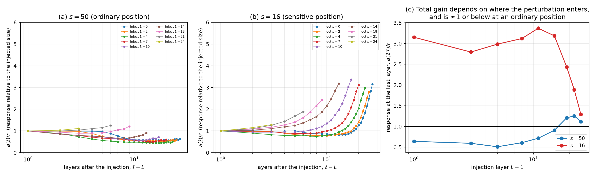

**Data.** Inject a perturbation of size $r=0.05$ into the residual stream **at one layer $L$**
and one position, then read the response at every layer $\ell>L$. 6 directions; HF convention:
`hidden_states[l]` is the input of block $l$, so the perturbation first appears at $\ell=L+1$.
Left: position $s=50$ (an ordinary position). Middle: $s=16$ (a position with a small gap).
Right: total gain at the last layer vs injection layer.

**Axes.** $x$: layers after the injection $\ell-L$ (log). $y$: $a(\ell)/r$, the response
relative to the injected size. A value of 1 means "no amplification, no decay".

**Reading — and the reconciliation of three earlier, apparently contradictory statements.**
- At an **ordinary position** ($s=50$) a local perturbation **never amplifies**: the gain is
  0.5–1.25, i.e. it decays slightly with distance. Injecting later leaves less distance to decay,
  hence the mild upward trend with $L$.
- At a **sensitive position** ($s=16$) the same perturbation is amplified **≈3×**, and the growth
  happens mostly in the last layers (the curves bend upward at $\ell-L\gtrsim10$).
- The earlier "depth gain $A(\ell)\propto\ell^{0.64}$" (A4) is a different object: it is the
  response at generated positions to a perturbation applied to **all prompt tokens**, so it
  measures how much *prompt content* each depth integrates, not the amplification of a local
  kick. The earlier "all growth in layer 1" came from the depth-FSLE / same-position product and
  from the state-norm jump at the embedding→residual transition; it is not the gain of a
  perturbation.

**Answer to "first or last layers?"** For a local perturbation: **neither** at an ordinary
position (no gain), **the last layers** at a sensitive position. For a prompt-wide perturbation:
the response grows with depth because deeper layers see more of the prompt, not because any
single block amplifies.

### N3. The nonlinearity at large $r$ is a power law

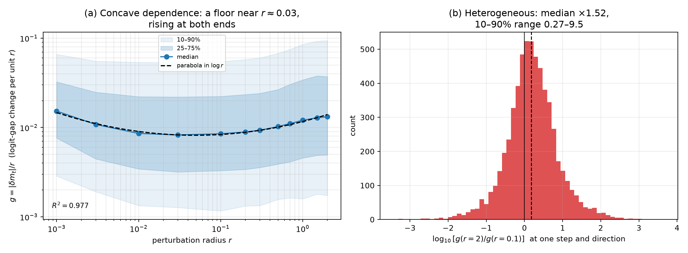

**Data.** All 12 radii, 20 directions, 300 steps; teacher-forced margin changes.

**Panel (a).** $x$: $r$ (log); $y$: $g(r)=\mathrm{median}\,|\delta m_t|/r$, the logit-gap change
per unit radius. **Panel (b).** Same quantity for three individual close calls.

**Reading.** $g$ is **flat at 0.0083–0.0093 for $r\in[0.01,0.3]$** (linear response), rises at
the float32 floor below $r\approx3\times10^{-4}$ (noise$/r$), and above $r=0.3$ follows a
**power law $g\propto r^{0.19}$** (×1.55 by $r=2$). The extra growth is not universal: one close
call ($t=2$) doubles while $t=123$ and $t=16$ stay flat until $r\approx0.7$. This is why a
threshold measured at small $r$ over-predicts flips at large $r$ (B5), and it is a genuine
sublinear power law, not an exponential.

### N4. The finite-time rate: positive, then negative

The quantity plotted in N1(b) is
$$\lambda(t)=\frac1t\log\frac{a(t)}{a(1)}.$$
For $W>P$ it is **positive for the first ~10–40 tokens** (peak $\lambda\approx0.026$ nats/token for
$W=100$; the peak is higher if measured from $t=1$ to $t=3$), then crosses zero and becomes
negative. For $W<P$ it is negative from the start. No window, radius or layer tested gives a
sustained positive rate over 300 tokens.

This is the closest legitimate analogue of a Lyapunov exponent in this system: a finite-time
stretching rate with a stated horizon. Read as a number: $\lambda(t=20)\approx+0.02$,
$\lambda(t=100)\approx+0.005$, $\lambda(t=299)\approx-0.002$ for $W=100$.

### N5. What a "window flush" is

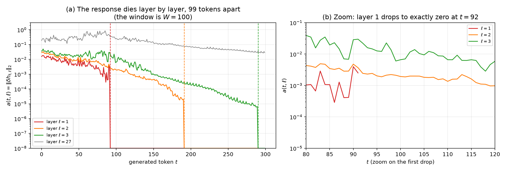

**Data.** Prompt perturbation, $r=0.1$, 20 directions, $W=100$, $P=65$; response read at layers
1, 2, 3 and 27.

**Axes.** $x$: $t$. $y$: $a(t,\ell)=\|\delta h_{t,\ell}\|_2$ (log). Panel (b) zooms on $t\in[80,120]$.

**Reading.** The perturbation is stored in the key/value cache of the **prompt** tokens. As the
generation advances, those prompt tokens leave the sliding window. When the last perturbed prompt
token leaves the receptive field of a layer, that layer's response becomes **exactly zero**:
layer 1 at $t=92$, layer 2 at $t=191$, layer 3 at $t=290$. The spacing is $W-1=99$: once layer 1
has lost the perturbation, layer 2 can only see layer-1 states from earlier positions, so it
survives one more window before it too goes to zero. Deeper layers (7, 14, 21, 27) keep a
non-zero response for the whole 300-token run because they also carry the perturbation through
the generated positions themselves.

So a "flush" is not a numerical artifact: it is the moment when a layer stops being able to see
any perturbed token. It also explains why the shallow-layer curves in A4 collapse while deep
layers decay more slowly.

---

Each block states: data, axes (with formulas), curves, reading. All perturbations are FP32,
greedy, teacher-forced unless stated.

## A. The attention window

### A1. Same prompt, same tokens, two windows

**Data.** Prompt of $P=65$ tokens. The *same* 400-token sequence $g_0,\dots,g_{399}$ is used in
both runs, so the tokens cannot differ. Prompt perturbation (1.2A) with $r=0.1$, 8 simplex
directions. Teacher-forced pass; state read at layer $\ell=27$.

**Axes.** $x$: generated token index $t$ (negative values = prompt, grey band; $t=0$ = first
generated token). $y$: $a(t,27)=\|\delta h_{t,27}\|_2$, median over the 8 directions.

**Curves.** Blue $W=100$; black $W=1000$ (never clips in 400 tokens, so it is the control).
Panel (b) zooms on $t\in[20,55]$.

**Reading.** The curves are numerically identical up to $t=34$ and separate at $t=35$.
$35=W-P=100-65$: at that step the context stops fitting in the window. The weights and the input
tokens are identical; only the mask differs. This is a controlled intervention, and it is the
cleanest evidence that the rise/decay shape of the response is produced by the window.

**Caveat.** Qwen2 applies the sliding window only to its last `max_window_layers` blocks, so
early layers keep full attention. The departure therefore shows up in the last-layer state and
then grows.

### A2. The generated text under two windows

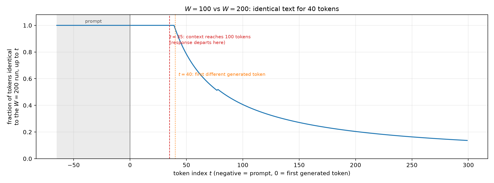

**Data.** Two *free-running* greedy generations from the same 65-token prompt, $W=100$ and
$W=200$. **No perturbation**: $r=0$. This figure is about text, not about the response.

**Axes.** $x$: token index (negative = prompt). $y$: fraction of tokens identical to the
$W=200$ run, over all positions up to $t$.

**Curve.** One curve: 1 over the whole prompt (trivially identical), 1 for the first 40 generated
tokens, then falling.

**Reading.** The text is bit-identical for 40 tokens; the first different token is $t=40$. The
*response* departed at $t=35$; five more tokens were needed before the small difference crossed
a decision gap. Afterwards the texts never re-converge, so the curve decays to 0.

**What it is not.** Not a perturbation experiment: $r=0$, only the mask differs.

### A3. Response is proportional to the radius

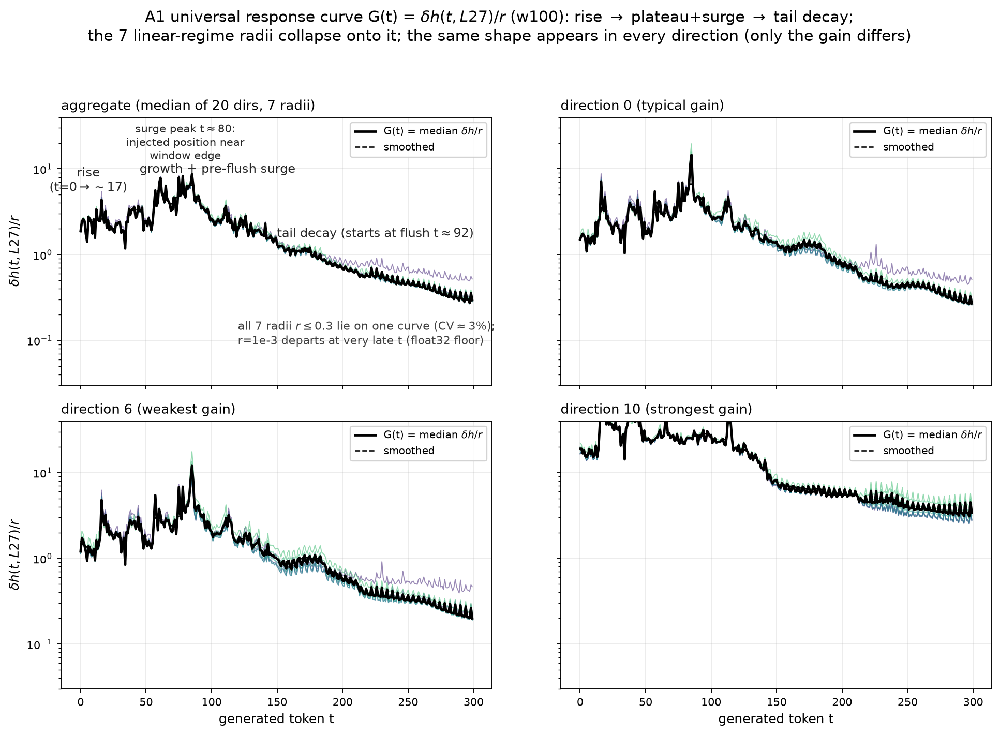

**Data.** Prompt perturbation, 20 simplex directions, 7 radii $r\in[10^{-3},0.3]$,
teacher-forced, layer 27.

**Axes.** $x$: $t$. $y$: $a(t,27)/r$ (response per unit radius). Thin lines: three individual
directions. Thick line: median.

**Reading.** If the response were proportional to $r$, all curves collapse onto one. They do:
the coefficient of variation of $a/r$ across radii is 2–3% (median; p90 ≤ 11%) at every layer
and time. Hence
$$a(t,\ell;r)=r\,G(t,\ell).$$
Deviations appear only at $r=10^{-3}$ late in the sequence (float32 round-off, $a<10^{-4}$) and
at $r\ge0.5$ (D5). This linearity licenses all threshold arithmetic in Part B.

### A4. Depth sets the gain

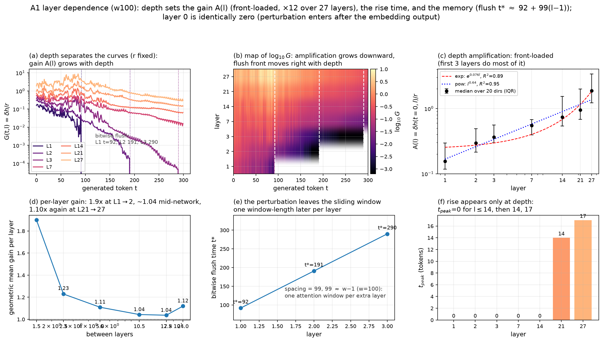

**Data.** Same run; fixed $r$, all saved layers.

**Axes.** Left: $x=t$, $y=a(t,\ell)$ for several $\ell$. Right: $x=\ell$, $y$=depth gain
$A(\ell)=a(t,\ell)/a(t,1)$ at fixed $t$.

**Reading.** Early layers respond and decay; deep layers rise, surge before the window flush,
then decay. The gain follows $A(\ell)\propto\ell^{0.64}$ ($R^2=0.95$): $0.155$ at L1 to $1.875$
at L27, a factor 12, and it is front-loaded (×1.9 from L1→L2, ×1.04 mid-network, ×1.12 at the
end). Depth also sets the rise time and the memory of the perturbation.

### A5. Large radii

**Data.** $r=0.1\ldots2$, same directions.

**Axes.** $x=t$; $y$: response, normalized by its own peak; insets give the fitted exponent.

**Reading.** No saturation and no new regime: the shape survives (CV 13% for $r\in[0.1,2]$), but
the response becomes mildly superlinear. The deep-layer exponent grows from 0.96 (L1) to 1.45
(L27); per direction it spans 0.47–2.0 and is uncorrelated with the linear gain. At $r=2$ the
largest response is ≈0.7 of the baseline state norm. This is why *extrapolating* a threshold
from small $r$ fails above $r\approx0.3$ (D5), while re-measuring at the radius of interest does
not.

## B. The decision boundary and thresholds

### B1. What is predicted

**Data.** One prompt, one direction, $r=0.5$, teacher-forced. Baseline gap $m_t$ and perturbed gap
$m'_t$ are read at every step; $\delta m_t=m'_t-m_t$.

**Axes.** $x$: $t$. $y$ (log): logit gap. The dashed "overtake" line is $m'_t=0$: where the
perturbed gap touches it, the runner-up becomes the winner.

**Reading.** Most steps have a gap of several logit units; at $t=123$ the baseline gap is
$0.020$. A perturbation that shrinks the gap by $0.041$ per unit $r$ gives
$r_c=m_t r/|\delta m_t|=0.020/0.041\approx0.25$: any $r\ge0.25$ flips that word. The figure
shows the observed flip at exactly that word for $r=0.5$.

**What is predicted.** Two things from one teacher-forced pass: whether the free run changes any
token, and the index of the first changed token. If no $r_c$ falls below $r$, the prediction is
"the entire answer is unchanged".

### B2. Accuracy of the prediction

**Data.** 19 free-run experiments × 20 directions = 380 runs; 320 are evaluable with the signed
rule (the childhood prompt has no stored geometry). Three prompts, radii $10^{-4}$–$2$,
windows 100/200/500.

**Axes.** $x$: outcome category. $y$: number of direction-runs out of 320.

**Bars.** Green: signed rule (1.4) with $\delta m$ measured at the predicted radius. Grey: the
earlier sign-blind rule $r_c=m_t/|\delta m_t/r|$.

**Reading.** Signed: 57 exact flip steps, 261 correct "no flip", 2 wrong steps, **0 false
alarms, 0 missed flips** = 318/320 = **99.4%**. Sign-blind: 45 exact, 240 no-flip, 13 wrong
steps, **21 false alarms**, 1 miss = 89.1%. The "many outliers" of the earlier scorecard were
produced by the sign-blind rule.

**Two misses.** Both are flips at $t=0$ at $r=1$ and $r=2$: a large perturbation deforms the
prompt itself, so the free run's first step is already uncertain while the teacher-forced pass
still follows the unperturbed prefix.

### B3. What the prediction is worth

**Data.** All 75 flipped runs (3 prompts), with the full generated sequences of both the
perturbed and the unperturbed run.

**Panel (a).** $x$: tokens after the first flip. $y$: fraction of tokens identical to the
unperturbed run in a rolling 10-token window. Three examples plus the average over 75 flips.

**Panel (b).** $x$: first-flip position $T_f$. $y$: fraction of the 300-token answer identical,
$S=T_f/T$. Points: runs. Dashed line: $y=x/300$.

**Reading.** After the first flip, agreement stays at 2–3%: **0 of 75 runs ever re-synchronise**.
The surviving fraction is exactly first-flip position / 300. All 305 runs without a flip are
100% identical. Predicting $T_f$ is predicting how much of the answer survives.

### B4. Which direction is fragile, and at which word

**Data.** Prompt perturbation, 20 directions, teacher-forced geometry, two prompts. One row per
direction.

**Axes.** $x$ (log): smallest radius $r_*(u)=\min_t r_c(t,u)$ that flips any word. Colour: the
token $t$ where that minimum occurs (the controlling close call). Open circles: the same
quantity under the sign-blind rule.

**Reading.** Propulsion prompt: the tie at word 123 (gap 0.020) controls 8/20 directions, word 14
(gap 0.087) 6/20, word 143 (gap 0.020) 3/20; $r_*$ spans 0.128–3.62. Cybersecurity prompt:
fragility is spread over words 17/39/22; $r_*$ spans 0.13–10.9. The sign-blind rule halves the
apparent threshold for many directions.

### B5. Where the linear prediction breaks

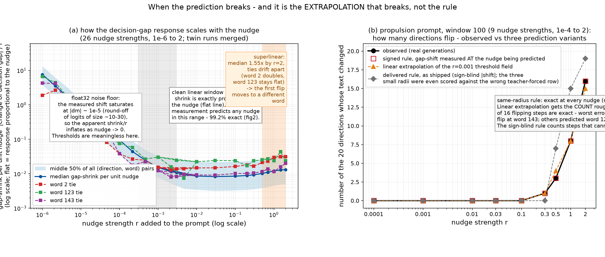

**Data.** All radii; teacher-forced gains $|\delta m_t|/r$ per direction and step.

**Axes.** Left: $x=r$ (log), $y=|\delta m_t|/r$ (log). Right: $x=r$, $y$ = number of directions
that flip.

**Reading.** Three regimes. (i) $r\lesssim3\times10^{-4}$: the measured shift is at the float32
round-off ($|\delta m|\sim10^{-5}$), so the apparent gain grows like noise$/r$. (ii)
$3\times10^{-3}\lesssim r\lesssim0.3$: gain flat at ≈0.0085, linear. (iii) $r\gtrsim0.5$: gain
grows (median ×1.55 by $r=2$) and becomes tie-dependent, so a threshold measured at small $r$
over-predicts: 16/20 at $r=0.5$, 6/20 at $r=1$, 3/20 at $r=2$. This breaks *extrapolation*, not
the rule: re-measuring $\delta m$ at the radius of interest restores 99.4%.

## C. Single-position perturbations

### C1. The response field

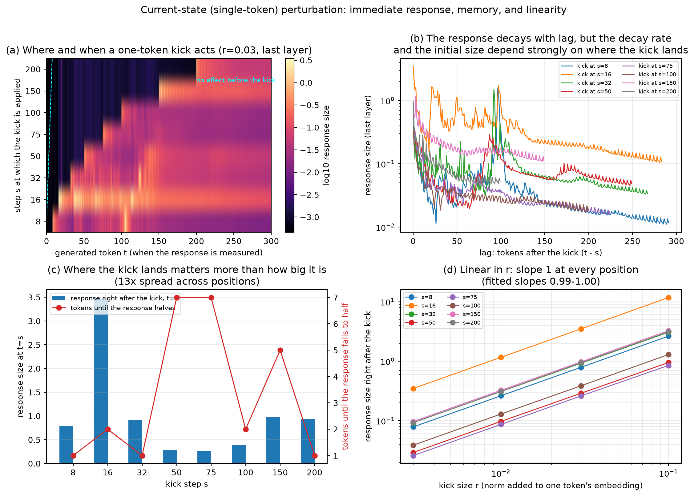

**Data.** Perturbation (1.2B) at one position $s$, 24 Gaussian directions, radii
$3\times10^{-3},10^{-2},3\times10^{-2},10^{-1}$, teacher-forced on the same 300-token sequence,
state read at layers 7/14/21/27. Panels (a)–(b): $r=0.03$.

**Panel (a).** $x=t$; $y=s$; colour $=\log_{10}$ of the median over directions of $a(t,27)$. Cyan
line $t=s$: no effect can precede the perturbation.

**Panel (b).** $x$: lag $\tau=t-s$; $y$: $a(s+\tau,27)$ (log), one curve per $s$.

**Panel (c).** Bars: $a(s,27)$ at lag 0 for each $s$. Red line (right axis): tokens until the
response halves.

**Panel (d).** $x=r$ (log); $y=a(s,27)$ (log) for each $s$. Slope-1 lines mean linearity; fitted
slopes 0.99–1.00.

**Reading.** (i) Exactly zero for $t<s$. (ii) At the perturbation position the size varies **×13**
with $s$ (0.26 at $s=75$ to 3.49 at $s=16$): *where* you perturb matters more than how hard.
(iii) Decay is fast — half-life 1–7 tokens — then a long small tail. (iv) Linearity at every
position.

### C2. Depth: absolute grows, relative shrinks

**Data.** Same run, $r=0.03$.

**Panel (a).** $x$: layer $\ell$; $y$: $a(s,\ell)=\|\delta h_{s,\ell}\|_2$ (absolute).

**Panel (b).** $x$: layer; $y$: $q(s,\ell)=a(s,\ell)/\|h_{s,\ell}\|_2$ (relative to the state
length).

**Reading.** Both panels are correct and they answer different questions. The absolute effect
grows with depth (the residual stream amplifies it). Relative to the state's own length it
*shrinks* with depth for ordinary positions $\times0.05$–0.09 from L7 to L27, because the state
length grows faster. The exception is the sensitive position $s=16$, whose relative effect stays
flat (×0.6). A perturbation at a close call is not washed out by depth.

### C3. When a perturbation acts

**Data.** Same run, $r=0.1$. Every (position, direction) pair whose margin condition
$\delta m_t\le -m_t$ is met at some $t>s$.

**Axes.** $x$: generated token $t$. Each horizontal segment starts at the perturbation position
$s$ and ends at the token $t$ that first changes. Grey curve (right axis, log): baseline gap
$m_t$.

**Reading.** Five events. All four $s=16$ directions change the token at $t=123$ — **107 tokens
after the perturbation** — and the one at $s=50$ at $t=143$ (93 later). Nothing happens at $s$.
The perturbation sits latent until the model reaches the next close call.

### C4. Autoregressive confirmation

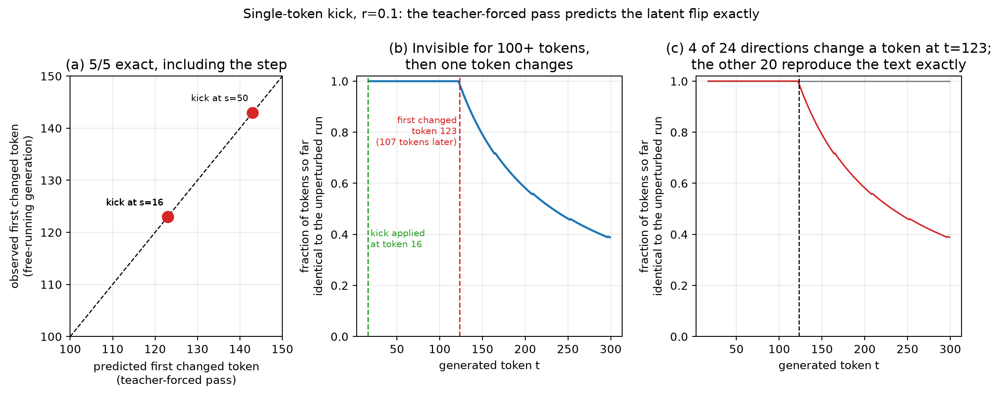

**Data.** Free-running generations with perturbation at $s=16$ and $s=50$, $r=0.1$, 24 directions,
compared with the teacher-forced prediction of C3.

**Panel (a).** $x$: predicted first changed token (teacher-forced), $y$: observed first changed
token (free run). Five events.

**Panel (b).** $x$: $t$; $y$: fraction of tokens so far identical to the unperturbed run, for one
direction. Green line: perturbation position. Red line: first changed token.

**Panel (c).** Same for all 24 directions at $s=16$: 4 change the text, 20 never do.

**Reading.** **5/5 exact**, including the step: 4 directions at $s=16\to t=123$, 1 at
$s=50\to t=143$. After the change, agreement falls to ≈40% and the texts never re-converge. The
latency is real, not an artifact of teacher forcing.

### C5. Which positions matter, and when it acts

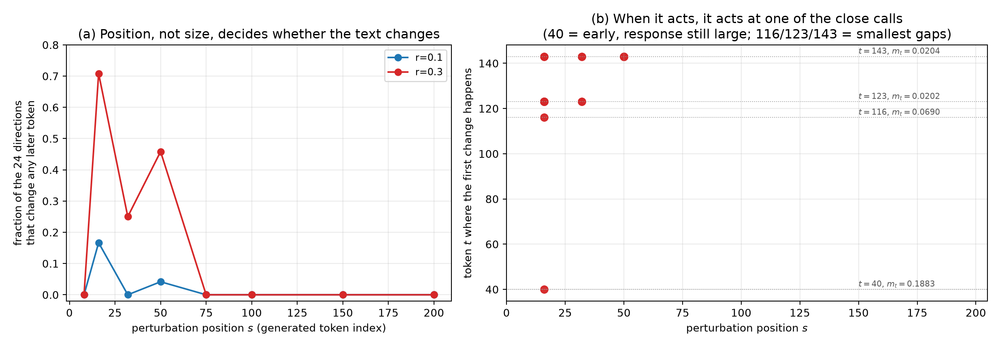

**Data.** Free runs with a single-position perturbation, 24 directions, at positions
$s=8,16,32,50,75,100,150,200$, two radii ($r=0.1$ and $r=0.3$). A "flip" is the first token that
differs from the unperturbed run.

**Panel (a).** $x$: perturbation position $s$; $y$: fraction of the 24 directions that change any
later token. Blue: $r=0.1$ (two runs, positions 8–50 and 8–200). Red: $r=0.3$.

**Panel (b).** A point per (position, direction) that flips: $x=s$, $y$ = token where the first
change happens. Dotted lines: near-tie tokens, labelled with their baseline gap $m_t$.

**Reading.** Position dominates. At $r=0.3$: 17/24 directions flip when the perturbation is at
$s=16$, 6/24 at $s=32$, 11/24 at $s=50$, and **zero** at $s\ge75$. At $r=0.1$ only $s=16$ (4/24)
and $s=50$ (1/24) act. When a perturbation acts, it acts at one of four tokens: $t=40$ (early, gap
0.188 but the response is still large) or $t=116/123/143$ (the smallest gaps, 0.069/0.020/0.020).
Nothing acts between them. This is the decision-boundary picture at the level of a single token:
the perturbation must survive to a place where the *product* of response and closeness is large
enough.

## D. Prompt perturbation: two kinds of flips

**Data.** Prompt perturbation; 27 observed free-run flips at $r=0.5,1,2$ (20 directions each);
baseline gaps and teacher-forced responses.

**Panel (a).** $x$: baseline gap $m_t$ (log); $y$: counts. Grey: all 300 steps. Red: steps where a
flip happens. Flips sit at the small-gap end (spikes at 0.020 and 0.069).

**Panel (b).** $x$: response at the flip step divided by its maximum up to that step; $y$: counts.
1 = flip at the response peak; near 0 = response already decayed.

**Panel (c).** $x$: flip step; $y$: the same ratio. Delayed flips cluster at $t=116$–$143$.

**Panel (d).** Example: gap (black, log) and response (blue, normalized) vs $t$; red line = flip at
$t=143$, gap 0.020, response 9% of its peak.

**Reading.** 17/27 flips are immediate (at the response peak); 10/27 are delayed — the response has
faded but the model reaches a later close call and breaks there. A flip depends on the product of
response size and closeness, not on the response alone.

## E. Directions are not equivalent

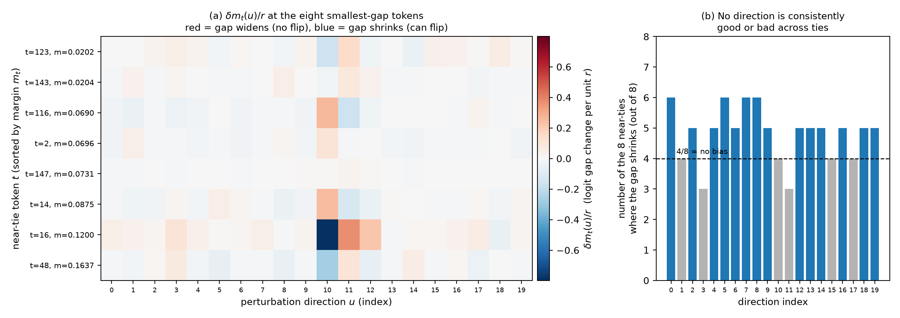

**Data.** Prompt perturbation at $r=0.3$ (linear regime), 20 simplex directions, teacher-forced.
The 8 near-ties are the 8 smallest baseline gaps $m_t$.

**Panel (a).** Rows: the 8 near-tie tokens, sorted by $m_t$ (labels give $t$ and $m_t$). Columns:
direction $u$. Colour: $\delta m_t(u)/r$ — gap change per unit radius. Red $>0$ (widens, no
flip), blue $<0$ (shrinks, can flip).

**Panel (b).** For each direction, the number of the 8 ties where the gap shrinks.

**Reading.** The sign is **not** a property of the direction: at $t=123$ seven directions shrink
the gap and thirteen widen it; at $t=16$ only four shrink it. Across the eight ties the sign
patterns are essentially uncorrelated (mean Spearman $-0.05$), and no direction is negative at
more than 6/8 ties. Magnitudes, in contrast, are a stable property of a direction (next figure).

**Consequence.** "Which direction is dangerous" only makes sense together with the word at which
it acts. Magnitude ranks directions; sign ranks (direction, word) pairs.

**Data.** The same 20 directions evaluated on three different continuations of the same prompt
(different windows produce different texts), teacher-forced.

**Axes.** Pairwise rank correlation of per-direction response magnitudes between continuations.

**Reading.** Rank correlations 0.80–0.98: a strong direction stays strong on a different text. The
"hot trio" (directions 10, 11, 12) is hot in all three. So magnitude is a property of the
direction; the sign at a particular word is not.

**Data.** Same geometry; (a) uses $t=123$ and $r=0.3$; (b) uses observed flips at
$r=0.5,1,2$.

**Panel (a).** $x$: directions sorted by their effect at word 123. $y$: $\delta m_{123}(u)$; the
dashed line is $-m_{123}$ (the flip line).

**Panel (b).** $x$: direction index; $y$: radius; markers: directions that flip at that radius.

**Reading.** At the same close call, different directions push the decision in opposite
directions, and only one crosses the flip line. Flips are stratified: at $r=0.5$ exactly the hot
directions 10–12 break, at $r=2$ sixteen directions do.

## F. Depth and non-normality

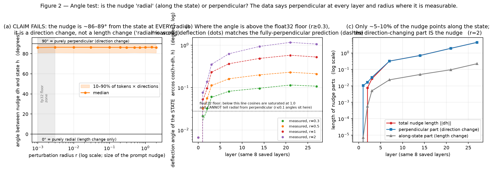

**Data.** Prompt perturbation, radii $10^{-3}$–$2$; full perturbed and baseline last-layer states
are saved for three directions, so the angle is exact.

**Panel (a).** $x$: $r$ (log); $y$: angle between $\delta h$ and $h$ in degrees. $0^\circ$ =
radial (length change), $90^\circ$ = perpendicular (direction change). Grey band: float32 floor,
below ≈0.03° the stored cosine rounds to 1 and the angle is not measurable.

**Panel (b).** $x$: layer; $y$: $1-\cos$ between $\delta h$ and $h$ (log), four radii.

**Panel (c).** The perturbation split into its component along $h$ and its perpendicular
component, vs layer.

**Reading.** The angle is 86–87° at every radius and layer. In 1536 dimensions two random vectors
are also nearly perpendicular (expected angle $\arccos(1/\sqrt d)\approx88.5^\circ$), so the angle
alone is **trivial**; the informative part is panel (c): ≈95% of the perturbation is
perpendicular and only 5–8% is along the state. Because the network normalizes length before the
logits, only that perpendicular part can change the output. Measured: the logit-gap change tracks
the perpendicular length linearly, $|\delta m|\approx4\,b/\|h\|$ with $b$ the perpendicular
component.

**Data.** Block Jacobians $J_\ell=\partial h_{\ell+1}/\partial h_\ell$ at a fixed position, 5
layers × 6 tokens; $\sigma_{\max}$ by power iteration, $\rho$ by ARPACK.

**Axes.** Per layer: $\sigma_{\max}$ (worst one-step amplification), $\rho$ (asymptotic growth if
the same map were repeated), $\kappa=\sigma_{\max}/\rho$, the principal angle between consecutive
top singular subspaces, and the measured aligned gain of the product.

**Reading.** $\sigma_{\max}$ reaches 95–195 at layer 0 and 6–9 at layer 27, yet the measured
product is far below both the naive chain $\prod\sigma_{\max}$ (by ~13 orders) and
$\prod\rho$ (by ~5). The reason is rotation: consecutive amplification directions differ by
83.6° on average, so gains cannot compound. The budget $(\sigma-1)\cos^2\theta$ reproduces the
measured chained gain within a factor ≲2.

**Important.** This is a statement about a *fixed position*. The full prompt perturbation also
travels across positions through attention and grows. The two statements are not contradictory,
but must not be conflated. It also means the earlier sentence "the depth expansion is only radial
scale drift" was wrong and has been retracted.

## G. Correlation dimension: why the curves looked different

**Data.** Last-layer states of long generations (4000 tokens), first-layer states, synthetic
controls.

**Axes.** $x$: $\varepsilon$ divided by the median pairwise distance (log). $y$:
$C(\varepsilon)$ from 1.4 (log). Dashed lines $1/N$ and $10/N$: below them the estimate is
dominated by finite sampling.

**Panels.** (a) A near-exact repetition loop: knee plus "ring", fittable with $r^2=0.999$. (b)
First-layer states contain 352,035 exact duplicate pairs, giving a flat floor $C=0.042$ at every
$\varepsilon$. (c) A naive computation including $i=j$ pairs and/or a linear $\varepsilon$ grid
produces a staircase. (d) Same data on linear vs log grid.

**Reading.** All four shapes are artifacts of the data or the estimator, not evidence of a
low-dimensional attractor. On non-loop trajectories the whole rise of $C$ spans 0.16–0.19 decades,
and the interval that is both below $2\log_{10}N$ and above $10/N$ is 0.00–0.04 decades wide: no
plateau exists. The estimator is not at fault — at the same $N$ it recovers Hénon ($D_2=1.157$)
and Lorenz ($D_2=1.984$).

**Update (16 fresh 1000-token trajectories).** 0 of 64 (trajectory × $N$ × Theiler) configurations
contain a slope-stable interval inside the legal band. Eight of the sixteen trajectories are
quasi-loops with periods 12–81 and narrow relative distance (0.018–0.035 of the cloud scale); they
have wide "plateaus" that are loop knees. The eight non-repetitive ones have an ER-legal width of
**0.000 decades**. Predictability with $k$-nearest neighbours replicates only on the eight
quasi-loops (NSE gaps +0.27…+0.67 over surrogates); on the eight non-repetitive ones the gap is
+0.018 (median) versus MIAAFT and +0.002 versus a linear ridge, i.e. nothing. The earlier
`launch` lead does not replicate. Two surrogate-implementation bugs were found and fixed in that
pass, so older MIAFT-based numbers should be re-checked; the clean statement is the one above.

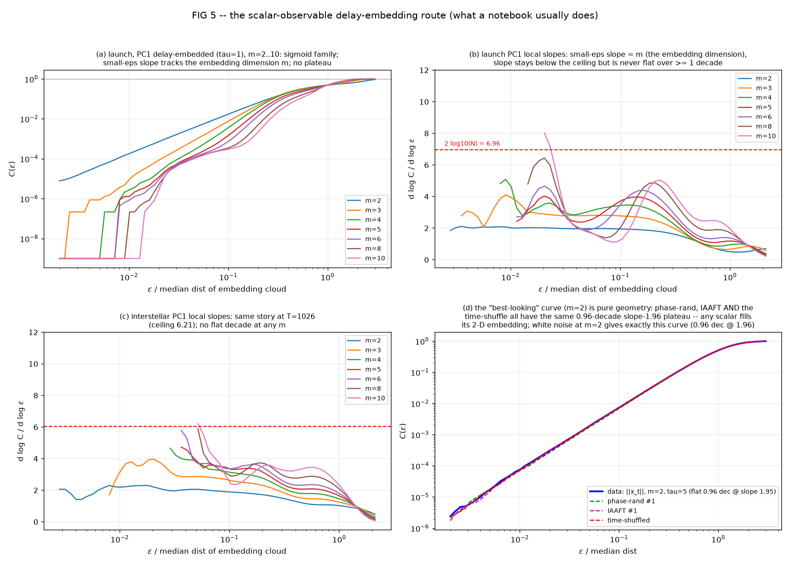

**Data.** Delay embedding of the same trajectories, $m=2\ldots10$, with white-noise and
phase-randomised controls.

**Axes.** $x$: embedding dimension $m$; $y$: estimated $D_2$.

**Reading.** At $m=2$ the curve looks textbook (slope 1.95 over 0.96 decades, $r^2=0.999$), but
**white noise at $m=2$ gives the identical curve**: it is the fill dimension of any 2-D cloud.
The estimate rises with $m$ and never saturates below the surrogate band.

## H. A sanity check that is trivial by definition

**Data.** 140 teacher-forced predicted sequences compared with free runs (20 directions × 7
radii).

**Panels.** (a) timeline of one example around the flip; (b) predicted vs observed first flip
step; (c) flip counts per radius.

**Reading.** 29/29 flips agree in step and token, 0 false positives among 111 no-flip cases. The
first two panels are **trivial by construction**: a token cannot differ before the first
difference. The only non-trivial content is panel (b)'s exactness of the *predicted token*: one
teacher-forced pass also gets the new word right. After the flip the comparison is meaningless
because the prefixes differ.

---

# Part 3. Relation to Lyapunov exponents

For an autonomous map $x_{n+1}=F(x_n)$, the maximal Lyapunov exponent is
$$\lambda=\lim_{n\to\infty}\frac1n\log\|DF^n(x_0)\,\delta_0\| .$$
It is a property of the invariant measure, independent of $x_0$ and $\delta_0$ almost surely.

Three things separate our measurement from this.

1. **The map changes every step.** The input at step $t$ is the token $g_t$, itself the output of
   the previous step; the update is $h_{t+1}=F_t(h_t)$ with a different $F_t$ each step (different
   token, position, mask). A time-dependent product of Jacobians has **finite-time** stretching
   exponents, not one Lyapunov exponent. The correct object is the finite-time rate of
   $\prod_{i<t}DF_i$, which depends on $t$ and on the window.
2. **The trajectory is finite and transient.** Our curves decay and the network is reset at every
   prompt. There is no long-time limit: 300–1000 tokens is the whole experiment.
3. **The relevant norm is not the raw state norm.** The output depends on the *direction* of the
   state (length is normalized away), so the dynamically relevant growth is the tangential one.
   The raw norm grows ×452 with depth mostly because the residual stream's scale grows, which the
   logits do not see.

What the data support:
- the finite-time response is linear in $r$ up to $r\approx0.3$ and transient;
- $\lambda(t)=\frac1t\log(a(t)/a(0))$ is positive early and turns negative: a transient, not
  sustained stretching;
- the depth product at a fixed position contracts relative to the state scale, while the full
  response grows through cross-position mixing;
- the actual mechanism of unpredictability is a **decision-boundary crossing** at a close call,
  not exponential separation of nearby trajectories.

If a Lyapunov-like number is wanted, the honest report is a finite-time exponent with horizon and
window stated, e.g. "$\lambda(t=50)=0.04$ nats/token at $W=100$", never a bare "Lyapunov
exponent".

---

# Part 4. What is trivial and what is not

**Trivial (implied by the definitions).**
- Tokens are identical until the first flip; that is the definition. The teacher-forcing figure is
  a sanity check.
- Small perturbations produce a response proportional to their size: any differentiable map does.
- In 1536 dimensions two random vectors are nearly perpendicular; the angle test alone says
  nothing. What matters is the split into along-state and perpendicular components and the linear
  relation between the perpendicular part and the logit change.
- The state norm grows with depth in a residual network.
- The output is invariant to the state's length (normalization).

**Not trivial (measured, not implied).**
- The **quantitative** threshold law: one teacher-forced pass predicts the first changed word in
  318/320 cases including all 70 borderline calls, with zero false alarms.
- The **window law** $D=W-P$, exact to the token on two prompts and five window sizes with
  identical inputs; and the text needs 4–6 extra tokens to split.
- The **survival law**: after a flip the text never re-converges, so the surviving fraction is
  exactly $T_f/T$.
- The **latency**: perturbations can act 100+ tokens later at the next close call, confirmed
  autoregressively.
- **Direction structure**: magnitudes stable across texts (rank correlation 0.8–0.98) while signs
  at a given word are not (mean correlation $-0.05$); flips are stratified by direction.
- The **rotation mechanism**: components amplify ($\sigma_{\max}$ up to 195) yet the product does
  not, because the amplifying direction rotates by 84° per layer; the budget
  $(\sigma-1)\cos^2\theta$ closes the gap within a factor 2.
- The **negative** D2 result with a working positive control (Hénon/Lorenz).

---

# Part 5. Null results (things that did not work)

1. **No correlation-dimension plateau** on any non-loop trajectory, in any metric, centering, $N$
   or embedding dimension. Valid interval 0.00–0.04 decades wide. Every quoted $D_2$ was a
   window/tube/fill-dimension/duplicate artifact.
2. **Raw vs time-shuffled $D_2$** is a tautology (shuffling preserves the point cloud); it cannot
   be used as a dynamic control.
3. **No lag-collapse of the two-time response.** Normalizing by $a(s)$, by the first peak, or by
   $a(s+5)$ leaves ×1.5–1.6 RMS disagreement. The response is only approximately separable
   (68% rank-1).
4. **No direction clustering.** $k=1$ wins a parametric-bootstrap comparison ($P(k>1)=0.10$–0.18).
   There are reproducible outliers, not groups.
5. **Attention entropy does not explain near-ties.** Correlation with margin +0.32–0.38 at
   $W=100$, ≈0 at $W=200$.
6. **Linear extrapolation of thresholds fails above $r\approx0.3$** (16/20 at 0.5, 6/20 at 1, 3/20
   at 2), because the gain becomes superlinear and tie-dependent.
7. **Layer-14 injection is too weak to flip anything.** At matched $r$ it is 11–38× weaker at the
   output, and its margin change is ~10× too small to cross any gap.
8. **Single-position perturbations rarely change the text.** At $r=0.1$: 4/24 directions at
   $s=16$, 1/24 at $s=50$, zero elsewhere. At $r=0.3$: 17/24 at $s=16$, 6/24 at $s=32$, 11/24 at
   $s=50$, and **zero for every tested position $s\ge75$**.
9. **Below $r\approx3\times10^{-4}$** the response is at the float32 round-off and stops scaling.
10. **The first-layer D2 is high and meaningless** (352k exact duplicate pairs).
11. **600-token A1 in one batch** OOMs on a 15 GB T4; 500 works with `batch-dirs=1`.
12. **No evidence of chaos**: no positive sustained exponent, no attractor, no plateau.

---

# Part 6. Data inventory

| run | contents | used in |
|---|---|---|
| `a1_ds_w100_layers` | 12 radii × 20 dirs × 8 layers, 300 tokens | A3, A4, A5, B, E, F |
| `window_fixed/w{100,150,200,300,1000}` | same tokens, five windows, 400 tokens | A1 |
| `window_cyber/w{100,200,1000}` | second prompt, same protocol | A1 (law) |
| `a1_ds_w100_layers/free_run_*` | free runs, 20 dirs, $r=0.05\ldots2$ | B2, B3, D |
| `state_deep_emb` | 8 positions × 24 dirs × 4 radii × 4 layers | C1, C2, C3 |
| `state_deep_L14` | layer-14 injection | C2, Part 5 |
| `state_freerun_r0.1`, `r0.3` | free runs with a single-position perturbation | C4 |
| `long_traj*`, `long_traj_2k`, `long_traj_4k` | 1000–4000-token trajectories, window 4096 | G |
| `nonnorm_w100_big` | $\sigma_{\max},\rho,\kappa$, principal angles | F |

**Protocol invariants.** FP32; greedy; no repetition penalty; the unperturbed reference is a
duplicate row in the same batch and is verified bit-identical; teacher-forced passes use the
unperturbed token sequence; free runs are used only where stated.

**Reproducing.** Every figure comes from a script in `scripts/`; the per-topic reports with exact
numbers are under `results/`. The figures in this document are in `notebook/figures/`, produced by
`scripts/notebook_figs_window.py`, `scripts/notebook_figs_state.py`,
`scripts/notebook_fig_directions.py`, and copied from `results/figures/`.
