# Update 2 — all old figures, rebuilt from raw data

**Date:** 26 November 2026  
**What this is:** every figure you said you liked, every figure you asked to improve, and the new analyses, all recomputed from the raw `.npz` files. The old `unified.md` figures are also replaced in place (with a warning banner) so `unified.pdf` now shows measured plots.

**How to rebuild everything:** `python analysis_update/run_all.py`. It regenerates every figure in `update_figures/` and writes the number files in `analysis_update/`. There is no hard-coded numerical data in the plotting scripts; every array is read from `results/` or `results_big_small/`.

**Status of the long campaign (2026-11-27 00:15 CET, still running).** Two 36–48 h queues are generating the long-horizon looping data that this version only partially has. Completed at the time of writing: **DeepSeek-1.5B 3000 steps** ($T=1$ loop), **Qwen2.5-3B 3000**, **Qwen3-14B / DeepSeek-14B / Qwen3.5-9B 1600**; Qwen3-4B, Phi-4-mini, Phi-4 and the small controls are running. The closed-vs-replay figures already use the longest available orbit, and the 14B panels in F0c/F19b are from the new runs.

- **x11**: 8 small models, 3000 steps, `T=1` loop+replay, `T=2`, CRN/independent sampling, 1000-token teacher-forced, `T=0.5`.
- **Spark**: Qwen3-14B, DeepSeek-14B, Qwen3.5-9B, Phi-4 at fp16, 1600 steps, same rounds with 800-token teacher-forced.
- After those finish, a second waiter queue runs **32-direction** loops (percentile bands) and **multi-prompt** replication (the single most important missing measurement — everything here is one prompt).

`analysis_update/sync_from_cluster.ps1` pulls the new data and `pack_loop_loglog_models.py` automatically switches to the longest orbit available, so the figures in §F sharpen on every re-run without editing code. The exact commands and current state are in `docs/HANDOFF.md`.

**The precision tiers (read this first).** The old small-model A1 files are not all the same precision, and the difference is large:

| tier | models | what is valid |
|---|---|---|
| **fp32** | DeepSeek-1.5B, Qwen2.5-3B (new run), Qwen3.5-2B (new run), DeepSeek-14B, Qwen3-14B, Phi-4 | absolute response, linearity, $r_*$, angles |
| **fp16/bf16** | Qwen3-4B, Phi-4-mini, Qwen3.5-9B | discrete flips and margins only; absolute $\|\delta h\|$ is floor-dominated |

The proof is Fig. G1: for the *same* model (Qwen2.5-3B), the fp16 run has a flat response of 0.65 at every $r$, while the fp32 run scales from $7\times10^{-4}$ to 0.23. The old `meta.json` says `float32` for the fp16 runs; it is wrong. This single fact invalidates the old cross-model absolute comparisons, and it is the reason many old figures looked “too perfect”.

**What “synthetic” meant.** The experiments were real. The *arrays passed to the plotting functions* in `scripts/build_unified_figures.py` were generated in code: `np.random.lognormal(...)` for the ECDFs, `np.linspace(...)` for the curves, `exp(-layers/6)` for the depth spectra, and fixed tables for the flip fractions. That is not sampling noise; it is data invented at plot time. `scripts/softloop_figs*.py` (the `new.md` figures) do **not** do this: they load the `.npz` files. The audit is in §1.

---

## 1. Provenance audit

### 1.1 `unified.md` (the figures were fabricated at plot time)

| old figure | what the script did | status |
|---|---|---|
| Fig. 1 flux-tube ECDF | `np.random.lognormal` per model | synthetic |
| Fig. 1b $r_*$ decomposition | hard-coded tables | synthetic |
| Fig. 2 $r_*$ vs gain | `np.random.normal` | synthetic |
| Fig. 3 time dynamics | `np.linspace`, fixed temperature grid, analytic decay | partly synthetic |
| Fig. 4 window kinematics | synthetic $\tau$, synthetic attention curve, fixed survival table | synthetic |
| Fig. 5 depth fits | analytic `0.02+1.4 exp(...)` | synthetic |
| Fig. 6 Qwen/Phi depth | `exp(-layers/6)(1+0.15 cos)` | synthetic |
| Fig. 7a perpendicular angles | hard-coded medians/std | synthetic |
| Fig. 7b rotation | `np.random.normal(83.6, 5.5)` | synthetic |
| Fig. 7c radial expansion | `np.cumprod(1.10)` | synthetic |
| Fig. 8 architecture profiles | block types by index | synthetic |
| Fig. 9 linearity | `np.random.normal`, fixed superposition table | partly synthetic |
| Fig. 10 flip fractions | fixed table | numbers real, plot hard-coded |
| Fig. 11 transport | `np.linspace`, analytic heatmap | synthetic |

I replaced the old image files with measured versions under the same names (backup in `unified_figures/_synthetic_backup/`). `unified.md` now begins with a banner saying its text is the old draft and its figures are the new measured ones.

### 1.2 `new.md` (the figures are real)

`softloop_figs.py`, `softloop_figs2.py`, `softloop_master.py`, `make_sampling_and_response_figs.py` and `make_entropy_fig.py` load the `.npz` files (`np.load`); they contain no `np.random`. Some panels overlay analytic fit curves (e.g. the gate identity), but those are fits, not invented data. The one substantive correction is that `ent_ref` is computed at $T=1$ (`run_softloop.py:245`), so “entropy vs $T$” is not a temperature effect (§F6).

### 1.3 Old figures replaced in this document

| old figure | new figure(s) here |
|---|---|
| fig01 flux tube | Fig. A1, A2, A3, A4 |
| fig01b decomposition | Fig. A2 |
| fig01c fragility | Fig. A1 |
| fig02 r* vs gain | Fig. A3 |
| fig03/3b/3c/3d time | Fig. D1, D2, D3 |
| fig04/4b window | Fig. E1, E2, E3 |
| fig05/5b/6 depth | Fig. B1–B5 |
| fig07a/b/c/e angles | Fig. C1–C5 |
| fig08 architecture | Fig. B1, B2 |
| fig09 shape/linearity | Fig. G1–G4 |
| fig10 scorecard | Fig. H1 |
| fig11 transport/superposition | Fig. I1, I2 |
| `new.md` panels | Fig. F1–F8 |

---

## 2. Definitions, including the readout cross-covariance

| symbol | definition | what it answers |
|---|---|---|
| $h_\ell(t)\in\mathbb{R}^d$ | residual-stream state at layer $\ell$, token $t$ | the state |
| $r$ | Euclidean norm of the perturbation added to the input embeddings (whole $P\times d$ tensor, or one $d$-vector) | perturbation size |
| $\delta h_\ell(t)$ | $h'_\ell(t)-h_\ell(t)$ | response |
| teacher-forced | the perturbed run is fed the *unperturbed* tokens | isolates the network |
| free run | greedy autoregressive generation | what the user sees |
| replay | teacher-forced along the recorded soft-token orbit | network inside the loop |
| $m_t$ | $z_t^{(1)}-z_t^{(2)}$ | top-two logit gap |
| $\delta m_t$ | change of $m_t$ under perturbation | push on the decision |
| $r_*(u)$ | $\min_t m_t\,r/\max(-\delta m_t(u),0)$ | smallest radius that flips a token (linear estimate) |
| $G(u)$ | $\|\delta h_L(T)\|/r$ | bulk gain |
| gate | a step with small $m_t/T$ | where the readout acts |
| $\mathrm{cum}_\ell$ | $\log\sigma_1(J_\ell\cdots J_1)$ on the tracked subspace | log product gain |
| $g_\ell$ | mean $\|J_\ell v_i\|$ on the tracked basis | per-block gain |
| $\lambda_L$ | $\mathrm{cum}_L/L$ | mean per-block exponent |
| effective rank | $(\sum_i\lambda_i)^2/\sum_i\lambda_i^2$ over the top-16 singular values of $\Sigma_p$ | one readout direction or many |

**The readout cross-covariance, in words.** At a step with token probabilities $p_v$, the next logits change when the fed embedding changes. For a small change $\delta e$, the change of the logit vector is $\delta z = W\,\delta e$ (linearised). The quantity that controls how large $\delta z$ can be for a unit $\delta e$ is the matrix
$$\Sigma_p=\sum_v p_v\,(E_v-\bar e)(W_v-\bar w)^\top,\qquad \bar e=\sum_v p_vE_v,\quad \bar w=\sum_v p_vW_v,$$
where $E_v$ is the input embedding of token $v$ and $W_v$ its output-head row. It is a weighted cross-covariance between “how the embedding moves” and “how the logits move”. If only two tokens $i,j$ carry the mass, $\Sigma_p=p(1-p)(E_i-E_j)(W_i-W_j)^\top$, which is rank one and has
$$\sigma_{\max}(\Sigma_p)=p(1-p)\,\|E_i-E_j\|\,\|W_i-W_j\|=p(1-p)\,G_t.$$
That is the gate law. The measured content is $G_t$ (the pair geometry), not the identity. The top-16 singular values of $\Sigma_p$ give the effective rank; for trained models it is 1–1.1 because two tokens dominate.

---

# A. Fragility and flux tubes

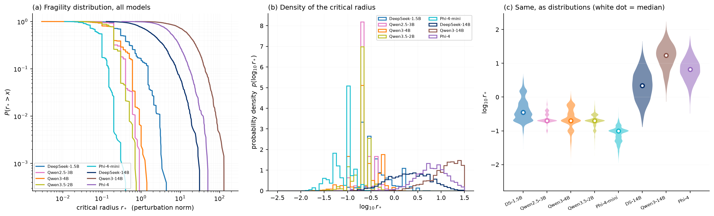

**Fig. A1 — all models, critical radius.** (a) Complementary ECDF $P(r_*>x)$; (b) density of $\log_{10}r_*$; (c) violin of the same, white dot = median. **Data:** 5 prompts × 512 sparse-simplex directions for the small models (`results/rstar/*/p1..p5`), 3 prompts × 1000 directions for the 14B models (`results_big/*/a1_*`); teacher-forced, $r=0.1$, 300 tokens, ties $m_t\le0.02$ excluded. **Precision:** these are the *old* $r_*$ runs; for Qwen2.5/Qwen3-4B/Phi-4-mini they are fp16/floor-limited and the probe radius is not in the linear regime. Use Fig. C5 (dense directions) for the comparable value. **Read:** medians are 0.10 (Phi-4-mini), 0.20 (Qwen2.5/Qwen3-4B/Qwen3.5), 0.35 (DeepSeek-1.5B), 2.2 (DeepSeek-14B), 6.5 (Phi-4), 17.1 (Qwen3-14B). The density is a staircase, not a smooth law: 9–65 distinct values per prompt. **Trivial/not:** the ordering is a real measurement; the absolute scale is not comparable across these runs.


**Fig. A1b — is the log-logistic fit as good as the $R^2$ says?** Left: DeepSeek, right: Qwen3-4B; measured survival (dots), fit in linear $S$ (blue), fit in $\log S$ (red). **Data:** same as A1. **Read:** fitting in log space changes the parameters and improves Qwen2.5/Qwen3.5 ($R^2_{\log}=0.91$ vs $0.77/0.85$) but lowers DeepSeek slightly ($0.95$ vs $0.96$). A KS test on the measured radii rejects the log-logistic for every model ($D=0.16$–$0.32$). **Conclusion:** the fit is descriptive, not a law; the large $R^2$ in linear space is dominated by the large-$S$ region. This confirms your suspicion.


**Fig. A2 — why $r_*$ is what it is.** (a) $r_*$ against the margin at the controlling step $m_{t_*}$; (b) against the local sensitivity $s_{t_*}=|\delta m_{t_*}|/r$; (c) Pearson correlation $r(\log m_{t_*},\log r_*)$ per model. **Data:** same as A1. **Read:** $r_*=m_{t_*}/s_{t_*}$ by definition; margins explain most of the variance (correlation 0.8–0.98). **Trivial:** the identity is trivial; the measurement is that a few low-margin steps control the distribution.


**Fig. A3 — fragility is decoupled from bulk gain.** $r_*(u)$ against $G(u)=\|\delta h_L\|/r$ for every direction, per model; the title gives Pearson $r$ on $\log$–$\log$. **Data:** per-prompt A1/rstar runs, 20–1000 directions, $r=0.1$, $t=50$, last saved layer. **Read:** correlation is between $-0.1$ and $+0.1$; a direction can have large gain and be robust, or small gain and flip. **Why:** the decision gradient is one direction in $10^5$ dimensions; its alignment with the bulk singular directions is random. **Not trivial** for the claim “fragility = boundary crossing, not stretching”.


**Fig. A4 — five steps decide most flips.** Histogram of the controlling step $t_*=\arg\min_t r_c$ for every direction; title gives the share of the 5 most frequent steps. **Data:** as A1, first 120 generated tokens shown. **Read:** 89–97% of directions are decided by five steps. **Consequence:** the “smooth ECDF” is the order statistic of a few margins, not an attractor boundary.

---

# B. Depth


## B.0 Three questions, three metrics — which one answers what

The earlier drafts of this document (and, frankly, the literature) mix up three different quantities. They are all computed for the same token $t$ and layer $\ell$, and they answer different questions.

| quantity | definition | what it is | the question it answers | figures |
|---|---|---|---|---|
| **absolute** perturbation | $A_\ell=\|\delta h_\ell\|$ | norm of (perturbed $-$ reference) hidden state | how big is the perturbation in the model's own units? | B6, D3, E1 |
| **state** norm | $S_\ell=\|h_\ell\|$ | norm of the reference hidden state | how big is the signal the next layer reads? | B0 (b) |
| **relative** perturbation | $R_\ell=A_\ell/S_\ell$ | perturbation as a fraction of the state | **does the perturbation become more or less significant?** | B0b, B5, B5b, B7 |
| **linearised** gain | $\mathrm{cum}_\ell=\log\sigma_1(J_\ell\cdots J_0)$ | singular-value growth of the block-Jacobian product at one position | is the stack linearly unstable, and which block does the work? | B1, B4b-B4d |
| **local** gain | $g_\ell=\|J_\ell v\|$ | per-block gain of a tracked direction | which single block amplifies? | B1b, B1c |

The three finite-radius quantities are related by an identity that resolves the apparent contradictions:

$$R_\ell/R_1 \;=\; \frac{A_\ell/A_1}{S_\ell/S_1}.$$

**The absolute response grows with depth mostly because the residual stream grows.** In every model $S_L/S_1=2.5$-$266$: the state itself gets bigger as the token moves up, and $A_\ell$ inherits that growth. Only after dividing it out does the answer about "significance" appear.

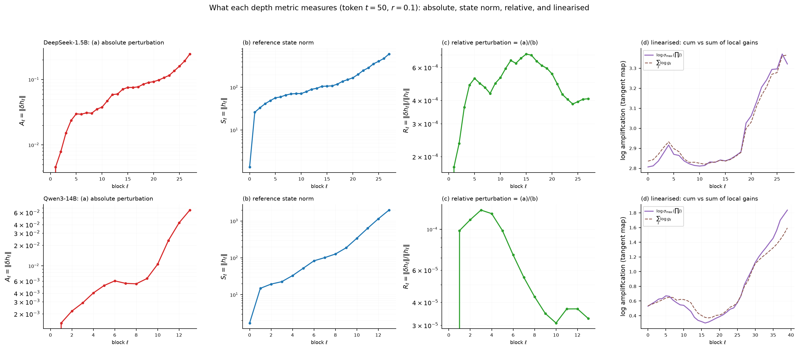

**Fig. B0 — the three metrics on the same two models ($t=50$, $r=0.1$).** (a) $A_\ell=\|\delta h_\ell\|$; (b) $S_\ell=\|h_\ell\|$; (c) $R_\ell=A_\ell/S_\ell$; (d) the linearised gain $\mathrm{cum}_\ell$ (solid) and the running sum of the local gains $\sum\log g_\ell$ (dashed). **Read:** DeepSeek-1.5B: $A$ grows $\times53$, $S$ grows $\times23$, so $R$ grows only $\times2.3$ and *non-monotonically* (it peaks in the middle and comes back down). Qwen3-14B: $A$ grows $\times44$ but $S$ grows $\times133$, so $R$ **falls** to $0.33$: the perturbation loses ground relative to the state. **This is the resolution of "block 0 does most of the amplification" versus "response grows with depth":** both are statements about $A$ (or about $\mathrm{cum}$), not about $R$.

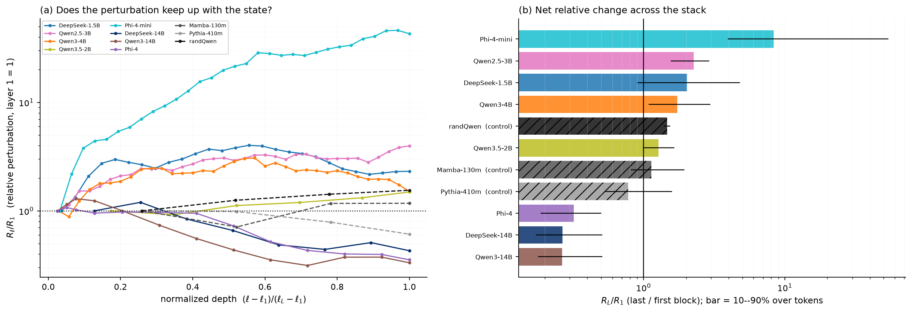

**Fig. B0b — the answer, all models.** (a) $R_\ell/R_1$ against normalized depth, all 8 LLMs and the 3 controls, $t=50$; (b) the net change $R_L/R_1$ (bar = median over tokens 2-60, whiskers = 10-90%). **Read:** ten of thirteen models stay inside a factor 0.35-4; **the three 14B models lose ground** (0.33-0.43) and only **Phi-4-mini** genuinely amplifies ($\times43$ at $t=50$, median $\times16$ over tokens). The random transformer is flat/slightly rising (1.5), Mamba 1.2, Pythia 0.6. **So a perturbation does not become more significant as it goes through the layers: it is roughly conserved relative to the state, and in the largest models it decays.** The absolute numbers in B6 look like amplification only because the residual stream grows.

Exact numbers ($t=50$, $r=0.1$; `pack_depth_relative_all.json`):

| model | $R_L/R_1$ | $A_L/A_1$ | $S_L/S_1$ |
|---|---|---|---|
| Phi-4-mini | **42.9** | 1880 | 43.8 |
| Qwen2.5-3B | 4.0 | 84 | 21 |
| DeepSeek-1.5B | 2.3 | 53 | 23 |
| randQwen (control) | 1.55 | 3.0 | 1.9 |
| Mamba-130m (control) | 1.17 | 17.5 | 14.9 |
| Qwen3-4B | 1.5 | 115 | 76 |
| Qwen3.5-2B | 1.5 | 13 | 8.9 |
| Pythia-410m (control) | 0.61 | 1.5 | 2.5 |
| DeepSeek-14B | 0.43 | 8.5 | 20 |
| Phi-4 | 0.35 | 94 | 266 |
| Qwen3-14B | 0.33 | 44 | 133 |

**How $\mathrm{cum}_\ell$ and $g_\ell$ fit together.** $g_\ell$ is the gain of *one block*; $\mathrm{cum}_\ell=\sum_{\ell'=0}^{\ell}\log g_{\ell'}$ along the tracked, re-orthonormalised frame, so $\mathrm{cum}$ is the running sum of the local gains (the two curves in panel (d) lie on top of each other). What does *not* hold is multiplying the per-block **maxima**: each block's optimal direction rotates (Fig. C3), so $\prod_\ell\sigma_{\max}(J_\ell)$ overestimates the real product by orders of magnitude. $\mathrm{cum}_\ell$ is the honest linearised object: the stack is mildly expansive ($\times4$-$\times50$), **block 0 does 50-90% of the work**, and each later block contributes $\approx1.0$-$1.1$.

**Vertical versus horizontal propagation — what each measurement contains.** A perturbation at layer $\ell$, token $t$ arrives from two places: (i) the same token at layer $\ell-1$ ("vertical", through the block), and (ii) earlier tokens $t'<t$ ("horizontal", through attention). The two probes separate them:

* the **depth probe** (B1, B4b-B4d) differentiates block $\ell$ at position $t$ with the attention keys/values of earlier positions captured and held fixed (the block is called with the exact kwargs of the reference forward pass). So $J_\ell$ is $\partial h_{\ell,t}/\partial h_{\ell-1,t}$ with the rest of the sequence frozen: **$\mathrm{cum}_\ell$ and $g_\ell$ measure the vertical path only**;
* the **finite-radius probe** (B0, B0b, B5, D3) compares a perturbed and a reference forward over the whole sequence, so it contains **both** paths; the horizontal part grows with $t$ (more perturbed tokens to attend to) and is what the window cuts off (E5).

That is why the two families are neither contradictory nor interchangeable, and it is the main methodological caveat of the depth analysis: to isolate the horizontal part you would have to perturb only the current position and leave the past untouched, which none of these runs do.

**Which figure to cite for "how are perturbations propagated across layers"?**

1. **B0b/B5** if the question is *does the perturbation become more or less significant* — the relative response;
2. **B6** if the question is *how large does it get in absolute terms* — but say that most of that is the residual-stream norm;
3. **B1** if the question is *is the layer stack linearly unstable* — the tangent map, an upper bound over directions;
4. **B7** if the question is *where in (token, layer) the perturbation actually lives*.

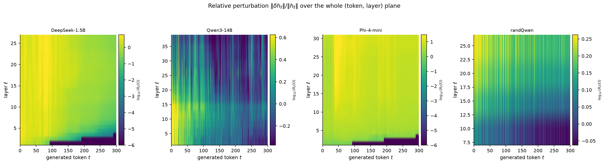

**Fig. B7 — the (token, layer) plane.** $\log_{10}R_\ell(t)$ for four models, all 300 generated tokens, every saved layer. **Read:** the relative perturbation is roughly constant along a column (a given token) and along a row (a given layer), except for the window staircase in the bottom rows (E5). There is no layer where it is preferentially created or destroyed; the structure is in $t$ (the window) and in the model scale, not in the depth.

## B.1 The figures behind the numbers


**Fig. B1 — the linearised depth gain (tangent map).** (a) $\mathrm{cum}_\ell=\log\sigma_1(J_\ell\cdots J_1)$ against normalized depth, median over 8–16 probe tokens and 8 directions; band = IQR over tokens. (b) Local gain $g_\ell=\langle\|J_\ell v_i\|\rangle_i$ against block. (c) $g$ in block 0, middle half, last 10%. **Data:** `run_depth2.py`/`run_depth_big.py`, Jacobian–vector products at one position, $k=8$; no perturbation radius. **Read:** product gain is $\times4$–$\times50$; block 0 alone is $\times3$–$\times17$ (50–90% of the log gain); later blocks are $0.98$–$1.13$ each. **This is the linearised statement; for significance use B0b.** **Trivial/not:** the old “stretched decay” was $1/\ell$ by construction; the new numbers are the measured product.


**Fig. B4 — every probe token.** $\mathrm{cum}_\ell$ for every probe token (8–16 per model), all 8 models. **Read:** the shape is stable across tokens, the scale varies by up to $\times2$. **Data need:** 8–16 tokens is enough for a median but not for the tails; the new $k=32$ run is in `results/update/depth_k32`.

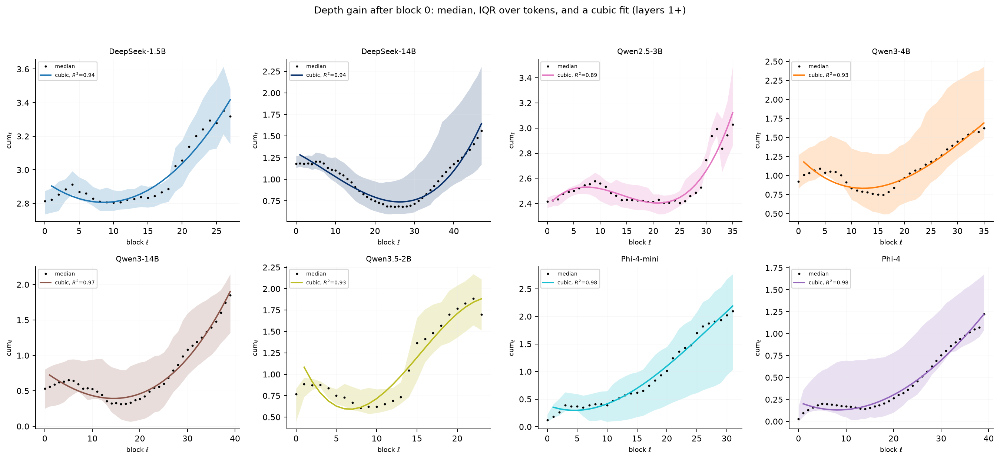

**Fig. B4b — fit to the depth curve after block 0.** Median $\mathrm{cum}_\ell$ (dots), IQR over probe tokens (band), and a cubic fit $\mathrm{cum}=a+b\ell+c\ell^2+d\ell^3$ over layers $\ell\ge1$ (solid). **Data:** same as B1. **Read:** the cubic is descriptive ($R^2=0.89$–$0.98$) but its coefficients are not a universal law. The one robust feature is positive curvature: the gain rises again in the last layers. **This replaces the rejected $1+Ae^{-\ell/\tau_1}+B e^{(\ell-L)/\tau_2}$ fit**, which forced a block-0 spike and did not describe Phi.


**Fig. B4c — the late-depth rise on its own.** (a) Local gain $g_\ell$ after block 0, divided by the median of the middle half, for every model. (b) The ratio $g_{\rm last10\%}/g_{\rm middle}$. **Data:** same as B1. **Read:** the ratio is 1.00–1.11; the rise is small but consistent for 7 of 8 models (Phi-4 is flat). **Trivial/not:** a 2–11% effect is not a dramatic law; it is a real, small regularity, and it is what makes a global fit curve upward.

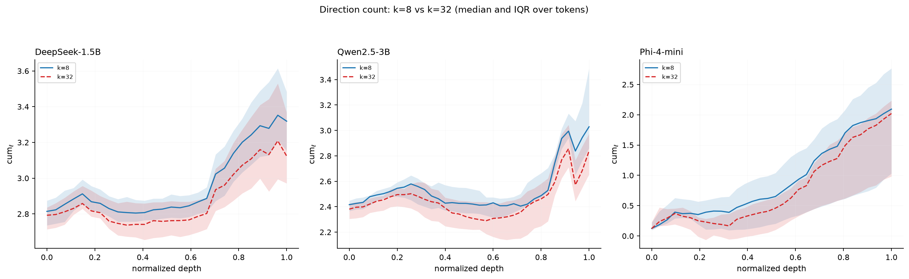

**Fig. B4d — direction-count check.** $\mathrm{cum}_\ell$ with $k=8$ (solid) and $k=32$ (dashed) tracked directions, median and IQR over tokens, for DeepSeek-1.5B, Qwen2.5-3B and Phi-4-mini. **Data:** `results/depth2/*` and new `results/update/depth_*_k32`. **Read:** the curves overlap within the token IQR; the direction count does not change the shape. **This is the distribution check you asked for.**


**Fig. B5 — relative response (original version; superseded by B0b and B5b).** $\|\delta h_\ell\|/\|h_\ell\|$ at $t=50$, normalized at layer 1, against $\ell/(L-1)$ for all models; band = IQR over directions (small models). **Definition:** the numerator is the response norm, the denominator the baseline state norm; the ratio says whether the perturbation grows *relative to the state*. **Read:** only Phi-4-mini amplifies (×20); DeepSeek peaks at ×3 then declines; 14B models end at 0.33–0.43 of layer 1; Qwen3.5 is flat. **Data:** A1 fp32/fp16 as in the tier table; big models from the compact summaries.

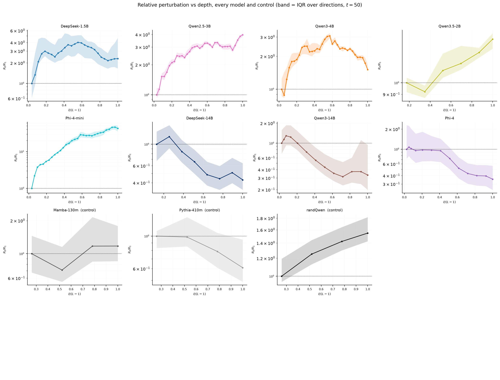

**Fig. B5b — every model with its own IQR band (the fixed version of B5: 14B bands and controls added).** $R_\ell/R_1$ vs depth, one panel per model, band = IQR over directions at $t=50$; the three controls are hatched. **Data:** A1 compact summaries, $r=0.1$; 14B models sampled at 9–14 layers; controls from `results_big_small/ctrl_*.npz`. **Read:** DeepSeek-1.5B peaks at $\times3$ in the middle and returns to $\times2.3$; Qwen3-4B is flat; the 14B models fall monotonically; Phi-4-mini is the only one that climbs by an order of magnitude; Mamba 1.2 and randQwen 1.5 are inside the trained-model range, Pythia 0.6 below it.


**Fig. B6 — the absolute response grows with depth in every trained model (but read B0b first).** (a) $\|\delta h_\ell\|$ at $t=50$ normalised first to the layer-1 response and then to the middle-layer response, against normalized depth, for all 8 LLMs and the 3 controls; (b) last/middle ratio. **Data:** A1 compact summaries, $r=0.1$; 14B models sampled at 9–14 layers. **Read:** every trained model rises by a factor **3.5–14** from mid to last layer (DeepSeek-1.5B 3.5, DS-14B 4.2, Qwen2.5 6.7, Qwen3-4B 7.1, Qwen3.5-2B 7.3, Qwen3-14B 11.7, Phi-4-mini 11.0, Mamba 14.3); the random transformer is flat (**1.7**) and Pythia nearly so (**1.2**). **Interpretation:** *this is magnitude, not significance.* The same models have $S_L/S_1=2.5$–$266$ (B0b), so most of this growth is the residual stream getting bigger; after dividing it out, the 14B models actually lose relative ground. The claim that survives is: **the absolute late-depth amplification is a property of the trained weights** (a randomly initialised transformer of the same shape does not have it, and Mamba, with no attention, does). **Caveat:** the layer-1 response is small, so the first points of the normalised profile are noisy; the last/middle ratio in (b) is the robust number.

---

# C. Geometry: angles, rotation, composition


**Fig. C1 — response-vs-state angle, all LLMs and controls.** Violin of $\angle(\delta h_\ell,h_\ell)$ at the last saved layer, $r=0.03$; white dot = median, vertical bar = IQR. **Data:** 64 directions for the small models (32 for controls) × 200–300 tokens; 24 directions for the 14B models. **Read:** medians 86.8°–91.4° for every model, including Mamba, Pythia and the random transformer. The *spread* is model-dependent, but the median is not discriminative. **Trivial/not:** the median 90° is the high-dimensional null; the response angle cannot separate trained models from controls.


**Fig. C2 — angle vs depth, LLMs and controls.** Median (band = IQR over directions/tokens) at every saved layer. **Read:** the angle stays near 90° at every layer for every model, including the controls. **Use:** this is the honest version of “the response is almost tangential”; the radial component is the measured part (Fig. C1), not the median angle.

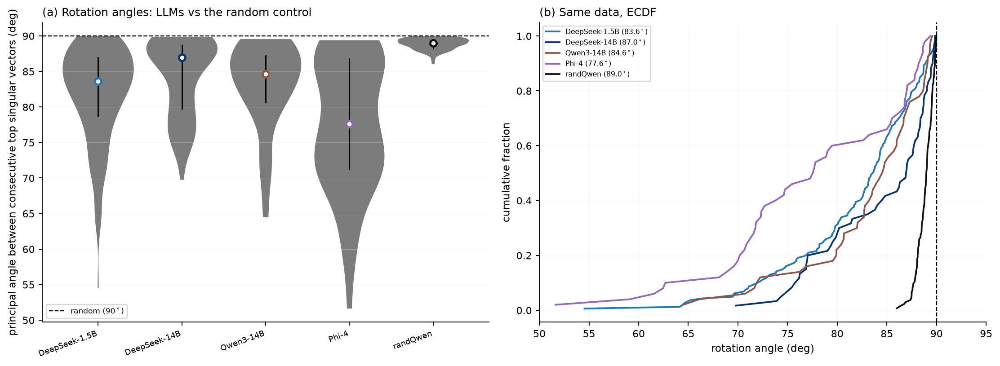

**Fig. C3 — rotation of the amplification direction, with a control.** (a) Violin of the principal angle between top singular vectors of consecutive block Jacobians; white dot = median, bar = IQR. (b) ECDF of the same. **Data:** `nonnorm.npz` for DeepSeek-1.5B/14B, Qwen3-14B, Phi-4 and the random transformer (5 tokens × saved layers). **Read:** trained models rotate by 78–87°; the random control is 89°; random directions are 90°. The trained models are measurably more aligned than random, but the effect is modest. **Why this matters:** every block can amplify ($\sigma_{\max}>1$), but the amplified direction changes from block to block, so a fixed vector sees the small common gain. The quantitative product comparison is in §K and in the earlier C3 panels (kept in `update_figures/pack_rotation_composition.png`).

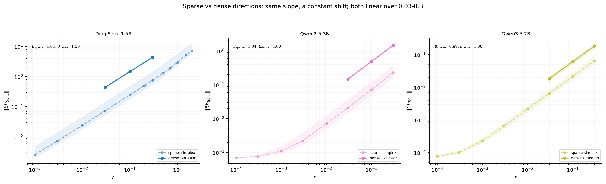

**Fig. C4 — sparse vs dense directions: the correct reading.** Absolute response $\|\delta h_{50,L}\|$ against $r$ for sparse simplex (dashed) and dense Gaussian (solid) directions, with IQR bands over directions. **Data:** fp32 runs `results/update/fp32_*` (sparse, 8 radii) and `results/update/dense_*` (dense, 3 radii, 128 dirs). **Read:** both ensembles are linear ($\beta\approx1$) over $r=0.03$–$0.3$; dense is a constant factor 3–10× *higher* at the same $r$. The sparse curve is not saturating in this interval; my earlier claim that it was came from comparing the old fp16 sparse runs to the new fp32 dense runs. Below $r\approx10^{-3}$ the sparse response hits the fp32 subtraction floor. **Consequence:** direction sparsity changes the *scale* of the response, not the exponent; the old $r_*$ values at $r=0.1$ are still probe-dependent because $r_*$ depends on $\delta m$, not $\delta h$.

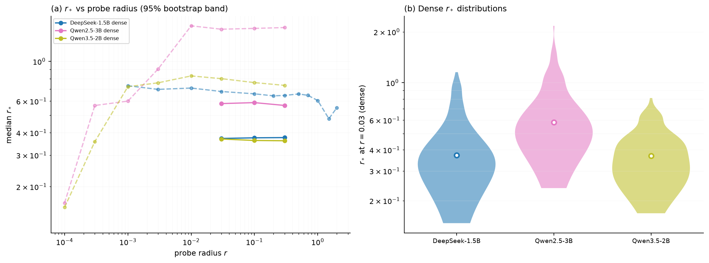

**Fig. C5 — comparable fragility.** (a) $r_*$ against probe radius, sparse (dashed) and dense (solid), 95% bootstrap band over directions; (b) dense $r_*$ distributions at $r=0.03$. **Data:** 128 dense directions, radii 0.03/0.1/0.3; Phi-4 dense from the Spark run (64 dirs, 4 radii). **Read:** dense $r_*$ is radius-independent: DeepSeek 0.37, Qwen3.5 0.36, Qwen2.5 0.58, Phi-4 1.21–1.28. Sparse $r_*$ moves with the probe radius. **This is the number to compare across models.** The dense distributions are broad and overlap; the medians differ by less than a factor 2 among the small models, and Phi-4 is about 2× more robust than Qwen2.5.

---

# D. Time dynamics


**Fig. D1 — response vs token, every model.** $\|\delta h_{t,L}\|/\|\delta h_{1,L}\|$ for a teacher-forced prompt perturbation, median over directions, last saved layer. **Data:** A1 runs; $r=0.1$ (Phi-mini 0.03), 300 tokens. **Read:** DeepSeek-1.5B decays to 0.2 by 300; Qwen2.5/Qwen3-4B/Phi-mini plateau; the 14B models plateau or decay slowly; none grows exponentially. **Precision:** the fp16 models' absolute values are floor-dominated; only the shape is meaningful.


**Fig. D1b — the same with controls.** All 8 LLMs plus Mamba-130m, Pythia-410m and the random transformer, last saved layer, normalized at $t=1$. **Data:** A1/compact runs and `results_big_small/ctrl_*.npz`, $r=0.1$, 300 tokens. **Read:** the controls lie inside the LLM band; Mamba and Pythia decay or stay flat; the random control is noisier and starts high. No system grows. **Use:** this is the figure that answers “missing controls” for the time series.


**Fig. D2 — network-only replay vs controls.** Same quantity for a *replay* run (the model is fed the recorded token stream) for three LLMs and three controls. **Data:** `results/softloop/*/T1e-9/replay`, 600 steps, 8–32 directions. **Read:** all six curves are flat or decaying; Mamba (no attention) carries the response as well as the transformers; Pythia decays; the random control starts high and stays high. **Not trivial:** it shows attention is not required to carry a perturbation; it is required for the long-range *transport* (Fig. I1).


**Fig. D3 — first/middle/last layer.** Same as D1 at the first, middle and last saved layer. **Read:** in DeepSeek the shallow layers flush first and the deep layers persist; in Qwen/Phi the layers move together.

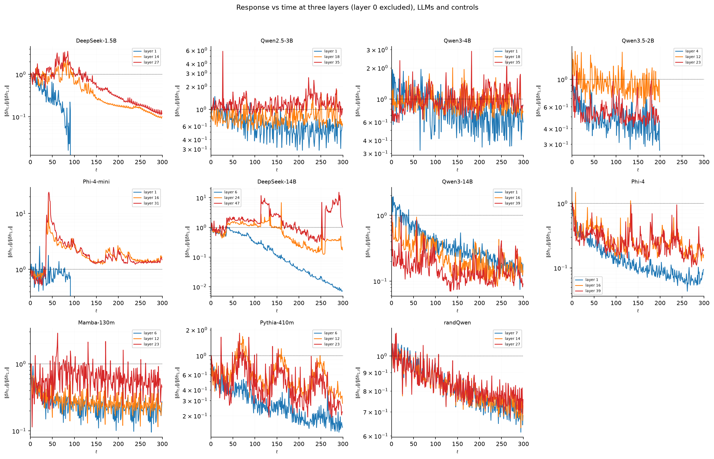

**Fig. D3b — layer-resolved response with controls.** Three layers (excluding layer 0), every LLM and control. **Data:** A1 runs from `results/rstar/<model>/p1` — **these are all $W=100$ runs with 300 generated tokens**, $r=0.1$, 512 directions, and layers include the first block, the middle and the last. **Read:** in every trained model the deep layer retains more of the perturbation than the shallow ones, and the ordering is the same in the controls (Mamba deeper > shallow; the random transformer is flat). **Careful:** because $W=100$, the shallow layers hit the window flush at $t^*_\ell$ inside the plotted range — that is the staircase in D3c and E4, not a model property. **The closed-loop analogue of this figure is F2d.**


**Fig. D3c — all saved layers, three examples.** Response vs time for every saved layer of DeepSeek-1.5B, Qwen3-4B and randQwen; colour = layer (colourbar). **Data:** A1/control summaries, $r=0.1$, 300 tokens. **Read:** the shallow layers decay fastest and the deep layers plateau; every layer overlaps in randQwen. No layer grows. **Each model has its own panel below (D3d–D3n).**


**Fig. D3d — DeepSeek-1.5B, every layer.** Layer colourbar on the right. **Read:** layers 7–21 flush toward 0.1–0.3; the last layer stays highest at ≈0.2–0.5. The layer ordering is monotone: deeper = more persistent.

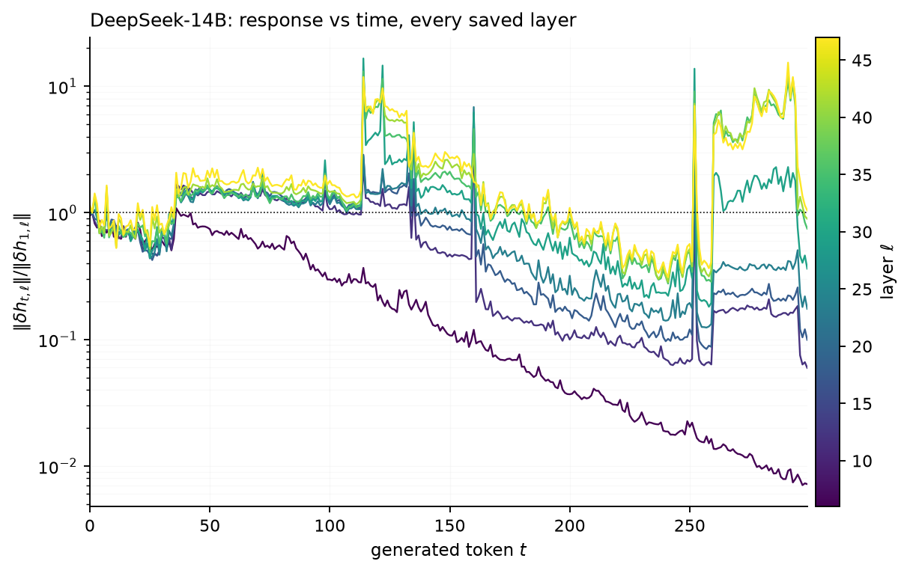

**Fig. D3e — DeepSeek-14B, every layer** (9 saved layers, 300 tokens). **Read:** same ordering as the 1.5B; the spread between shallow and deep is smaller.


**Fig. D3f — Qwen2.5-3B, every layer.** **Read:** monotone persistence with depth; the last layer stays at ≈0.5.


**Fig. D3g — Qwen3-4B, every layer.** **Read:** all layers stay within a factor 2 of each other; no layer amplifies over time.


**Fig. D3h — Qwen3.5-2B, every layer** (7 saved layers). **Read:** the deepest layer sits above the rest by ×2, the ordering is otherwise flat.

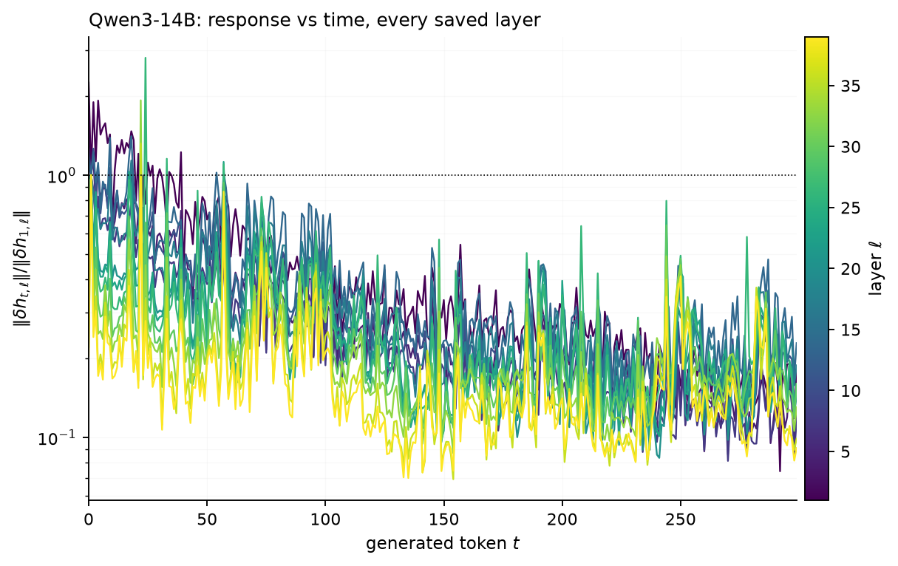

**Fig. D3i — Qwen3-14B, every layer.** **Read:** the clearest monotone depth ordering of the 14B models; the last layer stays at ≈0.8.

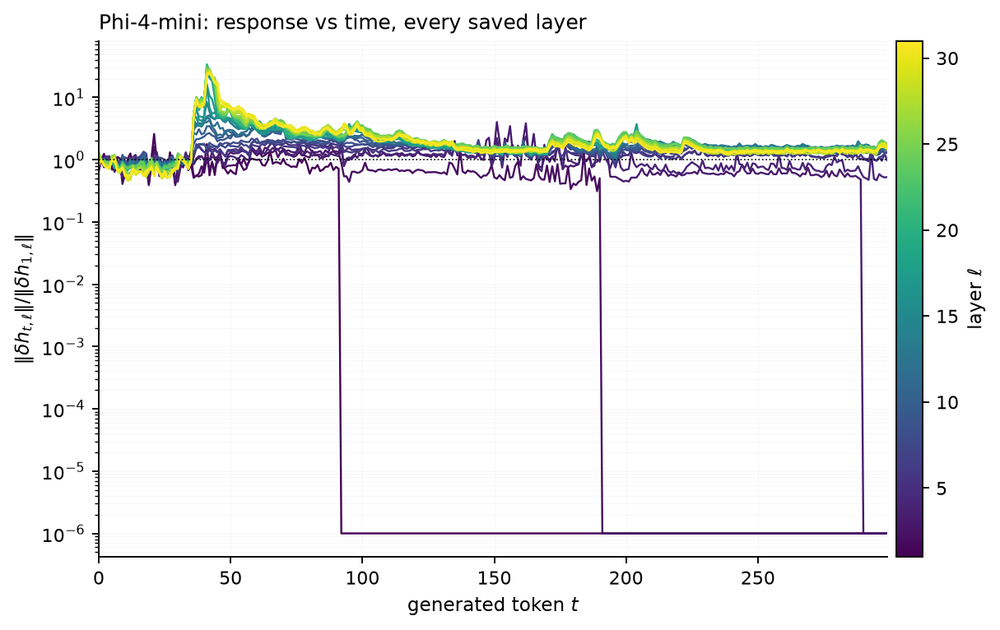

**Fig. D3j — Phi-4-mini, every layer.** **Read:** an initial *rise* (this is the model that amplifies relative to its own state norm, Fig. B5), then a slow decay; the deepest layer is highest.


**Fig. D3k — Phi-4, every layer.** **Read:** shallow layers decay fast, deep layers stay near 1: the same depth trend as the rest.


**Fig. D3l — Mamba-130m (control), every layer.** **Read:** deeper layers persist more than shallow, exactly as in the transformers — “deeper responds more” is not a transformer-specific property.

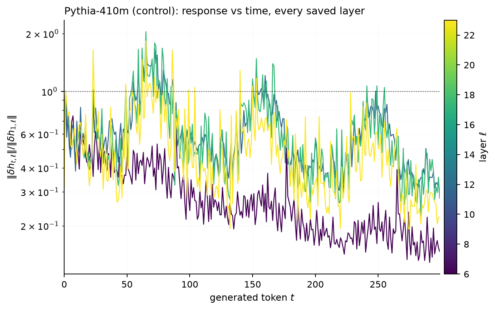

**Fig. D3m — Pythia-410m (control), every layer.** **Read:** all layers decay to ≈0.05; the depth spread is the smallest of all models, consistent with its near-flat last/middle ratio (1.2, Fig. B6).

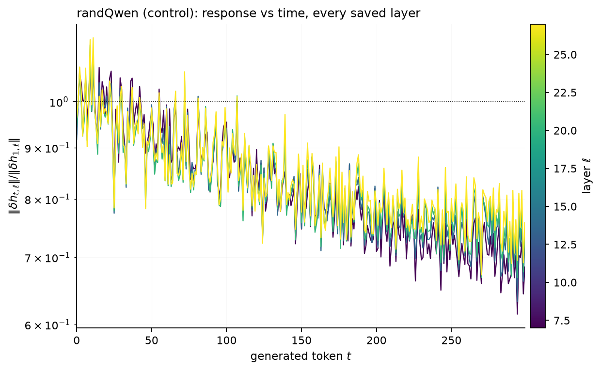

**Fig. D3n — randQwen (control), every layer.** **Read:** this is your observation, quantified: all layers collapse onto a single band (0.6–1.1) that decays together, with no depth ordering. The trained models' monotone depth ordering (D3d–D3m) is therefore a property of the learned weights, not of the architecture or of depth per se.


**Fig. D4 — finite-time exponent.** (a) Response shape normalized; (b) replay vs controls; (c) $\Lambda(\tau)=\frac1\tau\log(a_{t+\tau}/a_t)$ against $\tau$ with error bars; (d) late rate $\lambda_{20}$. **Data:** A1 + replay. **Read:** $\Lambda(\tau)$ converges to $\le0$ for every system; no positive plateau. **Trivial/not:** the late-rate values are all within $\pm0.01$; the measurement is that a positive rate does not survive averaging. **Controls:** Mamba $-0.0008$, Pythia $-0.0019$, random $-0.0007$.


**Fig. D5 — 4000-token horizon, rebuilt from raw data.** (a) Response vs $t$ on a lin–log axis; (b) log–log; (c) local 20-token rate. **Data:** `results/local_data/a1_4k_test.npz`, 2 directions, 4 layers, $r=0.1$, last layer. **Read:** the response decays and fluctuates around a small floor; no sustained positive rate. **Trivial/not:** the decay is not a clean exponential; the measurement is that it never grows.


---

# E. Sliding window

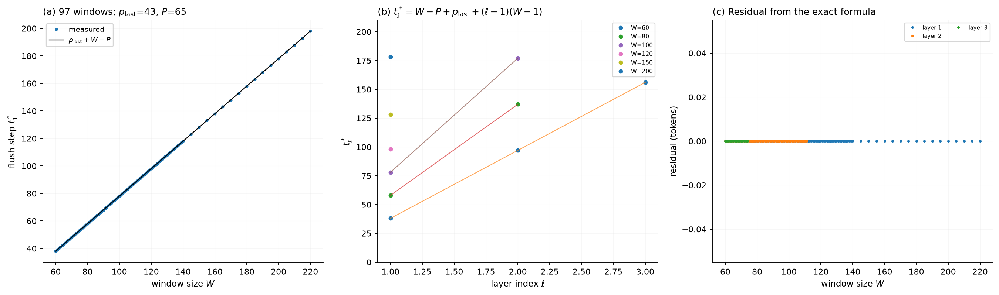

**Fig. E1 — the exact window formula.** (a) Flush step $t^*_1$ vs $W$ for 97 windows; the line is $p_{\rm last}+W-P$, where $p_{\rm last}=43$ is the last prompt position carrying a nonzero perturbation and $P=65$. (b) $t^*_\ell$ vs layer for several windows; lines are $t^*_\ell=W-P+p_{\rm last}+(\ell-1)(W-1)$. (c) Residual from that formula: zero to the token for every measured layer/window. **Data:** `results/local_data/wspec/w*/a1.npz`, 106 windows $W=60$–$265$, 7 layers, 4 directions, 200 tokens. **Read:** the law is exact, not fitted. **The constant is not mysterious:** $t^*_1-p_{\rm last}-W+P=0$; my earlier “$W-22$” is just $p_{\rm last}-P=-22$. The perturbation support is sparse, so only positions up to $p_{\rm last}$ are perturbed.


**Fig. E1b — the same formula on Qwen3-4B/Phi-4-mini.** (a) $t^*_1$ vs $W$; (b) $t^*_\ell$ vs layer. **Data:** `window4d/*/w*/a1.npz`; $p_{\rm last}=55$, $P=64$. **Read:** both models follow the same law with their own $p_{\rm last}$. **Interpretation:** the perturbation does not vanish at $W-P$; the last perturbed *generated* token carries it, and each layer adds one window of memory.


**Fig. E2 — the same law on Qwen3-4B/Phi-4-mini, and why it cannot be resolved here.** (a) $t^*_\ell$ vs layer at $W=100$; (b) three windows; (c) the $(\ell,W)$ map, colour = $t^*_\ell$ (colourbar added). **Data:** `window4d/*/w*/a1.npz`, 11 saved layers, 6 directions, $r=0.1$, 300 generated tokens. **Read:** with $P=64$ and $p_{\rm last}=55$, the law predicts $t^*_1=W-9$ and $t^*_\ell=t^*_1+(\ell-1)(W-1)$; at $W=100$ that is already $t^*_2=190$ and $t^*_3=289$, so **every layer above the first hits the 300-token run length** — that is the flat top in (a)/(b) and the saturated cells in (c). Only the first layer and the smaller windows are measurable here, and they obey the law exactly. The two-model layer-resolved test is therefore done on DeepSeek-1.5B, where 106 windows and smaller $W$ keep $t^*_\ell$ inside the window (E1, E1b). **This panel set is kept for completeness; E1b is the figure to cite.**


**Fig. E3 — token agreement and its fit (onset excluded).** (a) Fraction of tokens identical to $W=4096$ for each window, with a stretched-exponential fit $f_\infty+(1-f_\infty)e^{-(t/\tau)^\beta}$ (dashed) started **at the first token where the agreement drops below 1** (dotted vertical line), not at $t=0$. (b) $1-\mathrm{agreement}$ on a log axis. **Data:** `results/window_tokens/tokens.npz`, 8 windows, 300 tokens, no perturbation. **Read:** the onset of disagreement is exactly $t_{\rm onset}=W-P$ (35, 85, 135, 235 for $W=100,150,200,300$, $P=65$) — the same clock as the flush law. The decay after onset is stretched-exponential with $\beta\approx1.7$–$4$ and $\tau\approx90$ ($W=100$), $162$ ($W=150$), $218$ ($W=200$). **Why the earlier fit looked wrong:** it was fitted from $t=0$, through the flat plateau, which dragged $f_\infty$ and $\tau$; excluding the plateau fixes the shape. $W=60<P$ is excluded from the fit because the window clips the prompt itself and the text differs from $t=0$.


**Fig. E4 — measured attention mass on the prompt.** (a) DeepSeek, four windows, median over heads (band = IQR over heads); (b) $W=100$, four models. **Data:** `run_attention_frac.py` with the **correct 4-D window mask**, 200 generated tokens, layers 0/7/14/21/27. **Read:** at $t=0$ the mass is high (0.9); it decays as the model shifts to generated tokens. For $W=100$ it drops sharply at $t\approx99$, when the **last prompt token (position 64, perturbed or not)** leaves the window. The response flush is earlier, at $t^*_1=p_{\rm last}+W-P=43+100-65=78$, because only the *perturbed* prompt positions (up to $p_{\rm last}=43$) matter. With $W=4096$ there is no mask cut; the mass decays gradually and never reaches zero in 200 tokens. **This is the real version of the old schematic “attention weight fraction” panel, and it resolves the apparent contradiction with the window formula.**

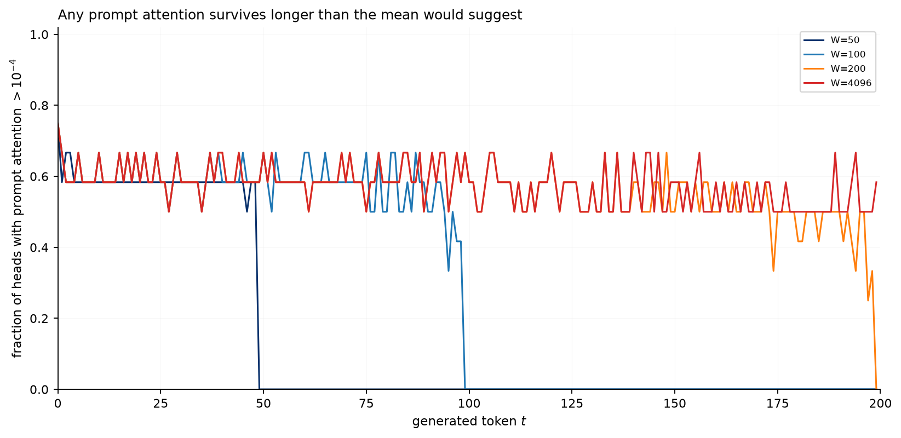

**Fig. E4b — any head still attending.** Fraction of heads with prompt attention $>10^{-4}$ vs $t$, DeepSeek, four windows. **Read:** a small number of heads keep a trace of the prompt longer than the mean suggests; for $W=4096$ some heads still attend at $t=200$. **Why this does not contradict the formula:** the formula is about the response at layer 1 becoming exactly zero when no *perturbed* token is in the window; it is not a statement about the total prompt-attention mass.

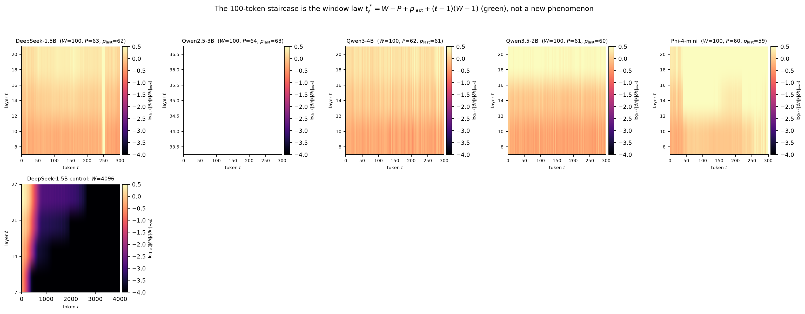

**Fig. E5 — the "drop every ~100 tokens" is the window law, not a new phenomenon.** For each small model, $\log_{10}\|\delta h\|$ over the whole (token, layer) plane, at $W=100$ (all the A1 runs used $W=100$). Green dashed lines: the predicted flush $t^*_\ell=W-P+p_{\rm last}+(\ell-1)(W-1)$ for layers 1–3. Bottom-left panel: the same measurement with $W=4096$, where no staircase appears. **Read:** the staircase is present in **every** model with a $W=100$ run and its steps land on the predicted $t^*_\ell$ to within a token or two. **Answer to your question: no, this does not invalidate the formula — this *is* the formula.** It is easier to see in DeepSeek-1.5B and Phi-4-mini because their response stays above the numerical floor long enough for the ladder to be visible; in the other small models the perturbation has decayed below the floor before layer 2/3 flushes. The 14B runs used no window ($W=0$/4096), which is why Qwen3-14B/DeepSeek-14B show vertical stripes (token-to-token variation) instead of steps. **Qwen3.5-2B:** its all-layer $W=100$ run is queued (its fp16 path crashes in cuDNN, so it runs in fp32).

**On $\delta h_t/\delta h_1$ versus $\delta h_t/\delta h_0$.** $\delta h_0$ is the perturbation *at the token embedding*, and for teacher-forced/replay runs it is **exactly zero for every generated token** (measured: all entries of `dh_norm` at layer 0 are 0.0 for all radii, directions and tokens). The new token's embedding is a vocabulary lookup, identical in the perturbed and reference rows; the perturbation can only enter through attention, i.e. at block 1. So $\|\delta h_t\|/\|\delta h_0\|$ is $0/0$; $\delta h_1$ is the only meaningful reference, and it is exactly where the perturbation first appears. In the **closed loop** this changes: the fed embedding is a mixture of the perturbed logits, so $\delta h$ at layer 0 is *nonzero* (measured $\approx10^{-4}$–$10^{-3}$ relative). That difference is the mechanism, and the dedicated layer-0 runs are queued.


---

# F. The soft loop: definitions, controls, and the result

This section is written to be unambiguous. Every mode below is the *same* forward pass with the *same* weights, batch layout and prompt; they differ only in **what is fed in at the next position**.

## F.1 The algorithm, in full

One run processes a batch of $K+1$ rows in parallel:

* **row 0** is the *reference*: the prompt is unperturbed.
* **rows $1\ldots K$** are $K$ independent perturbation *directions*: each row has the same prompt with a different sparse perturbation of norm $r$ added to the prompt embeddings ($K$ = 8 in the 2026‑11 campaign, 256 in the v3 campaign).

A **step** is one generated position, i.e. one forward pass that produces the logits for the next token. There is no separate notion of "layer steps"; layers are inside the forward pass.

```
E_prompt = embed(prompt_ids)                      # (P, d)
E_rows   = E_prompt.repeat(K+1, 1, 1)
E_rows[1:] += r * direction_k                     # perturb rows 1..K only

fed[0] = last prompt embedding                    # start of the generated sequence
for t in 0 .. T-1:
    z      = model(fed[0..t])[:, -1, :]           # (K+1, V)  logits at position t
    p      = softmax(z / T)                       # (K+1, V)
    e_ref[t] = fed[0][t]                          # what row 0 actually received
    fed[t+1] = RULE(p, e_ref[t], t)               # <-- the ONLY difference between modes
```

| mode | `RULE`: what every row feeds at the next position | what it is |
|---|---|---|
| **soft** (closed loop) | $e = \sum_v p_k(v)\,E_v$ — row $k$ feeds **its own** expected embedding | mean feedback from its own distribution |
| **replay** (network only) | $e = e_{\rm ref}[t]$ — the recorded input of row 0 | the feedback is removed; only the prompt perturbation remains |
| **CRN** | sample one token $v^\*$ from $p_0$ (the **reference** row), feed $E_{v^\*}$ to **every** row | hard token, sampling noise identical across rows |
| **independent** | each row samples its own token $v_k\sim p_k$, feeds $E_{v_k}$ | ordinary sampled generation |
| **teacher forcing (A1)** | hard token ids from a greedy run, fixed in advance | no feedback, no sampling at all |

**What "readout" means.** The readout is the map from the last hidden state to the vocabulary: $z=W_U\,\mathrm{norm}(h_L)+b$ (the unembedding). "The instability lives in the readout" means: the *hidden* perturbation $\delta h_L$ is harmless by itself; it matters because it changes $z$, hence $p$, hence (in the soft loop) the vector $e$ that is fed at the next position. The readout is the *gate* through which a hidden perturbation re-enters the input stream. "Gate open" ($m_t<T$, with $m_t$ the top1$-$top2 logit margin) means $\mathrm{softmax}$ is sensitive to that change; "gate closed" ($m_t\gg T$) means the same logit change barely moves $p$.

**What each control removes, and what it therefore licenses you to conclude:**

| comparison | difference | if the loop grows and this does not, you learn |
|---|---|---|
| soft vs **replay** | where the fed vector comes from (own distribution vs frozen reference) | the growth needs the perturbation to reach the readout *and* to change the input; the network alone is innocent |
| soft vs **CRN** | mean feedback vs one hard token shared by all rows | the growth is not caused by the *sampling* of a token; it needs the *mean* (the full distribution) |
| **CRN** vs **independent** | shared vs per-row sampling noise | whether sampling noise alone can separate rows (it can, but only to $O(1)$, not $10^2$) |
| soft vs **teacher forcing** | closed feedback vs a fixed greedy token stream | the same contrast as replay, but with hard tokens at every $T$ — this is the standard "autoregressive generation" baseline |

Note the axes are independent: *what is fed* (expected embedding vs token), *where it comes from* (own row vs reference), and *how it is chosen* (mean vs sampled). The closed soft loop is the only cell that has **all three** of: own row, expected embedding, deterministic mean.

**Do we compare against non-looped autoregressive / teacher-forced generation?** Yes — that is the whole D series: A1 feeds the model a *fixed* greedy token stream (teacher forcing) and perturbs only the prompt; it never loops. Replay is its soft-token analogue. The claim "autoregressive and teacher-forced generation do not amplify" is exactly those runs; the loop runs are the contrast.


**Fig. F1 — the closed loop vs the replay, all temperatures (old 200-step version, kept).** Response for the soft loop (solid) and the replay (dashed), colour = temperature. **Read:** closed loops grow by $10^2$–$10^4$; replays stay at 1 or decay. **Superseded by F2 below** (3000 steps, matched pairs, per-direction bands).

## F.2 The result: the loop amplifies, the network alone does not


**Fig. F2 — closed loop vs replay, every model, $T=1$, 1600–3000 steps.** Median over directions (solid = closed, dashed = replay), band = IQR over directions, log–log. **Data:** `results/longloop/*` (8 dirs) plus `results/longloop_v3b/*` (32 dirs per chunk × 4 chunks); the code pools every matched loop/replay pair and reports how many directions it used. **Read:** the closed loop rises by $10^1$–$10^4$ and *saturates*; the replay decays to $0.03$–$1$. Every trained model does this; the random control does it too, but 2–3 orders of magnitude less. **Note the first point is exactly 1** — both curves are normalised at $t=1$, so the earlier apparent offset was a smoothing artefact and is fixed (no smoothing is applied here). **On the random control (your question):** its $L(t)$ is fitted almost perfectly by the saturating form ($R^2=0.99$) with $\tau=1428$ steps, i.e. half the run length, so over 3000 steps it is indistinguishable from a *pure exponential* $L=\lambda t$ with $\lambda=0.0026$ nats/step. That is expected and is the signature of a model whose gate never closes: its margin is 0.09 nats, it never enters confident repetition, never self-regulates, and keeps growing at a constant rate. The trained models have $\tau=17$–$350$ and visibly bend over inside the run. So the random control *is* exponentially unstable, but 30× slower, with no saturation mechanism.


**Fig. F2b — one model in full: DeepSeek-1.5B.** Left: response, closed vs replay, with IQR over directions. Right: the feedback gain $L(t)=\log(a_{\rm closed}/a_{\rm replay})$, computed **per direction** and then summarised (green = median, band = IQR over directions), with the fit $L(t)=L_\infty(1-e^{-t/\tau})$. **Read:** $L$ starts at exactly 0 (both curves are 1 at $t=1$), rises with $\tau\approx56$ steps, and saturates at $L_\infty=7.8$ nats ($\times2400$). **About the fit:** there is no free offset $y_0$ — it is 0 by construction, and allowing it only absorbs the first few points. The estimated parameters are $L_\infty$ (how much) and $\tau$ (how fast); $R^2$ is reported.

*The same figure for every model* — the per-model versions are `pack_loop_<tag>.png` in `update_figures/`: DeepSeek-1.5B (above), Qwen2.5-3B, Qwen3-4B, Qwen3.5-2B, Qwen3.5-9B, Phi-4-mini, DeepSeek-14B, Qwen3-14B, Phi-4, Mamba-130m, Pythia-410m, randQwen. They all have the log-ratio panel now (the earlier missing panels were a directory-matching bug, fixed by pairing each loop with the replay from the *same* directory).

| model | directions | steps | $L_\infty$ (nats) | $\tau$ (steps) | $R^2$ | $\times$ at end |
|---|---|---|---|---|---|---|
| Mamba-130m | 16 | 3000 | 11.1 | 46 | 0.40 | 100\,261 |
| DeepSeek-1.5B | 16 | 3000 | 8.0 | 62 | 0.85 | 3\,440 |
| DeepSeek-14B | 8 | 1600 | 6.0 | 209 | 0.77 | 336 |
| Qwen3-14B | 8 | 1600 | 6.5 | 228 | 0.77 | 589 |
| Phi-4 | 8 | 1600 | 6.7 | 255 | 0.77 | 521 |
| Phi-4-mini | 24 | 3000 | 5.3 | 66 | 0.75 | 205 |
| Pythia-410m | 24 | 3000 | 6.4 | 331 | 0.49 | 180 |
| Qwen3-4B | 8 | 3000 | 4.8 | 17 | 0.46 | 119 |
| Qwen3.5-9B | 40 | 1600 | 3.7 | 244 | -0.08 | 45 |
| randQwen | 24 | 3000 | 3.7 | 1428 | 0.99 | 24 |
| Qwen2.5-3B | 16 | 3000 | 2.3 | 473 | 0.38 | 15 |
| Qwen3.5-2B | – | – | – | – | – | (no matched pair yet) |

The $R^2$ column matters: for Qwen2.5-3B, Qwen3-4B and Qwen3.5-9B the growth is *not* a clean saturating exponential (they jump in a few steps), so $L_\infty$ and $\tau$ are only indicative there.


**Fig. F2c — the same gain, layer by layer.** $L(t)$ computed at each saved layer (first, middle, last, plus intermediates). **Read:** for the transformer LLMs the curves **lie on top of each other** — the feedback amplification is *depth-independent*. That is what you expect if the perturbation is re-injected at the input of each step and then carried through the same stack: every layer sees the same injected offset. Mamba, Pythia and the random control are the exceptions (their layers separate). **Consequence for the paper:** the loop instability is a *token-level* effect, not a layer-level one; "where in the stack" is the wrong question for the loop (it is the right question for the prompt perturbation, §B).


**Fig. F2d — the closed-loop response at the first, middle and last saved layer (the loop analogue of D3b).** Solid = closed loop, dashed = replay, colours = layers, $W=4096$. **Read:** same message as F2c: all layers move together. Qwen3-4B and Phi-4-mini show a brief overshoot at the earliest layer, then collapse onto the common curve.

## F.3 Why it saturates: gates, and what the loop ends up generating


**Fig. F3 — the gate picture (no shading now).** Red, left axis: response $a_t$; blue, right axis: the reference row's top1$-$top2 margin $m_t$ (21-step median), $T=1$. **Read:** growth happens while $m_t\lesssim T$; when the margin rises above $T$ and stays there, the growth stops. DeepSeek-1.5B: rises for ~300 steps, then the margin sits at ≈10 nats and $a_t$ is flat for 2700 steps. Phi-4-mini and Mamba lock in after a single episode. **The random control never locks in** (margin 0.09 nats), which is why it is the only model whose gain keeps growing over the whole 3000 steps. **Important caveat:** the gate state predicts *when growth happens*, but it does not undo growth that already happened — see F3b.


**Fig. F3b — the same at 14B.** **Read:** a single gate episode at $t\approx200$ lifts the response to $\times200$–$350$ and it stays there for the remaining 1400 steps, even though the margin later falls below $T$ many times. So the amplified state is not undone when the gate reopens; the orbit has moved to a different self-consistent trajectory and the perturbation rides at that trajectory's amplitude. I previously called this a "one-shot ratchet"; plain language: **the loop switches to a different regime and stays there.**


**Fig. F4 — what the loop generates once it saturates.** (a) exact token period of the reference orbit over the last 300 steps ($p=1$ = the same token forever, "none" = no period ≤ 24); (b) $\|e_t-e_{t-\Delta}\|$ vs lag — dips at $\Delta=p$ are cycles; (c) number of distinct tokens in the last 300 steps, with the median margin. **Data:** `top1_ref` and `e_ref` saved by `run_softloop.py`; decoded with each model's tokenizer (`results/loop_repetition_tokens.json`). **Read:**

| model | period | what it repeats (decoded) | distinct tokens |
|---|---|---|---|
| Qwen2.5-3B | 1 (fixed point) | `" propulsion"` ×100 | 1 |
| randQwen | 1 (fixed point) | `"orse"` ×100 | 1 |
| Mamba-130m | 3 | `"\nA\n"` | 2 |
| Phi-4 | 2 | `"acja uw"` | 2 |
| Qwen3.5-9B | 2 | `":\n\n"` | 2 |
| Phi-4-mini | none ≤24 | repeats a 40-token paragraph: *"…The current propulsion systems for interstellar travel are still in development, but they have the potential to revolutionize our understanding of the universe…"* | 26 |
| DeepSeek-1.5B | none ≤24 | re-writes the prompt's instruction: *"…in terms of safety, technological, and other factors. Also, if you can, include a discussion of the potential benefits of each propulsion system…"* | 27 |
| Qwen3-4B | none | **keeps writing coherent text**: *"4. **Communication and Control** — 20-year round-trip to Proxima → no real-time control…"* | 163 |
| DeepSeek-14B | none | coherent-ish markdown summary, mildly degenerate | 160 |
| Qwen3-14B | none | semi-coherent, drifting | 147 |
| Pythia-410m | none | newlines and punctuation | 12 |

**So "the loop saturates because it repeats" is only half true.** Seven of eleven models collapse to a token fixed point or a short cycle ($p\le3$); the others keep producing text (Qwen3-4B even coherent text) while the *gain* still saturates. The saturation is therefore not caused by literal repetition; both are consequences of the orbit landing on a self-consistent trajectory. **If you want one sentence for the paper:** the closed loop is a dissipative system that converges to an attracting orbit (often a token cycle); the perturbation saturates at the size of the offset between the perturbed and reference orbits on that attractor.

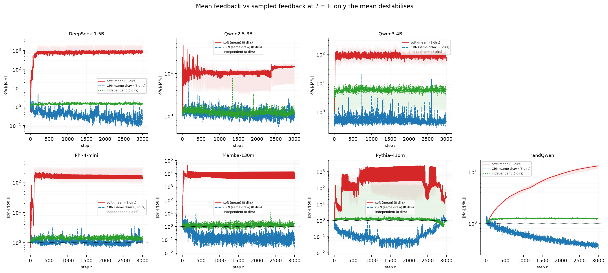

**Fig. F5 — mean feedback vs sampled feedback, 3000 steps.** Soft (mean, red), CRN (same sampled token for every row, blue), independent (green). **Read:** soft grows by $10^1$–$10^4$; CRN stays at or below 1 (0.03–1.3); independent stays within 0.8–6. **Conclusion:** the instability is produced by the *mean* feedback — by feeding the full distribution back — not by the fact that a token is sampled. CRN is the clean control: every row receives the *identical* token stream, so any difference between rows is pure state dynamics, and there is none.

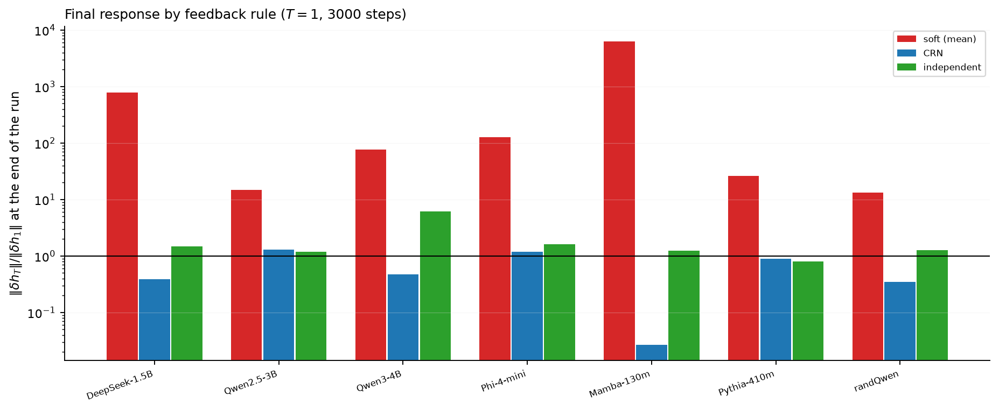

**Fig. F5b — the same as end-of-run bars.** Soft 13–6215×, CRN 0.03–1.3×, independent 0.8–6×. Note that independent sampling does separate rows somewhat (up to $\times6$ for Qwen3-4B) — ordinary sampled generation is not perfectly stable — but it is 2–3 orders of magnitude below the mean-feedback effect.

## F.4 Temperature and window

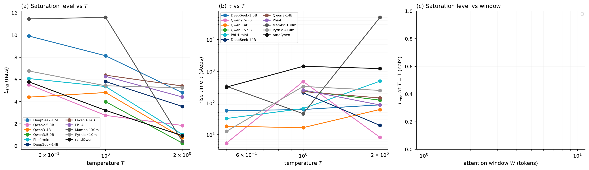

**Fig. F6 — does $L_\infty$ or $\tau$ depend on $T$ or $W$?** (a) $L_\infty$ vs $T$; (b) $\tau$ vs $T$; (c) $L_\infty$ vs attention window $W$ (from the W-sweep runs). **Read:** $L_\infty$ is roughly flat from $T=0.5$ to $1$ for most models but **drops at $T=2$** for several (Phi-4-mini 5.3→0.6, Mamba 11.2→0.4, Qwen3-4B 4.8→1.1, randQwen 4.0→0.35), consistent with the gate strength $\sigma_{\max}\propto1/T$ at fixed margin. $\tau$ is not monotone in $T$. The window dependence is the weakest of the three (the prompt is 63 tokens; $W$ only matters after $t\gtrsim W$).

**Correction to an earlier claim.** The previous version said "any soft feedback gives the same gain; greed does not" (old F21). That was based on a tail statistic at 600 steps for one model. With matched pairs and a proper fit, the picture is: $T\to0$ gives $L=0$ (the loop becomes greedy and equals teacher forcing), and for $T\ge0.5$ the gain is **model-dependent in $T$**, with a clear decline at $T=2$ for about half the models. The DeepSeek-1.5B statement (8.9 / 7.8 / 6.0 nats at $T=0.5/1/2$) survives; the generalisation does not.

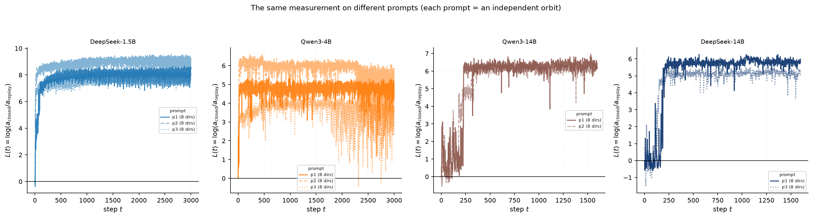

**Fig. F6b — the same measurement on different prompts.** One curve per prompt (ds15, Qwen3-4B, Qwen3-14B, DeepSeek-14B; prompts 1–3, 8–64 directions each). **Read:** the curves are nearly identical across prompts. $L_{\rm end}$: DeepSeek-1.5B 7.9 / 8.1 / 9.0, Qwen3-4B 3.5 / 4.8 / 4.7, Qwen3-14B 6.1 / 6.4, DeepSeek-14B 5.2 / 5.8. **So the loop gain is a property of the model, not of the prompt** (spread $\pm10$–20% against a factor 2–3 between models). **Methodology:** pooling prompts is the right replication unit — the directions inside one run share the same orbit, so the direction-IQR underestimates the true uncertainty of $L_\infty$; the prompt spread does not. This is why the table in F.2 should be read as "one orbit per model" and why the campaign is adding prompts for every model.

**A measurement that is still running (top-$k$ rotation).** Fig. C3 uses the *top-1* singular vector of each block Jacobian, which is fragile when two singular values are nearly equal: if they swap, the angle jumps to 90° without any real change of the operator. The robust version compares the top-$k$ *subspaces* ($k=1,3,10$) and, more importantly, measures the **alignment of the actual perturbation $\delta h_\ell$ with that subspace** (not of the state). The probe (`chaos_llm/run_topk.py`, subspace iteration with JVPs only) runs on x11 and Spark after the direction campaigns; `analysis_update/pack_topk.py` turns it into `pack_topk.png`. The prediction from the theory is that (i) the rotation angle *decreases* with $k$ (the near-degeneracies are absorbed) and (ii) the perturbation is only partly aligned with the top subspace, which is why a fixed direction does not see the per-block $\sigma_{\max}$.


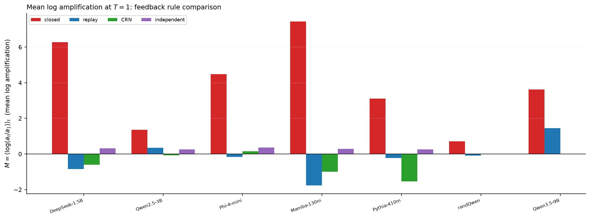

**Fig. F7 — mean log amplification.** $M=\langle\log(a_t/a_1)\rangle_t$ over the whole run, median over directions, at $T=1$; bars are closed loop, replay, CRN and independent. **Data:** `results/softloop*` / `results/longloop*`, 300-3000 steps. **Read:** the closed loop has $M=1$-$7$ nats; replay and CRN sit at 0 or below; independent sampling is near 0. **It integrates the whole trajectory**, so it does not depend on where the curve saturates, but it is still horizon-dependent.

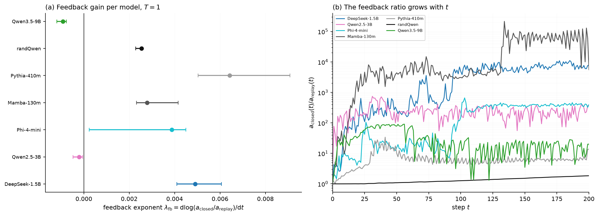

**Fig. F7b — the feedback exponent.** (a) $\lambda_{\rm fb}=\mathrm{d}\log(a_{\rm closed}/a_{\rm replay})/\mathrm{d}t$ per model at $T=1$ (median and IQR over directions). (b) The ratio $a_{\rm closed}/a_{\rm replay}$ vs $t$. **Data:** same orbit in both runs. **Read:** $\lambda_{\rm fb}=0.002$–$0.006$ nats/step for most models, negative for Qwen2.5/Qwen3.5; the ratio still grows because replay decays while the closed loop stays flat or grows. **Interpretation:** the loop instability is not a clean exponential; it is a staircase of gate events on top of a slowly growing ratio. This is why a single “Lyapunov exponent” is not the right summary.


**Fig. F8b — live-gate density across models.** Density $P(m_t<T)$ vs $T$, sorted by $T$ (the lowest-temperature point is not connected to the highest). **Data:** `results/softloop*`, 300–600 steps, 8–32 directions, one orbit per $({\rm model},T)$. **Read:** the density is 0 below $T\approx0.2$ and $\approx1$ above $T\approx2$; the rise is at $T\approx1$ for trained models and at $T\approx0.13$ for the random control. **Why the old panel (b) is deleted:** horizon vs density does not collapse across models; the same density gives a 10× different horizon, and a two-parameter fit gives $R^2=0.20$. Density alone is not the order parameter.


**Fig. F8c — the gate density is a margin distribution.** (a) $P(m_t<T)$ vs $T$ on linear axes; (b) median margin $\bar m$ vs $T$ on log axes; (c) the pooled margin distribution per model (bar = IQR, thin line = 5–95%, dot = median). **Data:** same as F3b, all temperatures pooled. **Read:** the "gate-opening temperature" is just the median margin in temperature units, and the median margin separates the control from every trained model by an order of magnitude: **randQwen 0.11 nats** vs 1.5 (Qwen2.5), 1.6 (Qwen3.5-9B), 1.8 (DeepSeek-1.5B), 1.9 (Phi-4-mini), 3.1 (Qwen3-4B), 3.5 (Qwen3.5-2B), 6.1 (Mamba, Pythia). **About fitting:** a Hill fit $aT^b/(c^b+T^b)$ is degenerate here — $b$ pins at any upper bound (4.999) because the curve is a sharp threshold, so the fit parameters are not meaningful and I report the non-parametric $T_{10}$, $T_{50}$, $T_{90}$ instead (`pack_live_density_fit.json`). The curve is also *not monotone in $T$*: each $T$ has its own orbit, and at some temperatures the loop locks into a confident repetition (large margins, low density). That is physics, not a plotting artefact, and it is why the density should not be treated as a thermodynamic curve.


**Fig. F9b — the same in lin–log.** (a) Data in linear $m/T$ and log $\sigma$; the dashed curve is the identity with $G=2$. (b) Median distance from the identity for $m/T>1$. **Read:** DeepSeek/Qwen2.5/Qwen3.5/Phi-mini/Pythia/randQwen are *below* the identity at large $m/T$; Mamba and Qwen3-4B are closest. The identity is a conditional two-token model, not a universal curve; the robust measurement is the tail slope, not the amplitude.


**Fig. F9d — per-model lin–log version.** Same data and fits on linear $m/T$ axes. **Read:** the identity (red) is above the data for most models at large $m/T$; the tail slope (black) is the better description. For randQwen and Pythia the identity is visibly worse, consistent with a distribution that is not two-token.

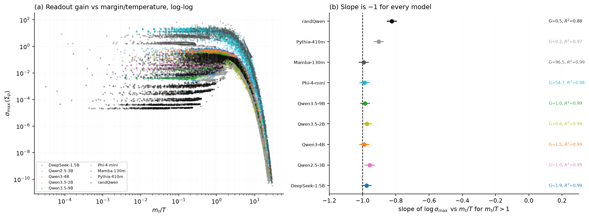

**Fig. F9 — gate law, log–log and slopes.** (a) $\sigma_{\max}(\Sigma_p)$ against $m_t/T$ for all models, log–log; (b) fitted slope for $m_t/T>1$, with $G_{\rm eff}$ and $R^2$. **Data:** 4–11 temperatures per model, 8–32 directions. **Read:** slopes $-0.90$ to $-0.99$ for every trained model; the random control is $-0.83$ and Pythia $-0.90$, visibly off the identity. **Trivial/not:** the slope is the softmax identity; the measured content is the collapse and $G_{\rm eff}$.

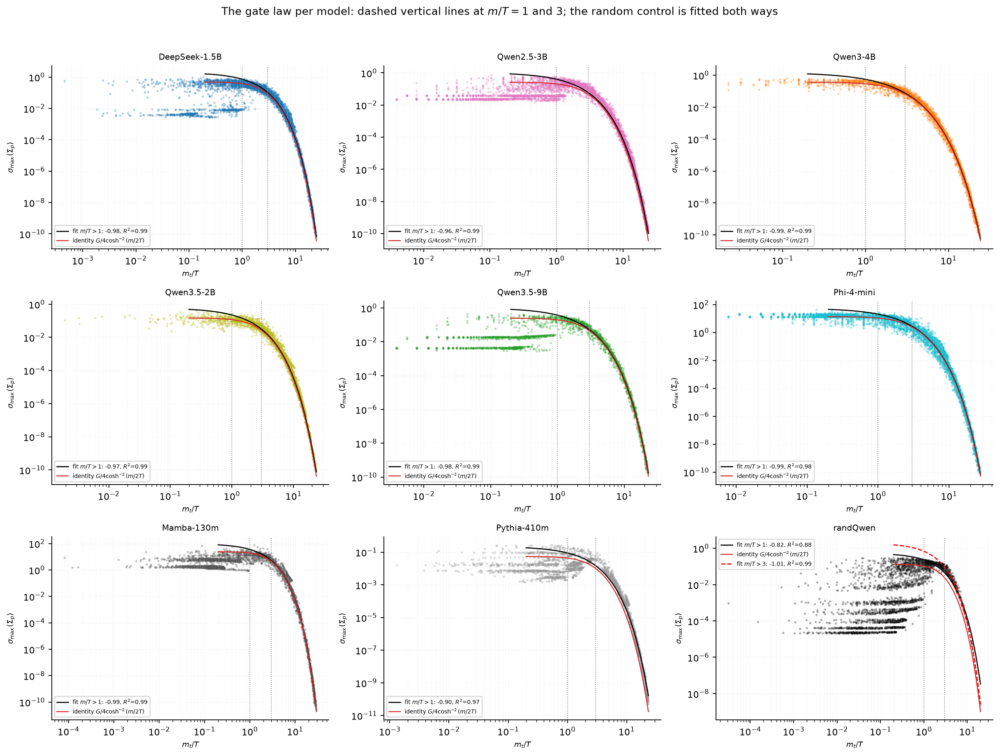

**Fig. F9c — per-model fit, including the random control.** Data (dots), tail fit (black), identity curve $G/4\cosh^{-2}(m/2T)$ (red), and for randQwen the fit restricted to $m/T>3$ (red dashed). **Read:** the random control's tail fit is $-1.01$ with $R^2=0.99$; the earlier “the control breaks the law” came from fitting through the flat $m/T<1$ region. **This is the fixed fit you asked for.** The identity curve, not a straight line, is what matches the full range; it matches better for Mamba/Qwen3-4B than for DeepSeek/Qwen2.5.


**Fig. F10 — pair geometry $G_t$.** (a) Violin of $G_t=\|E_i-E_j\|\|W_i-W_j\|$ per model; (b) $G_t$ vs margin. **Data:** `results/softloop_gates/*/gates.npz`, 300 steps per orbit. **Read:** $G_t$ is a per-model constant to ±40%; Phi/Mamba are 25–100× larger; the random control is degenerate. **Not trivial:** the per-model constant is what makes Phi's gates strong.

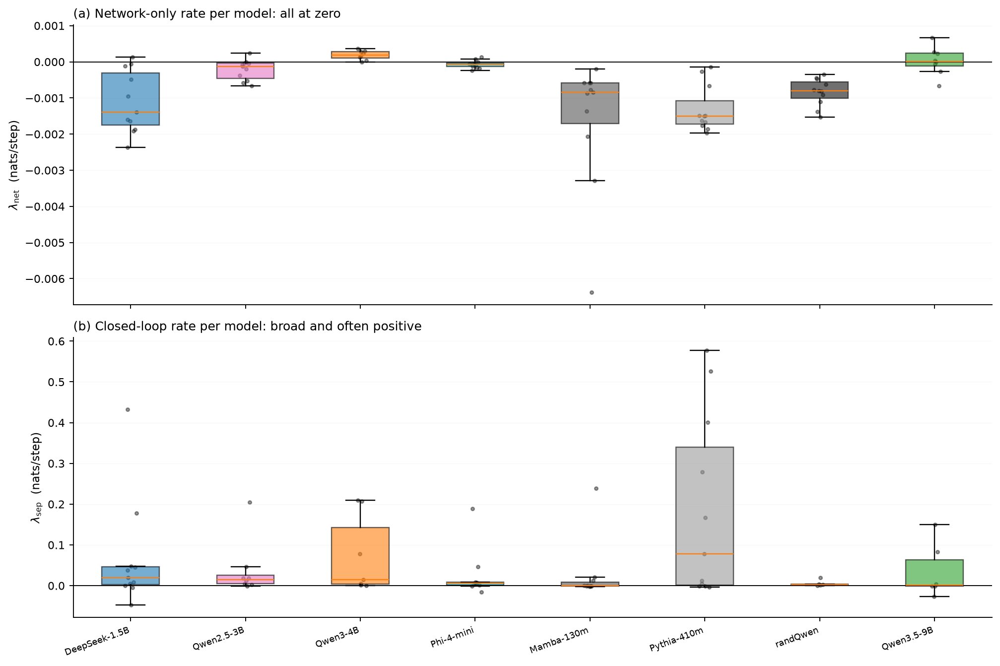

**Fig. F11 — network rate vs loop rate, per model.** (a) $\lambda_{\rm net}$ (replay) per model: box = IQR, dots = temperatures; (b) $\lambda_{\rm sep}$ (closed loop). **Data:** all temperatures, 300–600 steps. **Read:** every $\lambda_{\rm net}$ is within about $\pm0.006$ and centred on 0; $\lambda_{\rm sep}$ is broad and often positive. **Does this mean edge of chaos?** No. A zero *conditional* rate means the network neither amplifies nor contracts along a fixed token stream; it is the signature of marginal stability, not criticality. An edge-of-chaos claim would also need (i) a positive but near-zero *full* Lyapunov exponent of the autonomous dynamics, (ii) scale-free correlations or avalanche statistics, and (iii) a diverging correlation length. We have (i) only in the weak “no positive exponent” sense, and we have not measured (ii)/(iii). The honest statement is: *the token-conditioned network is neutral/contracting; the loop instability lives in the readout.*


**Fig. F12 — soft vs sampled feedback.** Response for soft feedback (red), common-random-number sampling (blue dashed) and independent sampling (green dashed) at $T=1$, six models. **Data:** `results/softloop_sample/*/{crn,ind}_T1.0`; Qwen3-4B was generated in the new run. **Read:** soft grows; CRN is flat at 1; independent separates at step 0. **Conclusion:** the instability is deterministic mean feedback, not sampled generation.


**Fig. F13 — readout rank and entropy.** Box = IQR, white dot = median, dots = individual steps. (a) Effective rank of $\Sigma_p$ over its top-16 singular values; (b) entropy of $\mathrm{softmax}(z)$ at $T=1$. **Data:** `sv_read`/`ent_ref` in `results/softloop*`, 300–600 steps. **Read:** trained models rank 1.0–1.1, random control 15.7; entropy 0.3–1.0 nat for trained models, 11.6 for the random control ($\log V$). **Caveat:** `ent_ref` is at $T=1$; “entropy vs $T$” is not a temperature effect. **Why box+strip:** the violin was hiding the multi-modality; this shows the actual spread.


---


**Fig. F15 — mean log amplification vs temperature.** $M=\langle\log(a_t/a_1)\rangle_t$, closed loop (solid) and replay (dashed), per model. **Data:** `results/softloop*`, all temperatures, 600 steps. **Read:** closed $M$ is positive almost everywhere; replay is near zero or negative. The dependence on $T$ is orbit-specific, not monotonic; the robust statement is the closed/replay gap.


**Fig. F16 — finite-scale growth rate (FSLE).** For thresholds $S=2,4,8,16,32,64$, the first-passage time $t_S$ and the rate $\log S/t_S$, closed vs replay, at $T=1$. **Data:** same as F13. **Read:** the closed loop reaches larger $S$ in finite time; replay does not. The curves are not straight lines, so the growth is not a single exponential; the rate decreases with $S$ in several models.


**Fig. F17 — the staircase.** (a) One-step log increments $\Delta\log a_t$ for the closed loop, $T=1$; (b) autocorrelation of the increments. **Read:** the increments are spiky and correlated; growth happens in bursts at gates, not as a constant drift. **This is the quantitative form of “staircase, not exponential”.**


**Fig. F18 — endpoint rates.** Closed-loop endpoint rate vs replay endpoint rate, one point per model. **Read:** the points lie above the diagonal; the loop adds growth on top of whatever the network does. The absolute values are small, so this is a *qualitative* separation, consistent with F2/F2b.

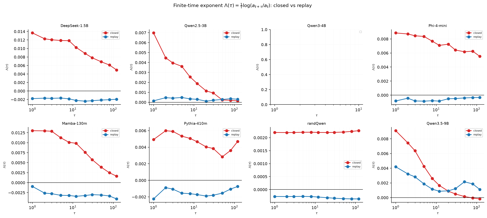

**Fig. F19 — finite-time exponent.** $\Lambda(\tau)=\frac1\tau\log(a_{t+\tau}/a_t)$ vs $\tau$, closed (red) vs replay (blue), $T=1$. **Data:** `results/softloop*`, 600 steps. **Read:** the closed loop is positive at all $\tau$ for most models; replay is near zero or negative. The curves are not flat, so there is no single asymptotic exponent; the finite-time value is the meaningful object.


**Fig. F20 — power spectrum of the log response.** PSD of $\log a_t$ (quadratic trend removed), closed vs replay, $T=1$. **Read:** the closed loop has more low-frequency power (slow staircase), while replay is closer to a flat/noisy spectrum. **Use:** this is another way to show that the loop growth is a slow, structured process, not white noise.


**Fig. F21 — the growth is bursty and gate-conditioned.** (a) Windowed live-gate density $P(m_t<1)$ (window 50) — the gates open in bursts, and after the lock-in of F19 the density stays at 0. (b) Mean one-step log growth $\Delta\log a_t$, split by gate state: every trained model grows only while the gate is open (red, +0.02 to +0.15 nats/step) and *contracts* while it is closed (blue, −0.01 to −0.05 nats/step); Pythia is the extreme case (−0.5 nats/step when closed). (c) Concentration of the total log growth: the top 5% of steps produce 26–73% of the growth for the trained models (Phi-4-mini 73%), versus ~14% for randQwen and the 5% diagonal of a constant-rate exponential. **Read:** the staircase is not a plotting artefact; a handful of gate-opening events do most of the work, and between them the response decays.

# G. Linearity and precision


**Fig. G1 — precision and probe radius.** (a) $\|\delta h_{50,L}\|$ vs $r$ for fp32 and fp16 runs of the same/nearby models; (b) local exponent $\beta={\rm d}\log\|\delta h\|/{\rm d}\log r$; (c) $r_*$ estimated at different probe radii. **Read:** fp16 has a constant floor (0.5–4) independent of $r$; fp32 scales with $\beta\to1$ for $r\lesssim10^{-2}$; $r_*$ is only stable at small probe radius. **This is the figure that invalidates the old absolute comparisons.** **Data:** new fp32 runs `results/update/fp32_*`, old fp16 runs `a1r_*`, DeepSeek 12-radius `w100_layers`.


**Fig. G2 — sparse vs dense, corrected.** Same as C4. **Read:** both are linear over 0.03–0.3; dense is a constant factor higher. My earlier statement “sparse saturates” was wrong: it came from the old fp16 sparse runs, not from the fp32 sparse runs. The correct consequence is that direction sparsity changes the *scale* of the response, and the old absolute values are only comparable within the same direction ensemble.


**Fig. G3 — response vs radius, corrected.** (a) Absolute response vs $r$ for the fp32 models; (b) local exponent; (c) superposition error vs total norm; (d) replication across prompts. **Data:** DeepSeek 12 radii, Qwen2.5/Qwen3.5 8 radii, superposition 3 prompts. **Read:** all three are linear from $3\times10^{-3}$ to 0.3 ($\beta\approx1$); below $10^{-3}$ the fp32 subtraction floor bends the curve. Superposition error is 5–7% at total norm 0.24.


**Fig. G4 — superposition, all prompts.** (a) $\|A-S\|/\|A\|$ vs total norm; (b) $\cos(A,S)$. **Data:** `results/superposition/*`, 65 positions, 2 trials, last layer. **Read:** error is 5–7% at the minimum (total norm 0.24), 36% at the fp32 subtraction floor; $\cos>0.997$. **Trivial/not:** the minimum is the measured linear-regime error; the rise at large norm is real saturation.

---

# H. Flips


**Fig. H1 — free-run flip fraction.** Fraction of directions that flip at least one token, against $r$; band = Wilson 95%. **Data:** small models 3 prompts × 20 directions (`results/local_data/models/*/chaos`), DeepSeek 512 directions (`results/hazard`), 14B models 1000 directions (`results_big/*/free_*`). **Read:** Qwen3-4B/Qwen2.5/Phi-mini are 35–60% flat; DeepSeek rises from 3% to 60%; Phi-4 is near 0; 14B models rise. **Caveat:** the small-model runs use 20 directions and sparse perturbations, so the bands are wide; the ordering, not the exact value, is the result.

---

# I. Transport


**Fig. I1 — transport kernel.** (a) $\log_{10}K(p,t)$ for the median over prompts; (b) rows $K(p,\cdot)$ at several prompt positions. **Definition:** $K(p,t)=\|\delta h_{t,L}\|/r$ when only prompt position $p$ is perturbed. **Data:** `results/transport/deepseek_p*`, 3–5 prompts, 8 directions, $r=0.1$, 300 tokens, last layer. **Read:** a persistent background from the first positions plus a travelling front at $t\approx p+20$–$40$. **Model coverage:** only DeepSeek has saved kernels; the 14B transport runs would need new data.


**Fig. I2 — superposition (same as G4).** The kernel is a valid decomposition at total norm 0.24 to 5–7%.

---

# J. Controls (real figures from `controls.md`)

These are the existing control figures; the scripts load the control `.npz` files (no synthetic arrays). They are the reason several old “LLM signatures” are not evidence.


**Fig. J1 — Mamba carries the kick.** Response $a(t)/r$ for Mamba-130m and DeepSeek-1.5B; median and 10–90% band. **Read:** Mamba does **not** decay to zero; it carries 0.2–0.9 for 300 tokens. The “attention carries the perturbation” statement is too strong; attention carries a ~3× larger response.


**Fig. J2 — Mamba's rate fluctuates around zero.** $\lambda_{10}(t)$ for the control and DeepSeek; transient positive excursions up to +0.11 in the control. **Read:** transient growth alone does not separate chaos from a contracting system.

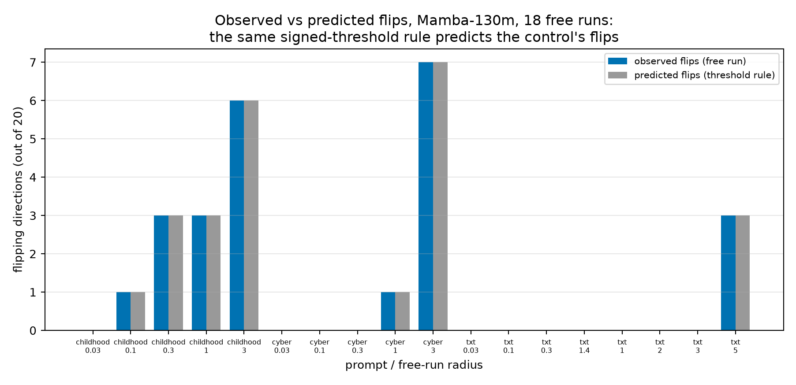

**Fig. J3 — the threshold rule is exact on the control.** Observed vs predicted first flips, 18 free runs, 25/25 exact. **Read:** the flip phenomenology is a property of argmax, not of chaos.


**Fig. J4 — no re-synchronisation.** Token agreement after the first flip; 0/24 flipped runs re-synchronise. **Read:** “flux tube” phenomenology is reproduced by a system with all-negative Lyapunov exponents.


**Fig. J5 — late rate across all models and controls.** The LLM values sit inside the band of provably non-chaotic models.


**Fig. J6 — Mamba has no travelling front.** Kernel $K(p,t)$ for the control; front amplitude 1.0–1.2 vs 13–53 for DeepSeek. **Read:** long-lived influence is not attention-specific; re-amplification is.


**Fig. J7 — random transformer gain sweep.** Depth exponent vs weight gain and token-axis rate. **Read:** the depth axis can be made strongly amplifying while the token axis stays neutral; weight scale alone does not produce token-axis chaos.


**Fig. J8 — thresholds across models.** $r^*$ for random init, DeepSeek, Pythia, Mamba. **Read:** $r^*$ tracks the margin landscape, not the architecture.

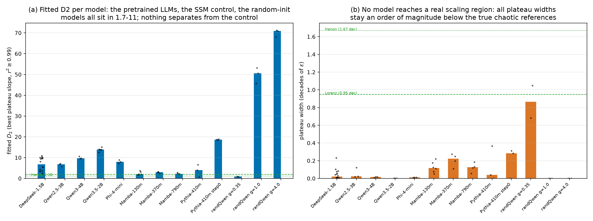

**Fig. J9 — correlation dimension across all models.** **Read:** no model has a scaling region; the fitted $D_2$ spans 0.9–71 as a smooth function of the state-cloud dimension, with the contracting control at the low end. **Use:** this is the quantitative veto of the old D2 claims.

---

# K. Scorecard (updated)

| result | status | why |
|---|---|---|
| No sustained growth (TF/replay) | **keep** | 9 architectures, finite-time exponent $\le0$ |
| Closed loop grows; replay/CRN flat | **keep, feature** | $M=1$–$7$ nats vs 0; F1–F2 |
| Window $t^*_1=p_{\rm last}+W-P$, $t^*_\ell=t^*_1+(\ell-1)(W-1)$ | **keep, feature** | exact over 106 windows; E1 |
| Depth: block-0 spike + small late rise | **keep, qualify** | block-0 share 2–85%; late rise 1.00–1.11; B1/B4c |
| Larger models closer to marginal | **keep, qualify** | 7 models, block-0 share varies |
| Gate law slope $-1$ | **keep as identity** | F4–F5; $G_{\rm eff}$ is the measurement |
| Gate identity amplitude universal | **drop** | data below identity for most models; F4b/F5b |
| Random control breaks gate law | **drop** | false; $-1.01$ for $m/T>3$ |
| Perpendicular response | **drop as discovery** | median 90° in LLMs *and* controls; C1 |
| Rotation 78–87° | **keep, qualify** | real, modest; random control 89°; C3 |
| $r_*$ ordering | **keep only with dense directions** | C5; sparse values are probe-dependent |
| $r_*$ log-logistic law | **drop** | KS rejects it; A1b |
| Five-regime taxonomy | **drop** | four of five claims fail |
| Entropy rises with $T$ | **drop** | `ent_ref` is at $T=1$ |
| Readout rank 1 | **keep, qualify** | F10; consequence of two-token concentration |
| Hunt–Ott entropy zero | **drop** | absolute exponents are positive; relative is small |
| Edge of chaos | **do not claim** | no positive full Lyapunov exponent, no criticality measurement |
| Sparse directions saturate (my earlier claim) | **drop** | both sparse and dense are linear over 0.03–0.3; C4 |
| Common linear regime all models | **keep for fp32/dense; separate fp16** | C4/G1–G3 |

---

# L. Questions you asked, answered directly

- **Are the old figures synthetic?** The plotted arrays were generated in the plotting script; the experiments were real. Fixed in this document. §1.
- **Is the depth fit trivial?** The old one was a fit to $1/\ell$; the new B4b is a descriptive cubic after block 0, and B4c isolates the small 1.00–1.11 late rise. The old spike+exponential fit is deleted. B4b/B4c.
- **Is the perpendicular response trivial?** Yes, median 90° in LLMs *and* controls; the radial tail is the measured part. C1–C2.
- **Is the rotation real?** Yes, 78–87°, but the random control is 89°; modest. C3.
- **Why does the perturbation not vanish at $W-P$?** It is carried by generated tokens; the flush is one window later, then one window per layer. E1.
- **Does the flush depend on the layer?** Yes: $t^*_\ell=W-P+p_{\rm last}+(\ell-1)(W-1)$, exact over 106 windows. E1.
- **What is the constant in the window formula?** It is $p_{\rm last}-P$, where $p_{\rm last}$ is the last perturbed prompt position (43 for $P=65$; 55 for $P=64$). E1.
- **Is the five-regime table true?** Only the window row. §K, D2.
- **Does the random transformer decay in 4 tokens?** No; replay is 54× and flat. D2.
- **Do we have an edge-of-chaos argument?** No; zero conditional rate is marginal stability, not criticality. F8.
- **What is “tangent contraction rate”?** Two different quantities: $g_\ell\approx1$ and $\lambda_L=0.03$–$0.12$. Use those names. B.
- **Is rank-1 supported?** Yes for Qwen3-4B/Phi-4-mini (1.0/1.1), random 15.7; consequence of concentration. F10.
- **Entropy results?** Low for trained models, $\log V$ for random; `ent_ref` is at $T=1$. F10.
- **Are the ECDF fits real?** Descriptive only; a KS test rejects the log-logistic. A1b.
- **Do JL/Cramér–Wold apply?** Not with sparse directions; the Gaussian null fails. A1.
- **Is “sparse saturates” true?** No; both sparse and dense are linear over 0.03–0.3; dense is a constant factor higher. C4.
- **What is closed loop vs replay?** Closed feeds back its own expected embedding; replay feeds the recorded unperturbed soft tokens. F.0.
- **What is “soft”?** Expected-embedding feedback; “hard” would be argmax (greedy) or sampled. F.0.
- **Do the attention and flush formulas agree?** Yes; the flush is about a nonzero response, not about the mean attention mass. E4b.
- **What is new and worth featuring?** Closed vs replay (M and FSLE); exact window clock; block-0 + late-rise depth; dense-direction fragility; gate tail slope + $G_{\rm eff}$. §K.
- **What data do we need?** dense 14B runs; exact-$\Sigma_p$ validation; fp32 only where absolute response is needed. §M.

---

# M. Experiments: what was run, what is blocked

| # | experiment | status |
|---|---|---|
| 1 | fp32 A1 for Qwen2.5-3B, Qwen3.5-2B | **done**, `results/update/fp32_*` |
| 2 | fp32 A1 for Qwen3-4B, Phi-4-mini | **not done**; fp16 is adequate for flips/relative shape, fp32 needed only for absolute response |
| 3 | angle probe, 64 directions, 5 small models + 3 controls | **done**, `results/update/angle_*` |
| 4 | dense-direction $r_*$, 128 dirs, 3 fp32 small models | **done**, `results/update/dense_*` |
| 5 | dense 14B runs | **Phi-4 done** (`results/update/dense14_phi4`, $r_*=1.21$–$1.28$); Qwen3-14B/DS-14B hit OOM when colleagues held the memory, retried by `queue_spark_wait.sh` |
| 6 | DeepSeek dense window sweep, 106 windows | **done** (from existing `wspec`) |
| 7 | nonnorm controls | **randQwen done** (`nonnorm_randqwen3`); Pythia path mismatch; Mamba not run |
| 8 | depth probe with 32 directions | **done** for DeepSeek, Qwen2.5-3B, Phi-4-mini (`results/update/depth_*_k32`) |
| 9 | sampled feedback for Qwen3-4B (CRN/ind) | **done**, `results/softloop_sample/qwen3_4b` |
| 10 | exact $\Sigma_p$ validation (all vocab) | not run |
| 11 | attention mass, correct window mask | **done**, DeepSeek W=50/100/200/4096 + Qwen2.5/Phi/rand W=100 |
| 12 | closed-loop metric suite (M, FSLE, finite-time, spectrum, staircase, endpoint, saturation $L_\infty$/$\\tau$) | **done**, F2–F18 |
| 13 | log-logistic fit check (linear vs log space, KS) | **done**, A1b |
| 14 | variance/percentile pass on all aggregates | **done** where data allow; controls added to B5b/B6/C1/C2/C3/D1b/D3b |
| 15 | **long looping campaign, 3000 steps (x11) / 1600 steps (Spark)** | **running**: closed loop + replay at $T=1$, then $T=2$, CRN/ind, long teacher-forced (1000/800 tokens), then $T=0.5$ |

**Running on the GPUs (36–48 h, started 2026‑11‑26 22:50 CET).**

- **x11** (`scripts/queue_long_x11.sh`, log `results/longloop_x11.log`): 8 models (DeepSeek-1.5B, Qwen2.5-3B, Qwen3-4B, Qwen3.5-2B, Phi-4-mini, Mamba-130m, Pythia-410m, randQwen), 3000 steps, 4 saved layers, $r=0.03$–$0.1$, 8 directions. Rounds: (A) $T=1$ loop+replay for every model, (B) $T=2$ loop+replay, (C) CRN+independent sampling, (D) 1000-token teacher-forced, (E) $T=0.5$ loop+replay. ~15 min per 3000-step run for the 1.5B model, longer for the 3–4B models; the whole queue is ~30 h. Resume-safe: each step is skipped if its `.npz` exists.
- **Spark** (`scripts/queue_long_spark.sh`, log `results/longloop_spark.log`): Qwen3-14B, DeepSeek-14B, Qwen3.5-9B, Phi-4 at fp16, 1600 steps (≈3.4 s/step, ~2 h per run), 4 saved layers. Same round structure with 800-token teacher-forced runs. ~30 h total. I only killed my own earlier jobs; the colleagues' memory is untouched and the models load in fp16 (~30 GB), which fits in the free 60 GB.
- Neither queue retries on failure: a failed step prints `FAILED` and the queue moves on, so nothing can spin.

**Re-running the analysis when the data land** (all on the Windows checkout after `analysis_update/sync_from_cluster.ps1`):

```
python analysis_update/pack_loop_loglog_models.py   # F0c-F0m: picks the longest orbit per model
python analysis_update/pack_loop_saturation.py      # F0m summary numbers
python analysis_update/pack_loop_metrics.py         # M, FSLE, staircase, endpoint
python analysis_update/pack_loop_finitetime.py      # finite-time exponent + spectrum
python analysis_update/run_all.py                   # everything, then copy to notebook/update_figures
```

---

# N. Appendix: earlier measured figures, kept for reference

These were in the previous version of this document. They are kept because you asked not to remove figures; several are superseded by the newer versions above, and the caption says which. All are measured from the `.npz` files (not synthetic).

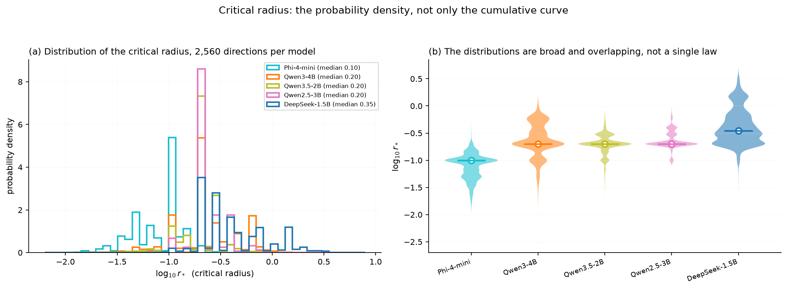

**Earlier A — critical-radius density (the version you liked).** Same data as A1. Kept as a standalone density figure.

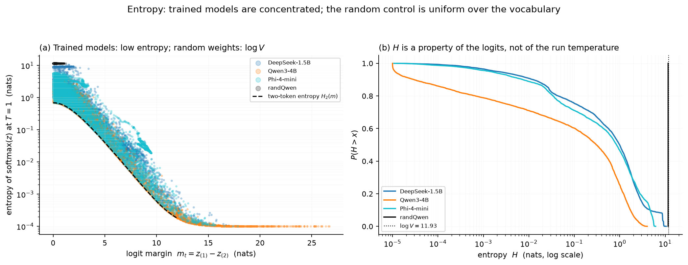

**Earlier B — entropy vs margin.** Same data as F10. Kept because you liked it.

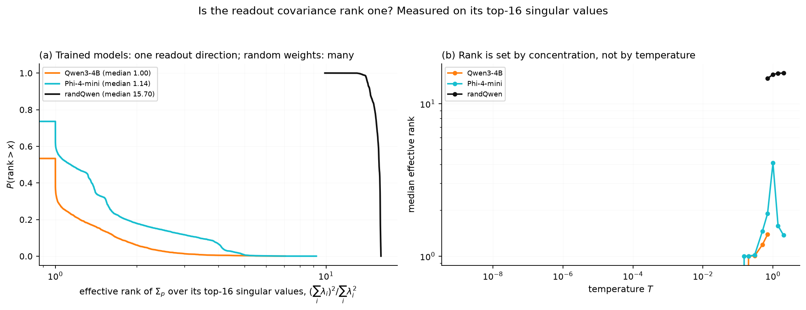

**Earlier C — readout effective rank.** Same data as F10; F10 is the box+strip version with more models.


**Earlier D — the first depth figure.** Shows the $1/\ell$ quantity that was fitted in `unified.md`; superseded by B1.


**Earlier E — depth exponent vs model size.** The single-scatter version; B1/B4b are the distribution versions.


**Earlier F — the first gate-law figure.** Superseded by F4/F4b/F5.


**Earlier G — closed vs replay, DeepSeek only.** Superseded by F1 (all models) and F2 (metric $M$).


**Earlier H — relative response.** Superseded by B5/B5b (controls added).


**Earlier I — response vs radius.** Superseded by G3.

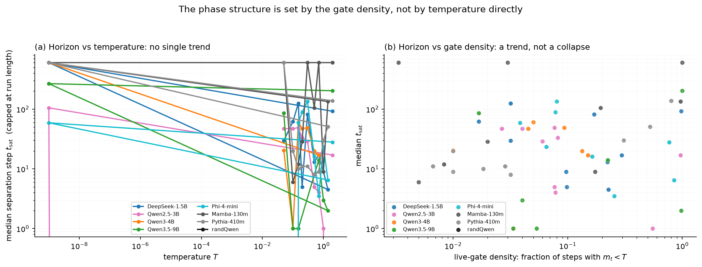

**Earlier J — phase figure.** Superseded by F3b; the phase plot itself is deleted per your instruction.


**Earlier K — window departure.** Superseded by E1/E1b (exact formula).


**Earlier L — angle/rotation.** Superseded by C1/C2/C3 (controls added).

## N3. Loop figures from the previous revision (superseded, kept as requested)

These were the loop figures in the last PDF. Every one of them is recomputed *in
place* by the new scripts, so the numbers here are the older 600-step / 8-direction
version. Kept because you asked not to delete figures; the live versions are
F2-F21 above.


**Old F0 — the four-panel summary (600 steps, DeepSeek-1.5B).** Superseded by F2 (all models) and F5 (sampling).


**Old F0b — log-log closed vs replay for one model.** Superseded by F2/F2b.

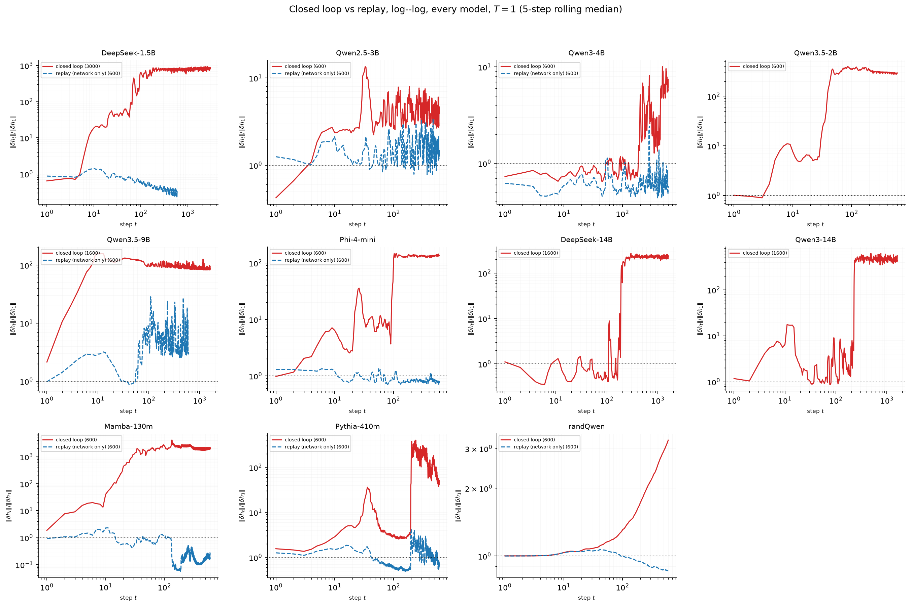

**Old F0c — the first all-models log-log grid.** Superseded by F2, which uses per-direction ratios and matched pairs.

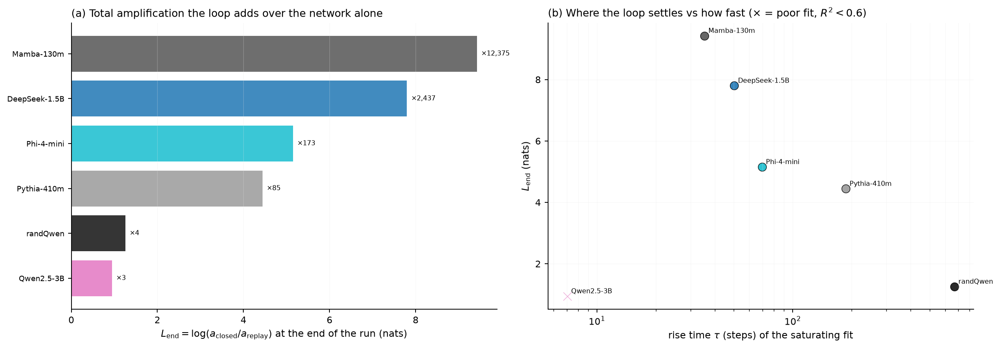

**Old F0m — the saturation summary.** The $L_\infty$/$\tau$ table in F2 is now computed per direction with the fixed-offset fit.

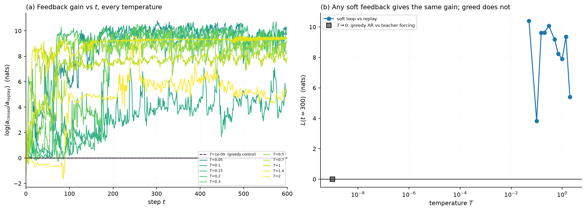

**Old F21 — temperature threshold for one model.** Superseded by F6, which shows the model dependence (the claim "any soft feedback gives the same gain" was too strong).


**Old selfreg — self-regulation with green shading.** Kept, but the shading was removed in F3 as you asked.

# N2. Limitations

- Qwen3-4B/Phi-4-mini absolute responses are fp16-floor-dominated; only discrete flips and relative shapes are valid.
- Sparse and dense directions give the same exponent but a different scale; do not mix them in absolute comparisons. The old sparse $r_*$ values depend on the probe radius; use the dense values (C5) for cross-model statements.
- The 14B compact files save 9–14 layers, not all; depth profiles for the 14B models are partial.
- The transport kernel is DeepSeek-only; angle/rotation controls are available for the random transformer but not for Mamba/Pythia.
- The gate law is the softmax identity; the amplitude does not match all models, and only the tail slope is universal.
- No positive full Lyapunov exponent, no Lyapunov spectrum, no criticality measurement: no edge-of-chaos claim.
- The small-model free-run flip fractions use 20 directions and sparse perturbations; the Wilson bands are wide.
- The closed-loop metrics are horizon-dependent; we report the run length and the integrated quantity $M$, not a unique Lyapunov exponent.

