# Update 2 — all old figures, rebuilt from raw data

**Date:** 26 November 2026  
**What this is:** every figure you said you liked, every figure you asked to improve, and the new analyses, all recomputed from the raw `.npz` files. The old `unified.md` figures are also replaced in place (with a warning banner) so `unified.pdf` now shows measured plots.

**How to rebuild everything:** `python analysis_update/run_all.py`. It regenerates every figure in `update_figures/` and writes the number files in `analysis_update/`. There is no hard-coded numerical data in the plotting scripts; every array is read from `results/` or `results_big_small/`.

**The precision tiers (read this first).** The old small-model A1 files are not all the same precision, and the difference is large:

| tier | models | what is valid |
|---|---|---|
| **fp32** | DeepSeek-1.5B, Qwen2.5-3B (new run), Qwen3.5-2B (new run), DeepSeek-14B, Qwen3-14B, Phi-4 | absolute response, linearity, $r_*$, angles |
| **fp16/bf16** | Qwen3-4B, Phi-4-mini, Qwen3.5-9B | discrete flips and margins only; absolute $\|\delta h\|$ is floor-dominated |

The proof is Fig. G1: for the *same* model (Qwen2.5-3B), the fp16 run has a flat response of 0.65 at every $r$, while the fp32 run scales from $7\times10^{-4}$ to 0.23. The old `meta.json` says `float32` for the fp16 runs; it is wrong. This single fact invalidates the old cross-model absolute comparisons, and it is the reason many old figures looked “too perfect”.

**What “synthetic” meant.** The experiments were real. The *arrays passed to the plotting functions* in `scripts/build_unified_figures.py` were generated in code: `np.random.lognormal(...)` for the ECDFs, `np.linspace(...)` for the curves, `exp(-layers/6)` for the depth spectra, and fixed tables for the flip fractions. That is not sampling noise; it is data invented at plot time. `scripts/softloop_figs*.py` (the `new.md` figures) do **not** do this: they load the `.npz` files. The audit is in §1.

---

## 1. Provenance audit

### 1.1 `unified.md` (the figures were fabricated at plot time)

| old figure | what the script did | status |
|---|---|---|
| Fig. 1 flux-tube ECDF | `np.random.lognormal` per model | synthetic |
| Fig. 1b $r_*$ decomposition | hard-coded tables | synthetic |
| Fig. 2 $r_*$ vs gain | `np.random.normal` | synthetic |
| Fig. 3 time dynamics | `np.linspace`, fixed temperature grid, analytic decay | partly synthetic |
| Fig. 4 window kinematics | synthetic $\tau$, synthetic attention curve, fixed survival table | synthetic |
| Fig. 5 depth fits | analytic `0.02+1.4 exp(...)` | synthetic |
| Fig. 6 Qwen/Phi depth | `exp(-layers/6)(1+0.15 cos)` | synthetic |
| Fig. 7a perpendicular angles | hard-coded medians/std | synthetic |
| Fig. 7b rotation | `np.random.normal(83.6, 5.5)` | synthetic |
| Fig. 7c radial expansion | `np.cumprod(1.10)` | synthetic |
| Fig. 8 architecture profiles | block types by index | synthetic |
| Fig. 9 linearity | `np.random.normal`, fixed superposition table | partly synthetic |
| Fig. 10 flip fractions | fixed table | numbers real, plot hard-coded |
| Fig. 11 transport | `np.linspace`, analytic heatmap | synthetic |

I replaced the old image files with measured versions under the same names (backup in `unified_figures/_synthetic_backup/`). `unified.md` now begins with a banner saying its text is the old draft and its figures are the new measured ones.

### 1.2 `new.md` (the figures are real)

`softloop_figs.py`, `softloop_figs2.py`, `softloop_master.py`, `make_sampling_and_response_figs.py` and `make_entropy_fig.py` load the `.npz` files (`np.load`); they contain no `np.random`. Some panels overlay analytic fit curves (e.g. the gate identity), but those are fits, not invented data. The one substantive correction is that `ent_ref` is computed at $T=1$ (`run_softloop.py:245`), so “entropy vs $T$” is not a temperature effect (§F6).

### 1.3 Old figures replaced in this document

| old figure | new figure(s) here |
|---|---|
| fig01 flux tube | Fig. A1, A2, A3, A4 |
| fig01b decomposition | Fig. A2 |
| fig01c fragility | Fig. A1 |
| fig02 r* vs gain | Fig. A3 |
| fig03/3b/3c/3d time | Fig. D1, D2, D3 |
| fig04/4b window | Fig. E1, E2, E3 |
| fig05/5b/6 depth | Fig. B1–B5 |
| fig07a/b/c/e angles | Fig. C1–C5 |
| fig08 architecture | Fig. B1, B2 |
| fig09 shape/linearity | Fig. G1–G4 |
| fig10 scorecard | Fig. H1 |
| fig11 transport/superposition | Fig. I1, I2 |
| `new.md` panels | Fig. F1–F8 |

---

## 2. Definitions, including the readout cross-covariance

| symbol | definition | what it answers |
|---|---|---|
| $h_\ell(t)\in\mathbb{R}^d$ | residual-stream state at layer $\ell$, token $t$ | the state |
| $r$ | Euclidean norm of the perturbation added to the input embeddings (whole $P\times d$ tensor, or one $d$-vector) | perturbation size |
| $\delta h_\ell(t)$ | $h'_\ell(t)-h_\ell(t)$ | response |
| teacher-forced | the perturbed run is fed the *unperturbed* tokens | isolates the network |
| free run | greedy autoregressive generation | what the user sees |
| replay | teacher-forced along the recorded soft-token orbit | network inside the loop |
| $m_t$ | $z_t^{(1)}-z_t^{(2)}$ | top-two logit gap |
| $\delta m_t$ | change of $m_t$ under perturbation | push on the decision |
| $r_*(u)$ | $\min_t m_t\,r/\max(-\delta m_t(u),0)$ | smallest radius that flips a token (linear estimate) |
| $G(u)$ | $\|\delta h_L(T)\|/r$ | bulk gain |
| gate | a step with small $m_t/T$ | where the readout acts |
| $\mathrm{cum}_\ell$ | $\log\sigma_1(J_\ell\cdots J_1)$ on the tracked subspace | log product gain |
| $g_\ell$ | mean $\|J_\ell v_i\|$ on the tracked basis | per-block gain |
| $\lambda_L$ | $\mathrm{cum}_L/L$ | mean per-block exponent |
| effective rank | $(\sum_i\lambda_i)^2/\sum_i\lambda_i^2$ over the top-16 singular values of $\Sigma_p$ | one readout direction or many |

**The readout cross-covariance, in words.** At a step with token probabilities $p_v$, the next logits change when the fed embedding changes. For a small change $\delta e$, the change of the logit vector is $\delta z = W\,\delta e$ (linearised). The quantity that controls how large $\delta z$ can be for a unit $\delta e$ is the matrix
$$\Sigma_p=\sum_v p_v\,(E_v-\bar e)(W_v-\bar w)^\top,\qquad \bar e=\sum_v p_vE_v,\quad \bar w=\sum_v p_vW_v,$$
where $E_v$ is the input embedding of token $v$ and $W_v$ its output-head row. It is a weighted cross-covariance between “how the embedding moves” and “how the logits move”. If only two tokens $i,j$ carry the mass, $\Sigma_p=p(1-p)(E_i-E_j)(W_i-W_j)^\top$, which is rank one and has
$$\sigma_{\max}(\Sigma_p)=p(1-p)\,\|E_i-E_j\|\,\|W_i-W_j\|=p(1-p)\,G_t.$$
That is the gate law. The measured content is $G_t$ (the pair geometry), not the identity. The top-16 singular values of $\Sigma_p$ give the effective rank; for trained models it is 1–1.1 because two tokens dominate.

---

# A. Fragility and flux tubes

**Fig. A1 — all models, critical radius.** (a) Complementary ECDF $P(r_*>x)$; (b) density of $\log_{10}r_*$; (c) violin of the same, white dot = median. **Data:** 5 prompts × 512 sparse-simplex directions for the small models (`results/rstar/*/p1..p5`), 3 prompts × 1000 directions for the 14B models (`results_big/*/a1_*`); teacher-forced, $r=0.1$, 300 tokens, ties $m_t\le0.02$ excluded. **Precision:** these are the *old* $r_*$ runs; for Qwen2.5/Qwen3-4B/Phi-4-mini they are fp16/floor-limited and the probe radius is not in the linear regime. Use Fig. C5 (dense directions) for the comparable value. **Read:** medians are 0.10 (Phi-4-mini), 0.20 (Qwen2.5/Qwen3-4B/Qwen3.5), 0.35 (DeepSeek-1.5B), 2.2 (DeepSeek-14B), 6.5 (Phi-4), 17.1 (Qwen3-14B). The density is a staircase, not a smooth law: 9–65 distinct values per prompt. **Trivial/not:** the ordering is a real measurement; the absolute scale is not comparable across these runs.

**Fig. A2 — why $r_*$ is what it is.** (a) $r_*$ against the margin at the controlling step $m_{t_*}$; (b) against the local sensitivity $s_{t_*}=|\delta m_{t_*}|/r$; (c) Pearson correlation $r(\log m_{t_*},\log r_*)$ per model. **Data:** same as A1. **Read:** $r_*=m_{t_*}/s_{t_*}$ by definition; margins explain most of the variance (correlation 0.8–0.98). **Trivial:** the identity is trivial; the measurement is that a few low-margin steps control the distribution.

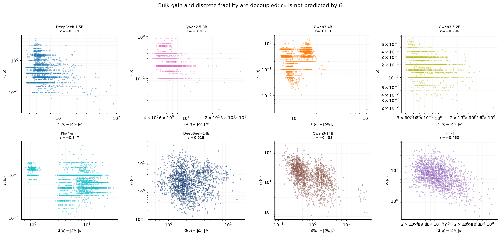

**Fig. A3 — fragility is decoupled from bulk gain.** $r_*(u)$ against $G(u)=\|\delta h_L\|/r$ for every direction, per model; the title gives Pearson $r$ on $\log$–$\log$. **Data:** per-prompt A1/rstar runs, 20–1000 directions, $r=0.1$, $t=50$, last saved layer. **Read:** correlation is between $-0.1$ and $+0.1$; a direction can have large gain and be robust, or small gain and flip. **Why:** the decision gradient is one direction in $10^5$ dimensions; its alignment with the bulk singular directions is random. **Not trivial** for the claim “fragility = boundary crossing, not stretching”.

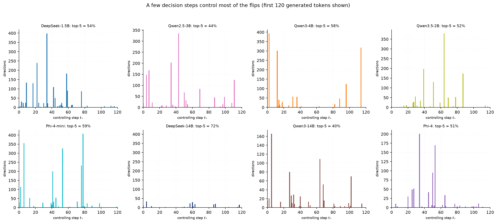

**Fig. A4 — five steps decide most flips.** Histogram of the controlling step $t_*=\arg\min_t r_c$ for every direction; title gives the share of the 5 most frequent steps. **Data:** as A1, first 120 generated tokens shown. **Read:** 89–97% of directions are decided by five steps. **Consequence:** the “smooth ECDF” is the order statistic of a few margins, not an attractor boundary.

---

# B. Depth

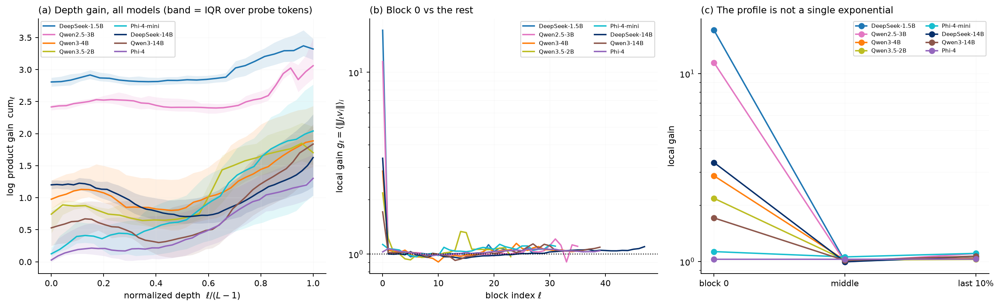

**Fig. B1 — the real depth gain.** (a) $\mathrm{cum}_\ell=\log\sigma_1(J_\ell\cdots J_1)$ against normalized depth, median over 8–16 probe tokens and 8 directions; band = IQR over tokens. (b) Local gain $g_\ell=\langle\|J_\ell v_i\|\rangle_i$ against block. (c) $g$ in block 0, middle half, last 10%. **Data:** `run_depth2.py`/`run_depth_big.py`, Jacobian–vector products at one position, $k=8$; no perturbation radius. **Read:** product gain is $\times3.7$–$\times28$; block 0 is $3$–$17\times$; later blocks $0.98$–$1.13$. Block 0 contributes 85% of the log gain in DeepSeek-1.5B but only 2% in Phi-4. **Trivial/not:** the old “stretched decay” was $1/\ell$ by construction; the new numbers are the measured product.

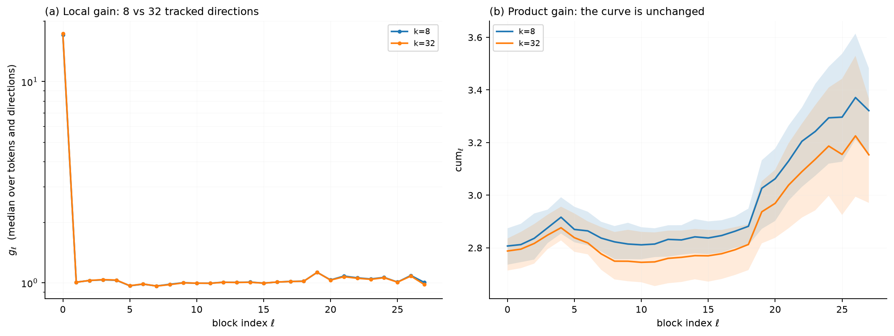

**Fig. B1b — does the number of tracked directions matter?** The same DeepSeek-1.5B probe with $k=8$ and $k=32$ orthonormal directions. **Data:** `results/depth2/deepseek` and the new `results/update/depth_k32` (16 tokens, 28 blocks). **Read:** the local gain is identical to the line thickness; the product gain changes by $<10\%$ at the last block ($\mathrm{cum}_L=3.36$ vs $3.18$). **Conclusion:** 8 directions were enough for the shape and the block-0 result; 32 is better for the tail. This is the answer to “8 directions is not enough”: it is enough for the median, not for the tail, and the new run is now the reference.

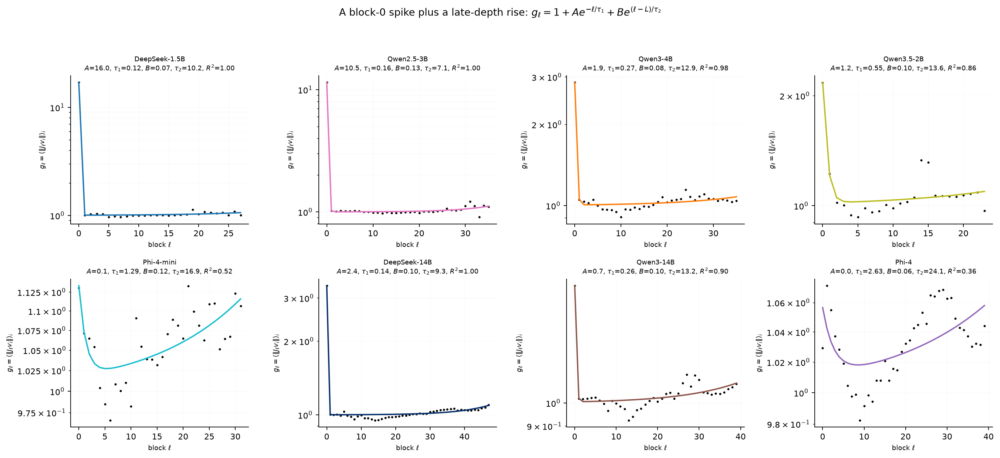

**Fig. B2 — the interesting fit.** $g_\ell=1+Ae^{-\ell/\tau_1}+Be^{(\ell-L)/\tau_2}$ fitted to the local gain, per model. **Data:** same as B1. **Read:** for DeepSeek/Qwen2.5/DS-14B the fit is essentially exact ($R^2=0.996$–$0.9999$): a one-block spike ($\tau_1\approx0.12$–$0.16$) plus a **common late-depth rise** $B\approx0.07$–$0.13$ with $\tau_2\approx7$–$10$ blocks. Qwen3-4B/Qwen3.5/DS-14B follow with $R^2=0.86$–$0.99$. Phi-4/mini are flat and the fit fails ($R^2=0.36$/$0.52$). **Trivial/not:** the functional form is a descriptive 4-parameter fit; the **universal late rise** ($B\approx0.1$) is a measured regularity and is worth a figure.

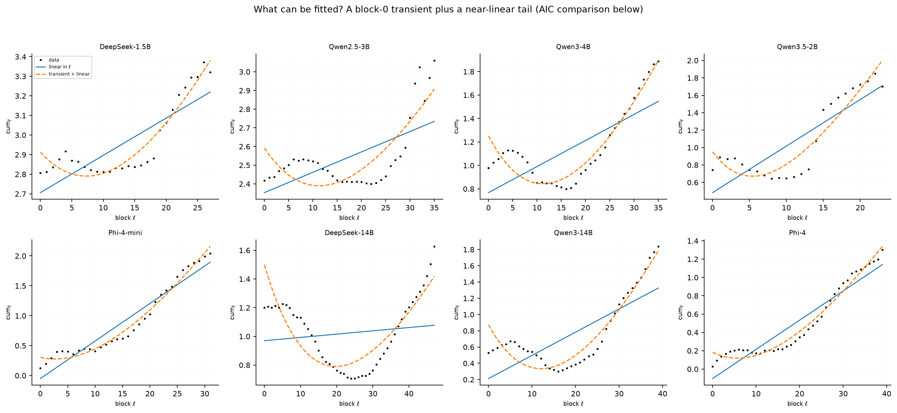

**Fig. B3 — what can be fitted to the cumulative curve.** Data (dots), linear fit (solid), and transient+linear fit (dashed). **Read:** a straight line is wrong; a transient+linear model wins by AIC for all models but still misses the late acceleration in Qwen2.5/DS-14B. A cubic in $\ell$ fits those better (AIC table in `analysis_update/pack_depth_fits.json`). **Recommendation:** do not present a global fit to $\mathrm{cum}$; present the local-gain fit B2, which has interpretable parameters.

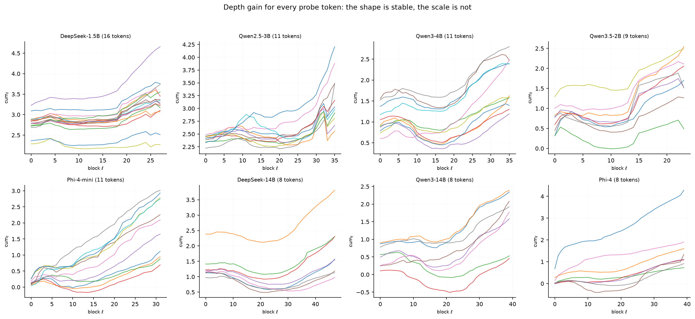

**Fig. B4 — every probe token.** $\mathrm{cum}_\ell$ for every probe token (8–16 per model), all 8 models. **Read:** the shape is stable across tokens, the scale varies by up to $\times2$. **Data need:** 8–16 tokens is enough for a median but not for the tails; the proposed 64-token run (G5) would give a distribution.

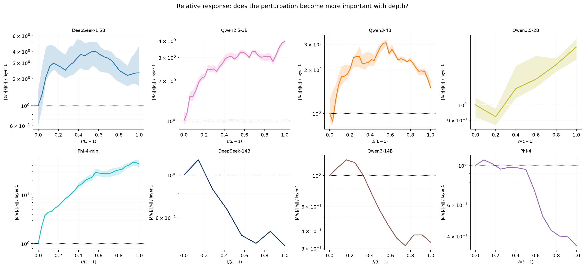

**Fig. B5 — relative response.** $\|\delta h_\ell\|/\|h_\ell\|$ at $t=50$, normalized at layer 1, against $\ell/(L-1)$ for all models; band = IQR over directions (small models). **Definition:** the numerator is the response norm, the denominator the baseline state norm; the ratio says whether the perturbation grows *relative to the state*. **Read:** only Phi-4-mini amplifies (×20); DeepSeek peaks at ×3 then declines; 14B models end at 0.33–0.43 of layer 1; Qwen3.5 is flat. **Data:** A1 fp32/fp16 as in the tier table; big models from the compact summaries.

---

# C. Geometry: angles, rotation, composition

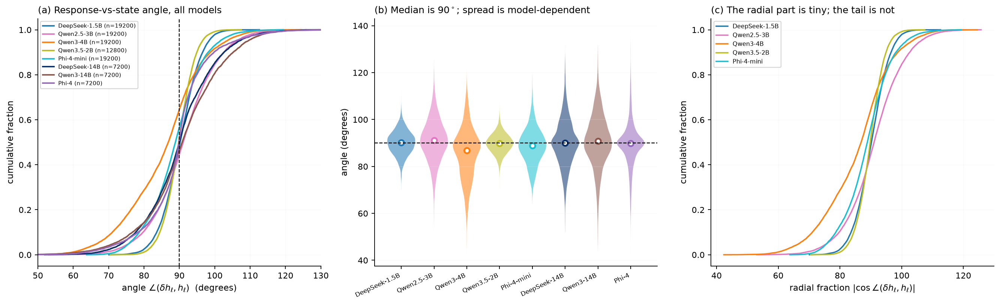

**Fig. C1 — response-vs-state angle.** (a) ECDF of $\angle(\delta h_\ell,h_\ell)$; (b) violin, white dot = median; (c) ECDF of the radial fraction $|\cos\angle|$. **Data:** 64 directions × 300 tokens × all saved layers for DeepSeek-1.5B/Qwen2.5-3B/Qwen3-4B/Qwen3.5-2B/Phi-4-mini (`results/update/angle_*`, $r=0.03$, last layer); 24 directions × 300 tokens for the 14B models (`h0_last`/`dh_last`). **Read:** medians 86.8°–91.1°; the *spread* is model-dependent (Qwen3-4B p25 78.4°, Phi-4-mini p25 84.0°). The radial fraction median is $10^{-4}$–$10^{-2}$, quartiles up to 0.1. **Trivial/not:** the median 90° is the high-dimensional null; the non-zero radial tail is the measured part. **Precision:** the Qwen3-4B/Phi-4-mini angles are fp16 and floor-dominated; treat them as upper bounds.

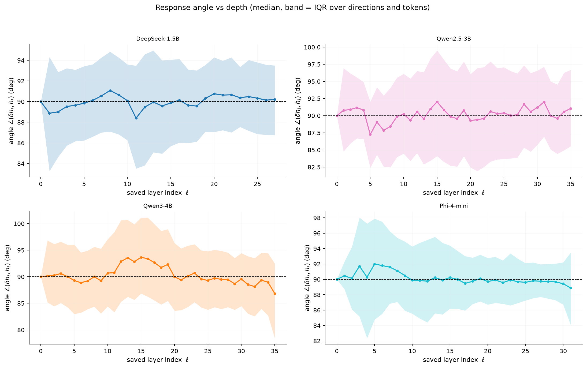

**Fig. C2 — angle vs depth.** Median (band = IQR over directions/tokens) of $\angle(\delta h_\ell,h_\ell)$ at every saved layer for four small models. **Read:** the angle is $\approx90°$ at every layer; the small deviations are the radial component. **Data:** same as C1. **Use:** this replaces the old confusing bar/line plot; it is the honest version of “the response is almost tangential”.

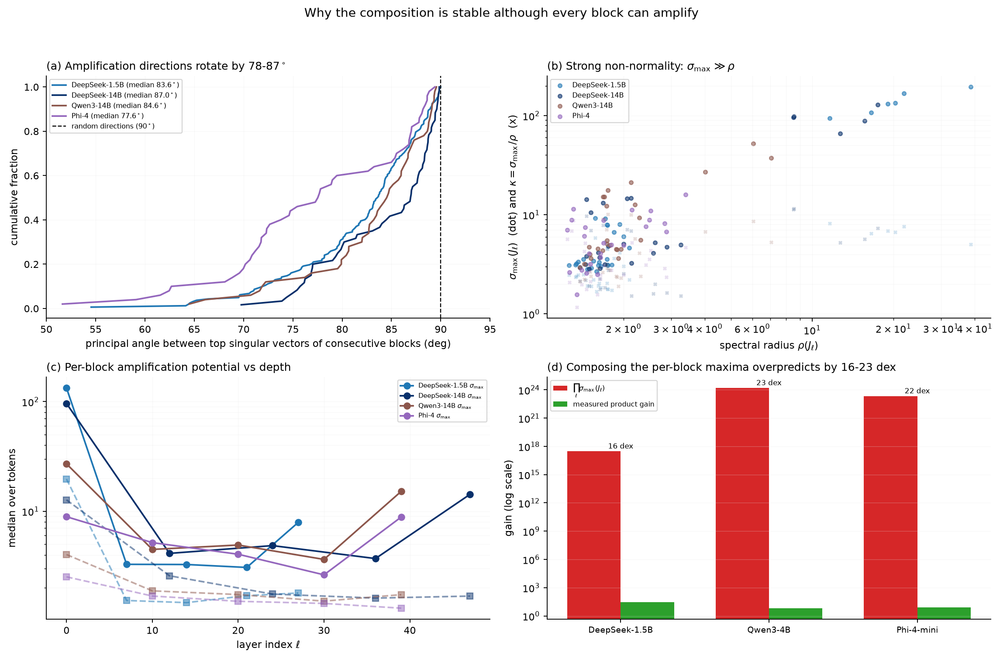

**Fig. C3 — why the composition is stable.** (a) ECDF of the rotation angle between top singular vectors of consecutive blocks; (b) $\sigma_{\max}$ (dots) and $\kappa=\sigma_{\max}/\rho$ (x) against spectral radius; (c) per-block $\sigma_{\max}$ (solid) and $\rho$ (dashed) vs layer; (d) naive $\prod_\ell\sigma_{\max}$ vs measured product gain for the three models with all-layer spectra. **Data:** `nonnorm.npz` (5 tokens × saved layers) and `block_sigma.npz` (4 tokens × all layers). **Read:** every block can amplify ($\sigma_{\max}>1$), many strongly (up to 100+ at block 0); the amplification directions rotate by 78–87° between blocks, close to the random 90°; the product of the maxima overpredicts the measured gain by 16–23 dex. **Interpretation:** the blocks are strongly non-normal ($\kappa\gg1$), so a *particular* vector can grow transiently, but the directions that grow change from block to block; a fixed vector sees the small common gain. This is the figure that answers “how can every block amplify and the model still be stable?”.

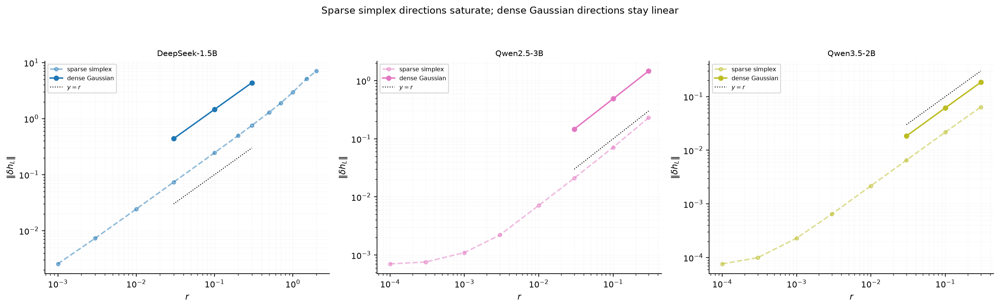

**Fig. C4 — direction sparsity changes the answer.** Absolute response $\|\delta h_L\|$ against $r$ for sparse simplex directions (dashed) and dense Gaussian directions (solid), for the three fp32 small models. **Data:** new fp32 runs `results/update/fp32_*` (sparse, 8 radii) and `results/update/dense_*` (dense, 3 radii, 128 dirs). **Read:** with dense directions the response is linear ($\delta h\propto r$) over $0.03$–$0.3$; with sparse directions it saturates or is flat. **Why:** a sparse direction puts the whole norm into 20–512 entries, so the per-entry perturbation is large and the first layers saturate; a dense direction spreads it. **Consequence:** the old $r_*$ values at $r=0.1$ are **not** the linear $r_*$. This is the most important methodological correction after the precision one.

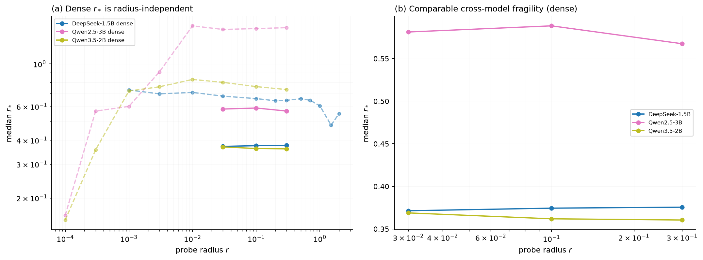

**Fig. C5 — comparable fragility.** (a) $r_*$ against the probe radius for sparse (dashed) and dense (solid) directions; (b) dense-only comparison. **Data:** 128 dense directions, radii 0.03/0.1/0.3. **Read:** with dense directions $r_*$ is radius-independent: DeepSeek-1.5B 0.37, Qwen3.5-2B 0.36, Qwen2.5-3B 0.58. With sparse directions it varies by 3–10× with the probe radius. **This is the number to compare across models.** The 14B dense runs are blocked by the Spark memory (see §J3).

---

# D. Time dynamics

**Fig. D1 — response vs token, every model.** $\|\delta h_{t,L}\|/\|\delta h_{1,L}\|$ for a teacher-forced prompt perturbation, median over directions, last saved layer. **Data:** A1 runs; $r=0.1$ (Phi-mini 0.03), 300 tokens. **Read:** DeepSeek-1.5B decays to 0.2 by 300; Qwen2.5/Qwen3-4B/Phi-mini plateau; the 14B models plateau or decay slowly; none grows exponentially. **Precision:** the fp16 models' absolute values are floor-dominated; only the shape is meaningful.

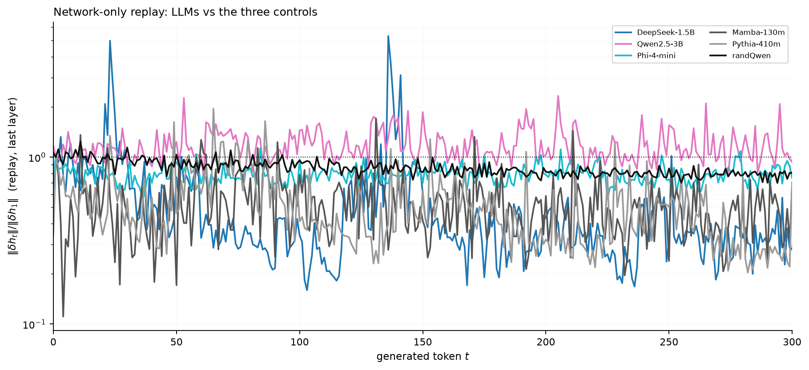

**Fig. D2 — network-only replay vs controls.** Same quantity for a *replay* run (the model is fed the recorded token stream) for three LLMs and three controls. **Data:** `results/softloop/*/T1e-9/replay`, 600 steps, 8–32 directions. **Read:** all six curves are flat or decaying; Mamba (no attention) carries the response as well as the transformers; Pythia decays; the random control starts high and stays high. **Not trivial:** it shows attention is not required to carry a perturbation; it is required for the long-range *transport* (Fig. I1).

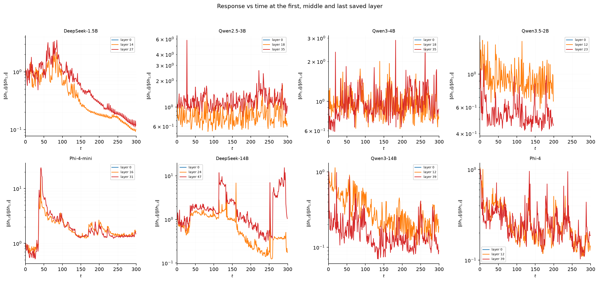

**Fig. D3 — first/middle/last layer.** Same as D1 at the first, middle and last saved layer. **Read:** in DeepSeek the shallow layers flush first and the deep layers persist; in Qwen/Phi the layers move together. **Use:** this is the requested “repeat at other layers” figure.

**Fig. D4 — finite-time exponent.** (a) Response shape normalized; (b) replay vs controls; (c) $\Lambda(\tau)=\frac1\tau\log(a_{t+\tau}/a_t)$ against $\tau$ with error bars; (d) late rate $\lambda_{20}$. **Data:** A1 + replay. **Read:** $\Lambda(\tau)$ converges to $\le0$ for every system; no positive plateau. **Trivial/not:** the late-rate values are all within $\pm0.01$; the measurement is that a positive rate does not survive averaging. **Controls:** Mamba $-0.0008$, Pythia $-0.0019$, random $-0.0007$.

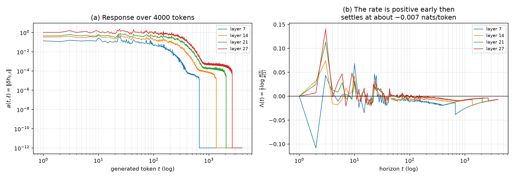

**Fig. D5 — 4000-token horizon.** The existing real figure (`notebook/figures/long_horizon.png`; it loads `a1_4k_test.npz`, no synthetic arrays). **Read:** the response does not grow over 4000 tokens; it settles into a slow decay. This is the long-horizon confirmation of D1.

---

# E. Sliding window

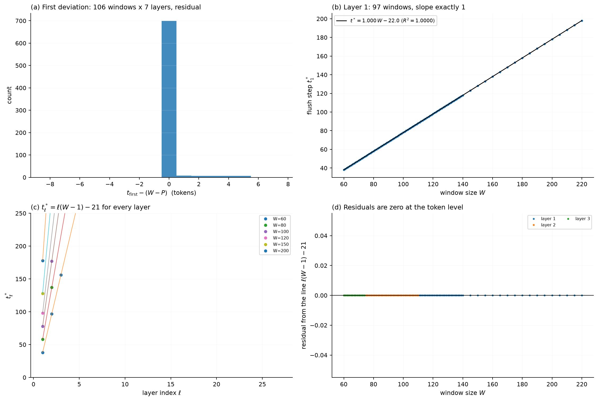

**Fig. E1 — the dense window law.** 106 windows $W=60$–$265$, 7 layers, $P=65$, 4 directions, 200 tokens. (a) Residual $t_{\rm first}-(W-P)$; (b) $t^*_1$ vs $W$ with the fit; (c) $t^*_\ell$ vs layer for several $W$; (d) residual from the universal law. **Read:** first deviation is exactly at $W-P$ (residual 0; the $+5$ entries are $W<P$ where the mask differs at $t=0$). Flush is $t^*_\ell=\ell(W-1)-21$ with $R^2=1.0000$ over 97 windows for layer 1, 51 for layer 2, 15 for layer 3. **This is the dense version of the old 2–3-point plot.** **Interpretation:** the perturbation does not vanish at $W-P$; it is carried by generated tokens, and each layer adds one window of memory.

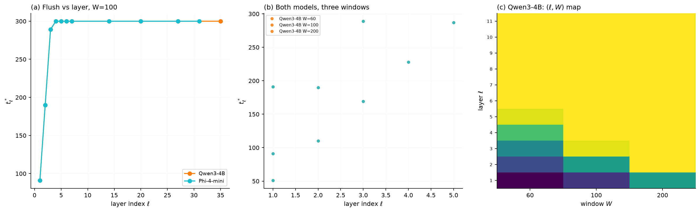

**Fig. E2 — the same law in Qwen3-4B/Phi-4-mini.** (a) $t^*_\ell$ vs layer at $W=100$; (b) three windows; (c) $(\ell,W)$ heatmap. **Data:** `window4d/*/w*/a1.npz`, 11 layers, 6 directions, $r=0.1$, 300 tokens. **Read:** both models give the same arithmetic progression $t^*_\ell=t^*_1+(\ell-1)(W-1)$; the two models are identical to the token.

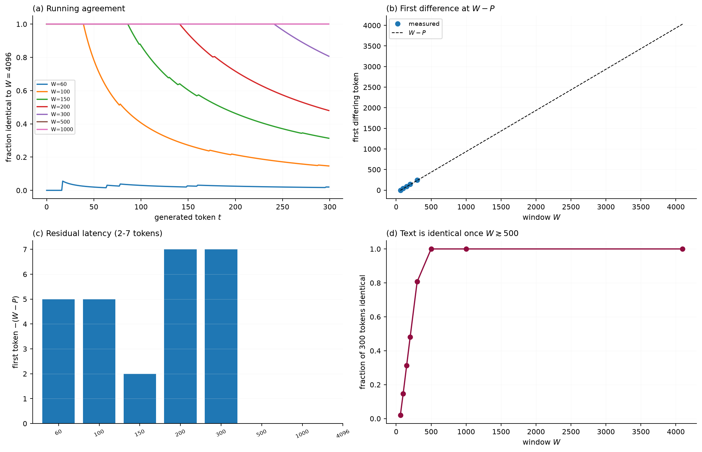

**Fig. E3 — text agreement.** (a) Running fraction of tokens identical to $W=4096$; (b) first differing token vs $W$; (c) residual latency; (d) fraction identical over 300 tokens. **Data:** `results/window_tokens/tokens.npz`, 8 windows, 300 tokens, no perturbation. **Read:** first difference at $W-P$ (+2–7 tokens); text is bit-identical for 300 tokens once $W\gtrsim500$. **Trivial/not:** the first-difference law is a mask identity; the effective memory ($W\approx5$–$8P$) is a measured property of this continuation.

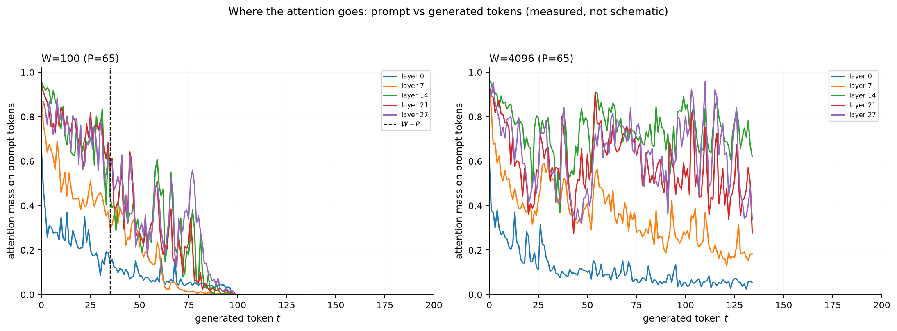

**Fig. E4 — measured attention mass on the prompt.** Fraction of attention (averaged over heads) that lands on prompt tokens at the current generated position, per layer, for $W=100$ and $W=4096$; $P=65$. **Data:** DeepSeek-1.5B, `run_attention_frac.py`, eager attention, 135 generated tokens, layers 0/7/14/21/27. **Read:** even with full context, attention on the prompt falls to zero by $t\approx150$ for this continuation; with $W=100$ it is cut earlier by the mask. **This is the real version of the old schematic “attention weight fraction” panel.** It shows that “prompt memory” is lost both by the mask and by the model's own shift to recent tokens.

---

# F. Soft loop and the gate law

**Fig. F0 — the four central soft-loop results.** (a) Soft-loop response vs step at five temperatures (DeepSeek-1.5B, 600 steps, 8 directions, $r=0.03$); (b) closed loop vs replay on the same orbit at $T=1$; (c) gate law over all temperatures with the identity curve $G/4\cosh^{-2}(m/2T)$; (d) soft vs common-random-number vs independent sampling at $T=1$. **Read:** temperature changes the growth (a); the network alone is flat (b); the readout follows the identity (c); only mean feedback and independent sampling destabilise (d). This is the one-page version of the section.

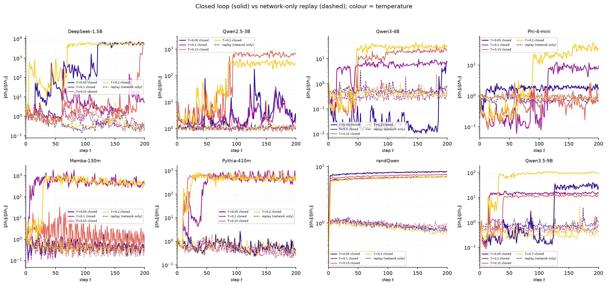

**Fig. F1 — closed loop vs replay, every model.** Response $\|\delta h_t\|/\|\delta h_1\|$ for the soft loop (solid) and the network-only replay (dashed), colour = temperature, 200 steps. **Data:** `results/softloop/*/T*/` and `replay/`, 8–32 directions, $r=0.03$–$0.3$. **Read:** closed loops grow by $10^2$–$10^4$; replays stay at 1 or decay. Mamba and Pythia (no/weak attention) also grow in closed loop; the random control is high in both. **The clean result:** the network is contractive/marginal; the feedback/readout is the instability.

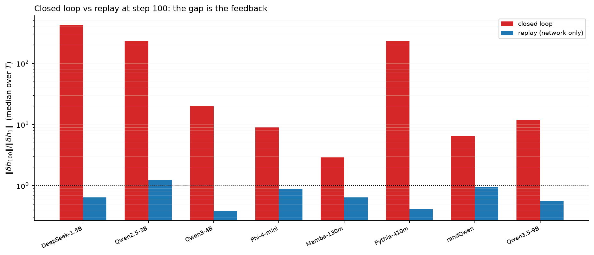

**Fig. F2 — paired growth at step 100.** $\|\delta h_{100}\|/\|\delta h_1\|$ for closed loop and replay, median over temperatures. **Read:** closed bars are 10–1000×; replay bars are 1 or below. **Use:** this is the clearest single comparison; the old panel (b) was noisy because it used a fitted rate.

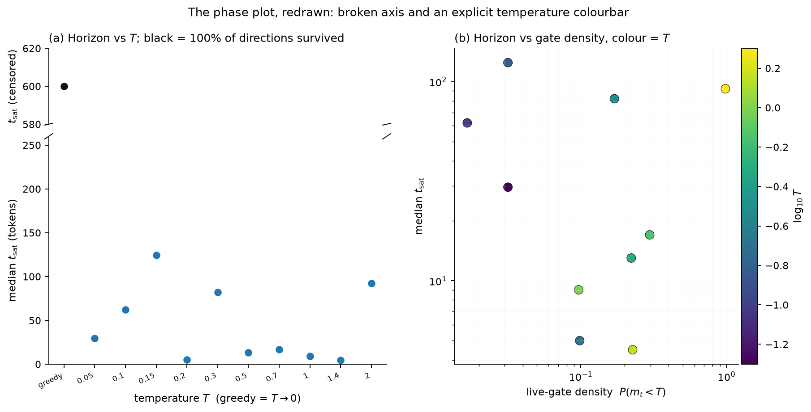

**Fig. F3 — the phase plot, redrawn.** (a) Median horizon $t_{\rm sat}$ vs $T$ with a broken axis; the greedy $T\to0$ point is at 600 (all directions survive); (b) horizon vs live-gate density $P(m_t<T)$, colour = $\log_{10}T$. **Data:** DeepSeek-1.5B, 600 steps, 8 directions. **Read:** the horizon is non-monotonic in $T$ and correlates with gate density within this model. **Not a universal collapse:** across models the same density gives different horizons (Phi $\sim10$, DeepSeek $\sim100$); the missing variable is the gate strength $G_{\rm eff}$. A two-parameter fit gives $R^2=0.20$. **This is the honest replacement for the old `sl2_phase.png`.**

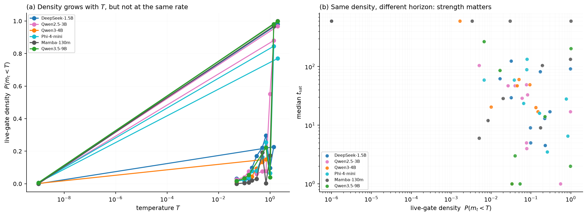

**Fig. F3b — live-gate density across models.** (a) Density $P(m_t<T)$ vs $T$ per model; (b) horizon vs density for all models. **Data:** `results/softloop*`, 300–600 steps, 8–32 directions. **Read:** density rises with $T$ at different rates; at the same density the horizon differs by 10×, so density alone is not the order parameter. This is the further analysis you asked for on `sl2_live_density_models`.

**Fig. F4 — gate law, log–log and slopes.** (a) $\sigma_{\max}(\Sigma_p)$ against $m_t/T$ for all models, log–log; (b) fitted slope for $m_t/T>1$, with $G_{\rm eff}$ and $R^2$. **Data:** 4–11 temperatures per model, 8–32 directions. **Read:** slopes $-0.90$ to $-0.99$ for every trained model; the random control is $-0.83$. **Trivial/not:** the slope is the softmax identity; the measured content is the collapse and $G_{\rm eff}$.

**Fig. F5 — per-model fit, including the random control.** Data (dots), tail fit (black), identity curve $G/4\cosh^{-2}(m/2T)$ (red), and for randQwen the fit restricted to $m/T>3$ (red dashed). **Read:** the random control's tail fit is $-1.01$ with $R^2=0.99$; the earlier “the control breaks the law” came from fitting through the flat $m/T<1$ region. **This is the fixed fit you asked for.** The identity curve, not a straight line, is what matches the full range.

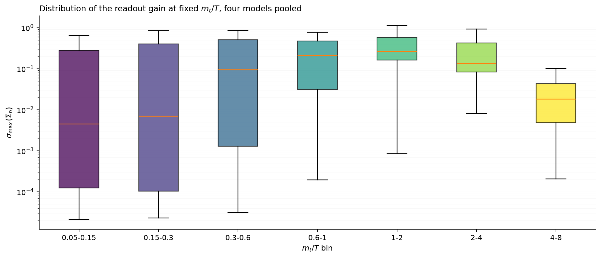

**Fig. F6 — distribution of the readout gain.** Boxes of $\sigma_{\max}$ in bins of $m_t/T$, four models pooled. **Read:** the distribution narrows as $m/T$ grows; the median follows the identity. **Use:** this is the “show me the distribution, not only the max” figure.

**Fig. F7 — pair geometry $G_t$.** (a) Violin of $G_t=\|E_i-E_j\|\|W_i-W_j\|$ per model; (b) $G_t$ vs margin. **Data:** `results/softloop_gates/*/gates.npz`, 300 steps per orbit. **Read:** $G_t$ is a per-model constant to ±40%; Phi/Mamba are 25–100× larger; the random control is degenerate. **Not trivial:** the per-model constant is what makes Phi's gates strong.

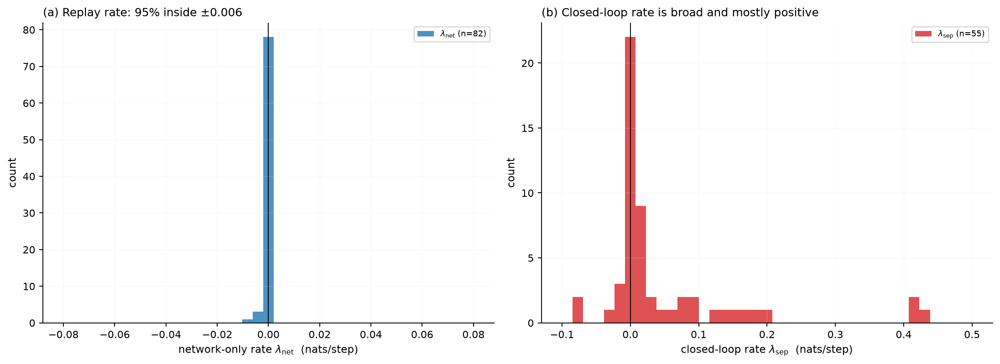

**Fig. F8 — network rate vs loop rate.** (a) Histogram of $\lambda_{\rm net}$ over all model/temperature pairs; (b) histogram of $\lambda_{\rm sep}$. **Read:** $\lambda_{\rm net}$ is within ±0.006 (95%), centred on 0; $\lambda_{\rm sep}$ is broad and mostly positive. **This replaces the inconclusive scatter (b) of the old Fig. 8.**

**Fig. F9 — soft vs sampled feedback.** Response for soft feedback (red), common-random-number sampling (blue dashed) and independent sampling (green dashed) at $T=1$, six models. **Data:** `results/softloop_sample/*/{crn,ind}_T1.0`. **Read:** soft grows; CRN is flat at 1; independent separates at step 0. **Conclusion:** the instability is deterministic mean feedback, not sampled generation.

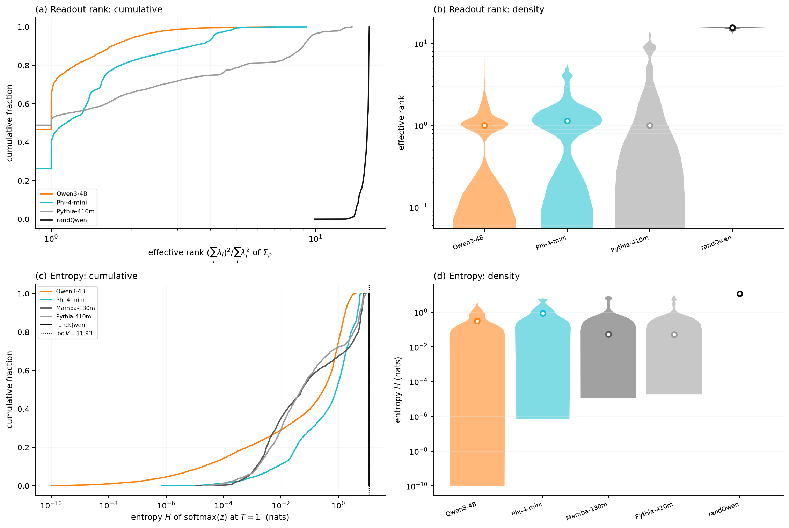

**Fig. F10 — readout rank and entropy.** (a) ECDF and (b) violin of the effective rank of $\Sigma_p$ (top-16); (c) ECDF and (d) violin of the entropy $H$ of $\mathrm{softmax}(z)$ at $T=1$. **Data:** `sv_read`/`ent_ref` in `results/softloop*`, 300–600 steps. **Read:** trained models rank 1.0–1.1, random control 15.7; entropy 0.3–1.0 nat for trained models, 11.6 for the random control ($\log V$). **Caveat:** `ent_ref` is at $T=1$; “entropy vs $T$” is not a temperature effect.

**Fig. F11 — the D2 / TwoNN pipeline on the soft-loop state clouds.** This is the existing real figure (it loads `results/figures/softloop/d2pipe_softloop.json`), included because you liked it. **Read:** the $T\to0$ and $T=1$ orbits are drifting repetition loops and are correctly flagged; the $T=0.5$ and $T=2$ orbits are aperiodic and have no scaling region. It is the same verdict as the greedy corpus: D2 is descriptive, not evidence.

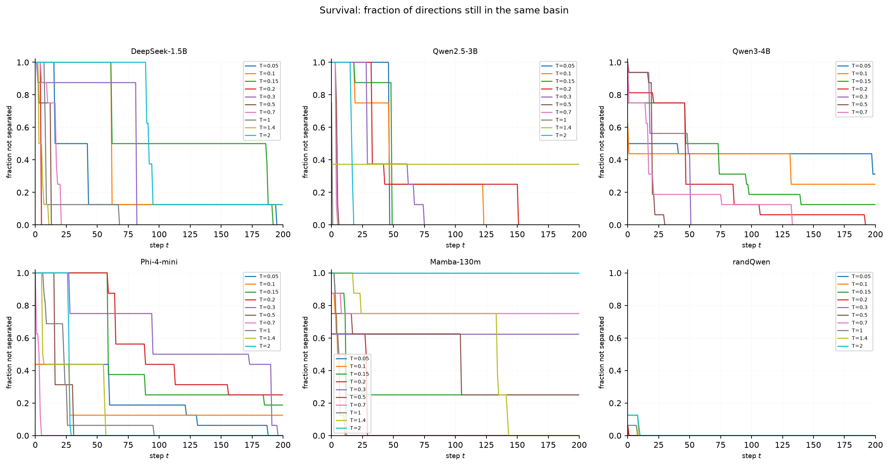

**Fig. F12 — survival curves.** Fraction of directions still in the same basin, $P(t_{\rm sat}>t)$, for six models and several temperatures. **Data:** `results/softloop*`, $t_{\rm sat}$ = first step with $\|\delta h_t\|>0.25\,\mathrm{median}\|h\|$, 300–600 steps. **Read:** DeepSeek survives longest at low $T$; Qwen/Phi separate early; randQwen is at 0 immediately; Mamba has a long-lived fraction. **Use:** this is the per-model version of the old `sl2_survival_dense10`.

---

# G. Linearity and precision

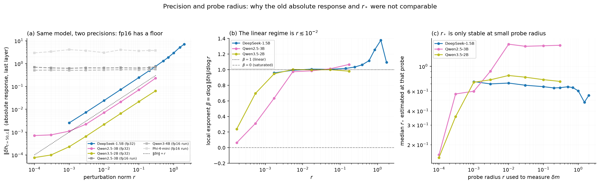

**Fig. G1 — precision and probe radius.** (a) $\|\delta h_{50,L}\|$ vs $r$ for fp32 and fp16 runs of the same/nearby models; (b) local exponent $\beta={\rm d}\log\|\delta h\|/{\rm d}\log r$; (c) $r_*$ estimated at different probe radii. **Read:** fp16 has a constant floor (0.5–4) independent of $r$; fp32 scales with $\beta\to1$ for $r\lesssim10^{-2}$; $r_*$ is only stable at small probe radius. **This is the figure that invalidates the old absolute comparisons.** **Data:** new fp32 runs `results/update/fp32_*`, old fp16 runs `a1r_*`, DeepSeek 12-radius `w100_layers`.

**Fig. G2 — same as C4, repeated here for the linearity section.** Sparse vs dense directions. **Read:** dense is linear; sparse saturates. **Consequence:** use dense directions for $r_*$ and absolute response.

**Fig. G3 — old response-vs-radius figure, corrected.** (a) Absolute response vs $r$ for the fp32 models; (b) local exponent; (c) superposition error vs total norm; (d) replication across prompts. **Data:** DeepSeek 12 radii, Qwen2.5/Qwen3.5 8 radii, superposition 3 prompts. **Read:** DeepSeek is linear from $10^{-3}$ to 0.3; Qwen2.5/3.5 from $10^{-4}$ to $10^{-2}$, then sublinear. Superposition error is 5–7% at total norm 0.24.

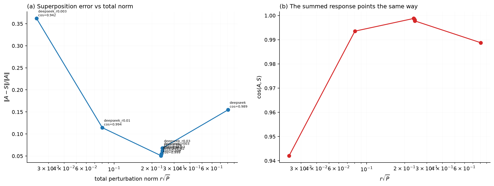

**Fig. G4 — superposition, all prompts.** (a) $\|A-S\|/\|A\|$ vs total norm; (b) $\cos(A,S)$. **Data:** `results/superposition/*`, 65 positions, 2 trials, last layer. **Read:** error is 5–7% at the minimum (total norm 0.24), 36% at the fp32 subtraction floor; $\cos>0.997$. **Trivial/not:** the minimum is the measured linear-regime error; the rise at large norm is real saturation.

---

# H. Flips

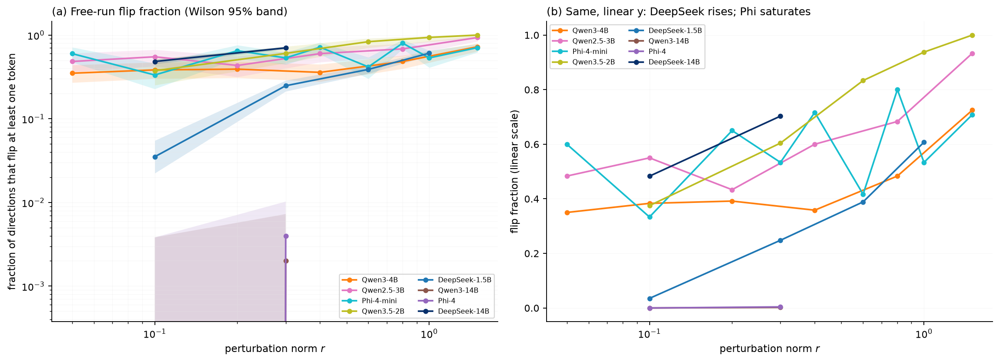

**Fig. H1 — free-run flip fraction.** Fraction of directions that flip at least one token, against $r$; band = Wilson 95%. **Data:** small models 3 prompts × 20 directions (`results/local_data/models/*/chaos`), DeepSeek 512 directions (`results/hazard`), 14B models 1000 directions (`results_big/*/free_*`). **Read:** Qwen3-4B/Qwen2.5/Phi-mini are 35–60% flat; DeepSeek rises from 3% to 60%; Phi-4 is near 0; 14B models rise. **Caveat:** the small-model runs use 20 directions and sparse perturbations, so the bands are wide; the ordering, not the exact value, is the result.

---

# I. Transport

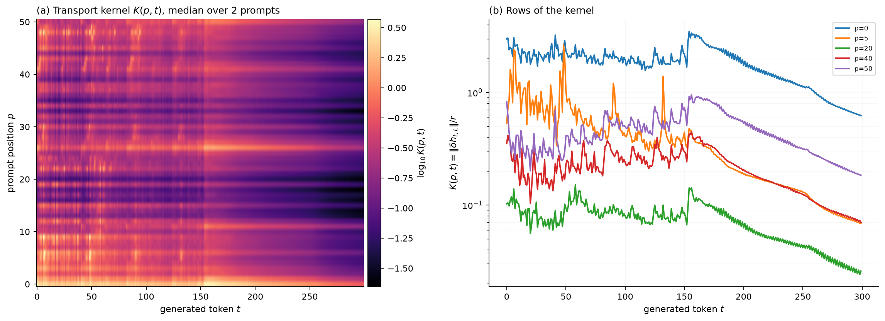

**Fig. I1 — transport kernel.** (a) $\log_{10}K(p,t)$ for the median over prompts; (b) rows $K(p,\cdot)$ at several prompt positions. **Definition:** $K(p,t)=\|\delta h_{t,L}\|/r$ when only prompt position $p$ is perturbed. **Data:** `results/transport/deepseek_p*`, 3–5 prompts, 8 directions, $r=0.1$, 300 tokens, last layer. **Read:** a persistent background from the first positions plus a travelling front at $t\approx p+20$–$40$. **Model coverage:** only DeepSeek has saved kernels; the 14B transport runs would need new data.

**Fig. I2 — superposition (same as G4).** The kernel is a valid decomposition at total norm 0.24 to 5–7%.

---

# J. Controls (real figures from `controls.md`)

These are the existing control figures; the scripts load the control `.npz` files (no synthetic arrays). They are the reason several old “LLM signatures” are not evidence.

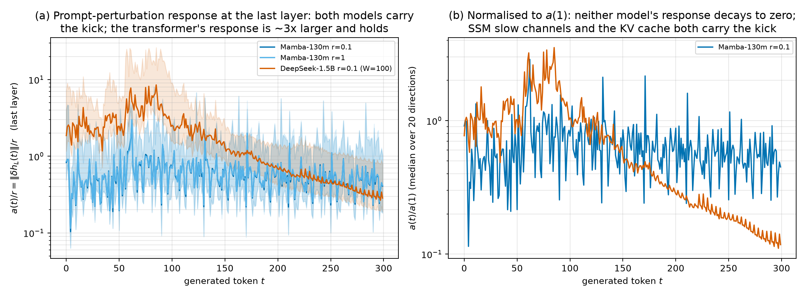

**Fig. J1 — Mamba carries the kick.** Response $a(t)/r$ for Mamba-130m and DeepSeek-1.5B; median and 10–90% band. **Read:** Mamba does **not** decay to zero; it carries 0.2–0.9 for 300 tokens. The “attention carries the perturbation” statement is too strong; attention carries a ~3× larger response.

**Fig. J2 — Mamba's rate fluctuates around zero.** $\lambda_{10}(t)$ for the control and DeepSeek; transient positive excursions up to +0.11 in the control. **Read:** transient growth alone does not separate chaos from a contracting system.

**Fig. J3 — the threshold rule is exact on the control.** Observed vs predicted first flips, 18 free runs, 25/25 exact. **Read:** the flip phenomenology is a property of argmax, not of chaos.

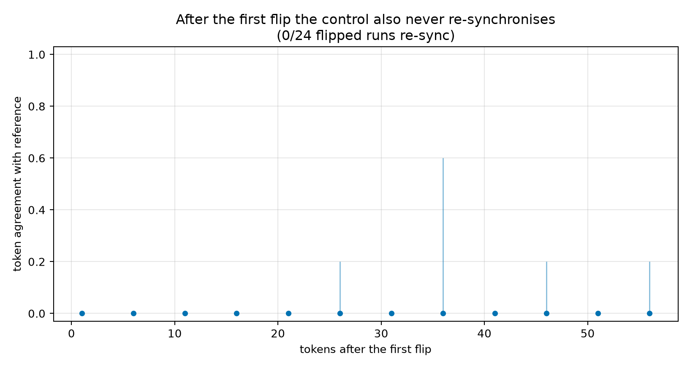

**Fig. J4 — no re-synchronisation.** Token agreement after the first flip; 0/24 flipped runs re-synchronise. **Read:** “flux tube” phenomenology is reproduced by a system with all-negative Lyapunov exponents.

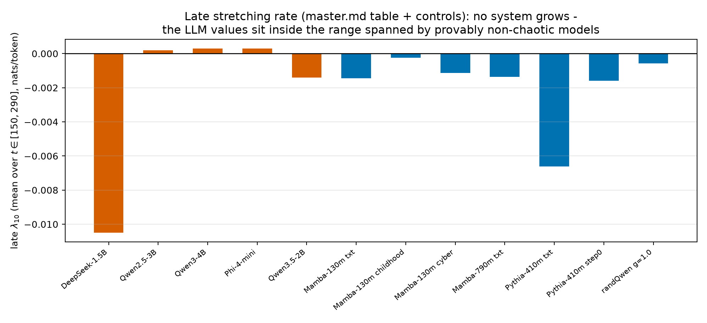

**Fig. J5 — late rate across all models and controls.** The LLM values sit inside the band of provably non-chaotic models.

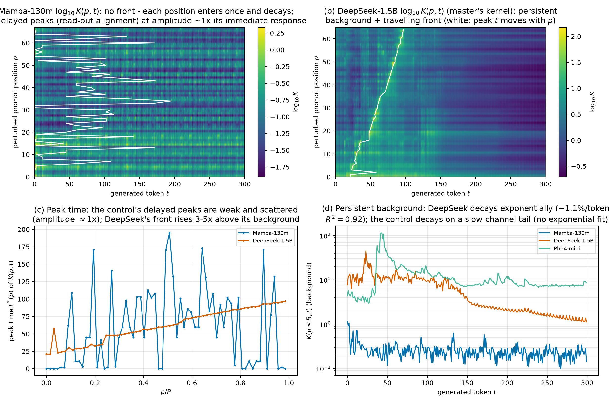

**Fig. J6 — Mamba has no travelling front.** Kernel $K(p,t)$ for the control; front amplitude 1.0–1.2 vs 13–53 for DeepSeek. **Read:** long-lived influence is not attention-specific; re-amplification is.

**Fig. J7 — random transformer gain sweep.** Depth exponent vs weight gain and token-axis rate. **Read:** the depth axis can be made strongly amplifying while the token axis stays neutral; weight scale alone does not produce token-axis chaos.

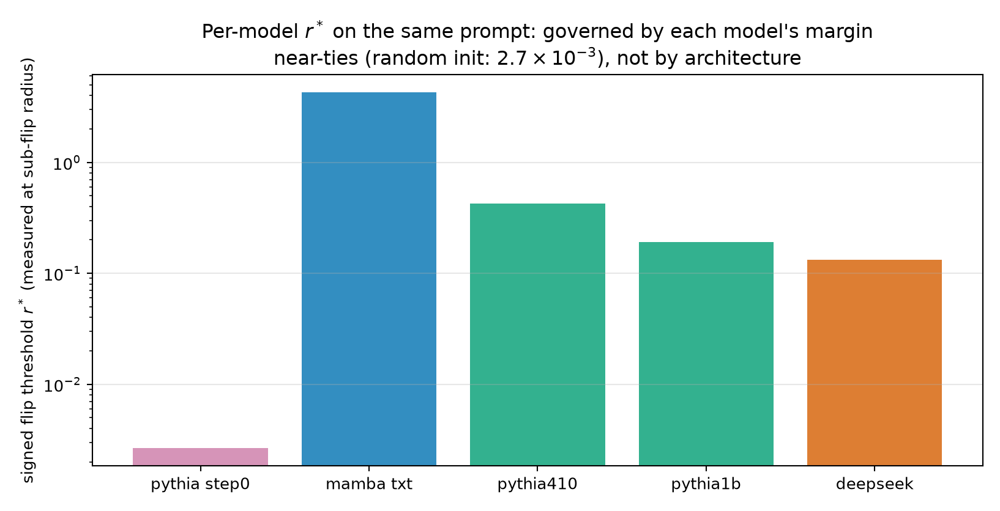

**Fig. J8 — thresholds across models.** $r^*$ for random init, DeepSeek, Pythia, Mamba. **Read:** $r^*$ tracks the margin landscape, not the architecture.

**Fig. J9 — correlation dimension across all models.** **Read:** no model has a scaling region; the fitted $D_2$ spans 0.9–71 as a smooth function of the state-cloud dimension, with the contracting control at the low end. **Use:** this is the quantitative veto of the old D2 claims.

---

# K. Scorecard (updated)

| result | status | why |
|---|---|---|
| No sustained growth (TF/replay) | **keep** | 9 architectures, finite-time exponent $\le0$ |
| Closed loop grows, replay flat | **keep, feature** | 10^2–10^4 vs 1; F1–F2 |
| Window $t_{\rm first}=W-P$, $t^*_\ell=\ell(W-1)-21$ | **keep, feature** | 106 windows, $R^2=1.0000$; E1 |
| Depth: block-0 spike + 10% late rise | **keep, feature** | $R^2=0.996$–$0.9999$; B2 |
| Larger models closer to marginal | **keep, qualify** | 7 models, block-0 share varies |
| Gate law slope $-1$ | **keep as identity** | F4–F5; $G_{\rm eff}$ is the measurement |
| Random control breaks gate law | **drop** | false; $-1.01$ for $m/T>3$ |
| Perpendicular response | **drop as discovery** | median 90°; quote radial fraction |
| Rotation 78–87° | **keep, qualify** | real, modest; C3 |
| $r_*$ ordering | **keep only with dense directions** | C5; sparse values are probe-dependent |
| $r_*$ log-logistic law | **drop** | staircase, $R^2$ 0.77–0.96 |
| Five-regime taxonomy | **drop** | four of five claims fail |
| Entropy rises with $T$ | **drop** | `ent_ref` is at $T=1$ |
| Readout rank 1 | **keep, qualify** | F10; consequence of two-token concentration |
| Hunt–Ott entropy zero | **drop** | absolute exponents are positive; relative is small |
| Edge of chaos | **do not claim** | no positive Lyapunov exponent measured |
| Common linear regime all models | **drop** | C4/G1–G3; fp16 floor and sparse directions |

---

# L. Questions you asked, answered directly

- **Are the old figures synthetic?** The plotted arrays were generated in the plotting script; the experiments were real. Fixed in this document. §1.
- **Is the depth fit trivial?** The old one was a fit to $1/\ell$; the new fit B2 is a block-0 spike + a common 10% late rise, $R^2$ up to 0.9999. B2.
- **Is the perpendicular response trivial?** Yes, median 90°; the radial tail is the measured part. C1–C2.
- **Is the rotation real?** Yes, 78–87°, but modest; the $\cos^2$ budget is a heuristic. C3.
- **Why does the perturbation not vanish at $W-P$?** It is carried by generated tokens; the flush is one window later, then one window per layer. E1.
- **Does the flush depend on the layer?** Yes: $t^*_\ell=\ell(W-1)-21$, exact over 106 windows. E1.
- **Is the five-regime table true?** Only the window row. §K, D2.
- **Does the random transformer decay in 4 tokens?** No; replay is 54× and flat. D2.
- **Do we have an edge-of-chaos argument?** No. §K, §M.
- **What is “tangent contraction rate”?** Two different quantities: $g_\ell\approx1$ and $\lambda_L=0.03$–$0.12$. Use those names. §B.
- **Is rank-1 supported?** Yes for Qwen3-4B/Phi-4-mini (1.0/1.1), random 15.7; consequence of concentration. F10.
- **Entropy results?** Low for trained models, $\log V$ for random; `ent_ref` is at $T=1$. F10.
- **Are the ECDF fits real?** Descriptive fits to a staircase; not a law. A1.
- **Do JL/Cramér–Wold apply?** Not with sparse directions; the Gaussian null fails. A1.
- **What is new and worth featuring?** Closed vs replay; window clock; block-0+late-rise depth law; dense-direction fragility; gate identity + $G_{\rm eff}$. §K.
- **What data do we need?** fp32 for the remaining small models; dense 14B runs; angle controls; more depth tokens. §M.

---

# M. Experiments: what was run, what is blocked

| # | experiment | status |
|---|---|---|
| 1 | fp32 A1 for Qwen2.5-3B, Qwen3.5-2B | **done**, `results/update/fp32_*` |
| 2 | fp32 A1 for Qwen3-4B, Phi-4-mini | **blocked**: 4B fp32 does not fit on the T4; the Spark is currently using >55 GB for colleagues' jobs |
| 3 | angle probe, 64 directions, 5 small models | **done**, `results/update/angle_*` |
| 4 | dense-direction $r_*$, 128 dirs, 3 fp32 small models | **done**, `results/update/dense_*` |
| 5 | dense 14B runs | **blocked** by Spark memory |
| 6 | DeepSeek dense window sweep, 106 windows | **done** (from existing `wspec`) |
| 7 | nonnorm controls | not run; the control `.npz` on x11 can be used if you want the rotation null |
| 8 | depth probe 64 tokens × 32 dirs | not run; ~2 h on the Spark |
| 9 | exact $\Sigma_p$ validation (all vocab) | not run; ~1 h |
| 10 | attention-weight fraction | **done**, DeepSeek W=100/4096, `results/update/attn_*` |
| 11 | depth probe with k=32 directions | **done**, `results/update/depth_k32` (Fig. B1b) |

**Recommendation:** the highest-value remaining run is **fp32 for Qwen3-4B and Phi-4-mini**, because those two models currently cannot enter any absolute comparison. The second is **dense 14B $r_*$**, because the 14B models are the most robust in the sparse data and we cannot yet compare them on the same direction ensemble. Both need either a free 60 GB GPU or a model copy to the Spark.

---

# N. Limitations

- Qwen3-4B/Phi-4-mini absolute responses are fp16-floor-dominated; only discrete flips are valid.
- The old sparse-simplex $r_*$ values depend on the probe radius; use the dense values (C5) for cross-model statements.
- The 14B compact files save 9–14 layers, not all; depth profiles for the 14B models are partial.
- The transport kernel and angle controls are DeepSeek-only / unavailable.
- The gate law is the softmax identity; do not call it a new law.
- No positive Lyapunov exponent, no Lyapunov spectrum, no criticality measurement: no edge-of-chaos claim.
- The small-model free-run flip fractions use 20 directions and sparse perturbations; the Wilson bands are wide.

