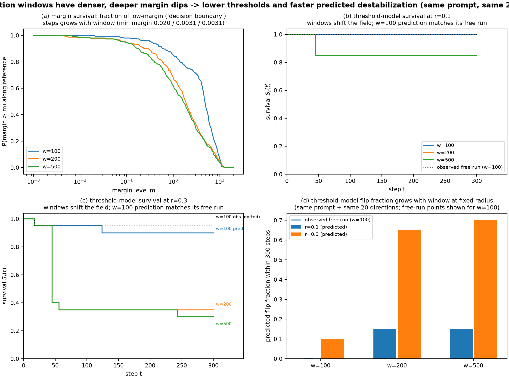
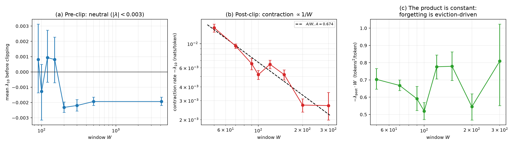
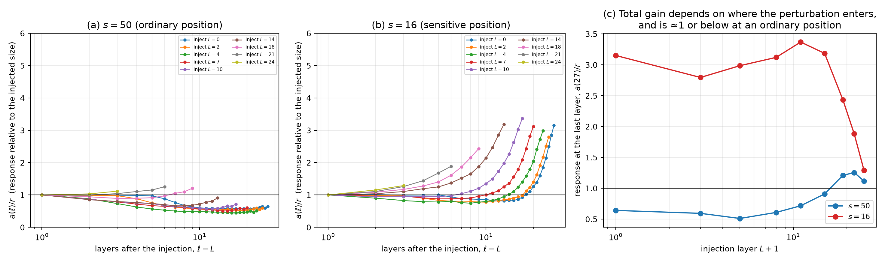
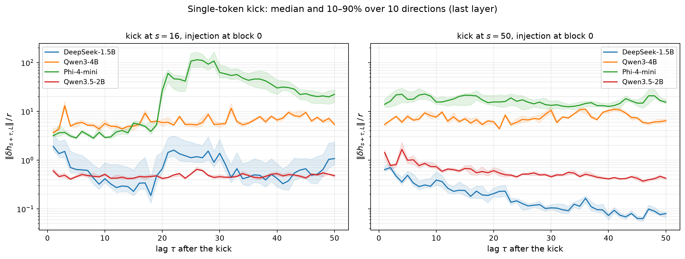
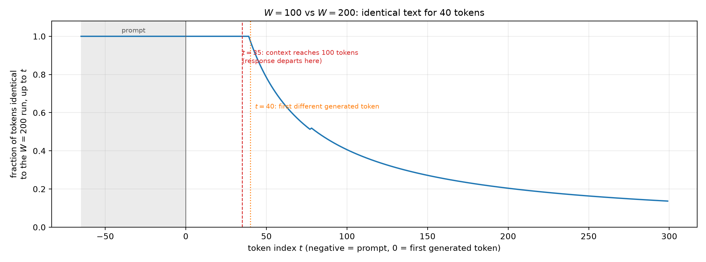
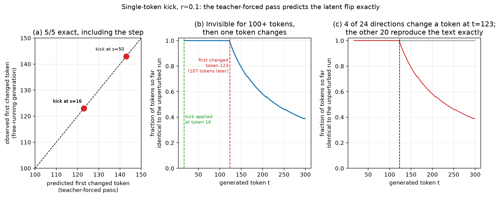
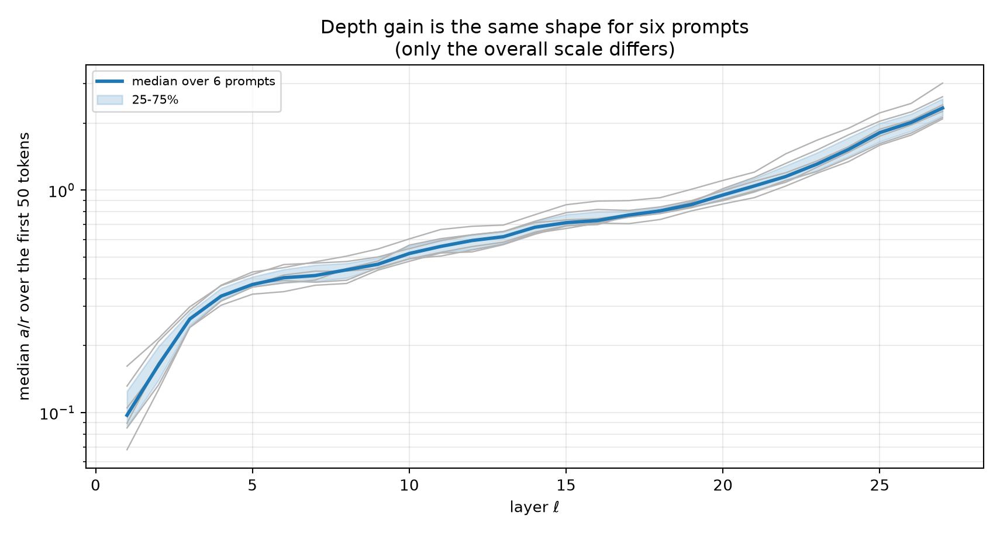
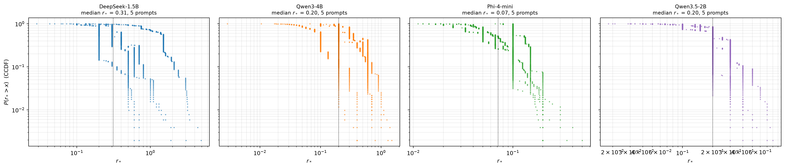

# Veto list — extra results, and whether they belong in the paper

This file vets the figures that are not in `master.md`. For each: what is plotted, how it is computed,
and a verdict — **include**, **include as a caveat**, or **veto** — with the reason. The rule I apply:
*a result is worth including if it is (i) measured, not defined, (ii) not an artefact of the
measurement, and (iii) says something that is not already said better by another figure.*

---

## 1. `stablechaos_windows.png` — margin survival for different windows

**What is plotted.** (a) The fraction of steps whose top-two logit gap exceeds $m$, as a function of
$m$, for three window sizes ($W=100,200,500$). (b),(c) Survival of the threshold model (teacher-forced
margin rule) compared with the free run at two radii. (d) Predicted flip fraction vs window.

**How it is computed.** For each window, run the model greedily, collect the margin at every step, and
plot the complementary CDF. The threshold model uses the teacher-forced margin change per direction.

**Verdict: veto (a); keep (b) as a control only.**
- (a) compares margin statistics across windows, but **a different window produces a different text**.
  The comparison is therefore stream-confounded: it is a statement about two different continuations,
  not about the effect of the window. The differences in (a) are real but not attributable.
- (b) is a consistency check — at $W=100$ the predicted survival matches the observed free run
  (blue dotted vs solid). That is worth one sentence in the methods, not a figure.
- (d)'s "flips grow with window" is a *prediction* for $W=200,500$; only the $W=100$ point is observed.

**Can (a) be fitted?** It is a distribution function, so any smooth CDF would fit; the fit would carry
no dynamical information. Not worth it.

---

## 2. `regime_scaling.png` — the free-forgetting law after the window clips

**What is plotted.** (a) The mean rate $\lambda_{10}$ **before** the window first clips (all $W$): it is
zero within the error bars. (b) The contraction rate **after** the clip, against $W$, log–log, with the
fit $A/W$ and $A=0.674$. (c) The product $\lambda_{\rm post}\cdot W$, which is constant within errors.

**How it is computed.** $\lambda_{10}(t)$ as in the master document, averaged over the interval after
the first prompt token is evicted ($t>W-P$) and before the end. Error bars are bootstrap over
directions.

**Verdict: include as a methods result (panel b), not as a headline.**
This is one of the few clean *quantitative laws* we have: the post-clip contraction rate falls as
$1/W$, and the total log-cost of the post-clip phase, $\lambda_{\rm post}\cdot W$, is constant
(0.5–0.8, consistent with a constant within the error bars). It says: **each eviction event costs a
fixed amount of log-probability, independent of the window**. It is a property of the mask, not of the
model's dynamics, so it belongs in the methods section with the flush law — and it also explains why
the "$W=100$" runs show a decay that disappears at large $W$.

**Why not a headline:** it does not involve the perturbation at all; it is the unperturbed trajectory
losing context.

---

## 3. `layer_probe.png` — where along the depth the amplification happens

**What is plotted.** A one-position perturbation injected at block $\ell_0$ (rows), measured at every
later block and every later token. The quantity is the response of the *same* position at a later
block, or of a later token.

**How it is computed.** Forward hook at the output of block $\ell_0$ adding $r v$ at one position; then
the teacher-forced run records $\|\delta h\|$ at every other position and block.

**Verdict: superseded — do not include this figure; the finding is in `master.md` §8 in a better form.**
The finding is that the downstream amplification does not depend on the injection block over the first
60–75% of the depth (flat curves in `perturbation_vs_depth.png`). The old figure shows the same thing
with fewer statistics and a confusing layout. One clean figure with medians and 10–90% bands is
better than two.

---

## 4. `probe_pulse.png` — the same perturbation resolved in *time* after the injection

**What is plotted.** For a perturbation at position $s$, the response at the last layer as a function
of the lag $\tau$ after $s$ (1–50 tokens), median over directions with a 10–90% band.

**How it differs from master §8.** §8 fixes the lag window (max over 50 tokens) and varies the
*position*; this figure fixes the position and varies the *lag*. Same experiment, two projections.

**Verdict: include as supporting evidence for Phi's hot spot.**
It is the only place where the delayed amplification is visible directly: Phi at $s=16$ is flat for
~18 tokens and then rises to **×120 at lag 25–30**, while DeepSeek decays monotonically. That is a
mechanism-shaped fact (the perturbation is carried, then amplified), and it costs one panel.

---

## 5. `window_token_agreement.png` — token agreement between windows

**What is plotted.** Fraction of generated tokens identical between two window sizes, against the
generated token index.

**Verdict: veto.** The two runs produce different texts by construction, so the curve is a property of
two different continuations, not of the window. It is descriptive and confounded in the same way as
§1(a).

---

## 6. The "latent" perturbation and the token-agreement decay

**What is plotted.** (a) Predicted vs observed first changed token for five perturbations; (b) token
agreement along the continuation for one direction; (c) the same for 24 directions at $s=16$.

**What it shows.** A perturbation at $s=16$ changes the text at **$t=123$ — 107 tokens later**; at
$s=50$ at $t=143$ (93 later). After the change, agreement falls to ~40% and never recovers.

**Verdict: the latency belongs in `master.md` (it is the mechanism); the "decay type" does not.**
- The latency is a strong, non-trivial result: the perturbation does not grow (Part 4) and does not act
  immediately; it waits until the model reaches a close call. That is what "stable chaos" means
  operationally.
- The apparent decay in (b) is **token agreement**, which saturates at a floor (~0.4) because
  continuations re-align on repetitive text. It is not a physical decay of anything. Fitting an
  exponential to it would be fitting text statistics. Veto the fit.

---

## 7. `depth_gain_6prompts.png` — six prompts, absolute response vs layer

**What is plotted.** $\|\delta h_{t,\ell}\|/r$ against layer, six prompts, DeepSeek, median over
directions at $t\le50$; the band is 25–75% over prompts.

**What it shows.** The depth profile has the same shape for every prompt, with a scale that varies by
×1.45 at the last layer.

**Verdict: veto.** The absolute profile is dominated by the growth of the state norm (×18–30), which
we now know is not amplification. The informative version is the *relative* response
(`sigma_vs_relative.png`, panel b), which separates the models. This figure would suggest an
amplification that is not there.

---

## 8. `rstar_1536.png` and the per-model version — the flip radius

**What is plotted.** The complementary CDF of the flux-tube radius $r_*$ for each model: the fraction
of directions whose smallest flipping radius exceeds $x$. 512 directions × 5 prompts per model, log–log.

**How it is computed.** For each direction and each token $t$, $r_c(t)=m_t/(|\delta m_t|/r)$ — the
radius at which that token's margin would reach zero. $r_*(u)=\min_t r_c(t,u)$. Steps whose margin is
below the resolvable gap (0.02) are excluded: they are quantisation ties, not decision gates.

**What it shows.** The scale is model-specific and ordered: Phi **0.07**, Qwen3-4B and Qwen3.5
**0.20**, DeepSeek **0.31** (medians). The curves are staircases, because the minimum over $t$ lands on
a handful of discrete ratios, and their shapes differ across prompts.

**Verdict: include the *scale*, not the law.**
The ordering "Phi is the most fragile, DeepSeek the least" is stable across five prompts per model and
matches the amplification ordering in the master document. The distribution itself has no universal
shape (fitted tail exponents range 2.3–17.6 and the median varies 15× across prompts), so any statement
of the form "the distribution is a log-logistic" should be removed. One panel with the four models and
the medians is enough.

---

## 9. Two figures from the earlier list that I would drop from the paper

**`threshold_largr.png`** (predicted vs observed flip time at $r=0.5$–2): the axes span 300 tokens
while the data occupy 0–50, one prompt is 20/20 exact and the other is 1–6/20, and the comparison is
only meaningful where the margin response is still linear. **Veto.** The one-sentence version —
"the rule is exact up to $r\approx0.3$ and becomes an extrapolation beyond" — belongs in the text.

**`flip_fraction_512.png`** as a headline: it is dominated by zero-margin ties (3.5% → 0.4% after
removing one token). **Include only as a caveat** in the methods, with the tie-corrected numbers.

---

## 10. Summary table

| figure | verdict | why |
|---|---|---|
| `stablechaos_windows` | veto | stream-confounded; distribution, not dynamics |
| `regime_scaling` (b) | **include (methods)** | clean $1/W$ law of the mask |
| `layer_probe` | superseded | replaced by `perturbation_vs_depth` |
| `probe_pulse` | **include (support)** | delayed ×120 amplification in Phi |
| `window_token_agreement` | veto | two different texts |
| latent perturbation, *latency* | **include (master)** | the perturbation waits 107 tokens |
| latent perturbation, *decay fit* | veto | token agreement, not a physical decay |
| `depth_gain_6prompts` | veto | it is the state norm, not amplification |
| `rstar` per model | **include (scale only)** | ordering stable, shape not universal |
| `threshold_largr` | veto | axes and range make it unreadable; text suffices |
| `flip_fraction_512` | caveat only | tie-dominated |

**Net effect on the paper:** two additions (the $1/W$ forgetting law and the latency), one supporting
panel (Phi's delayed amplification), one qualitative panel ($r_*$ scale), and seven vetoes.
