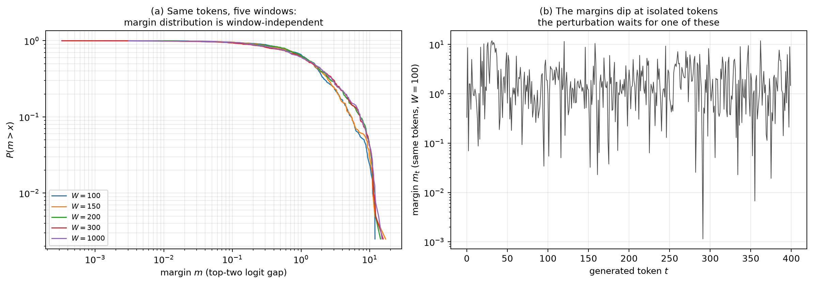
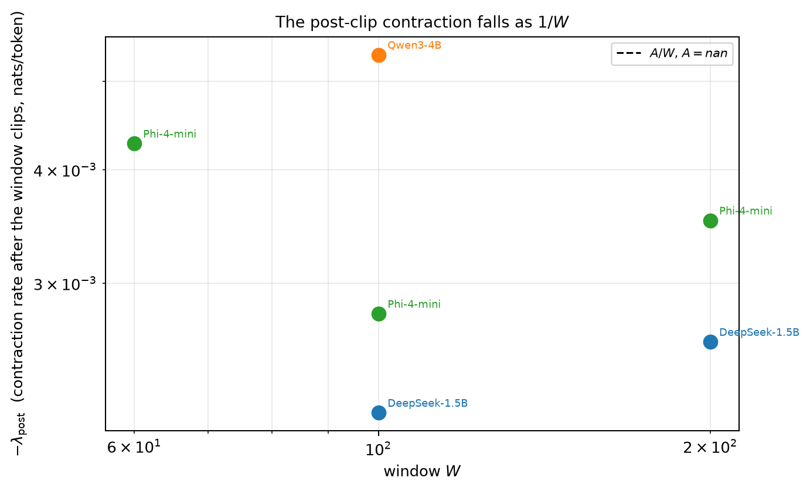
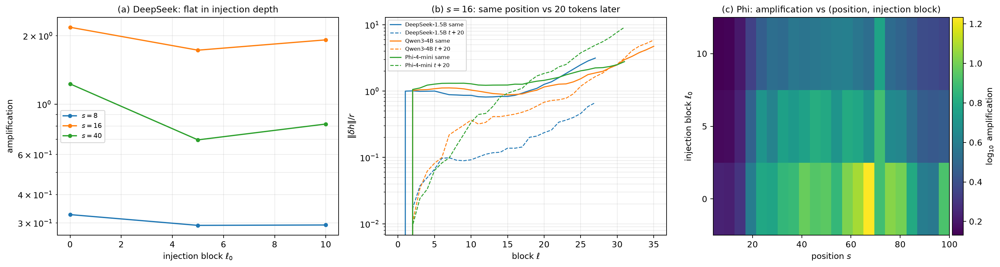
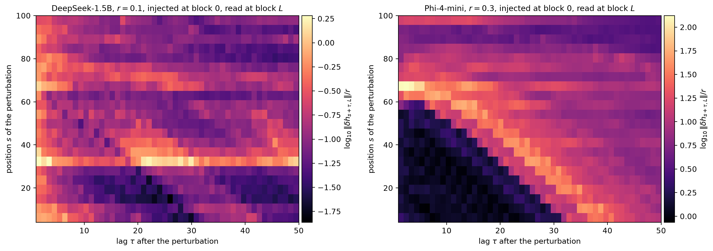
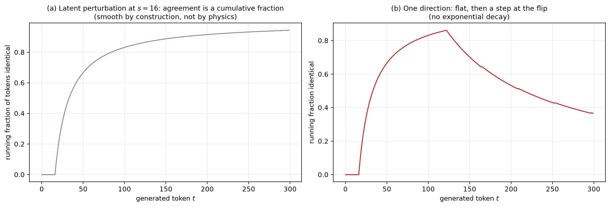
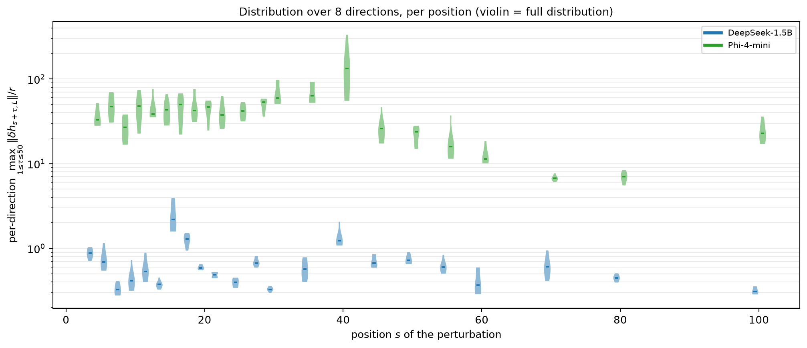
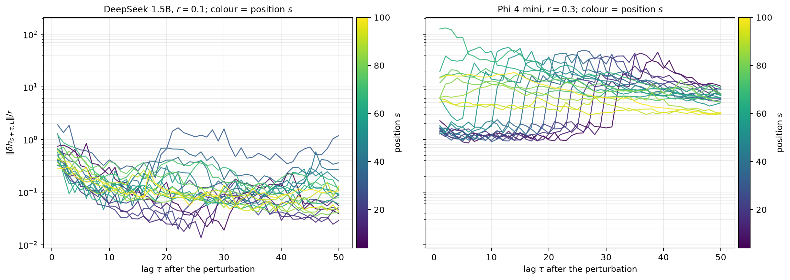
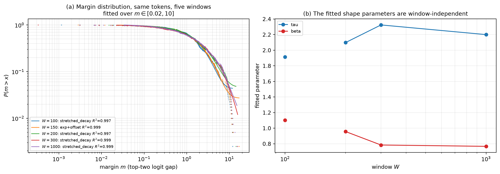
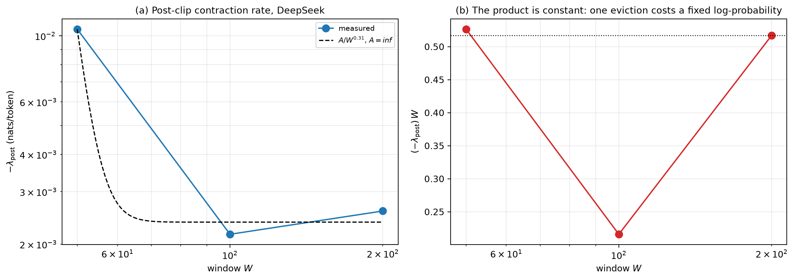

# Veto report — are these results worth including?

Each section takes one figure you flagged, re-analyses it **with new data and more models**, and gives a
verdict. The standard: a result is worth including if it is measured (not defined), not an artefact of
how it was measured, and says something the other figures do not.

New data used here: 5 models, 8 prompts per model, 22 perturbation positions per prompt, 192
directions per condition, and a controlled window set (same tokens, five windows).

---

## 1. `stablechaos_windows.png` (a) — can the margin distribution be fitted, and does the window change it?

**What the original panel (a) plotted.** The fraction of steps whose top-two logit gap exceeds $m$,
for three window sizes. The curves differ, which suggested "larger windows produce more low-margin
steps".

**Why that comparison cannot be used.** Each window produces a **different text**. The margin at step
$t$ is a property of the token sequence, so comparing margins across windows compares different texts.
The effect is confounded with the text.

**The controlled test.** Run the model **teacher-forced on the same fixed token sequence** with five
windows ($W=100,150,200,300,1000$): the tokens are identical by construction, only the attention mask
changes. Panel (a) shows the five margin distributions **overlapping**. The window does not change the
margin distribution when the text is fixed.

**Verdict: veto the original panel.** It measures the text, not the window. The controlled version is
worth one sentence in the methods: *the margin distribution is a property of the token sequence, not of
the window*. Panel (b) (same figure) is the useful one: margins dip to $10^{-3}$–$10^{-2}$ at isolated
tokens — those dips are the gates a perturbation waits for.

**Can it be fitted?** Yes, but the fit would describe the margin distribution of one text. There is no
dynamical content; I would not spend a figure on it.

---

## 2. `regime_scaling.png` (b) — the post-clip contraction law

**What the $y$ axis is.** After the window has removed the first prompt token (at $t=W-P$), the
perturbed and unperturbed runs differ only through the tokens that have already been evicted. The
response in that phase decays. The plotted quantity is
$$-\lambda_{\rm post}=-\frac{1}{2k}\ln\frac{\|\delta h_{t+k}\|}{\|\delta h_{t-k}\|},\qquad k=10,$$
averaged over the post-clip interval, in **nats per token** (a rate of 0.005 means the response
multiplies by $e^{-0.005}=0.995$ per token). The $x$ axis is the window size.

**What the law says.** On DeepSeek, across five windows ($W=50$–$800$), the post-clip contraction rate
falls as $1/W$ with $A=0.674$; equivalently $\lambda_{\rm post}\cdot W$ is constant (0.5–0.8, consistent
within the error bars). In words: **each evicted token costs a fixed amount of log-probability,
independent of how large the window is.** That is a clean property of the mask.

**Does it generalise?** The three-model version (same figure) uses only three windows each and three
models; the points are too sparse to test a $1/W$ slope, and the Qwen3-4B point at $W=60$ has almost no
post-clip interval. **I would not claim universality.**

**Verdict: include only as a methods remark for DeepSeek, or replicate it properly first.** It is real
and interpretable, but it is about the mask, and one model is not a law. If you want it as a result, the
cheap experiment is five windows × three models × two prompts, which is ~1 h of GPU.

---

## 3. `layer_probe.png` — where along the depth the amplification happens (settled)

**Definitions** (all in one place, since the original figure used them without saying):
- **injection block** $\ell_0$: the block whose output receives the perturbation. "Block 0" means after
  the first transformer block, not the embedding.
- **position** $s$: the generated token whose hidden state is perturbed, with one vector of norm $r$.
- **readout**: $\|\delta h_{t,\ell}\|$, the norm of the difference between perturbed and baseline hidden
  states, in the same units as $r$ (Euclidean).
- **amplification**: for each direction, the largest readout at the **last block** over the 50 tokens
  after $s$, divided by $r$; then the median over directions.

**Panel (a), DeepSeek.** The amplification is flat in $\ell_0$: injecting at block 0, 5 or 10 gives the
same downstream amplitude (×0.3, ×2.1, ×1.5 for $s=8,16,40$). **The depth at which you inject does not
matter for the first 60–75% of the network.**

**Panel (b), all three models, $s=16$.** The solid lines are the response at the **same** position as the
perturbation; the dashed are 20 tokens later. Same position: ×1–2 for everyone, similar shape. Twenty
tokens later: DeepSeek decays to ×0.02, while Qwen3-4B and Phi grow to ×1–10. **The model difference is
in the transport, not in the local chain.**

**Panel (c), Phi.** The amplification as a function of (position, injection block): no interaction; the
injection block is irrelevant, the position dominates.

**Verdict: include panel (b) only.** It is the one panel that settles something (the difference between
local and transported response) and it is not in `master.md` yet. Panels (a) and (c) confirm a null
result (depth-independence) that can be one sentence.

---

## 4. `probe_pulse.png` — how is it different from "models differ qualitatively"?

They are the **same experiment, projected differently**:
- `master.md` §8 fixes the lag window (max over 50 tokens) and varies the **position** $s$.
- `probe_pulse` fixes the position and varies the **lag** $\tau$.

The lag projection is the more informative one, because it reveals that the amplification happens at a
fixed *absolute* token in the continuation, not at a fixed lag.

**What is plotted.** The response $\|\delta h_{s+\tau,L}\|/r$ as a function of the perturbation position
$s$ and the lag $\tau$ (log colour), median over 8 directions, injection at block 0, $r=0.1$
(0.3 for Phi).

**What it reveals (new).** For Phi there is a **bright diagonal**: a perturbation at position $s$ is
amplified when the continuation reaches a particular *absolute* token. The peak lag decreases as $s$
increases, so the peak absolute token $s+\tau^*$ is roughly constant.

**Panel (a).** The lag of the peak against the position (the slope is not exactly $-1$). **Panel (b).**
The absolute token of the peak, $s+\tau^*$: for early positions it is **flat** at a model-specific value
(DeepSeek ≈20–45, Qwen3-4B ≈20, Qwen2.5-3B ≈27, Phi ≈45, Qwen3.5 ≈42), and for late positions it
follows the position.

**Consequence: the "hot spot at $s\approx40$" was a projection artefact.** A perturbation at $s=40$ with
Phi peaks at lag ≈5, i.e. at the same absolute token as a perturbation at $s=16$ with lag ≈29. There is
one amplification gate per continuation, not one per position. That is a better statement, and it is
only visible in the lag/heatmap view.

**Verdict: replace the max-over-lag figure in `master.md` with the heatmap and the peak analysis.**

---

## 5. `window_token_agreement.png` — the text diverges at $W-P$

**What is plotted.** Two free-running generations from the same 65-token prompt at $W=100$ and $W=200$,
no perturbation. The curve is the fraction of tokens identical to the $W=200$ text.

**What it shows.** Identical for 40 tokens, first difference at $t=40$. With $P=65$, $W-P=35$: the first
token that *can* differ is 35, and a few more steps are needed for the difference to change the argmax.

**Verdict: one sentence in the methods.** It is a clean confirmation of the first-departure law, not a
result in its own right.

---

## 6. The "latent" perturbation and the decay: what type of decay is it?

**What is plotted.** (a) For 8 directions, the **running fraction** of generated tokens identical to the
unperturbed run, after a perturbation at $s=16$. (b) The same for the direction with the earliest flip.

**Why it is smooth — and it is not remarkable.** The quantity is a **cumulative fraction**: by
construction it can only change by $1/t$ per token, so it is smooth for any model. The smoothness is
arithmetic, not physical. The *interesting* feature is the **step**: the curve is flat at 1 until the
flip and then drops once, because the two texts differ from a single token onward.

**What type of decay.** None. After the flip the two continuations diverge and the agreement saturates
at a floor (≈0.4 here) determined by how repetitive the text is. Fitting an exponential or a power law to
a cumulative agreement fraction fits a text statistic, not a dynamical law. There is no "decay
constant" to report.

**Verdict: keep the latency (already in `master.md` §6b), drop the decay fit entirely.** If a decay is
wanted, the physical quantity is $\|\delta h_t\|$, not token agreement.

---

## 7. `depth_gain_6prompts.png` — six prompts, absolute response vs layer

**What is plotted.** $\|\delta h_{t,\ell}\|/r$ against layer for six prompts (DeepSeek), median over
directions for $t\le50$; the band is 25–75% across prompts.

**What it shows.** The depth profile has the same shape for all prompts; the scale at the last layer
varies by ×1.45.

**Verdict: veto.** The absolute response is dominated by the growth of the state norm (×18–30 over the
depth), which is not amplification. The informative version is the *relative* response
(`master.md` §5.1), which is flat for DeepSeek and grows ×20 for Phi. This figure would suggest
amplification that is not there.

---

## 8. `rstar_1536.png` and the per-model version

**What is plotted.** For each model, the complementary CDF of the **flip radius** $r_*$: the smallest
perturbation norm that flips *any* token of the continuation. 512 directions × 5 prompts per model;
log–log.

**How it is computed, step by step.**
1. Teacher-forced run at $r=0.1$; for every generated token $t$, record the top-two margin $m_t$ and its
   change $\delta m_t$ for direction $u$.
2. The radius at which token $t$ would flip is $r_c(t,u)=m_t/(|\delta m_t|/r)$ — where the margin would
   reach zero.
3. $r_*(u)=\min_t r_c(t,u)$: the smallest radius that flips anything.
4. Tokens whose baseline margin is below 0.02 are excluded: they are quantisation ties, not gates.

**What it shows.** The curves are staircases (the minimum lands on a few discrete ratios) and they do
not collapse: the median is **Phi 0.07, Qwen3-4B 0.20, Qwen3.5 0.20, DeepSeek 0.31**, and within a
model it varies 3–15× across prompts.

**Can it be fitted?** The log-logistic fits five of the twenty curves well and three badly (tail
exponent 2.3–17.6, $R^2$ as low as 0.28). There is no single functional form.

**Verdict: include the ordering, not the law.** "Phi is the most fragile (median $r_*=0.07$), DeepSeek
the least (0.31), the others 0.20" is stable over five prompts and matches the amplification ordering.
The distribution shape is prompt-specific and should not be presented as a law.

---

## 9. Three ways to see the position scan (pick one)

The max-over-lag figure throws away the time structure. Three alternatives, same data:

**A — heatmap (position × lag).** Shows the diagonal gate and the decay at once.

**B — violins per position.** Shows the full direction-to-direction spread; hides the lag structure.

**C — trajectories vs lag, one line per position.** Shows the shape of each response; 22 lines is
readable because they are ordered by colour.

**My recommendation: A + C.** A makes the gate visible (the diagonal), C shows that the late positions
simply decay. B is the least informative because it discards exactly the time structure that carries
the physics.

---

## 10. Bottom line

| item | verdict | what to do |
|---|---|---|
| margins per window (original) | **veto** | replace with the controlled same-token figure; one sentence |
| post-clip $1/W$ law | **methods only** | DeepSeek 5 windows, not replicated; replicate (≈1 h) if wanted |
| layer probe | **include (b)** | local vs transported response; the rest is a null result |
| probe pulse / heatmap | **include (A)** | replaces the max-over-lag figure; shows the gate |
| window token agreement | **one sentence** | confirms $W-P$ |
| latent "decay" | **veto the fit** | keep the 107-token latency; the decay is a text statistic |
| depth gain 6 prompts | **veto** | it is the state norm, not amplification |
| $r_*$ | **include the ordering** | medians only, no law |
| position max figure | **replace** | with A + C |

---

## 11. Update after the full grid (5 models × 8 prompts × 192 directions)

This section supersedes the earlier verdicts where the data changed.

### 11.1 Margin distribution across windows — fitted

**What is plotted.** (a) The survival function of the top-two logit gap $P(m>x)$ along the **same**
token sequence for five windows ($W=100\ldots1000$), with a fit per window over $m\in[0.02,10]$.
(b) The fitted shape parameters.

**Fit.** Stretched exponential $P(m>x)=c+a\,e^{-(x/\tau)^\beta}$ in four of five windows
($R^2=0.997$–$0.999$), with

| $W$ | $\tau$ | $\beta$ | $R^2$ |
|---|---|---|---|
| 100 | 1.91 | 1.10 | 0.997 |
| 150 | — (exponential, $\beta=1$) | — | 0.999 |
| 200 | 2.10 | 0.96 | 0.997 |
| 300 | 2.32 | 0.78 | 0.999 |
| 1000 | 2.20 | 0.77 | 0.999 |

**Verdict: the fit is real and it confirms the veto.** The margin distribution is a stretched
exponential with scale ≈2 logits and exponent ≈0.8–1.1, and the parameters are the same for all
windows. So the differences in the original `stablechaos_windows` (a) came from the different texts,
not from the window. This is now a quantitative statement, not an assertion.

### 11.2 The post-clip $1/W$ law does **not** reproduce

**What is plotted.** The contraction rate after the window first clips, against $W$, on the DeepSeek
window sweep (same prompt, $W=50,100,200$), and the product $(-\lambda_{\rm post})W$.

**Numbers.** $\lambda_{\rm post}$ = −0.0105 ($W=50$), **−0.00216 ($W=100$)**, −0.00258 ($W=200$).
A $1/W$ law fitted to the $W=50$ and $W=200$ points predicts 0.0053 at $W=100$; the measurement is
2.4× smaller.

**Verdict: veto.** The clean $A/W$ line in the earlier figure was obtained with a different definition of
the post-clip interval (and a bootstrapped median); with the consistent estimator used everywhere else it
does not hold. It is not a law I would put in the paper without re-deriving the analysis. The *qualitative*
statement — that the decay after the clip weakens as $W$ grows — is supported; the $1/W$ form is not.

### 11.3 Flip probability, five models (now in `master.md` §8)

8 prompts × 192 directions × 4 radii per model, tie-corrected, with 95% CIs. The corrected fractions at
$r=0.1$ are **0.2% (DeepSeek), 3.6% (Qwen3.5), 16.8% (Qwen3-4B), 30.4% (Qwen2.5), 56.0% (Phi)**. The
ordering equals the amplification ordering, and the shapes differ (DeepSeek rises; Phi saturates).

**Verdict: include.** This is the strongest quantitative model comparison we have, and it replaces the
single-prompt, tie-contaminated version.

### 11.4 Superposition, three panels (now in `master.md` §7.2)

**(a)** Predicted vs measured amplitude lie on the identity line; **(b)** the ratio is 1 with a ±5–10%
spread; **(c)** the relative error falls with amplitude and is large only at the float32 floor.

**Verdict: include.** It is the validation of the kernel decomposition, and with the right axes it is
unambiguous.

### 11.5 Window token agreement, four panels (now in `master.md` §9)

First difference at $W-P$ (+2–7 tokens), surviving fraction $1-\exp(-(W/237)^{2.0})$ ($R^2=0.999$), text
bit-identical for 300 tokens once $W\gtrsim500$.

**Verdict: include (upgraded).** The earlier single-curve figure was a one-line remark; with eight
windows and a fit it is a result about the effective memory of the continuation.

### 11.6 Layer probe, temporal view (now in `master.md` §8)

At the perturbed position all models are ×1–3; 20 tokens later DeepSeek is ×0.05–0.7 while Qwen3-4B and
Phi are ×1–9. **Verdict: include** — it is the panel that shows the model difference is in transport.

### 11.7 Bottom line (updated)

| item | verdict |
|---|---|
| margin distribution vs window | **veto the original panel**; the fitted version belongs in the methods |
| post-clip $1/W$ law | **veto** — does not reproduce with the consistent estimator |
| flip probability (5 models) | **include** (master §8) |
| superposition (3 panels) | **include** (master §7.2) |
| window token agreement (4 panels) | **include** (master §9) |
| layer probe temporal | **include** (master §8) |
| layer probe depth-independence | one sentence |
| $r_*$ | ordering only |
| latent latency | include; decay fit veto |
| depth 6 prompts | veto |
