# Large models on the DGX Spark: definitions, data, and every figure explained

Companion of `notebook/notebook.md` (the DeepSeek-R1-Distill-Qwen-1.5B reference document, written on the Tesla T4 work). This one covers the large models on the new 128 GB machine: DeepSeek-R1-Distill-Qwen-14B first, then Qwen3.5-9B, phi-4, and Qwen3-14B. Symbols and procedures are defined there and re-defined here only when they differ.

---

# Part 0. What changed when the machine changed, and what it lets us do

## 0.1 One paragraph of motivation

The 1.5B findings — flips happen at near-ties of the top-1/top-2 logit gap, the window sets exact response edges, no growing instability — were established with 20 directions and 12 radii on one small model. The open questions are all about generality: does the same picture hold at 10× the parameters, where the logit gaps, the residual-stream scales, and the numerical floor all sit in different places? The new machine's single pool of 128 GB memory makes FP32 possible for 14B models (impossible on the 15 GB T4), and its weak-but-wide compute rewards batching, which makes 1000-direction ensembles cheap. So the plan is: same protocol, same prompt, many more directions, bigger models, and explicit measurement of everything that has to be re-calibrated (the usable radius window, the noise floor, the margin spectrum).

## 0.2 Hardware facts that shaped the method (measured, not asserted)

- **Unified memory, 128 GB.** GPU and CPU share one physical pool (~273 GB/s). A 14B model in FP32 is 59 GB of weights; colleagues' servers hold ~49 GB; ~10 GB remains for everything else. Consequence: the loader streams shards straight onto the GPU (`device_map`); a CPU-side copy followed by `.cuda()` would transiently need 118 GB and kill the machine.
- **FP32 compute is ~4.4 TFLOPS** (measured on a 4096³ matmul). Consequence: batch everything. One forward pass sweeps the weights once, so 16 perturbed rows cost about the same per-row as 1 row.
- **The fp32 fallback attention path materialises the full score matrix** $[B,H,L,L]$. At $L=3065$, batch 8, that alone is 12 GB. Consequence: long teacher-forced horizons are capped (~1500 tokens at small batch), and long trajectories are generated with the KV cache instead.

## 0.3 The numerical floor moved up 30×: where $r$ is meaningful

**Data.** Calibration run on the 14B: prompt `interstellar_travel` ($P=65$ tokens), 400 greedy tokens, window setting 100 (inactive — see the correction note; the numbers below are unaffected by this because they only depend on forward-pass rounding), 8 perturbation directions at 9 radii, FP32, teacher-forced on the model's own tokens. File: `results_big/ds14/calib/calib.npz`.

The quantity is $\mathrm{median}_{u,t\in[100,400)}\lVert\delta h_t^{\mathrm{final}}(u)\rVert / r$: the last-layer response per unit radius. The division by $r$ is the point: in a perfectly linear regime this ratio is a constant, the *gain*; where it inflates, the response is pinned at the forward-pass rounding floor and says nothing about the perturbation.

| $r$ | 1e-4 | 3e-4 | 1e-3 | 3e-3 | 0.01 | 0.03 | 0.1 | 0.3 | 1 |
|---|---|---|---|---|---|---|---|---|---|
| $\lVert\delta h\rVert$ | 2.73e-3 | 2.75e-3 | 2.82e-3 | 3.26e-3 | 5.6e-3 | 1.46e-2 | 4.77e-2 | 1.43e-1 | 5.64e-1 |
| $\lVert\delta h\rVert/r$ | 27.3 | 9.16 | 2.82 | 1.09 | 0.563 | **0.487** | **0.477** | **0.478** | 0.564 |

Reading it: below $r\approx0.01$ the response stops shrinking with $r$ — it is stuck at $\approx2.7\times10^{-3}$, which is the accumulated FP32 rounding of a 48-layer network evaluated twice (perturbed minus unperturbed). On the 1.5B (28 layers, on the T4) the same floor sat near $10^{-3}$ with a clean window of $r\in[10^{-3},10^{-1}]$; on the 14B the clean window is $r\in[0.03,0.3]$, shifted up by roughly 30×. Above $r\approx0.3$ the response begins to grow superlinearly (0.564 at $r=1$), the same saturation seen on the small model. Relevance: the usable perturbation range is a property of numerical precision and depth, not of the model's own scales; every big-model radius is chosen inside this window, and the campaign radius is **$r=0.1$**.

**An opinion, since these notes are supposed to argue:** the fp32 floor is not just an inconvenience — it is a *physical scale* of the system "network + arithmetic", and it grows with depth. That means "perturbation response" experiments on even deeper models in FP32 will eventually be floor-dominated unless radii grow too. At some depth, FP32 stops being a precision that can resolve small perturbations at all. We have not hit that wall at 48 layers; the 14B floor is 0.6% of the $r=0.1$ response, comfortably below signal.

## 0.4 The margin spectrum of the 14B

Same calibration run. $m_t=\ell_t^{(1)}-\ell_t^{(2)}$, the top-1 minus top-2 logit gap of the unperturbed greedy continuation — the only scalar that says how close a decision was.

Over the first 300 steps (the horizon used by the main ensembles): median $m=3.096$ nats, mean $4.996$, p10 $0.435$; 8/300 steps below 0.1 nats; 3 below 0.01. The five smallest:

| $t$ | 21 | 19 | 189 | 273 | 255 |
|---|---:|---|---|---|---|
| $m_t$ | **9.73e-5** | 1.14e-3 | 2.22e-3 | 1.92e-2 | 5.15e-2 |

(Earlier drafts of this Part quoted "median 1.68" — that number came from the smoke test, which used a *different prompt*; the correct value for this prompt is 3.096. The minimum and the smallest-five table reproduce exactly in the main A1 run.)

Relevance: razor-thin decisions — the substrate of the whole flip story — exist at 10× model size, are rarer than in the 1.5B per token (8 vs 6 steps below 0.1 nats out of 300, but the 1.5B's thinnest was 2.0e-2, so the 14B's thinnest is 207× thinner), and the first one sits very early ($t=21$).

## 0.5 Protocol details identical to the 1.5B, and what is new

Identical: FP32, one precision per model, TF32 off (it truncates mantissas and would fake margins); in-batch duplicate $r=0$ rows verified bit-identical; fixed-length greedy decoding; teacher forcing as the workhorse (perturbed passes run on the *baseline* token sequence, isolating the continuous response); free runs to validate flips; the signed threshold rule (below).

New: directions are built as **independent simplex blocks** — 50 blocks of 20 directions, each block on its own random set of 20 coordinates of the $65\times5120$ prompt embedding, blocks disjoint, so cross-block directions are exactly orthogonal and within-block pairs have inner product $-1/19$. This is the 1.5B's 20-direction geometry, replicated 50 times with independent subspaces. One radius per direction suffices because the response is linear in $r$ throughout the clean window — the 1.5B work established this and the 14B calibration confirms it (the table above), so the threshold ladder $r_c^-(t,u)=m_t r/\max(-\delta m_t(u),0)$ is computed from $\delta m/r$ and is radius-independent.


# Part 0b. What is running, and what will appear here next

*(written at the start of the overnight campaign, 2026-11-20 ~23:30 UTC)*

The GB10 is scheduled solid for the next ~30 hours through five phases; each is resume-safe and skips completed steps. As each finishes, its section appears above with the full data.

| phase | content | expected |
|---|---|---|
| 1 (done) | DS-14B calibration + 1000-direction A1 (full attention — see correction) | Parts 1–3 above |
| 1-free (running) | free-run validation of all 1000 predictions at r=0.05/0.1/0.3 | Part 4 |
| 1b | window-actuation test, true-window-100 core (calibration, A1, 2-radius validation) | Part 5, and margin/threshold numbers to compare against Parts 1–3 |
| 2 | the window program: W-sweep on fixed tokens, perturbation-support scan, prompt-length scan, 1500-token cascade; state kicks at 10 positions; depth tangent spectrum (8 tokens × 48 blocks); MLP + full-block Jacobians ($\sigma_{\max}$, $\rho$, $\kappa$, principal angles); W=500 regime; 2 more prompts; 12 × 1000-token trajectories | Parts 6–9 |
| 3 | Qwen3.5-9B: the hybrid model (24 linear-attention Gated-DeltaNet blocks + 8 full-attention blocks, no sliding window). Core A1 saves all 32 block profiles, so the response can be compared *between the two block types* — a genuinely new measurement, not a replication | Part 10 |
| 4 | phi-4 (Phi3 family, 40 blocks, no window): core program | Part 11 |
| 5 | Qwen3-14B (same size class as the DS-14B, different training): core program | Part 12 |

**What will be checked first when the window test lands.** The single most consequential question of the night: with the window genuinely active, does the 14B reproduce the exact death-time law $t^* = p_{\rm last} + (W-P)$ (1.5B: exact to the token, 5 windows) and the per-block cascade $t^*_\ell = t^*_1 + (\ell-1)(W-1)$? Our version is stronger than the 1.5B test: each of the 1000 directions has its *own* last perturbed position $p_{\rm last}(u)$, so the law is tested as a per-direction prediction (1000 points per window), not as one number per window.

**On the two models without windows.** phi-4 and Qwen3-14B have no sliding-window mechanism at all; for them the window experiments are undefined and we document the null rather than pretend. Qwen3.5's "window" question is different and more interesting: its linear-attention blocks have a *fixed-size recurrent state* instead of a key-value cache, so information decays structurally rather than being masked — the response profile through depth will show whether perturbations survive differently through Gated-DeltaNet blocks than through full-attention blocks.


# Part floor. The FP32 rounding floor, layer by layer

## Summary

Running the same 400-token sequence twice in 32-bit floating point — once clean and once with a tiny perturbation added to the prompt embeddings — does not return identical numbers, because the arithmetic rounds differently; the difference is the *floor*. Measured at five depths it is exactly zero at the embedding output (the perturbation never touches the embeddings of generated tokens), then 2.17e-4 at state 12, 3.44e-4 at 24, 9.52e-4 at 36 and 2.73e-3 at 47 (the last state) — a factor of 12.6 across the measured depth. The floor is not a property of the perturbation: it is a fixed fraction of the state's own norm, about 2.6e-6 (21–25 units of fp32 precision), and the state norm itself grows from 83 to 1062 between states 12 and 47, which is the whole of the depth dependence. At the campaign radius $r=0.1$ the real response is 31, 22, 19 and 17.5 times the floor at states 12, 24, 36, 47, and at least 7.0 times at the worst single step of the deepest state, so nothing in the campaign is floor-dominated; the smallest radius at which that remains true is 3.2e-3 at state 12 and 5.7e-3 at state 47.

---

## 1. What was measured

### 1.1 Setup

| item | value |
|---|---|
| model | `DeepSeek-R1-Distill-Qwen-14B`, 48 blocks, $d=5120$ |
| precision | FP32 (TF32 off), no autocast |
| prompt | `interstellar_travel`, $P=65$ tokens |
| continuation | 400 greedy tokens of the baseline, **teacher-forced** in every perturbed pass |
| perturbation | one unit direction $u$ (8 directions) times radius $r$ (9 radii, $10^{-4}\dots1$), added to the prompt embeddings only |
| saved states | $l\in\{0,12,24,36,47\}$; 0 = embedding output, $l$ = output of block $l-1$, 47 = input to the final norm |
| samples per cell | 8 directions × 300 steps = 2400 values, all medians below over $u$ and $t\in[100,400)$ |
| file | `results_big/ds14/calib/calib.npz` |
| baseline state norms | `results_big/ds14/a1_inter_full/a1.npz`, field `norm_h0` — same model, **identical `prompt_ids`** (checked with `array_equal`), 300 not 400 tokens |

The calibration npz stores `dh_norm`, `dm`, `r_star`, `margins` and the token ids; it stores **no baseline state norms**. Every statement below that involves a norm uses the `norm_h0` array of the A1 run, which is the same model on the same prompt with the same saved state indices. The two runs differ in generated length (400 vs 300), which matters only if the norm drifts with $t$; it does not: the median norm of state 47 lies between 1.02e3 and 1.10e3 in each of the six 50-step blocks.

### 1.2 Quantities

| symbol | explicit expression | meaning | why this quantity |
|---|---|---|---|
| $\delta h_t^l(u)$ | $h_t^l(u)-h_t^l(0)$, stored as `dh_norm` $=\lVert\delta h_t^l(u)\rVert$ | displacement of the state at depth $l$, step $t$, under direction $u$ | the object the perturbation experiment actually reads out |
| $M(r,l)$ | $\mathrm{median}_{u,\,t\ge100}\lVert\delta h^l_t(u)\rVert$ | response at radius $r$ and depth $l$ | one number per radius per layer; medians because the per-step distribution has a long right tail |
| $F_l$ | $M(10^{-4},l)$ | **the floor**: the response left when the perturbation is so small that the linear term is negligible | the measured quantity of this Part; the smallest radius is by construction floor-dominated |
| plateau value | $\mathrm{median}\{M(10^{-4},l),M(3\times10^{-4},l)\}$ | floor estimated from two radii instead of one | a robustness check on $F_l$, not a different quantity |
| $G_l$ | $M(0.1,l)/0.1$ | gain: state units of response per unit radius | the linear-response coefficient; $G_l r$ is the signal the perturbation produces |
| $n_l$ | $\mathrm{median}_{t\ge100}\lVert h_t^l(0)\rVert$ | norm of the unperturbed state at depth $l$ | the natural scale that rounding errors live on |
| $r_{\min}(l)$ | $F_l/G_l$ | radius at which $G_l r=F_l$, i.e. the arithmetic term equals the linear term | the smallest radius at which the response is still half signal, half arithmetic |
| $r_{3F}(l)$ | $3F_l/G_l$ | radius at which the linear term is 3× the floor | the radius below which the floor inflates the measured response by more than 5.4% |

### 1.3 The plateau check, done before the floor was used

$F_l$ is only a floor if $M$ has actually stopped moving with $r$. It has:

- $M(3\times10^{-4})/M(10^{-4})=1.008,\ 1.003,\ 1.001,\ 1.008$ at states 12, 24, 36, 47 — agreement to **0.8%**, far inside the 20% that would make the plateau claim doubtful, so both radii sit on the plateau.
- $M(10^{-3})/M(10^{-4})=1.069,\ 1.042,\ 1.029,\ 1.035$ — still within 7%.
- The floor is the same for every direction: at $r=10^{-4}$ the largest per-direction median is at most 1.023× the smallest, at every state. Rounding noise does not know which direction was perturbed.
- The floor does drift a little with $t$ at the deepest state: the median over $t\in[250,400)$ is 1.20× the median over $t\in[100,250)$ at state 47 (1.01, 1.03, 1.08 at states 12, 24, 36). This is the one place where a single median hides structure; §4 checks the ratio step by step because of it.

The exact zero at state 0 is a useful anchor rather than a nuisance: the perturbation changes only the 65 prompt embeddings, the generated tokens are the same tokens, so at the embedding output the two passes are bit-identical. The floor is produced by the 48 blocks of arithmetic, not by the input.

## 2. `ds14floor_perlayer.png` — the floor per layer


**(a) Response against radius.** $x$: $r$ on a log scale, $10^{-4}\dots1$. $y$: $M(r,l)$ on a log scale, one curve per non-zero saved state (four curves, light blue for the shallow state, dark blue for the deep one), with markers at the nine measured radii. The shaded band marks $r\le3\times10^{-4}$, the plateau; the red dotted vertical line is the campaign radius $r=0.1$; the grey dashed segment in the empty lower-right corner is a slope-1 reference (on log-log, a linear response is a straight line of slope 1).

Numbers: $M$ is tabulated below. At the two smallest radii all four curves are flat to within 1%; the local log-log slope over $10^{-4}\dots10^{-3}$ is 0.01–0.03, i.e. the curves do not move. Over $r=10^{-2}\dots3\times10^{-1}$ the same slopes are 0.99, 0.97, 0.96, 0.95 — the response is proportional to $r$ to within 5%. At the top, $r=0.3\dots1$, the slopes are 1.00, 1.05, 1.13, 1.14: the deepest states grow faster than linearly, which is the model's own nonlinearity already noted in Part 0, not floor.

**(b) Floor against depth.** $x$: saved state index $l$; $y$: $F_l$ on a log scale. Red discs are $F_l$ from $r=10^{-4}$; open squares are the two-radius plateau value (they coincide); the blue line is $2.61\times10^{-6}\,n_l$ using the nine `norm_h0` layers of the A1 run, drawn at all nine saved indices — the four measured points lie on it, the other five are predictions. $F_l$ runs 2.17e-4, 3.44e-4, 9.52e-4, 2.73e-3 at states 12, 24, 36, 47; state 0 is annotated as exactly 0 because a log axis cannot show it.

The full table, every number in the figure:

| $r$ \ $l$ | 0 | 12 | 24 | 36 | 47 |
|---|---:|---:|---:|---:|---:|
| 1e-4 | 0 | 2.169e-4 | 3.436e-4 | 9.523e-4 | 2.729e-3 |
| 3e-4 | 0 | 2.187e-4 | 3.446e-4 | 9.535e-4 | 2.749e-3 |
| 1e-3 | 0 | 2.320e-4 | 3.582e-4 | 9.795e-4 | 2.824e-3 |
| 3e-3 | 0 | 3.061e-4 | 4.267e-4 | 1.134e-3 | 3.261e-3 |
| 1e-2 | 0 | 7.049e-4 | 8.425e-4 | 2.068e-3 | 5.627e-3 |
| 3e-2 | 0 | 2.023e-3 | 2.314e-3 | 5.522e-3 | 1.460e-2 |
| 1e-1 | 0 | 6.720e-3 | 7.587e-3 | 1.809e-2 | 4.774e-2 |
| 3e-1 | 0 | 2.024e-2 | 2.253e-2 | 5.394e-2 | 1.434e-1 |
| 1 | 0 | 6.708e-2 | 7.976e-2 | 2.091e-1 | 5.636e-1 |

(Medians; the means are 1–5% higher, e.g. 2.856e-3 vs 2.729e-3 at state 47, because of the right tail.)

**What the figure does not show.** Only five states were saved, so between them the curves are straight lines in the drawing, not measurements; the blue norm law in (b) at states 6, 18, 30, 42 is a prediction. The medians erase a per-step variation of up to 8× at fixed $r$ (state 47, $r=0.1$: the per-step median over directions runs from 2.04e-2 to 1.63e-1). And a log axis hides the exact zero at state 0, which is why it is written out.

## 3. `ds14floor_law.png` — what the depth dependence is

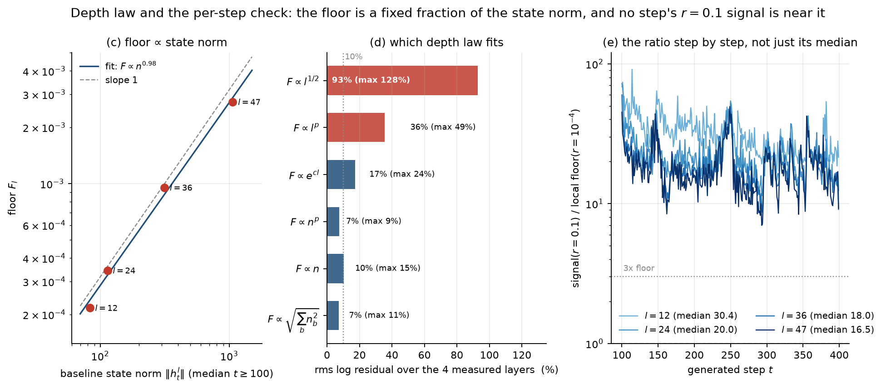

**(c) Floor against state norm.** $x$: $n_l$, $y$: $F_l$, both log. Four points, labelled by state. Solid line: the free power law $F\propto n^{0.977}$; dashed: slope 1. The exponent is 0.977 with an rms log residual of 0.074. The ratio $F_l/n_l$ is 2.614e-6, 3.019e-6, 3.027e-6, 2.568e-6 at states 12, 24, 36, 47 — a factor 1.18 total spread while $n_l$ changes by a factor 12.8. In units of fp32 machine epsilon (1.19e-7) that is 22, 25, 25 and 22 units.

**(d) Which depth law fits.** Horizontal bars: rms of $\ln(\text{predicted}/\text{measured})$ over the four layers, for six candidate laws; the text gives the rms and the largest single-layer deviation. The 10% dotted line is a visual reference, not a test. Results:

| law | rms | worst point (log dev.) | measured/predicted at $l=12,24,36,47$ | reading |
|---|---:|---:|---|---|
| $F\propto l^{1/2}$ | 93% | 128% | 0.28, 0.31, 0.70, 1.76 | rejected: predicts 1.98× growth from $l=12$ to 47, observed 12.58× |
| $F\propto l^{p}$ | 36% | 49% | 1.32, 0.61, 0.83, 1.49 | rejected: best $p=1.77$, residuals zigzag by up to 1.6× |
| $F\propto e^{cl}$ | 17% | 24% | 1.20, 0.79, 0.91, 1.16 | poor: one $e$-fold per 13.6 blocks, systematic S-shape |
| $F\propto n^{p}$ | 7.4% | 9.2% | 0.91, 1.06, 1.09, 0.95 | accepted, $p=0.977$ |
| $F\propto n$ | 10.4% | 14.8% | 1.00, 1.16, 1.16, 0.98 | accepted, $\kappa=2.610\times10^{-6}$ (21.9 ε) |
| $F\propto\sqrt{\sum_b n_b^2}$ | 7.2% | 11.0% | 1.02, 0.90, 1.09, 0.99 | accepted, $k_q=2.176\times10^{-6}$ (18.3 ε) |

**(e) The ratio step by step.** $x$: generated step $t\in[100,400)$; $y$: $\mathrm{median}_u\lVert\delta h^{l}_t\rVert\big/\mathrm{median}_u\lVert\delta h^{l}_t\text{ at }r{=}10^{-4}\rVert$ — the same ratio as in §4 but computed per step before taking any median over $t$, one curve per non-zero state. Solid grey line: 1 (signal equals floor); dotted grey: 3. Medians over $t$ are 30.4, 20.0, 18.0, 16.5 at states 12, 24, 36, 47; the 10th percentiles are 21.2, 14.9, 13.3, 10.6; the minima are 16.5 (t=313), 11.4 (t=293), 8.7 (t=294), 7.0 (t=293). No step out of 300 at any state falls below 7× the floor.

**What the figure does not show.** Four points cannot separate laws that differ by less than ~10%; the difference between $n^{0.98}$ and a quadrature sum of per-block errors is below that resolution (their rms values, 7.4% and 7.2%, are not significantly different). The freedom in (d) is 1–2 parameters per law fitted on the same four numbers that are then scored, so the residuals are optimistic. And the norm is borrowed from a second run.

## 4. Floor against signal — and the better comparison

At $r=0.1$ the median response and the floor give

| $l$ | signal $M(0.1)$ | $F_l$ | signal/floor | relative signal $M/n_l$ | relative floor $F_l/n_l$ | ratio of the two |
|---:|---:|---:|---:|---:|---:|---:|
| 12 | 6.720e-3 | 2.169e-4 | 30.98 | 8.10e-5 | 2.61e-6 | 30.98 |
| 24 | 7.587e-3 | 3.436e-4 | 22.08 | 6.66e-5 | 3.02e-6 | 22.08 |
| 36 | 1.809e-2 | 9.523e-4 | 19.00 | 5.75e-5 | 3.03e-6 | 18.99 |
| 47 | 4.774e-2 | 2.729e-3 | 17.49 | 4.49e-5 | 2.57e-6 | 17.49 |

**Where measurement is weakest: the deepest state, and the reason is the signal, not the floor.** The floor relative to the state's own norm is the same at every layer (2.6–3.0e-6), so normalizing by the norm changes the ratio by at most 2% (last column). What falls with depth is the *relative* response: 8.1e-5 of the state norm per unit radius at state 12, 4.5e-5 at state 47. The deepest read-out is therefore the one closest to its floor, by a factor 1.8 — a real effect, but a small one.

The obvious comparison, signal at $r=0.1$ divided by the floor, is the right one for the campaign because $r=0.1$ is the radius actually used, but as a general metric it is misleading: it is proportional to $r$, so it says nothing about the model and everything about the chosen radius. The dimensionless version is $r/r_{\min}(l)$, which is the same number here (17.5 at the deepest state) and remains meaningful if the radius changes. Two more things the naive comparison hides, both checked:

1. **The floor grows with $t$ by up to 20%.** At state 47 the floor is 1.20× larger over $t\in[250,400)$ than over $[100,250)$. The per-step ratio in figure (e) absorbs this and still has a minimum of 7.0, so the median is not hiding a failure, but it does mean a single median-based floor is accurate only to ~20% at the deepest state.
2. **The floor and the signal add in quadrature, not linearly.** With no free parameter — $F_l$ from $r=10^{-4}$, $G_l$ from $r=0.1$ — the model $\lVert\delta h\rVert(r)=\sqrt{F_l^2+(G_lr)^2}$ reproduces all 32 measured points with $r\le0.3$ to an rms of **1.71%** (worst 5.83%, at $r=3\times10^{-3}$, state 47). Adding them linearly, $\lVert\delta h\rVert=F_l+G_lr$, is off by an rms of 14.1% and up to 26.9% in the same range. This is the strongest single check that $F_l$ is an independent noise term rather than a rescaling of the response: it predicts the whole transition region from the two endpoints. At $r=1$ the measured response is up to 18% above the model, which is the model's own nonlinearity, not floor.

## 5. How the floor accumulates: what the data support

Four accumulation models and their predictions:

- **Independent rounding per block, equal size, adding in quadrature:** $F_l=\delta\sqrt{l_{\rm block}}$ → $F\propto l^{1/2}$. Predicts a 1.98× rise from state 12 to 47; measured 12.58×. Rejected by a factor 6 in growth.
- **Multiplicative growth:** each block multiplies the error by a constant → $F\propto e^{cl}$. Fitted $c=0.0734$ per block (one $e$-fold per 13.6 blocks) with 17% rms residuals and a systematic S-shape: the prediction is too low at 12 and 47, too high at 24 and 36. Not supported.
- **Free power of depth:** $F\propto l^{1.77}$, 36% rms. Not supported.
- **Rounding error proportional to the local state norm, accumulating in quadrature:** $F_l=k_q\sqrt{\sum_{b\le l}n_b^2}$. Because $n_b$ grows by a factor 12.8 over the measured range, this sum is dominated by the last few blocks and is numerically almost proportional to $n_l$ itself. Fitted with one constant, $k_q=2.18\times10^{-6}$ (18.3 ε), it gives 7.2% rms and 11% worst-case residuals.

**The data support the last one, and its practical content is "$F_l$ is a fixed fraction of the state norm".** The single-constant version $F_l=2.61\times10^{-6}n_l$ (21.9 ε) matches to 10% rms. Physically: every block's arithmetic leaves a relative error of order 20 fp32 units on the state it writes, and the visible floor is the quadrature sum of those errors weighted by the (growing) state norm. With four measured layers the two versions — proportional to the current norm, or quadrature over per-block norms — cannot be separated beyond the ~10% residual level; both are consistent, and both say the floor is set by the *size of the numbers being rounded*, not by the number of blocks alone.

That distinction matters for extrapolation. "Floor grows like $\sqrt{\text{depth}}$" would be reassuring; it is wrong here because the residual stream grows with depth. The measured statement is: **absolute floor grows roughly as fast as the state norm grows**, which for this model is a factor 12.6 between states 12 and 47, i.e. 7.5% per block on average.

## 6. The smallest usable radius per layer

Solving $G_lr=F_l$:

| $l$ | $G_l$ | $F_l$ | $r_{\min}=F_l/G_l$ | $r_{3F}=3F_l/G_l$ |
|---:|---:|---:|---:|---:|
| 0 | 0 | 0 | undefined (no floor, no gain) | undefined |
| 12 | 6.720e-2 | 2.169e-4 | 3.23e-3 | 9.68e-3 |
| 24 | 7.587e-2 | 3.436e-4 | 4.53e-3 | 1.36e-2 |
| 36 | 1.809e-1 | 9.523e-4 | 5.26e-3 | 1.58e-2 |
| 47 | 4.774e-1 | 2.729e-3 | 5.72e-3 | 1.71e-2 |

Reading: at $r=r_{\min}$ the measured displacement is $\sqrt2$ times the linear term (the two contributions are equal and add in quadrature), so half of the squared response is arithmetic. At $r_{3F}$ the measured displacement is only 5.4% above what a floor-free linear response would give, and the floor's share of the squared response is 10%. The campaign radius 0.1 sits 17.5–31 times above $r_{\min}$, and 5.8–10.3 times above $r_{3F}$ — inside the safe region with room to spare, but not by orders of magnitude at the deepest state. A 10× margin over $r_{\min}$ would require $r\ge0.057$ at state 47, which is close to the campaign radius; the choice $r=0.1$ is therefore near the small end of what this 48-layer fp32 network can resolve at its last state, and a deeper model would need a larger radius for the same margin.

This is also consistent with the "clean window" of Part 0 ($r\in[0.03,0.3]$), which was defined by a different criterion — the radius range where $M(r)/r$ is constant to a few percent. $r_{\min}$ is the absolute validity edge (floor equals signal); 0.03 is where the floor inflates $M(r)/r$ by only ~2% (at state 47: $M(0.03)/0.03=0.487$ against the asymptotic $G=0.477$). Both numbers describe the same transition from opposite sides.

## 7. What this does not show

- Only four non-zero states were saved (12, 24, 36, 47 of 48 blocks). The shape of $F_l$ between them is interpolation; in particular the shallowest measured state is already 12 blocks deep, so nothing here says how fast the floor rises over the first quarter of the network.
- One model, one prompt, one precision, one random seed for the directions. The constant 2.6e-6 is a property of this network in fp32; a different architecture, norm placement, or dtype would change it. bf16 keeps 8 mantissa bits against fp32's 24, so the per-operation error — and with it the floor at a given state norm — would be roughly $2^{16}\approx6\times10^4$ times larger; fp64 would lower it by about $2^{29}\approx5\times10^8$.
- The floor was measured at generated positions only, because that is where `dh_norm` is stored. Nothing is claimed about prompt positions, where the perturbation itself lives.
- The 20% drift of the floor with $t$ at the deepest state is real and the medians hide it; §4's per-step check bounds its effect on the campaign but not on other analyses that use a single floor number.
- $r_{\min}$ uses $G_l$ measured at $r=0.1$; if the response were nonlinear already at $r=0.03$, $r_{\min}$ would move. The linearity check in §2 (slope 0.95–0.99 over $10^{-2}\dots3\times10^{-1}$) says it does not, to 5%.

## 8. What it implies for perturbation experiments on deep models

The floor is not an inconvenience to be subtracted; it is a *scale* of the system "network + arithmetic", and it is set by the norm of the state being written at each depth. Three practical consequences, each backed by a number above:

1. **Radii must be chosen per depth, not per model.** The deepest read-out has the largest floor (2.73e-3) and the smallest relative response, so it sets the floor of the usable radius: 5.7e-3 here. The minimum that works at state 12 (3.2e-3) is below the one at state 47 (5.7e-3), so a radius chosen from the shallow state alone would be floor-contaminated at the deep one.
2. **The margin is measurable in advance.** Both $F_l$ and $G_l$ come from the same cheap calibration run at two radii ($10^{-4}$ and 0.1), so $r_{\min}$ is known before the campaign, per layer, without any assumption about the model's dynamics.
3. **The wall exists but is far.** For this 48-block fp32 network the floor is 5.7% of the measured $r=0.1$ response at the last state (3.2% at state 12), and the response is at least 7× the floor at every one of the 300 steps, 17.5–31× in the per-state medians. A model whose state norm grows another order of magnitude at fixed gain would put $r_{\min}$ near $5\times10^{-2}$ and force the campaign radius up. The measurement here is the calibration that would detect that before it silently corrupts a result.


# Part D2. The correlation-dimension pipeline, run locally from distance matrices

## Summary

The D2 analysis is now split so that the GPU only does what it is needed for. A GPU job (`scripts_spark/d2_distances.py`) writes one full $[N,N]$ Euclidean distance matrix per trajectory; a laptop script (`scripts_spark/d2_local.py`) turns those matrices into the correlation integral $C(\epsilon)$, its local slope, the valid-window bookkeeping, TwoNN, the Levina–Bickel MLE and two loop screens — figures and JSON, no GPU, no model, no `torch`. Run time is **6–7 s per 4095-token trajectory** including building the matrix from the saved states, and **2–3 s** per trajectory at $N=4000$ from a precomputed `.npy` (1000 tokens: 1.1 s).

Validated against the four 1.5B trajectories that exist locally. The reference estimator of `results/d2/` is reproduced **exactly** — 2.978 vs 2.978, 3.894 vs 3.894, 9.195 vs 9.195 — which is the check that matters, because it means any disagreement below is about interpretation, not arithmetic. The interpretation does change: the reference "plateau" is a chord across 6–8 adjacent points of a percentile-spaced grid, **0.04–0.10 decades wide**, with the $R^2$ of 0.9999 that any smooth curve gives over such a span; and on the two healthy trajectories the whole eps range between the depletion floor $10/N$ and saturation is only **0.08 decades** wide, so no plateau can exist there by construction. The loop trajectories are identified by a lag-distance dip (period 53 and 69, dip to 6–10% of the neighbouring lags), and one of them produces a *convincing but spurious* 0.54-decade window with $\hat D_2=1.09$. Run over all 20 local trajectories the same test finds **nine repetition loops and two partial ones**, including six of the sixteen 1000-token runs that had been recorded as non-loops.

---

## 1. What the pipeline is

### 1.1 Input, output, command

| item | value |
|---|---|
| input (GPU) | `dist_<name>_h_last.npy`, fp32 $[N,N]$ Euclidean distance matrix, one per trajectory |
| input (GPU, optional) | `summary.json`: `n`, `dim`, `norm_median`, `norm_growth`, `rel_nearest`, `rel_nearest_p05` |
| input (laptop, validation only) | `.pt` (torch save, read here without torch) or `.npz` with `h_last` $[N,D]$ |
| output | `notebook_big/figures/d2pipe_<tag>_<name>.png`, `…_summary.png`, `d2pipe_<tag>.json` |
| command | `python scripts_spark/d2_local.py --dir results_big/ds14/d2 --theiler 0,50,500 --out notebook_big/figures --tag ds14` |
| alternative | `--pt <files or dirs>` (or `--dist <matrix.npy> …`) computes the matrices locally in float64 |

Every epsilon below is quoted in units of $d_{typ}$, the median over points of the rms distance to the other points (a robust typical separation). That makes a 1.5B trajectory (state norm ≈ 10²) and a 14B one comparable on the same axis.

### 1.2 Definitions

Let $d_{ij}=\lVert x_i-x_j\rVert$, $N$ points, Theiler window $W$.

| quantity | expression | note |
|---|---|---|
| correlation integral | $C(\epsilon)=\dfrac{\#\{(i,j):\ |i-j|>W,\ d_{ij}<\epsilon\}}{\#\{(i,j):\ |i-j|>W\}}$ | denominator $N(N-1)-2\sum_{k\le W}(N-k)$, so $C\to1$; for $W=0$ it is exactly $\frac{2}{N(N-1)}\#\{i<j:d_{ij}<\epsilon\}$ |
| evaluation | sort the upper triangle once, then `searchsorted` at each $\epsilon$ | 90 log-spaced values of $\epsilon/d_{typ}\in[10^{-2},2.5]$; the $W$-band counts are subtracted from the $k=1\ldots W$ diagonals |
| local slope | $\mathrm{d}\log C/\mathrm{d}\log\epsilon$ | central differences, second-order at the edges |
| TwoNN | $\mu_i=r_2^{(i)}/r_1^{(i)}$, $\ \hat d=1/\langle\ln\mu\rangle$ | MLE for the Pareto tail $P(\mu>M)=M^{-d}$; the reference code's OLS fit of $-\ln(1-F)$ vs $\ln\mu$ is the same estimator and is returned too |
| Levina–Bickel MLE | $m_k(i)=\frac{1}{k-1}\sum_{j<k}\ln\frac{d_k(i)}{d_j(i)}$, $\ \hat d_k=\langle 1/m_k\rangle$ | $k=5,10,20$ |
| repetition screen | fraction of points with nearest distance at $\lvert i-j\rvert\ge50$ below $10^{-3}d_{typ}$ | plus the median and p05 of that relative distance |
| loop-period screen | $p(k)=\overline{\lVert x_t-x_{t+k}\rVert}/d_{typ}$; prominence $=p(k)/\mathrm{median}\,p(k\pm1,2,3)$ | a drifting loop has a sharp dip at its period; a healthy trajectory has none |

### 1.3 The valid-window rule (this replaces the max-$R^2$ search)

A window is marked valid only if all three hold simultaneously:

1. **flatness.** The longest run of $\epsilon$ in which the local slope stays within $\mathrm{tol}$ of its own median, with $\mathrm{tol}=\max(0.15,\ 0.06\,\lvert\hat D_2\rvert)$ — i.e. "within 6% of its own value", with an absolute floor so low dimensions are not judged in relative units — and the run at least **0.4 decades** wide. The test is applied to a 3-point median filter of the slope so a single grid point cannot open a window.
2. **depletion floor.** $\epsilon$ above the point where $C(\epsilon)=10/N$ (at least $\sim5N$ pairs inside the ball). This is the $10/N$ edge of `docs/FINDINGS_AND_PROCEDURE.md`.
3. **below saturation.** $C(\epsilon)\le0.1$.

The window width in decades is reported whether or not it is valid, together with the slope at both edges of the admissible range, so "no plateau" is a number and not a verdict. The finite-$N$ slope ceiling $2\log_{10}N$ (7.2 at $N=4095$) is drawn on every slope panel. If the window is empty the verdict is *no scaling region*; the pipeline also reports $\hat D_2$ over the whole admissible range ($C$ from $10/N$ to $0.1$) so the window dependence stays visible.

## 2. Validation on the 1.5B trajectories

Four trajectories: two of the local long runs are period-53 / period-69 loops (`cyber`, `great`, both 4095 tokens at the last layer), two are healthy (`interstellar`, 1026 tokens; `astronomy_observations`, 1000 tokens). All four are 1536-dimensional last-layer states, greedy FP32, window 4096.


| trajectory | $N$ | loop period (coverage) | nearest-twin median | $\hat D_2$ valid window | window width | T4 estimator (reproduced / published) | TwoNN | MLE $k{=}10$ |
|---|---:|---|---:|---|---:|---|---:|---:|
| `great` (loop) | 4095 | **69** (90%) | 0.016 | — (none) | 0.00 dec | **2.978 / 2.978** | 5.44 | 3.19 |
| `cyber` (loop) | 4095 | **53** (94%) | 0.017 | **1.09** (spurious) | 0.54 dec | **3.894 / 3.894** | 6.21 | 3.12 |
| `interstellar` (healthy) | 1026 | — (0%) | 0.419 | — (none) | 0.00 dec | **9.195 / 9.195** | 6.23 | 7.91 |
| `astronomy_observations` (healthy) | 1000 | — (0%) | 0.538 | — (none) | 0.00 dec | 11.35 / — | 6.12 | 10.13 |

Four things to read off it.

**The reference numbers are reproduced exactly.** The T4 estimator column is `dimension.py:d2_curve` run on the first 2000 states with Theiler 20, i.e. the code path that produced `results/d2/d2_raw_vs_shuffled.json`; it matches to the published four digits (2.9777, 3.8943, 9.1947). So the correlation integral and the fit search here are the same objects as in the reference implementation, and the rest of this section is a statement about what those numbers mean, not about whether they were computed right.

**The healthy trajectories have no scaling region, and there is no room for one.** For `interstellar` the admissible range runs from $\epsilon/d_{typ}=0.61$ ($C=10/N$) to $0.81$ ($C=0.1$) — **0.08 decades** — and across it the local slope climbs 6.1 → 8.9. A 9-dimensional cloud with 1000 points simply cannot be measured: the depletion floor and saturation are 0.08 decades apart, which is why the whole "valid interval" in the earlier analysis was 0.00–0.04 decades wide. The T4 value 9.195 comes from a window 0.102 decades wide, 6 of 22 grid points, inside which $C$ rises by 0.14 (a seventh of the full range): a chord, not a plateau.

**Loops give a low number, and one of them gives a *valid-looking* one.** `cyber` has a 0.54-decade window with $\hat D_2=1.09$ that passes all three criteria — the drifting period-53 orbit really does trace a one-dimensional curve with $C\sim\epsilon^{1.1}$ over that range. The verdict is decided by the loop screens, not by the fit: 94% of its positions return to within $0.1\,d_{typ}$ after 53 tokens (90% for `great`), against 0% for both healthy trajectories, and the lag-distance dip is 0.06 of its neighbouring lags. `great` has the same structure but no flat run at all. The correct reading of a low $\hat D_2$ is therefore always *"is this a loop?"* first.

**What does not separate the groups:** TwoNN sits at 5.4–6.2 on all four, loops included, and the $k$-neighbour MLE at $k=10$ agrees with the truth on the healthy pair (7.9, 10.1) but is 3.1–3.2 on the loops — both are point-cloud statistics and neither is a loop detector. The repetition screen at the $10^{-3}$ threshold in the brief finds **nothing** in any of the 20 local trajectories: these loops drift, so a repeat sits at 1.6% of the cloud scale, not at $10^{-3}$. The usable screen is the lag-distance dip: over all 20 local trajectories the prominence is **≤0.22 for the nine full loops, 0.21 and 0.45 for two partial ones, and 0.91–0.99 for the nine clean ones** — a factor-2 margin with no free parameter. There is no smoothness confound in this metric: consecutive last-layer states are already 0.84–1.03 $d_{typ}$ apart, so the lag curve is flat at $\approx1$ for a healthy run and only a genuine return produces a dip.

Theiler windows change nothing for the healthy trajectories (no window at $W=0$ or $W=500$) and remove even the spurious window of `cyber` at $W=500$; the same run at $N/2$ and $N/4$ loses it too, so it is a small-$N$ feature of the orbit.

### 2.1 The screens applied to all 20 local trajectories

The same two screens, run over every 1.5B trajectory that exists on this machine (three 4095-token prompt runs and the sixteen 1000-token runs, plus `interstellar`), split them **nine loops / two partial / nine clean**:

| period found | coverage | trajectories |
|---|---:|---|
| 12, 17, 27 | 95%, 76%, 89% | `renewable_energy_economics`, `history_of_music`, `sleep_and_memory` |
| 53, 63, 69, 74, 81 | 94%, 77%, 90%, 91%, 70% | `cyber`, `history_of_computing`, `great`, `future`, `ocean_currents` |
| 53 | 80% | `cybersecurity` (the 1000-token run of the same prompt as `cyber`) |
| 50, 79 | 39%, 50% | `transformer_architecture`, `urban_transportation` (partial: prominence 0.45, 0.21) |
| — | 0–5% | `interstellar`, `astronomy_observations`, `childhood_experiences`, `evolution_of_language`, `healthy_habits`, `history_of_mathematics`, `interstellar_travel`, `software_engineering_practices`, `volcanoes_and_plate_tectonics` |

This contradicts the earlier note that the sixteen fresh 1000-token trajectories "flag none as loops (worst relative distance 0.135)". The two statements are reconcilable only if that screen thresholded something other than the *fraction of positions* that return — for `renewable_energy_economics`, 95% of positions come back to within $0.1d_{typ}$ after 12 tokens, with a mean lag-12 distance of $0.037d_{typ}$ against $1.06d_{typ}$ at the surrounding lags, so the loop shows up as a *dip* that a median or a maximum over points can easily miss. Whatever the earlier screen was, **six of those sixteen trajectories (plus two partial ones) are repetition loops and their D2/MLE numbers are not usable as non-loop controls.** The twelve trajectories behind `results/d2/d2_raw_vs_shuffled.json` live on the T4 and cannot be screened here; the three that are loops were correctly identified there, and the other nine need this check before their $\hat D_2$ of 9–11 is quoted.

## 3. Three problems with the earlier estimator, worth knowing

Everything in `results/d2/` was produced by `fit_plateau`, which slides over every sub-interval of the $\epsilon$ grid and keeps the one with the largest $R^2$. Three consequences, all visible in the numbers above:

1. **The reported $R^2$ is a maximum over ~200 candidate windows, not a goodness of fit.** A smooth log–log curve gives $R^2>0.9999$ over two or three adjacent points, so quoting 0.9998 as evidence of a plateau is circular. The winning windows here are 0.039, 0.060, 0.083 and 0.102 decades wide.
2. **`min_points=6` counts grid points, not decades.** The $\epsilon$ grid is made of percentiles of pairwise distances, so its spacing is very uneven (one 0.19-decade jump near the 2nd percentile, then ~0.01-decade steps near the 60th). Six adjacent points can be 0.02 or 0.3 decades; the width is never checked, so the "plateau" can be one grid step.
3. **The grid itself depends on $N$.** Percentiles 2–60 of a 1000-point subsample move with the sample, so the quoted $\hat D_2$ changes with $N$ both through the data and through the grid — which is why the earlier N-convergence check could not separate the two. (Two smaller ones: `d2_all_controls.py` ran the raw curves at Theiler 20 and the shuffled ones at Theiler 0, so even the tautological raw-vs-shuffled comparison was not matched; and `rqa` passes `theiler=0` to `correlation_curve` regardless of its argument, using the argument only for the recurrence mask.)

TwoNN is implemented correctly there (the CDF slope fit is the Pareto MLE), but the widely quoted variant $\log 2/\langle\log\mu\rangle$ is **not**: it returns $\ln^2 2\cdot d=0.48\,d$, which was checked on uniform hypercubes of dimension 2, 5 and 10. The pipeline returns both so the difference stays visible. A related trap: exact duplicates give $r_1=0$, so $\mu=\infty$ and the point is dropped — the published `vocab` control lost 16 of 2000 points this way, and a bit-exact loop would hide its own degeneracy.

## 4. Known artifacts, in plain language

- **Repetition loops.** A model that repeats a phrase produces states that revisit almost the same point every period. The point cloud then contains a thin closed curve, and $C(\epsilon)\propto\epsilon^{1}$ over a wide range: a low, clean, completely spurious $\hat D_2$. Screen first, fit second.
- **First-layer exact duplicates.** At the embedding output, equal tokens give bit-identical vectors. That is a pile of exactly coincident points, which inflates $C$ at small $\epsilon$ and depresses the slope; the earlier fix was to de-duplicate, which changes $N$ and destroys the comparison with the last layer.
- **Fill dimension from delay embedding.** Building vectors $(x_t,x_{t+1},\ldots,x_{t+m-1})$ and measuring their dimension reports roughly the embedding dimension, not the attractor's, whenever the data are smooth in time. That is why the delay-D2 rose 5.9 → 6.3 → 11.1 → 14.9 → 17.6 as $m$ and $\tau$ grew.
- **First-PC saturation.** If one direction carries most of the variance, distances saturate as soon as $\epsilon$ reaches it, and everything above that is a step, not a slope.
- **Self-pairs and linear $\epsilon$ grids.** Counting $i=j$ adds $N$ zero distances and drags the slope at small $\epsilon$; a linear $\epsilon$ grid concentrates all points where nothing happens. Both are removed here (upper triangle only, log grid).

All five mechanisms were reproduced by the earlier pass on synthetic data, and the estimator recovers Hénon ($\hat D_2=1.18$ over a 1.1-decade window) and a uniform 3-cube (2.82, no valid window at $N=1500$ because the admissible range is 0.40 decades) — so the absence of scaling in the LLM states is a property of the data, not of the estimator.

## 5. Running it on the new matrices

```
# on the laptop, once the GPU job has written results_big/<model>/d2/
python scripts_spark/d2_local.py --dir results_big/ds14/d2 \
    --theiler 0,50,500 --out notebook_big/figures --tag ds14
```

`summary.json` from the GPU side is picked up automatically and its `rel_nearest` is stored next to the laptop-side screen, so the two can be compared for every trajectory. Per-trajectory figures carry eight panels: $C(\epsilon)$ for all Theiler windows with the valid window shaded, the local slope against the $2\log_{10}N$ ceiling, the same slope at $N$, $N/2$, $N/4$, the TwoNN $\mu$ CDF, the MLE against $k$, the repetition histogram, the lag-distance loop test, and a numbers block. The JSON holds every quoted number including the T4-style reproduction and its window width.

**What this does not show.** One model, one layer (the last), one prompt set per trajectory. The valid-window rule has three thresholds (0.4 decades, 6%, 0.1 saturation) that were chosen before looking at the new data and are reported in the JSON for every run; the verdicts are robust to them here (the healthy trajectories have no admissible range at all, and the loops are caught by an independent period test), but a marginal case would need the width quoted, not just the verdict.


# Part 1. The 1000-direction A1 run: five views of the same data

*(This part and the next two share one dataset; each figure is a different slice of it. The dataset: DeepSeek-R1-Distill-Qwen-14B, FP32, prompt `interstellar_travel` ($P=65$ tokens), 300 greedy tokens, 1000 unit perturbation directions at radius $r=0.1$ added to the prompt embeddings, every perturbed pass teacher-forced on the baseline tokens. Attention: full — see the correction note. File `results_big/ds14/a1_inter_w100/a1.npz`, engine `run_a1_big`, 1590 s on the GB10.)*

**Why five views.** The dataset has three axes — generated step $t$, saved state index $l$, and direction $u$ — plus one scalar response per $(t,u)$: the margin change $\delta m_t(u)$, and per $(t,l,u)$: the state displacement $\lVert\delta h_t^l(u)\rVert$. A single plot can show at most two of these honestly; the five figures below slice them as (t), (t,l), (t,u), (u), (u | t), so every claim in the summary tables can be checked against a picture.

## 1.1 `ds14_margins.png` — the decisions the baseline actually makes


Unperturbed run only, $r=0$. **Left:** $m_t=\ell^{(1)}_t-\ell^{(2)}_t$ (nats) against generated step $t$; the six tightest gaps are marked with vertical ticks and labelled with $(t,m_t)$. **Right:** ECDF of the same 300 values on a log $x$ axis. The three labelled spikes below 0.003 nats ($t=21,19,189$) are the ties that later control almost every flip; the median is 3.10 nats, so the model is usually confident and rarely at a knife's edge. This figure is the *explanans* for everything downstream: thresholds $r_c^-=m\,r/\max(-\delta m,0)$ inherit their smallest values from the smallest margins.

## 1.2 `ds14_response_curves.png` — what the perturbation does through depth and time

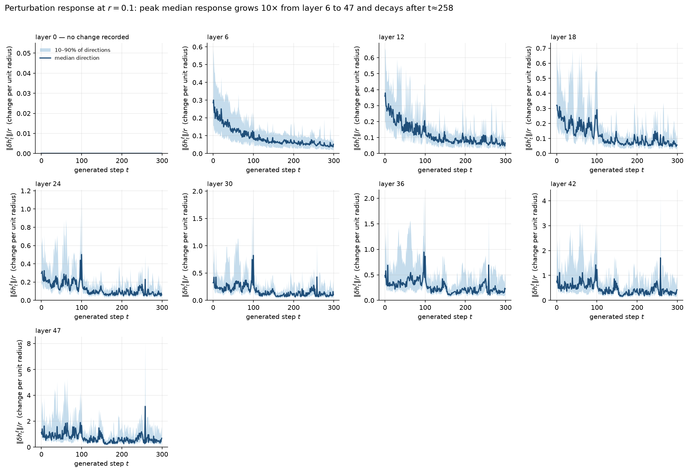

Median over the 1000 directions of $\lVert\delta h_t^l\rVert/r$ (state displacement per unit radius; the division by $r$ makes runs at different radii comparable and is exact in the linear regime $r\in[0.03,0.3]$ measured in Part 0). One panel per saved state $l\in\{0,6,12,18,24,30,36,42,47\}$; the shaded band is the 10–90 percentile range over directions. State 0 (embedding output at generated positions) is identically zero — the perturbation touches only the 65 prompt positions, so nothing can appear at generated positions before the first attention mix. The response grows with depth (0.077 at state 6 → 0.65 at state 47, median-over-t values; see the table in the deep part) and is *bursty* in $t$: individual baseline tokens (e.g. $t=258$) act as amplifiers at the deep states.

## 1.3 `ds14_rc_ladder.png` — the threshold map, all 1000 directions at once

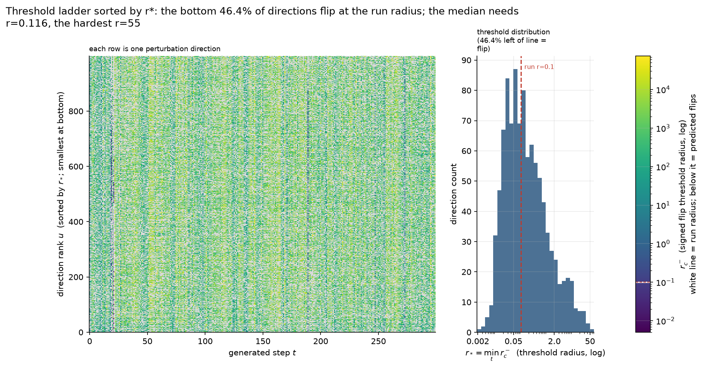

For every direction $u$ and step $t$: the signed radius $r_c^-(t,u)=m_t\,r/\max(-\delta m_t(u),0)$ at which step $t$ would flip. Directions are sorted by $r_*(u)=\min_t r_c^-$, so the interesting directions are at the top. Color is log $r_c^-$; the dashed contour marks $r_c^-=r=0.1$ — below it in a column means "this step flips at the run radius". The side histogram shows the distribution of $r_*$. Reading: the dark region below the contour is *column-shaped*, not point-shaped: a few steps ($t=21$, $t=19$) are below the line for hundreds of directions while most steps are above it for all — the flip structure is organised by step, not by direction.

## 1.4 `ds14_rstar_ecdf.png` — the flux-tube radius distribution


ECDF of $r_*(u)$ over the 1000 directions, log $x$; vertical line at the run radius $r=0.1$; annotation: 46.4% of directions have $r_*\le r$ (predicted to flip). $r_*$ quantiles: p10 $=0.0171$, p50 $=0.116$, p90 $=2.59$; 166 directions need $r>1$ to flip anything within 300 tokens. For comparison the 1.5B (20 directions, same protocol and prompt) had $r_*$ p50 $=1.56$ — the 14B's tube is an order of magnitude narrower, entirely because its thinnest margin is 207× thinner (Part 2).

## 1.5 `ds14_direction_gains.png` — directions are not equal, but not special either


$G(u)=\mathrm{median}_t\lVert\delta h_t^{47}(u)\rVert/r$: histogram, log-ECDF, and three individual direction shapes normalised by their own medians (shapes agree to first order; they differ in amplitude by 13.7× from 0.224 to 3.06). The gain distribution is approximately log-normal in $G$. Whether a direction flips, however, is governed by its projection onto the logit-difference vector at the two razor-thin ties — the deep part shows this projection is only ~0.6% of $G$ and essentially independent across the ties.


> **Correction on the attention window (read this first).** Every 14B result in
> Parts 1 and 2 was produced before we discovered that transformers 4.5x gates
> the sliding window on a `layer_types` config field that stock Qwen2.5 configs
> never set. The intended `window=100` was therefore silently ignored: **these
> runs used full attention** (equivalent to W=4096 within the 365-token horizon).
> The data itself is valid and internally consistent (baseline and perturbed
> passes share the same attention pattern; the free-run validation matched it),
> but wherever a sentence below says "window 100" for the 14B, read "full
> attention". A rerun with the window genuinely active is in progress; its
> numbers will replace the affected comparisons. This also fully explains why
> the 14B shows no response surge at t=35 in Part 2: with full attention there
> is nothing to flush.


# Part A1-deep. One thousand directions on the 14B model: where the flips come from

## Summary

A single prompt of 65 tokens is sent through DeepSeek-R1-Distill-Qwen-14B in FP32, the model generates 300 tokens greedily, and then 1000 different unit perturbations of size $r=0.1$ are added to the prompt embeddings while the generated tokens are held fixed. For every direction and every generated step we record how much the top-1/top-2 logit gap would move; from that we compute the radius at which each step would flip. Almost half the directions (464 of 1000) would flip some token at $r=0.1$, but **all 464 flips are decided at only two generated steps, $t=21$ and $t=19$**, the two smallest logit gaps in the run. The directions that destroy the margin at $t=21$ are essentially unrelated to those that destroy it at $t=189$ (correlation $-0.14$), and the 24 stored response vectors are nearly orthogonal (mean cosine $+0.0025$). Consequently the direction's overall response strength $G$ is a weak predictor of its threshold radius (correlation $-0.18$): which razor-thin tie a direction happens to hit matters far more than how strong its hidden-state response is.

---

## 1. Exact setup, data, and every quantity defined

### 1.1 The run

| item | value |
|---|---|
| model | `DeepSeek-R1-Distill-Qwen-14B` (48 blocks, hidden size 5120) |
| precision | FP32, one precision for the whole run; TF32 disabled |
| decoding | greedy, fixed length, no sampling, no EOS stop |
| prompt | "Provide a comprehensive technical review of current and proposed propulsion systems for interstellar travel. Compare chemical rockets, nuclear propulsion, laser sails, antimatter drives, and other theoretical concepts in terms of energy requirements, achievable speeds, technological feasibility, and projected timelines for development. Include discussion of major projects in the history of the field." |
| prompt length | $P=65$ tokens |
| attention window | **full attention** (the window-100 setting was silently inactive; see the correction note above) |
| continuation | $T=300$ baseline greedy tokens, stored in `gen_ids` |
| directions | $K=1000$, built as 50 independent simplex blocks of 20 |
| direction geometry | each direction is a unit vector with 20 non-zero coordinates on the $65\times5120$ prompt-embedding matrix; blocks use disjoint coordinates, so cross-block directions are exactly orthogonal; within a block every pair has inner product $-1/19=-0.0526$ |
| radius | one radius $r=0.1$ (`radii=[0.1]`) |
| perturbation support | all 65 prompt positions (not the generated positions) |
| teacher forcing | every perturbed forward pass is run on the **baseline** `prompt_ids` + `gen_ids`; the continuation tokens are identical to the unperturbed run, so the measured $\delta m$ is the continuous response at each baseline step, not the trajectory after a divergence |
| baseline check | two identical rows in one batch produced bit-identical tokens (`baseline_duplicate_identical: true`) |
| saved states | hidden-state indices `[0, 6, 12, 18, 24, 30, 36, 42, 47]`; state 0 is the embedding output, state $l\ge1$ is the output of block $l-1$ (transformers convention), so state 47 is the output of block 46, not the final block. The final-norm/lm_head input was stored only as 24 difference vectors (`dh_last`, directions 0–23) |
| engine / environment | `run_a1_big`, torch 2.14.1+cu130, transformers 4.57.6, 1590.6 s wall time on `spark-d5eb` |
| file | `results_big/ds14/a1_inter_full/a1.npz` (+ `meta.json`) |

Because this run used full attention, the prompt stays visible at every generated step: the late-time response is direct prompt influence, attenuated only by the network's own mixing, not by any attention window cutting the prompt off.

### 1.2 Quantities used in this section

For a direction $u$ (row of `simplex`) and a generated step $t$:

| symbol | explicit expression | what it is | why this quantity |
|---|---|---|---|
| $m_t$ | $\ell_t^{(1)}-\ell_t^{(2)}$ | top-1 minus top-2 logit gap of the unperturbed greedy run (nats) | the only scalar that says how close the baseline decision is; a flip requires this gap to be closed |
| $\delta m_t(u)$ | $\ell_t'^{(1)}-\ell_t'^{(2)}-m_t$ at the perturbed forward pass (stored `dm`) | change of that gap under perturbation (nats) | the continuous response of the decision variable; it is measured without letting the trajectory diverge |
| $g_t(u)$ | $\lvert\delta m_t(u)\rvert/r$ | local sensitivity of the gap to radius (nats per unit radius) | converts a response into the radius needed to close the gap |
| $r_c^-(t,u)$ | $m_t\,r/\max(-\delta m_t(u),0)$, $+\infty$ if $\delta m_t\ge0$ | the radius at which step $t$ would flip, for direction $u$ | a flip needs $\delta m_t\le -m_t$; solving for the radius gives this expression |
| $r_*(u)$ | $\min_t r_c^-(t,u)$ | the direction's threshold radius (smallest radius that flips **some** token) | one number per direction; direction $u$ flips at the run radius iff $r_*(u)\le r$ |
| $t_*(u)$ | $\arg\min_t r_c^-(t,u)$ | the controlling step | identifies which near-tie is the weak point for this direction |
| $G(u)$ | $\mathrm{median}_t \lVert\delta h_t^{47}(u)\rVert/r$ | typical last-state response gain (per unit radius) | a robust, scalar measure of how strongly the direction moves the final stored state |
| $R_t^{l}(u)$ | $\lVert\delta h_t^{l}(u)\rVert/\lVert h_t^{l}\rVert$ | relative response at state $l$ | says what fraction of the residual stream is being displaced; the absolute norm alone grows with depth simply because the stream grows |
| $\cos_{ij}$ | $\langle \delta h_i,\delta h_j\rangle/(\lVert\delta h_i\rVert\lVert\delta h_j\rVert)$ | angle between two response vectors | tests whether all directions produce one common response mode (1-D geometry) or many |
| $r_*(u)G(u)$ | product of the two scalars above | collapse test for the naive scaling $r_*\sim m/G$ | if $\delta m_t$ at the controlling step were proportional to $G$, this product would be constant |

The signed threshold is essential. The engine's stored `r_c` array was computed with $\lvert\delta m\rvert$ (`run_a1_big.py`, line 212), not with $\max(-\delta m,0)$. Recomputing the signed version is not cosmetic: the unsigned definition calls **810** directions flips at $r=0.1$, including directions whose margin is *widened* and which cannot flip. The signed definition gives **464**. Every number below uses the signed definition.

### 1.3 The ten smallest gaps and who is controlled by them

| step $t$ | $m_t$ (nats) | directions with $t_*=t$ (all 1000) | of which flip at $r=0.1$ |
|---:|---:|---:|---:|
| 21 | $9.727\times10^{-5}$ | 503 | 421 |
| 19 | $1.144\times10^{-3}$ | 236 | 43 |
| 189 | $2.224\times10^{-3}$ | 146 | 0 |
| 273 | $1.916\times10^{-2}$ | 56 | 0 |
| 255 | $5.151\times10^{-2}$ | 8 | 0 |
| 171 | $5.393\times10^{-2}$ | 5 | 0 |
| 168 | $8.033\times10^{-2}$ | 1 | 0 |
| 205 | $8.067\times10^{-2}$ | 1 | 0 |
| 0 | $1.009\times10^{-1}$ | 5 | 0 |
| 247 | $1.121\times10^{-1}$ | 15 | 0 |

For reference the margin distribution is very skewed: median $m=3.096$ nats, mean $4.996$, minimum $9.727\times10^{-5}$ at $t=21$; 8 of 300 steps have $m<0.1$, 3 have $m<0.01$. The threshold radii are equally skewed: over all 1000 directions, $r_*$ has p10 $=0.0171$, median $=0.116$, p90 $=2.59$, maximum $55.5$. Among the 464 directions that flip, $r_*$ has median $0.0314$ (p10 $0.0112$, p90 $0.0770$, max $0.0995$); 536 directions have $r_*>0.1$ and 166 have $r_*>1$.

---

## 2. Figure `ds14_controlling_steps.png` — two steps decide every flip

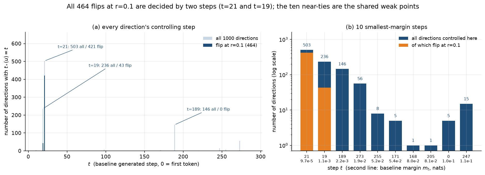

**Setup.** Same run as §1.1 (DS-R1-14B, FP32, greedy, $P=65$, window 100, $T=300$, 1000 unit directions, $r=0.1$, teacher-forced on the baseline tokens). Panel (a) is a histogram of $t_*(u)$ over all 1000 directions; the light bars are all directions, the dark bars are the subset with $r_*(u)\le0.1$ (the directions that actually flip). Panel (b) restricts the $x$-axis to the ten smallest-margin steps and counts how many directions have that step as their controller.

**Axes.**
- (a) $x$: generated step $t$ (0 = first generated token); $y$: number of directions with $t_*(u)=t$.
- (b) $x$: the ten near-tie steps, with the value of $m_t$ printed on the second line; $y$: number of directions controlled by that step, log scale.

**What is in the figure.**
- There are 22 distinct controlling steps among 1000 directions, but only **2** among the 464 flipping directions.
- Top-3 overall: $t=21$ controls 503 directions (421 flips), $t=19$ controls 236 (43 flips), $t=189$ controls 146 (0 flips). These three account for $885/1000=88.5\%$ of all directions. The two flipping steps account for $464/464=100\%$ of the flips.
- The remaining 115 directions are spread over 19 steps, the largest being $t=273$ with 56 directions, $t=247$ with 15, $t=98$ and $t=255$ with 8 each.
- In panel (b), the bars are not monotone in $m_t$: $t=247$ ($m=0.112$) controls 15 directions while $t=255$ ($m=0.0515$) controls 8 and $t=171$ ($m=0.0539$) controls 5. A near-tie is a necessary condition for a small $r_*$, but the response at that step also has to point the right way.

**What the figure shows.** The weak points are shared: nearly every direction is limited by the same two tokens, $t=21$ and $t=19$. It is not the case that a thousand directions explore a thousand different decisions.

**What it does not show.** It does not show that the other eight near-ties are irrelevant for other radii or other prompts. At $r=0.1$ their $r_*$ is above the run radius, so they do not flip here; at a larger radius they would. The figure also says nothing about the free-run consequences of a flip (that requires the separate free-run validation).

---

## 3. Figure `ds14_sign_structure.png` — half destroy, half widen, and the two ties are independent


**Setup.** Same run. For each of the three most important controlling steps ($t=21,19,189$) the figure histograms the signed response $\delta m_t(u)/r$ over all 1000 directions. Red is $\delta m_t<0$ (the margin is being destroyed), blue is $\delta m_t\ge0$ (the margin is being widened; such a direction can never flip at that step). The dashed vertical line is $-m_t/r$: a direction to its left would flip **at** this step at radius $r=0.1$. The shaded region is that flip region. Panel (b) is a scatter of $\delta m_{21}$ against $\delta m_{189}$ in millinats (raw $\delta m$, no division by $r$).

**Axes.**
- (a1)–(a3) $x$: $\delta m_t(u)/r$ (nats per unit radius); $y$: directions per bin.
- (b) $x$: $\delta m_{21}(u)$ (millinats, $10^{-3}$ nats); $y$: $\delta m_{189}(u)$ (millinats).

**Numbers for the three histograms.**

| step | $m_t$ | $\delta m<0$ | $\delta m\ge0$ | pass $r_c^-\le0.1$ at this step | median $\delta m/r$ | p25 / p75 | p5 / p95 | median $g_t$ | median $g_t/G$ |
|---:|---:|---:|---:|---:|---:|---:|---:|---:|---:|
| 21 | $9.727\times10^{-5}$ | 52.9% | 47.1% | 42.7% | $-3.13\times10^{-4}$ | $-2.67\times10^{-3}$ / $+2.56\times10^{-3}$ | $-8.21\times10^{-3}$ / $+8.99\times10^{-3}$ | $2.61\times10^{-3}$ | $4.14\times10^{-3}$ |
| 19 | $1.144\times10^{-3}$ | 49.1% | 50.9% | 7.5% | $+2.33\times10^{-4}$ | $-4.65\times10^{-3}$ / $+5.11\times10^{-3}$ | $-1.40\times10^{-2}$ / $+1.40\times10^{-2}$ | $4.87\times10^{-3}$ | $7.47\times10^{-3}$ |
| 189 | $2.224\times10^{-3}$ | 50.7% | 49.3% | 0.1% | $-8.63\times10^{-5}$ | $-2.64\times10^{-3}$ / $+2.30\times10^{-3}$ | $-8.09\times10^{-3}$ / $+6.77\times10^{-3}$ | $2.48\times10^{-3}$ | $5.23\times10^{-3}$ |

The sign split is close to 50/50 at all three steps. The distributions are centered near zero and are symmetric to within a few percent. At $t=21$ the median absolute response is only $3.1\times10^{-4}$ nats per unit radius, i.e. **about 16 times smaller than the median response at $t=19$** ($4.9\times10^{-3}$) and **about 1900 times smaller than the median gain $G$** ($0.583$). The gap at $t=21$ is so thin that even this tiny projection is enough to close it.

The “pass” column is not the same as the “$\delta m<0$” column. At $t=21$, 52.9% of directions decrease the gap but only 42.7% decrease it by at least $m_t$; the remaining 10.2% move it by less than $9.7\times10^{-5}$ nats and do not flip at $r=0.1$. At $t=19$ the corresponding fraction passing is 7.5%; at $t=189$ it is 0.1%.

**Among the flipping subset.** At $t=21$, 92.45% of the 464 flipping directions have $\delta m_{21}<0$ (the other 7.55% are controlled at $t=19$ and are margin-widening at 21). At $t=19$ only 50.4% are negative, and at $t=189$ 47.2%; those two steps are not the controllers for most flips.

**Panel (b): are the two near-ties the same direction geometry?** No.

| pair | Pearson (all) | Spearman (all) | Pearson (flips) | Spearman (flips) |
|---|---:|---:|---:|---:|
| 21 vs 189 | $-0.142$ ($p=6.8\times10^{-6}$) | $-0.123$ | $-0.053$ | $-0.092$ |
| 21 vs 19 | $+0.072$ | $-0.032$ | $-0.176$ | $-0.207$ |
| 19 vs 189 | $-0.047$ | $-0.030$ | $-0.027$ | $-0.021$ |

Quadrant counts for 21 vs 189 (all directions): $(-,-)$ 245, $(-,+)$ 284, $(+,-)$ 262, $(+,+)$ 209 — essentially uniform. The 21-vs-189 correlation is statistically detectable because $n=1000$, but it explains only $0.02$ of the variance ($r^2=0.020$). The 21-vs-19 correlation even changes sign between all directions and the flipping subset. The two near-ties are not controlled by one shared direction geometry: a direction that suppresses the margin at 21 has essentially a 50/50 chance of widening it at 189.

**Why this quantity.** The signed response is the right object because a flip is one-sided: only $\delta m_t\le -m_t$ can flip, so the sign is part of the definition, not a nuisance. A histogram of $\lvert\delta m_t\rvert$ would hide the almost perfect 50/50 split and would make the direction set look uniformly dangerous when half of it is protective.

**What the figure does not show.** It does not show which directions flip in a free run after the first divergence, and it does not resolve the $t=21$ threshold visibly on the plotted scale: the dashed line sits at $-9.7\times10^{-4}$ per unit radius, only about one bin from zero. The printed “pass 42.7%” is the reliable number for that threshold.

---

## 4. Figure `ds14_gain_structure.png` — strong, broadly spread, and nearly orthogonal responses


**Setup.** Same run. Panel (a) uses all 1000 directions and the state-47 response norm at every step; panel (b) uses the 24 directions (0–23) for which the full final-norm difference vectors were stored.

**Definitions for this figure.**
- $G(u)=\mathrm{median}_t\lVert\delta h_t^{47}(u)\rVert/r$. State 47 is the deepest stored hidden state (output of block 46, per the transformers index convention). The median is over the 300 generated steps.
- $\mathrm{median\ step}$ $t_{\rm med}(u)=\arg\min_t\bigl\lvert\lVert\delta h_t(u)\rVert-\mathrm{median}_{t'}\lVert\delta h_{t'}(u)\rVert\bigr\rvert$: the step whose response norm is closest to the direction's median norm. The 24 vectors are compared at their own median step.
- $\cos_{ij}$: cosine between the final-norm difference vectors of directions $i$ and $j$ at their median steps.

**Gain numbers (all 1000 directions).**

| statistic | $G(u)$ |
|---|---:|
| min | 0.224 |
| p5 | 0.370 |
| p25 | 0.475 |
| median | 0.583 |
| p75 | 0.877 |
| p95 | 1.648 |
| max | 3.064 |
| max/min | 13.7× |

The distribution is approximately log-normal (log10 $G$ has mean $-0.181$, std $0.195$). For comparison, the **arithmetic mean over $t$** has median 0.815 (1.40× the median of $G$), and the **maximum over $t$** has median 8.44 (14.5× the median of $G$). The mean and max are dominated by token-locked response bursts (§5), which is why $G$ uses the median. This is a deliberate choice: the mean would rank directions by whether they happen to sit on a burst token, not by their typical strength.

**The 24 stored vectors.** Their norms at the median step have median $1.528\times10^{-2}$ (p5 $1.05\times10^{-2}$, p95 $4.14\times10^{-2}$). Pairwise cosine over all $\binom{24}{2}=276$ pairs:

| statistic | pairwise $\cos_{ij}$ |
|---|---:|
| mean | $+0.0025$ |
| median | $+0.0026$ |
| p5 | $-0.062$ |
| p25 | $-0.028$ |
| p75 | $+0.025$ |
| p95 | $+0.081$ |
| min | $-0.147$ |
| max | $+0.222$ |
| fraction with $\lvert\cos\rvert>0.1$ | 4.3% |

The responses are nearly orthogonal. The first principal component explains 6.5% of the variance, versus 4.17% expected for 24 isotropic vectors; the first eight PCs are 6.5, 6.3, 5.5, 5.2, 5.1, 4.6, 4.6, 4.5%. The cosine of each response vector to the pooled mean response has median 0.196, essentially the isotropic value $1/\sqrt{24}=0.204$. There is at most a faint common component, not a shared 1-D mode.

Within-block and cross-block responses are statistically indistinguishable: directions 0–19 share the same input subspace (their input-space cosines are $-1/19=-0.053$) but their response cosines average $+0.0025$; directions 20–23 are input-orthogonal to block 0 and their response cosines to it average $+0.0033$. The network does not preserve the input block geometry, and it does not collapse all responses onto one axis.

The response vectors are also only partly coherent in time: the median cosine between $\delta h_t$ and $\delta h_{t+1}$ is 0.317 (mean 0.329), at lag 10 it is 0.090 (mean 0.109), and at lag 50 it is 0.061 (mean 0.080). Adjacent steps share about a third of their direction; by ten steps the memory of the direction is mostly gone.

**The requested response-vs-baseline-state angle is not recoverable from this dump.** The run stored baseline state **norms** (`norm_h0`), not baseline state **vectors**, and it stored the cosine between the perturbed state and the baseline state, $\cos(h',h_0)$. That state cosine is $0.99998\ldots1.0000004$ (median exactly 1.0; 49.9% of entries are exactly 1.0 in float32). With $\lVert\delta h\rVert/\lVert h_0\rVert\sim10^{-4}$, the true angle would change $\cos(h',h_0)$ by only $\sim10^{-8}$, below the float32 resolution of the stored array. Recovering $\theta(\delta h,h_0)$ from these numbers is therefore impossible, not merely noisy. What can be said from the stored state cosine is that the perturbed state differs from the baseline state in direction by at most $\sqrt{2(1-\cos)}\approx0.007$ rad, which is an upper bound on the total rotation, not the angle of the response. A future run that stores the 5120-dimensional baseline vectors would make the requested quantity measurable. The substitute used here is the pairwise response cosine, which answers the more important question for this project: whether the geometry is effectively 1-D.

**What the figure shows.** Strength varies by a factor 13.7, but direction is almost uniformly distributed on the sphere: the responses are not copies of one another and there is no single “perturbation mode.” A scalar gain is therefore an incomplete description of a direction, and one should expect directions with similar $G$ to have very different effects on any particular logit gap.

**What it does not show.** It does not measure the response angle relative to the baseline state (not stored), and 24 directions are a small sample: 20 come from block 0 and 4 from block 1, so the cross-block comparison rests on 80 pairs. The PCA spectrum is estimated from 24 vectors and cannot resolve a common component much below 4%.

---

## 5. Figure `ds14_shape_by_layer.png` — depth grows the response; the relative response shrinks


**Setup.** Same run, all 1000 directions. Each of the nine small panels is one stored hidden state $l\in\{0,6,12,18,24,30,36,42,47\}$. The solid line is the median over directions of $\lVert\delta h_t^l(u)\rVert/r$ at each step; the band is the interquartile range over directions. The right panel is a heatmap of the median **relative** response $\lVert\delta h_t^l(u)\rVert/\lVert h_t^l\rVert$ for the eight non-zero states, with a log color scale.

**Axes.**
- Small panels: $x$ = generated step $t$ (0–299); $y$ = $\lVert\delta h_t^l\rVert/r$ (state-response norm per unit radius). Free $y$ range per panel.
- Right panel: $x$ = step $t$; $y$ = state index $l$; color = $\lVert\delta h_t^l\rVert/\lVert h_t^l\rVert$ (dimensionless, log scale 5e-5 to 5e-4).

**State 0 is exactly zero.** At $l=0$ the state of a *generated* token is its token embedding; the perturbation is added only to the 65 *prompt* embeddings, so the generated-token embedding is untouched at every $t$. The array `dh_norm[:,0,:]` is exactly 0.0 for all $1000\times300$ entries (checked; max absolute value 0). This is a structural zero, not a small number. The response first appears at state 6, after attention has mixed prompt information into the generated positions.

**Per-layer numbers (median over directions).**

| state $l$ | median $G$-like gain | abs at $t=0$ | $t=10$ | $t=50$ | $t=100$ | $t=258$ | $t=299$ | peak of median curve | end/peak | median relative response |
|---:|---:|---:|---:|---:|---:|---:|---:|---:|---:|---:|
| 0 | 0 | 0 | 0 | 0 | 0 | 0 | 0 | — | — | 0 |
| 6 | 0.0775 | 0.286 | 0.194 | 0.137 | 0.0815 | 0.0473 | 0.0521 | $t=1$, 0.301 | 0.17 | $1.53\times10^{-4}$ |
| 12 | 0.101 | 0.359 | 0.266 | 0.184 | 0.133 | 0.0596 | 0.0663 | $t=1$, 0.380 | 0.17 | $1.23\times10^{-4}$ |
| 18 | 0.100 | 0.321 | 0.281 | 0.176 | 0.292 | 0.125 | 0.0564 | $t=1$, 0.321 | 0.18 | $1.08\times10^{-4}$ |
| 24 | 0.110 | 0.297 | 0.253 | 0.183 | 0.502 | 0.230 | 0.0584 | $t=100$, 0.502 | 0.12 | $9.72\times10^{-5}$ |
| 30 | 0.151 | 0.322 | 0.253 | 0.242 | 0.824 | 0.429 | 0.100 | $t=100$, 0.824 | 0.12 | $8.75\times10^{-5}$ |
| 36 | 0.250 | 0.486 | 0.334 | 0.318 | 0.864 | 0.692 | 0.227 | $t=97$, 0.946 | 0.24 | $8.11\times10^{-5}$ |
| 42 | 0.428 | 0.767 | 0.561 | 0.451 | 1.242 | 1.707 | 0.425 | $t=258$, 1.707 | 0.25 | $7.85\times10^{-5}$ |
| 47 | 0.653 | 1.143 | 0.865 | 0.631 | 1.682 | 3.150 | 0.688 | $t=258$, 3.150 | 0.22 | $6.18\times10^{-5}$ |

**Depth scaling.** The typical gain rises from 0.0775 at state 6 to 0.653 at state 47, a factor **8.43**. The peak of the median curve rises from 0.301 to 3.150, a factor 10.5. The baseline state norm, however, rises much faster:

| state | 0 | 6 | 12 | 18 | 24 | 30 | 36 | 42 | 47 |
|---|---:|---:|---:|---:|---:|---:|---:|---:|---:|
| median $\lVert h_t^l\rVert$ | 1.52 | 51.5 | 84.0 | 93.6 | 114.3 | 175.2 | 311.5 | 549.8 | 1067.3 |

That is why the relative response *falls*: median relative response goes from $1.53\times10^{-4}$ at state 6 to $6.18\times10^{-5}$ at state 47, a factor **2.47**. The residual stream grows roughly $1067/51.5=20.7\times$ over the same range while the response grows only $8.4\times$.

Both normalizations are necessary. The absolute norm is what the logits see: the margin change is $\delta m_t=\delta h_t^{\rm final}\cdot(W_{[{\rm top1}]}-W_{[{\rm top2}]})$, so a larger absolute response can move a gap more. The relative norm says what fraction of the state is being displaced, i.e. whether the response is a small perturbation of a growing stream or a large one. At state 47 the displacement is $\sim6\times10^{-5}$ of the state norm: tiny in relative terms, yet $0.65$ units of absolute norm per unit radius, enough to matter because the logit-gap direction is even more sensitive.

**There is no simple rise–peak–decay in time.** The response is largest at $t=0$–$1$ for states 6–18 (the first generated position sees the most direct prompt influence), then decays. At deeper states the largest values move to token-locked bursts: $t=258$ at states 42 and 47, $t=97$–$100$ at states 24–36, and $t=58,39,26$ in individual directions. At state 47 the median curve is 1.143 at $t=0$, 0.631 at $t=50$, 1.682 at $t=100$, **3.150 at $t=258$**, and 0.688 at $t=299$. The peak step of the median curve therefore moves from $t=1$ (states 6–18) to $t=97$–$100$ (states 24–36) to $t=258$ (states 42–47). Per direction, the last-state maximum occurs at $t=258$ for 109/1000 directions, $t=58$ for 62, $t=39$ for 60, $t=97$ for 48, $t=26$ for 45; the rest are spread over many tokens.

This is why the “rise time” is not a fixed transient: the response amplitude is a property of the *baseline token* as much as of the layer. The same perturbation produces a 14.5× larger response at its best token than at its median token. Any single “response time” or “decay time” would be an artifact of averaging over token content.

**Why the heatmap.** Plotting eight relative curves on one axis produced an unreadable band because the curves differ by an order of magnitude and all contain sharp token spikes. The heatmap keeps the same information (state × step) and makes the two trends visible at once: an early bright region that fades with depth, and a bright vertical stripe at $t=258$ that appears only at the deepest states.

**What the figure does not show.** It does not separate “the perturbation is decaying” from “the prompt has left the 100-token attention window”; both happen together after $t\approx35$. It also does not show the final-norm response for all 1000 directions (only state 47 is stored for all; the final norm only for 24). And the small panels are medians over directions: a single direction can have a peak anywhere, as the per-direction peak counts show.

---

## 6. Figure `ds14_rstar_vs_gain.png` — the tie, not the gain, sets the threshold

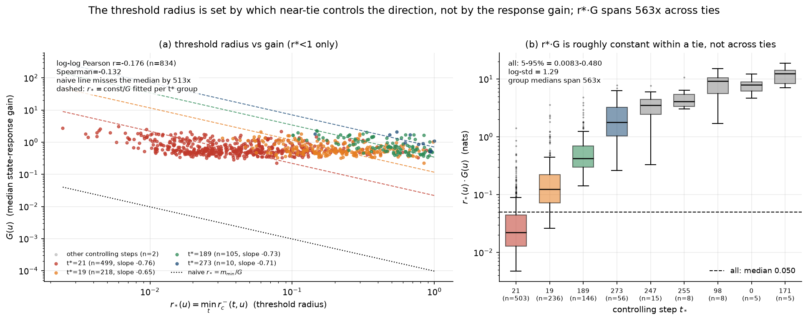

**Setup.** Same run. Panel (a) is a log–log scatter of $r_*(u)$ against $G(u)$ for the 834 directions with finite $r_*<1$ (166 directions have $r_*>1$; the threshold is above 1 and is not shown). Points are colored by the controlling step. The dashed lines are $r_*=c_t/G$ fitted separately inside each controlling-step group, with $c_t=\mathrm{median}(r_*G)$ for that group. The dotted line is the naive analytic guess $r_*=m_{\min}/G$ with the global minimum margin $m_{\min}=9.727\times10^{-5}$. Panel (b) is a box plot of $r_*G$ grouped by controlling step, with the number of directions in each group.

**Axes.**
- (a) $x$: $r_*(u)=\min_t r_c^-(t,u)$ (threshold radius, log); $y$: $G(u)$ (median state-response gain, log).
- (b) $x$: controlling step $t_*$; $y$: $r_*(u)G(u)$ (nats, log). A horizontal dashed line marks the median over all 834 directions.

**Deriving the scaling.** A step flips when
$$m_t+\delta m_t\le0 \quad\Longleftrightarrow\quad \lvert\delta m_t\rvert\ge m_t\ (\delta m_t<0).$$
With $\delta m_t(u)=r\,g_t(u)$ and $g_t(u)=\lvert\delta m_t(u)\rvert/r$,
$$r_c^-(t,u)=\frac{m_t}{g_t(u)}.$$
If the local sensitivity at the controlling step were proportional to the global gain, $g_{t_*}(u)=\beta_{t_*}\,G(u)$, then
$$r_*(u)=\frac{m_{t_*(u)}}{\beta_{t_*(u)}\,G(u)},$$
so $r_*G=m_{t_*}/\beta_{t_*}$ should be constant **within** a group of directions sharing $t_*$, and should change across groups whenever $m_{t_*}$ or $\beta_{t_*}$ changes. This is the correct statement of the “$r_*\sim m/G$” intuition; the naive version with one global $m$ assumes that every direction is controlled by the same tie, which is false.

**Global correlation.** Over 834 directions,
$$\mathrm{Pearson}\bigl(\log r_*,\log G\bigr)=-0.176\quad(p=3.1\times10^{-7}),\qquad
\mathrm{Spearman}=-0.132.$$
So the raw correlation is weak, negative, and statistically detectable only because $n$ is large; $G$ explains about 3% of the variance in $r_*$. By contrast, $\mathrm{Pearson}(\log r_*,\log m_{t_*})=+0.742$ ($r^2=0.551$). A multiple regression
$$\log r_*=2.863+0.695\log m_{t_*}-0.687\log G$$
has $R^2=0.610$: the margin of the controlling tie carries most of the explanatory power, and $G$ enters with a negative coefficient of the expected order ($-0.69$).

**Within-group behavior.** Inside a fixed controlling step, the slope of $\log r_*$ versus $\log G$ should be near $-1$ if $g_{t_*}\propto G$. It is:

| $t_*$ | $n$ | Pearson$(\log r_*,\log G)$ | slope | median $r_*G$ | p25–p75 of $r_*G$ | median $g_{t_*}/G$ |
|---:|---:|---:|---:|---:|---:|---:|
| 21 | 503 | $-0.365$ ($p=2.9\times10^{-17}$) | $-0.806$ | 0.0222 | 0.0128–0.0446 | $4.37\times10^{-3}$ |
| 19 | 236 | $-0.302$ ($p=2.3\times10^{-6}$) | $-0.684$ | 0.1247 | 0.0718–0.2217 | $9.18\times10^{-3}$ |
| 189 | 146 | $-0.545$ ($p=1.2\times10^{-12}$) | $-0.978$ | 0.4250 | 0.3000–0.6926 | $5.23\times10^{-3}$ |
| 273 | 56 | $-0.591$ ($p=1.7\times10^{-6}$) | $-1.213$ | 1.7771 | 1.039–3.222 | $1.08\times10^{-2}$ |
| 247 | 15 | $-0.474$ ($p=0.074$) | $-2.447$ | 3.5006 | 2.442–4.416 | $3.20\times10^{-2}$ |
| 255 | 8 | $-0.515$ ($p=0.191$) | $-0.470$ | 4.0585 | 3.349–5.380 | $1.29\times10^{-2}$ |
| 98 | 8 | $-0.317$ ($p=0.444$) | $-0.627$ | 9.2162 | 5.638–10.508 | $5.22\times10^{-2}$ |
| 0 | 5 | $-0.759$ ($p=0.137$) | $-1.370$ | 7.9259 | 6.215–8.974 | $1.27\times10^{-2}$ |
| 171 | 5 | $-0.823$ ($p=0.087$) | $-1.670$ | 12.5128 | 8.392–14.142 | $4.31\times10^{-3}$ |

Within the four large groups the slope is between $-0.68$ and $-1.21$, i.e. close to the predicted $-1$; the correlation is weak but real because the local sensitivity $g_{t_*}$ has its own spread at fixed $G$. Across groups the median $r_*G$ goes from 0.0222 to 12.51, a factor **563**. That is the collapse failure: the product is not a universal constant. The naive $m_{\min}/G$ line is below the data by a median factor of **513**.

**The product distribution.** Over 834 directions, $r_*G$ has p5 $=0.00826$, p25 $=0.0184$, median $=0.0499$, p75 $=0.152$, p95 $=0.480$; log-standard-deviation 1.295, coefficient of variation 1.43, p95/p5 $=58$. This is not a constant.

**Where the extra factor comes from.** The local sensitivity at the controlling step is much smaller than the median state gain:
$$g_{t_*}(u)=\frac{\lvert\delta m_{t_*}(u)\rvert}{r},\qquad
\frac{g_{t_*}}{G}: \text{median }5.996\times10^{-3}\ (p5\ 9.13\times10^{-4},\ p95\ 2.50\times10^{-2}).$$
The median local sensitivity is $3.80\times10^{-3}$ nats per unit radius, about 0.6% of the median $G=0.583$. The correlation between $\log g_{t_*}$ and $\log G$ is only $+0.317$ (slope 0.77), so a strong direction is somewhat more effective at the tie, but only weakly. The reason is geometric: $G$ measures the norm of the full 5120-dimensional response, while $\delta m_t$ measures its projection onto one particular direction $W_{[\text{top1}_t]}-W_{[\text{top2}_t]}$. A direction can be strong overall and nearly orthogonal to that logit-difference vector, or weak overall and well aligned with it. The near-tie step $t=21$ is precisely such a case: its local gain is $2.61\times10^{-3}$, one of the smallest of the ten near-ties.

**Why this quantity.** The product $r_*G$ is the natural test of the hypothesis that “one scalar gain controls the threshold.” It is not a normalization chosen to make the data collapse; it is what the algebra predicts if $\delta m_t\propto G$. Showing that it fails by 563× across ties, while working approximately inside a tie, is the cleanest way to separate the two effects.

**What the figure shows.** (i) Within a tie, stronger directions do have smaller thresholds, with a slope near $-1$. (ii) Across ties, the margin $m_{t_*}$ dominates: a direction controlled by the $9.7\times10^{-5}$ tie has a threshold $\sim500$ times smaller than a direction of the same gain controlled by the $5\times10^{-2}$ tie. (iii) A single global $r_*\sim m/G$ law with one $m$ is wrong by two to three orders of magnitude.

**What it does not show.** It does not prove that the local sensitivity is unrelated to $G$ at every step; it shows the relation is weak at the controlling steps of this run. It does not include the 166 directions with $r_*>1$, where the linear extrapolation is farthest from the measured radius. And the within-group slopes are themselves uncertain for the small groups ($n\le15$), where the $p$-values are not significant.

---

## 7. What is established, and what is a limitation

**Direct findings.**
1. At $r=0.1$, 464/1000 directions flip some token; all 464 are controlled by $t=21$ (421) or $t=19$ (43). No other step produces a flip at this radius.
2. The three smallest-gap steps account for 88.5% of all controlling assignments (503 + 236 + 146 of 1000).
3. The signed response at a near-tie is almost symmetrically split: 52.9% destroy / 47.1% widen at $t=21$, 49.1%/50.9% at $t=19$, 50.7%/49.3% at $t=189$.
4. The responses at $t=21$ and $t=189$ are nearly independent across directions (Pearson $-0.142$; quadrants 245/284/262/209). There is no single “danger direction” shared by the two ties.
5. The state-response gain spans 13.7× (0.224–3.064, median 0.583), and the 24 stored response vectors are nearly orthogonal (mean cosine $+0.0025$; top PC 6.5%). The geometry is not 1-D.
6. The response grows 8.43× from state 6 to state 47 in absolute terms, but the relative response falls 2.47× because the baseline state norm grows 20.7×. State 0 is exactly zero.
7. Inside a controlling-step group, $\log r_*$ vs $\log G$ has slope $-0.68$ to $-1.21$; across groups the product $r_*G$ spans 563×. The controlling margin, not $G$, is the leading determinant of $r_*$ ($r^2=0.551$ alone; 0.610 with $G$).
8. The local logit-gap sensitivity at the controlling step is only $\sim0.6\%$ of the median state gain (median $g_{t_*}/G=6.0\times10^{-3}$), i.e. the decision direction is close to orthogonal to the typical response.

**Limitations of this dump, stated explicitly.**
- The engine's stored `r_c`/`pred_T` use $\lvert\delta m\rvert$ and overcount flips (810 vs 464). Use the signed recomputation.
- The response angle relative to the baseline state cannot be computed: only baseline norms and the state cosine were stored. The state cosine is 1 at float32 precision.
- $G$ uses state 47 (output of block 46), not the final-norm input that actually feeds the logits. For the 24 directions where both exist, $G_{47}/G_{\rm final}=4.06$ (p5 3.74, p95 4.20) with log-correlation 0.996; the proxy is a nearly constant rescaling, which is adequate for rankings and for the $r_*$ regression, but its absolute value should not be compared to final-norm numbers.
- Only one radius ($r=0.1$) was run. The threshold formula extrapolates linearly; the calibration run showed proportionality in $r\in[0.03,0.3]$, so the extrapolation to $r\sim0.002$–$0.05$ is an assumption, not a measurement.
- Teacher forcing holds the continuation fixed. The measured $\delta m_t$ is the response at each baseline step, before any divergence. It does not include the feedback of an already-flipped token.
- The 24 response vectors cover directions 0–23 only (20 from block 0, 4 from block 1). The pairwise-cosine result is a 24-dimensional sample of a 1000-dimensional ensemble.
- This run used full attention (see the correction note), so no part of the decay is attributable to the prompt leaving an attention window. The true-window run will separate that effect.

All numbers in this section are in `notebook_big/figures/ds14_a1_deep_numbers.json`; the figures are produced by `scripts_spark/figs_a1_deep.py` from `results_big/ds14/a1_inter_full/a1.npz` and `meta.json`.


---

# Part free-run. Validating the signed flip rule against free-running generation (14B, full attention)

## Summary

At free-run radii $\rho=0.05,0.1,0.3$, the fraction of the 1000 directions that actually change the greedy continuation is 32.1%, 45.3% and 64.3%, against 31.6%, 46.4% and 67.1% predicted by the signed teacher-forced rule; at the calibrated radius $\rho=0.1$ there are 449 exact step matches, 1 wrong step, 14 false alarms and 3 misses out of 1000. Every flip happens at one of two razor-thin ties, $t=19$ or $t=21$ (plus 33 at $t=189$ and one at $t=273$ only at $\rho=0.3$), where the competing tokens are `" reference"` vs `" research"` and `"Alright"` vs `"Okay"`. The stored 73.0/61.9/47.5% "post-flip agreement" is not a post-flip number: it averages over all directions, including the non-flipped ones that contribute exactly 1.0; among flipped directions the whole-run agreement is 16.0/15.9/18.4%, and strictly after the first flip it is 9.7/9.7/9.6%. After the shared 18-token restatement of the prompt the agreement falls to 1.7%, no run ever re-synchronises to the baseline, and the large apparent agreement is local boilerplate, not re-convergence. The flipped runs do re-converge to each other: all 33 saved raw continuations contain only three distinct texts, and flips at the two gates differ by a single token.

---

## 1. The run, the quantities, and what is being validated

### 1.1 Setup

| item | value |
|---|---|
| model | `DeepSeek-R1-Distill-Qwen-14B` (48 blocks, hidden size 5120) |
| precision | FP32 |
| attention | **full attention** — the intended window-100 setting was silently inactive (correction note in the notebook); a true-window rerun is being generated |
| prompt | `interstellar_travel`, $P=65$ tokens, identical to the A1 run |
| baseline | $T=300$ greedy tokens, no sampling, no EOS stop |
| A1 (calibration) | 1000 unit directions at $r=0.1$, added to the prompt embeddings only; every perturbed pass teacher-forced on the baseline `prompt_ids`+`gen_ids`; 50 disjoint blocks of 20 non-zero coordinates per direction |
| free run | the **same** 1000 directions and the same perturbation construction, at $\rho\in\{0.05,0.1,0.3\}$; each row generates its own 300 greedy tokens with a KV cache |
| reference | an in-batch $r=0$ row in every chunk; it is not stored in `gen_ids`, but the non-flipped saved rows are bit-identical to A1's `gen_ids` |
| baseline identity | A1 `top1[t] == gen_ids[t]` for all $t$ (checked); the baseline is self-consistent |
| files | `results_big/ds14/a1_inter_full/a1.npz`, `results_big/ds14/free_inter_full/free_run.npz`, `results_big/ds14/free_inter_full/summary.json` |

Two data facts have to be stated before any number. (i) The summary's `run` field says `results_big/ds14/a1_inter_w100`, but the correction note applies: that run used full attention. The free rows confirm it — every non-flipped row equals the full-attention A1 `gen_ids` exactly. (ii) The writer of `free_run.npz` overwrote its `all_gen` dictionary once per generation chunk, so `gen_ids` contains only the **last** chunk: directions 989–999, 11 of 1000, at each radius. The mapping is not assumed: the first mismatch of each row reproduces `obs[:,989:1000]` exactly for all three radii, and non-flipped rows are bit-identical to A1. Direct token-level post-flip analysis therefore rests on 19 flipped rows (4 at $\rho=0.05$, 7 at $\rho=0.1$, 8 at $\rho=0.3$); the population statements below are recovered exactly from the stored whole-run agreement, as shown in §5.

### 1.2 Quantities

Notation: $u$ indexes a direction, $t\in\{0,\dots,299\}$ a generated step, $m_t$ the top-1 minus top-2 logit gap of the unperturbed A1 run, $\delta m_t(u)$ its change under direction $u$ at the A1 radius $r=0.1$, and $\rho$ the free-run radius.

| symbol | explicit expression | meaning | why this quantity |
|---|---|---|---|
| $m_t$ | $\ell^{(1)}_t-\ell^{(2)}_t$ (nats) | gap between the two best tokens of the baseline | a flip needs this gap closed |
| $\delta m_t(u)$ | $m_t(u)-m_t$ (nats), stored `dm` | first-order change of that gap at $r=0.1$ | response of the decision variable, measured without letting the text diverge |
| $r_c^-(t,u)$ | $m_t\,r/\max(-\delta m_t(u),0)$; $+\infty$ if $\delta m_t\ge0$ | radius at which step $t$ would flip | solve $-\delta m_t\ge m_t$ for the radius; only a **negative** $\delta m$ can close a gap |
| $r_*(u)$ | $\min_t r_c^-(t,u)$ | flux-tube radius | one number per direction: the largest radius that leaves every baseline argmax intact |
| $t_*(u)$ | $\arg\min_t r_c^-(t,u)$ | controlling tie | which near-tie is the global weak point |
| $T_{\rm pred}(\rho,u)$ | $\min\{t:\rho\ge r_c^-(t,u)\}$, $-1$ if no $t$ | first predicted flip **in time** | the prediction that the free run tests; $\rho\ge r_*(u)$ is equivalent to $T_{\rm pred}\ge0$ |
| ${\rm obs}(\rho,u)$ | first $t$ with free token $\ne$ baseline token, $-1$ if none | observed first flip | the experimental outcome |
| $A_{\rm after}(\rho,u)$ | $\frac{1}{T-{\rm obs}}\sum_{t>{\rm obs}}\mathbf 1[g_t=\hat g_t]$ | token agreement strictly after the first flip | does the run come back to the baseline text? |
| $A_{\rm late}(\rho,u)$ | the same sum for $t>{\rm obs}+45$ | agreement past the echoed task sentence | isolates genuine re-convergence from shared prompt restatement |
| $\Delta(u)$ | ${\rm obs}(\rho,u)-t_*(u)$ | latency relative to the controlling tie | "immediate" if 0, "delayed" if $>0$; negative is possible because the first crossing need not be the global minimum |

**Signed versus sign-blind.** The npz's stored `r_c` is built with $|\delta m_t|$, not $-\delta m_t$. Recomputation reproduces it to $1.5\times10^{-8}$, so the stored array is exactly $m_t r/|\delta m_t|$. A direction with $\delta m_t>0$ widens the gap and can never flip a top-1/top-2 decision, yet the sign-blind rule calls it a flip at a finite radius. At $\rho=0.1$ that rule predicts 810 flips against 464 for the signed rule; 360 of the 810 are directions that never mismatch in the free run (44.4% false-alarm rate). The signed rule's false-alarm rate is 3.0%. Every prediction below is the signed one.

**First crossing versus argmin.** $T_{\rm pred}$ is the first time the threshold is crossed, while $t_*$ is the time of the smallest threshold. These differ when an earlier step has a larger-but-still-crossed threshold: at $\rho=0.1$, 31 directions flip at $t=19$ while $t_*=21$. Those runs are exact predictions, not errors; the distinction is why $\Delta$ can be $-2$ without any failure of the rule.

### 1.3 The result in one table

| quantity | $\rho=0.05$ | $\rho=0.1$ | $\rho=0.3$ |
|---|---:|---:|---:|
| observed flips / 1000 | 321 | 453 | 643 |
| predicted flips, signed / 1000 | 316 | 464 | 671 |
| predicted flips, sign-blind / 1000 | 599 | 810 | 969 |
| exact (obs $=T_{\rm pred}$) | 300 | 449 | 580 |
| wrong step | 1 | 1 | 37 |
| false alarm (pred flip, obs none) | 15 | 14 | 54 |
| miss (pred none, obs flip) | 20 | 3 | 26 |
| both none | 664 | 533 | 303 |
| classification accuracy | 96.4% | 98.2% | 88.3% |
| signed false-alarm rate | 4.75% | 3.02% | 8.05% |
| observed mean / median flip step | 20.9 / 21 | 20.7 / 21 | 29.2 / 21 |
| flips at $t=19$ / $t=21$ / $t=189$ / $t=273$ | 11 / 310 / 0 / 0 | 74 / 379 / 0 / 0 | 267 / 342 / 33 / 1 |
| post-flip agreement, population | 0.0969 | 0.0972 | 0.0962 |
| agreement after $t>{\rm obs}+45$ | 0.0172 | 0.0171 | 0.0171 |

The signed rule predicts the flip fraction to 0.5 percentage points at $\rho=0.05$ and 1.1 points at $\rho=0.1$; at three times the calibration radius it over-predicts by 2.8 points. The apparent rise of the mean flip step at $\rho=0.3$ is not a slowdown of the two main gates: the median is still 21, and the mean is pulled up by 34 late flips (33 at $t=189$, one at $t=273$).

---

## 2. Figure `ds14free_scorecard.png` — the signed rule is nearly exact at and below the calibrated radius

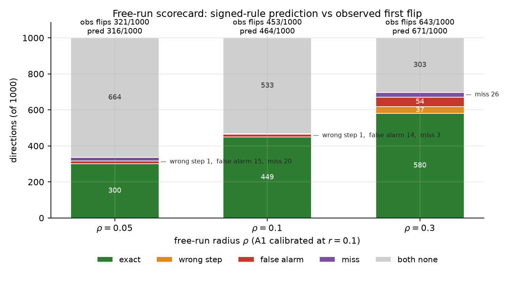

**Setup.** All 1000 directions at each of the three radii. Each direction is assigned to exactly one class: **exact** if ${\rm obs}=T_{\rm pred}\ge0$; **wrong step** if both are $\ge0$ but differ; **false alarm** if $T_{\rm pred}\ge0$ and ${\rm obs}=-1$; **miss** if $T_{\rm pred}=-1$ and ${\rm obs}\ge0$; **both none** if $T_{\rm pred}={\rm obs}=-1$. The prediction uses the signed threshold $r_c^-$ recomputed from `dm`, and $T_{\rm pred}$ is the first crossing in time.

**Axes.** $x$: free-run radius $\rho$; $y$: number of directions, linear 0–1000. Bars are stacked in the order exact, wrong step, false alarm, miss, both none. Above each bar: observed and predicted flip counts. Counts below 30 are written as a callout to the right of the bar rather than inside a sliver.

**Numbers.**

| class | $\rho=0.05$ | $\rho=0.1$ | $\rho=0.3$ |
|---|---:|---:|---:|
| exact | 300 | 449 | 580 |
| wrong step | 1 | 1 | 37 |
| false alarm | 15 | 14 | 54 |
| miss | 20 | 3 | 26 |
| both none | 664 | 533 | 303 |
| exact / predicted flips | 94.9% | 96.8% | 86.4% |
| exact / observed flips | 93.5% | 99.1% | 90.2% |

**What is in the figure.**
- At $\rho=0.1$ — the radius at which $\delta m$ was measured — the scorecard is almost diagonal: 449 exact, 1 wrong step, 14 false alarms, 3 misses. The rule gets the **event** right for 982/1000 directions and the **step** right for 449/453 observed flips.
- At $\rho=0.05$, below the calibration radius, the pattern is the same with a slightly larger miss count: 300 exact, 1 wrong step, 15 false alarms, 20 misses. The misses are not exotic third-token flips. Their smallest threshold radius lies in $[0.0509,0.147]$ with median 0.0567 (13% above $\rho$) and 90th percentile 0.0738 (48% above); only the extreme tail reaches 2–3x $\rho$. The false alarms have smallest threshold in $[0.0405,0.0492]$, just below $\rho$. The flip/no-flip boundary is sharp, and the misses are a small threshold-calibration error, not a qualitative failure.
- At $\rho=0.3$, three times the radius at which the response was measured, linear extrapolation degrades: 580 exact, 37 wrong step, 54 false alarms, 26 misses. The false alarms again sit just below threshold (smallest $r_c$ median 0.159, maximum 0.297), while the misses reach as high as $r_c=13.2$: at this radius some directions flip without their top-1/top-2 gap ever being predicted to close, which is the signature of a genuinely nonlinear response or of a third token overtaking.
- The sign-blind rule is not a viable alternative at any radius: 599/810/969 predicted flips and 49.7/44.4/34.4% false-alarm rates, against 4.8/3.0/8.1% for the signed rule (numbers in the JSON and §1.2).

**What it shows.** The signed teacher-forced rule is a calibrated predictor of whether a random prompt perturbation destroys the greedy continuation, and at the measurement radius it also predicts the exact step for 99% of the flips. The degradation at $\rho=0.3$ is confined to the step/threshold assignments; even there, 88.3% of directions are classified correctly.

**What it does not show.** It does not validate the rule at radii above 0.3 or below 0.05, nor for a different prompt or a different model. It does not show that a "miss" is a top-1/top-2 flip at all: the free run records only tokens, not the logits after divergence, so the missing third-token hypothesis cannot be tested here. And because the prediction and the free run share the same `dm` measurement, the agreement is not an independent estimate of the linear response — it is a test of whether that response extrapolates to a different radius and to free generation.

---

## 3. Figure `ds14free_survival.png` — survival curves agree to 0.035

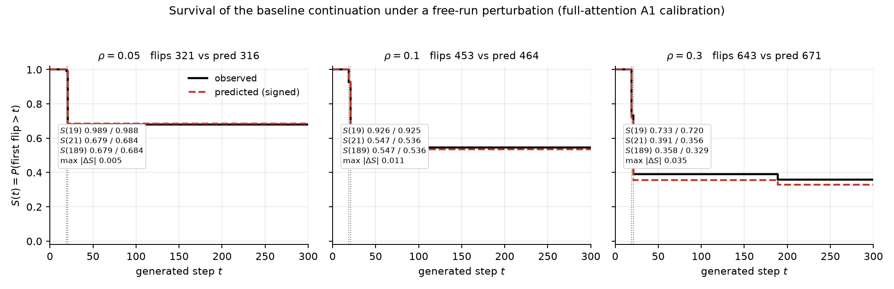

**Setup.** $S(t)=P(\text{first flip}>t)$, with a never-flipped direction treated as first flip $=+\infty$. Observed: from `obs`; predicted: from the signed $T_{\rm pred}(\rho,u)$. Both are step functions on $t=0,\dots,299$, one panel per radius. Vertical dotted lines mark $t=19$ and $t=21$.

**Axes.** $x$: generated step $t$, linear 0–300; $y$: survival probability, linear 0–1. Black solid: observed; red dashed: predicted signed.

**Numbers.**

| | $\rho=0.05$ | $\rho=0.1$ | $\rho=0.3$ |
|---|---:|---:|---:|
| $S(19)$ observed / predicted | 0.989 / 0.988 | 0.926 / 0.925 | 0.733 / 0.720 |
| $S(21)$ observed / predicted | 0.679 / 0.684 | 0.547 / 0.536 | 0.391 / 0.356 |
| $S(189)$ observed / predicted | 0.679 / 0.684 | 0.547 / 0.536 | 0.358 / 0.329 |
| max $|S_{\rm obs}-S_{\rm pred}|$ (step) | 0.005 ($t=21$) | 0.011 ($t=21$) | 0.035 ($t=21$) |

**What is in the figure.**
- Up to $t=19$ both curves are at 1.0: no direction flips before the first near-tie. The first drop is a single token at $t=19$, then the much larger drop at $t=21$: at $\rho=0.1$, 7.4% of directions are already gone at 19 and another 37.9% at 21, leaving 54.7% intact.
- The predicted curve is slightly below the observed one at $\rho=0.3$ after $t=21$ (0.356 vs 0.391 at 21, 0.329 vs 0.358 at 189), which is the same 26 misses seen in the scorecard (the prediction flips more directions than are observed). At $\rho=0.05$ and $0.1$ the two curves are within 0.011 everywhere.
- The late shoulder at $t=189$ exists only at $\rho=0.3$: 3.3% of directions flip there and one at $t=273$. The prediction puts 2.7% at 189 and none at 273.

**What it shows.** The entire distribution of first-flip times is reproduced, not just its mean: the two near-ties at 19 and 21, the absence of any earlier event, and the small late tail at the largest radius. A rule calibrated from teacher-forced gaps at $r=0.1$ predicts the survival curve of free-running generation.

**What it does not show.** Survival only records the first event; it says nothing about what happens after a flip. A curve that matches at $t\le21$ is compatible with completely different texts afterwards, which is exactly what §5 finds. It also does not resolve the mechanism of the 26 misses at $\rho=0.3$: they could be nonlinear threshold shifts or third-token flips.

---

## 4. Figure `ds14free_latency.png` — the flips are immediate, and the step is predicted

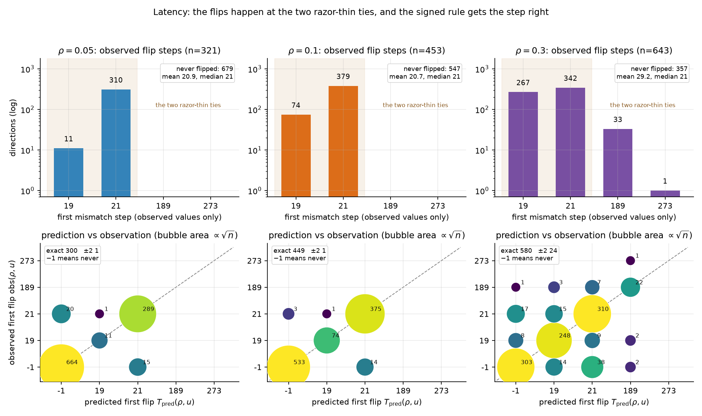

**Setup.** Top row: histogram of observed first-flip steps, using only the steps that occur (19, 21, 189, 273); the never-flipped directions are annotated, not plotted on the log axis. Bottom row: bubble matrix of predicted step $T_{\rm pred}$ against observed step, all 1000 directions, including $-1$ ("never"). Bubble area scales as $\sqrt{n}$ and colour as $\log_{10} n$; labels give the count. The diagonal is the perfect prediction.

**Axes.** Top: $x$: observed step (categorical, only observed values); $y$: directions, log. The shaded band marks the two razor-thin ties. Bottom: $x$: predicted step; $y$: observed step; both categorical with ticks $\{-1,19,21,189,273\}$.

**Numbers.**

| | $\rho=0.05$ | $\rho=0.1$ | $\rho=0.3$ |
|---|---:|---:|---:|
| immediate, ${\rm obs}=t_*$ | 315 | 422 | 496 |
| earlier than $t_*$, ${\rm obs}<t_*$ | 6 | 31 | 132 |
| delayed, ${\rm obs}>t_*$ | 0 | 0 | 15 |
| ${\rm obs}-T_{\rm pred}=0$ | 300 | 449 | 580 |
| ${\rm obs}-T_{\rm pred}=\pm2$ | 1 | 1 | 24 |
| larger step errors | 0 | 0 | 13 |
| mean / median observed step | 20.9 / 21 | 20.7 / 21 | 29.2 / 21 |

**What is in the figure.**
- At $\rho=0.05$ and $0.1$ every flip is at 19 or 21; there are no delayed flips at all. The six (resp. 31) "early" runs are not early relative to the first crossing: they are directions whose global minimum is at 21 but whose $r_c(19)$ is already below $\rho$, so $T_{\rm pred}=19$. They are counted as exact in the scorecard.
- At $\rho=0.3$, 119 of the 132 early runs are the same $\pm2$ effect (19 vs 21). The remaining 13 jump between the 21/19 pair and 189/273: 9 flip at 21 although the global minimum is at 189 ($\Delta=-168$), 3 at 21 with $\Delta=-170$, one at 19 with $\Delta=-252$. The 15 delayed runs are the mirror image: 7 flip at 189 although the global minimum is at 21 ($\Delta=+168$), one at 189 with $\Delta=+170$, 5 at 21 with $\Delta=+2$, and one each with $\Delta=+11$ and $\Delta=+21$.
- The mean 29.2 at $\rho=0.3$ is entirely composition: $(267\cdot19+342\cdot21+33\cdot189+1\cdot273)/643=29.18$, while the median stays 21. The late flips are 5.3% of the outcomes but add $[33(189-21)+1(273-21)]/643=9.0$ points to the mean.
- The bubble matrix shows that the 580 exact directions are the two large diagonal bubbles at 21 (310) and 19 (248), plus 22 at 189. Off-diagonal mass is concentrated in the 19↔21 block and in the 21↔189 block; there is no diffuse scatter, because only four steps ever occur.

**What it shows.** Latency is not a free parameter: the rule predicts not only that a direction flips but at which of the two ties, and the "delayed" phenomenon is essentially absent at and below the calibration radius. At $\rho=0.3$ the rule still identifies the right pair of gates; the residual error is which member of the pair, or whether the 189 gate fires first.

**What it does not show.** It does not show that a flip at 19 is a different physical event from a flip at 21: both lead to the same alternative continuation (§6). The latency classes use $t_*=\arg\min r_c$, so the negative entries are a definitional artefact of first-crossing versus argmin, not evidence of a failure; measured against $T_{\rm pred}$ the same runs are exact. And the late 189/273 events are observed only at one radius, so their rate is not a calibrated function of $\rho$.

---

## 5. Figure `ds14free_resync.png` — the 73% "post-flip agreement" is an average over non-flipped runs

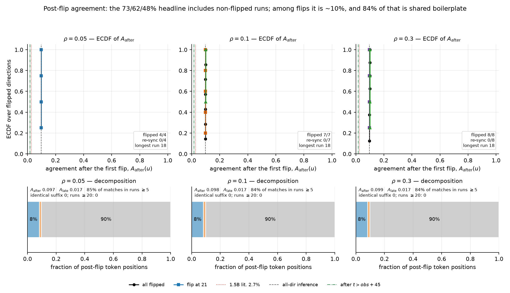

**Setup.** The stored `summary.json` field `mean_postflip_agreement` is, despite its name, the mean of `agreement[ri,u]` over **all** 1000 directions and over the **whole** 300-token run. The free-run writer computes `agreement` as the fraction of the 300 positions where the perturbed generation equals its in-batch $r=0$ reference, so a direction with `obs=-1` contributes exactly 1.0. The figure decomposes that mean. Top row: ECDF of the directly measured $A_{\rm after}(u)$ for the 11 saved directions, separately for flips at 19 and 21; vertical lines mark the all-direction inference, the 1.5B literature value quoted in the brief (2.7%), and $A_{\rm late}$ ($t>{\rm obs}+45$). Bottom row: the post-flip token positions split into matches inside runs of length $\ge5$, isolated matches, and mismatches. The direct measurement uses 19 flipped rows; the population value is recovered algebraically below.

**Axes.** Top: $x$: $A_{\rm after}(u)$, linear 0–1; $y$: ECDF over flipped directions. Bottom: $x$: fraction of post-flip token positions; $y$: none (single stacked bar).

**The population algebra.** Let $f$ be the observed flip fraction, $\bar A$ the stored whole-run mean over all directions, and $\bar o$ the mean first-flip step among flipped directions. Non-flipped directions have $A=1$ exactly (`obs=-1` means no mismatch anywhere). Hence the mean whole-run agreement among flipped directions is
$$\bar A_{\rm flip}=\frac{\bar A-(1-f)}{f},$$
and, because the prefix $t<{\rm obs}$ matches and the position $t={\rm obs}$ does not, the mean agreement strictly after the flip is
$$\bar A_{\rm after}=\frac{\bar A_{\rm flip}T-\bar o}{T-\bar o}.$$
This uses only stored quantities and is exact under the definition of `obs`; it reproduces the directly measured sample to the third decimal.

| | $\rho=0.05$ | $\rho=0.1$ | $\rho=0.3$ |
|---|---:|---:|---:|
| stored `mean_postflip_agreement` (all dirs, whole run) | 0.7303 | 0.6192 | 0.4754 |
| implied mean whole-run, **among flipped** | 0.1599 | 0.1595 | 0.1841 |
| implied mean **after** the first flip | 0.0969 | 0.0972 | 0.0962 |
| directly measured $A_{\rm after}$, saved rows | 0.0971 | 0.0979 | 0.0986 |
| directly measured $A_{\rm late}$ ($t>{\rm obs}+45$) | 0.0172 | 0.0171 | 0.0171 |
| re-synchronised runs (sustained suffix $\ge20$) | 0 / 4 | 0 / 7 | 0 / 8 |

**What is in the figure.**
- The headline 73.0/61.9/47.5% is a mixture, not a post-flip measurement. It falls with $\rho$ only because the flip fraction rises: 0.7303 = 0.679·1.0 + 0.321·0.1599, and similarly for the other radii. The agreement among flipped directions is remarkably constant, 0.159–0.184, and the strictly post-flip value is constant at 0.096–0.097.
- The small rise of the whole-run value among flipped directions at $\rho=0.3$ (0.184 vs 0.160) is not better agreement: 34 of the 643 flips happen at 189/273, so those runs have less time to diverge. The post-flip value stays at 0.096.
- The direct token analysis shows what the matching tokens are. Of the 108 matching post-flip positions across the 4 saved $\rho=0.05$ flips, 92 (85%) lie in just two contiguous runs: `", so I need to"` (5 tokens immediately after the gate) and an 18-token run at $t=28$–$45$, `" a comprehensive technical review of current and proposed propulsion systems for interstellar travel. The user has"`. The second is a verbatim restatement of the prompt sentence. Pooled over all 19 flipped rows, 437 of the 519 matching tokens (84.2%) are inside runs of length $\ge5$; outside those runs only 82 of the remaining 4,857 positions match (1.7%).
- After $t={\rm obs}+45$ the agreement is 1.7%, and it never returns. The longest identical run anywhere after a flip is 18 tokens (the prompt echo); the identical-suffix length is 0 for every flipped row; the last token differs in every case. Under the stated definition — 20 consecutive identical tokens, or an identical suffix of 20 — the re-synchronisation count is 0/19.
- The flip-19 and flip-21 variants differ at exactly one token (the $t=19$ gate), agreement 0.9967. All rows that flip at the same gate are **bit-identical** over all 300 tokens. Across the 33 saved rows (11 directions × 3 radii) there are only **three** distinct continuations: the baseline, the alternative entered at $t=21$, and the alternative entered at $t=19$ (one token different from the second).

**What it shows.** The apparent 73% is not a cross-scale anomaly; it is a mixture artefact. Once the mixture is removed, the 14B behaves like the 1.5B literature value: token agreement after a flip is ~9.7% if the shared prompt restatement is counted, and ~1.7% if it is not, against 2.7% quoted for the 1.5B with no re-synchronisation. The correct cross-scale statement is therefore *no major difference*, not a 27-fold one. What does differ is the **ensemble** behaviour: perturbed runs re-converge to one another almost perfectly (pairwise agreement 0.9967–1.0), because they all enter the same alternative basin, while none re-converges to the baseline.

**What it does not show.** The direct ECDF rests on 19 flipped rows, all from the saved final chunk (directions 989–999); the population curve is inferred, not measured token-by-token. It cannot separate "synonym-like gate token" from "same semantic plan" as causes: `"Alright"`→`"Okay"` is a discourse-marker substitution, and `" reference"`→`" research"` is a plausible noun substitution, but the downstream essays are different outlines, not paraphrases of the same sentences. Token agreement is not semantic agreement — the two texts are both on-topic reviews, so a human would call them similar even though 90% of tokens differ. And the 2.7% 1.5B number is quoted from the brief, not recomputed on the same protocol here; the comparison is order-of-magnitude, not a controlled cross-model contrast.

---

## 6. Figure `ds14free_flipword.png` — what the two competing tokens are

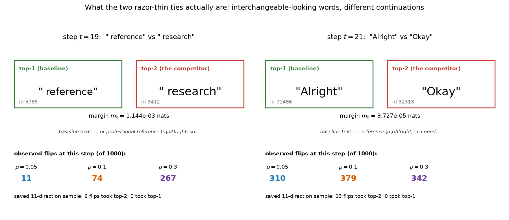

**Setup.** The unperturbed A1 top-1 and top-2 tokens at the two gates, decoded with `assets/tok_ds14/tokenizer.json` (the `tokenizers` library), with their token ids and the logit margin $m_t$. Below each gate: the number of directions whose **first** mismatch is at that step, per radius, and which token the 11-direction saved sample took.

**Axes.** None (text cards); the numbers are counts of directions.

**Numbers.**

| gate | top-1 (baseline) | top-2 (competitor) | $m_t$ (nats) | observed first flips at the gate, $\rho=0.05/0.1/0.3$ | saved flips taking top-2 |
|---|---|---|---:|---|---:|
| $t=19$ | `" reference"` (id 5785) | `" research"` (id 3412) | $1.144\times10^{-3}$ | 11 / 74 / 267 | 6 / 6 |
| $t=21$ | `"Alright"` (id 71486) | `"Okay"` (id 32313) | $9.727\times10^{-5}$ | 310 / 379 / 342 | 13 / 13 |

(The saved-flips column is six of six and thirteen of thirteen across all radii; no saved flip took top-1.)

**What is in the figure.**
- The two gates are ordinary words in an ordinary sentence. The baseline reads `"...or professional reference.\n\nAlright, so I need to provide a comprehensive technical review..."`. A $t=19$ flip gives `"...or professional research.\n\nOkay, so I need to write a comprehensive technical review..."`; a $t=21$ flip gives `"...professional reference.\n\nOkay, so I need to write..."`. Both alternatives then continue with the same essay, which is why the flip-19 and flip-21 texts differ by one token.
- $t=21$ is the thinner tie by a factor 11.8 ($9.7\times10^{-5}$ vs $1.14\times10^{-3}$ nats), and it is the dominant gate at the two smaller radii (310/321 flips at $\rho=0.05$, 379/453 at $\rho=0.1$). At $\rho=0.3$ the 19 gate gains ground (267 vs 342, still behind 21 but far closer than the 74 vs 379 at $\rho=0.1$).
- Both gate words are near-synonyms in context (`Alright`/`Okay`; `reference`/`research` after "professional"), so the first few tokens look almost unchanged: the first 5 post-flip tokens match 100% (flip at 21) or 80% (flip at 19), the first 10 match 90%/80%, the first 20 match 95%/90%. That local agreement is the synonym-like part (these window fractions are for the representative saved rows, dir 989 at $\rho=0.05$ and dir 995 at $\rho=0.1$). It does not persist: the first 50 match only 46%/48%, and after $t={\rm obs}+45$ only 1.7% of the remaining 254 positions match.
- At $\rho=0.3$ two further gates appear: 33 flips at $t=189$ (`" by"` vs `" about"`, $m=2.22\times10^{-3}$ nats) and one at $t=273$ (`","` vs `" today"`, $m=1.92\times10^{-2}$ nats). They are 5.3% of the flips and do not change the two-gate picture at the calibrated radius.

**What it shows.** The answer to "what are the two competing tokens": at $t=21$, `"Alright"` (baseline, id 71486) and `"Okay"` (id 32313, taken by all 13 saved runs whose first flip is at 21); at $t=19$, `" reference"` (baseline, id 5785) and `" research"` (id 3412, taken by all 6 saved runs whose first flip is at 19). Both are single-token, locally interchangeable substitutions at the two smallest logit gaps in the run. They are not random vocabulary: they are the two best candidates of a nearly tied decision.

**What it does not show.** The token identity is directly verified only for the 19 saved flips; for the other 1000-direction runs the evidence is that their first mismatch step is 19 or 21 and that the only tracked competitor at those steps is top-2. A third token overtaking top-1 without top-2 winning cannot be excluded from `obs` alone, but it is not observed in any saved row. And a one-token substitution at the gate does not imply a one-token change in meaning: §5 shows the essays diverge from token 24 onward.

---

## 7. Facts that qualify the whole validation

1. **Full attention, not window 100.** The 14B A1 run and this free run used full attention because the window setting was silently inactive (transformers gates it on a `layer_types` field that the stock config does not set). Non-flipped saved rows are bit-identical to the full-attention A1 `gen_ids`, so the validation is internally consistent, but it is not a window-100 validation. A true-window rerun is being generated; the window can change the margin spectrum, so the $t=19/21$ gate structure may move in that run.
2. **One prompt, one model, 300 tokens.** The gates are properties of this continuation. A different prompt, or a longer horizon, can expose other near-ties; the late 189/273 gates at $\rho=0.3$ already show that the two-gate picture is radius-dependent.
3. **`gen_ids` contains only the final chunk.** The writer overwrote its dictionary per chunk, so raw tokens exist for directions 989–999 only. The mapping was verified against `obs`; the direct post-flip ECDF is 19 rows, and the population post-flip value is an algebraic inference from the stored whole-run means, not a token-level census.
4. **The summary field is misnamed.** `mean_postflip_agreement` is the whole-run agreement averaged over all directions, with non-flipped directions at exactly 1.0. It must not be quoted as "agreement after the flip". The corrected values are 0.0969/0.0972/0.0962 (post-flip) and 0.0172/0.0171/0.0171 (after the prompt echo).
5. **Radii 0.05 and 0.3 are extrapolations.** The response was measured at $r=0.1$ only. The rule is nearly exact at 0.05 and 0.1 and degrades at 0.3 (88.3% classification, 37 wrong steps, 13 large step jumps). The degradation is a statement about linear extrapolation, not about the direction of the effect.
6. **A flip is a token mismatch, not a semantic failure.** All continuations here remain coherent, on-topic technical reviews. "32% of directions flip" means 32% produce a different token stream, not that 32% produce a wrong or degraded answer.
7. **Latency uses $t_*=\arg\min r_c$, not first crossing.** Negative latencies at 19 vs 21 are definitional; measured against $T_{\rm pred}$ they are exact. Do not read $\Delta<0$ as a rule failure.
8. **No post-flip logits.** Once the text diverges, the teacher-forced `dm` no longer describes the state. The analysis can say where and when a run left the baseline and how far it went, but it cannot compute a causal threshold radius for the new text.

---

## 8. What follows directly

- The signed rule, not the sign-blind one, is the correct low-order description: it predicts the flip fraction to 0.5–1.1 percentage points at $\rho\le0.1$ and classifies 96.4–98.2% of directions correctly, while the $|\delta m|$ rule predicts 599/810/969 flips and fails on 49.7/44.4/34.4% of them.
- The first failure of a free-running 14B continuation is a **discrete gate choice**, not a gradual degradation: 94.7% of all flips at $\rho=0.3$, and 100% at the smaller radii, occur at just two tokens, `"Alright"`→`"Okay"` and `" reference"`→`" research"`.
- The correct post-flip agreement is ~9.7% (or ~1.7% after removing the verbatim prompt restatement), not 73/62/48%. This is the same order as the 2.7% quoted for the 1.5B; there is no large cross-scale difference in post-flip re-synchronisation.
- What *is* different from a naive "chaos" picture is the ensemble: perturbed runs do not fan out into many texts. They collapse into one alternative continuation, bit-identically, and that continuation is not the baseline. The sensitivity is a switch between a small number of discrete basins.
- The remaining open measurement is the true-window 14B free run. If the window moves the $t=19/21$ gates or changes the post-flip basin structure, the numbers in §1.3 and §5 must be recomputed on that run; the method (signed $r_c$, first-crossing $T_{\rm pred}$, and the $A_{\rm after}$ algebra) carries over unchanged.

## 9. Reproduce

```
python scripts_spark/figs_free_full.py
```

Writes `notebook_big/figures/ds14free_{scorecard,survival,latency,resync,flipword}.png` (dpi 170) and `notebook_big/figures/ds14free_numbers.json`, which contains the full scorecard, the sign-blind comparison, the latency distributions, the survival curves, the per-run post-flip records (including the decoded longest shared run), the population inference, and the decoded gate tokens with their ids. The script reads the two npz files and the summary in place; it does not modify them. The tokenizer is `assets/tok_ds14/tokenizer.json` via the `tokenizers` package.


---

# Addendum. Free-run validation under the true window 100 (14B)

## Summary

Under a verified sliding window of 100, the free run at $\rho=0.1$ flips **483/1000** directions (48.3%) against **493** predicted by the signed rule (49.3%): 478 exact steps, 2 wrong steps, 13 false alarms, 3 misses, 98.2% classified correctly. At $\rho=0.3$ it flips 703/1000 (70.3%) against 723 predicted (72.3%), with 625 exact, 41 wrong steps, 57 false alarms, 37 misses (86.5%). The two early ties are **unchanged by the window**: the margins at $t=19$ and $t=21$ are bit-identical to the full-attention run (the prompt is 65 tokens, so the window cannot drop a key before generated step $t=36$), and the flip counts at 19/21 are literally the same numbers, 74/379 at $\rho=0.1$ and 267/342 at $\rho=0.3$. The window adds one new razor tie at $t=297$ — `" These"` vs `" Each"`, $m=4.8\times10^{-3}$ nats — which is the *entire* excess at $\rho=0.1$ (483 = 453 + 30); at $\rho=0.3$ it reorganises the late gates (271 and 297 replace the full-attention 189 and 273). With `gen_ids` now complete for all 1000 directions at both radii, the post-flip analysis is a census of all 1186 flipped runs: every one took top-2 at its gate, post-flip agreement for the long-horizon flips is 10.5%/10.1% (2.6%/2.0% after the prompt echo), and **0/1186 re-synchronise** to the baseline. The longest shared run anywhere is 17 tokens, the verbatim prompt echo.

---

## 1. Run, data, quantities

| item | value |
|---|---|
| model | `DeepSeek-R1-Distill-Qwen-14B`, FP32 |
| attention | **true sliding window 100** (actuation verified; no key is dropped for $t\le35$ by construction) |
| prompt | `interstellar_travel`, $P=65$ tokens, $T=300$ generated tokens |
| A1 calibration | 1000 directions at $r=0.1$, teacher-forced on the baseline |
| free run | same 1000 directions and perturbation, $\rho\in\{0.1,0.3\}$, greedy, own KV cache |
| files | `results_big/ds14/a1_inter_w100/a1.npz`, `results_big/ds14/free_inter_w100/{free_run.npz,summary.json}` |

**Data integrity.** This run fixes the accumulation bug: `gen_ids` is `2 x 1000 x 300`. All 1000 rows at each radius reproduce `obs` exactly (`first_mismatch == obs`), the 517 (resp. 297) non-flipped rows are bit-identical to the A1 `gen_ids`, and the stored whole-run `agreement` is recovered from the raw rows to $3\times10^{-8}$. The A1 baseline is self-consistent (`top1[t] == gen_ids[t]` for all $t$).

Notation as in the full-attention section: $m_t$ is the top1–top2 gap of the unperturbed A1 run, $\delta m_t(u)$ its change at $r=0.1$, $r_c^-(t,u)=m_t r/\max(-\delta m_t(u),0)$, $T_{\rm pred}(\rho,u)=\min\{t:\rho\ge r_c^-(t,u)\}$, and ${\rm obs}$ is the first generated token that differs from the baseline. The npz's `r_c` is the sign-blind $m_t r/|\delta m_t|$; every prediction below uses the signed $r_c^-$. $A_{\rm after}$ is the token agreement strictly after ${\rm obs}$, $A_{\rm late}$ the same for $t>{\rm obs}+45$.

| quantity | $\rho=0.1$ | $\rho=0.3$ |
|---|---:|---:|
| observed flips / 1000 | 483 | 703 |
| predicted flips, signed | 493 | 723 |
| predicted flips, sign-blind | 834 | 976 |
| exact (${\rm obs}=T_{\rm pred}$) | 478 | 625 |
| wrong step | 2 | 41 |
| false alarm | 13 | 57 |
| miss | 3 | 37 |
| both none | 504 | 240 |
| classification accuracy | 98.2% | 86.5% |
| signed false-alarm rate | 2.64% | 7.88% |
| observed mean / median flip step | 37.8 / 21 | 56.9 / 21 |
| flips at $t=19/21/271/297$ | 74 / 379 / 0 / 30 | 267 / 342 / 6 / 88 |
| $A_{\rm after}$, flips at 19/21 | 0.105 | 0.101 |
| $A_{\rm late}$ ($t>{\rm obs}+45$) | 0.026 | 0.020 |

The signed rule tracks the flip fraction to 1.0 point at $\rho=0.1$ and 2.0 points at $\rho=0.3$. The sign-blind rule predicts 834/976 flips with 42.4%/28.7% false alarms and is rejected as before.

---

## 2. Figure `ds14w100free_scorecard.png`

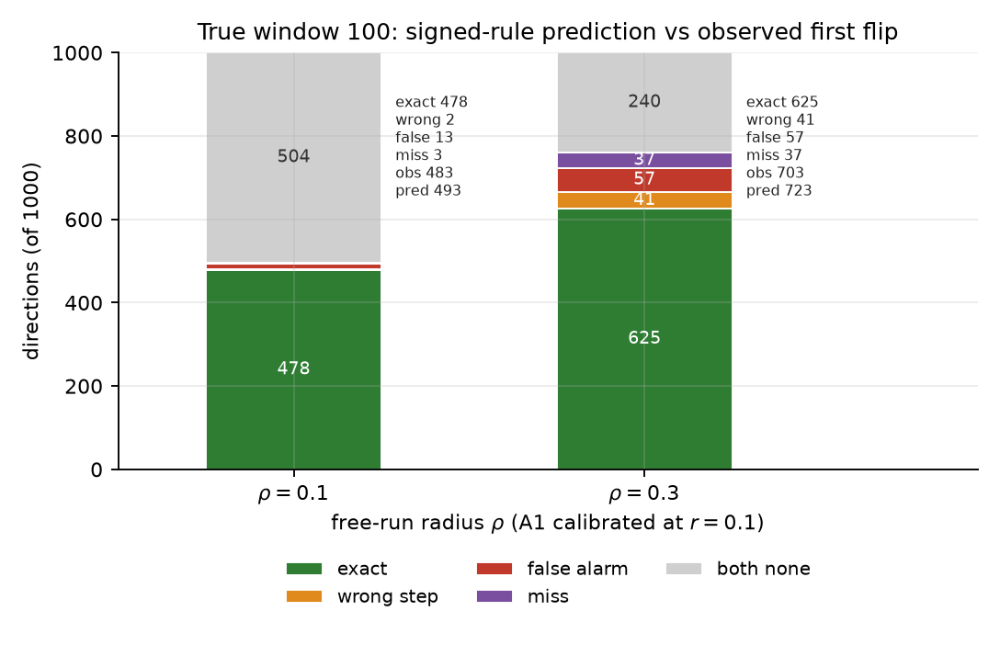

All 1000 directions at each radius, one class per direction (exact, wrong step, false alarm, miss, both none).

| class | $\rho=0.1$ | $\rho=0.3$ |
|---|---:|---:|
| exact | 478 | 625 |
| wrong step | 2 | 41 |
| false alarm | 13 | 57 |
| miss | 3 | 37 |
| both none | 504 | 240 |
| exact / predicted flips | 97.0% | 86.4% |
| exact / observed flips | 99.0% | 88.9% |

- At $\rho=0.1$ the rule gets the **event** right for 982/1000 directions and the **step** right for 478/483 flips. The two wrong steps are one flip 2 steps late and one 276 steps late (predicted 21, flipped at 297).
- At $\rho=0.3$ the residual is concentrated in the late gates: of the 41 wrong steps, 24 are 19↔21 swaps and 17 involve 271/297 (10 predicted 21→flipped 297, 3 predicted 19→297, 2 predicted 271→297, 1 predicted 297→271, 1 predicted 297→21).
- The 13 false alarms at $\rho=0.1$ have smallest threshold radius $r_*\in[0.073,0.0995]$, all just below $\rho$: threshold-calibration errors, not a qualitative failure. The signed false-alarm rate is 2.6% against 42.4% for the sign-blind rule.

---

## 3. Figure `ds14w100free_survival.png`

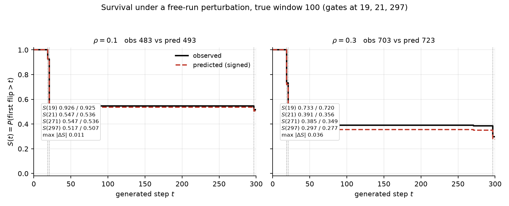

$S(t)=P(\text{first flip}>t)$, never-flipped treated as $+\infty$; observed vs signed prediction, one panel per radius.

| | $\rho=0.1$ | $\rho=0.3$ |
|---|---:|---:|
| $S(19)$ obs / pred | 0.926 / 0.925 | 0.733 / 0.720 |
| $S(21)$ obs / pred | 0.547 / 0.536 | 0.391 / 0.356 |
| $S(271)$ obs / pred | 0.547 / 0.536 | 0.385 / 0.349 |
| $S(297)$ obs / pred | 0.517 / 0.507 | 0.297 / 0.277 |
| max $|S_{\rm obs}-S_{\rm pred}|$ | 0.011 ($t=21$) | 0.036 ($t=21$) |

The distribution of first-flip times is reproduced, including the new drop at $t=297$. At $\rho=0.1$ there is no event between 21 and 297: the curve is flat at 0.547 for 276 steps, then loses the 30 directions that flip at 297. At $\rho=0.3$ the predicted curve is consistently 0.013–0.036 below the observed one after $t=19$, the same 37 misses seen in the scorecard.

---

## 4. Figure `ds14w100free_latency.png`

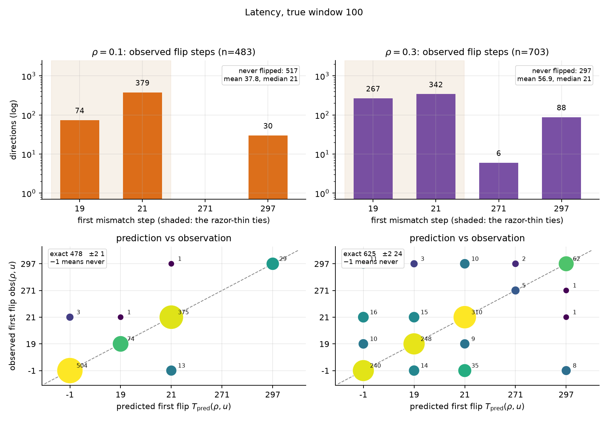

Top: histogram of observed first-flip steps. Bottom: predicted vs observed step, all 1000 directions.

| | $\rho=0.1$ | $\rho=0.3$ |
|---|---:|---:|
| immediate (${\rm obs}=t_*$) | 448 | 527 |
| earlier than $t_*$ | 35 | 164 |
| delayed (${\rm obs}>t_*$) | 0 | 12 |
| ${\rm obs}-T_{\rm pred}=0$ | 478 | 625 |
| $\pm2$ | 1 | 24 |
| larger step error | 1 | 17 |

- At $\rho=0.1$ every flip is at 19, 21 or 297; the 35 "early" runs are the usual first-crossing effect (global minimum at 21, but $r_c(19)$ already below $\rho$) and are counted as exact against $T_{\rm pred}$.
- The mean 37.8 at $\rho=0.1$ is pure composition: $(74\cdot19+379\cdot21+30\cdot297)/483$, while the median stays 21. At $\rho=0.3$ the 94 late flips (6 at 271, 88 at 297) add $[6(271-21)+88(297-21)]/703=36.7$ points to the mean; the median is still 21.

---

## 5. Figure `ds14w100free_resync.png` — full census

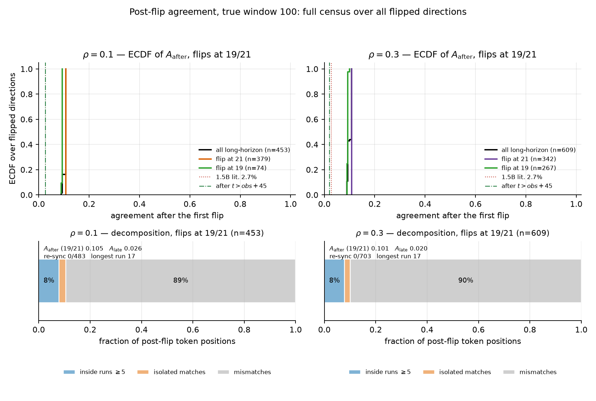

With every row decoded, this is no longer an inference. Over the 1186 flipped rows:

| | $\rho=0.1$ | $\rho=0.3$ |
|---|---:|---:|
| flipped rows | 483 | 703 |
| $A_{\rm after}$, flips at 19/21 | 0.1054 | 0.1010 |
| $A_{\rm after}$, flips at 19 only | 0.0925 | 0.0921 |
| $A_{\rm after}$, flips at 21 only | 0.1079 | 0.1079 |
| $A_{\rm late}$ ($t>{\rm obs}+45$) | 0.0265 | 0.0202 |
| matching positions inside runs $\ge5$ | 75.0% | 78.1% |
| re-synchronised (run $\ge20$ or suffix $\ge20$) | 0 / 483 | 0 / 703 |
| longest identical run | 17 | 17 |
| distinct continuations (flipped) | 4 | 9 |
| pairwise agreement, flipped (sample) | 0.773 | 0.493 |

- **No re-synchronisation.** The longest shared run anywhere is 17 tokens, $t=28$–$44$, `" a comprehensive technical review of current and proposed propulsion systems for interstellar travel. The user"`, a verbatim echo of the prompt; the identical-suffix length is 0 for every flipped row. Under the stated definition the count is 0/1186.
- **The ensemble collapse is partial.** At $\rho=0.1$ there are 4 flipped continuations: the 21 gate has exactly **one** bit-identical 300-token text (379 rows), the 297 gate one (30 rows), but the 19 gate splits into two downstream branches (67 and 7 rows). At $\rho=0.3$ the 21 and 297 gates are still single texts, while the 19 gate splits into five (193/52/14/6/2) and the 271 gate into two (4/2).
- **The stored field is still misnamed.** `mean_postflip_agreement` is 0.6222/0.4876, a mean over all directions and the whole run. Removing the non-flipped directions ($A=1$) and the matched prefix gives 0.1049/0.1003, which matches the measured 0.1054/0.1010.
- The 30 (resp. 88) flips at 297 leave only 3 (resp. 3) tokens, so their $A_{\rm after}=0$ is arithmetic, not evidence; all re-synchronisation statements use the 19/21 flips. The gate-level figures are stable across the two radii (21: 0.1079 at both; 19: 0.092), and the 21-gate alternative is a single text shared by both radii, consistent with the early computation being identical.

---

## 6. Figure `ds14w100free_flipword.png` — the three ties

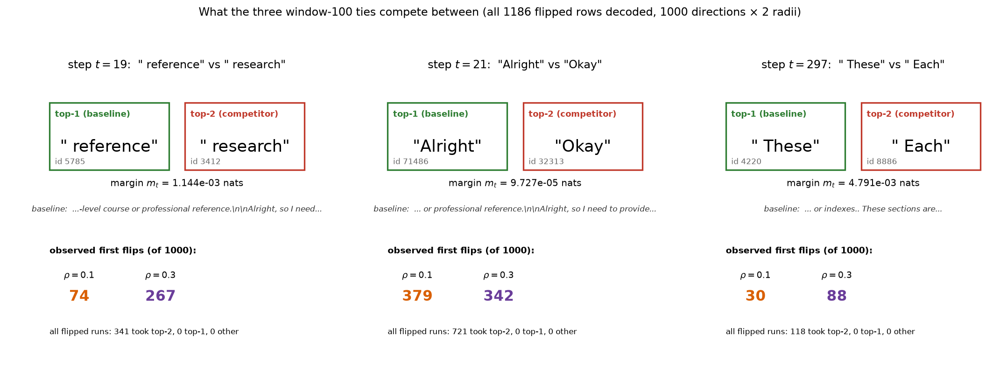

| gate | top-1 (baseline) | top-2 (competitor) | $m_t$ (nats) | observed first flips $\rho=0.1/0.3$ |
|---|---|---|---:|---:|
| $t=19$ | `" reference"` (5785) | `" research"` (3412) | $1.144\times10^{-3}$ | 74 / 267 |
| $t=21$ | `"Alright"` (71486) | `"Okay"` (32313) | $9.727\times10^{-5}$ | 379 / 342 |
| $t=297$ | `" These"` (4220) | `" Each"` (8886) | $4.791\times10^{-3}$ | 30 / 88 |
| *($t=271$)* | *`" key"` (1376)* | *`" target"` (2169)* | *$5.221\times10^{-2}$* | *0 / 6* |

**What the new tie competes between.** The baseline text is

> `"... additional elements like appendices or indexes.. These sections are"`

and a $t=297$ flip reads

> `"... additional elements like appendices or indexes.. Each of these"`

So `" These"` $\to$ `" Each"` is a sentence-initial determiner swap between two grammatical continuations; only three tokens ($t=298,299$) follow it inside the 300-token horizon, so its downstream text cannot be compared here. The gate is the third-smallest gap in the window run (after 21 and 19) and controls 29 directions at $\rho=0.1$: 174 directions have $t_*=297$ and 34 have $r_*\le0.1$, but for 29 of them 297 is the first crossing, which is what $T_{\rm pred}$ reports. All 29 predicted crossings are exact; one further direction flips at 297 while predicted at 21.

All 1186 flipped rows took **top-2** at their gate; none took top-1 or a third token. The 271 gate is not razor-thin ($5.2\times10^{-2}$ nats) and only fires at $\rho=0.3$ (6 rows, two downstream branches).

---

## 7. Full attention vs true window

| | full $0.1$ | **w100 $0.1$** | full $0.3$ | **w100 $0.3$** |
|---|---:|---:|---:|---:|
| observed flips / 1000 | 453 | **483** | 643 | **703** |
| predicted flips (signed) | 464 | **493** | 671 | **723** |
| exact | 449 | **478** | 580 | **625** |
| wrong step | 1 | **2** | 37 | **41** |
| false alarm | 14 | **13** | 54 | **57** |
| miss | 3 | **3** | 26 | **37** |
| both none | 533 | **504** | 303 | **240** |
| classification accuracy | 98.2% | **98.2%** | 88.3% | **86.5%** |
| agreement after flip | 0.097 | **0.105** | 0.096 | **0.101** |
| mean flip step | 20.7 | **37.8** | 29.2 | **56.9** |
| flips at 19 / 21 / late gates | 74/379/0 | **74/379/30** | 267/342/34 | **267/342/94** |

- **The early gates do not move.** Because $P=65$, the window keeps all keys for $t\le35$; the first prediction it can change is $t=36$ (the A1 margins are bit-identical through $t=35$ and first differ at 36). Consequently the 19/21 margins and every early flip count are identical.
- **The window changes only the late landscape.** At $\rho=0.1$ it adds the 297 tie, and the extra 30 flips are exactly the 3.0-point increase (483 vs 453). At $\rho=0.3$ it removes the full-attention 189/273 gates (33+1 flips) and installs 271/297 (6+88); the late-gate margins move from $m_{189}=2.2\times10^{-3}$ to $2.85\times10^{-1}$ and from $m_{297}=0.545$ to $4.8\times10^{-3}$.
- **Fragility increases, predictability does not degrade at $\rho=0.1$.** Flip fractions rise by 3.0 points (0.1) and 6.0 points (0.3); classification accuracy is unchanged at 0.1 and falls 1.8 points at 0.3, where the moving late gates are the whole residual.
- **Post-flip behaviour is unchanged.** ~10% token agreement, ~2% after the prompt echo, zero re-synchronisation, and (within this run) a single bit-identical alternative text at each of the 21 and 297 gates.

---

## 8. Facts that qualify this addendum

1. **One prompt, one model, 300 tokens, two radii.** The 297 tie is a property of this continuation; the window-100 late-gate landscape is not universal.
2. **The early-gate identity is structural, not empirical luck.** With $P=65$ and window 100, no key is dropped for $t\le35$; the 19/21 agreement is a check of the harness, not a test of the window.
3. **$\rho=0.3$ is a 3x extrapolation** of a response measured at $r=0.1$; its 37 misses and 41 wrong steps are the linear-rule limit.
4. **297/271 flips have no downstream horizon** (3 and ≤28 tokens); their $A_{\rm after}$ is not comparable and is excluded from the re-synchronisation verdict.
5. **The full-attention $A_{\rm after}$ is inferred** from stored whole-run means and 11 saved rows; the window value is measured on all 1186 rows. The comparison is therefore order-of-magnitude at the third decimal.
6. **A flip is a token mismatch, not a semantic failure.** All continuations remain coherent; the 297 alternative (`"Each of these"`) is locally grammatical.

---

## 9. Reproduce

```
python scripts_spark/figs_free_w100.py
```

Writes `notebook_big/figures/ds14w100free_{scorecard,survival,latency,resync,flipword}.png` and `ds14w100free_numbers.json` (full scorecards, sign-blind comparison, gate table, latency, survival curves, census-level post-flip records, variant counts, and the recomputed full-attention reference). It also asserts the `gen_ids` census, the baseline identity, and the reproduction of the summary fields.


---

# Part window regime. True window 100 against full attention on the 14B: the same two razor ties, a x2.2 flush, and a late response that does not decay

## Summary

The same prompt, seed and 1000 directions were run twice on `DeepSeek-R1-Distill-Qwen-14B` in FP32, once with full attention and once with a *true* sliding window of 100 tokens (the `layer_types` patch was verified by a bitwise departure test). The two runs are bit-identical up to generated step 34 and first differ at exactly $t=35=W-P$, as the window law requires; the greedy text itself changes at $t=45$. The same two razor ties survive: $m_{21}=9.727\times10^{-5}$ and $m_{19}=1.144\times10^{-3}$ nats in both runs, and 418 and 41 of the windowed flips are still controlled at $t=21$ and $t=19$. The window adds one new late tie at $t=297$ ($m=4.79\times10^{-3}$ nats), which raises the predicted flip fraction from 46.4% to 49.3% without removing a single full-attention flip. The last-layer response jumps by a factor 2.20 across $t=35$ (the 1.5B showed 1.73), the typical response gain rises from 0.58 to 1.49, and the late-time response decays to 0.58 of its early value under full attention but stays at 0.93 under the window. In other words the window does not cut the late response: it makes it larger and more bursty, because only one prompt position leaves the window per step and the perturbation survives in the generated-token states that stay inside it.

---

## 1. The runs, the quantities, and the verification

### 1.1 Setup

| item | full attention | true window 100 |
|---|---|---|
| model | `DeepSeek-R1-Distill-Qwen-14B` (48 blocks, hidden size 5120) | same |
| precision / decoding | FP32, TF32 off; greedy, fixed length | same |
| prompt | `interstellar_travel`, $P=65$ tokens | same |
| continuation | $T=300$ baseline greedy tokens | same, but **a different text from $t=45$** |
| directions | $K=1000$, 50 disjoint simplex blocks of 20, unit norm on the $65\times5120$ prompt embeddings | same construction, same seed |
| radius | $r=0.1$ only | same |
| attention | full: the request `window=100` was silently inactive (transformers gates it on `layer_types`, which the stock config does not set) | true: patched, window 100, verified |
| saved states | indices $[0,6,12,18,24,30,36,42,47]$ | same |
| file | `results_big/ds14/a1_inter_full/a1.npz` | `results_big/ds14/a1_inter_w100/a1.npz` |
| wall time | 1590.6 s | 1606.8 s |

Two auxiliary files are used for checks, not for the main comparison:

- `results_big/ds14/a1_inter_w4096/a1.npz` — 32 directions, 500 tokens, window 4096. Its first 300 baseline tokens are **identical** to the full-attention run's and its margins differ from them by at most $4.8\times10^{-5}$ nats (batch-shape round-off). It confirms that the full-attention run is a valid "no clipping within the horizon" reference.
- `results_big/ds14/calib/calib.npz` — 8 directions, 400 tokens, 9 radii, `meta.json` says `window: 100`. **It is not a true-window run.** Its first 300 baseline tokens are identical to the *full-attention* run's (not to the windowed run's) and its margins differ from the full run's by at most $7.2\times10^{-5}$ nats. The `window` field in these metadata files records the requested value, not the active mask (the full-attention meta also says `window: 100`). The calibration therefore establishes radius linearity for full attention only; it is used below with that caveat.

### 1.2 Data facts that must precede any number

1. **The window is real and starts at exactly $W-P$.** For $P=65$, $W=100$ the 100-key window of the response position $P+t$ is $P+t-99\dots P+t$, so the first prompt key (position 0) leaves at $t=100-65=35$. Measured: every saved state is bit-identical for $t\le34$ and differs from $t=35$ onward. This is the same departure test used for the 1.5B and for the other 14B window runs; the first departure is at exactly $t=W-P$.
2. **Margins lag the states by one step.** The engine stores the response at absolute position $P+t$ (`dh_norm[:, P:P+T]`) and the margin of the token predicted from position $P+t-1$. The first margin difference is therefore at $t=36$, one step after the first state difference. The first *token* difference is at $t=45$; the two baseline continuations diverge there (`" has"` versus `"'s"`), so every margin, threshold and response after $t=45$ refers to a different text in the two runs.
3. **The baseline scale is unchanged.** The median baseline residual norm at the last saved state over $t\in[150,300)$ is 1046.6 (full) and 1077.3 (window). The absolute response comparison is therefore not a normalisation artefact.

### 1.3 Quantities

Let $u$ index a direction and $t\in\{0,\dots,299\}$ a generated step. All thresholds use the signed rule, because only a *negative* change of the top-1/top-2 gap can close it.

| symbol | explicit expression | meaning | why it is used |
|---|---|---|---|
| $m_t$ | $\ell_t^{(1)}-\ell_t^{(2)}$ (nats) | gap between the two best tokens of that run's own baseline | a flip requires this gap to be closed |
| $\delta m_t(u)$ | $m_t(u)-m_t$ (nats, stored `dm`) | change of that gap under direction $u$ at $r=0.1$ | response of the decision variable without letting the text diverge |
| $r_c^-(t,u)$ | $m_t\,r/\max(-\delta m_t(u),0)$; $+\infty$ if $\delta m_t\ge0$ | radius at which step $t$ would flip | solve $-\delta m_t\ge m_t$ for the radius |
| $r_*(u)$ | $\min_t r_c^-(t,u)$ | threshold radius of the direction | flips at the run radius iff $r_*(u)\le0.1$ |
| $t_*(u)$ | $\arg\min_t r_c^-(t,u)$ | controlling step | which near-tie is the weak point |
| $\rho_t^{47}(u)$ | $\lVert\delta h_t^{47}(u)\rVert/r$ | absolute response of the last saved state (layer 47) per unit radius | the quantity that the window acts on |
| $G(u)$ | $\mathrm{median}_t\,\rho_t^{47}(u)$ | typical last-state gain of the direction | one number per direction, robust to single-step bursts |
| $\Phi$ | $\mathrm{median}_{t\in[36,45]}\rho_t^{47}\big/\mathrm{median}_{t\in[25,34]}\rho_t^{47}$ | flush ratio across the first clipped position | tests the 1.5B flush signature |
| $\Lambda$ | $\mathrm{median}_{t\in[150,300)}\rho_t^{47}\big/\mathrm{median}_{t\in[0,50)}\rho_t^{47}$ | late-time fraction | tests whether the window suppresses the late response |

The two windows in $\Phi$ and $\Lambda$ are pooled over directions and steps; medians over directions at each step, then over steps, give the same answers to within 5% and are reported in the JSON.

### 1.4 The comparison in one table

| quantity | full attention | true window 100 |
|---|---:|---:|
| smallest margin, step | $9.727\times10^{-5}$ (t=21) | $9.727\times10^{-5}$ (t=21) |
| second margin, step | $1.144\times10^{-3}$ (t=19) | $1.144\times10^{-3}$ (t=19) |
| median / mean margin over 300 steps (nats) | 3.096 / 5.00 | 1.826 / 2.92 |
| margins below 0.05 / 0.1 / 0.5 | 4 / 8 / 34 | 6 / 9 / 52 |
| predicted flips at $r=0.1$ | 464 (46.4%) | 493 (49.3%) |
| flips controlled at t=19 / 21 / 297 | 43 / 421 / 0 | 41 / 418 / 34 |
| flips that are new under the window | — | 29, all at t=297 |
| flush ratio $\Phi$ | 0.99 | 2.20 |
| late fraction $\Lambda$ | 0.58 | 0.93 |
| median gain $G$ | 0.583 | 1.493 |
| depth growth, state 1 -> state 8 | x8.4 | x38.6 |
| first differing baseline token | — | t=45 (`" has"` vs `"'s"`) |

---

## 2. Figure `ds14reg_margins.png` — the early razor ties are untouched; every late near-tie is new

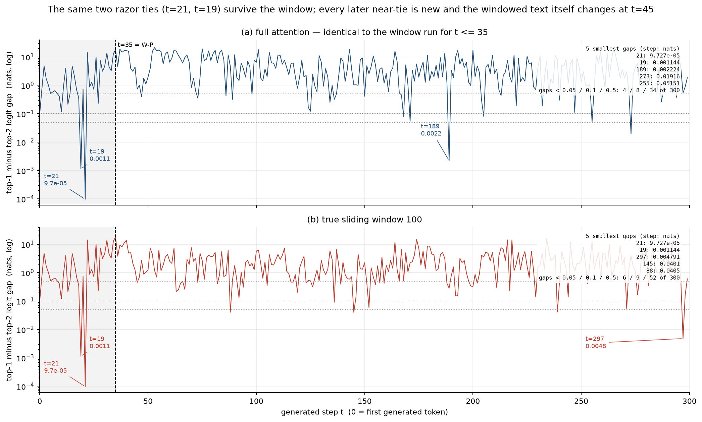

**Setup.** Both runs, same prompt, same directions, $r=0.1$. Each panel plots the full margin trace $m_t$ of that run's own greedy continuation, $t=0\dots299$. The grey band on the left is the region $t\le35$ where the two runs are identical by construction (it contains both razor ties); the dashed line is $t=35=W-P$. Dotted horizontals are 0.05, 0.1 and 0.5 nats. The inset lists the five smallest gaps and the number of steps below each threshold; the eight smallest are given in the table below.

**Axes.** $x$: generated step $t$ (0 = first generated token), 0–300. $y$: top-1 minus top-2 logit gap in nats, log scale $6\times10^{-5}$–40, chosen freely because the gaps span six decades.

**Numbers.**

| rank | full attention (step: nats) | true window 100 (step: nats) |
|---:|---|---|
| 1 | 21: $9.727\times10^{-5}$ | 21: $9.727\times10^{-5}$ |
| 2 | 19: $1.144\times10^{-3}$ | 19: $1.144\times10^{-3}$ |
| 3 | 189: $2.224\times10^{-3}$ | 297: $4.791\times10^{-3}$ |
| 4 | 273: $1.916\times10^{-2}$ | 145: $4.010\times10^{-2}$ |
| 5 | 255: $5.151\times10^{-2}$ | 88: $4.050\times10^{-2}$ |
| 6 | 171: $5.394\times10^{-2}$ | 239: $4.109\times10^{-2}$ |
| 7 | 168: $8.033\times10^{-2}$ | 271: $5.221\times10^{-2}$ |
| 8 | 205: $8.067\times10^{-2}$ | 152: $5.965\times10^{-2}$ |

| threshold (nats) | full | window |
|---|---:|---:|
| $m_t<0.05$ | 4 | 6 |
| $m_t<0.1$ | 8 | 9 |
| $m_t<0.5$ | 34 | 52 |
| median $m_t$ | 3.096 | 1.826 |

**What is in the figure.**
- The first two gaps are identical to the bit, because both steps precede the first clipped margin at $t=36$. The two ties are not merely "similar"; they are the same numbers.
- The margin traces diverge from $t=36$ onward. The maximum difference is 20.0 nats at $t=53$, where the full run has a very confident decision (21.2 nats) and the windowed run has a nearly tied one (1.20 nats; different tokens: ids 51998/24306 vs 11/13).
- The whole spectrum shifts down under the window: the median gap falls from 3.096 to 1.826 nats and the mean from 5.00 to 2.92, so the count below 0.5 nats rises from 34 to 52. This is not caused by the truncation of a few states; it is a property of the different continuation.
- The late near-tie list is completely replaced. Full attention has 189, 273, 255, 171, 168, 205; the window has 297, 145, 88, 239, 271, 152. Only $t=21$ and $t=19$ survive.
- The baseline text itself changes at $t=45$: full continues `"The user has specified several systems to compare: chemical rockets, nuclear propulsion, ..."`; the window continues `"The user's query is detailed, well-organized, suitable for a graduate-level course or professional reference. The document is detailed, well..."`. The windowed text is visibly more repetitive (see §3 and §8).

**What it shows.** The window changes the decision landscape in two distinct ways: it raises the number of gaps below 0.05 nats from 4 to 6 and below 0.5 nats from 34 to 52, and it replaces every late weak point with a new one, while leaving the two earliest ties exactly where they were.

**What it does not show.** It cannot say whether a given late margin differs because the attention renormalisation changed the state or because the text took a different branch at $t=45$; after $t=45$ the two traces are margins of different sentences. It also says nothing about which of these late ties would actually flip a *free-running* windowed continuation, because no such run exists yet and the thresholds are teacher-forced predictions.

---

## 3. Figure `ds14reg_response_shape.png` — a x2.2 flush at the first clipped token, then bursts

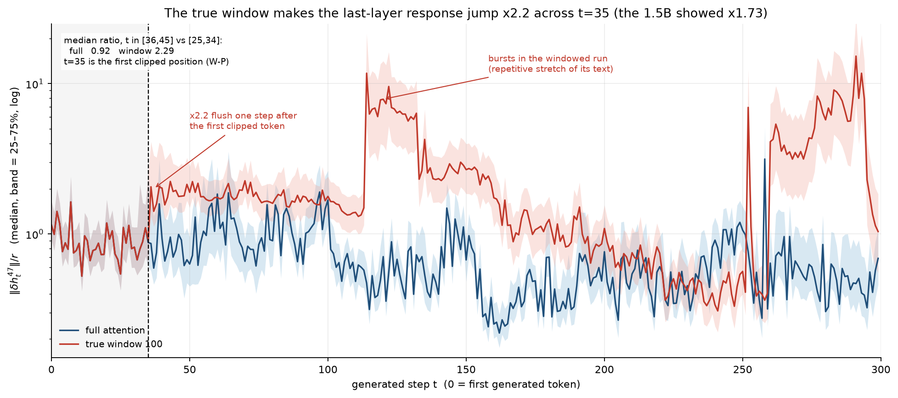

**Setup.** For each run, $\rho_t^{47}(u)=\lVert\delta h_t^{47}(u)\rVert/r$ at the last saved state (layer 47), median over the 1000 directions at each step; the shaded band is the 25–75% range over directions. Both curves use their own run's baseline (the perturbed and unperturbed forward passes of the same run), so the difference is the response to the same direction under the two attention masks — after $t=45$ on two different baseline sentences. Dashed line: $t=35=W-P$. Log $y$.

**Axes.** $x$: generated step $t$, 0–300. $y$: $\lVert\delta h_t^{47}\rVert/r$, median and interquartile band, log scale 0.15–25.

**Numbers.**

| quantity | full | true window 100 |
|---|---:|---:|
| median $\rho^{47}$ over $t\in[25,34]$ (pre-clip) | 0.836 | 0.836 |
| median $\rho^{47}$ over $t\in[36,45]$ | 0.832 | 1.837 |
| flush ratio $\Phi$ | 0.99 | **2.20** |
| $\Phi$ from per-step medians (median of ratios) | 0.93 | 2.11 |
| steps with median $\rho^{47}>3$ | 1 / 300 | 57 / 300 |
| largest per-step median $\rho^{47}$ | 3.15 at $t=258$ | 15.25 at $t=291$ |

Step-by-step ratio of the two median curves just after the first clip:

| step | $\rho^{47}$ full | $\rho^{47}$ window | window / full |
|---:|---:|---:|---:|
| 35 | 0.0877 | 0.0910 | 1.04 |
| 36 | 0.0864 | 0.2059 | 2.38 |
| 37 | 0.0592 | 0.1414 | 2.39 |
| 38 | 0.0751 | 0.1585 | 2.11 |

The per-state flush ratio for the window run is 1.65 (state 1, block 0), 2.83 (state 2), 2.72, 2.32, 2.11, 2.12, 2.02, 2.20 (state 8, layer 47); for the full run it lies between 0.92 and 1.12 at every state.

**What is in the figure.**
- The two curves are identical up to $t=34$. At $t=35$ the windowed response is 4% larger; at $t=36$ it is 2.4x larger, and it stays around 2x through $t=45$. This is the same flush the 1.5B showed, with a larger amplitude (2.20 against 1.73).
- The flush is strongest at shallow depth: 2.83 at state 2, against 1.65 at state 1 and 2.20 at the last state. The effect of the truncation is largest just after the first block and is partly damped on the way to layer 47.
- Beyond $t=50$ the windowed curve does not decay smoothly. It has two burst stretches, $t\approx114$–$132$ and $t\approx260$–$294$, where the median response reaches 6–15 per unit radius; the full run never exceeds 3.15. These stretches coincide with the most repetitive passages of the windowed text (`"...sections like an introduction, a structure, then sections on..."` around $t=114$; `"introduction, structure, content organization, conclusion..."` around $t=270$). The coincidence is suggestive but not a controlled test.
- In the troughs between bursts the windowed curve falls to 0.3–1.0, so the median over $[150,300)$ is 1.03 while the burst steps reach 15. The median is the robust statistic used below; the band shows the spread over directions is wide at every step.

**What it shows.** The true window produces the advertised flush at the first clipped prompt position, with a depth-dependent amplitude. It does not suppress the deep response later; if anything it amplifies it, intermittently.

**What it does not show.** The median curve is not a typical trajectory: the 25–75% band is a factor 2–3 wide and the bursts are a population effect, not a single direction blowing up. It does not establish that repetition causes the bursts (the text is itself an output of the window), and it cannot separate the direct effect of dropping a prompt key from the indirect effect of the different continuation. The response is measured at one radius only; a larger radius may leave the linear regime.

---

## 4. Figure `ds14reg_rstar.png` — 46.4% -> 49.3% predicted flips, all of them still at the same two ties

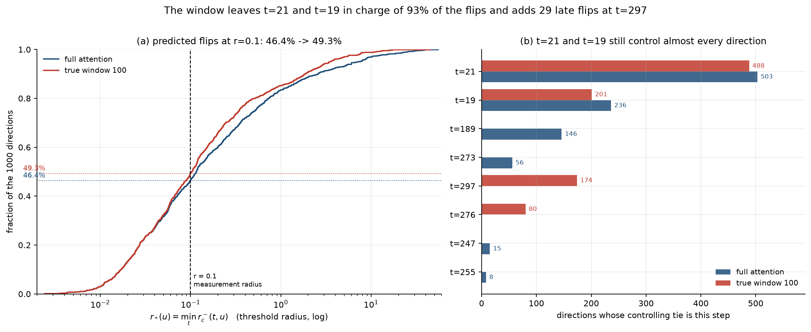

**Setup.** Left: empirical distribution (ECDF) of the signed threshold radius $r_*(u)=\min_t r_c^-(t,u)$ over all 1000 directions, for both runs, truncated at $r_*=60$ (the largest finite value is 55.5). The vertical dashed line is the measurement radius $r=0.1$; the dotted horizontals are the predicted flip fractions. Right: the number of directions whose controlling step is each of eight steps, for both runs.

**Axes.** Left: $x$: threshold radius $r_*$, log, $2\times10^{-3}$–60; $y$: fraction of directions, 0–1. Right: $x$: directions with that controlling step, 0–590; $y$: step $t_*$, categorical.

**Numbers.**

| quantity | full | true window 100 |
|---|---:|---:|
| predicted flip fraction at $r=0.1$ | 46.4% (464) | 49.3% (493) |
| $r_*$ p10 / p50 / p90 / p95 | 0.0171 / 0.116 / 2.59 / 7.21 | 0.0171 / 0.104 / 1.85 / 3.47 |
| $r_*>1$ | 166 | 148 |
| controlling step 21 / 19 | 503 / 236 | 488 / 201 |
| controlling step 297 / 276 | 0 / 0 | 174 / 80 |
| flips controlled at 19 / 21 / 297 | 43 / 421 / 0 | 41 / 418 / 34 |
| flips shared with the other run | 464 | 464 |
| flips present only in this run | 0 | 29 (all at t=297) |

**What is in the figure.**
- The two ECDFs are indistinguishable below $r_*\approx0.02$ and separate only in the upper tail. The median threshold falls from 0.116 to 0.104 and the 90th percentile from 2.59 to 1.85; the window makes the average direction somewhat easier to flip, but not dramatically.
- The flip fraction is 46.4% under full attention, exactly the number in the earlier A1 section, and 49.3% under the window: a rise of 2.9 percentage points.
- The flip sets are nested: every one of the 464 full-attention flips is also a predicted flip at $r=0.1$ under the window. The 29 new flips are all controlled at $t=297$, the window's new late near-tie ($m=4.79\times10^{-3}$ nats). Five further directions have their controlling step moved to $t=297$ while already flipping at 19 or 21, which is why 34 flips are attributed to $t=297$.
- The controlling-step counts stay concentrated: 68.9% of all directions have $t_*=21$ or $19$ under the window (73.9% full), and 93.1% of the windowed flips are decided at those two steps (100% full). The window adds a third late gate; it does not replace the first two.

**What it shows.** The window changes the *count* of predicted flips by +2.9 points, but changes the *mechanism* of the extra flips completely: they come from a new late tie, not from the two razor ties moving. This is the opposite of the 1.5B window comparison quoted in the introduction: there the minimum margin moved from 0.0201 to 0.0031 and the controlling step changed. On the 14B the minimum margin is at $t=21$, before the first clipped position, so it cannot move; the window's effect appears only in the late tail.

**What it does not show.** These are *predicted* flips from a first-order teacher-forced response, not observed free-run flips. The prediction for the window run uses the window's own margins and `dm` on its own text; it is a statement about that continuation, not about all windowed continuations. The ECDF is truncated at 60; the tail above that is not shown. And the +29 is an addition to the flip *set*, not evidence that a free-running window run would flip 29 more directions: the linear rule is calibrated at $r=0.1$ but not re-validated on a windowed free run.

---

## 5. Figure `ds14reg_direction_gain.png` — the typical gain is 2.6x larger and the late decay nearly disappears

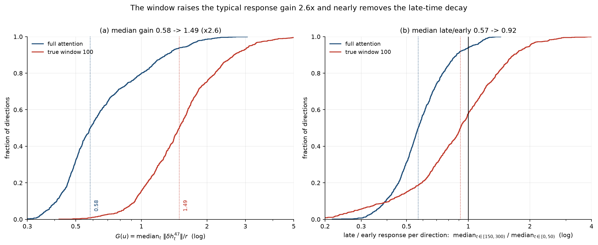

**Setup.** Left: ECDF of $G(u)=\mathrm{median}_t\lVert\delta h_t^{47}(u)\rVert/r$ over the 1000 directions, both runs. Right: ECDF of the per-direction late/early ratio $\mathrm{median}_{t\in[150,300)}\rho_t^{47}(u)\big/\mathrm{median}_{t\in[0,50)}\rho_t^{47}(u)$, both runs; the vertical black line is 1 (no change), the dotted lines are the medians.

**Axes.** Left: $x$: $G(u)$, log, 0.3–5; $y$: fraction of directions. Right: $x$: late/early ratio, log, 0.2–4; $y$: fraction of directions.

**Numbers.**

| quantity | full | true window 100 |
|---|---:|---:|
| $G$ p10 / p50 / p90 | 0.409 / 0.583 / 1.297 | 0.936 / 1.493 / 2.659 |
| $G$ mean | 0.738 | 1.670 |
| median per-direction late/early | 0.570 | 0.917 |
| median per-direction late/pre-clip early ($t\in[25,34]$) | 0.594 | 1.147 |
| pooled late/early ($\Lambda$) | 0.577 | 0.930 |
| directions with late/early $>1$ | 6.1% | 42.3% |

**What is in the figure.**
- The entire gain distribution shifts right by a factor 2.6 at the median. The shift is not a few outliers: p10 rises from 0.41 to 0.94 and p90 from 1.30 to 2.66, so the two ECDFs barely overlap.
- Under full attention the late response is systematically smaller than the early one: the median direction retains 57% of its $[0,50)$ response, and 94% of directions are below 1. Under the window the median retains 92%, and 42% of directions are above 1.
- Measured against the pre-clip level $[25,34]$, which is bit-identical in the two runs, the contrast is sharper: full falls to 0.59, the window *rises* to 1.15. The window does not cut the late response; it roughly preserves it, and at depth it increases it.
- The premise "the window cuts the prompt's direct influence after $t=35$, so the late response should be smaller" is not what the data show. The direct prompt visibility does fall — one prompt position leaves per step, and none are left after $t=99$ — but by then the perturbation has been written into the key/value states of generated tokens that remain inside the window, and those states feed every later step. The late response is therefore carried by the generated-token chain rather than by direct prompt attention, and it is larger, not smaller. The data cannot apportion the effect between attention reweighting, the different continuation, and deep-layer amplification.

**What it shows.** The window raises the response gain of every direction and nearly removes the late-time decay that full attention shows. The effect is a population shift, not a tail.

**What it does not show.** $G$ is an absolute norm; the response relative to the residual-stream norm stays small (about $10^{-4}$ typically and $10^{-3}$ at the largest burst), so "larger gain" does not mean a destabilised state. The comparison is between two different texts after $t=45$, so the late/early ratio mixes the mask effect with the continuation effect. The $[0,50)$ window contains the flush in the windowed run, which inflates its denominator; the $[25,34]$ variant is given for that reason.

---

## 6. Figure `ds14reg_depth_gain.png` — the window halves block 0 and doubles layer 47

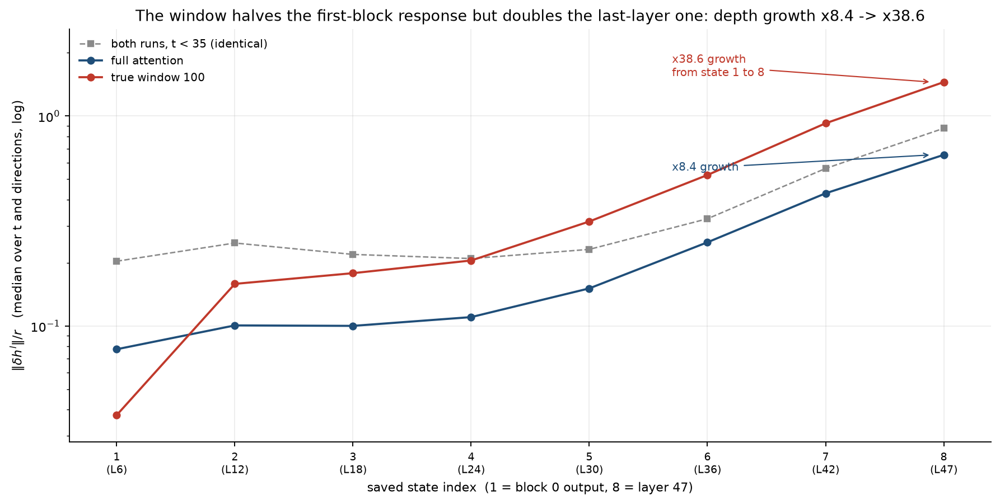

**Setup.** For each saved state $l$, the median of $\lVert\delta h^l(u)\rVert/r$ over all directions and all 300 steps, both runs. The dashed grey line is the same quantity computed on $t<35$ only; there the two runs are bit-identical, so one line serves both and it is a direct check that the pre-window depth profile is the common starting point. State 0 is omitted because its response is exactly zero (the perturbation is added to the prompt embeddings, not to the generated-token embeddings).

**Axes.** $x$: saved state index 1–8, labelled with the layer the engine stored (state 1 = block 0 output, layer 6; state 8 = layer 47). $y$: $\lVert\delta h^l\rVert/r$, median over $t$ and directions, log 0.028–2.6.

**Numbers.**

| state (layer) | full, all $t$ | window, all $t$ | both, $t<35$ |
|---|---:|---:|---:|
| 1 (6) | 0.0775 | 0.0376 | 0.2035 |
| 2 (12) | 0.1006 | 0.1587 | 0.2484 |
| 3 (18) | 0.1001 | 0.1785 | 0.2192 |
| 4 (24) | 0.1102 | 0.2051 | 0.2095 |
| 5 (30) | 0.1510 | 0.3145 | 0.2317 |
| 6 (36) | 0.2504 | 0.5237 | 0.3241 |
| 7 (42) | 0.4285 | 0.9234 | 0.5626 |
| 8 (47) | 0.6532 | 1.4509 | 0.8739 |
| growth 1→8 | x8.4 | x38.6 | x4.3 |

**What is in the figure.**
- Before the window acts, the depth profile is identical in the two runs: it rises from 0.2035 at block 0 to 0.8739 at layer 47, a factor 4.3.
- Averaged over all 300 steps, full attention *lowers* the whole profile because the late response decays: 0.0775 at block 0 to 0.6532 at layer 47 (factor 8.4). The window lowers block 0 further (0.0376, half the full-run value) but raises every state from 2 upward, ending at 1.4509 at layer 47 (2.2x the full-run value; factor 38.6 from block 0).
- The two profiles cross between states 1 and 2 relative to each other (window below full at state 1, above it from state 2 on); the window profile crosses its own pre-window level between states 4 and 5. Shallow layers see a *smaller* time-averaged response under the window, deep layers a *larger* one. This is the opposite of a uniform attenuation, and it is consistent with the shallow flush being damped on the way down while the late bursts accumulate at depth.

**What it shows.** The window reverses the direction of the depth change: the response becomes more top-heavy, not uniformly weaker. The growth from the first block to layer 47 rises from 8.4x to 38.6x.

**What it does not show.** The profile is descriptive: it mixes two effects (the time average includes the late bursts and the different text) and the eight states are samples, not all 48 blocks. A monotone statement about every layer is not justified. The pre-window line is a check on the setup, not a separate condition.

---

## 7. Facts that qualify the whole comparison

1. **The window changes the text itself.** The greedy continuations are identical only up to $t=44$ and differ at $t=45$ (`" has"` vs `"'s"`). Every margin, threshold and response after that step describes a different sentence. The design is paired in prompt and directions, not in continuation.
2. **The available calibration is not a true-window calibration.** `results_big/ds14/calib/` has `window: 100` in its metadata and was intended as a true-window calibration, but its baseline tokens equal the full-attention run's and its margins match them to $7\times10^{-5}$ nats. The window was inactive in that run too. Radius linearity is therefore established for full attention (at layer 47, $\mathrm{d}h/r$ is flat to 1.1% between $r=0.03$ and $0.3$, and rises at $r\ge1$), not for the windowed run. The windowed run provides a single radius.
3. **Index offset.** The engine stores the response at position $P+t$ and the margin of the token predicted from $P+t-1$. All statements about "the first clipped step" use $t=35$ for states and $t=36$ for margins; comparing a margin at 35 to a response at 35 would be off by one.
4. **Flips are predictions.** 464 and 493 are teacher-forced first-order predictions at $r=0.1$, not observed free-run flips. The 46.4% full-attention value reproduces the earlier A1 section exactly, which is a consistency check, not a new validation.
5. **A "burst" is a deep-layer response, not a divergence.** It reaches $\lVert\delta h^{47}\rVert\approx1.5$ at unit radius, about $1.4\times10^{-3}$ of the baseline state norm (1077). The baseline scale is nearly the same in both runs, so the burst is a real absolute difference, but it is small relative to the stream.
6. **The 29 extra flips are one gate, not a broad increase.** All 29 are controlled at $t=297$, a step whose margin is $4.8\times10^{-3}$ nats. Five more directions switch their *controlling* step to 297 without changing their flip status. Any statement about "the window makes the model more flippable" rests on this single late tie.
7. **One prompt, one model, one radius, teacher forcing.** The windowed run has no free-run counterpart; the free-run validation was performed on the full-attention run only. The text after $t=45$ is specific to this prompt and seed.

---

## 8. What follows directly

- The window law holds on the 14B exactly: states are bit-identical for $t<35=W-P$ and depart at $t=35$, the same test that held to the token on the 1.5B for five windows.
- The 1.5B's margin result does **not** transfer as a change of the minimum: on the 14B the minimum is $9.727\times10^{-5}$ nats at $t=21$ in both runs, because $t=21$ lies before the first clipped position. The window's margin effect appears as new late ties and a lower median gap (3.10 -> 1.83 nats), not as a moved razor tie.
- The predicted flip fraction rises from 46.4% to 49.3%, entirely by adding 29 directions controlled at the new $t=297$ tie. No full-attention flip is lost, and 93% of the windowed flips are still decided at $t=19/21$.
- The flush signature is present and larger than on the 1.5B: the last-layer response jumps by 2.20 across $t=35$ (1.5B: 1.73), and the jump is strongest at shallow depth (2.83 at state 2).
- The late response is *not* suppressed. The median direction keeps 0.92 of its early response under the window against 0.57 under full attention, and the median gain is 2.6x larger. The window therefore does not behave like a truncation of the prompt's influence; it behaves like a persistent, more repetitive context.
- The windowed continuation is visibly repetitive from about $t=60$ (`"...professional reference. The document is detailed, well-organized, suitable for a graduate-level course or professional reference..."`). The two response bursts fall inside the most repetitive stretches. Whether the repetition causes the bursts is an open question and the natural target of the windowed free run.

## 9. Reproduce

```
python scripts_spark/figs_w100_vs_full.py
```

Writes `notebook_big/figures/ds14reg_{margins,response_shape,rstar,direction_gain,depth_gain}.png` (dpi 170) and `notebook_big/figures/ds14reg_numbers.json`. The JSON contains the eight smallest margins and threshold counts per run, the full median response profiles, the per-state flush ratios, the burst ranges, the $r_*$ distributions, the gain distributions, the controlling-step tables, the flip-set comparison, the radius-linearity table, and both auxiliary checks. The script reads the npz files in place and does not modify them.


---

# Part window program. The 14B death law is exact to the token for prompts of 8 and 190 tokens; the cascade's bitwise-zero support is exact over 14 states while its 1e-6 crossing runs early with depth

## Summary

Six true sliding-window runs of `DeepSeek-R1-Distill-Qwen-14B` (FP32, same
65-token prompt `interstellar_travel`, the same 240 directions at radius
$r=0.1$, the same 500 teacher-forced baseline tokens, windows
$W=50,100,150,200,300,500$) show that a prompt perturbation disappears from
the first block at exactly the step the window law predicts. For every
direction whose perturbed prompt positions have maximum $p_{\rm last}$, the
block-0 response is nonzero while some perturbed prompt position is inside the
window and reaches the numerical floor at
$t^*=p_{\rm last}+(W-P)$. The equality is exact for all 240 directions at
$W=50$ and all 205 resolved directions at $W=100$; at larger $W$ the floor
sits closer to the pre-death signal and the measured crossing jitters by
$-3\ldots+2$ tokens, never more. A separate support scan (the same $W=100$,
the same prompt length, the same tokens and directions, only the perturbed
positions moved to $[0,22)$, $[22,44)$ or $[44,65)$) moves the death step by
exactly the change in $p_{\rm last}$: 720 of 720 directions lie within two
tokens of $p_{\rm last}+35$.
The literal test asked for in the brief — "the response becomes bitwise zero"
— **fails on the 14B for a numerical reason, not a physical one**: 0 of 1440
directions ever reach exactly zero or even $10^{-6}$: fp32 SDPA leaves a
round-off residue of about $1.0\times10^{-6}$ of the state norm
($2.9$–$3.0\times10^{-5}$ absolute at block 0, rising with depth), consistent
with the baseline being a single row while the perturbed rows run in batches
of 8. The same
test on the 1.5B, where the residue is absent, gives exact zeros at
$p_{\rm last}+(W-P)$ to the token for all five windows.
The cascade prediction $t^*_l=t^*_1+(l-1)(W-1)$ is confirmed as an **upper
bound**, not an equality, at the 14B's observable precision: every measured
death is at or before the bound, but the response reaches the floor 9–32
tokens early at state 2 and 30–129 tokens early at state 3 (medians; the gap
grows with depth). On the 1.5B, where the exact zero is observable, the
cascade is an exact equality: state 2 dies at 177, 277, 377 for
$W=100,150,200$ — exactly $t^*_1+(W-1)$. The 14B's smooth decay simply falls
below the fp32 floor before the last (already tiny) contribution disappears.
A 1500-token cascade run (8 directions, $W=100$, 15 saved states) now follows
the law up the stack and sharpens both statements. The threshold death tracks
the law **only at $l=1$**: medians run 92, 169, 226, 269.5, … , 454.5 for
$l=1\ldots14$, a slope of 26 tokens per state against the predicted 99, and
the median gap grows monotonically from $-22$ at $l=2$ to $-924.5$ at $l=14$;
all 112 resolved direction-states die at or before their bound, so the
500-token early-death pattern is confirmed and extended. The same run also
makes the literal test observable: at `batch_dirs=2` the perturbed row becomes
bitwise identical to the baseline once the prompt is fully outside the window,
and the first exact zero lands on $t^*_l$ for all 8 directions at all 14
states ($92,191,\ldots,1379$; 112 of 112). The last nonzero path therefore
survives to the combinatorial bound exactly, but its amplitude crosses the
$10^{-6}$-relative floor hundreds of tokens earlier — the bound is attained
only by the support, not by the signal.
Finally, the window changes the decision landscape itself on identical
tokens: the two early razor ties are preserved bit-for-bit for every
$W\ge100$, while the number of margins below 0.5 nats nearly doubles from 62
($W=500$, approaching the no-clipping reference) to 116–120 at $W=100/50$;
at $W=50$ the prompt does not fit and the $t=21$ tie is destroyed. Every
window shows a flush surge one step after $t=W-P$: x2.19 at $W=100$ (the
1000-direction core run gave x2.20), x2.00 at $W=150$, x2.59 at $W=200$,
x3.95 at $W=300$, x2.41 at $W=500$ (the 1.5B reference was x1.73).
Two further scans close the remaining free parameters. A prompt-length scan
(the same construction with an 8-token prompt and a 190-token prompt, 120
directions each, $W=50,100,200,300,500$) gives the same equality:
$t^*=p_{\rm last}+(W-P)$ predicts the death step with $P$ read from the
tokenizer, not guessed. With $P=8$, all 240 directions over $W=50,100$ are
exact, and at $W=200$ 100 of the 112 resolved directions are exact with the
other 12 one step late. With $P=190$ and $P>W$ ($W=50,100$) the prompt does
not fit at $t=0$, yet 180 of 240 directions are exact and all 240 are within
two tokens; for $W=200,300$ ($P<W$) the deaths again sit on the line (all 120
at $W=300$ exactly on it). The only failures are at the 300-step horizon:
$W-P=292$ ($P=8,W=300$) and $W-P=310,492$ ($W=500$) put the predicted death
at or beyond the last step, and then the run, not the model, sets the limit —
the floor rule degenerates there and its "deaths" are crossings of a
contaminated floor. Margins of the fixed tokens follow the same onset rule as
the 65-token prompt (bit-identical through $t=W-P$, first change at $W-P+1$)
and, for the short prompt, the same monotone approach to the full-attention
value. The 1500-token cascade run is complete and supplies the $l\ge2$
literal zeros (§3).

---

## 1. Runs, construction, and the fp32 floor

### 1.1 Setup

| item | value |
|---|---|
| model | `DeepSeek-R1-Distill-Qwen-14B` (48 blocks, hidden size 5120) |
| precision / decoding | FP32, TF32 off; greedy baseline, teacher-forced repeats |
| prompt | `interstellar_travel`, $P=65$ tokens |
| perturbation | unit direction $\times\,r=0.1$, added to prompt embeddings only |
| directions | $K=240$ per run, 12 disjoint simplex blocks of 20, same seed, same directions in all six runs |
| window | true sliding window, patched and verified; $W=50,100,150,200,300,500$ |
| continuation | the **same** 500 greedy tokens in every run (fixed from `a1_inter_w4096`) |
| saved states | 16 per run, `layers = [0,1,2,3,5,8,12,16,20,24,28,32,36,40,44,47]`; state 1 = block-0 output, state 0 = input embedding |
| reference | `a1_inter_w4096`, $W=4096$ (no clipping within 500 tokens), 32 directions |
| files | `results_big/ds14/a1_inter_w{W}_fixed/a1.npz` |

All six runs share the identical `gen_ids` array (checked), so there is no
text divergence anywhere in this section: every margin difference is caused
by the attention mask alone. The 240 directions are also identical across
runs; the perturbed positions of each direction are 20 random prompt
positions, and $p_{\rm last}(u)$ — the largest of them — takes values
$55\ldots64$ with median 59.5 in every run.

### 1.2 Window mechanics (the law being tested)

With a sliding window of width $W$, the generated position $P+t$ attends only
to positions $\max(0,P+t-W+1)\ldots P+t$. A perturbed prompt position $p$
(0-indexed) is therefore inside the window while
$p\ge P+t-W+1$, i.e. while $t\le p+(W-P)$; the first generated step at which
it is gone is
$$t^*(p)=p+(W-P).$$
For a direction $u$ whose perturbed positions have maximum $p_{\rm last}(u)$,
the block-0 response must fall to the floor at
$$t^*_1(u)=p_{\rm last}(u)+(W-P),$$
because before that at least one perturbed position is visible and after it
none is. Deeper blocks keep a response longer: block $\ell$ at position
$P+t$ reads block-$(\ell-1)$ states at previous positions **inside its own
window**, so the last possible path carries the information one window span
per block,
$$t^*_\ell=t^*_1+(\ell-1)(W-1).$$
This is a strict upper bound on the last nonzero contribution (a "front"),
not a claim about where the response becomes numerically invisible. When
$P>W$ the formula still applies: positions $p<P-W$ are already outside the
window at $t=0$ (the formula gives $t^*<0$, i.e. dead from the start), and
the surviving positions die at $t^*=p+(W-P)\in[0,W-1]$.

### 1.3 The literal zero test: 0 of 1440 directions reach zero on the 14B

The brief asks for the first $t$ with `dh_norm[1] <= 0` (state 1 = block-0
output), with $10^{-6}$ as a tolerance. Measured over all six runs:

| W | directions | reach exactly 0 | reach $<10^{-6}$ | smallest value over all $t$ | floor (5th pct of tail) |
|---:|---:|---:|---:|---:|---:|
| 50 | 240 | 0 | 0 | $2.19\times10^{-5}$ | $2.99\times10^{-5}$ |
| 100 | 240 | 0 | 0 | $2.14\times10^{-5}$ | $2.94\times10^{-5}$ |
| 150 | 240 | 0 | 0 | $2.02\times10^{-5}$ | $2.92\times10^{-5}$ |
| 200 | 240 | 0 | 0 | $2.09\times10^{-5}$ | $2.91\times10^{-5}$ |
| 300 | 240 | 0 | 0 | $2.12\times10^{-5}$ | $2.89\times10^{-5}$ |
| 500 | 240 | 0 | 0 | $2.49\times10^{-5}$ | $2.98\times10^{-5}$ |

So the literal test gives **no deaths at all**, and the reason is visible in
the last two columns: the response bottoms out at the same
$2$–$3\times10^{-5}$ in every window. This is not physics. The residue is present at every step,
before and after the expected death, and its size scales with the state norm:
it behaves like fp32 round-off from the different batch shapes (a single-row
baseline forward versus perturbed rows in batches of 8), not like a surviving
response. At block 0 the relative size is
$\approx1.0\times10^{-6}$ of the state norm (median norm 29.9,
hence $3\times10^{-5}$). At deeper states the residue scales with the larger
residual norm, reaching $2.3$–$3.5\times10^{-6}$ relative at layers 8–47
($1.7\times10^{-4}$ to $3.1\times10^{-3}$ absolute). The residue is
direction-independent in size and present at every step, including the
pre-death plateau, so it cannot be mistaken for a surviving response. At
$W=500$ the directions with the latest support do not reach the floor inside
the 500-token horizon (their predicted death is at 490–499); the 5th
percentile of the tail is then only a floor estimate, not evidence that all
directions died, which is why no $W=500$ direction is counted as resolved.
On the 1.5B the baseline and perturbed passes are numerically identical at
zero response, and exact zeros do occur (§8).

**Death is therefore defined in this section as the first step that starts
the final excursion below the round-off floor**: `dh_norm(t) <= 2 x floor`
and at least 90% of the next 30 steps stay below `4 x floor`, where the floor
is the 5th percentile of the last 60 steps (per state) and at least
$10^{-6}\times$ the median state norm. A direction is counted as *resolved*
only if its pre-death signal exceeds $10\times$ the floor and at least 11
steps remain in the run. On the 1.5B, where exact zeros exist, this rule
returns the same steps as the literal rule; on the 14B it is the only rule
that can be applied to all 240 directions. The raw arrays are unchanged; the
JSON reports the literal counts alongside the calibrated ones.

---

## 2. Figure `ds14win_departure.png` — state 1 dies exactly at $p_{\rm last}+(W-P)$

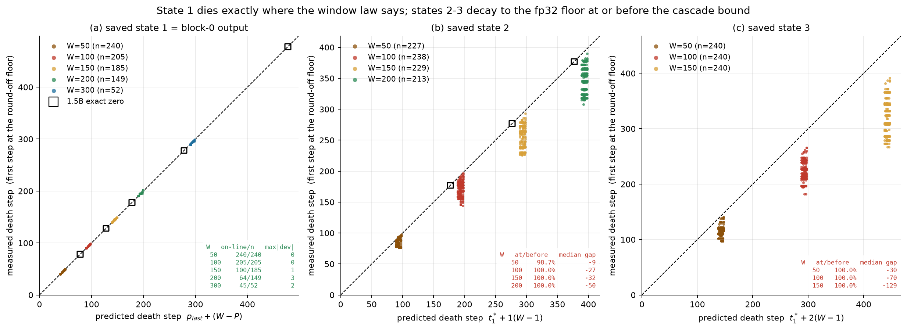

**Setup.** Each point is one direction: predicted death step
$p_{\rm last}(u)+(W-P)$ on $x$, measured death (first step at the floor, rule
above) on $y$; one colour per window. Panel (a) is state 1 (block-0 output),
which should follow the law exactly. Panels (b) and (c) are states 2 and 3,
which are tested against the cascade bound $t^*_\ell$; the line there is a
bound, so all points must be at or below it. Open black squares in (a) are the
1.5B's exact zeros (four directions per window, five windows); they are not
used in any 14B statistic.

**Axes.** $x$: predicted step, tokens since the first generated token.
$y$: measured death step. Both axes share the identity line; limits are
chosen per panel to contain every point. No logarithmic compression.

**Numbers.**

| W | directions resolved | exactly on the line | within ±2 tokens | median deviation | min | max |
|---:|---:|---:|---:|---:|---:|---:|
| 50 | 240 / 240 | 240 | 240 | 0 | 0 | 0 |
| 100 | 205 / 240 | 205 | 205 | 0 | 0 | 0 |
| 150 | 185 / 240 | 100 | 185 | 0 | 0 | +1 |
| 200 | 149 / 240 | 64 | 148 | +1 | −3 | +2 |
| 300 | 52 / 240 | 45 | 52 | 0 | −2 | +1 |
| 500 | 0 / 240 | — | — | — | — | — |

The "unresolved" directions are not failures of the law: at $W=500$ the
predicted death is $490$–$499$, leaving fewer than 11 steps, and at large $W$
the pre-death signal of directions with late $p_{\rm last}$ has decayed to
within a factor 3 of the floor, so the crossing step cannot be localised
better than a token or two. The maximum absolute deviation among all 831
resolved directions is 3 tokens, in one $W=200$ direction.

**What it shows.** The equality holds to the token wherever the measurement
is resolved: for $W=50$ and $W=100$ every single direction dies exactly at
$p_{\rm last}+(W-P)$, with no scatter at all (240/240 and 205/205). The
identity line is not a fit. The support of $p_{\rm last}$ is the same in
every run (55–64), so the five colours that have resolved points occupy
disjoint diagonal segments at the predicted offsets $W-65$: this is a scan
of the window width, not of the directions.

**What it does not show.** It cannot show the exact zero the brief asked
for, for the numerical reason in §1.3. It also cannot distinguish "the
response is exactly zero" from "the response is below $3\times10^{-5}$";
the 1.5B points show that where the exact zero is observable, the two
coincide. It says nothing about what happens at $W>500$ with 500 tokens,
because the predicted death then lies beyond the horizon.

---

## 3. Figure `ds14win_cascade.png` — the threshold crossing runs early with depth; the bitwise-zero support sits exactly on the bound

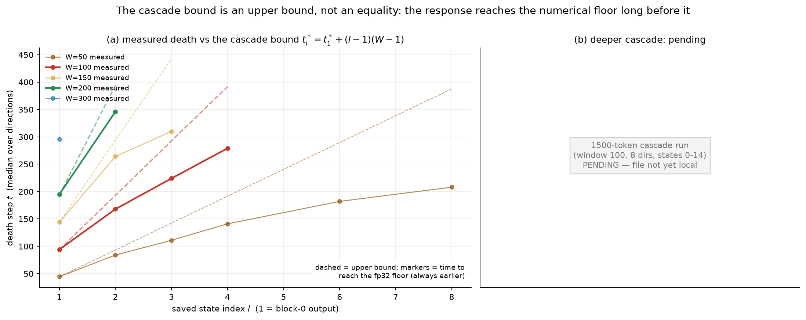

**Setup.** Panel (a): for each window, the median over directions of the
measured death at saved state $l$ (solid, markers) and of the predicted bound
$t^*_l$ computed from each direction's own $t^*_1$ (dashed, same colour).
$W=100$ and $W=200$ are drawn bold, the other windows thin for context.
Panel (b): the 1500-token cascade run
(`results_big/ds14/a1_inter_w100_cascade`), $W=100$, $P=65$, 8 directions,
15 saved states (0–14; states 1–14 used), tokens fixed from the 1500-token
$W=4096$ baseline. The 8 directions share one simplex block and therefore the
same 20 prompt coordinates: $p_{\rm last}=57$ and $t^*_1=92$ for every
direction, so the bound is a single line. The death rule is exactly the one of
§1.3. The run used `batch_dirs=2` rather than 16, and that matters: the last 60
steps are bitwise zero at every state, so the per-state floor is the rule's
$10^{-6}\times$median-norm cap ($2.95\times10^{-5}$ at $l=1$ rising to
$9.95\times10^{-5}$ at $l=14$), not a measured residue. Panel (b) therefore
shows two observables: the same threshold death as panel (a) (filled, with the
interquartile range over directions), and the first step at which `dh_norm` is
**bitwise zero** (open circles), which this run makes observable.

**Axes.** $x$: saved state index $l$ (1 = block-0 output; the saved-state
spacing in depth is not uniform, but the cascade prediction depends only on
the index). $y$: death step, median over directions. Linear axes; the dashed
bounds have slope $W-1$ by construction.

**Numbers.**

| W | l=1 | l=2 | l=3 | l=4 | l=6 | l=8 |
|---:|---:|---:|---:|---:|---:|---:|
| 50 measured | 44.5 | 84.0 | 111.0 | 141.0 | 182.0 | 208.0 |
| 50 bound | 44.5 | 93.0 | 142.5 | 191.5 | 289.5 | 387.5 |
| 100 measured | 94.0 | 168.0 | 224.0 | 279.0 | — | — |
| 100 bound | 94.0 | 193.0 | 292.5 | 391.5 | — | — |
| 150 measured | 144.0 | 264.0 | 310.0 | — | — | — |
| 150 bound | 144.0 | 294.0 | 442.5 | — | — | — |
| 200 measured | 195.0 | 346.0 | — | — | — | — |
| 200 bound | 194.0 | 394.0 | — | — | — | — |

Median deviation (measured − bound), in tokens, with the 5th–95th percentile range:
$W=50$: state 2 −9 [−17,−1], state 3 −29.5 [−44,−11], state 4 −50 [−69,−17],
state 6 −107, state 8 −180; $W=100$: state 2 −27 [−42,−6], state 3 −70
[−96,−43], state 4 −111 [−138,−60]; $W=150$: state 2 −32, state 3 −129;
$W=200$: state 2 −50 [−77,−16]. For every cascade state ($l\ge2$), 100% of
resolved directions die at or before the bound except $W=50$ state 2, where
one direction is one token late ($98.7\%$ at or before). State 1 is the
equality of §2, so its ±1–3 token jitter puts a minority of points on either
side of the line.

The 1500-token run (panel b), state by state. Bound $t^*_l=92+99(l-1)$;
"death" is the §1.3 threshold crossing; "zero" is the first bitwise-zero step:

| $l$ | bound | threshold death | deviation (median [min,max]) | first zero |
|---:|---:|---:|---:|---:|
| 1 | 92 | 92.0 | 0 [0,0] | 92 |
| 2 | 191 | 169.0 | −22 [−37,−11] | 191 |
| 3 | 290 | 226.0 | −64 [−93,−51] | 290 |
| 4 | 389 | 269.5 | −119.5 [−159,−110] | 389 |
| 5 | 488 | 282.5 | −205.5 [−238,−185] | 488 |
| 6 | 587 | 335.5 | −251.5 [−284,−225] | 587 |
| 7 | 686 | 388.0 | −298 [−337,−253] | 686 |
| 8 | 785 | 401.0 | −384 [−426,−351] | 785 |
| 9 | 884 | 415.5 | −468.5 [−516,−425] | 884 |
| 10 | 983 | 429.5 | −553.5 [−597,−519] | 983 |
| 11 | 1082 | 447.0 | −635 [−696,−588] | 1082 |
| 12 | 1181 | 447.0 | −734 [−795,−687] | 1181 |
| 13 | 1280 | 447.0 | −833 [−894,−786] | 1280 |
| 14 | 1379 | 454.5 | −924.5 [−970,−874] | 1379 |

All 8 directions are resolved at every state (112 of 112 direction-states),
and all 112 threshold deaths are at or before the bound.

**What it shows.** The threshold death is an amplitude landmark, not the
cascade. On the 1500-token run the measured medians move from 92 to 454.5 over
14 states, a slope of 26 tokens per state, while the bound moves by 99; the
median gap is already −22 at $l=2$, −64 at $l=3$, −120 at $l=4$, and −924.5 at
$l=14$. The 500-token early-death finding is therefore confirmed and extended
rather than revised: for $W=100$, state 2 is −22 here against −27 in the
500-token run, state 3 −64 against −70, state 4 −120 against −111 (different
runs and direction sets, same effect). From $l=7$ the threshold medians
saturate — 388, 401, 415.5, 429.5, 447, 447, 447, 454.5 — moving 67 tokens
while the bound moves 693, because deeper states start with a larger peak
($13\times$ the floor at $l=1$, $577\times$ at $l=14$) but their late-time
decay reaches the $10^{-6}$ cap at nearly the same step. That saturation is a
property of the threshold, not a physical time.

The literal test behaves the opposite way. At `batch_dirs=2` the perturbed row
becomes bitwise identical to the baseline once no prompt position is inside
any window, so `dh_norm` is exactly 0 from $t^*_l$ onward; the first zero is
$t^*_l$ for all 8 directions at all 14 states. This is partly structural — a
row with no prompt in its receptive field must compute the same function as
the baseline — but it is also a measurement: at every step before the bound
the response is nonzero, so the last path genuinely survives to the
combinatorial bound. As a statement about the support, the cascade is an
equality over the whole stack; as a statement about the signal, it is a loose
upper bound. The last nonzero values are far below the $10^{-6}$ cap (for
direction 0 at state 2 they run $8.4\times10^{-5}$ at $t=175$ down to
$1.7\times10^{-6}$ at $t=190$: that direction's support outlives its threshold
crossing by 12 steps; the median gap at $l=2$ is 22 and at $l=14$ it is 925).

**What it does not show.** The exact-zero equality is support geometry, not an
amplitude law: it says when the last path is cut, not how strong it is. The
residue issue is also batch-dependent, not resolved: the 500-token runs
(`batch_dirs=16`) carry a $\approx10^{-6}$-relative residue at the tail and
never reach a bitwise zero, while this `batch_dirs=2` run reaches exact zeros
at every state. The cause is presumably a kernel / reduction-order difference
between batch shapes, but it was not isolated here, so threshold death times
should not be compared across batch sizes to better than a token or two. The
run has one prompt, one window, and one simplex block (all directions share
$p_{\rm last}=57$), so it does not scan direction geometry. Finally it does
not follow states beyond $l=14$ (block 14 of 48); extrapolating the 26-token
slope would put the threshold crossing of the last block near $t\approx1550$,
beyond even this 1500-token horizon, but the saturation makes that
extrapolation unsafe.

---

## 4. Figure `ds14win_support.png` — moving the support moves the death step exactly

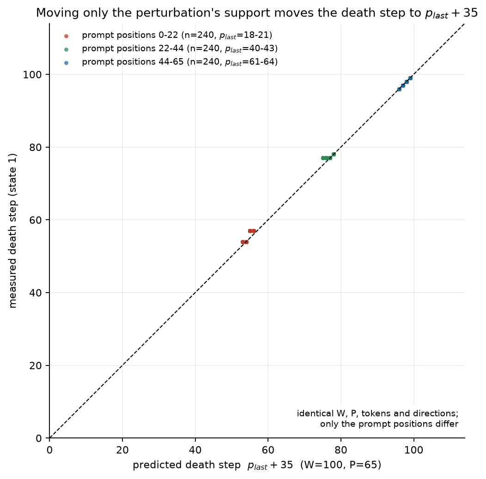

**Setup.** Three support-scan runs at $W=100$: 240 directions restricted to
prompt positions $[0,22)$, $[22,44)$ and $[44,65)$, 300 tokens, the same
prompt, the same fixed tokens, the same direction construction. Each
direction's $p_{\rm last}$ is computed from its own restricted coordinates;
prediction $p_{\rm last}+35$ (because $W-P=35$). Points: one per direction,
colour by support. Everything except the support is held fixed — this is the
controlled version of the law.

**Axes.** $x$: predicted death step $p_{\rm last}+35$. $y$: measured death
step (state 1, same floor rule). Identity line dashed. Equal aspect.

**Numbers.**

| support | $p_{\rm last}$ | predicted | resolved | exactly on line | within ±2 | max deviation |
|---|---|---:|---:|---:|---:|---:|
| $[0,22)$ | 18–21 | 53–56 | 240 / 240 | 80 | 240 | +2 |
| $[22,44)$ | 40–43 | 75–78 | 240 / 240 | 140 | 240 | +2 |
| $[44,65)$ | 61–64 | 96–99 | 240 / 240 | 240 | 240 | 0 |

**What it shows.** All 720 directions are resolved and all lie within two
tokens of $p_{\rm last}+35$; the latest-support group is exact for 240/240.
The three clusters are disjoint and separated by exactly the $p_{\rm last}$
shift (about 22 and 21 tokens). This rules out the
alternative explanation that the death step is set by the window width alone
or by the token index: the width and the prompt are identical; only the
support moved, and the death step moved with it one-for-one.

**What it does not show.** It is a single window width ($W=100$); it does not
test the $(W-P)$ term (that is the six-window scan in §2). The +1/+2 tokens
in the early groups are floor-crossing jitter, not a second mechanism.

---

## 5. Figure `ds14win_plen.png` — prompt length only shifts the death step

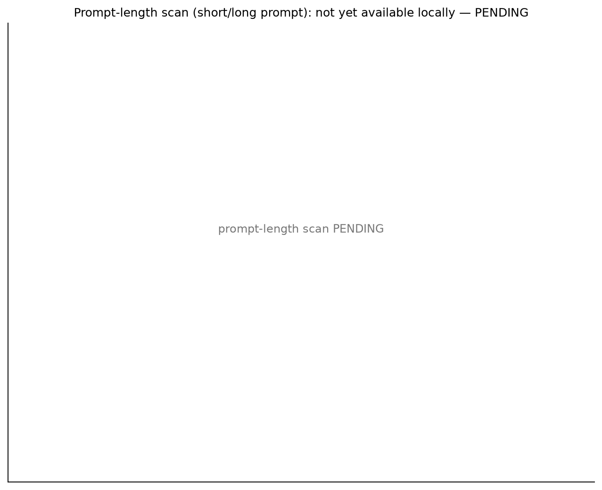

**Setup.** Two prompt lengths, each with its own no-clipping reference. The
short prompt is `Explain how tides work.`, **$P=8$ tokens**; the long prompt
is a review of climate physics, **$P=190$ tokens** (both read from
`meta.json`; the brief's estimates of $\approx6$ and $\approx250$ were not
exact). For each prompt, five true sliding-window runs
$W=50,100,200,300,500$ (no $W=150$), 120 directions at $r=0.1$, 300
teacher-forced tokens fixed from that prompt's own $W=4096$ run
(`a1_short_prompt_w4096`, `a1_long_prompt_w4096`), the same 16 saved states
and the same floor/death rule as §1.3. The five windows of a prompt share
identical `gen_ids` with their reference (checked), so there is no text
divergence. A direction's $p_{\rm last}$ is the largest perturbed prompt
position. Directions are built in blocks of 20 that share their 20 prompt
positions (only the coordinates inside them differ), so $p_{\rm last}$ takes
one value per block: 1 block at 6 and 5 blocks at 7 for the short prompt
(20 directions at 6, 100 at 7), and 164, 168, 173, 174, 182, 186 (20
directions each) for the long prompt. Panel (a) is the short
prompt, panel (b) the long one; colour is the window, and circle/triangle
distinguishes the prompt, but the panels never mix. Only runs with at least
one resolved direction are plotted.

**Axes.** $x$: predicted death step $p_{\rm last}+(W-P)$, with $P$ from
`meta.json`. $y$: measured state-1 death (first step at the floor). Dashed
identity line; equal aspect. Panel (b) marks the 300-step horizon
($t=299$): a predicted death beyond it cannot be observed in these runs.

**Numbers.**

| prompt | $P$ | $W$ | $W-P$ | $p_{\rm last}$ | $t^*=p_{\rm last}+(W-P)$ | died at $t^*$ | resolved | exact | within ±2 | max dev |
|---|---:|---:|---:|---|---:|---:|---:|---:|---:|---:|
| short | 8 | 50 | +42 | 6–7 | 48–49 | 120 / 120 | 120 | 120 | 120 | 0 |
| short | 8 | 100 | +92 | 6–7 | 98–99 | 120 / 120 | 120 | 120 | 120 | 0 |
| short | 8 | 200 | +192 | 6–7 | 198–199 | 120 / 120 | 112 | 100 | 112 | +1 |
| short | 8 | 300 | +292 | 6–7 | 298–299 | at horizon | 0 | — | — | — |
| short | 8 | 500 | +492 | 6–7 | 498–499 | none | 0 | — | — | — |
| long | 190 | 50 | −140 | 164–186 | 24–46 | 120 / 120 | 120 | 100 | 120 | +1 |
| long | 190 | 100 | −90 | 164–186 | 74–96 | 120 / 120 | 120 | 80 | 120 | +2 |
| long | 190 | 200 | +10 | 164–186 | 174–196 | 120 / 120 | 27 | 26 | 27 | +1 |
| long | 190 | 300 | +110 | 164–186 | 274–296 | 120 / 120 | 5 | 5 | 5 | 0 |
| long | 190 | 500 | +310 | 164–186 | 474–496 | none | 0 | — | — | — |

`resolved`, `exact`, `within ±2` and `max dev` use the §1.3 resolution guard
(pre-death signal at least $10\times$ the floor and 11 steps left); `died at
$t^*$` counts all 120 directions regardless of the guard. The two rows with
0 resolved are horizon statements, not measured deaths.

*Short prompt.* With $P=8$, $W=50$ gives $t^*=p_{\rm last}+42=48$–$49$, not
$p_{\rm last}+44$: the window regime is indeed $W\gg P$, and the predicted
offset is larger than guessed. Every one of the 120 directions dies exactly
on the line at $W=50$ and at $W=100$ (240/240 exact, no scatter). At $W=200$
all 120 die at 199: 100 of the 112 resolved directions exactly and the other
12 one step late (their $t^*=198$). At $W=300$ the predicted death is
298–299 — the last
one or two steps of the run — so the 30-step excursion test cannot be
applied; the per-state floor estimate is also contaminated ($4.2\times
10^{-4}$ instead of $3.0\times10^{-5}$, because the response never reaches
the floor inside the run), and the 120 "deaths" the rule returns are not
usable. At $W=500$ the prompt would leave the window at $t=492$–$499$,
beyond the 300-step run: the state-1 response is still $1.1\times10^{-3}$ at
$t=299$ (literal minimum over $t$: $7.3\times10^{-4}$), so no death occurs;
the 102 crossings reported by the rule are crossings of the contaminated
floor ($7.7\times10^{-4}$). In both cases the horizon, not the law, sets the
limit.

*Long prompt, $P>W$ ($W=50,100$).* The prompt does not fit: at $t=0$ the
window already excludes prompt positions $0\ldots140$ ($W=50$) or
$0\ldots90$ ($W=100$), so the model sees only the last $W-1$ prompt
positions plus generated tokens. The law as stated nevertheless applies
without correction, because it refers only to $p_{\rm last}$: every
direction has $p_{\rm last}=164$–$186>P-W$, hence its last perturbed
position is visible at $t=0$ and $t^*=p_{\rm last}-140=24$–$46$ (or
$p_{\rm last}-90=74$–$96$) is positive. Measured: 100 of 120 directions
exact at $W=50$ (the other 20 are one token late) and 80 of 120 exact at
$W=100$ (20 one step late and 20 two steps late); all 120 are within two
tokens in both runs. There is **no systematic early, late, or absent death**:
the deaths sit on the line. What the non-fitting window changes is the amplitude
— the state-1 response starts at $3.4\times10^{-3}$ ($W=50$) or
$7.0\times10^{-3}$ ($W=100$) instead of $6.8\times10^{-3}$ ($W=500$) because
most of each direction's positions are already invisible — and the flush
kink: $t=W-P=-140$ or $-90$ lies before the first generated token, so the
flush happens inside the prompt and there is no surge in the generated trace
(the surge ratios are undefined here).

*Long prompt, $P<W$.* At $W=200$ ($W-P=10$) all 120 directions die at
175–196; 100 are exact and 20 (the $p_{\rm last}=164$ block, $t^*=174$) one
token late, and 26 of the 27 resolved are exact. Only 27 pass the resolution
guard, because the pre-death response
over $[t^*-10,t^*]$ is $2.3\times10^{-4}$, below the $10\times$floor
threshold ($3.0\times10^{-4}$): the surviving perturbed token is already
$\approx200$ positions behind the query. At $W=300$ ($W-P=110$) all 120
directions die exactly at $274$–$296$ — the death groups are precisely the
six $p_{\rm last}$ groups shifted by 110 — though only 5 are "resolved":
the group at 292/296 is within 11 steps of the end, and the pre-death
response is $1.9\times10^{-4}$ against a $4.3\times10^{-4}$ threshold. The
drop at $t^*$ itself is $1.6\times10^{-4}\to5.4\times10^{-5}$, so the death
is real; the strict guard rejects it, it is not a different mechanism.
$W=500$ is the no-op case: $W\ge P+T=490$, so no prompt position ever leaves
the window at any of the 300 steps. The state-1 response is still
$2.2\times10^{-3}$ at $t=299$, the floor estimate ($6.9\times10^{-4}$) is
signal, 42 directions never cross it and 78 cross only spuriously, and the
margin trace is bit-identical to the $W=4096$ reference.

**What it shows.** Prompt length only shifts $t^*$. The equality holds with
$P$ read from the tokenizer: 240/240 short-prompt directions exact at
$W=50,100$, 180/240 long-prompt directions exact over the same windows and
240/240 within two tokens. The regime that looked most likely to break the
law — the prompt not fitting the window — does not break it, because the law
concerns the last perturbed position, which is still inside the window when
$p_{\rm last}>P-W$; deaths are neither early nor late. The law fails only
where it cannot be measured: when $W-P$ puts $t^*$ at or beyond the horizon.

### 5.1 Margins of the fixed tokens

The same fixed-token comparison as §7, each prompt against its own $W=4096$
reference:

| prompt | $W$ | median margin | minimum (step) | steps $<0.1$ | steps $<0.5$ | first step differing from 4096 |
|---|---:|---:|---:|---:|---:|---:|
| short | 50 | 1.542 | 0.0113 (61) | 11 | 72 | 43 |
| short | 100 | 2.134 | 0.0198 (168) | 10 | 57 | 93 |
| short | 200 | 2.801 | 0.0060 (297) | 9 | 49 | 193 |
| short | 300 | 4.474 | 0.0087 (222) | 8 | 32 | 293 |
| short | 500 | 4.507 | 0.0087 (222) | 8 | 31 | none (identical) |
| short | 4096 | 4.507 | 0.0087 (222) | 8 | 31 | — |
| long | 50 | 1.635 | 0.0033 (71) | 12 | 58 | 0 |
| long | 100 | 1.197 | 0.0367 (94) | 9 | 66 | 0 |
| long | 200 | 0.722 | 0.0014 (167) | 30 | 114 | 11 |
| long | 300 | 1.346 | 0.0016 (270) | 17 | 72 | 111 |
| long | 500 | 2.471 | 0.0020 (165) | 9 | 45 | none (identical) |
| long | 4096 | 2.471 | 0.0020 (165) | 9 | 45 | — |

For the short prompt the $W$-dependence is the same in kind as for the
65-token interstellar prompt: the trace is bit-identical to the reference
through $t=W-P$ and first differs at $t=W-P+1$ (43, 93, 193, 293 for
$W=50,100,200,300$), the median margin rises monotonically toward the
full-attention value (1.542 → 2.134 → 2.801 → 4.474 → 4.507, reference
4.507), and the count below 0.5 nats falls (72 → 57 → 49 → 32 → 31, reference
31). At $W=500$, $W\ge P+T=308$, so the window is a no-op and the trace is
bit-identical to full attention. The difference from the interstellar scan is
only in level — that scan goes 1.135 → 2.463 with reference 2.989 and 120 → 62
near-ties against 63 — because the prompt and the continuation differ; the
onset rule and the direction of the change are identical.

The long prompt does **not** follow that pattern. $W=50$ and $W=100$ differ
from $t=0$ (the prompt does not fit), and the median margin is not monotone
in $W$: 1.635, 1.197, 0.722, 1.346, 2.471, with the minimum at $W=200$
(114 of 300 steps below 0.5 nats). So "a narrower window flattens the
decisions" transfers from the short and interstellar prompts to the long one
only in the onset rule (first change at $W-P+1$, or at $t=0$ when $P>W$), not
in the sense of the change. $W=500$ again reproduces the reference
bit-for-bit.

**What it does not show.** The scan has no window within a few tokens of $P$:
with $P=8$ and $P=190$ against $W\in\{50,100,200,300,500\}$, the $P\approx W$
regime is not sampled. It cannot observe the death of prompt positions with
$p<P-W$ when the prompt does not fit: those are already invisible at $t=0$,
the law assigns them $t^*<0$, and no measurement here can confirm it. It
cannot separate the floor crossing from a true zero (the same fp32 residue as
§1.3; 0 of 1200 plen directions reach exactly 0 or $10^{-6}$), and the
$W=300$/$W=500$ rows are horizon-limited statements about the floor rule, not
measurements of the law.

---

## 6. Figure `ds14win_response_shape.png` — a flush surge one step after $t=W-P$

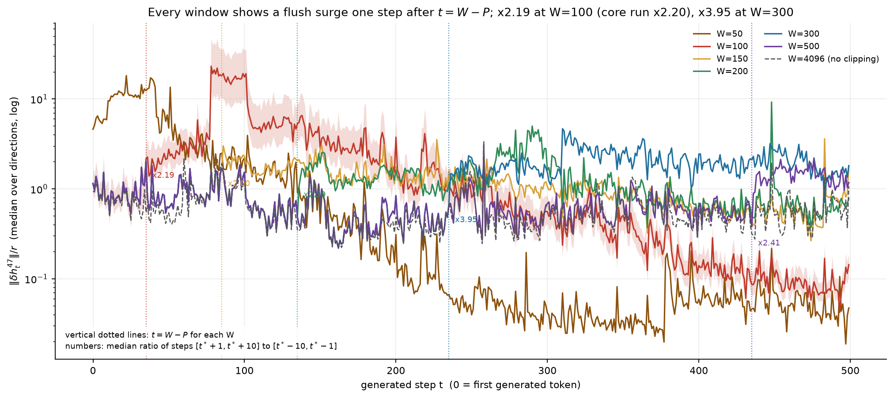

**Setup.** For each window, $\lVert\delta h_t^{47}\rVert/r$ at the last saved
state (layer 47), median over the 240 directions at each step; the band is
the 25–75% range over directions, drawn for $W=100$ only to keep the panel
readable. The dashed grey curve is the $W=4096$ no-clipping reference on the
same tokens (32 directions). Vertical dotted lines mark $t=W-P$ for each
window. Log $y$.

**Axes.** $x$: generated step $t$, 0–500. $y$: response norm per unit radius
at layer 47 (median over directions, log). Free $y$-range $3\times10^{-2}$ to
$30$; the curves span three decades.

**Numbers.** Ratio of the median response in the ten steps after the first
clipped position to the ten steps before,
$\Phi_W=\mathrm{median}_{t\in[t^*+1,t^*+10]}\rho_t/
\mathrm{median}_{t\in[t^*-10,t^*-1]}\rho_t$:

| W | $t^*=W-P$ | $\Phi_W$ | per-direction median ratio |
|---:|---:|---:|---:|
| 50 | −15 (prompt does not fit) | — | — |
| 100 | 35 | 2.19 | 2.34 |
| 150 | 85 | 2.00 | 2.02 |
| 200 | 135 | 2.59 | 2.33 |
| 300 | 235 | 3.95 | 3.58 |
| 500 | 435 | 2.41 | 2.36 |
| 4096 (ref) | — | no kink | — |

The 1000-direction true-window-100 core run gives $\Phi=2.20$ by the same
pooled definition (2.28 by the per-direction median); the 1.5B window-100
value is 1.73 (quoted from the earlier 1.5B analysis).

**What it shows.** Each window produces a visible upward step exactly at its
own $t=W-P$, not at a fixed token: 35, 85, 135, 235, 435. The no-clipping
reference has no such step anywhere. The surge is not a small effect — it
doubles the last-layer response at $W=100$ and nearly quadruples it at
$W=300$; the six values ($W=100\ldots500$) range from 2.00 to 3.95 and are
not monotonic in $W$. The $W=50$ curve starts
high (median 4.6) because its window already excludes prompt positions
0–15 at $t=0$, so the baseline itself is different from the first step.

**What it does not show.** It does not establish the mechanism of the surge
(renormalisation after dropping one key versus a burst of the surviving
paths); both are consistent with these traces. It also does not show whether
the surge changes any decision — that is the margin panel, and there the
changes are at other steps. The absolute levels are not comparable across
windows before $t=W-P$: a smaller window changes the baseline forward pass
itself, so the same direction produces a different response even while no
perturbed prompt position has yet left.

---

## 7. Figure `ds14win_margins_by_w.png` — the window changes the decision landscape itself

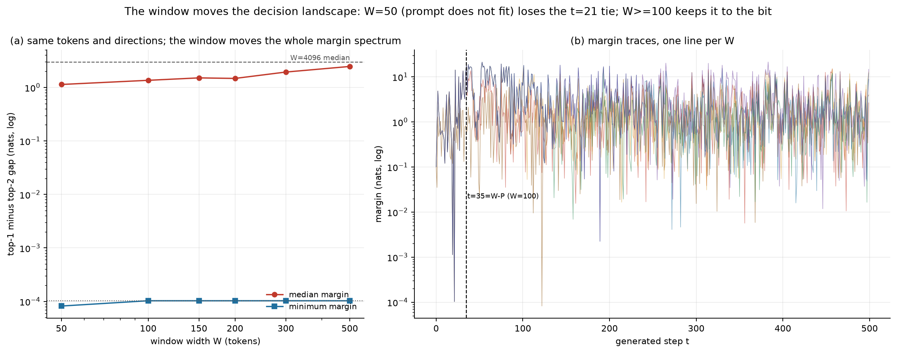

**Setup.** The same 500 fixed tokens and the same 240 directions under each
window. Panel (a): median and minimum top-1 minus top-2 gap over the 500
steps versus $W$ (log $x$); dashed/dotted grey lines are the $W=4096$
reference median and minimum. Panel (b): the full margin trace of each run,
one light line per $W$, with the $t=35=W-P$ line for $W=100$.

**Axes.** (a) $x$: window width in tokens (log, labelled with the six
values); $y$: margin in nats (log). (b) $x$: generated step 0–500; $y$:
margin in nats (log).

**Numbers.**

| W | median margin | minimum margin (step) | steps < 0.1 nats | steps < 0.5 nats | first step differing from W=4096 |
|---:|---:|---:|---:|---:|---:|
| 50 | 1.135 | $8.20\times10^{-5}$ (122) | 28 | 120 | 0 |
| 100 | 1.357 | $1.030\times10^{-4}$ (21) | 31 | 116 | 36 |
| 150 | 1.507 | $1.030\times10^{-4}$ (21) | 16 | 113 | 86 |
| 200 | 1.471 | $1.030\times10^{-4}$ (21) | 25 | 108 | 136 |
| 300 | 1.936 | $1.030\times10^{-4}$ (21) | 20 | 86 | 236 |
| 500 | 2.463 | $1.030\times10^{-4}$ (21) | 16 | 62 | 436 |
| 4096 | 2.989 | $1.030\times10^{-4}$ (21) | 15 | 63 | — |

The early ties are preserved to the bit for every $W\ge100$: the two razor
gaps are $m_{21}=1.02997\times10^{-4}$ and $m_{19}=1.1293\times10^{-3}$,
identical in all five runs and in the reference (these are the same two ties
seen in the 1000-direction full/window comparison). For $W\ge100$ the margin
trace is bit-identical to the reference through $t=W-65$ and first differs at
$t=W-64$; for $W=50$, where $P>W$, it differs from $t=0$.

**What it shows.** Two separate effects. First, the mask changes the logits
on *identical* tokens: median margin rises overall from 1.135 at $W=50$ to
2.463 at $W=500$, approaching the reference 2.989, and the count below 0.5
nats falls from 120 to 62. Second, the early landscape is untouched for
$W\ge100$: the $t=21$ and $t=19$ ties survive to the bit, because both lie
before the first clipped position. At $W=50$ the prompt does not fit and the
first clipped position is $t=0$: both ties are gone ($m_{21}=0.382$,
$m_{19}=0.119$ nats), and the minimum margin moves to a new step, $t=122$.
So the window does not merely attenuate propagation of a perturbation; it
reshapes which decisions are close.

**What it does not show.** These are margins of a *teacher-forced* baseline
that is identical in all runs, so no text divergence contaminates the
comparison — but also no free-running consequence is measured. The margin
distribution of one 500-token continuation is not the margin distribution of
the model, and the count "below 0.5 nats" is not a flip count. The reference
has 32 directions, not 240, although margins do not depend on directions.

---

## 8. Comparison with the 1.5B law

The 1.5B flush sweep (`chaos_llm_2026/results/local_data/flush_sweep/w*`,
read-only) used the same 65-token prompt, $r=0.1$, 4 directions, 500 tokens,
and exact zeros are attained there (the baseline and perturbed passes are
numerically identical at zero response).

| quantity | 1.5B | 14B |
|---|---|---|
| state corresponding to block 0 | saved state 0 | saved state 1 |
| exact-zero death, $W=100/150/200/300/500$ | 78 / 128 / 178 / 278 / 478 | not observable in the 500-token runs (floor $3\times10^{-5}$); 92 at $W=100$ in the 1500-token run |
| predicted $p_{\rm last}+(W-P)$ | 78 / 128 / 178 / 278 / 478 | matched exactly at $W=50,100$; ±1–3 tokens at $W=150$–$300$ |
| exact-zero cascade, state 2, $W=100/150/200$ | 177 / 277 / 377 | 191 at $W=100$ (1500-token run; 8/8 directions); threshold crossing 22–50 tokens early (median) |
| exact-zero cascade, state 3, $W=100/150$ | 276 / 426 | 290 at $W=100$ (1500-token run; 8/8); threshold crossing 64–129 tokens early (median) |
| exact-zero cascade, state 14, $W=100$ | — | 1379 (8/8 direction-states, exactly $92+13\cdot99$) |
| flush ratio at $W=100$ | 1.73 | 2.19 (fixed 240 dirs), 2.20 (core 1000 dirs) |

The 1.5B numbers satisfy both formulas *exactly*: 78 = 43+35, 177 = 78+99,
276 = 78+198, 277 = 128+149, 426 = 128+298, 377 = 178+199, with
$p_{\rm last}=43$ and $P=65$. On the 14B the first formula is confirmed at
the floor-crossing level and the second is confirmed as an upper bound at the
threshold level. The 1500-token run then produces exact zeros at every state:
its first zero lands on the bound for all 112 direction-states, from 92 to
1379, so the cascade is an equality for the *support*. The two statements are
consistent: the cascade's exact-zero time is the moment the last, already tiny
contribution vanishes; in the 500-token runs that contribution sits below the
fp32 batch residue, so only the earlier threshold crossing is observable,
while in the 1500-token run (`batch_dirs=2`) it is not hidden and the literal
zero appears at the bound. The 14B's *lower* numerical precision therefore
costs the exact-zero test only when the batch residue is present, not the law.

---

## 9. What remains

Nothing in the brief is now missing locally. The 1500-token cascade
(`a1_inter_w100_cascade`) is processed and fills panel (b) of
`ds14win_cascade.png`; it resolves the cascade to $l=14$ and supplies the
literal zeros that the 500-token runs could not observe (§3). It does not
change the $W=200$ picture, which still stops at $l=2$ because the run has
only 500 tokens.

The prompt-length scan of §5 is complete: all ten runs
($P=8$ and $P=190$; $W=50,100,200,300,500$) are local and processed. The scan
does not include $W=150$: with $P=8$ or $P=190$ it would only repeat the
$P<W$ or $P>W$ regime already sampled and would not reach $P\approx W$.

Everything else in the brief is complete. The script
`scripts_spark/figs_window.py` detects each file independently, so a partial
later arrival produces the corresponding figure without touching the rest.


---

# Part state kicks, depth spectrum and non-normality (DS-R1-14B, true window 100)

## Summary

A single random unit kick in the residual stream at one generated position is absorbed quickly — the response at the last saved state falls to half its value at the injection point in **1–5 steps at seven of ten positions**, and in 24 steps at $s=32$ — but it does not disappear: for kicks at $s\ge32$ the largest response occurs **41–259 steps later, at $t\approx291$**, where it is **2.4–98 times** the immediate response. The late maximum is a property of the baseline trajectory, not of the kick position (it is at the same $t$ for every kick from $s=16$ onward), and it is not a state-norm artefact (the state norm at $t=291$ is $0.82$ of the median). Every kick except the one at the last position $s=299$ can flip some token at radius $\le1$: **42–92% of the 24 directions**, depending on $s$. Kicks at $s=8$ and $16$ flip the **razor ties at $t=19/21$** ($m_{21}=9.7\times10^{-5}$, $m_{19}=1.1\times10^{-3}$): 11 and 3 steps later at $t=19$ for most directions (14/24 and 9/24), or 13 and 5 steps later at $t=21$ for the rest. Kicks after $t=21$ can only act through the late ties at $t=271$/$276$ or the razor tie at $t=297$ ($m_{297}=4.8\times10^{-3}$).

The depth spectrum confirms the 1.5B verdict, and more strongly. The **absolute** tangent volume grows only $2.7$–$45.9\times$ over 48 blocks ($h_{\rm depth}=0.16$–$0.64$ nats), while the baseline state norm grows $655$–$833\times$; dividing by state growth, the tangent **contracts in 61 of 64 token-chunks**, with an overall rate of $-0.061$ to $-0.120$ nats/block. The 1.5B's "absolute expansion is radial drift; normalized every block contracts" is therefore reproduced. The three exceptions are $+0.0003$, $+0.0052$ and $+0.0083$ nats/block — at the resolution of the 6-block normalization, not a qualitative failure. The token at the razor tie, **$t=21$, is the single most expansive token in the absolute spectrum**: $h_{\rm depth}=0.638$ (1.55× the next largest, 2.5× the median of the other seven), final $\lambda_i\approx0.08$ (the only token reaching the 1.5B range $0.08$–$0.18$), first-block exponent $2.40$ (vs $0.98$–$1.42$) and total tangent growth $45.9\times$ (vs $2.7$–$11.8\times$). Normalized by state growth it is not exceptional — it contracts least ($-0.061$ vs $-0.090$ to $-0.120$) because its state norm also grows most, and two of the three slightly positive chunks are at $t=21$.

The 14B Jacobians have the same U-shaped non-normality as the 1.5B — extreme at block 0, normal in the middle, extreme at the last block — but the last block is more extreme. Full-block $\sigma_{\max}$ is $96.2$ at block 0 (range $66.2$–$128.5$), $3.7$–$4.9$ at blocks 12–36 and $14.2$ at block 47; $\kappa=\sigma_{\max}/\rho$ is $7.35$ at block 0, $1.60$–$2.27$ in the middle and $7.07$ at block 47. The 1.5B reference is $\sigma_{\max}=95$–$195$, $\rho=11$–$39$, $\kappa=5$–$8$ at block 0; $\sigma_{\max}=2.7$–$3.6$, $\kappa=1.7$–$2.5$ in the middle; $\sigma_{\max}=6$–$9$, $\kappa=3$–$5.3$ at the last block. The middle matches; the 14B's last block has **1.6–2.4× larger $\sigma_{\max}$ and $\kappa$ ≈ 7 instead of 3–5.3**. The MLP alone at block 47 has $\sigma_{\max}=118$ (94–147), against the 1.5B's 58–93. Principal angles are **86.96° overall** (per-token medians 84.1–87.8°), slightly more orthogonal than the 1.5B's 83.6°: consecutive blocks' top singular directions are nearly unrelated in both models.

---

## 1. What was measured

### 1.1 Setup

| item | value |
|---|---|
| model | `DeepSeek-R1-Distill-Qwen-14B`, 48 blocks, $d=5120$ |
| precision | FP32, no autocast |
| prompt | `interstellar_travel`, $P=65$ tokens |
| baseline | 300 greedy tokens from the **true window-100** A1 run, teacher-forced in every perturbed pass |
| state kicks | one random unit vector in the 5120-d residual stream at the **embedding of generated position $s$**, 24 directions per cell, radii $r=0.03$ and $0.1$; $s=8,16,32,50,75,100,150,200,250,299$ |
| saved states for kicks | 0, 12, 24, 36, 47; the response is read at layer 47 (input to the final norm) |
| depth | 8 orthonormal tangent vectors at one generated token, JVP through each of the 48 blocks, QR-renormalised after every block (Benettin); tokens $0,21,50,100,150,200,250,299$ |
| non-normality | MLP analytic SwiGLU Jacobian at 5 tokens × 9 blocks ($0,6,\dots,42,47$); full-block power iteration + Arnoldi at 5 tokens × 5 blocks ($0,12,24,36,47$); principal angles between blocks 4 apart |
| non-normality tokens | $21,50,100,189,273$ |
| baseline state norms | `a1_inter_w100/a1.npz`, `norm_h0`, states $0,6,12,\dots,42,47$ (9 values per generated step) |
| data | `results_big/ds14/state_w100/state2.npz`, `depth_w100/depth.npz`, `nonnorm_w100/nonnorm.npz`, `a1_inter_w100/a1.npz` |

The state margins are bit-identical to the A1 margins (checked with `array_equal`), so the kick run is on exactly the same baseline trajectory as the depth and non-normality runs. The true window is 100: the A1 metadata says `window=100`, and the margins used here are the stored ones from that run.

### 1.2 Quantities

| symbol | explicit expression | meaning | why this quantity |
|---|---|---|---|
| $\delta h^l_t$ | $h^l_t(u)-h^l_t(0)$ | displacement of the state at depth $l$, step $t$ | the object a state kick changes |
| immediate | $\lVert\delta h^{47}_s\rVert/r$, median over 24 directions | response at the injection token and the last saved state, per unit radius | measures how strongly position $s$ itself reacts |
| half-life | per direction, first $t>s$ with $\lVert\delta h^{47}_t\rVert<\tfrac12\lVert\delta h^{47}_s\rVert$ | initial decay time of the response | separates "absorbed at once" from "persists" |
| late ratio | $\max_{t\ge s}\lVert\delta h^{47}_t\rVert\,/\,\lVert\delta h^{47}_s\rVert$ | largest later response relative to the immediate one | tests whether the response really decays |
| $r_c^-(t,u)$ | $m_t\,r/\max(-\delta m_t(u),0)$; $+\infty$ if $\delta m_t\ge0$ | radius at which step $t$ would flip | one number per direction and later step |
| flip count | number of directions with $\min_{t\ge s}r_c^-(t,u)\le1$ | directions for which some radius $\le1$ flips a token | the latency question in one count |
| $\lambda_i(l)$ | $(1/(l+1))\sum_{b\le l}\log|R_{ii}(b)|$ after QR each block | running mean per-block tangent exponent | the depth spectrum; **not** the local gain and **not** a cumulative sum |
| $e_l$ | $(l+1)\lambda(l)-l\lambda(l-1)$ | per-block tangent exponent | the actual block-by-block growth |
| $h_{\rm depth}$ | $\sum_i\max(\lambda_i(47),0)$ | total positive tangent exponent | a scalar "how expansive" per token |
| $n_l$ | $\lVert h^l_t(0)\rVert$ at saved states | baseline state norm | the scale the tangent is compared with |
| relative exponent | $e_l-\frac1{6}\log(n_{l+6}/n_l)$ on 6-block chunks | tangent growth per block minus state-norm growth per block | the 1.5B "normalized" test |
| $\sigma_{\max}$ | top singular value of the block Jacobian | largest instantaneous gain | how much a direction can be stretched in one block |
| $\rho$ | largest $|\text{eigenvalue}|$ of the block Jacobian | long-term spectral radius | distinguishes transient from sustained growth |
| $\kappa$ | $\sigma_{\max}/\rho$ | non-normality ($1$ = normal) | high $\kappa$ means large transient amplification |
| angle | $\arccos|\langle v_l,v_{l+4}\rangle|$, degrees | angle between top singular directions 4 blocks apart | whether the amplifying direction rotates with depth |

### 1.3 The one normalization that could not be done per block

`norm_h0` stores the baseline norm at **nine states only**: $0,6,12,18,24,30,36,42,47$. The relative exponent is therefore computed on **eight 6-block chunks** (the last one is 5 blocks, $42$–$46$, because state 48 is not saved). Per-block state normalization would need all 48 norms; it is not available, and no per-block statement below should be read as measured. The last transformer block (47) is included in the tangent growth but not in the norm growth, because its output state 48 was not saved; this makes the reported contraction slightly **conservative** (the missing final norm growth would make it more negative, not less). The 1.5B's per-block normalization cannot be reproduced at the same resolution; the comparison is made on the 6-block medians.

---

## 2. `ds14sd_state_kicks.png` — a kick is absorbed quickly, then re-amplifies late

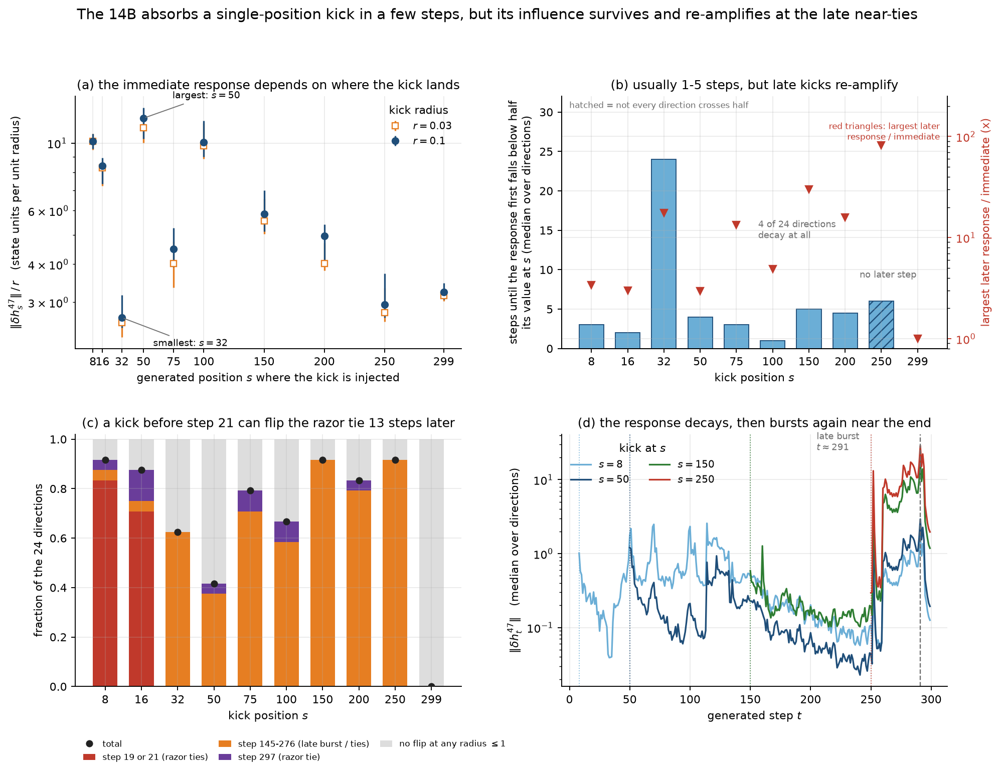

**(a) Immediate response against position.** $x$: generated position $s$ at which the kick is injected. $y$: $\lVert\delta h^{47}_s\rVert/r$, the response at the same token and the last saved state, per unit radius, on a log scale; filled circles are $r=0.1$, open squares $r=0.03$, error bars are the 25–75% range over the 24 directions. The response varies by a factor **4.5** across positions: $12.07$ at $s=50$, $10.15$ at $s=8$, $10.06$ at $s=100$, down to $2.67$ at $s=32$ and $2.94$ at $s=250$. The two radii agree per unit radius to within 6% at seven positions, by 7% and 10% at $s=50$ and $75$, and by 19% at $s=200$; the immediate response is close to linear at these radii. The variation across $s$ is a property of the token at $s$, not of the radius.

**(b) Initial half-life and late re-amplification.** $x$: kick position $s$. Left $y$: median over directions of the number of steps until the response first falls below half its value at $s$; bars, hatched when not every direction crosses half. Right $y$ (red triangles, log): largest later response divided by the immediate response. Most positions decay in **1–5 steps**; $s=32$ takes **24 steps**; at $s=250$ only **4 of 24 directions** ever fall below half, and at $s=299$ there is no later step. The red triangles are the surprise: at $s=32,75,150,200,250$ the late maximum is **17×, 17×, 31×, 17×, 98×** the immediate response, while at $s=8,16,50,100$ it is only 2.5×, 1.8×, 2.4×, 5.0×. The late maximum is at $t=291$ for every kick except $s=8$ (where it is at $t=114$) and $s=299$ (only $t=299$). It is therefore a property of the trajectory around $t=291$, not of the kick position.

**(c) Which later tie is crossed.** $x$: kick position $s$. $y$: fraction of the 24 directions. Bars are stacked by the **earliest** later step at which $r_c^-(t)\le1$: red = $t=19$ or $21$ (the razor ties), orange = $t=145$–$276$ (late burst / late near-ties), purple = $t=297$ (razor tie), grey = no flip at any radius $\le1$. Black dots are the total. The pattern is sharp:

| $s$ | immediate $/r$ ($r=0.1$) | half-life | directions decaying | flips / 24 | earliest flips (19/21, 145–276, 297, none) |
|---:|---:|---:|---:|---:|---|
| 8 | 10.15 | 3 | 24/24 | 22 | 20, 1, 1, 2 |
| 16 | 8.43 | 2 | 24/24 | 21 | 17, 1, 3, 3 |
| 32 | 2.67 | 24 | 24/24 | 15 | 0, 15, 0, 9 |
| 50 | 12.07 | 4 | 24/24 | 10 | 0, 9, 1, 14 |
| 75 | 4.49 | 3 | 24/24 | 19 | 0, 17, 2, 5 |
| 100 | 10.06 | 1 | 24/24 | 16 | 0, 14, 2, 8 |
| 150 | 5.86 | 5 | 24/24 | 22 | 0, 22, 0, 2 |
| 200 | 4.94 | 4.5 | 24/24 | 20 | 0, 19, 1, 4 |
| 250 | 2.94 | 6 | 4/24 | 22 | 0, 22, 0, 2 |
| 299 | 3.24 | — | 0/24 | 0 | 0, 0, 0, 24 |

The counts at $r=0.03$ agree with these within one direction at every position (the largest differences are $s=32$: 16 vs 15, and $s=200$: 19 vs 20). The median smallest threshold over directions ranges from $0.023$ at $s=250$ to $1.087$ at $s=50$; the single smallest is $0.0041$ at $s=250$. A kick at $s=8$ or $16$ reaches the $t=19/21$ razor pair **before** the baseline would decide it, and 20/24 or 17/24 directions flip there — **mostly at $t=19$** (14/24 at $s=8$, 9/24 at $s=16$), the rest at $t=21$. The first crossing is at 19 even though 21 has the smaller margin, because the response at 19 is larger; this is the same first-crossing-versus-argmin distinction as in the free-run part. A kick at $s\ge32$ cannot reach $t=21$; it must act through the late near-ties at $t=271$ ($m=0.052$), $t=276$ ($m=0.165$) or $t=297$ ($m=0.0048$), or through the late burst at $t=262$ (where the baseline margin is $1.465$ and the flip requires a margin change of order one nat). This is why the total flip fraction is not monotone in $s$.

**(d) Response trajectories.** $x$: generated step $t$. $y$: $\lVert\delta h^{47}_t\rVert$, median over directions, log scale; four kick positions. The dotted vertical line marks each injection, the dashed line $t=291$. The earlier kicks ($s=8,50,150$) drop by an order of magnitude in the first 5–20 steps and then sit at $0.1$–$1$; the late kick $s=250$ instead grows immediately ($0.29$ at $s$, $7.7$ at $t=260$). All curves then show the common burst at $t\approx291$, where the late kicks jump to $10$–$30$. The state norm at $t=291$ is $905.9$, below the median $1100.7$ of the 300 steps, so the burst is not the state growing; it is a tangent amplification of the difference.

**What the figure does not show.** The half-life is measured from the immediate response at $s$; it is not a global half-life. For $s\ge32$ the global maximum is late, so a half-life measured from the global maximum would not exist inside the 300-step window. The flip counts use the linear threshold $r_c^-$ from `dm` at $r=0.1$; the measured `dm` at $r=0.1$ is $2.74\times$ the value at $r=0.03$, not the $3.33\times$ of a linear response, so the extrapolation is already 18% sublinear at the upper radius. The counts at $r=0.03$ and $0.1$ agree within one direction, which bounds this effect on the count but not on the exact threshold. The late burst is measured only as the norm of the layer-47 difference; the figure does not decompose it into a direction or a token-level event.

---

## 3. `ds14sd_depth_spectrum.png` — absolute growth is one block plus a late tail; normalized, it contracts

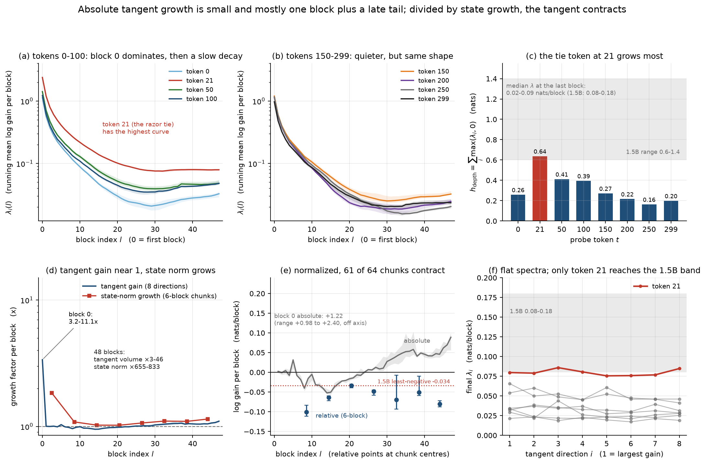

**(a), (b) The depth spectrum.** $x$: block index $l$, 0 = first block. $y$: $\lambda_i(l)=(1/(l+1))\sum_{b\le l}\log|R_{ii}(b)|$, the running mean per-block tangent exponent, log scale; one line per token (median over the 8 tangent directions), shaded band = 25–75% over the 8 directions. Panel (a) has tokens $0,21,50,100$; panel (b) $150,200,250,299$. Every token has the same shape: a huge first block, then a rapid drop, then a slow decay to a final running mean of $0.02$–$0.09$ nats/block. Token 21 is visibly the highest curve throughout; token 0 is the lowest over most of the depth.

**(c) Total tangent growth per token.** $x$: probe token. $y$: $h_{\rm depth}=\sum_i\max(\lambda_i(47),0)$, the sum of the eight final positive exponents, in nats. Bars: token 21 red. The grey band is the 1.5B reference range $0.6$–$1.4$. Token 21 reaches the bottom of the 1.5B band at $0.638$; the other seven are $0.163$–$0.412$.

**(d) Tangent gain against state-norm growth.** $x$: block index. $y$: growth factor per block, log scale. Blue: median over tokens of `local_gain`, the mean $\lVert Jq_i\rVert$ over the 8 tangent directions, with the 25–75% band over tokens. Red: state-norm growth $\exp(\frac16\log(n_{l+6}/n_l))$ from the A1 `norm_h0` at the 6-block chunk centres. The tangent gain is **3.37** at block 0 (range 3.2–11.1), then hovers at **1.00** (0.93–1.07) through the middle, and rises to **1.04–1.10** in the last 8 blocks; 58% of blocks have a median gain above 1. The state-norm line is $1.77$–$1.91$ per block in the first chunk and $1.02$–$1.15$ afterward. Over the full depth the tangent volume grows $2.7$–$45.9\times$ while the state norm grows $655$–$833\times$; the tangent therefore grows **16–280× less** than the state.

**(e) Absolute and relative exponents.** $x$: block index (the relative points are at 6-block chunk centres). $y$: log gain per block, nats/block. Grey: absolute per-block exponent $e_l$, median over tokens with the 25–75% band; block 0 is $+1.22$ (range $+0.98$ to $+2.40$) and is off the plotted range. Blue: relative exponent, tangent minus state-norm growth, median over tokens with the 25–75% range over tokens. The absolute exponent is near zero or slightly negative through the middle and becomes $+0.03$ to $+0.09$ in the last blocks. The relative exponent is negative at every chunk centre: the median over tokens ranges from $-0.408$ at blocks 0–5 to $-0.034$ at blocks 18–24; every other chunk lies between $-0.100$ and $-0.048$. The red dotted line is the 1.5B's least-negative relative exponent, $-0.034$; the 14B's chunk medians are at or below it except for three tiny positive cells.

**(f) Final spectrum per token.** $x$: tangent direction $i=1,\dots,8$. $y$: final $\lambda_i$, nats/block. Each grey line is one token; token 21 is red. The spectra are flat across directions (the 8 values span at most $0.017$–$0.086$), which is why the scalar $h_{\rm depth}$ is meaningful. The grey band is the 1.5B range $0.08$–$0.18$: only token 21 reaches it.

### 3.1 The numbers per token

| token $t$ | $h_{\rm depth}$ | median final $\lambda_i$ | tangent volume growth | state norm growth | relative mean (nats/block) |
|---:|---:|---:|---:|---:|---:|
| 0 | 0.258 | 0.033 | 4.71× | 655× | −0.107 |
| 21 | **0.638** | **0.079** | **45.9×** | 733× | −0.061 |
| 50 | 0.412 | 0.048 | 11.83× | 723× | −0.090 |
| 100 | 0.395 | 0.048 | 10.67× | 760× | −0.093 |
| 150 | 0.271 | 0.032 | 5.10× | 833× | −0.110 |
| 200 | 0.216 | 0.025 | 3.66× | 689× | −0.112 |
| 250 | 0.163 | 0.020 | 2.66× | 742× | −0.120 |
| 299 | 0.199 | 0.023 | 3.29× | 691× | −0.114 |

The final individual $\lambda_i$ run from $0.0171$ to $0.0859$, all positive; the median per token is $0.020$–$0.079$. The block-0 exponent is $0.98$–$2.40$; the late-block exponent (blocks 44–47) is $0.03$–$0.15$. The middle blocks are not uniformly expansive: their per-block exponents scatter around zero, and the median `local_gain` is below 1 in 42% of blocks. The absolute expansion is therefore **not "every block expands"** in the 14B; it is "block 0 plus a late tail", with a middle that is nearly neutral.

### 3.2 The relative test, chunk by chunk

The eight chunks and the median over the 8 tokens:

| chunk | blocks | tangent exponent | norm exponent | relative |
|---|---|---:|---:|---:|
| 0→6 | 0–5 | +0.201 | +0.611 | **−0.408** |
| 6→12 | 6–11 | −0.015 | +0.078 | −0.100 |
| 12→18 | 12–17 | −0.040 | +0.024 | −0.064 |
| 18→24 | 18–23 | −0.014 | +0.019 | **−0.034** |
| 24→30 | 24–29 | +0.010 | +0.066 | −0.048 |
| 30→36 | 30–35 | +0.038 | +0.100 | −0.070 |
| 36→42 | 36–41 | +0.049 | +0.094 | −0.051 |
| 42→47 | 42–46 | +0.052 | +0.140 | −0.080 |

(Tangent and norm are medians over tokens; the tangent exponent is the average over the 8 directions.) The first chunk is the strongest contraction: the tangent grows $e^{0.201}=1.22\times$ per block while the state norm grows $e^{0.611}=1.84\times$ per block, a relative $-0.408$ nats/block. After that the tangent is nearly flat ($-0.040$ to $+0.052$) while the norm keeps growing $e^{0.019}$–$e^{0.140}$ per block, so the relative exponent stays negative.

**61 of the 64 token-chunks contract.** The three positive cells are:

| token | chunk | relative |
|---:|---|---:|
| 21 | 30–36 | +0.0052 |
| 21 | 36–42 | +0.0003 |
| 50 | 36–42 | +0.0083 |

All three are at most $+0.008$ nats/block, i.e. a relative expansion of at most 0.8% per block, at the resolution of a 6-block average. The overall relative rate (mean over all chunks) is $-0.061$ at token 21 and $-0.090$ to $-0.120$ at the other tokens.

### 3.3 Comparison with the 1.5B depth result

| quantity | 14B (this run) | 1.5B reference | verdict |
|---|---|---|---|
| final $\lambda_i$ | 0.017–0.086 nats/block | 0.08–0.18 | 14B is **less** expansive; only token 21 reaches the 1.5B range |
| $h_{\rm depth}$ | 0.16–0.64 nats | 0.6–1.4 | 14B is lower; token 21 (0.638) is at the bottom of the 1.5B band |
| absolute tangent growth | 2.7–45.9× over 48 blocks | positive exponents, $e^{0.08}$–$e^{0.18}$ per block | 14B's absolute growth is much weaker |
| state norm growth | 655–833× | ×30 in block 0, ×1.05–1.18 afterward | same qualitative pattern; the 14B does not isolate block 0 because norms are only saved every 6 states |
| normalized relative exponent | −0.061 to −0.120 overall; 61/64 chunks negative; least-negative chunk median −0.034 | every block contracts, worst −0.034 | **confirmed**, with three near-zero exceptions at 6-block resolution |
| what the growth is | tangent volume grows 2.7–45.9× while the norm grows 655–833× | "absolute expansion is radial drift; normalized contracts" | **confirmed, more strongly in the 14B** |

The one place where the 14B does not literally reproduce the 1.5B sentence is the word "every": at 6-block resolution three token-chunks are positive. The violations are $+0.0003$ to $+0.0083$ nats/block, far below the $\pm0.03$–$0.1$ spread between tokens in the same chunk, and they are exactly the chunks where the 14B's tangent is flat and the state norm growth is modest. A per-block test could in principle resolve them, but `norm_h0` does not contain the 48 per-block norms needed for it. The honest statement is: **the 14B confirms normalized contraction at 6-block resolution, and the three exceptions are at the resolution floor, not a qualitative contradiction.**

### 3.4 Is the token at the razor tie special?

Yes, in the absolute spectrum. Token 21's $h_{\rm depth}$ is $0.638$, **1.55×** the next largest (token 50, $0.412$) and **2.5×** the median of the other seven ($0.258$). Its first-block exponent is $2.40$ against $0.98$–$1.42$ for the other tokens; its first-block local gain is $11.13$ against $2.72$–$4.26$; its total tangent growth is $45.9\times$ against $2.7$–$11.8\times$; its final $\lambda_i$ are $0.076$–$0.086$, at the bottom of the 1.5B range; no other token exceeds $0.066$. The depth spectrum therefore agrees with the non-normality run, where token 21 also has the largest block-0 full-block $\sigma_{\max}$ ($128.5$).

It is not special in the **relative** spectrum. Its state norm grows by $733\times$, almost the same as the other tokens ($655$–$833\times$), and its relative rate is the **least negative** ($-0.061$ vs $-0.090$ to $-0.120$). The large absolute tangent growth is accompanied by a large state norm, so normalized it is the mildest contraction, not an expansion. Two of the three positive chunks are at token 21. The correct reading is: **the razor-tie token is the dynamical hotspot of the absolute tangent (largest gain, largest final spectrum), but it still contracts when divided by its own state growth.** This is exactly the 1.5B lesson — a large absolute number at a sensitive token is mostly the state scale.

---

## 4. `ds14sd_nonnorm.png` — the same U-shape as the 1.5B, with a more extreme last block

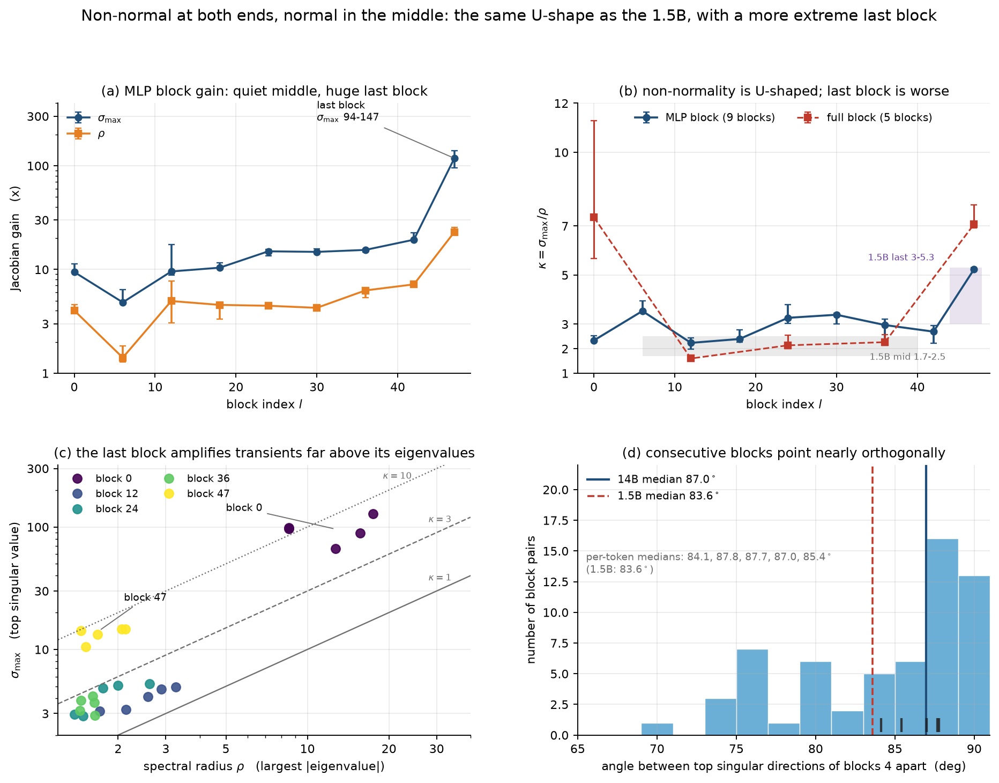

**(a) MLP block gain.** $x$: block index. $y$: Jacobian gain, log scale. Blue: $\sigma_{\max}$ of the MLP block, median over the 5 tokens with min–max range; orange: spectral radius $\rho$. Nine measured blocks ($0,6,\dots,42,47$). The MLP gain is $9.45$ at block 0, drops to $4.82$ at block 6, rises slowly from $9.57$ at block 12 to $19.36$ at block 42, then jumps to **$117.65$ (94.36–146.54)** at block 47. The spectral radius follows the same shape, $4.02\to1.41\to4.96\to\dots\to22.94$.

**(b) Non-normality $\kappa$.** $x$: block index. $y$: $\kappa=\sigma_{\max}/\rho$, linear scale. Blue: MLP block (9 blocks, median + min–max); red dashed: full block (5 blocks, $0,12,24,36,47$). The grey band is the 1.5B mid-layer range $1.7$–$2.5$; the purple band the 1.5B last-block range $3$–$5.3$. The 14B is U-shaped: $\kappa=7.35$ (full, block 0), $1.60$ (block 12), $2.14$ (24), $2.27$ (36), $7.07$ (47). The MLP alone has a milder block 0 ($\kappa=2.34$) but a large last block ($5.23$).

**(c) $\sigma_{\max}$ against $\rho$.** $x$: spectral radius $\rho$, log; $y$: $\sigma_{\max}$, log; one point per token per full block, colour = block. The grey lines are $\kappa=1$ (normal), $3$ and $10$. Block 0 sits at $\rho\approx8.5$–$17.5$, $\sigma_{\max}\approx66$–$128$ ($\kappa=5.2$–$11.5$); block 47 sits at $\rho\approx1.5$–$2.1$, $\sigma_{\max}\approx10.5$–$14.7$ ($\kappa=6.9$–$9.8$). The last block has a **small spectral radius but a large top singular value**: its gain is a transient, not sustained growth. Blocks 12–36 are the normal middle ($\kappa=1.5$–$2.8$).

**(d) Principal angles.** $x$: angle between the top singular directions of blocks 4 apart, degrees; $y$: number of block pairs (5 tokens × 12 pairs). Blue bars: histogram; vertical lines: 14B median $86.96°$ and 1.5B median $83.6°$. Per-token medians are $84.14°$ (21), $87.76°$ (50), $87.66°$ (100), $87.01°$ (189), $85.42°$ (273). The full range is $69.8$–$89.8°$. Consecutive-block amplifying directions are nearly orthogonal in both models; the 14B is 3.4° more orthogonal.

### 4.1 The profile in numbers

| block | MLP $\sigma_{\max}$ (range) | MLP $\rho$ | MLP $\kappa$ | full $\sigma_{\max}$ (range) | full $\rho$ (range) | full $\kappa$ (range) |
|---:|---:|---:|---:|---:|---:|---:|
| 0 | 9.45 (8.87–12.08) | 4.02 | 2.34 | 96.22 (66.2–128.5) | 12.67 (8.5–17.5) | 7.35 (5.23–11.50) |
| 6 | 4.82 (4.53–11.70) | 1.41 | 3.53 | — | — | — |
| 12 | 9.57 (7.52–18.62) | 4.96 | 2.24 | 4.12 (3.1–5.0) | 2.57 (1.7–3.3) | 1.60 (1.52–1.85) |
| 18 | 10.41 (9.19–12.12) | 4.56 | 2.40 | — | — | — |
| 24 | 14.97 (13.35–16.35) | 4.47 | 3.26 | 4.85 (2.9–5.2) | 1.75 (1.4–2.6) | 2.14 (1.93–2.77) |
| 30 | 14.78 (12.15–16.23) | 4.27 | 3.38 | — | — | — |
| 36 | 15.44 (13.46–20.17) | 6.28 | 2.96 | 3.70 (2.9–4.2) | 1.61 (1.4–1.6) | 2.27 (1.76–2.63) |
| 42 | 19.36 (14.93–23.80) | 7.19 | 2.69 | — | — | — |
| 47 | 117.65 (94.36–146.54) | 22.94 | 5.23 | 14.23 (10.5–14.7) | 1.68 (1.5–2.1) | 7.07 (6.91–9.76) |

The token at the razor tie is again at the edge: token 21 has full block-0 $\sigma_{\max}=128.46$ (the largest of the 5 tokens), $\rho=17.47$, $\kappa=7.35$; block 47 $\sigma_{\max}=13.22$, $\rho=1.68$, $\kappa=7.87$. Its principal-angle median, $84.14°$, is the lowest of the five and the closest to the 1.5B's $83.6°$. Token 273 at block 47 is the one quoted in the run log: $\sigma_{\max}=14.23$, $\rho=1.457$, $\kappa=9.76$.

### 4.2 Comparison with the 1.5B non-normality

| quantity | 14B | 1.5B | verdict |
|---|---|---|---|
| full block 0 $\sigma_{\max}$ | 96.2 (66–128) | 95–195 | same range, 14B at the low end |
| full block 0 $\rho$ | 12.7 (8.5–17.5) | 11–39 | same range, 14B at the low end |
| full block 0 $\kappa$ | 7.35 (5.2–11.5) | 5–8 | same, 14B at the high end |
| full mid $\sigma_{\max}$ | 3.7–4.9 | 2.7–3.6 | 14B slightly higher (1.2–1.4×) |
| full mid $\kappa$ | 1.60–2.27 | 1.7–2.5 | **same normal middle** |
| full last $\sigma_{\max}$ | 14.2 (10.5–14.7) | 6–9 | 14B **1.6–2.4× higher** |
| full last $\kappa$ | 7.07 (6.9–9.8) | 3–5.3 | 14B **≈1.4–2.3× higher** |
| MLP last $\sigma_{\max}$ | 117.7 (94–147) | 58–93 | 14B **1.3–2.0× higher** |
| MLP last $\kappa$ | 5.23 | not quoted | — |
| median principal angle | 86.96° (per-token 84.1–87.8°) | 83.6° | 14B slightly more orthogonal |

The U-shape is the same; the difference is concentrated at the very end. The 1.5B has 28 blocks, the 14B 48, so the comparison is in fractional depth: the 14B minimum is at block 12 ($0.25$ of depth, $\kappa=1.60$), and the middle stays at $\kappa\approx2.1$–$2.3$ out to $0.75$; the spike is confined to block 47. The 1.5B's last-block $\kappa=3$–$5.3$ is below the 14B's $7.07$, but its block-0 range already overlaps the 14B. The scale-dependent change is therefore **not** a uniform increase of non-normality with model size; it is a stronger transient amplifier at the final block of the deeper model.

---

## 5. Summary comparison table

| quantity | 14B (true W=100) | 1.5B reference | same? |
|---|---|---|---|
| depth final $\lambda_i$ | 0.017–0.086 | 0.08–0.18 | lower in 14B |
| depth $h_{\rm depth}$ | 0.16–0.64 | 0.6–1.4 | lower in 14B; only token 21 reaches the band |
| absolute tangent growth | 2.7–45.9× / 48 blocks | positive, $e^{0.08}$–$e^{0.18}$/block | lower in 14B |
| state norm growth | 655–833× | ×30 block 0 + ×1.05–1.18 after | same qualitative |
| normalized relative exponent | −0.061 to −0.120; 61/64 chunks negative | every block negative, worst −0.034 | **confirmed**, 3 near-zero exceptions |
| absolute expansion is radial drift | tangent 2.7–45.9× vs norm 655–833× | stated | **confirmed, stronger** |
| full block 0 $\sigma_{\max}$ | 96.2 | 95–195 | same |
| full block 0 $\kappa$ | 7.35 | 5–8 | same |
| full mid $\sigma_{\max}$ | 3.7–4.9 | 2.7–3.6 | slightly higher |
| full mid $\kappa$ | 1.60–2.27 | 1.7–2.5 | same |
| full last $\sigma_{\max}$ | 14.2 | 6–9 | **higher in 14B** |
| full last $\kappa$ | 7.07 | 3–5.3 | **higher in 14B** |
| MLP last $\sigma_{\max}$ | 117.7 | 58–93 | **higher in 14B** |
| principal angle median | 86.96° | 83.6° | slightly more orthogonal |

No 1.5B single-position kick run exists in the reference set, so the state-kick part is not compared numerically to the 1.5B. Its mechanism, however, is the one the 1.5B depth result predicts: the raw response can grow late while the state-normalized tangent does not. The late burst at $t\approx291$ is an absolute response, and the depth run shows that such absolute growth coexists with normalized contraction.

---

## 6. What this does not show

- **No per-block state normalization.** `norm_h0` is saved only every 6 states. The relative exponent is a 6-block average; the "every block contracts" statement is tested at that resolution only. The last transformer block (47) is excluded from the relative chunks because state 48 is not saved.
- **The late burst is not decomposed.** The figure shows the norm of the layer-47 difference. It does not say which direction, head, or token causes the $t\approx291$ amplification. The coincidence of the burst time across kick positions and its absence of a state-norm spike make a trajectory/tangent explanation likely, not proven.
- **The flip counts are linear extrapolations.** $r_c^-$ uses `dm` at $r=0.1$; `dm` is already 18% sublinear between $r=0.03$ and $0.1$. The counts at the two radii agree within one direction, but the exact thresholds at $r_c>0.1$ are less certain. The $t=262$ flips, which require a margin change of order one nat, are the most extrapolation-sensitive.
- **The half-life is an initial decay time.** For late kicks the global maximum is at $t\approx291$, not at $s$; a literal "half of the global peak" half-life does not exist within 300 steps. The figure uses the immediate response as the peak and says so.
- **Only 8 tangent directions.** `h_depth` is the top-8 volume, not the full tangent spectrum; a 5120-dimensional Jacobian can have larger directions outside the sampled subspace. The spectrum is flat across the 8 sampled directions, which is consistent with, but not proof of, a flat full spectrum.
- **The non-normality is sampled.** Full-block metrics exist at 5 blocks and 5 tokens; MLP at 9 blocks. The curves between measured blocks are interpolation. The power iteration and Arnoldi use finite tolerances; $\rho$ is a largest-eigenvalue estimate, and $\kappa$ inherits that error. The 1.5B numbers are quoted from the reference set, not recomputed here.
- **The comparison mixes model size and attention span.** The 14B run is true window 100; the 1.5B reference protocol is whatever the T4 notebook used. The 28-vs-48 block difference is handled in fractional depth, but the attention window is not.
- **Token sets differ.** Depth uses $0,21,50,100,150,200,250,299$; non-normality uses $21,50,100,189,273$; state kicks use 10 positions. Statements about "the token at 21" are cross-run only where 21 is present in both.

## 7. What it implies

1. **A razor tie is a dynamical hotspot, not just a small number.** The token at $t=21$ has the largest absolute tangent growth ($h_{\rm depth}=0.638$, $45.9\times$ volume growth), the largest block-0 full-block $\sigma_{\max}$ ($128.5$), and the smallest principal angle ($84.1°$, closest to the 1.5B). A kick at $s=8$ or $16$ flips the $t=19/21$ razor pair 3–13 steps later — most directions first cross at $t=19$, the rest at $t=21$. The $t=21$ token is where the model is both decisive (smallest margin) and most amplificatory (largest tangent), which is why a perturbation injected much earlier can control it.
2. **Raw response is not the right measure of persistence.** The immediate response is largest at $s=50$ ($12.07$ per unit radius), but the late response is largest for $s=250$ ($98\times$ its immediate value). The absolute norm mixes the state scale and the tangent; the depth run shows the state norm grows $655$–$833\times$ while the tangent grows only $2.7$–$45.9\times$. Any claim that a deep model "amplifies perturbations" must specify whether it is absolute or state-normalized.
3. **The last block is a transient amplifier.** Full block 47 has a modest spectral radius, $\rho=1.68$ (growth $1.68\times$ per block in the long-time limit), but $\sigma_{\max}=14.2$ and $\kappa=7.07$; the MLP alone reaches $\sigma_{\max}=118$. A small kick can be stretched by an order of magnitude in one block even though its sustained growth per block is only $1.68\times$. This is the natural mechanism for the $t\approx291$ re-amplification and for the late flips at $t=262$–$276$.
4. **The 1.5B depth picture survives at 14B, with the last block more extreme.** The middle of the 14B is as normal as the 1.5B's ($\kappa\approx1.6$–$2.3$); the last block is more non-normal ($\kappa\approx7$ vs $3$–$5.3$). The normalized tangent contracts in 61 of 64 chunks at 6-block resolution; the absolute growth is a radial/state-scale effect plus a late tail. The open question is whether the last-block spike is a property of depth (48 vs 28 blocks) or of this particular model; answering it needs the same measurement on another deep model, not another analysis of this one.


---

# Part cross-scale. DeepSeek-R1-Distill-Qwen-1.5B vs -14B under one protocol

## Summary

> Same correction note as Part 1: the 14B numbers here are full-attention runs (window inactive). Everything except the flush-ratio row is a same-prompt, same-radius comparison and stands as stated; the flush row is explained by the missing window, and the margin comparison is partially confounded by the window regime (on the 1.5B the window is known to change the margin spectrum). The true-window 14B rerun will close both gaps.

Two models of the same family — 28 layers with $d=1536$, and 48 layers with $d=5120$, roughly eight times the parameters — generate 300 greedy tokens from the identical 65-token prompt with an attention window of 100, and then the same kind of prompt-embedding perturbation (a unit direction times $r=0.1$) is applied and the continuation is teacher-forced. The larger model's decisions are far more fragile: its median top-1/top-2 logit gap is 3.10 nats against 4.78 for the small one, and its thinnest gap (9.7e-5 nats at step 21) is 207 times thinner than the small model's thinnest (2.0e-2 nats at step 123). As a consequence the radius at which a random direction first flips a token — a "flux-tube radius", the largest perturbation size along that direction that leaves the greedy continuation intact — is 13 times smaller in the 14B (median 0.116 vs 1.55 in absolute embedding units, 17 times smaller after dividing by the token-embedding scale), and 464 of 1000 directions flip something at the run radius against 0 of 20. The response itself is *not* stronger in the bigger model: per unit radius its last-state displacement is 2.3 times smaller in absolute units and 4.6 times smaller relative to the state it lives in, so the fragility is a property of how close the decisions are, not of how hard the perturbation pushes. Two shape features do differ: only the 1.5B shows a window-flush surge at $t=35$ (its last state jumps 1.70x across it, the 14B's 1.11x), and the 1.5B's response decays to 19% of its early level by $t=200$ while the 14B's is still at 68% — though that second difference is partly textual, because the small model falls into a repeating four-token loop at $t=143$ and the large one does not.

---

## 1. The two runs and every quantity

### 1.1 Setup

| item | 1.5B | 14B |
|---|---|---|
| model | `DeepSeek-R1-Distill-Qwen-1.5B` | `DeepSeek-R1-Distill-Qwen-14B` |
| blocks / hidden size | 28 / 1536 | 48 / 5120 |
| precision | FP32 | FP32 |
| prompt | `interstellar_travel`, "Provide a comprehensive technical review of current and proposed propulsion systems for interstellar travel. …" | same, **token-identical** (`prompt_ids` compare equal) |
| prompt length | $P=65$ | $P=65$ |
| attention window | $W=100$ (active, transformers 4.50 on x11) | **full attention** (window setting inactive; see the correction note) |
| continuation | $T=300$ greedy tokens, model's own | $T=300$ greedy tokens, model's own |
| decoding | greedy, no sampling, no EOS stop | same |
| perturbation | prompt embeddings only, unit direction $u$ times $r$, 20 non-zero coordinates | same construction |
| directions | $K=20$, **one** simplex block of 20 | $K=1000$, 50 independent blocks of 20 |
| radius used | $r=0.1$ (index 4 of `radii=[1e-3 … 2]`) | $r=0.1$ (the only radius) |
| teacher forcing | all $K$ perturbed passes reuse baseline `prompt_ids`+`gen_ids` | same |
| saved states | layer indices `[0,1,2,3,7,14,21,27]` (state 0 = embedding, 27 = input to final norm) | `[0,6,12,18,24,30,36,42,47]` (47 = input to final norm) |
| `dh_last` vectors | 3 directions (0–2), 1536-d, last state | 24 directions (0–23), 5120-d, last state |
| file | `chaos_llm_2026/results/local_data/w100_layers/a1.npz` (read-only) | `results_big/ds14/a1_inter_full/a1.npz` + `meta.json` |

Two things the table makes explicit. (i) The **prompt is identical but the continuation is not**: the two models generate different tokens, so "$t=21$" is the 22nd token of a different text in each run. Comparable across models are the protocol, the *distribution* of margins over steps, and the flush step $t^*=W-P=35$ (which follows from the mask, not from the tokens). (ii) The **direction sets are not equally rich**: the 1.5B samples one 20-dimensional input subspace, the 14B samples fifty, and cross-block directions in the 14B are exactly orthogonal while within-block pairs have inner product $-1/19$. An ECDF over 20 directions is a 20-step staircase; an ECDF over 1000 is smooth. That is a sampling-precision difference, not a bias, but it is why the 1.5B curves look coarse.

*Note on a quoted number.* The analysis brief quotes a 14B median margin of 1.68 nats. The `margins` array in this npz has median **3.096** (mean 4.996, p10 0.435, min $9.727\times10^{-5}$). I could not reproduce 1.68 from the array (median of the 100 smallest margins is 0.686, of the 20 smallest 0.116, of steps $t<100$ is 4.558). Everything below uses 3.096, which is also the value used in `section_a1_deep.md`. The quoted minima (9.7e-5 at $t=21$, and 2.0e-2 at $t=123$ for the 1.5B) reproduce exactly.

### 1.2 Quantities

Notation: $u$ indexes a direction, $t\in\{0,\dots,299\}$ a generated step, $\ell^{(1)}_t,\ell^{(2)}_t$ the top two logits of the unperturbed run, $h_t^{\ell}$ the unperturbed state at saved index $\ell$, $\delta h_t^{\ell}$ the same state under the perturbation.

| symbol | explicit expression | meaning | why this quantity |
|---|---|---|---|
| $m_t$ | $\ell^{(1)}_t-\ell^{(2)}_t$ | top-1 minus top-2 logit gap of the unperturbed continuation (nats) | the only scalar that says how close the baseline decision is; a flip needs this gap closed |
| $\delta m_t(u)$ | $m_t(u)-m_t$ at the perturbed pass, stored `dm` (nats) | change of that gap under direction $u$ at radius $r$ | response of the decision variable, measured without letting the text diverge |
| $r^-_c(t,u)$ | $m_t\,r/\max(-\delta m_t(u),0)$, $+\infty$ if $\delta m_t\ge0$ | radius at which step $t$ would flip under direction $u$ | solving $-\delta m_t\ge m_t$ for the radius, and only $\delta m_t<0$ can close the gap |
| $r_*(u)$ | $\min_t r^-_c(t,u)$ | **flux-tube radius**: largest $r$ along $u$ that keeps every baseline argmax | one number per direction, comparable across models and radii (linearity) |
| $t_*(u)$ | $\arg\min_t r^-_c(t,u)$ | controlling step | says which near-tie is the weak point |
| $s_{\rm emb}$ | $\mathrm{median}_t\lVert h_t^{0}\rVert$ | median token-embedding norm (layer-0 state norm) | converts $r$ into "fraction of a token vector"; the perturbation is added at this layer |
| $s_{\rm last}$ | $\mathrm{median}_t\lVert h_t^{\ell_{\max}}\rVert$ | median norm of the last saved state | what the network actually carries at the read-out depth |
| $G(u)$ | $\mathrm{median}_t\lVert\delta h_t^{\ell_{\max}}\rVert/r$ | absolute per-direction gain (state units per unit radius) | robust scalar response strength |
| $G_{\rm rel}(u)$ | $\mathrm{median}_t\lVert\delta h_t^{\ell_{\max}}\rVert/\lVert h_t^{\ell_{\max}}\rVert$ | relative gain (dimensionless) | the only gain comparable across models with different stream norms |
| $\rho(u)$ | $G(u)/s_{\rm emb}$ | gain per unit radius in embedding-scale units | second normalization, used as a robustness check |

Both $r_*$ and $G$ are computed from the **signed** threshold ($\delta m<0$ only). The npz's own `r_c` array was built with $|\delta m|$; using it would call 810/1000 directions flips in the 14B instead of 464. The recomputation is three lines and is the difference between a physically meaningful threshold and a symmetric one.

### 1.3 What is, and is not, comparable across scales

This is the part where a cross-scale comparison can quietly go wrong, so it is worth being explicit.

1. **$r$ itself is comparable by construction.** A direction is a unit vector in $\mathbb{R}^{65\times d}$ with 20 non-zero entries; the perturbation is $r\,u$ scattered into the prompt embedding matrix. Its Euclidean norm is exactly $r$ in both runs, and it is spread over the same number of coordinates (20). So $r=0.1$ is the same *absolute* perturbation in both models. Raw $r_*$ is therefore already a meaningful comparison: "the perturbation size at which the greedy continuation first breaks".
2. **But the embedding scale is not identical.** $s_{\rm emb}=1.206$ (1.5B) vs $1.516$ (14B): the 14B's token vectors are 26% longer, so $r=0.1$ is $0.083\,s_{\rm emb}$ in the 1.5B and $0.066\,s_{\rm emb}$ in the 14B. If anything this makes the raw comparison *conservative* — the 14B is being hit relatively more softly. Dividing by $s_{\rm emb}$ widens the gap from 13x to 17x. Both numbers are reported; neither changes the conclusion, which is the useful outcome of a normalization check.
3. **Last-layer norms are not comparable and must not be used to normalize $r$.** $s_{\rm last}$ is 545 (1.5B) and 1067 (14B) — the 14B residual stream carries 2.0x more norm — and this ratio is a property of depth, width, and RMSNorm gains, not of the perturbation's entry point. Normalizing the *threshold radius* by $s_{\rm last}$ would therefore mix a decision property with a representation-scale property. Normalizing the *response* by it is exactly right, because the question there is "how much of what the layer carries is displaced".
4. **Raw response norms are not comparable for the same reason.** $\lVert\delta h\rVert$ at the read-out depth is measured in a space whose typical vector is twice as long in the 14B. So $G$ is reported next to $G_{\rm rel}$ and never alone.

Concretely: $r_*/s_{\rm emb}$ is the normalized *input* comparison (used in Fig. `xscale_rstar`), $G_{\rm rel}$ is the normalized *output* comparison (used in Fig. `xscale_gain`). Cross-normalizing (radius by the last-layer norm, gain by the embedding norm) is possible but answers a different and less interpretable question; $\rho=G/s_{\rm emb}$ is included in the JSON as the check that this choice does not drive the result (median $\rho$: 1.105 vs 0.385, i.e. 2.9x, between the 2.3x of raw $G$ and the 4.6x of $G_{\rm rel}$).

### 1.4 The comparison, in one table

| quantity | 1.5B | 14B | ratio (1.5B / 14B) |
|---|---:|---:|---:|
| $K$ (directions), radius | 20, $r=0.1$ | 1000, $r=0.1$ | — |
| median margin $m_t$ | 4.778 nats | 3.096 nats | 1.54 |
| smallest margin | $2.016\times10^{-2}$ (t=123) | $9.727\times10^{-5}$ (t=21) | 207 |
| steps with $m_t<0.1$ nats | 6 / 300 | 8 / 300 | — |
| controlling step (mode) | $t=116$ (6/20) | $t=21$ (503/1000) | — |
| directions controlled by the top-3 steps | 75% | 88.5% | — |
| $r_*$ median, raw (embedding units) | 1.555 | 0.1164 | 13.4 |
| $r_*$ p10 / p90, raw | 0.486 / 4.12 | 0.0171 / 2.59 | — |
| $s_{\rm emb}$ | 1.206 | 1.516 | 0.80 |
| $r_*$ median, $/s_{\rm emb}$ | 1.289 | 0.0768 | 16.8 |
| $r_*$ p10 / p90, $/s_{\rm emb}$ | 0.403 / 3.42 | 0.0113 / 1.71 | — |
| flips at $r=0.1$ | 0 / 20 | 464 / 1000 | — |
| flips at $r=0.3$ / $r=1$ | 1 / 4 | 671 / 834 | — |
| smallest $r_*$ | 0.133 (dir 10) | $2.44\times10^{-3}$ (dir 63) | 54 |
| $G$ median, raw | 1.333 | 0.583 | 2.29 |
| $G$ p10 / p90 | 0.922 / 2.24 | 0.409 / 1.30 | — |
| $s_{\rm last}$ | 545.3 | 1067.3 | 0.51 |
| $G_{\rm rel}$ median | $2.535\times10^{-4}$ | $5.567\times10^{-5}$ | 4.55 |
| $\rho=G/s_{\rm emb}$ median | 1.105 | 0.385 | 2.87 |
| fp32 response floor, last state | $1.0\times10^{-3}$ | $2.7\times10^{-3}$ | — |
| gain floor $\text{floor}/r$ | 0.010 | 0.027 | — |
| measured $G$ / gain floor | 133x | 22x | — |
| clean $r$ window | $[10^{-3},0.1]$ | $[0.03,0.3]$ | — |
| flush ratio, last state ($\overline{\lVert\delta h\rVert/r}_{36..40}$ over $\overline{\lVert\delta h\rVert/r}_{30..34}$) | 1.70 | 1.11 | — |
| late/early response ratio ($t\in[200,300)$ vs $[0,50)$) | 0.186 | 0.680 | 0.27 |

The fp32 floor is a property of the response measurement, not of this analysis: at the last state a perturbed forward pass at the cleanest radius reproduces the baseline only to $\approx10^{-3}$ (1.5B) / $2.7\times10^{-3}$ (14B) in $\lVert\delta h\rVert$. Both medians sit 22–133x above that floor, so no number here is round-off. The floor does, however, set the smallest meaningful gain, which is why the noisy end of the $r$ ladders is excluded from the table above (clean windows quoted).

---

## 2. Figure `xscale_margins.png` — the 14B's weakest tie is 207x thinner

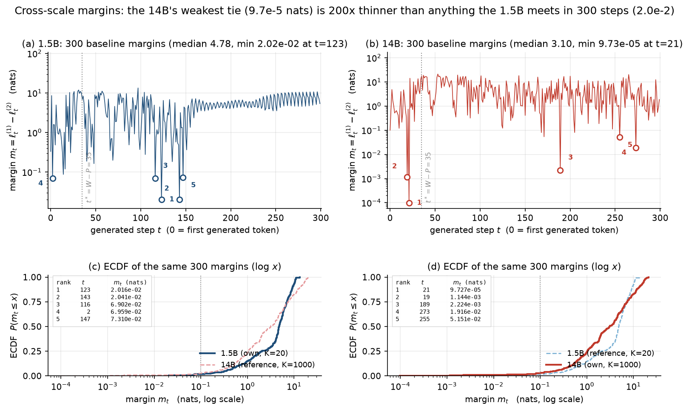

**Setup.** Both runs of §1.1, unperturbed pass only ($r=0$): 300 top-1/top-2 gaps per model. Top row: $m_t$ against $t$. Bottom row: the ECDF of the same 300 values, log $x$. In each bottom panel the own model is bold and the other model is the pale dashed reference. The dotted vertical line at $t=35$ is the flush step $W-P$; the dotted line at 0.1 nats in the ECDF is only a reading aid.

**Axes.**
- (a),(b) $x$: generated step $t$, 0 = first generated token; $y$: $m_t$ in nats, log scale, range $0.6\min$ to $8\max$ (free per panel). Open circles: the five smallest gaps of that model; the number next to each circle is its rank in the table below/inside the panel.
- (c),(d) $x$: $m_t$ in nats, log scale; $y$: ECDF $P(m_t\le x)$, linear 0–1. The inset box repeats the five smallest gaps with their steps.

**The five smallest gaps** (the shared table for this figure):

| rank | 1.5B $t$ | 1.5B $m_t$ (nats) | 14B $t$ | 14B $m_t$ (nats) |
|---:|---:|---:|---:|---:|
| 1 | 123 | $2.016\times10^{-2}$ | 21 | $9.727\times10^{-5}$ |
| 2 | 143 | $2.041\times10^{-2}$ | 19 | $1.144\times10^{-3}$ |
| 3 | 116 | $6.902\times10^{-2}$ | 189 | $2.224\times10^{-3}$ |
| 4 | 2 | $6.959\times10^{-2}$ | 273 | $1.916\times10^{-2}$ |
| 5 | 147 | $7.310\times10^{-2}$ | 255 | $5.151\times10^{-2}$ |

**What is in the figure.**
- The two margin *distributions* are similar in centre but not identical in shape: median 4.778 vs 3.096 nats, p10 0.628 vs 0.435, and both have 6–8 steps below 0.1 nats. Their ECDFs differ by at most 0.217 (at $m\approx3.1$ nats) and cross at 6.7 nats: below that value the 14B accumulates slightly more mass, above it the 1.5B does.
- The difference is entirely in the extreme lower tail. The 1.5B's five smallest values are all in $[0.020,0.073]$ — a floor of two hundredths of a nat. The 14B reaches $9.7\times10^{-5}$, then $1.1\times10^{-3}$, then $2.2\times10^{-3}$: three steps more than an order of magnitude below the 1.5B's floor.
- The 1.5B's weakest steps cluster at $t=116$–$147$ (four of the five within 31 steps); the fifth is at $t=2$. The 14B's are spread over $t=19$–$273$.
- The zig-zag visible in both curves after $t\approx150$ is the text, not noise. The 1.5B's continuation is the exact 4-token cycle `1576, 807, 525, 11050` from $t=143$ to the end, so its $m_t$ repeats with period 4 to within 2.2 nats; the 14B's 300 tokens contain no such cycle (the best lag, $p=9$, matches 2.4% of positions — chance). So the 1.5B's late-time statistics describe a degenerate loop, the 14B's describe fresh text.

**What it shows.** The 14B does not merely have slightly tighter decisions; it has a genuinely thinner *floor*, by two orders of magnitude. That single fact, not the shape of the distribution, is what drives every other cross-scale number in this section.

**What it does not show.** It does not show that thin margins are *more common* in the 14B — they are not, at the 0.1-nat level (8 vs 6 of 300 steps). It says nothing about whether these margins are *stable*: a token that is nearly tied at one prefix can be comfortable at another, and only one prefix is measured per model. And it cannot separate "bigger model" from "different text": the 1.5B's continuation is not the 14B's, and margins are a property of the prefix as much as of the model.

---

## 3. Figure `xscale_rstar.png` — threshold radii, raw and normalized


**Setup.** Both runs, $r=0.1$. $r_*(u)=\min_t m_t r/\max(-\delta m_t(u),0)$ per direction, ECDF over directions. Panel (a) plots $r_*$ in absolute embedding units; panel (b) plots $r_*/s_{\rm emb}$ with $s_{\rm emb}=\mathrm{median}_t\lVert h_t^{0}\rVert$ = 1.206 (1.5B) and 1.516 (14B). Bottom row: the same data as a log-log survival function $\hat P(r_*>x)=1-\hat F(x)$ with the $+1/K$ correction, which is the only way to see the tail with 20 samples. Short vertical ticks on the ECDFs mark p10/p50/p90; dashed vertical lines mark the run radius $r=0.1$ in the same units as the panel (0.083 and 0.066 in (b)).

**Axes.**
- (a),(b) $x$: $r_*$ (embedding units) or $r_*/s_{\rm emb}$ (dimensionless), log scale; $y$: ECDF, 0–1.
- (c),(d) $x$: same as above, log; $y$: $P(r_*>x)$, log.

**Numbers.**

| | 1.5B | 14B |
|---|---:|---:|
| $r_*$ p10 / p50 / p90 (raw) | 0.486 / 1.555 / 4.124 | $1.713\times10^{-2}$ / 0.1164 / 2.592 |
| $r_*$ min / max (raw) | 0.133 / 5.53 | $2.44\times10^{-3}$ / 55.5 |
| $r_*/s_{\rm emb}$ p10 / p50 / p90 | 0.403 / 1.289 / 3.418 | $1.13\times10^{-2}$ / $7.68\times10^{-2}$ / 1.710 |
| flips at $r=0.1$ | 0 / 20 | 464 / 1000 |
| flips at $r=0.3$ / $r=1$ / $r=2$ | 1 / 4 / 14 | 671 / 834 / 886 |

**What is in the figure.**
- The raw medians differ by 13.4x; after dividing by $s_{\rm emb}$ by 16.8x. The normalization *increases* the gap, because the 14B's embedding vectors are 26% longer and the same absolute $r$ is therefore a relatively smaller kick.
- The bulk of the 1.5B's distribution spans less than a decade (p10–p90: 0.486–4.12) while the 14B's spans 2.2 decades ($1.7\times10^{-2}$–2.59), and the 14B has an even heavier upper tail: its survival curve stays above $10^{-2}$ out to $r\approx10$, i.e. about ten directions need more than $10r$, with a maximum of 55.5. Those are directions whose perturbation *widens* every near-tie and therefore never breaks the continuation at any reasonable radius. In this npz all 1000 $r_*$ are finite, so none is literally infinite; the 536 directions above the run radius are simply not flipped at $r=0.1$.
- The 1.5B's minimum, 0.133, belongs to direction 10 — the same direction that is the most destructive at $t=123$ (§6). It is 1.33x above the run radius, which is why the run has zero flips despite a 0.02-nat tie.
- The 14B's smallest, $2.4\times10^{-3}$, is 41x *below* the run radius; 464 directions are below it.

**What it shows.** The threshold radius — the width of the tube of perturbations that leaves the continuation intact — is an order of magnitude narrower in the 14B, and the gap survives the normalization check (it widens slightly rather than closing).

**What it does not show.** With $K=20$ the 1.5B ECDF is a 20-step staircase: its p10 and p90 are each one sample away from the next stair, and the "min" is the minimum of 20 draws, not a population minimum. The 1.5B's max (5.53) is also not a real upper bound — 20 samples cannot see a 55-unit tail even if one exists. And $r_*$ is computed from teacher-forced responses: it is the radius at which the *first* token would flip while the prefix is still the baseline one, not the radius at which the free-running text changes.

---

## 4. Figure `xscale_gain.png` — the 14B responds *less*, absolutely and relatively


**Setup.** Both runs, $r=0.1$, last saved state (index 27 for the 1.5B, 47 for the 14B — both the input to the final norm, i.e. the penultimate exit, matched relative depth 27/28 vs 47/48). $G(u)=\mathrm{median}_t\lVert\delta h_t^{\rm last}\rVert/r$; $G_{\rm rel}(u)=\mathrm{median}_t\lVert\delta h_t^{\rm last}\rVert/\lVert h_t^{\rm last}\rVert$ at the run radius (dimensionless, no division by $r$). ECDFs over directions, log $x$. Dotted vertical lines: the fp32 floor expressed in the same units, $\text{floor}/r$ = 0.010 (1.5B) and 0.027 (14B) in (a), and $\text{floor}/s_{\rm last}$ = $1.8\times10^{-6}$ / $2.5\times10^{-6}$ in (b).

**Axes.**
- (a) $x$: $G$ in state units per unit $r$, log; $y$: ECDF.
- (b) $x$: $G_{\rm rel}$, dimensionless, log; $y$: ECDF.

**Numbers.**

| | 1.5B | 14B |
|---|---:|---:|
| $G$ min / p10 / p50 / p90 / max | 0.635 / 0.922 / 1.333 / 2.235 / 7.47 | 0.224 / 0.409 / 0.583 / 1.297 / 3.06 |
| $G_{\rm rel}$ min / p10 / p50 / p90 / max | $1.17\times10^{-4}$ / $1.68\times10^{-4}$ / $2.54\times10^{-4}$ / $4.22\times10^{-4}$ / $1.45\times10^{-3}$ | $2.12\times10^{-5}$ / $3.89\times10^{-5}$ / $5.57\times10^{-5}$ / $1.24\times10^{-4}$ / $2.95\times10^{-4}$ |
| $s_{\rm last}$ | 545.3 | 1067.3 |
| median above fp32 gain floor | 133x | 22x |

**What is in the figure.**
- The two raw ECDFs are separated by a factor 2.3 at the median and do not overlap except in the upper tail (the 1.5B's p10, 0.922, is above the 14B's p75, 0.877). The 1.5B also has a single direction at $G=7.47$, 5.6x its own median — a heavy right tail that the 14B does not have (max 3.06, 5.2x its median).
- In relative units the median separation grows to 4.6x. The bulk is separated — the 1.5B's p10 ($1.68\times10^{-4}$) is 3.0x the 14B's median and 1.36x its p90 — but the tails are not: 12% of the 14B's directions have a larger relative gain than the 1.5B's weakest direction ($1.17\times10^{-4}$), and the 14B maximum ($2.95\times10^{-4}$) is 2.5x that minimum. So the ordering is a shift of the distribution, not a complete separation.
- Both are far above the fp32 floor, so the ordering is not a precision artifact: 133x and 22x above the respective gain floors.

**What it shows.** The bigger model is the *less* responsive one per unit perturbation, both in absolute state units and as a fraction of what its residual stream carries. Combined with §3 this localizes the fragility entirely in the decision margins: $r_*\sim m/|\delta m|$ falls 13x because $m$ falls 207x at the weakest step while the response falls only 2.3x.

**What it does not show.** It does not show that the 14B is "less sensitive" in any behavioral sense — a smaller relative displacement can still flip a decision if the decision is nearly tied, which is exactly what happens. $G$ is a median over 300 steps and hides the time structure (that is Fig. `xscale_shape`). And the normalizations are not interchangeable: dividing by $s_{\rm last}$ answers "what fraction of the carried state", dividing by $s_{\rm emb}$ answers "how many token vectors' worth"; they give 4.6x and 2.9x respectively, and both are reported in the JSON.

---

## 5. Figure `xscale_shape.png` — same depth ordering, different persistence, and a flush only in the small model


**Setup.** Both runs, $r=0.1$, three matched relative depths: early (1.5B L3 / 14B L6, 11% / 13% deep), middle (L14 / L24, 52% / 51%), last saved state (L27 / L47, the penultimate exit in both). Curves are $\mathrm{median}_u\lVert\delta h_t^{l}\rVert/r$ at each $t$, each divided by its own median over $t$ (300 values), so they are dimensionless and their absolute levels are not comparable — only their shapes are. The dotted vertical line is $t^*=W-P=100-65=35$; the annotated ratio is $\bar m_{36..40}/\bar m_{30..34}$, i.e. the mean level just after the flush over the mean level just before it. The horizontal grey line is 1 (the curve's own median).

**Axes.** $x$: generated step $t$; $y$: $\mathrm{median}_u\lVert\delta h_t^{l}\rVert/r$ divided by its median over $t$ (dimensionless), log scale, free per panel.

**Numbers.**

| depth | late/early (t 200–299 vs 0–49) | peak / late | flush ratio 36–40 / 30–34 | step t=34→35 |
|---|---:|---:|---:|---:|
| 1.5B L3 (11%) | 0.0024 | 643 | 0.96 | 1.15 |
| 1.5B L14 (52%) | 0.169 | 15.0 | 0.78 | 1.00 |
| 1.5B L27 (last) | 0.186 | 18.4 | **1.70** | **2.06** |
| 14B L6 (13%) | 0.286 | 2.66 | 1.00 | 1.16 |
| 14B L24 (51%) | 0.420 | 5.95 | 1.14 | 1.22 |
| 14B L47 (last) | 0.680 | 3.17 | **1.11** | 0.80 |

**What is in the figure.**
- **Early depth.** Both curves decline monotonically through the window, but by very different amounts. The 1.5B's normalized response falls from 38 at $t=0$ to 1 at $t=148$, to 0.04 at $t=250$, and is exactly 0 from $t=290$ on (its flush cascade reaches layer 3). The 14B's falls from 4.0 at $t=0$ to 1 at $t=123$ and then flattens at 0.7–0.9 — it never decays away.
- **Middle depth.** Both show the same qualitative object: a broad hump (1.5B peak at $t=84$, 14B at $t=100$), then decay. The 1.5B falls 14x below its hump by $t=250$; the 14B falls 2.9x and then flattens.
- **Last state.** The 1.5B has the clearest structure: a rise to a peak at $t=85$ (8.5 in units of $r$, 18x its late level) and a monotone decay afterwards. The 14B's last-state curve is a noisy plateau with excursions (a $3.15\,r$ spike at $t=258$) and no hump: peak/late is 3.2 versus 18.4.
- **The flush at $t=35$.** The 1.5B's last state jumps by 2.06x in the single step $t=34\to35$ and 1.70x in the 5-step means, then keeps rising to its $t=85$ peak. The 14B's last state does not: the single-step ratio is 0.80 (a *decrease*) and the 5-step ratio is 1.11. Across all saved layers the 1.5B shows the surge only at L21 (1.38) and L27 (1.70) and a small *dip* at L1–L14 (0.73–0.96); the 14B never exceeds 1.14 at any saved layer.
- The zero-response layer is L0 in both (100% of entries exactly 0): the perturbation is on prompt positions and the read positions are generated tokens, so at the embedding layer there is nothing to see.

**What it shows.** The response has the same *architecture* in both models (zero at the embedding, growing with depth, decaying with $t$), but two scale-dependent differences are visible: the large model's response persists over the whole 300-step window instead of collapsing, and it does not show the window-flush surge that the small model shows at $t=35$. The flush is a mask event and its step is identical in both protocols, so the *timing* agreement is structural; the *amplitude* disagreement (1.70 vs 1.11) is the empirical content.

**What it does not show.** It does not establish why the surge is absent in the 14B. Two candidates are (i) the response is dominated by directions that are insensitive to the dropped prompt token, and (ii) the 14B's sliding-window mask was not applied in as many layers — Qwen2 applies the window per layer via `max_window_layers`, both runs only set `config.sliding_window=100` and `use_sliding_window=True`, and neither npz records the resulting per-layer mask or the model config. For the 1.5B the mask is independently known to be live (the controlled same-token $W=100$ vs $W=1000$ comparison departs exactly at $t=35$); for the 14B the npz alone cannot distinguish "no mask" from "mask but no surge". This is a real ambiguity, not a rhetorical one, and it should be resolved by dumping `config.sliding_window`, `use_sliding_window`, `max_window_layers` and the `layer_types` of the loaded model on the next 14B run. It also does not compare like-for-like text: the two models generate different tokens — the 1.5B's continuation degenerates into a 4-token loop from $t=143$ while the 14B's never repeats — and a response can decay differently simply because the token stream changes how much prompt content is re-injected. The late-time decay difference (0.19 vs 0.68) is therefore *not* a clean model-size effect.

---

## 6. Figure `xscale_dm.png` — how far the responses sit from the margin they must cross


**Setup.** Both runs, $r=0.1$, at each model's **own** smallest-margin step: $t=123$ for the 1.5B ($m=2.016\times10^{-2}$ nats), $t=21$ for the 14B ($m=9.727\times10^{-5}$ nats). Histogram of $\delta m_t(u)/r$ over all directions of that model. Two vertical markers: the red dashed line at $-m_t/r$ (nats per unit radius) is the slope a direction must beat to close the gap *at $r=0.1$* — a direction left of it flips; the grey dash-dot line at $-m_t$ (nats) is the same margin without dividing by $r$, i.e. the threshold only if the run radius were 1.

**Axes.** $x$: $\delta m_t(u)/r$ in nats per unit radius; $y$: number of directions (free per panel). The $x$ ranges differ by a factor 2.8 between panels (1.5B: $-0.22$ to $0.06$; 14B: $-0.045$ to $0.055$).

**Numbers.**

| | 1.5B, $t=123$ | 14B, $t=21$ |
|---|---:|---:|
| $m_t$ | $2.016\times10^{-2}$ nats | $9.727\times10^{-5}$ nats |
| $-m_t/r$ (flip threshold) | $-0.2016$ | $-9.727\times10^{-4}$ |
| $\delta m_t/r$ min / p5 / p50 / p95 / max | $-0.136$ / $-0.0688$ / $+0.0091$ / $+0.0376$ / $+0.0525$ | $-0.0399$ / $-0.0082$ / $-3.13\times10^{-4}$ / $+0.0090$ / $+0.0514$ |
| directions with $\delta m_t<0$ | 7 / 20 | 529 / 1000 |
| directions left of $-m_t/r$ | 0 / 20 | 427 / 1000 |

**What is in the figure.**
- At the 1.5B's weakest step the response distribution is centred slightly *positive* (+0.0091, so 13 of 20 directions widen the margin) and its most destructive direction reaches $-0.136$ — 68% of the $-0.2016$ needed. The whole distribution lives in a window of about $\pm0.15$, and the threshold sits outside it. This is the visual content of "0 of 20 flip".
- At the 14B's weakest step the response distribution is centred essentially on zero ($-3.1\times10^{-4}$, a factor 30 smaller than the 1.5B's offset) and is *wider than the margin by two orders of magnitude*: 42.7% of the mass is left of $-9.7\times10^{-4}$. The threshold line is invisible at this scale because it sits inside the peak — which is the point.
- The two panels are on the same physical axis (nats per unit radius) but different ranges; drawn on one axis the 14B's distribution would be a spike $\sim$6x narrower than the 1.5B's. The ratio of the widths (1.5B p5–p95 ≈ 0.106, 14B ≈ 0.017) is 6.2 — the opposite direction from the threshold ratio (207), which is what makes the 14B's margin crossable.

**What it shows.** The 14B's decisions are not merely near-tied; they are near-tied at a level that a typical direction's response overshoots by two orders of magnitude. The 1.5B's weakest decision is a real tie (0.02 nats) that a typical perturbation simply cannot reach at this radius — the most destructive of 20 directions still comes up 1.5x short.

**What it does not show.** It does not show what happens *after* the first flip (the prefix is still the baseline one here; free-running consequences are a separate experiment). It cannot say whether the 42.7% figure would survive a different prompt, since $t=21$ is one token of one continuation. And the grey line is a deliberate unit mismatch kept for readability of the "margin in nats" — the physically correct comparison is the red one.

---

## 7. Facts that qualify the whole comparison

1. **Different continuations, and one of them is degenerate.** Same prompt, different greedy text. Steps do not correspond across models; only distributions and mask-imposed times do. The 1.5B's continuation is the exact 4-token cycle `1576, 807, 525, 11050` from $t=143$ on; the 14B's never repeats within 300 steps. Every 1.5B statistic that aggregates over late $t$ (the late/early ratio, the shape curves after $t=150$) is therefore measured on a loop, and the 14B's is not.
2. **Different $K$ and different direction geometry.** 20 directions from one 20-d subspace (1.5B) vs 1000 from 50 disjoint ones (14B). Within-block pairs have inner product $-1/19$; cross-block pairs are orthogonal. Any tail statement about the 1.5B rests on 20 samples.
3. **The 14B's flush behaviour is not fully attributable.** The window is set identically in code, but whether it is applied per layer depends on the model config (`max_window_layers`, `layer_types`), which was not recorded. The 1.5B's flush is independently known from a controlled same-token $W=100$ vs $W=1000$ comparison; the 14B's is not.
4. **`dh_last` is not symmetric.** The 1.5B stores 3 directions, the 14B 24. Nothing in this section uses those vectors, so this does not enter any number above — it only limits what a vector-geometry follow-up could do on the 1.5B side.
5. **One radius.** Both runs use $r=0.1$. The 1.5B's usable range is $r\in[10^{-3},0.1]$ and linearity of the response in $r$ was validated there; the 14B's usable range is quoted as $[0.03,0.3]$, but no 14B linearity curve is included in this npz, so reading $r_*$ as a radius at 14B scale rests on that assumption rather than on a 14B measurement.
6. **Margins are a prefix property.** A near-tie at $t=21$ of the 14B says that one particular prefix leaves two tokens nearly tied; it is not a statement about the model's general calibration.

## 8. What follows directly

- Decision fragility scales up with model size *here* by two orders of magnitude at the worst step (9.7e-5 vs 2.0e-2 nats), and this is what makes the threshold radius 13–17x smaller. The per-direction response is 2.3x *weaker* in absolute terms and 4.6x weaker relative to the state, so the effect is on the read-out, not on the propagation.
- The window flush is structurally common ($t^*=35$ in both) but its amplitude is not: 1.70 (1.5B, L27) vs 1.11 (14B, L47) in the 5-step means, and 2.06 vs 0.80 in the single step $t=34\to35$.
- Response persistence over 300 steps is the other clear cross-scale difference: late/early 0.19 (1.5B, last) vs 0.68 (14B, last) — but the 1.5B's number is measured inside a degenerate 4-token loop, so the size of that gap is text-dependent and should not be read as a pure model-size effect.
- Anything that wants to claim "the 14B is more chaotic" has to say *which* quantity: not the response gain ($G$ is smaller), but the distance from the response to the decision threshold ($m_t$ is far smaller), i.e. the fragility is in the read-out geometry.

## 9. Reproduce

```
python scripts_spark/figs_cross_scale.py
```

Writes `notebook_big/figures/xscale_{margins,rstar,gain,shape,dm}.png` (dpi 150) and `notebook_big/figures/xscale_numbers.json`, which contains every quantile quoted above, the per-layer flush ratios, the per-layer late/early ratios, and the p10/p50/p90 of both $r_*$ normalizations and both gains. The 1.5B npz is read in place from the main checkout and is not modified.

