# Large models on the DGX Spark: definitions, data, and every figure explained

Companion of `notebook/notebook.md` (the DeepSeek-R1-Distill-Qwen-1.5B reference document, written on the Tesla T4 work). This one covers the large models on the new 128 GB machine: DeepSeek-R1-Distill-Qwen-14B first, then Qwen3.5-9B, phi-4, and Qwen3-14B. Symbols and procedures are defined there and re-defined here only when they differ.

---

# Part 0. What changed when the machine changed, and what it lets us do

## 0.1 One paragraph of motivation

The 1.5B findings — flips happen at near-ties of the top-1/top-2 logit gap, the window sets exact response edges, no growing instability — were established with 20 directions and 12 radii on one small model. The open questions are all about generality: does the same picture hold at 10× the parameters, where the logit gaps, the residual-stream scales, and the numerical floor all sit in different places? The new machine's single pool of 128 GB memory makes FP32 possible for 14B models (impossible on the 15 GB T4), and its weak-but-wide compute rewards batching, which makes 1000-direction ensembles cheap. So the plan is: same protocol, same prompt, many more directions, bigger models, and explicit measurement of everything that has to be re-calibrated (the usable radius window, the noise floor, the margin spectrum).

## 0.2 Hardware facts that shaped the method (measured, not asserted)

- **Unified memory, 128 GB.** GPU and CPU share one physical pool (~273 GB/s). A 14B model in FP32 is 59 GB of weights; colleagues' servers hold ~49 GB; ~10 GB remains for everything else. Consequence: the loader streams shards straight onto the GPU (`device_map`); a CPU-side copy followed by `.cuda()` would transiently need 118 GB and kill the machine.
- **FP32 compute is ~4.4 TFLOPS** (measured on a 4096³ matmul). Consequence: batch everything. One forward pass sweeps the weights once, so 16 perturbed rows cost about the same per-row as 1 row.
- **The fp32 fallback attention path materialises the full score matrix** $[B,H,L,L]$. At $L=3065$, batch 8, that alone is 12 GB. Consequence: long teacher-forced horizons are capped (~1500 tokens at small batch), and long trajectories are generated with the KV cache instead.

## 0.3 The numerical floor moved up 30×: where $r$ is meaningful

**Data.** Calibration run on the 14B: prompt `interstellar_travel` ($P=65$ tokens), 400 greedy tokens, window setting 100 (inactive — see the correction note; the numbers below are unaffected by this because they only depend on forward-pass rounding), 8 perturbation directions at 9 radii, FP32, teacher-forced on the model's own tokens. File: `results_big/ds14/calib/calib.npz`.

The quantity is $\mathrm{median}_{u,t\in[100,400)}\lVert\delta h_t^{\mathrm{final}}(u)\rVert / r$: the last-layer response per unit radius. The division by $r$ is the point: in a perfectly linear regime this ratio is a constant, the *gain*; where it inflates, the response is pinned at the forward-pass rounding floor and says nothing about the perturbation.

| $r$ | 1e-4 | 3e-4 | 1e-3 | 3e-3 | 0.01 | 0.03 | 0.1 | 0.3 | 1 |
|---|---|---|---|---|---|---|---|---|---|
| $\lVert\delta h\rVert$ | 2.73e-3 | 2.75e-3 | 2.82e-3 | 3.26e-3 | 5.6e-3 | 1.46e-2 | 4.77e-2 | 1.43e-1 | 5.64e-1 |
| $\lVert\delta h\rVert/r$ | 27.3 | 9.16 | 2.82 | 1.09 | 0.563 | **0.487** | **0.477** | **0.478** | 0.564 |

Reading it: below $r\approx0.01$ the response stops shrinking with $r$ — it is stuck at $\approx2.7\times10^{-3}$, which is the accumulated FP32 rounding of a 48-layer network evaluated twice (perturbed minus unperturbed). On the 1.5B (28 layers, on the T4) the same floor sat near $10^{-3}$ with a clean window of $r\in[10^{-3},10^{-1}]$; on the 14B the clean window is $r\in[0.03,0.3]$, shifted up by roughly 30×. Above $r\approx0.3$ the response begins to grow superlinearly (0.564 at $r=1$), the same saturation seen on the small model. Relevance: the usable perturbation range is a property of numerical precision and depth, not of the model's own scales; every big-model radius is chosen inside this window, and the campaign radius is **$r=0.1$**.

**An opinion, since these notes are supposed to argue:** the fp32 floor is not just an inconvenience — it is a *physical scale* of the system "network + arithmetic", and it grows with depth. That means "perturbation response" experiments on even deeper models in FP32 will eventually be floor-dominated unless radii grow too. At some depth, FP32 stops being a precision that can resolve small perturbations at all. We have not hit that wall at 48 layers; the 14B floor is 0.6% of the $r=0.1$ response, comfortably below signal.

## 0.4 The margin spectrum of the 14B

Same calibration run. $m_t=\ell_t^{(1)}-\ell_t^{(2)}$, the top-1 minus top-2 logit gap of the unperturbed greedy continuation — the only scalar that says how close a decision was.

Over the first 300 steps (the horizon used by the main ensembles): median $m=3.096$ nats, mean $4.996$, p10 $0.435$; 8/300 steps below 0.1 nats; 3 below 0.01. The five smallest:

| $t$ | 21 | 19 | 189 | 273 | 255 |
|---|---:|---|---|---|---|
| $m_t$ | **9.73e-5** | 1.14e-3 | 2.22e-3 | 1.92e-2 | 5.15e-2 |

(Earlier drafts of this Part quoted "median 1.68" — that number came from the smoke test, which used a *different prompt*; the correct value for this prompt is 3.096. The minimum and the smallest-five table reproduce exactly in the main A1 run.)

Relevance: razor-thin decisions — the substrate of the whole flip story — exist at 10× model size, are rarer than in the 1.5B per token (8 vs 6 steps below 0.1 nats out of 300, but the 1.5B's thinnest was 2.0e-2, so the 14B's thinnest is 207× thinner), and the first one sits very early ($t=21$).

## 0.5 Protocol details identical to the 1.5B, and what is new

Identical: FP32, one precision per model, TF32 off (it truncates mantissas and would fake margins); in-batch duplicate $r=0$ rows verified bit-identical; fixed-length greedy decoding; teacher forcing as the workhorse (perturbed passes run on the *baseline* token sequence, isolating the continuous response); free runs to validate flips; the signed threshold rule (below).

New: directions are built as **independent simplex blocks** — 50 blocks of 20 directions, each block on its own random set of 20 coordinates of the $65\times5120$ prompt embedding, blocks disjoint, so cross-block directions are exactly orthogonal and within-block pairs have inner product $-1/19$. This is the 1.5B's 20-direction geometry, replicated 50 times with independent subspaces. One radius per direction suffices because the response is linear in $r$ throughout the clean window — the 1.5B work established this and the 14B calibration confirms it (the table above), so the threshold ladder $r_c^-(t,u)=m_t r/\max(-\delta m_t(u),0)$ is computed from $\delta m/r$ and is radius-independent.


# Part 0b. What is running, and what will appear here next

*(written at the start of the overnight campaign, 2026-11-20 ~23:30 UTC)*

The GB10 is scheduled solid for the next ~30 hours through five phases; each is resume-safe and skips completed steps. As each finishes, its section appears above with the full data.

| phase | content | expected |
|---|---|---|
| 1 (done) | DS-14B calibration + 1000-direction A1 (full attention — see correction) | Parts 1–3 above |
| 1-free (running) | free-run validation of all 1000 predictions at r=0.05/0.1/0.3 | Part 4 |
| 1b | window-actuation test, true-window-100 core (calibration, A1, 2-radius validation) | Part 5, and margin/threshold numbers to compare against Parts 1–3 |
| 2 | the window program: W-sweep on fixed tokens, perturbation-support scan, prompt-length scan, 1500-token cascade; state kicks at 10 positions; depth tangent spectrum (8 tokens × 48 blocks); MLP + full-block Jacobians ($\sigma_{\max}$, $\rho$, $\kappa$, principal angles); W=500 regime; 2 more prompts; 12 × 1000-token trajectories | Parts 6–9 |
| 3 | Qwen3.5-9B: the hybrid model (24 linear-attention Gated-DeltaNet blocks + 8 full-attention blocks, no sliding window). Core A1 saves all 32 block profiles, so the response can be compared *between the two block types* — a genuinely new measurement, not a replication | Part 10 |
| 4 | phi-4 (Phi3 family, 40 blocks, no window): core program | Part 11 |
| 5 | Qwen3-14B (same size class as the DS-14B, different training): core program | Part 12 |

**What will be checked first when the window test lands.** The single most consequential question of the night: with the window genuinely active, does the 14B reproduce the exact death-time law $t^* = p_{\rm last} + (W-P)$ (1.5B: exact to the token, 5 windows) and the per-block cascade $t^*_\ell = t^*_1 + (\ell-1)(W-1)$? Our version is stronger than the 1.5B test: each of the 1000 directions has its *own* last perturbed position $p_{\rm last}(u)$, so the law is tested as a per-direction prediction (1000 points per window), not as one number per window.

**On the two models without windows.** phi-4 and Qwen3-14B have no sliding-window mechanism at all; for them the window experiments are undefined and we document the null rather than pretend. Qwen3.5's "window" question is different and more interesting: its linear-attention blocks have a *fixed-size recurrent state* instead of a key-value cache, so information decays structurally rather than being masked — the response profile through depth will show whether perturbations survive differently through Gated-DeltaNet blocks than through full-attention blocks.


# Part floor. The FP32 rounding floor, layer by layer

## Summary

Running the same 400-token sequence twice in 32-bit floating point — once clean and once with a tiny perturbation added to the prompt embeddings — does not return identical numbers, because the arithmetic rounds differently; the difference is the *floor*. Measured at five depths it is exactly zero at the embedding output (the perturbation never touches the embeddings of generated tokens), then 2.17e-4 at state 12, 3.44e-4 at 24, 9.52e-4 at 36 and 2.73e-3 at 47 (the last state) — a factor of 12.6 across the measured depth. The floor is not a property of the perturbation: it is a fixed fraction of the state's own norm, about 2.6e-6 (21–25 units of fp32 precision), and the state norm itself grows from 83 to 1062 between states 12 and 47, which is the whole of the depth dependence. At the campaign radius $r=0.1$ the real response is 31, 22, 19 and 17.5 times the floor at states 12, 24, 36, 47, and at least 7.0 times at the worst single step of the deepest state, so nothing in the campaign is floor-dominated; the smallest radius at which that remains true is 3.2e-3 at state 12 and 5.7e-3 at state 47.

---

## 1. What was measured

### 1.1 Setup

| item | value |
|---|---|
| model | `DeepSeek-R1-Distill-Qwen-14B`, 48 blocks, $d=5120$ |
| precision | FP32 (TF32 off), no autocast |
| prompt | `interstellar_travel`, $P=65$ tokens |
| continuation | 400 greedy tokens of the baseline, **teacher-forced** in every perturbed pass |
| perturbation | one unit direction $u$ (8 directions) times radius $r$ (9 radii, $10^{-4}\dots1$), added to the prompt embeddings only |
| saved states | $l\in\{0,12,24,36,47\}$; 0 = embedding output, $l$ = output of block $l-1$, 47 = input to the final norm |
| samples per cell | 8 directions × 300 steps = 2400 values, all medians below over $u$ and $t\in[100,400)$ |
| file | `results_big/ds14/calib/calib.npz` |
| baseline state norms | `results_big/ds14/a1_inter_full/a1.npz`, field `norm_h0` — same model, **identical `prompt_ids`** (checked with `array_equal`), 300 not 400 tokens |

The calibration npz stores `dh_norm`, `dm`, `r_star`, `margins` and the token ids; it stores **no baseline state norms**. Every statement below that involves a norm uses the `norm_h0` array of the A1 run, which is the same model on the same prompt with the same saved state indices. The two runs differ in generated length (400 vs 300), which matters only if the norm drifts with $t$; it does not: the median norm of state 47 lies between 1.02e3 and 1.10e3 in each of the six 50-step blocks.

### 1.2 Quantities

| symbol | explicit expression | meaning | why this quantity |
|---|---|---|---|
| $\delta h_t^l(u)$ | $h_t^l(u)-h_t^l(0)$, stored as `dh_norm` $=\lVert\delta h_t^l(u)\rVert$ | displacement of the state at depth $l$, step $t$, under direction $u$ | the object the perturbation experiment actually reads out |
| $M(r,l)$ | $\mathrm{median}_{u,\,t\ge100}\lVert\delta h^l_t(u)\rVert$ | response at radius $r$ and depth $l$ | one number per radius per layer; medians because the per-step distribution has a long right tail |
| $F_l$ | $M(10^{-4},l)$ | **the floor**: the response left when the perturbation is so small that the linear term is negligible | the measured quantity of this Part; the smallest radius is by construction floor-dominated |
| plateau value | $\mathrm{median}\{M(10^{-4},l),M(3\times10^{-4},l)\}$ | floor estimated from two radii instead of one | a robustness check on $F_l$, not a different quantity |
| $G_l$ | $M(0.1,l)/0.1$ | gain: state units of response per unit radius | the linear-response coefficient; $G_l r$ is the signal the perturbation produces |
| $n_l$ | $\mathrm{median}_{t\ge100}\lVert h_t^l(0)\rVert$ | norm of the unperturbed state at depth $l$ | the natural scale that rounding errors live on |
| $r_{\min}(l)$ | $F_l/G_l$ | radius at which $G_l r=F_l$, i.e. the arithmetic term equals the linear term | the smallest radius at which the response is still half signal, half arithmetic |
| $r_{3F}(l)$ | $3F_l/G_l$ | radius at which the linear term is 3× the floor | the radius below which the floor inflates the measured response by more than 5.4% |

### 1.3 The plateau check, done before the floor was used

$F_l$ is only a floor if $M$ has actually stopped moving with $r$. It has:

- $M(3\times10^{-4})/M(10^{-4})=1.008,\ 1.003,\ 1.001,\ 1.008$ at states 12, 24, 36, 47 — agreement to **0.8%**, far inside the 20% that would make the plateau claim doubtful, so both radii sit on the plateau.
- $M(10^{-3})/M(10^{-4})=1.069,\ 1.042,\ 1.029,\ 1.035$ — still within 7%.
- The floor is the same for every direction: at $r=10^{-4}$ the largest per-direction median is at most 1.023× the smallest, at every state. Rounding noise does not know which direction was perturbed.
- The floor does drift a little with $t$ at the deepest state: the median over $t\in[250,400)$ is 1.20× the median over $t\in[100,250)$ at state 47 (1.01, 1.03, 1.08 at states 12, 24, 36). This is the one place where a single median hides structure; §4 checks the ratio step by step because of it.

The exact zero at state 0 is a useful anchor rather than a nuisance: the perturbation changes only the 65 prompt embeddings, the generated tokens are the same tokens, so at the embedding output the two passes are bit-identical. The floor is produced by the 48 blocks of arithmetic, not by the input.

## 2. `ds14floor_perlayer.png` — the floor per layer

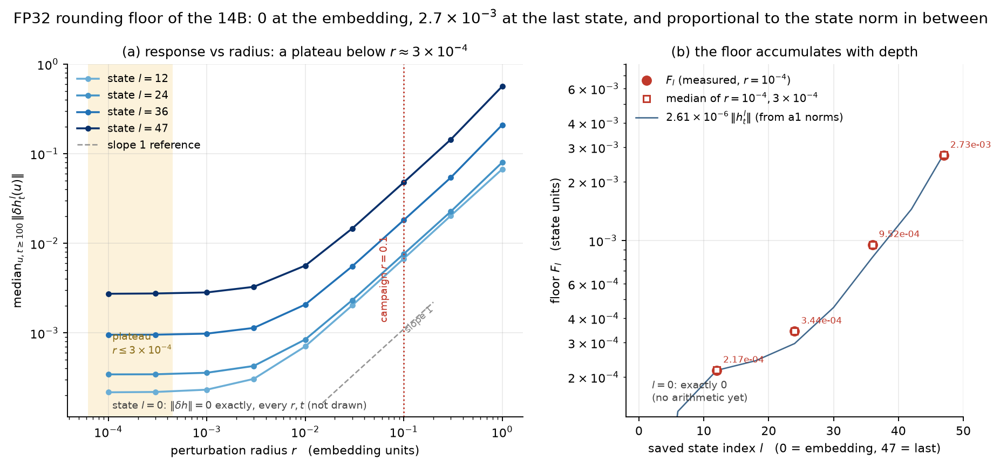

**(a) Response against radius.** $x$: $r$ on a log scale, $10^{-4}\dots1$. $y$: $M(r,l)$ on a log scale, one curve per non-zero saved state (four curves, light blue for the shallow state, dark blue for the deep one), with markers at the nine measured radii. The shaded band marks $r\le3\times10^{-4}$, the plateau; the red dotted vertical line is the campaign radius $r=0.1$; the grey dashed segment in the empty lower-right corner is a slope-1 reference (on log-log, a linear response is a straight line of slope 1).

Numbers: $M$ is tabulated below. At the two smallest radii all four curves are flat to within 1%; the local log-log slope over $10^{-4}\dots10^{-3}$ is 0.01–0.03, i.e. the curves do not move. Over $r=10^{-2}\dots3\times10^{-1}$ the same slopes are 0.99, 0.97, 0.96, 0.95 — the response is proportional to $r$ to within 5%. At the top, $r=0.3\dots1$, the slopes are 1.00, 1.05, 1.13, 1.14: the deepest states grow faster than linearly, which is the model's own nonlinearity already noted in Part 0, not floor.

**(b) Floor against depth.** $x$: saved state index $l$; $y$: $F_l$ on a log scale. Red discs are $F_l$ from $r=10^{-4}$; open squares are the two-radius plateau value (they coincide); the blue line is $2.61\times10^{-6}\,n_l$ using the nine `norm_h0` layers of the A1 run, drawn at all nine saved indices — the four measured points lie on it, the other five are predictions. $F_l$ runs 2.17e-4, 3.44e-4, 9.52e-4, 2.73e-3 at states 12, 24, 36, 47; state 0 is annotated as exactly 0 because a log axis cannot show it.

The full table, every number in the figure:

| $r$ \ $l$ | 0 | 12 | 24 | 36 | 47 |
|---|---:|---:|---:|---:|---:|
| 1e-4 | 0 | 2.169e-4 | 3.436e-4 | 9.523e-4 | 2.729e-3 |
| 3e-4 | 0 | 2.187e-4 | 3.446e-4 | 9.535e-4 | 2.749e-3 |
| 1e-3 | 0 | 2.320e-4 | 3.582e-4 | 9.795e-4 | 2.824e-3 |
| 3e-3 | 0 | 3.061e-4 | 4.267e-4 | 1.134e-3 | 3.261e-3 |
| 1e-2 | 0 | 7.049e-4 | 8.425e-4 | 2.068e-3 | 5.627e-3 |
| 3e-2 | 0 | 2.023e-3 | 2.314e-3 | 5.522e-3 | 1.460e-2 |
| 1e-1 | 0 | 6.720e-3 | 7.587e-3 | 1.809e-2 | 4.774e-2 |
| 3e-1 | 0 | 2.024e-2 | 2.253e-2 | 5.394e-2 | 1.434e-1 |
| 1 | 0 | 6.708e-2 | 7.976e-2 | 2.091e-1 | 5.636e-1 |

(Medians; the means are 1–5% higher, e.g. 2.856e-3 vs 2.729e-3 at state 47, because of the right tail.)

**What the figure does not show.** Only five states were saved, so between them the curves are straight lines in the drawing, not measurements; the blue norm law in (b) at states 6, 18, 30, 42 is a prediction. The medians erase a per-step variation of up to 8× at fixed $r$ (state 47, $r=0.1$: the per-step median over directions runs from 2.04e-2 to 1.63e-1). And a log axis hides the exact zero at state 0, which is why it is written out.

## 3. `ds14floor_law.png` — what the depth dependence is


**(c) Floor against state norm.** $x$: $n_l$, $y$: $F_l$, both log. Four points, labelled by state. Solid line: the free power law $F\propto n^{0.977}$; dashed: slope 1. The exponent is 0.977 with an rms log residual of 0.074. The ratio $F_l/n_l$ is 2.614e-6, 3.019e-6, 3.027e-6, 2.568e-6 at states 12, 24, 36, 47 — a factor 1.18 total spread while $n_l$ changes by a factor 12.8. In units of fp32 machine epsilon (1.19e-7) that is 22, 25, 25 and 22 units.

**(d) Which depth law fits.** Horizontal bars: rms of $\ln(\text{predicted}/\text{measured})$ over the four layers, for six candidate laws; the text gives the rms and the largest single-layer deviation. The 10% dotted line is a visual reference, not a test. Results:

| law | rms | worst point (log dev.) | measured/predicted at $l=12,24,36,47$ | reading |
|---|---:|---:|---|---|
| $F\propto l^{1/2}$ | 93% | 128% | 0.28, 0.31, 0.70, 1.76 | rejected: predicts 1.98× growth from $l=12$ to 47, observed 12.58× |
| $F\propto l^{p}$ | 36% | 49% | 1.32, 0.61, 0.83, 1.49 | rejected: best $p=1.77$, residuals zigzag by up to 1.6× |
| $F\propto e^{cl}$ | 17% | 24% | 1.20, 0.79, 0.91, 1.16 | poor: one $e$-fold per 13.6 blocks, systematic S-shape |
| $F\propto n^{p}$ | 7.4% | 9.2% | 0.91, 1.06, 1.09, 0.95 | accepted, $p=0.977$ |
| $F\propto n$ | 10.4% | 14.8% | 1.00, 1.16, 1.16, 0.98 | accepted, $\kappa=2.610\times10^{-6}$ (21.9 ε) |
| $F\propto\sqrt{\sum_b n_b^2}$ | 7.2% | 11.0% | 1.02, 0.90, 1.09, 0.99 | accepted, $k_q=2.176\times10^{-6}$ (18.3 ε) |

**(e) The ratio step by step.** $x$: generated step $t\in[100,400)$; $y$: $\mathrm{median}_u\lVert\delta h^{l}_t\rVert\big/\mathrm{median}_u\lVert\delta h^{l}_t\text{ at }r{=}10^{-4}\rVert$ — the same ratio as in §4 but computed per step before taking any median over $t$, one curve per non-zero state. Solid grey line: 1 (signal equals floor); dotted grey: 3. Medians over $t$ are 30.4, 20.0, 18.0, 16.5 at states 12, 24, 36, 47; the 10th percentiles are 21.2, 14.9, 13.3, 10.6; the minima are 16.5 (t=313), 11.4 (t=293), 8.7 (t=294), 7.0 (t=293). No step out of 300 at any state falls below 7× the floor.

**What the figure does not show.** Four points cannot separate laws that differ by less than ~10%; the difference between $n^{0.98}$ and a quadrature sum of per-block errors is below that resolution (their rms values, 7.4% and 7.2%, are not significantly different). The freedom in (d) is 1–2 parameters per law fitted on the same four numbers that are then scored, so the residuals are optimistic. And the norm is borrowed from a second run.

## 4. Floor against signal — and the better comparison

At $r=0.1$ the median response and the floor give

| $l$ | signal $M(0.1)$ | $F_l$ | signal/floor | relative signal $M/n_l$ | relative floor $F_l/n_l$ | ratio of the two |
|---:|---:|---:|---:|---:|---:|---:|
| 12 | 6.720e-3 | 2.169e-4 | 30.98 | 8.10e-5 | 2.61e-6 | 30.98 |
| 24 | 7.587e-3 | 3.436e-4 | 22.08 | 6.66e-5 | 3.02e-6 | 22.08 |
| 36 | 1.809e-2 | 9.523e-4 | 19.00 | 5.75e-5 | 3.03e-6 | 18.99 |
| 47 | 4.774e-2 | 2.729e-3 | 17.49 | 4.49e-5 | 2.57e-6 | 17.49 |

**Where measurement is weakest: the deepest state, and the reason is the signal, not the floor.** The floor relative to the state's own norm is the same at every layer (2.6–3.0e-6), so normalizing by the norm changes the ratio by at most 2% (last column). What falls with depth is the *relative* response: 8.1e-5 of the state norm per unit radius at state 12, 4.5e-5 at state 47. The deepest read-out is therefore the one closest to its floor, by a factor 1.8 — a real effect, but a small one.

The obvious comparison, signal at $r=0.1$ divided by the floor, is the right one for the campaign because $r=0.1$ is the radius actually used, but as a general metric it is misleading: it is proportional to $r$, so it says nothing about the model and everything about the chosen radius. The dimensionless version is $r/r_{\min}(l)$, which is the same number here (17.5 at the deepest state) and remains meaningful if the radius changes. Two more things the naive comparison hides, both checked:

1. **The floor grows with $t$ by up to 20%.** At state 47 the floor is 1.20× larger over $t\in[250,400)$ than over $[100,250)$. The per-step ratio in figure (e) absorbs this and still has a minimum of 7.0, so the median is not hiding a failure, but it does mean a single median-based floor is accurate only to ~20% at the deepest state.
2. **The floor and the signal add in quadrature, not linearly.** With no free parameter — $F_l$ from $r=10^{-4}$, $G_l$ from $r=0.1$ — the model $\lVert\delta h\rVert(r)=\sqrt{F_l^2+(G_lr)^2}$ reproduces all 32 measured points with $r\le0.3$ to an rms of **1.71%** (worst 5.83%, at $r=3\times10^{-3}$, state 47). Adding them linearly, $\lVert\delta h\rVert=F_l+G_lr$, is off by an rms of 14.1% and up to 26.9% in the same range. This is the strongest single check that $F_l$ is an independent noise term rather than a rescaling of the response: it predicts the whole transition region from the two endpoints. At $r=1$ the measured response is up to 18% above the model, which is the model's own nonlinearity, not floor.

## 5. How the floor accumulates: what the data support

Four accumulation models and their predictions:

- **Independent rounding per block, equal size, adding in quadrature:** $F_l=\delta\sqrt{l_{\rm block}}$ → $F\propto l^{1/2}$. Predicts a 1.98× rise from state 12 to 47; measured 12.58×. Rejected by a factor 6 in growth.
- **Multiplicative growth:** each block multiplies the error by a constant → $F\propto e^{cl}$. Fitted $c=0.0734$ per block (one $e$-fold per 13.6 blocks) with 17% rms residuals and a systematic S-shape: the prediction is too low at 12 and 47, too high at 24 and 36. Not supported.
- **Free power of depth:** $F\propto l^{1.77}$, 36% rms. Not supported.
- **Rounding error proportional to the local state norm, accumulating in quadrature:** $F_l=k_q\sqrt{\sum_{b\le l}n_b^2}$. Because $n_b$ grows by a factor 12.8 over the measured range, this sum is dominated by the last few blocks and is numerically almost proportional to $n_l$ itself. Fitted with one constant, $k_q=2.18\times10^{-6}$ (18.3 ε), it gives 7.2% rms and 11% worst-case residuals.

**The data support the last one, and its practical content is "$F_l$ is a fixed fraction of the state norm".** The single-constant version $F_l=2.61\times10^{-6}n_l$ (21.9 ε) matches to 10% rms. Physically: every block's arithmetic leaves a relative error of order 20 fp32 units on the state it writes, and the visible floor is the quadrature sum of those errors weighted by the (growing) state norm. With four measured layers the two versions — proportional to the current norm, or quadrature over per-block norms — cannot be separated beyond the ~10% residual level; both are consistent, and both say the floor is set by the *size of the numbers being rounded*, not by the number of blocks alone.

That distinction matters for extrapolation. "Floor grows like $\sqrt{\text{depth}}$" would be reassuring; it is wrong here because the residual stream grows with depth. The measured statement is: **absolute floor grows roughly as fast as the state norm grows**, which for this model is a factor 12.6 between states 12 and 47, i.e. 7.5% per block on average.

## 6. The smallest usable radius per layer

Solving $G_lr=F_l$:

| $l$ | $G_l$ | $F_l$ | $r_{\min}=F_l/G_l$ | $r_{3F}=3F_l/G_l$ |
|---:|---:|---:|---:|---:|
| 0 | 0 | 0 | undefined (no floor, no gain) | undefined |
| 12 | 6.720e-2 | 2.169e-4 | 3.23e-3 | 9.68e-3 |
| 24 | 7.587e-2 | 3.436e-4 | 4.53e-3 | 1.36e-2 |
| 36 | 1.809e-1 | 9.523e-4 | 5.26e-3 | 1.58e-2 |
| 47 | 4.774e-1 | 2.729e-3 | 5.72e-3 | 1.71e-2 |

Reading: at $r=r_{\min}$ the measured displacement is $\sqrt2$ times the linear term (the two contributions are equal and add in quadrature), so half of the squared response is arithmetic. At $r_{3F}$ the measured displacement is only 5.4% above what a floor-free linear response would give, and the floor's share of the squared response is 10%. The campaign radius 0.1 sits 17.5–31 times above $r_{\min}$, and 5.8–10.3 times above $r_{3F}$ — inside the safe region with room to spare, but not by orders of magnitude at the deepest state. A 10× margin over $r_{\min}$ would require $r\ge0.057$ at state 47, which is close to the campaign radius; the choice $r=0.1$ is therefore near the small end of what this 48-layer fp32 network can resolve at its last state, and a deeper model would need a larger radius for the same margin.

This is also consistent with the "clean window" of Part 0 ($r\in[0.03,0.3]$), which was defined by a different criterion — the radius range where $M(r)/r$ is constant to a few percent. $r_{\min}$ is the absolute validity edge (floor equals signal); 0.03 is where the floor inflates $M(r)/r$ by only ~2% (at state 47: $M(0.03)/0.03=0.487$ against the asymptotic $G=0.477$). Both numbers describe the same transition from opposite sides.

## 7. What this does not show

- Only four non-zero states were saved (12, 24, 36, 47 of 48 blocks). The shape of $F_l$ between them is interpolation; in particular the shallowest measured state is already 12 blocks deep, so nothing here says how fast the floor rises over the first quarter of the network.
- One model, one prompt, one precision, one random seed for the directions. The constant 2.6e-6 is a property of this network in fp32; a different architecture, norm placement, or dtype would change it. bf16 keeps 8 mantissa bits against fp32's 24, so the per-operation error — and with it the floor at a given state norm — would be roughly $2^{16}\approx6\times10^4$ times larger; fp64 would lower it by about $2^{29}\approx5\times10^8$.
- The floor was measured at generated positions only, because that is where `dh_norm` is stored. Nothing is claimed about prompt positions, where the perturbation itself lives.
- The 20% drift of the floor with $t$ at the deepest state is real and the medians hide it; §4's per-step check bounds its effect on the campaign but not on other analyses that use a single floor number.
- $r_{\min}$ uses $G_l$ measured at $r=0.1$; if the response were nonlinear already at $r=0.03$, $r_{\min}$ would move. The linearity check in §2 (slope 0.95–0.99 over $10^{-2}\dots3\times10^{-1}$) says it does not, to 5%.

## 8. What it implies for perturbation experiments on deep models

The floor is not an inconvenience to be subtracted; it is a *scale* of the system "network + arithmetic", and it is set by the norm of the state being written at each depth. Three practical consequences, each backed by a number above:

1. **Radii must be chosen per depth, not per model.** The deepest read-out has the largest floor (2.73e-3) and the smallest relative response, so it sets the floor of the usable radius: 5.7e-3 here. The minimum that works at state 12 (3.2e-3) is below the one at state 47 (5.7e-3), so a radius chosen from the shallow state alone would be floor-contaminated at the deep one.
2. **The margin is measurable in advance.** Both $F_l$ and $G_l$ come from the same cheap calibration run at two radii ($10^{-4}$ and 0.1), so $r_{\min}$ is known before the campaign, per layer, without any assumption about the model's dynamics.
3. **The wall exists but is far.** For this 48-block fp32 network the floor is 5.7% of the measured $r=0.1$ response at the last state (3.2% at state 12), and the response is at least 7× the floor at every one of the 300 steps, 17.5–31× in the per-state medians. A model whose state norm grows another order of magnitude at fixed gain would put $r_{\min}$ near $5\times10^{-2}$ and force the campaign radius up. The measurement here is the calibration that would detect that before it silently corrupts a result.


# Part D2. The correlation-dimension pipeline, run locally from distance matrices

## Summary

The D2 analysis is now split so that the GPU only does what it is needed for. A GPU job (`scripts_spark/d2_distances.py`) writes one full $[N,N]$ Euclidean distance matrix per trajectory; a laptop script (`scripts_spark/d2_local.py`) turns those matrices into the correlation integral $C(\epsilon)$, its local slope, the valid-window bookkeeping, TwoNN, the Levina–Bickel MLE and two loop screens — figures and JSON, no GPU, no model, no `torch`. Run time is **6–7 s per 4095-token trajectory** including building the matrix from the saved states, and **2–3 s** per trajectory at $N=4000$ from a precomputed `.npy` (1000 tokens: 1.1 s).

Validated against the four 1.5B trajectories that exist locally. The reference estimator of `results/d2/` is reproduced **exactly** — 2.978 vs 2.978, 3.894 vs 3.894, 9.195 vs 9.195 — which is the check that matters, because it means any disagreement below is about interpretation, not arithmetic. The interpretation does change: the reference "plateau" is a chord across 6–8 adjacent points of a percentile-spaced grid, **0.04–0.10 decades wide**, with the $R^2$ of 0.9999 that any smooth curve gives over such a span; and on the two healthy trajectories the whole eps range between the depletion floor $10/N$ and saturation is only **0.08 decades** wide, so no plateau can exist there by construction. The loop trajectories are identified by a lag-distance dip (period 53 and 69, dip to 6–10% of the neighbouring lags), and one of them produces a *convincing but spurious* 0.54-decade window with $\hat D_2=1.09$. Run over all 20 local trajectories the same test finds **nine repetition loops and two partial ones**, including six of the sixteen 1000-token runs that had been recorded as non-loops.

---

## 1. What the pipeline is

### 1.1 Input, output, command

| item | value |
|---|---|
| input (GPU) | `dist_<name>_h_last.npy`, fp32 $[N,N]$ Euclidean distance matrix, one per trajectory |
| input (GPU, optional) | `summary.json`: `n`, `dim`, `norm_median`, `norm_growth`, `rel_nearest`, `rel_nearest_p05` |
| input (laptop, validation only) | `.pt` (torch save, read here without torch) or `.npz` with `h_last` $[N,D]$ |
| output | `notebook_big/figures/d2pipe_<tag>_<name>.png`, `…_summary.png`, `d2pipe_<tag>.json` |
| command | `python scripts_spark/d2_local.py --dir results_big/ds14/d2 --theiler 0,50,500 --out notebook_big/figures --tag ds14` |
| alternative | `--pt <files or dirs>` (or `--dist <matrix.npy> …`) computes the matrices locally in float64 |

Every epsilon below is quoted in units of $d_{typ}$, the median over points of the rms distance to the other points (a robust typical separation). That makes a 1.5B trajectory (state norm ≈ 10²) and a 14B one comparable on the same axis.

### 1.2 Definitions

Let $d_{ij}=\lVert x_i-x_j\rVert$, $N$ points, Theiler window $W$.

| quantity | expression | note |
|---|---|---|
| correlation integral | $C(\epsilon)=\dfrac{\#\{(i,j):\ |i-j|>W,\ d_{ij}<\epsilon\}}{\#\{(i,j):\ |i-j|>W\}}$ | denominator $N(N-1)-2\sum_{k\le W}(N-k)$, so $C\to1$; for $W=0$ it is exactly $\frac{2}{N(N-1)}\#\{i<j:d_{ij}<\epsilon\}$ |
| evaluation | sort the upper triangle once, then `searchsorted` at each $\epsilon$ | 90 log-spaced values of $\epsilon/d_{typ}\in[10^{-2},2.5]$; the $W$-band counts are subtracted from the $k=1\ldots W$ diagonals |
| local slope | $\mathrm{d}\log C/\mathrm{d}\log\epsilon$ | central differences, second-order at the edges |
| TwoNN | $\mu_i=r_2^{(i)}/r_1^{(i)}$, $\ \hat d=1/\langle\ln\mu\rangle$ | MLE for the Pareto tail $P(\mu>M)=M^{-d}$; the reference code's OLS fit of $-\ln(1-F)$ vs $\ln\mu$ is the same estimator and is returned too |
| Levina–Bickel MLE | $m_k(i)=\frac{1}{k-1}\sum_{j<k}\ln\frac{d_k(i)}{d_j(i)}$, $\ \hat d_k=\langle 1/m_k\rangle$ | $k=5,10,20$ |
| repetition screen | fraction of points with nearest distance at $\lvert i-j\rvert\ge50$ below $10^{-3}d_{typ}$ | plus the median and p05 of that relative distance |
| loop-period screen | $p(k)=\overline{\lVert x_t-x_{t+k}\rVert}/d_{typ}$; prominence $=p(k)/\mathrm{median}\,p(k\pm1,2,3)$ | a drifting loop has a sharp dip at its period; a healthy trajectory has none |

### 1.3 The valid-window rule (this replaces the max-$R^2$ search)

A window is marked valid only if all three hold simultaneously:

1. **flatness.** The longest run of $\epsilon$ in which the local slope stays within $\mathrm{tol}$ of its own median, with $\mathrm{tol}=\max(0.15,\ 0.06\,\lvert\hat D_2\rvert)$ — i.e. "within 6% of its own value", with an absolute floor so low dimensions are not judged in relative units — and the run at least **0.4 decades** wide. The test is applied to a 3-point median filter of the slope so a single grid point cannot open a window.
2. **depletion floor.** $\epsilon$ above the point where $C(\epsilon)=10/N$ (at least $\sim5N$ pairs inside the ball). This is the $10/N$ edge of `docs/FINDINGS_AND_PROCEDURE.md`.
3. **below saturation.** $C(\epsilon)\le0.1$.

The window width in decades is reported whether or not it is valid, together with the slope at both edges of the admissible range, so "no plateau" is a number and not a verdict. The finite-$N$ slope ceiling $2\log_{10}N$ (7.2 at $N=4095$) is drawn on every slope panel. If the window is empty the verdict is *no scaling region*; the pipeline also reports $\hat D_2$ over the whole admissible range ($C$ from $10/N$ to $0.1$) so the window dependence stays visible.

## 2. Validation on the 1.5B trajectories

Four trajectories: two of the local long runs are period-53 / period-69 loops (`cyber`, `great`, both 4095 tokens at the last layer), two are healthy (`interstellar`, 1026 tokens; `astronomy_observations`, 1000 tokens). All four are 1536-dimensional last-layer states, greedy FP32, window 4096.

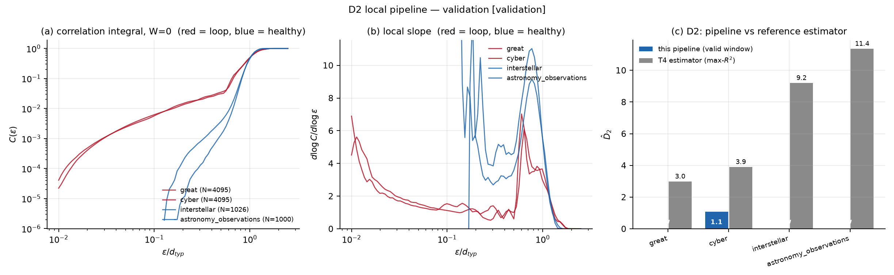

| trajectory | $N$ | loop period (coverage) | nearest-twin median | $\hat D_2$ valid window | window width | T4 estimator (reproduced / published) | TwoNN | MLE $k{=}10$ |
|---|---:|---|---:|---|---:|---|---:|---:|
| `great` (loop) | 4095 | **69** (90%) | 0.016 | — (none) | 0.00 dec | **2.978 / 2.978** | 5.44 | 3.19 |
| `cyber` (loop) | 4095 | **53** (94%) | 0.017 | **1.09** (spurious) | 0.54 dec | **3.894 / 3.894** | 6.21 | 3.12 |
| `interstellar` (healthy) | 1026 | — (0%) | 0.419 | — (none) | 0.00 dec | **9.195 / 9.195** | 6.23 | 7.91 |
| `astronomy_observations` (healthy) | 1000 | — (0%) | 0.538 | — (none) | 0.00 dec | 11.35 / — | 6.12 | 10.13 |

Four things to read off it.

**The reference numbers are reproduced exactly.** The T4 estimator column is `dimension.py:d2_curve` run on the first 2000 states with Theiler 20, i.e. the code path that produced `results/d2/d2_raw_vs_shuffled.json`; it matches to the published four digits (2.9777, 3.8943, 9.1947). So the correlation integral and the fit search here are the same objects as in the reference implementation, and the rest of this section is a statement about what those numbers mean, not about whether they were computed right.

**The healthy trajectories have no scaling region, and there is no room for one.** For `interstellar` the admissible range runs from $\epsilon/d_{typ}=0.61$ ($C=10/N$) to $0.81$ ($C=0.1$) — **0.08 decades** — and across it the local slope climbs 6.1 → 8.9. A 9-dimensional cloud with 1000 points simply cannot be measured: the depletion floor and saturation are 0.08 decades apart, which is why the whole "valid interval" in the earlier analysis was 0.00–0.04 decades wide. The T4 value 9.195 comes from a window 0.102 decades wide, 6 of 22 grid points, inside which $C$ rises by 0.14 (a seventh of the full range): a chord, not a plateau.

**Loops give a low number, and one of them gives a *valid-looking* one.** `cyber` has a 0.54-decade window with $\hat D_2=1.09$ that passes all three criteria — the drifting period-53 orbit really does trace a one-dimensional curve with $C\sim\epsilon^{1.1}$ over that range. The verdict is decided by the loop screens, not by the fit: 94% of its positions return to within $0.1\,d_{typ}$ after 53 tokens (90% for `great`), against 0% for both healthy trajectories, and the lag-distance dip is 0.06 of its neighbouring lags. `great` has the same structure but no flat run at all. The correct reading of a low $\hat D_2$ is therefore always *"is this a loop?"* first.

**What does not separate the groups:** TwoNN sits at 5.4–6.2 on all four, loops included, and the $k$-neighbour MLE at $k=10$ agrees with the truth on the healthy pair (7.9, 10.1) but is 3.1–3.2 on the loops — both are point-cloud statistics and neither is a loop detector. The repetition screen at the $10^{-3}$ threshold in the brief finds **nothing** in any of the 20 local trajectories: these loops drift, so a repeat sits at 1.6% of the cloud scale, not at $10^{-3}$. The usable screen is the lag-distance dip: over all 20 local trajectories the prominence is **≤0.22 for the nine full loops, 0.21 and 0.45 for two partial ones, and 0.91–0.99 for the nine clean ones** — a factor-2 margin with no free parameter. There is no smoothness confound in this metric: consecutive last-layer states are already 0.84–1.03 $d_{typ}$ apart, so the lag curve is flat at $\approx1$ for a healthy run and only a genuine return produces a dip.

Theiler windows change nothing for the healthy trajectories (no window at $W=0$ or $W=500$) and remove even the spurious window of `cyber` at $W=500$; the same run at $N/2$ and $N/4$ loses it too, so it is a small-$N$ feature of the orbit.

### 2.1 The screens applied to all 20 local trajectories

The same two screens, run over every 1.5B trajectory that exists on this machine (three 4095-token prompt runs and the sixteen 1000-token runs, plus `interstellar`), split them **nine loops / two partial / nine clean**:

| period found | coverage | trajectories |
|---|---:|---|
| 12, 17, 27 | 95%, 76%, 89% | `renewable_energy_economics`, `history_of_music`, `sleep_and_memory` |
| 53, 63, 69, 74, 81 | 94%, 77%, 90%, 91%, 70% | `cyber`, `history_of_computing`, `great`, `future`, `ocean_currents` |
| 53 | 80% | `cybersecurity` (the 1000-token run of the same prompt as `cyber`) |
| 50, 79 | 39%, 50% | `transformer_architecture`, `urban_transportation` (partial: prominence 0.45, 0.21) |
| — | 0–5% | `interstellar`, `astronomy_observations`, `childhood_experiences`, `evolution_of_language`, `healthy_habits`, `history_of_mathematics`, `interstellar_travel`, `software_engineering_practices`, `volcanoes_and_plate_tectonics` |

This contradicts the earlier note that the sixteen fresh 1000-token trajectories "flag none as loops (worst relative distance 0.135)". The two statements are reconcilable only if that screen thresholded something other than the *fraction of positions* that return — for `renewable_energy_economics`, 95% of positions come back to within $0.1d_{typ}$ after 12 tokens, with a mean lag-12 distance of $0.037d_{typ}$ against $1.06d_{typ}$ at the surrounding lags, so the loop shows up as a *dip* that a median or a maximum over points can easily miss. Whatever the earlier screen was, **six of those sixteen trajectories (plus two partial ones) are repetition loops and their D2/MLE numbers are not usable as non-loop controls.** The twelve trajectories behind `results/d2/d2_raw_vs_shuffled.json` live on the T4 and cannot be screened here; the three that are loops were correctly identified there, and the other nine need this check before their $\hat D_2$ of 9–11 is quoted.

## 3. Three problems with the earlier estimator, worth knowing

Everything in `results/d2/` was produced by `fit_plateau`, which slides over every sub-interval of the $\epsilon$ grid and keeps the one with the largest $R^2$. Three consequences, all visible in the numbers above:

1. **The reported $R^2$ is a maximum over ~200 candidate windows, not a goodness of fit.** A smooth log–log curve gives $R^2>0.9999$ over two or three adjacent points, so quoting 0.9998 as evidence of a plateau is circular. The winning windows here are 0.039, 0.060, 0.083 and 0.102 decades wide.
2. **`min_points=6` counts grid points, not decades.** The $\epsilon$ grid is made of percentiles of pairwise distances, so its spacing is very uneven (one 0.19-decade jump near the 2nd percentile, then ~0.01-decade steps near the 60th). Six adjacent points can be 0.02 or 0.3 decades; the width is never checked, so the "plateau" can be one grid step.
3. **The grid itself depends on $N$.** Percentiles 2–60 of a 1000-point subsample move with the sample, so the quoted $\hat D_2$ changes with $N$ both through the data and through the grid — which is why the earlier N-convergence check could not separate the two. (Two smaller ones: `d2_all_controls.py` ran the raw curves at Theiler 20 and the shuffled ones at Theiler 0, so even the tautological raw-vs-shuffled comparison was not matched; and `rqa` passes `theiler=0` to `correlation_curve` regardless of its argument, using the argument only for the recurrence mask.)

TwoNN is implemented correctly there (the CDF slope fit is the Pareto MLE), but the widely quoted variant $\log 2/\langle\log\mu\rangle$ is **not**: it returns $\ln^2 2\cdot d=0.48\,d$, which was checked on uniform hypercubes of dimension 2, 5 and 10. The pipeline returns both so the difference stays visible. A related trap: exact duplicates give $r_1=0$, so $\mu=\infty$ and the point is dropped — the published `vocab` control lost 16 of 2000 points this way, and a bit-exact loop would hide its own degeneracy.

## 4. Known artifacts, in plain language

- **Repetition loops.** A model that repeats a phrase produces states that revisit almost the same point every period. The point cloud then contains a thin closed curve, and $C(\epsilon)\propto\epsilon^{1}$ over a wide range: a low, clean, completely spurious $\hat D_2$. Screen first, fit second.
- **First-layer exact duplicates.** At the embedding output, equal tokens give bit-identical vectors. That is a pile of exactly coincident points, which inflates $C$ at small $\epsilon$ and depresses the slope; the earlier fix was to de-duplicate, which changes $N$ and destroys the comparison with the last layer.
- **Fill dimension from delay embedding.** Building vectors $(x_t,x_{t+1},\ldots,x_{t+m-1})$ and measuring their dimension reports roughly the embedding dimension, not the attractor's, whenever the data are smooth in time. That is why the delay-D2 rose 5.9 → 6.3 → 11.1 → 14.9 → 17.6 as $m$ and $\tau$ grew.
- **First-PC saturation.** If one direction carries most of the variance, distances saturate as soon as $\epsilon$ reaches it, and everything above that is a step, not a slope.
- **Self-pairs and linear $\epsilon$ grids.** Counting $i=j$ adds $N$ zero distances and drags the slope at small $\epsilon$; a linear $\epsilon$ grid concentrates all points where nothing happens. Both are removed here (upper triangle only, log grid).

All five mechanisms were reproduced by the earlier pass on synthetic data, and the estimator recovers Hénon ($\hat D_2=1.18$ over a 1.1-decade window) and a uniform 3-cube (2.82, no valid window at $N=1500$ because the admissible range is 0.40 decades) — so the absence of scaling in the LLM states is a property of the data, not of the estimator.

## 5. Running it on the new matrices

```
# on the laptop, once the GPU job has written results_big/<model>/d2/
python scripts_spark/d2_local.py --dir results_big/ds14/d2 \
    --theiler 0,50,500 --out notebook_big/figures --tag ds14
```

`summary.json` from the GPU side is picked up automatically and its `rel_nearest` is stored next to the laptop-side screen, so the two can be compared for every trajectory. Per-trajectory figures carry eight panels: $C(\epsilon)$ for all Theiler windows with the valid window shaded, the local slope against the $2\log_{10}N$ ceiling, the same slope at $N$, $N/2$, $N/4$, the TwoNN $\mu$ CDF, the MLE against $k$, the repetition histogram, the lag-distance loop test, and a numbers block. The JSON holds every quoted number including the T4-style reproduction and its window width.

**What this does not show.** One model, one layer (the last), one prompt set per trajectory. The valid-window rule has three thresholds (0.4 decades, 6%, 0.1 saturation) that were chosen before looking at the new data and are reported in the JSON for every run; the verdicts are robust to them here (the healthy trajectories have no admissible range at all, and the loops are caught by an independent period test), but a marginal case would need the width quoted, not just the verdict.


# Part 1. The 1000-direction A1 run: five views of the same data

*(This part and the next two share one dataset; each figure is a different slice of it. The dataset: DeepSeek-R1-Distill-Qwen-14B, FP32, prompt `interstellar_travel` ($P=65$ tokens), 300 greedy tokens, 1000 unit perturbation directions at radius $r=0.1$ added to the prompt embeddings, every perturbed pass teacher-forced on the baseline tokens. Attention: full — see the correction note. File `results_big/ds14/a1_inter_w100/a1.npz`, engine `run_a1_big`, 1590 s on the GB10.)*

**Why five views.** The dataset has three axes — generated step $t$, saved state index $l$, and direction $u$ — plus one scalar response per $(t,u)$: the margin change $\delta m_t(u)$, and per $(t,l,u)$: the state displacement $\lVert\delta h_t^l(u)\rVert$. A single plot can show at most two of these honestly; the five figures below slice them as (t), (t,l), (t,u), (u), (u | t), so every claim in the summary tables can be checked against a picture.

## 1.1 `ds14_margins.png` — the decisions the baseline actually makes

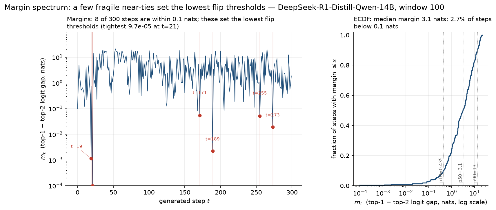

Unperturbed run only, $r=0$. **Left:** $m_t=\ell^{(1)}_t-\ell^{(2)}_t$ (nats) against generated step $t$; the six tightest gaps are marked with vertical ticks and labelled with $(t,m_t)$. **Right:** ECDF of the same 300 values on a log $x$ axis. The three labelled spikes below 0.003 nats ($t=21,19,189$) are the ties that later control almost every flip; the median is 3.10 nats, so the model is usually confident and rarely at a knife's edge. This figure is the *explanans* for everything downstream: thresholds $r_c^-=m\,r/\max(-\delta m,0)$ inherit their smallest values from the smallest margins.

## 1.2 `ds14_response_curves.png` — what the perturbation does through depth and time


Median over the 1000 directions of $\lVert\delta h_t^l\rVert/r$ (state displacement per unit radius; the division by $r$ makes runs at different radii comparable and is exact in the linear regime $r\in[0.03,0.3]$ measured in Part 0). One panel per saved state $l\in\{0,6,12,18,24,30,36,42,47\}$; the shaded band is the 10–90 percentile range over directions. State 0 (embedding output at generated positions) is identically zero — the perturbation touches only the 65 prompt positions, so nothing can appear at generated positions before the first attention mix. The response grows with depth (0.077 at state 6 → 0.65 at state 47, median-over-t values; see the table in the deep part) and is *bursty* in $t$: individual baseline tokens (e.g. $t=258$) act as amplifiers at the deep states.

## 1.3 `ds14_rc_ladder.png` — the threshold map, all 1000 directions at once


For every direction $u$ and step $t$: the signed radius $r_c^-(t,u)=m_t\,r/\max(-\delta m_t(u),0)$ at which step $t$ would flip. Directions are sorted by $r_*(u)=\min_t r_c^-$, so the interesting directions are at the top. Color is log $r_c^-$; the dashed contour marks $r_c^-=r=0.1$ — below it in a column means "this step flips at the run radius". The side histogram shows the distribution of $r_*$. Reading: the dark region below the contour is *column-shaped*, not point-shaped: a few steps ($t=21$, $t=19$) are below the line for hundreds of directions while most steps are above it for all — the flip structure is organised by step, not by direction.

## 1.4 `ds14_rstar_ecdf.png` — the flux-tube radius distribution

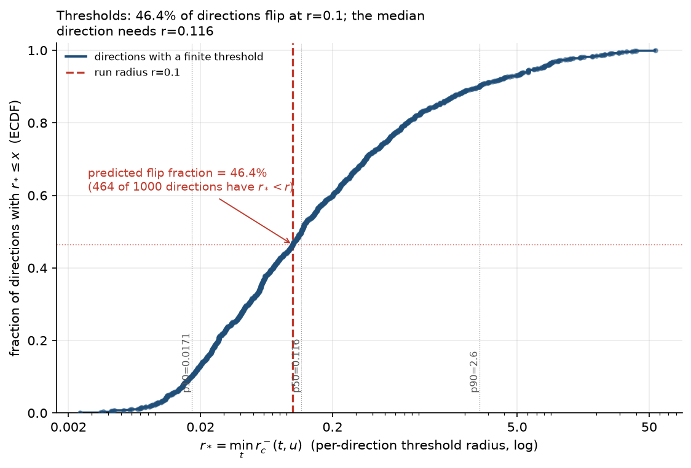

ECDF of $r_*(u)$ over the 1000 directions, log $x$; vertical line at the run radius $r=0.1$; annotation: 46.4% of directions have $r_*\le r$ (predicted to flip). $r_*$ quantiles: p10 $=0.0171$, p50 $=0.116$, p90 $=2.59$; 166 directions need $r>1$ to flip anything within 300 tokens. For comparison the 1.5B (20 directions, same protocol and prompt) had $r_*$ p50 $=1.56$ — the 14B's tube is an order of magnitude narrower, entirely because its thinnest margin is 207× thinner (Part 2).

## 1.5 `ds14_direction_gains.png` — directions are not equal, but not special either

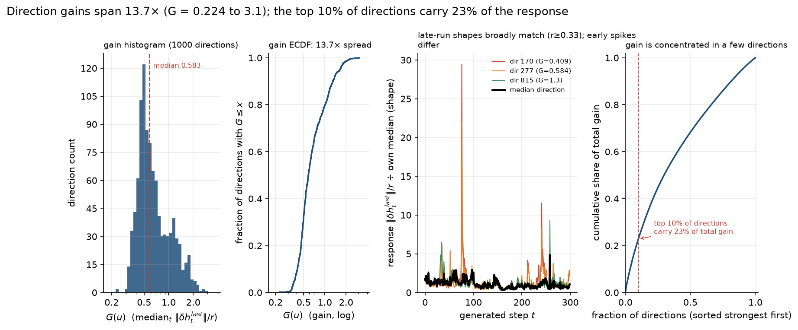

$G(u)=\mathrm{median}_t\lVert\delta h_t^{47}(u)\rVert/r$: histogram, log-ECDF, and three individual direction shapes normalised by their own medians (shapes agree to first order; they differ in amplitude by 13.7× from 0.224 to 3.06). The gain distribution is approximately log-normal in $G$. Whether a direction flips, however, is governed by its projection onto the logit-difference vector at the two razor-thin ties — the deep part shows this projection is only ~0.6% of $G$ and essentially independent across the ties.


> **Correction on the attention window (read this first).** Every 14B result in
> Parts 1 and 2 was produced before we discovered that transformers 4.5x gates
> the sliding window on a `layer_types` config field that stock Qwen2.5 configs
> never set. The intended `window=100` was therefore silently ignored: **these
> runs used full attention** (equivalent to W=4096 within the 365-token horizon).
> The data itself is valid and internally consistent (baseline and perturbed
> passes share the same attention pattern; the free-run validation matched it),
> but wherever a sentence below says "window 100" for the 14B, read "full
> attention". A rerun with the window genuinely active is in progress; its
> numbers will replace the affected comparisons. This also fully explains why
> the 14B shows no response surge at t=35 in Part 2: with full attention there
> is nothing to flush.


# Part A1-deep. One thousand directions on the 14B model: where the flips come from

## Summary

A single prompt of 65 tokens is sent through DeepSeek-R1-Distill-Qwen-14B in FP32, the model generates 300 tokens greedily, and then 1000 different unit perturbations of size $r=0.1$ are added to the prompt embeddings while the generated tokens are held fixed. For every direction and every generated step we record how much the top-1/top-2 logit gap would move; from that we compute the radius at which each step would flip. Almost half the directions (464 of 1000) would flip some token at $r=0.1$, but **all 464 flips are decided at only two generated steps, $t=21$ and $t=19$**, the two smallest logit gaps in the run. The directions that destroy the margin at $t=21$ are essentially unrelated to those that destroy it at $t=189$ (correlation $-0.14$), and the 24 stored response vectors are nearly orthogonal (mean cosine $+0.0025$). Consequently the direction's overall response strength $G$ is a weak predictor of its threshold radius (correlation $-0.18$): which razor-thin tie a direction happens to hit matters far more than how strong its hidden-state response is.

---

## 1. Exact setup, data, and every quantity defined

### 1.1 The run

| item | value |
|---|---|
| model | `DeepSeek-R1-Distill-Qwen-14B` (48 blocks, hidden size 5120) |
| precision | FP32, one precision for the whole run; TF32 disabled |
| decoding | greedy, fixed length, no sampling, no EOS stop |
| prompt | "Provide a comprehensive technical review of current and proposed propulsion systems for interstellar travel. Compare chemical rockets, nuclear propulsion, laser sails, antimatter drives, and other theoretical concepts in terms of energy requirements, achievable speeds, technological feasibility, and projected timelines for development. Include discussion of major projects in the history of the field." |
| prompt length | $P=65$ tokens |
| attention window | **full attention** (the window-100 setting was silently inactive; see the correction note above) |
| continuation | $T=300$ baseline greedy tokens, stored in `gen_ids` |
| directions | $K=1000$, built as 50 independent simplex blocks of 20 |
| direction geometry | each direction is a unit vector with 20 non-zero coordinates on the $65\times5120$ prompt-embedding matrix; blocks use disjoint coordinates, so cross-block directions are exactly orthogonal; within a block every pair has inner product $-1/19=-0.0526$ |
| radius | one radius $r=0.1$ (`radii=[0.1]`) |
| perturbation support | all 65 prompt positions (not the generated positions) |
| teacher forcing | every perturbed forward pass is run on the **baseline** `prompt_ids` + `gen_ids`; the continuation tokens are identical to the unperturbed run, so the measured $\delta m$ is the continuous response at each baseline step, not the trajectory after a divergence |
| baseline check | two identical rows in one batch produced bit-identical tokens (`baseline_duplicate_identical: true`) |
| saved states | hidden-state indices `[0, 6, 12, 18, 24, 30, 36, 42, 47]`; state 0 is the embedding output, state $l\ge1$ is the output of block $l-1$ (transformers convention), so state 47 is the output of block 46, not the final block. The final-norm/lm_head input was stored only as 24 difference vectors (`dh_last`, directions 0–23) |
| engine / environment | `run_a1_big`, torch 2.14.1+cu130, transformers 4.57.6, 1590.6 s wall time on `spark-d5eb` |
| file | `results_big/ds14/a1_inter_full/a1.npz` (+ `meta.json`) |

Because this run used full attention, the prompt stays visible at every generated step: the late-time response is direct prompt influence, attenuated only by the network's own mixing, not by any attention window cutting the prompt off.

### 1.2 Quantities used in this section

For a direction $u$ (row of `simplex`) and a generated step $t$:

| symbol | explicit expression | what it is | why this quantity |
|---|---|---|---|
| $m_t$ | $\ell_t^{(1)}-\ell_t^{(2)}$ | top-1 minus top-2 logit gap of the unperturbed greedy run (nats) | the only scalar that says how close the baseline decision is; a flip requires this gap to be closed |
| $\delta m_t(u)$ | $\ell_t'^{(1)}-\ell_t'^{(2)}-m_t$ at the perturbed forward pass (stored `dm`) | change of that gap under perturbation (nats) | the continuous response of the decision variable; it is measured without letting the trajectory diverge |
| $g_t(u)$ | $\lvert\delta m_t(u)\rvert/r$ | local sensitivity of the gap to radius (nats per unit radius) | converts a response into the radius needed to close the gap |
| $r_c^-(t,u)$ | $m_t\,r/\max(-\delta m_t(u),0)$, $+\infty$ if $\delta m_t\ge0$ | the radius at which step $t$ would flip, for direction $u$ | a flip needs $\delta m_t\le -m_t$; solving for the radius gives this expression |
| $r_*(u)$ | $\min_t r_c^-(t,u)$ | the direction's threshold radius (smallest radius that flips **some** token) | one number per direction; direction $u$ flips at the run radius iff $r_*(u)\le r$ |
| $t_*(u)$ | $\arg\min_t r_c^-(t,u)$ | the controlling step | identifies which near-tie is the weak point for this direction |
| $G(u)$ | $\mathrm{median}_t \lVert\delta h_t^{47}(u)\rVert/r$ | typical last-state response gain (per unit radius) | a robust, scalar measure of how strongly the direction moves the final stored state |
| $R_t^{l}(u)$ | $\lVert\delta h_t^{l}(u)\rVert/\lVert h_t^{l}\rVert$ | relative response at state $l$ | says what fraction of the residual stream is being displaced; the absolute norm alone grows with depth simply because the stream grows |
| $\cos_{ij}$ | $\langle \delta h_i,\delta h_j\rangle/(\lVert\delta h_i\rVert\lVert\delta h_j\rVert)$ | angle between two response vectors | tests whether all directions produce one common response mode (1-D geometry) or many |
| $r_*(u)G(u)$ | product of the two scalars above | collapse test for the naive scaling $r_*\sim m/G$ | if $\delta m_t$ at the controlling step were proportional to $G$, this product would be constant |

The signed threshold is essential. The engine's stored `r_c` array was computed with $\lvert\delta m\rvert$ (`run_a1_big.py`, line 212), not with $\max(-\delta m,0)$. Recomputing the signed version is not cosmetic: the unsigned definition calls **810** directions flips at $r=0.1$, including directions whose margin is *widened* and which cannot flip. The signed definition gives **464**. Every number below uses the signed definition.

### 1.3 The ten smallest gaps and who is controlled by them

| step $t$ | $m_t$ (nats) | directions with $t_*=t$ (all 1000) | of which flip at $r=0.1$ |
|---:|---:|---:|---:|
| 21 | $9.727\times10^{-5}$ | 503 | 421 |
| 19 | $1.144\times10^{-3}$ | 236 | 43 |
| 189 | $2.224\times10^{-3}$ | 146 | 0 |
| 273 | $1.916\times10^{-2}$ | 56 | 0 |
| 255 | $5.151\times10^{-2}$ | 8 | 0 |
| 171 | $5.393\times10^{-2}$ | 5 | 0 |
| 168 | $8.033\times10^{-2}$ | 1 | 0 |
| 205 | $8.067\times10^{-2}$ | 1 | 0 |
| 0 | $1.009\times10^{-1}$ | 5 | 0 |
| 247 | $1.121\times10^{-1}$ | 15 | 0 |

For reference the margin distribution is very skewed: median $m=3.096$ nats, mean $4.996$, minimum $9.727\times10^{-5}$ at $t=21$; 8 of 300 steps have $m<0.1$, 3 have $m<0.01$. The threshold radii are equally skewed: over all 1000 directions, $r_*$ has p10 $=0.0171$, median $=0.116$, p90 $=2.59$, maximum $55.5$. Among the 464 directions that flip, $r_*$ has median $0.0314$ (p10 $0.0112$, p90 $0.0770$, max $0.0995$); 536 directions have $r_*>0.1$ and 166 have $r_*>1$.

---

## 2. Figure `ds14_controlling_steps.png` — two steps decide every flip


**Setup.** Same run as §1.1 (DS-R1-14B, FP32, greedy, $P=65$, window 100, $T=300$, 1000 unit directions, $r=0.1$, teacher-forced on the baseline tokens). Panel (a) is a histogram of $t_*(u)$ over all 1000 directions; the light bars are all directions, the dark bars are the subset with $r_*(u)\le0.1$ (the directions that actually flip). Panel (b) restricts the $x$-axis to the ten smallest-margin steps and counts how many directions have that step as their controller.

**Axes.**
- (a) $x$: generated step $t$ (0 = first generated token); $y$: number of directions with $t_*(u)=t$.
- (b) $x$: the ten near-tie steps, with the value of $m_t$ printed on the second line; $y$: number of directions controlled by that step, log scale.

**What is in the figure.**
- There are 22 distinct controlling steps among 1000 directions, but only **2** among the 464 flipping directions.
- Top-3 overall: $t=21$ controls 503 directions (421 flips), $t=19$ controls 236 (43 flips), $t=189$ controls 146 (0 flips). These three account for $885/1000=88.5\%$ of all directions. The two flipping steps account for $464/464=100\%$ of the flips.
- The remaining 115 directions are spread over 19 steps, the largest being $t=273$ with 56 directions, $t=247$ with 15, $t=98$ and $t=255$ with 8 each.
- In panel (b), the bars are not monotone in $m_t$: $t=247$ ($m=0.112$) controls 15 directions while $t=255$ ($m=0.0515$) controls 8 and $t=171$ ($m=0.0539$) controls 5. A near-tie is a necessary condition for a small $r_*$, but the response at that step also has to point the right way.

**What the figure shows.** The weak points are shared: nearly every direction is limited by the same two tokens, $t=21$ and $t=19$. It is not the case that a thousand directions explore a thousand different decisions.

**What it does not show.** It does not show that the other eight near-ties are irrelevant for other radii or other prompts. At $r=0.1$ their $r_*$ is above the run radius, so they do not flip here; at a larger radius they would. The figure also says nothing about the free-run consequences of a flip (that requires the separate free-run validation).

---

## 3. Figure `ds14_sign_structure.png` — half destroy, half widen, and the two ties are independent

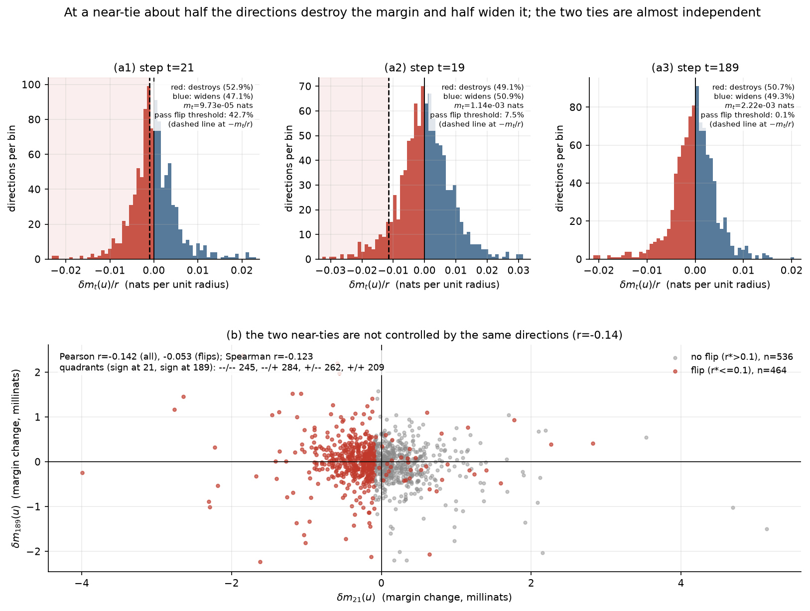

**Setup.** Same run. For each of the three most important controlling steps ($t=21,19,189$) the figure histograms the signed response $\delta m_t(u)/r$ over all 1000 directions. Red is $\delta m_t<0$ (the margin is being destroyed), blue is $\delta m_t\ge0$ (the margin is being widened; such a direction can never flip at that step). The dashed vertical line is $-m_t/r$: a direction to its left would flip **at** this step at radius $r=0.1$. The shaded region is that flip region. Panel (b) is a scatter of $\delta m_{21}$ against $\delta m_{189}$ in millinats (raw $\delta m$, no division by $r$).

**Axes.**
- (a1)–(a3) $x$: $\delta m_t(u)/r$ (nats per unit radius); $y$: directions per bin.
- (b) $x$: $\delta m_{21}(u)$ (millinats, $10^{-3}$ nats); $y$: $\delta m_{189}(u)$ (millinats).

**Numbers for the three histograms.**

| step | $m_t$ | $\delta m<0$ | $\delta m\ge0$ | pass $r_c^-\le0.1$ at this step | median $\delta m/r$ | p25 / p75 | p5 / p95 | median $g_t$ | median $g_t/G$ |
|---:|---:|---:|---:|---:|---:|---:|---:|---:|---:|
| 21 | $9.727\times10^{-5}$ | 52.9% | 47.1% | 42.7% | $-3.13\times10^{-4}$ | $-2.67\times10^{-3}$ / $+2.56\times10^{-3}$ | $-8.21\times10^{-3}$ / $+8.99\times10^{-3}$ | $2.61\times10^{-3}$ | $4.14\times10^{-3}$ |
| 19 | $1.144\times10^{-3}$ | 49.1% | 50.9% | 7.5% | $+2.33\times10^{-4}$ | $-4.65\times10^{-3}$ / $+5.11\times10^{-3}$ | $-1.40\times10^{-2}$ / $+1.40\times10^{-2}$ | $4.87\times10^{-3}$ | $7.47\times10^{-3}$ |
| 189 | $2.224\times10^{-3}$ | 50.7% | 49.3% | 0.1% | $-8.63\times10^{-5}$ | $-2.64\times10^{-3}$ / $+2.30\times10^{-3}$ | $-8.09\times10^{-3}$ / $+6.77\times10^{-3}$ | $2.48\times10^{-3}$ | $5.23\times10^{-3}$ |

The sign split is close to 50/50 at all three steps. The distributions are centered near zero and are symmetric to within a few percent. At $t=21$ the median absolute response is only $3.1\times10^{-4}$ nats per unit radius, i.e. **about 16 times smaller than the median response at $t=19$** ($4.9\times10^{-3}$) and **about 1900 times smaller than the median gain $G$** ($0.583$). The gap at $t=21$ is so thin that even this tiny projection is enough to close it.

The “pass” column is not the same as the “$\delta m<0$” column. At $t=21$, 52.9% of directions decrease the gap but only 42.7% decrease it by at least $m_t$; the remaining 10.2% move it by less than $9.7\times10^{-5}$ nats and do not flip at $r=0.1$. At $t=19$ the corresponding fraction passing is 7.5%; at $t=189$ it is 0.1%.

**Among the flipping subset.** At $t=21$, 92.45% of the 464 flipping directions have $\delta m_{21}<0$ (the other 7.55% are controlled at $t=19$ and are margin-widening at 21). At $t=19$ only 50.4% are negative, and at $t=189$ 47.2%; those two steps are not the controllers for most flips.

**Panel (b): are the two near-ties the same direction geometry?** No.

| pair | Pearson (all) | Spearman (all) | Pearson (flips) | Spearman (flips) |
|---|---:|---:|---:|---:|
| 21 vs 189 | $-0.142$ ($p=6.8\times10^{-6}$) | $-0.123$ | $-0.053$ | $-0.092$ |
| 21 vs 19 | $+0.072$ | $-0.032$ | $-0.176$ | $-0.207$ |
| 19 vs 189 | $-0.047$ | $-0.030$ | $-0.027$ | $-0.021$ |

Quadrant counts for 21 vs 189 (all directions): $(-,-)$ 245, $(-,+)$ 284, $(+,-)$ 262, $(+,+)$ 209 — essentially uniform. The 21-vs-189 correlation is statistically detectable because $n=1000$, but it explains only $0.02$ of the variance ($r^2=0.020$). The 21-vs-19 correlation even changes sign between all directions and the flipping subset. The two near-ties are not controlled by one shared direction geometry: a direction that suppresses the margin at 21 has essentially a 50/50 chance of widening it at 189.

**Why this quantity.** The signed response is the right object because a flip is one-sided: only $\delta m_t\le -m_t$ can flip, so the sign is part of the definition, not a nuisance. A histogram of $\lvert\delta m_t\rvert$ would hide the almost perfect 50/50 split and would make the direction set look uniformly dangerous when half of it is protective.

**What the figure does not show.** It does not show which directions flip in a free run after the first divergence, and it does not resolve the $t=21$ threshold visibly on the plotted scale: the dashed line sits at $-9.7\times10^{-4}$ per unit radius, only about one bin from zero. The printed “pass 42.7%” is the reliable number for that threshold.

---

## 4. Figure `ds14_gain_structure.png` — strong, broadly spread, and nearly orthogonal responses

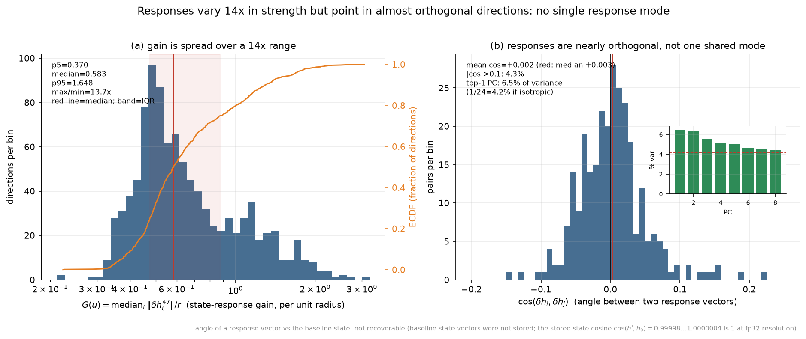

**Setup.** Same run. Panel (a) uses all 1000 directions and the state-47 response norm at every step; panel (b) uses the 24 directions (0–23) for which the full final-norm difference vectors were stored.

**Definitions for this figure.**
- $G(u)=\mathrm{median}_t\lVert\delta h_t^{47}(u)\rVert/r$. State 47 is the deepest stored hidden state (output of block 46, per the transformers index convention). The median is over the 300 generated steps.
- $\mathrm{median\ step}$ $t_{\rm med}(u)=\arg\min_t\bigl\lvert\lVert\delta h_t(u)\rVert-\mathrm{median}_{t'}\lVert\delta h_{t'}(u)\rVert\bigr\rvert$: the step whose response norm is closest to the direction's median norm. The 24 vectors are compared at their own median step.
- $\cos_{ij}$: cosine between the final-norm difference vectors of directions $i$ and $j$ at their median steps.

**Gain numbers (all 1000 directions).**

| statistic | $G(u)$ |
|---|---:|
| min | 0.224 |
| p5 | 0.370 |
| p25 | 0.475 |
| median | 0.583 |
| p75 | 0.877 |
| p95 | 1.648 |
| max | 3.064 |
| max/min | 13.7× |

The distribution is approximately log-normal (log10 $G$ has mean $-0.181$, std $0.195$). For comparison, the **arithmetic mean over $t$** has median 0.815 (1.40× the median of $G$), and the **maximum over $t$** has median 8.44 (14.5× the median of $G$). The mean and max are dominated by token-locked response bursts (§5), which is why $G$ uses the median. This is a deliberate choice: the mean would rank directions by whether they happen to sit on a burst token, not by their typical strength.

**The 24 stored vectors.** Their norms at the median step have median $1.528\times10^{-2}$ (p5 $1.05\times10^{-2}$, p95 $4.14\times10^{-2}$). Pairwise cosine over all $\binom{24}{2}=276$ pairs:

| statistic | pairwise $\cos_{ij}$ |
|---|---:|
| mean | $+0.0025$ |
| median | $+0.0026$ |
| p5 | $-0.062$ |
| p25 | $-0.028$ |
| p75 | $+0.025$ |
| p95 | $+0.081$ |
| min | $-0.147$ |
| max | $+0.222$ |
| fraction with $\lvert\cos\rvert>0.1$ | 4.3% |

The responses are nearly orthogonal. The first principal component explains 6.5% of the variance, versus 4.17% expected for 24 isotropic vectors; the first eight PCs are 6.5, 6.3, 5.5, 5.2, 5.1, 4.6, 4.6, 4.5%. The cosine of each response vector to the pooled mean response has median 0.196, essentially the isotropic value $1/\sqrt{24}=0.204$. There is at most a faint common component, not a shared 1-D mode.

Within-block and cross-block responses are statistically indistinguishable: directions 0–19 share the same input subspace (their input-space cosines are $-1/19=-0.053$) but their response cosines average $+0.0025$; directions 20–23 are input-orthogonal to block 0 and their response cosines to it average $+0.0033$. The network does not preserve the input block geometry, and it does not collapse all responses onto one axis.

The response vectors are also only partly coherent in time: the median cosine between $\delta h_t$ and $\delta h_{t+1}$ is 0.317 (mean 0.329), at lag 10 it is 0.090 (mean 0.109), and at lag 50 it is 0.061 (mean 0.080). Adjacent steps share about a third of their direction; by ten steps the memory of the direction is mostly gone.

**The requested response-vs-baseline-state angle is not recoverable from this dump.** The run stored baseline state **norms** (`norm_h0`), not baseline state **vectors**, and it stored the cosine between the perturbed state and the baseline state, $\cos(h',h_0)$. That state cosine is $0.99998\ldots1.0000004$ (median exactly 1.0; 49.9% of entries are exactly 1.0 in float32). With $\lVert\delta h\rVert/\lVert h_0\rVert\sim10^{-4}$, the true angle would change $\cos(h',h_0)$ by only $\sim10^{-8}$, below the float32 resolution of the stored array. Recovering $\theta(\delta h,h_0)$ from these numbers is therefore impossible, not merely noisy. What can be said from the stored state cosine is that the perturbed state differs from the baseline state in direction by at most $\sqrt{2(1-\cos)}\approx0.007$ rad, which is an upper bound on the total rotation, not the angle of the response. A future run that stores the 5120-dimensional baseline vectors would make the requested quantity measurable. The substitute used here is the pairwise response cosine, which answers the more important question for this project: whether the geometry is effectively 1-D.

**What the figure shows.** Strength varies by a factor 13.7, but direction is almost uniformly distributed on the sphere: the responses are not copies of one another and there is no single “perturbation mode.” A scalar gain is therefore an incomplete description of a direction, and one should expect directions with similar $G$ to have very different effects on any particular logit gap.

**What it does not show.** It does not measure the response angle relative to the baseline state (not stored), and 24 directions are a small sample: 20 come from block 0 and 4 from block 1, so the cross-block comparison rests on 80 pairs. The PCA spectrum is estimated from 24 vectors and cannot resolve a common component much below 4%.

---

## 5. Figure `ds14_shape_by_layer.png` — depth grows the response; the relative response shrinks

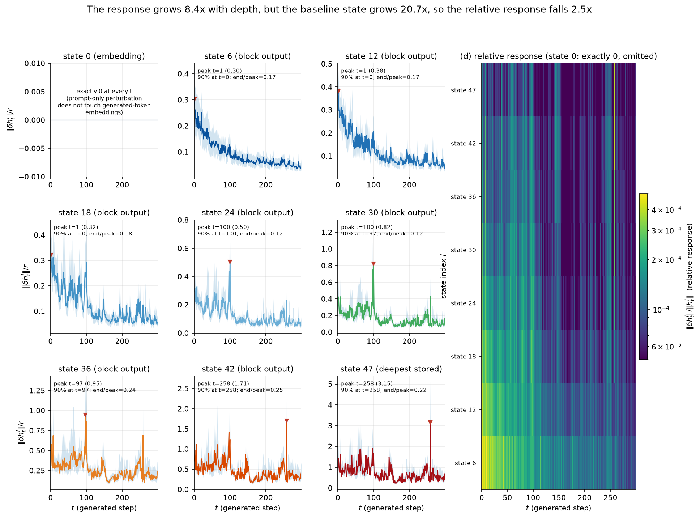

**Setup.** Same run, all 1000 directions. Each of the nine small panels is one stored hidden state $l\in\{0,6,12,18,24,30,36,42,47\}$. The solid line is the median over directions of $\lVert\delta h_t^l(u)\rVert/r$ at each step; the band is the interquartile range over directions. The right panel is a heatmap of the median **relative** response $\lVert\delta h_t^l(u)\rVert/\lVert h_t^l\rVert$ for the eight non-zero states, with a log color scale.

**Axes.**
- Small panels: $x$ = generated step $t$ (0–299); $y$ = $\lVert\delta h_t^l\rVert/r$ (state-response norm per unit radius). Free $y$ range per panel.
- Right panel: $x$ = step $t$; $y$ = state index $l$; color = $\lVert\delta h_t^l\rVert/\lVert h_t^l\rVert$ (dimensionless, log scale 5e-5 to 5e-4).

**State 0 is exactly zero.** At $l=0$ the state of a *generated* token is its token embedding; the perturbation is added only to the 65 *prompt* embeddings, so the generated-token embedding is untouched at every $t$. The array `dh_norm[:,0,:]` is exactly 0.0 for all $1000\times300$ entries (checked; max absolute value 0). This is a structural zero, not a small number. The response first appears at state 6, after attention has mixed prompt information into the generated positions.

**Per-layer numbers (median over directions).**

| state $l$ | median $G$-like gain | abs at $t=0$ | $t=10$ | $t=50$ | $t=100$ | $t=258$ | $t=299$ | peak of median curve | end/peak | median relative response |
|---:|---:|---:|---:|---:|---:|---:|---:|---:|---:|---:|
| 0 | 0 | 0 | 0 | 0 | 0 | 0 | 0 | — | — | 0 |
| 6 | 0.0775 | 0.286 | 0.194 | 0.137 | 0.0815 | 0.0473 | 0.0521 | $t=1$, 0.301 | 0.17 | $1.53\times10^{-4}$ |
| 12 | 0.101 | 0.359 | 0.266 | 0.184 | 0.133 | 0.0596 | 0.0663 | $t=1$, 0.380 | 0.17 | $1.23\times10^{-4}$ |
| 18 | 0.100 | 0.321 | 0.281 | 0.176 | 0.292 | 0.125 | 0.0564 | $t=1$, 0.321 | 0.18 | $1.08\times10^{-4}$ |
| 24 | 0.110 | 0.297 | 0.253 | 0.183 | 0.502 | 0.230 | 0.0584 | $t=100$, 0.502 | 0.12 | $9.72\times10^{-5}$ |
| 30 | 0.151 | 0.322 | 0.253 | 0.242 | 0.824 | 0.429 | 0.100 | $t=100$, 0.824 | 0.12 | $8.75\times10^{-5}$ |
| 36 | 0.250 | 0.486 | 0.334 | 0.318 | 0.864 | 0.692 | 0.227 | $t=97$, 0.946 | 0.24 | $8.11\times10^{-5}$ |
| 42 | 0.428 | 0.767 | 0.561 | 0.451 | 1.242 | 1.707 | 0.425 | $t=258$, 1.707 | 0.25 | $7.85\times10^{-5}$ |
| 47 | 0.653 | 1.143 | 0.865 | 0.631 | 1.682 | 3.150 | 0.688 | $t=258$, 3.150 | 0.22 | $6.18\times10^{-5}$ |

**Depth scaling.** The typical gain rises from 0.0775 at state 6 to 0.653 at state 47, a factor **8.43**. The peak of the median curve rises from 0.301 to 3.150, a factor 10.5. The baseline state norm, however, rises much faster:

| state | 0 | 6 | 12 | 18 | 24 | 30 | 36 | 42 | 47 |
|---|---:|---:|---:|---:|---:|---:|---:|---:|---:|
| median $\lVert h_t^l\rVert$ | 1.52 | 51.5 | 84.0 | 93.6 | 114.3 | 175.2 | 311.5 | 549.8 | 1067.3 |

That is why the relative response *falls*: median relative response goes from $1.53\times10^{-4}$ at state 6 to $6.18\times10^{-5}$ at state 47, a factor **2.47**. The residual stream grows roughly $1067/51.5=20.7\times$ over the same range while the response grows only $8.4\times$.

Both normalizations are necessary. The absolute norm is what the logits see: the margin change is $\delta m_t=\delta h_t^{\rm final}\cdot(W_{[{\rm top1}]}-W_{[{\rm top2}]})$, so a larger absolute response can move a gap more. The relative norm says what fraction of the state is being displaced, i.e. whether the response is a small perturbation of a growing stream or a large one. At state 47 the displacement is $\sim6\times10^{-5}$ of the state norm: tiny in relative terms, yet $0.65$ units of absolute norm per unit radius, enough to matter because the logit-gap direction is even more sensitive.

**There is no simple rise–peak–decay in time.** The response is largest at $t=0$–$1$ for states 6–18 (the first generated position sees the most direct prompt influence), then decays. At deeper states the largest values move to token-locked bursts: $t=258$ at states 42 and 47, $t=97$–$100$ at states 24–36, and $t=58,39,26$ in individual directions. At state 47 the median curve is 1.143 at $t=0$, 0.631 at $t=50$, 1.682 at $t=100$, **3.150 at $t=258$**, and 0.688 at $t=299$. The peak step of the median curve therefore moves from $t=1$ (states 6–18) to $t=97$–$100$ (states 24–36) to $t=258$ (states 42–47). Per direction, the last-state maximum occurs at $t=258$ for 109/1000 directions, $t=58$ for 62, $t=39$ for 60, $t=97$ for 48, $t=26$ for 45; the rest are spread over many tokens.

This is why the “rise time” is not a fixed transient: the response amplitude is a property of the *baseline token* as much as of the layer. The same perturbation produces a 14.5× larger response at its best token than at its median token. Any single “response time” or “decay time” would be an artifact of averaging over token content.

**Why the heatmap.** Plotting eight relative curves on one axis produced an unreadable band because the curves differ by an order of magnitude and all contain sharp token spikes. The heatmap keeps the same information (state × step) and makes the two trends visible at once: an early bright region that fades with depth, and a bright vertical stripe at $t=258$ that appears only at the deepest states.

**What the figure does not show.** It does not separate “the perturbation is decaying” from “the prompt has left the 100-token attention window”; both happen together after $t\approx35$. It also does not show the final-norm response for all 1000 directions (only state 47 is stored for all; the final norm only for 24). And the small panels are medians over directions: a single direction can have a peak anywhere, as the per-direction peak counts show.

---

## 6. Figure `ds14_rstar_vs_gain.png` — the tie, not the gain, sets the threshold


**Setup.** Same run. Panel (a) is a log–log scatter of $r_*(u)$ against $G(u)$ for the 834 directions with finite $r_*<1$ (166 directions have $r_*>1$; the threshold is above 1 and is not shown). Points are colored by the controlling step. The dashed lines are $r_*=c_t/G$ fitted separately inside each controlling-step group, with $c_t=\mathrm{median}(r_*G)$ for that group. The dotted line is the naive analytic guess $r_*=m_{\min}/G$ with the global minimum margin $m_{\min}=9.727\times10^{-5}$. Panel (b) is a box plot of $r_*G$ grouped by controlling step, with the number of directions in each group.

**Axes.**
- (a) $x$: $r_*(u)=\min_t r_c^-(t,u)$ (threshold radius, log); $y$: $G(u)$ (median state-response gain, log).
- (b) $x$: controlling step $t_*$; $y$: $r_*(u)G(u)$ (nats, log). A horizontal dashed line marks the median over all 834 directions.

**Deriving the scaling.** A step flips when
$$m_t+\delta m_t\le0 \quad\Longleftrightarrow\quad \lvert\delta m_t\rvert\ge m_t\ (\delta m_t<0).$$
With $\delta m_t(u)=r\,g_t(u)$ and $g_t(u)=\lvert\delta m_t(u)\rvert/r$,
$$r_c^-(t,u)=\frac{m_t}{g_t(u)}.$$
If the local sensitivity at the controlling step were proportional to the global gain, $g_{t_*}(u)=\beta_{t_*}\,G(u)$, then
$$r_*(u)=\frac{m_{t_*(u)}}{\beta_{t_*(u)}\,G(u)},$$
so $r_*G=m_{t_*}/\beta_{t_*}$ should be constant **within** a group of directions sharing $t_*$, and should change across groups whenever $m_{t_*}$ or $\beta_{t_*}$ changes. This is the correct statement of the “$r_*\sim m/G$” intuition; the naive version with one global $m$ assumes that every direction is controlled by the same tie, which is false.

**Global correlation.** Over 834 directions,
$$\mathrm{Pearson}\bigl(\log r_*,\log G\bigr)=-0.176\quad(p=3.1\times10^{-7}),\qquad
\mathrm{Spearman}=-0.132.$$
So the raw correlation is weak, negative, and statistically detectable only because $n$ is large; $G$ explains about 3% of the variance in $r_*$. By contrast, $\mathrm{Pearson}(\log r_*,\log m_{t_*})=+0.742$ ($r^2=0.551$). A multiple regression
$$\log r_*=2.863+0.695\log m_{t_*}-0.687\log G$$
has $R^2=0.610$: the margin of the controlling tie carries most of the explanatory power, and $G$ enters with a negative coefficient of the expected order ($-0.69$).

**Within-group behavior.** Inside a fixed controlling step, the slope of $\log r_*$ versus $\log G$ should be near $-1$ if $g_{t_*}\propto G$. It is:

| $t_*$ | $n$ | Pearson$(\log r_*,\log G)$ | slope | median $r_*G$ | p25–p75 of $r_*G$ | median $g_{t_*}/G$ |
|---:|---:|---:|---:|---:|---:|---:|
| 21 | 503 | $-0.365$ ($p=2.9\times10^{-17}$) | $-0.806$ | 0.0222 | 0.0128–0.0446 | $4.37\times10^{-3}$ |
| 19 | 236 | $-0.302$ ($p=2.3\times10^{-6}$) | $-0.684$ | 0.1247 | 0.0718–0.2217 | $9.18\times10^{-3}$ |
| 189 | 146 | $-0.545$ ($p=1.2\times10^{-12}$) | $-0.978$ | 0.4250 | 0.3000–0.6926 | $5.23\times10^{-3}$ |
| 273 | 56 | $-0.591$ ($p=1.7\times10^{-6}$) | $-1.213$ | 1.7771 | 1.039–3.222 | $1.08\times10^{-2}$ |
| 247 | 15 | $-0.474$ ($p=0.074$) | $-2.447$ | 3.5006 | 2.442–4.416 | $3.20\times10^{-2}$ |
| 255 | 8 | $-0.515$ ($p=0.191$) | $-0.470$ | 4.0585 | 3.349–5.380 | $1.29\times10^{-2}$ |
| 98 | 8 | $-0.317$ ($p=0.444$) | $-0.627$ | 9.2162 | 5.638–10.508 | $5.22\times10^{-2}$ |
| 0 | 5 | $-0.759$ ($p=0.137$) | $-1.370$ | 7.9259 | 6.215–8.974 | $1.27\times10^{-2}$ |
| 171 | 5 | $-0.823$ ($p=0.087$) | $-1.670$ | 12.5128 | 8.392–14.142 | $4.31\times10^{-3}$ |

Within the four large groups the slope is between $-0.68$ and $-1.21$, i.e. close to the predicted $-1$; the correlation is weak but real because the local sensitivity $g_{t_*}$ has its own spread at fixed $G$. Across groups the median $r_*G$ goes from 0.0222 to 12.51, a factor **563**. That is the collapse failure: the product is not a universal constant. The naive $m_{\min}/G$ line is below the data by a median factor of **513**.

**The product distribution.** Over 834 directions, $r_*G$ has p5 $=0.00826$, p25 $=0.0184$, median $=0.0499$, p75 $=0.152$, p95 $=0.480$; log-standard-deviation 1.295, coefficient of variation 1.43, p95/p5 $=58$. This is not a constant.

**Where the extra factor comes from.** The local sensitivity at the controlling step is much smaller than the median state gain:
$$g_{t_*}(u)=\frac{\lvert\delta m_{t_*}(u)\rvert}{r},\qquad
\frac{g_{t_*}}{G}: \text{median }5.996\times10^{-3}\ (p5\ 9.13\times10^{-4},\ p95\ 2.50\times10^{-2}).$$
The median local sensitivity is $3.80\times10^{-3}$ nats per unit radius, about 0.6% of the median $G=0.583$. The correlation between $\log g_{t_*}$ and $\log G$ is only $+0.317$ (slope 0.77), so a strong direction is somewhat more effective at the tie, but only weakly. The reason is geometric: $G$ measures the norm of the full 5120-dimensional response, while $\delta m_t$ measures its projection onto one particular direction $W_{[\text{top1}_t]}-W_{[\text{top2}_t]}$. A direction can be strong overall and nearly orthogonal to that logit-difference vector, or weak overall and well aligned with it. The near-tie step $t=21$ is precisely such a case: its local gain is $2.61\times10^{-3}$, one of the smallest of the ten near-ties.

**Why this quantity.** The product $r_*G$ is the natural test of the hypothesis that “one scalar gain controls the threshold.” It is not a normalization chosen to make the data collapse; it is what the algebra predicts if $\delta m_t\propto G$. Showing that it fails by 563× across ties, while working approximately inside a tie, is the cleanest way to separate the two effects.

**What the figure shows.** (i) Within a tie, stronger directions do have smaller thresholds, with a slope near $-1$. (ii) Across ties, the margin $m_{t_*}$ dominates: a direction controlled by the $9.7\times10^{-5}$ tie has a threshold $\sim500$ times smaller than a direction of the same gain controlled by the $5\times10^{-2}$ tie. (iii) A single global $r_*\sim m/G$ law with one $m$ is wrong by two to three orders of magnitude.

**What it does not show.** It does not prove that the local sensitivity is unrelated to $G$ at every step; it shows the relation is weak at the controlling steps of this run. It does not include the 166 directions with $r_*>1$, where the linear extrapolation is farthest from the measured radius. And the within-group slopes are themselves uncertain for the small groups ($n\le15$), where the $p$-values are not significant.

---

## 7. What is established, and what is a limitation

**Direct findings.**
1. At $r=0.1$, 464/1000 directions flip some token; all 464 are controlled by $t=21$ (421) or $t=19$ (43). No other step produces a flip at this radius.
2. The three smallest-gap steps account for 88.5% of all controlling assignments (503 + 236 + 146 of 1000).
3. The signed response at a near-tie is almost symmetrically split: 52.9% destroy / 47.1% widen at $t=21$, 49.1%/50.9% at $t=19$, 50.7%/49.3% at $t=189$.
4. The responses at $t=21$ and $t=189$ are nearly independent across directions (Pearson $-0.142$; quadrants 245/284/262/209). There is no single “danger direction” shared by the two ties.
5. The state-response gain spans 13.7× (0.224–3.064, median 0.583), and the 24 stored response vectors are nearly orthogonal (mean cosine $+0.0025$; top PC 6.5%). The geometry is not 1-D.
6. The response grows 8.43× from state 6 to state 47 in absolute terms, but the relative response falls 2.47× because the baseline state norm grows 20.7×. State 0 is exactly zero.
7. Inside a controlling-step group, $\log r_*$ vs $\log G$ has slope $-0.68$ to $-1.21$; across groups the product $r_*G$ spans 563×. The controlling margin, not $G$, is the leading determinant of $r_*$ ($r^2=0.551$ alone; 0.610 with $G$).
8. The local logit-gap sensitivity at the controlling step is only $\sim0.6\%$ of the median state gain (median $g_{t_*}/G=6.0\times10^{-3}$), i.e. the decision direction is close to orthogonal to the typical response.

**Limitations of this dump, stated explicitly.**
- The engine's stored `r_c`/`pred_T` use $\lvert\delta m\rvert$ and overcount flips (810 vs 464). Use the signed recomputation.
- The response angle relative to the baseline state cannot be computed: only baseline norms and the state cosine were stored. The state cosine is 1 at float32 precision.
- $G$ uses state 47 (output of block 46), not the final-norm input that actually feeds the logits. For the 24 directions where both exist, $G_{47}/G_{\rm final}=4.06$ (p5 3.74, p95 4.20) with log-correlation 0.996; the proxy is a nearly constant rescaling, which is adequate for rankings and for the $r_*$ regression, but its absolute value should not be compared to final-norm numbers.
- Only one radius ($r=0.1$) was run. The threshold formula extrapolates linearly; the calibration run showed proportionality in $r\in[0.03,0.3]$, so the extrapolation to $r\sim0.002$–$0.05$ is an assumption, not a measurement.
- Teacher forcing holds the continuation fixed. The measured $\delta m_t$ is the response at each baseline step, before any divergence. It does not include the feedback of an already-flipped token.
- The 24 response vectors cover directions 0–23 only (20 from block 0, 4 from block 1). The pairwise-cosine result is a 24-dimensional sample of a 1000-dimensional ensemble.
- This run used full attention (see the correction note), so no part of the decay is attributable to the prompt leaving an attention window. The true-window run will separate that effect.

All numbers in this section are in `notebook_big/figures/ds14_a1_deep_numbers.json`; the figures are produced by `scripts_spark/figs_a1_deep.py` from `results_big/ds14/a1_inter_full/a1.npz` and `meta.json`.


---

# Part cross-scale. DeepSeek-R1-Distill-Qwen-1.5B vs -14B under one protocol

## Summary

> Same correction note as Part 1: the 14B numbers here are full-attention runs (window inactive). Everything except the flush-ratio row is a same-prompt, same-radius comparison and stands as stated; the flush row is explained by the missing window, and the margin comparison is partially confounded by the window regime (on the 1.5B the window is known to change the margin spectrum). The true-window 14B rerun will close both gaps.

Two models of the same family — 28 layers with $d=1536$, and 48 layers with $d=5120$, roughly eight times the parameters — generate 300 greedy tokens from the identical 65-token prompt with an attention window of 100, and then the same kind of prompt-embedding perturbation (a unit direction times $r=0.1$) is applied and the continuation is teacher-forced. The larger model's decisions are far more fragile: its median top-1/top-2 logit gap is 3.10 nats against 4.78 for the small one, and its thinnest gap (9.7e-5 nats at step 21) is 207 times thinner than the small model's thinnest (2.0e-2 nats at step 123). As a consequence the radius at which a random direction first flips a token — a "flux-tube radius", the largest perturbation size along that direction that leaves the greedy continuation intact — is 13 times smaller in the 14B (median 0.116 vs 1.55 in absolute embedding units, 17 times smaller after dividing by the token-embedding scale), and 464 of 1000 directions flip something at the run radius against 0 of 20. The response itself is *not* stronger in the bigger model: per unit radius its last-state displacement is 2.3 times smaller in absolute units and 4.6 times smaller relative to the state it lives in, so the fragility is a property of how close the decisions are, not of how hard the perturbation pushes. Two shape features do differ: only the 1.5B shows a window-flush surge at $t=35$ (its last state jumps 1.70x across it, the 14B's 1.11x), and the 1.5B's response decays to 19% of its early level by $t=200$ while the 14B's is still at 68% — though that second difference is partly textual, because the small model falls into a repeating four-token loop at $t=143$ and the large one does not.

---

## 1. The two runs and every quantity

### 1.1 Setup

| item | 1.5B | 14B |
|---|---|---|
| model | `DeepSeek-R1-Distill-Qwen-1.5B` | `DeepSeek-R1-Distill-Qwen-14B` |
| blocks / hidden size | 28 / 1536 | 48 / 5120 |
| precision | FP32 | FP32 |
| prompt | `interstellar_travel`, "Provide a comprehensive technical review of current and proposed propulsion systems for interstellar travel. …" | same, **token-identical** (`prompt_ids` compare equal) |
| prompt length | $P=65$ | $P=65$ |
| attention window | $W=100$ (active, transformers 4.50 on x11) | **full attention** (window setting inactive; see the correction note) |
| continuation | $T=300$ greedy tokens, model's own | $T=300$ greedy tokens, model's own |
| decoding | greedy, no sampling, no EOS stop | same |
| perturbation | prompt embeddings only, unit direction $u$ times $r$, 20 non-zero coordinates | same construction |
| directions | $K=20$, **one** simplex block of 20 | $K=1000$, 50 independent blocks of 20 |
| radius used | $r=0.1$ (index 4 of `radii=[1e-3 … 2]`) | $r=0.1$ (the only radius) |
| teacher forcing | all $K$ perturbed passes reuse baseline `prompt_ids`+`gen_ids` | same |
| saved states | layer indices `[0,1,2,3,7,14,21,27]` (state 0 = embedding, 27 = input to final norm) | `[0,6,12,18,24,30,36,42,47]` (47 = input to final norm) |
| `dh_last` vectors | 3 directions (0–2), 1536-d, last state | 24 directions (0–23), 5120-d, last state |
| file | `chaos_llm_2026/results/local_data/w100_layers/a1.npz` (read-only) | `results_big/ds14/a1_inter_full/a1.npz` + `meta.json` |

Two things the table makes explicit. (i) The **prompt is identical but the continuation is not**: the two models generate different tokens, so "$t=21$" is the 22nd token of a different text in each run. Comparable across models are the protocol, the *distribution* of margins over steps, and the flush step $t^*=W-P=35$ (which follows from the mask, not from the tokens). (ii) The **direction sets are not equally rich**: the 1.5B samples one 20-dimensional input subspace, the 14B samples fifty, and cross-block directions in the 14B are exactly orthogonal while within-block pairs have inner product $-1/19$. An ECDF over 20 directions is a 20-step staircase; an ECDF over 1000 is smooth. That is a sampling-precision difference, not a bias, but it is why the 1.5B curves look coarse.

*Note on a quoted number.* The analysis brief quotes a 14B median margin of 1.68 nats. The `margins` array in this npz has median **3.096** (mean 4.996, p10 0.435, min $9.727\times10^{-5}$). I could not reproduce 1.68 from the array (median of the 100 smallest margins is 0.686, of the 20 smallest 0.116, of steps $t<100$ is 4.558). Everything below uses 3.096, which is also the value used in `section_a1_deep.md`. The quoted minima (9.7e-5 at $t=21$, and 2.0e-2 at $t=123$ for the 1.5B) reproduce exactly.

### 1.2 Quantities

Notation: $u$ indexes a direction, $t\in\{0,\dots,299\}$ a generated step, $\ell^{(1)}_t,\ell^{(2)}_t$ the top two logits of the unperturbed run, $h_t^{\ell}$ the unperturbed state at saved index $\ell$, $\delta h_t^{\ell}$ the same state under the perturbation.

| symbol | explicit expression | meaning | why this quantity |
|---|---|---|---|
| $m_t$ | $\ell^{(1)}_t-\ell^{(2)}_t$ | top-1 minus top-2 logit gap of the unperturbed continuation (nats) | the only scalar that says how close the baseline decision is; a flip needs this gap closed |
| $\delta m_t(u)$ | $m_t(u)-m_t$ at the perturbed pass, stored `dm` (nats) | change of that gap under direction $u$ at radius $r$ | response of the decision variable, measured without letting the text diverge |
| $r^-_c(t,u)$ | $m_t\,r/\max(-\delta m_t(u),0)$, $+\infty$ if $\delta m_t\ge0$ | radius at which step $t$ would flip under direction $u$ | solving $-\delta m_t\ge m_t$ for the radius, and only $\delta m_t<0$ can close the gap |
| $r_*(u)$ | $\min_t r^-_c(t,u)$ | **flux-tube radius**: largest $r$ along $u$ that keeps every baseline argmax | one number per direction, comparable across models and radii (linearity) |
| $t_*(u)$ | $\arg\min_t r^-_c(t,u)$ | controlling step | says which near-tie is the weak point |
| $s_{\rm emb}$ | $\mathrm{median}_t\lVert h_t^{0}\rVert$ | median token-embedding norm (layer-0 state norm) | converts $r$ into "fraction of a token vector"; the perturbation is added at this layer |
| $s_{\rm last}$ | $\mathrm{median}_t\lVert h_t^{\ell_{\max}}\rVert$ | median norm of the last saved state | what the network actually carries at the read-out depth |
| $G(u)$ | $\mathrm{median}_t\lVert\delta h_t^{\ell_{\max}}\rVert/r$ | absolute per-direction gain (state units per unit radius) | robust scalar response strength |
| $G_{\rm rel}(u)$ | $\mathrm{median}_t\lVert\delta h_t^{\ell_{\max}}\rVert/\lVert h_t^{\ell_{\max}}\rVert$ | relative gain (dimensionless) | the only gain comparable across models with different stream norms |
| $\rho(u)$ | $G(u)/s_{\rm emb}$ | gain per unit radius in embedding-scale units | second normalization, used as a robustness check |

Both $r_*$ and $G$ are computed from the **signed** threshold ($\delta m<0$ only). The npz's own `r_c` array was built with $|\delta m|$; using it would call 810/1000 directions flips in the 14B instead of 464. The recomputation is three lines and is the difference between a physically meaningful threshold and a symmetric one.

### 1.3 What is, and is not, comparable across scales

This is the part where a cross-scale comparison can quietly go wrong, so it is worth being explicit.

1. **$r$ itself is comparable by construction.** A direction is a unit vector in $\mathbb{R}^{65\times d}$ with 20 non-zero entries; the perturbation is $r\,u$ scattered into the prompt embedding matrix. Its Euclidean norm is exactly $r$ in both runs, and it is spread over the same number of coordinates (20). So $r=0.1$ is the same *absolute* perturbation in both models. Raw $r_*$ is therefore already a meaningful comparison: "the perturbation size at which the greedy continuation first breaks".
2. **But the embedding scale is not identical.** $s_{\rm emb}=1.206$ (1.5B) vs $1.516$ (14B): the 14B's token vectors are 26% longer, so $r=0.1$ is $0.083\,s_{\rm emb}$ in the 1.5B and $0.066\,s_{\rm emb}$ in the 14B. If anything this makes the raw comparison *conservative* — the 14B is being hit relatively more softly. Dividing by $s_{\rm emb}$ widens the gap from 13x to 17x. Both numbers are reported; neither changes the conclusion, which is the useful outcome of a normalization check.
3. **Last-layer norms are not comparable and must not be used to normalize $r$.** $s_{\rm last}$ is 545 (1.5B) and 1067 (14B) — the 14B residual stream carries 2.0x more norm — and this ratio is a property of depth, width, and RMSNorm gains, not of the perturbation's entry point. Normalizing the *threshold radius* by $s_{\rm last}$ would therefore mix a decision property with a representation-scale property. Normalizing the *response* by it is exactly right, because the question there is "how much of what the layer carries is displaced".
4. **Raw response norms are not comparable for the same reason.** $\lVert\delta h\rVert$ at the read-out depth is measured in a space whose typical vector is twice as long in the 14B. So $G$ is reported next to $G_{\rm rel}$ and never alone.

Concretely: $r_*/s_{\rm emb}$ is the normalized *input* comparison (used in Fig. `xscale_rstar`), $G_{\rm rel}$ is the normalized *output* comparison (used in Fig. `xscale_gain`). Cross-normalizing (radius by the last-layer norm, gain by the embedding norm) is possible but answers a different and less interpretable question; $\rho=G/s_{\rm emb}$ is included in the JSON as the check that this choice does not drive the result (median $\rho$: 1.105 vs 0.385, i.e. 2.9x, between the 2.3x of raw $G$ and the 4.6x of $G_{\rm rel}$).

### 1.4 The comparison, in one table

| quantity | 1.5B | 14B | ratio (1.5B / 14B) |
|---|---:|---:|---:|
| $K$ (directions), radius | 20, $r=0.1$ | 1000, $r=0.1$ | — |
| median margin $m_t$ | 4.778 nats | 3.096 nats | 1.54 |
| smallest margin | $2.016\times10^{-2}$ (t=123) | $9.727\times10^{-5}$ (t=21) | 207 |
| steps with $m_t<0.1$ nats | 6 / 300 | 8 / 300 | — |
| controlling step (mode) | $t=116$ (6/20) | $t=21$ (503/1000) | — |
| directions controlled by the top-3 steps | 75% | 88.5% | — |
| $r_*$ median, raw (embedding units) | 1.555 | 0.1164 | 13.4 |
| $r_*$ p10 / p90, raw | 0.486 / 4.12 | 0.0171 / 2.59 | — |
| $s_{\rm emb}$ | 1.206 | 1.516 | 0.80 |
| $r_*$ median, $/s_{\rm emb}$ | 1.289 | 0.0768 | 16.8 |
| $r_*$ p10 / p90, $/s_{\rm emb}$ | 0.403 / 3.42 | 0.0113 / 1.71 | — |
| flips at $r=0.1$ | 0 / 20 | 464 / 1000 | — |
| flips at $r=0.3$ / $r=1$ | 1 / 4 | 671 / 834 | — |
| smallest $r_*$ | 0.133 (dir 10) | $2.44\times10^{-3}$ (dir 63) | 54 |
| $G$ median, raw | 1.333 | 0.583 | 2.29 |
| $G$ p10 / p90 | 0.922 / 2.24 | 0.409 / 1.30 | — |
| $s_{\rm last}$ | 545.3 | 1067.3 | 0.51 |
| $G_{\rm rel}$ median | $2.535\times10^{-4}$ | $5.567\times10^{-5}$ | 4.55 |
| $\rho=G/s_{\rm emb}$ median | 1.105 | 0.385 | 2.87 |
| fp32 response floor, last state | $1.0\times10^{-3}$ | $2.7\times10^{-3}$ | — |
| gain floor $\text{floor}/r$ | 0.010 | 0.027 | — |
| measured $G$ / gain floor | 133x | 22x | — |
| clean $r$ window | $[10^{-3},0.1]$ | $[0.03,0.3]$ | — |
| flush ratio, last state ($\overline{\lVert\delta h\rVert/r}_{36..40}$ over $\overline{\lVert\delta h\rVert/r}_{30..34}$) | 1.70 | 1.11 | — |
| late/early response ratio ($t\in[200,300)$ vs $[0,50)$) | 0.186 | 0.680 | 0.27 |

The fp32 floor is a property of the response measurement, not of this analysis: at the last state a perturbed forward pass at the cleanest radius reproduces the baseline only to $\approx10^{-3}$ (1.5B) / $2.7\times10^{-3}$ (14B) in $\lVert\delta h\rVert$. Both medians sit 22–133x above that floor, so no number here is round-off. The floor does, however, set the smallest meaningful gain, which is why the noisy end of the $r$ ladders is excluded from the table above (clean windows quoted).

---

## 2. Figure `xscale_margins.png` — the 14B's weakest tie is 207x thinner


**Setup.** Both runs of §1.1, unperturbed pass only ($r=0$): 300 top-1/top-2 gaps per model. Top row: $m_t$ against $t$. Bottom row: the ECDF of the same 300 values, log $x$. In each bottom panel the own model is bold and the other model is the pale dashed reference. The dotted vertical line at $t=35$ is the flush step $W-P$; the dotted line at 0.1 nats in the ECDF is only a reading aid.

**Axes.**
- (a),(b) $x$: generated step $t$, 0 = first generated token; $y$: $m_t$ in nats, log scale, range $0.6\min$ to $8\max$ (free per panel). Open circles: the five smallest gaps of that model; the number next to each circle is its rank in the table below/inside the panel.
- (c),(d) $x$: $m_t$ in nats, log scale; $y$: ECDF $P(m_t\le x)$, linear 0–1. The inset box repeats the five smallest gaps with their steps.

**The five smallest gaps** (the shared table for this figure):

| rank | 1.5B $t$ | 1.5B $m_t$ (nats) | 14B $t$ | 14B $m_t$ (nats) |
|---:|---:|---:|---:|---:|
| 1 | 123 | $2.016\times10^{-2}$ | 21 | $9.727\times10^{-5}$ |
| 2 | 143 | $2.041\times10^{-2}$ | 19 | $1.144\times10^{-3}$ |
| 3 | 116 | $6.902\times10^{-2}$ | 189 | $2.224\times10^{-3}$ |
| 4 | 2 | $6.959\times10^{-2}$ | 273 | $1.916\times10^{-2}$ |
| 5 | 147 | $7.310\times10^{-2}$ | 255 | $5.151\times10^{-2}$ |

**What is in the figure.**
- The two margin *distributions* are similar in centre but not identical in shape: median 4.778 vs 3.096 nats, p10 0.628 vs 0.435, and both have 6–8 steps below 0.1 nats. Their ECDFs differ by at most 0.217 (at $m\approx3.1$ nats) and cross at 6.7 nats: below that value the 14B accumulates slightly more mass, above it the 1.5B does.
- The difference is entirely in the extreme lower tail. The 1.5B's five smallest values are all in $[0.020,0.073]$ — a floor of two hundredths of a nat. The 14B reaches $9.7\times10^{-5}$, then $1.1\times10^{-3}$, then $2.2\times10^{-3}$: three steps more than an order of magnitude below the 1.5B's floor.
- The 1.5B's weakest steps cluster at $t=116$–$147$ (four of the five within 31 steps); the fifth is at $t=2$. The 14B's are spread over $t=19$–$273$.
- The zig-zag visible in both curves after $t\approx150$ is the text, not noise. The 1.5B's continuation is the exact 4-token cycle `1576, 807, 525, 11050` from $t=143$ to the end, so its $m_t$ repeats with period 4 to within 2.2 nats; the 14B's 300 tokens contain no such cycle (the best lag, $p=9$, matches 2.4% of positions — chance). So the 1.5B's late-time statistics describe a degenerate loop, the 14B's describe fresh text.

**What it shows.** The 14B does not merely have slightly tighter decisions; it has a genuinely thinner *floor*, by two orders of magnitude. That single fact, not the shape of the distribution, is what drives every other cross-scale number in this section.

**What it does not show.** It does not show that thin margins are *more common* in the 14B — they are not, at the 0.1-nat level (8 vs 6 of 300 steps). It says nothing about whether these margins are *stable*: a token that is nearly tied at one prefix can be comfortable at another, and only one prefix is measured per model. And it cannot separate "bigger model" from "different text": the 1.5B's continuation is not the 14B's, and margins are a property of the prefix as much as of the model.

---

## 3. Figure `xscale_rstar.png` — threshold radii, raw and normalized

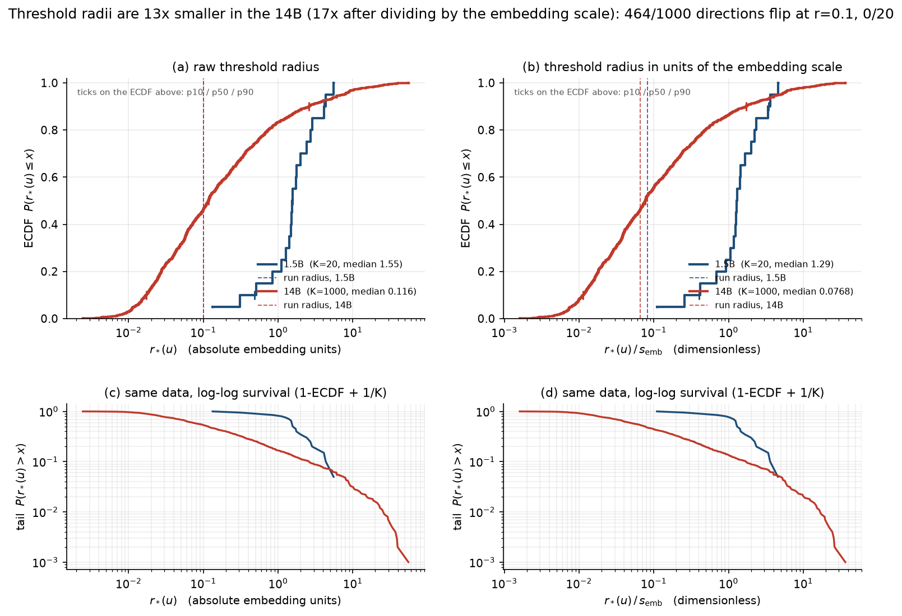

**Setup.** Both runs, $r=0.1$. $r_*(u)=\min_t m_t r/\max(-\delta m_t(u),0)$ per direction, ECDF over directions. Panel (a) plots $r_*$ in absolute embedding units; panel (b) plots $r_*/s_{\rm emb}$ with $s_{\rm emb}=\mathrm{median}_t\lVert h_t^{0}\rVert$ = 1.206 (1.5B) and 1.516 (14B). Bottom row: the same data as a log-log survival function $\hat P(r_*>x)=1-\hat F(x)$ with the $+1/K$ correction, which is the only way to see the tail with 20 samples. Short vertical ticks on the ECDFs mark p10/p50/p90; dashed vertical lines mark the run radius $r=0.1$ in the same units as the panel (0.083 and 0.066 in (b)).

**Axes.**
- (a),(b) $x$: $r_*$ (embedding units) or $r_*/s_{\rm emb}$ (dimensionless), log scale; $y$: ECDF, 0–1.
- (c),(d) $x$: same as above, log; $y$: $P(r_*>x)$, log.

**Numbers.**

| | 1.5B | 14B |
|---|---:|---:|
| $r_*$ p10 / p50 / p90 (raw) | 0.486 / 1.555 / 4.124 | $1.713\times10^{-2}$ / 0.1164 / 2.592 |
| $r_*$ min / max (raw) | 0.133 / 5.53 | $2.44\times10^{-3}$ / 55.5 |
| $r_*/s_{\rm emb}$ p10 / p50 / p90 | 0.403 / 1.289 / 3.418 | $1.13\times10^{-2}$ / $7.68\times10^{-2}$ / 1.710 |
| flips at $r=0.1$ | 0 / 20 | 464 / 1000 |
| flips at $r=0.3$ / $r=1$ / $r=2$ | 1 / 4 / 14 | 671 / 834 / 886 |

**What is in the figure.**
- The raw medians differ by 13.4x; after dividing by $s_{\rm emb}$ by 16.8x. The normalization *increases* the gap, because the 14B's embedding vectors are 26% longer and the same absolute $r$ is therefore a relatively smaller kick.
- The bulk of the 1.5B's distribution spans less than a decade (p10–p90: 0.486–4.12) while the 14B's spans 2.2 decades ($1.7\times10^{-2}$–2.59), and the 14B has an even heavier upper tail: its survival curve stays above $10^{-2}$ out to $r\approx10$, i.e. about ten directions need more than $10r$, with a maximum of 55.5. Those are directions whose perturbation *widens* every near-tie and therefore never breaks the continuation at any reasonable radius. In this npz all 1000 $r_*$ are finite, so none is literally infinite; the 536 directions above the run radius are simply not flipped at $r=0.1$.
- The 1.5B's minimum, 0.133, belongs to direction 10 — the same direction that is the most destructive at $t=123$ (§6). It is 1.33x above the run radius, which is why the run has zero flips despite a 0.02-nat tie.
- The 14B's smallest, $2.4\times10^{-3}$, is 41x *below* the run radius; 464 directions are below it.

**What it shows.** The threshold radius — the width of the tube of perturbations that leaves the continuation intact — is an order of magnitude narrower in the 14B, and the gap survives the normalization check (it widens slightly rather than closing).

**What it does not show.** With $K=20$ the 1.5B ECDF is a 20-step staircase: its p10 and p90 are each one sample away from the next stair, and the "min" is the minimum of 20 draws, not a population minimum. The 1.5B's max (5.53) is also not a real upper bound — 20 samples cannot see a 55-unit tail even if one exists. And $r_*$ is computed from teacher-forced responses: it is the radius at which the *first* token would flip while the prefix is still the baseline one, not the radius at which the free-running text changes.

---

## 4. Figure `xscale_gain.png` — the 14B responds *less*, absolutely and relatively

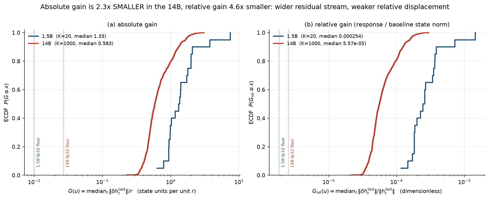

**Setup.** Both runs, $r=0.1$, last saved state (index 27 for the 1.5B, 47 for the 14B — both the input to the final norm, i.e. the penultimate exit, matched relative depth 27/28 vs 47/48). $G(u)=\mathrm{median}_t\lVert\delta h_t^{\rm last}\rVert/r$; $G_{\rm rel}(u)=\mathrm{median}_t\lVert\delta h_t^{\rm last}\rVert/\lVert h_t^{\rm last}\rVert$ at the run radius (dimensionless, no division by $r$). ECDFs over directions, log $x$. Dotted vertical lines: the fp32 floor expressed in the same units, $\text{floor}/r$ = 0.010 (1.5B) and 0.027 (14B) in (a), and $\text{floor}/s_{\rm last}$ = $1.8\times10^{-6}$ / $2.5\times10^{-6}$ in (b).

**Axes.**
- (a) $x$: $G$ in state units per unit $r$, log; $y$: ECDF.
- (b) $x$: $G_{\rm rel}$, dimensionless, log; $y$: ECDF.

**Numbers.**

| | 1.5B | 14B |
|---|---:|---:|
| $G$ min / p10 / p50 / p90 / max | 0.635 / 0.922 / 1.333 / 2.235 / 7.47 | 0.224 / 0.409 / 0.583 / 1.297 / 3.06 |
| $G_{\rm rel}$ min / p10 / p50 / p90 / max | $1.17\times10^{-4}$ / $1.68\times10^{-4}$ / $2.54\times10^{-4}$ / $4.22\times10^{-4}$ / $1.45\times10^{-3}$ | $2.12\times10^{-5}$ / $3.89\times10^{-5}$ / $5.57\times10^{-5}$ / $1.24\times10^{-4}$ / $2.95\times10^{-4}$ |
| $s_{\rm last}$ | 545.3 | 1067.3 |
| median above fp32 gain floor | 133x | 22x |

**What is in the figure.**
- The two raw ECDFs are separated by a factor 2.3 at the median and do not overlap except in the upper tail (the 1.5B's p10, 0.922, is above the 14B's p75, 0.877). The 1.5B also has a single direction at $G=7.47$, 5.6x its own median — a heavy right tail that the 14B does not have (max 3.06, 5.2x its median).
- In relative units the median separation grows to 4.6x. The bulk is separated — the 1.5B's p10 ($1.68\times10^{-4}$) is 3.0x the 14B's median and 1.36x its p90 — but the tails are not: 12% of the 14B's directions have a larger relative gain than the 1.5B's weakest direction ($1.17\times10^{-4}$), and the 14B maximum ($2.95\times10^{-4}$) is 2.5x that minimum. So the ordering is a shift of the distribution, not a complete separation.
- Both are far above the fp32 floor, so the ordering is not a precision artifact: 133x and 22x above the respective gain floors.

**What it shows.** The bigger model is the *less* responsive one per unit perturbation, both in absolute state units and as a fraction of what its residual stream carries. Combined with §3 this localizes the fragility entirely in the decision margins: $r_*\sim m/|\delta m|$ falls 13x because $m$ falls 207x at the weakest step while the response falls only 2.3x.

**What it does not show.** It does not show that the 14B is "less sensitive" in any behavioral sense — a smaller relative displacement can still flip a decision if the decision is nearly tied, which is exactly what happens. $G$ is a median over 300 steps and hides the time structure (that is Fig. `xscale_shape`). And the normalizations are not interchangeable: dividing by $s_{\rm last}$ answers "what fraction of the carried state", dividing by $s_{\rm emb}$ answers "how many token vectors' worth"; they give 4.6x and 2.9x respectively, and both are reported in the JSON.

---

## 5. Figure `xscale_shape.png` — same depth ordering, different persistence, and a flush only in the small model

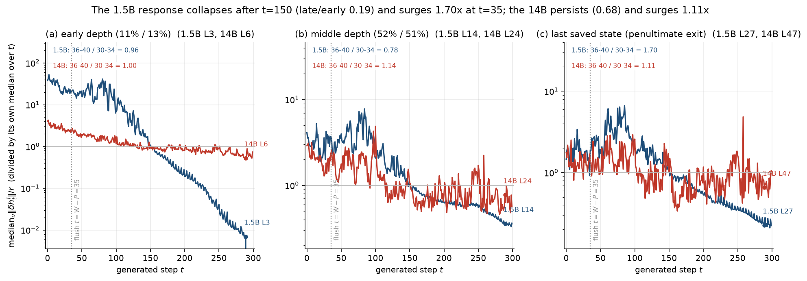

**Setup.** Both runs, $r=0.1$, three matched relative depths: early (1.5B L3 / 14B L6, 11% / 13% deep), middle (L14 / L24, 52% / 51%), last saved state (L27 / L47, the penultimate exit in both). Curves are $\mathrm{median}_u\lVert\delta h_t^{l}\rVert/r$ at each $t$, each divided by its own median over $t$ (300 values), so they are dimensionless and their absolute levels are not comparable — only their shapes are. The dotted vertical line is $t^*=W-P=100-65=35$; the annotated ratio is $\bar m_{36..40}/\bar m_{30..34}$, i.e. the mean level just after the flush over the mean level just before it. The horizontal grey line is 1 (the curve's own median).

**Axes.** $x$: generated step $t$; $y$: $\mathrm{median}_u\lVert\delta h_t^{l}\rVert/r$ divided by its median over $t$ (dimensionless), log scale, free per panel.

**Numbers.**

| depth | late/early (t 200–299 vs 0–49) | peak / late | flush ratio 36–40 / 30–34 | step t=34→35 |
|---|---:|---:|---:|---:|
| 1.5B L3 (11%) | 0.0024 | 643 | 0.96 | 1.15 |
| 1.5B L14 (52%) | 0.169 | 15.0 | 0.78 | 1.00 |
| 1.5B L27 (last) | 0.186 | 18.4 | **1.70** | **2.06** |
| 14B L6 (13%) | 0.286 | 2.66 | 1.00 | 1.16 |
| 14B L24 (51%) | 0.420 | 5.95 | 1.14 | 1.22 |
| 14B L47 (last) | 0.680 | 3.17 | **1.11** | 0.80 |

**What is in the figure.**
- **Early depth.** Both curves decline monotonically through the window, but by very different amounts. The 1.5B's normalized response falls from 38 at $t=0$ to 1 at $t=148$, to 0.04 at $t=250$, and is exactly 0 from $t=290$ on (its flush cascade reaches layer 3). The 14B's falls from 4.0 at $t=0$ to 1 at $t=123$ and then flattens at 0.7–0.9 — it never decays away.
- **Middle depth.** Both show the same qualitative object: a broad hump (1.5B peak at $t=84$, 14B at $t=100$), then decay. The 1.5B falls 14x below its hump by $t=250$; the 14B falls 2.9x and then flattens.
- **Last state.** The 1.5B has the clearest structure: a rise to a peak at $t=85$ (8.5 in units of $r$, 18x its late level) and a monotone decay afterwards. The 14B's last-state curve is a noisy plateau with excursions (a $3.15\,r$ spike at $t=258$) and no hump: peak/late is 3.2 versus 18.4.
- **The flush at $t=35$.** The 1.5B's last state jumps by 2.06x in the single step $t=34\to35$ and 1.70x in the 5-step means, then keeps rising to its $t=85$ peak. The 14B's last state does not: the single-step ratio is 0.80 (a *decrease*) and the 5-step ratio is 1.11. Across all saved layers the 1.5B shows the surge only at L21 (1.38) and L27 (1.70) and a small *dip* at L1–L14 (0.73–0.96); the 14B never exceeds 1.14 at any saved layer.
- The zero-response layer is L0 in both (100% of entries exactly 0): the perturbation is on prompt positions and the read positions are generated tokens, so at the embedding layer there is nothing to see.

**What it shows.** The response has the same *architecture* in both models (zero at the embedding, growing with depth, decaying with $t$), but two scale-dependent differences are visible: the large model's response persists over the whole 300-step window instead of collapsing, and it does not show the window-flush surge that the small model shows at $t=35$. The flush is a mask event and its step is identical in both protocols, so the *timing* agreement is structural; the *amplitude* disagreement (1.70 vs 1.11) is the empirical content.

**What it does not show.** It does not establish why the surge is absent in the 14B. Two candidates are (i) the response is dominated by directions that are insensitive to the dropped prompt token, and (ii) the 14B's sliding-window mask was not applied in as many layers — Qwen2 applies the window per layer via `max_window_layers`, both runs only set `config.sliding_window=100` and `use_sliding_window=True`, and neither npz records the resulting per-layer mask or the model config. For the 1.5B the mask is independently known to be live (the controlled same-token $W=100$ vs $W=1000$ comparison departs exactly at $t=35$); for the 14B the npz alone cannot distinguish "no mask" from "mask but no surge". This is a real ambiguity, not a rhetorical one, and it should be resolved by dumping `config.sliding_window`, `use_sliding_window`, `max_window_layers` and the `layer_types` of the loaded model on the next 14B run. It also does not compare like-for-like text: the two models generate different tokens — the 1.5B's continuation degenerates into a 4-token loop from $t=143$ while the 14B's never repeats — and a response can decay differently simply because the token stream changes how much prompt content is re-injected. The late-time decay difference (0.19 vs 0.68) is therefore *not* a clean model-size effect.

---

## 6. Figure `xscale_dm.png` — how far the responses sit from the margin they must cross

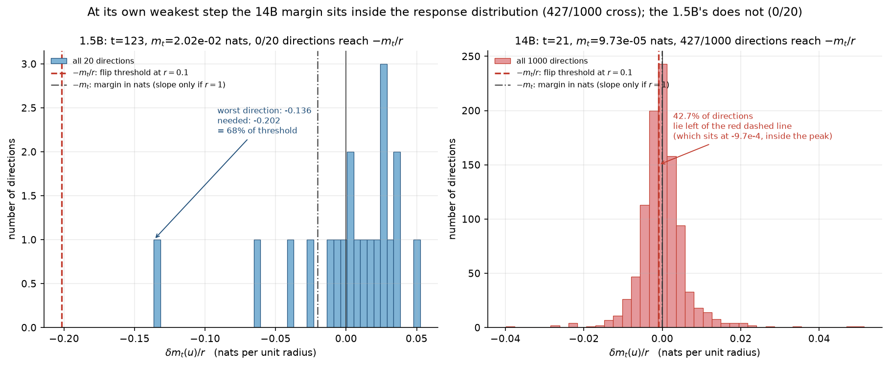

**Setup.** Both runs, $r=0.1$, at each model's **own** smallest-margin step: $t=123$ for the 1.5B ($m=2.016\times10^{-2}$ nats), $t=21$ for the 14B ($m=9.727\times10^{-5}$ nats). Histogram of $\delta m_t(u)/r$ over all directions of that model. Two vertical markers: the red dashed line at $-m_t/r$ (nats per unit radius) is the slope a direction must beat to close the gap *at $r=0.1$* — a direction left of it flips; the grey dash-dot line at $-m_t$ (nats) is the same margin without dividing by $r$, i.e. the threshold only if the run radius were 1.

**Axes.** $x$: $\delta m_t(u)/r$ in nats per unit radius; $y$: number of directions (free per panel). The $x$ ranges differ by a factor 2.8 between panels (1.5B: $-0.22$ to $0.06$; 14B: $-0.045$ to $0.055$).

**Numbers.**

| | 1.5B, $t=123$ | 14B, $t=21$ |
|---|---:|---:|
| $m_t$ | $2.016\times10^{-2}$ nats | $9.727\times10^{-5}$ nats |
| $-m_t/r$ (flip threshold) | $-0.2016$ | $-9.727\times10^{-4}$ |
| $\delta m_t/r$ min / p5 / p50 / p95 / max | $-0.136$ / $-0.0688$ / $+0.0091$ / $+0.0376$ / $+0.0525$ | $-0.0399$ / $-0.0082$ / $-3.13\times10^{-4}$ / $+0.0090$ / $+0.0514$ |
| directions with $\delta m_t<0$ | 7 / 20 | 529 / 1000 |
| directions left of $-m_t/r$ | 0 / 20 | 427 / 1000 |

**What is in the figure.**
- At the 1.5B's weakest step the response distribution is centred slightly *positive* (+0.0091, so 13 of 20 directions widen the margin) and its most destructive direction reaches $-0.136$ — 68% of the $-0.2016$ needed. The whole distribution lives in a window of about $\pm0.15$, and the threshold sits outside it. This is the visual content of "0 of 20 flip".
- At the 14B's weakest step the response distribution is centred essentially on zero ($-3.1\times10^{-4}$, a factor 30 smaller than the 1.5B's offset) and is *wider than the margin by two orders of magnitude*: 42.7% of the mass is left of $-9.7\times10^{-4}$. The threshold line is invisible at this scale because it sits inside the peak — which is the point.
- The two panels are on the same physical axis (nats per unit radius) but different ranges; drawn on one axis the 14B's distribution would be a spike $\sim$6x narrower than the 1.5B's. The ratio of the widths (1.5B p5–p95 ≈ 0.106, 14B ≈ 0.017) is 6.2 — the opposite direction from the threshold ratio (207), which is what makes the 14B's margin crossable.

**What it shows.** The 14B's decisions are not merely near-tied; they are near-tied at a level that a typical direction's response overshoots by two orders of magnitude. The 1.5B's weakest decision is a real tie (0.02 nats) that a typical perturbation simply cannot reach at this radius — the most destructive of 20 directions still comes up 1.5x short.

**What it does not show.** It does not show what happens *after* the first flip (the prefix is still the baseline one here; free-running consequences are a separate experiment). It cannot say whether the 42.7% figure would survive a different prompt, since $t=21$ is one token of one continuation. And the grey line is a deliberate unit mismatch kept for readability of the "margin in nats" — the physically correct comparison is the red one.

---

## 7. Facts that qualify the whole comparison

1. **Different continuations, and one of them is degenerate.** Same prompt, different greedy text. Steps do not correspond across models; only distributions and mask-imposed times do. The 1.5B's continuation is the exact 4-token cycle `1576, 807, 525, 11050` from $t=143$ on; the 14B's never repeats within 300 steps. Every 1.5B statistic that aggregates over late $t$ (the late/early ratio, the shape curves after $t=150$) is therefore measured on a loop, and the 14B's is not.
2. **Different $K$ and different direction geometry.** 20 directions from one 20-d subspace (1.5B) vs 1000 from 50 disjoint ones (14B). Within-block pairs have inner product $-1/19$; cross-block pairs are orthogonal. Any tail statement about the 1.5B rests on 20 samples.
3. **The 14B's flush behaviour is not fully attributable.** The window is set identically in code, but whether it is applied per layer depends on the model config (`max_window_layers`, `layer_types`), which was not recorded. The 1.5B's flush is independently known from a controlled same-token $W=100$ vs $W=1000$ comparison; the 14B's is not.
4. **`dh_last` is not symmetric.** The 1.5B stores 3 directions, the 14B 24. Nothing in this section uses those vectors, so this does not enter any number above — it only limits what a vector-geometry follow-up could do on the 1.5B side.
5. **One radius.** Both runs use $r=0.1$. The 1.5B's usable range is $r\in[10^{-3},0.1]$ and linearity of the response in $r$ was validated there; the 14B's usable range is quoted as $[0.03,0.3]$, but no 14B linearity curve is included in this npz, so reading $r_*$ as a radius at 14B scale rests on that assumption rather than on a 14B measurement.
6. **Margins are a prefix property.** A near-tie at $t=21$ of the 14B says that one particular prefix leaves two tokens nearly tied; it is not a statement about the model's general calibration.

## 8. What follows directly

- Decision fragility scales up with model size *here* by two orders of magnitude at the worst step (9.7e-5 vs 2.0e-2 nats), and this is what makes the threshold radius 13–17x smaller. The per-direction response is 2.3x *weaker* in absolute terms and 4.6x weaker relative to the state, so the effect is on the read-out, not on the propagation.
- The window flush is structurally common ($t^*=35$ in both) but its amplitude is not: 1.70 (1.5B, L27) vs 1.11 (14B, L47) in the 5-step means, and 2.06 vs 0.80 in the single step $t=34\to35$.
- Response persistence over 300 steps is the other clear cross-scale difference: late/early 0.19 (1.5B, last) vs 0.68 (14B, last) — but the 1.5B's number is measured inside a degenerate 4-token loop, so the size of that gap is text-dependent and should not be read as a pure model-size effect.
- Anything that wants to claim "the 14B is more chaotic" has to say *which* quantity: not the response gain ($G$ is smaller), but the distance from the response to the decision threshold ($m_t$ is far smaller), i.e. the fragility is in the read-out geometry.

## 9. Reproduce

```
python scripts_spark/figs_cross_scale.py
```

Writes `notebook_big/figures/xscale_{margins,rstar,gain,shape,dm}.png` (dpi 150) and `notebook_big/figures/xscale_numbers.json`, which contains every quantile quoted above, the per-layer flush ratios, the per-layer late/early ratios, and the p10/p50/p90 of both $r_*$ normalizations and both gains. The 1.5B npz is read in place from the main checkout and is not modified.

