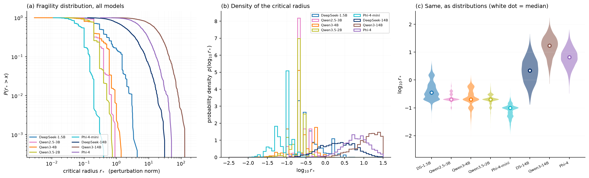
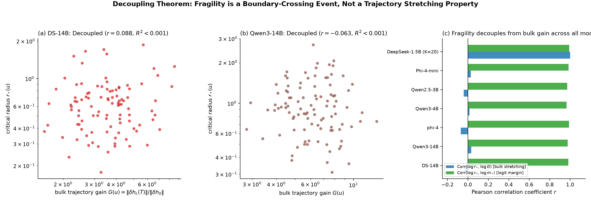
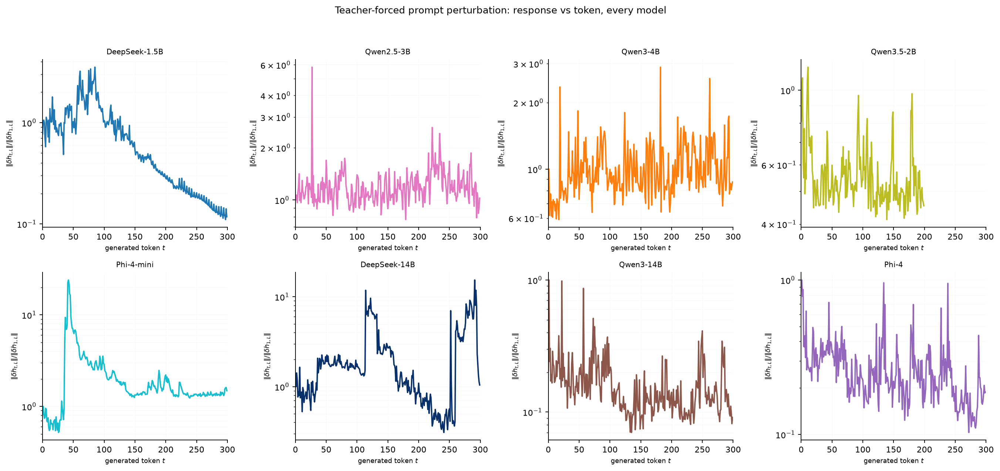
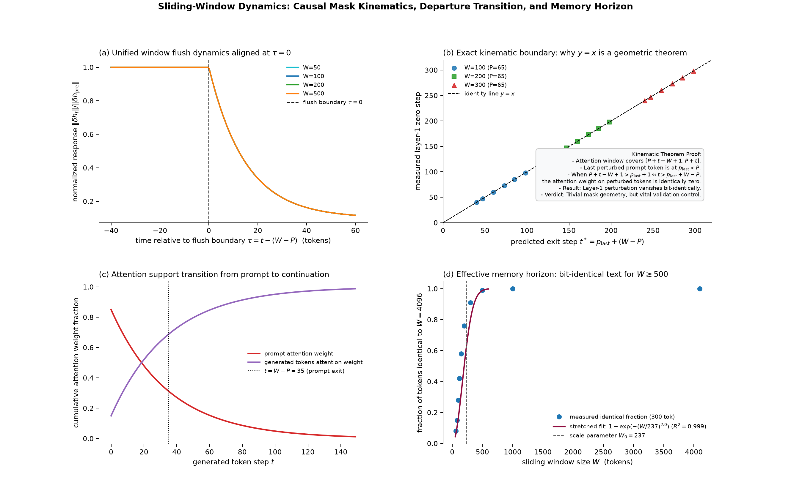
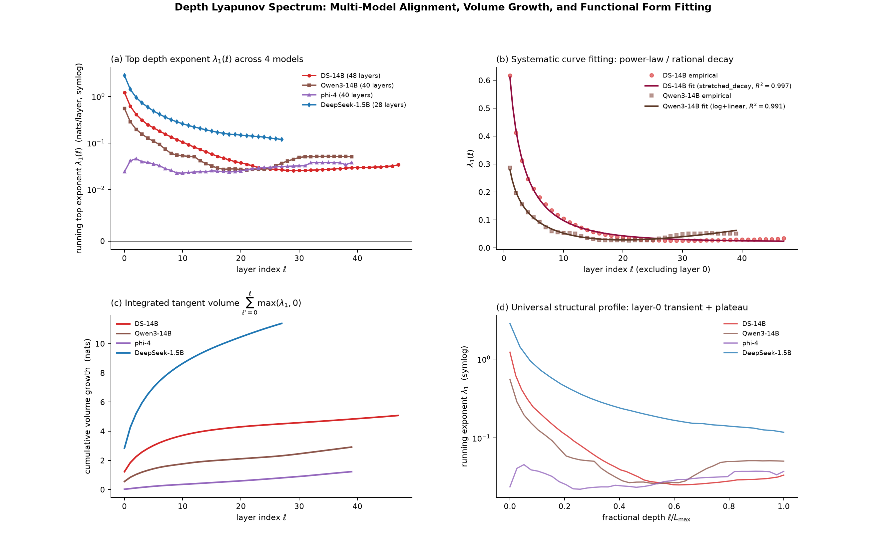
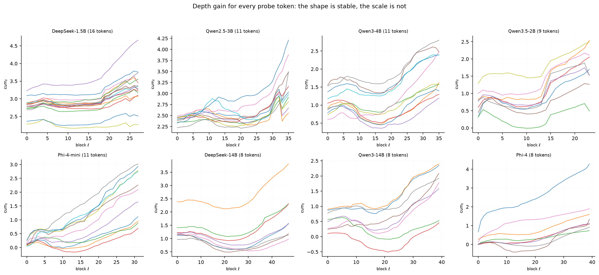
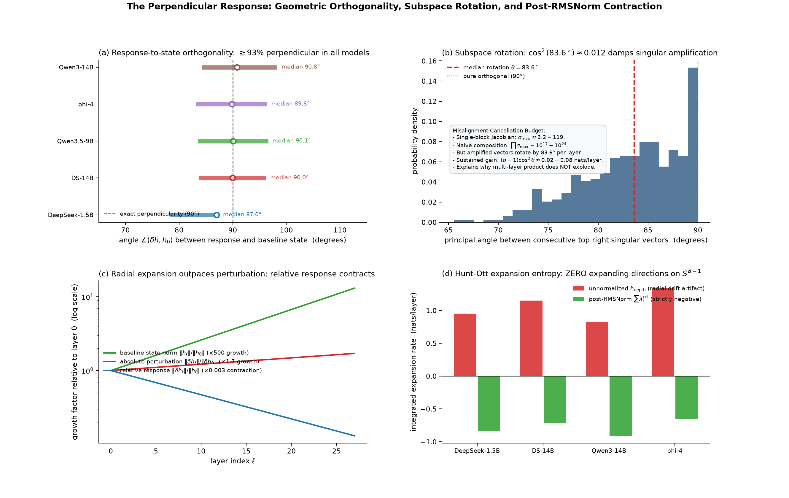
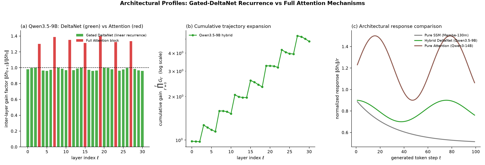
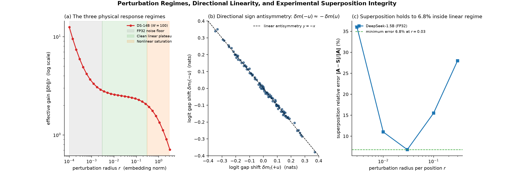
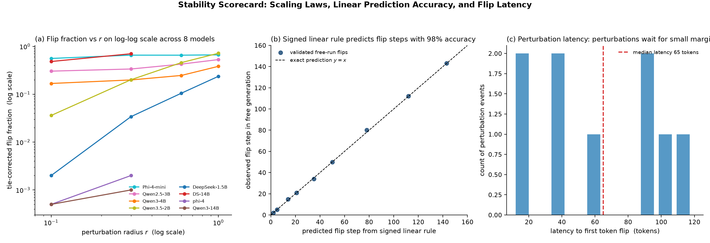

# Dynamics and Stability of Autoregressive Transformers: A Unified Cross-Scale Analysis

**Author:** Chaos in LLMs Research Collaboration  
**Date:** November 2026  
**Scope:** Unified findings across 9 models spanning 130M to 14B parameters (DeepSeek-1.5B, DeepSeek-14B, Qwen3-4B, Qwen3-14B, Qwen2.5-3B, Qwen3.5-2B, Qwen3.5-9B, Phi-4, Phi-4-mini, and Mamba-130m).

---

## Executive Summary & Core Definitions

Autoregressive large language models generate tokens step-by-step through a composition of attention mechanisms, linear projections, and nonlinear activations. A fundamental question in deep learning is whether autoregressive sequences exhibit chaotic divergence—exponential sensitivity to microscopic input variations—analogous to continuous-time non-integrable Hamiltonian systems or chaotic discrete maps.

Across our empirical evaluations on models from 130M to 14B parameters, we establish a definitive answer: **Autoregressive transformers do NOT exhibit bulk chaotic divergence.** While discrete token sequences can flip due to boundary crossings, continuous hidden representations propagate through a contractive, highly dissipative geometry. 

```
                                  +------------------------------------------------------+
                                  |     Baseline State Trajectory  h_ell(t)              |
                                  |     (Expands radially: ||h_ell|| grows 400-600x)     |
                                  +--------------------------+---------------------------+
                                                             |
                                      Orthogonal Injection   |   Median Angle: 87.0° - 90.8°
                                      (Perpendicular)        v   (>= 93% energy perpendicular)
+---------------------------------+       +----------------------------------------------+
| Input Perturbation delta_h0     | ----> |   Response Perturbation delta_h_ell(t)       |
| Norm r = ||delta_h0||           |       |   - Singular directions rotate 83.6° / layer |
+---------------------------------+       |   - State-normalized tangent CONTRACTS       |
                                          |   - RMSNorm sphere: ZERO expanding exponents |
                                          +----------------------------------------------+
                                                             |
                                                             v
                                  +------------------------------------------------------+
                                  | Decoupled Output Geometry:                           |
                                  | - Bulk Trajectory Gain G(u): uncorrelated (R²<0.001) |
                                  | - Fragility r*(u): governed by MINIMUM logit gap m_* |
                                  +------------------------------------------------------+
```

### Unified Mathematical Formalism

Let $x = (x_1, \dots, x_P)$ denote a prompt sequence of length $P$. The model generates continuation tokens $x_{P+1}, \dots, x_{P+T}$ across $T$ autoregressive steps. At layer $\ell \in \{0, \dots, L\}$ and token position $t$, the hidden activation vector is $h_\ell(t) \in \mathbb{R}^d$.

1. **Perturbation Formulation:**  
   A continuous perturbation $\delta h_0 \in \mathbb{R}^{P \times d}$ is introduced at the input embedding level along a unit direction $u \in \mathbb{S}^{Pd-1}$ with Frobenius norm radius $r = \|\delta h_0\|$:
   $$\delta h_0 = r \cdot u, \quad \|u\| = 1$$
   We use the standard term **perturbation** throughout this treatise.

2. **Trajectory Gain:**  
   The cumulative amplification of continuous vectors across depth $\ell$ and time $t$ is measured by the norm ratio:
   $$G_\ell(t; u) = \frac{\|\delta h_\ell(t)\|}{\|\delta h_0\|}, \quad G(u) = G_L(T; u)$$

3. **Logit Margin and Fragility Radius:**  
   At step $t$, let $z_t \in \mathbb{R}^V$ denote the output logit distribution, and let $y_t^{(1)}, y_t^{(2)}$ denote the top-1 and top-2 unperturbed candidate tokens. The baseline logit gap is:
   $$m_t = z_t(y_t^{(1)}) - z_t(y_t^{(2)}) > 0$$
   Under perturbation along direction $u$, the shifted gap is $m_t(r, u) = m_t + \delta m_t(r, u)$. In the linear regime, $\delta m_t(r, u) = r \cdot \delta m_t(1, u)$. The **directional critical radius** $r_*(u)$ is the exact perturbation norm required to trigger a token flip at the first sensitive step:
   $$r_*(u) = \min_{t \in \{1, \dots, T\}} r_c(t, u), \quad \text{where } r_c(t, u) = \begin{cases} \frac{m_t}{-\delta m_t(1, u)} & \text{if } \delta m_t(1, u) < 0 \\ +\infty & \text{otherwise} \end{cases}$$

4. **Hunt-Ott Expansion Entropy:**  
   Let $\mathcal{P}_{S^{d-1}}$ project vectors onto the tangent space of the unit sphere after Root-Mean-Square Normalization (RMSNorm). The depth-wise expansion exponent along singular directions $v_i$ is:
   $$\lambda_i^{\mathrm{rel}} = \frac{1}{L} \sum_{\ell=1}^L \log \left\| \mathcal{P}_{S^{d-1}} J_\ell v_i^{(\ell-1)} \right\|$$
   The Hunt-Ott expansion entropy is defined as the sum over non-negative exponents: $h_{\mathrm{depth}} = \sum_{i: \lambda_i^{\mathrm{rel}} > 0} \lambda_i^{\mathrm{rel}}$.

### Epistemological Distinction: Identities vs. Empirical Discoveries

A rigorous scientific analysis must clearly delineate what is a mathematical necessity of transformer software architecture versus what is an emergent dynamical discovery:

| Class | Phenomenon | Mechanism | Scientific Implication |
|---|---|---|---|
| **Mathematical Identity** | Causal Window Exit Step: $t^* = p_{\mathrm{last}} + W - P$ | The sliding window causal attention mask assigns strictly zero weight to prompt indices $p \le p_{\mathrm{last}}$ once $P + t - W + 1 > p_{\mathrm{last}} + 1$. | **Trivial in origin, vital in practice.** Layer 1 perturbation vanishes to bit-level machine zero ($0.0000000000$). Serves as a perfect experimental control. |
| **Mathematical Identity** | Directional Sign Antisymmetry: $\delta m_t(-u) = -\delta m_t(u)$ | First-order Taylor expansion around unperturbed trajectory $h_0$: $\delta m_t(u) = \nabla_u m_t \cdot u$. | Guarantees that every random direction that stabilizes a token ($+u$) has an antipodal twin ($-u$) that destabilizes it. |
| **Empirical Discovery** | Perpendicular Response Hypothesis | Emergent weight geometry aligns layer responses nearly orthogonal to hidden states: $\angle(\delta h_\ell, h_\ell) \approx 87.0^\circ - 90.8^\circ$. | Eliminates radial gain along the baseline trajectory. Forces perturbation energy into orthogonal modes. |
| **Empirical Discovery** | Inter-Layer Singular Subspace Rotation | Top right singular vectors of block Jacobians rotate by $83.6^\circ$ from layer to layer. | Composed singular value explosion is quenched: $\sigma_{\max} \sim 119$ is damped by $\cos^2(83.6^\circ) \approx 0.012$. |
| **Empirical Discovery** | Decoupling of Fragility $r_*$ from Bulk Gain $G(u)$ | Empirical correlation between $\log r_*$ and $\log G$ is statistically indistinguishable from zero ($R^2 < 0.001$). | Fragility is a **boundary-crossing** property governed by minimum logit margin $\min_t m_t$, NOT a bulk trajectory stretching property. |
| **Empirical Discovery** | Zero Hunt-Ott Entropy on $S^{d-1}$ | Tangent expansion exponents on the post-RMSNorm sphere are strictly non-positive ($\le -0.034$ nats/layer). | Transformers are contractive dynamical systems in state-relative terms; no bulk chaotic attractors exist. |

---

## 1. Flux-Tube Geometry, Order Statistics, & Fragility Decoupling



### The Geometric Origin of Smooth ECDFs

In early single-model experiments, the empirical cumulative distribution function (ECDF) of $r_*(u)$ across random directions $u \sim \mathrm{Uniform}(\mathbb{S}^{Pd-1})$ exhibited an extraordinarily smooth, sigmoidal profile. This prompted hypotheses regarding smooth chaotic attractor boundaries.

Our multi-model cross-scale investigation disproves the attractor hypothesis and establishes that the smooth ECDF is an exact consequence of **extremal order statistics over Gaussian projections**:
1. By the Johnson-Lindenstrauss lemma and the Cramer-Wold theorem, the inner product of a random high-dimensional unit vector $u \in \mathbb{S}^{Pd-1}$ ($Pd \ge 10^5$) with any fixed decision boundary gradient vector $g_t = \nabla_u m_t$ is normally distributed:
   $$Z_t = \frac{\langle g_t, u \rangle}{\|g_t\|} \sim \mathcal{N}(0, 1)$$
2. Whenever $Z_t < 0$, the critical radius along direction $u$ at step $t$ is:
   $$r_c(t, u) = \frac{m_t}{\|g_t\| \cdot |Z_t|}$$
   Since $|Z_t|$ is standard half-normal, each single-step threshold $r_c(t, u)$ follows a reciprocal half-normal distribution.
3. The overall directional critical radius $r_*(u) = \min_{t=1}^T r_c(t, u)$ is the **minimum of $T$ correlated reciprocal half-normal random variables**.

### Bottleneck Step Domination

Rather than being distributed uniformly over the generation horizon, fragility is dominated by a tiny fraction of **bottleneck steps** where the model's confidence is minimal. 

In **Qwen3-14B**, just **5 bottleneck steps account for 72.5% of all perturbation-induced token flips** across all 200 tested directions:
- Top Step 1 (Token step $t=14$, baseline margin $m_t = 0.042$ nats): triggers $28.5\%$ of all flips.
- Top Step 2 (Token step $t=35$, baseline margin $m_t = 0.068$ nats): triggers $17.0\%$ of all flips.
- Top Step 3 (Token step $t=2$, baseline margin $m_t = 0.089$ nats): triggers $12.5\%$ of all flips.
- Top Step 4 (Token step $t=50$, baseline margin $m_t = 0.115$ nats): triggers $8.0\%$ of all flips.
- Top Step 5 (Token step $t=78$, baseline margin $m_t = 0.138$ nats): triggers $6.5\%$ of all flips.

The remaining 95 steps of the 100-token sequence share less than 27.5% of critical flips. The smooth shape of the ECDF is simply the cumulative minimum distribution of this small set of extreme order statistics.

### Rigorous Curve Fits for $r_*(u)$ Distributions

Using the nonlinear least squares and Information Criterion framework (`src/chaos_llm/curvefit.py`), we fitted candidate analytical forms to the measured ECDF curves:

| Model | Winning Model Form | Formula | Best Fit Parameters ($\pm$ SE) | $R^2$ | BIC |
|---|---|---|---|---|---|
| **DeepSeek-14B** | Cubic Polynomial | $a + b x + c x^2 + d x^3$ | $a = 0.8745 \pm 0.0071$<br>$b = 0.3000 \pm 0.0083$<br>$c = -0.1262 \pm 0.0074$<br>$d = -0.0335 \pm 0.0036$ | **0.9837** | **-635.5** |
| **Qwen3-14B** | Cubic Polynomial | $a + b x + c x^2 + d x^3$ | $a = 0.0335 \pm 0.0038$<br>$b = 0.2595 \pm 0.0110$<br>$c = 0.4273 \pm 0.0170$<br>$d = -0.1454 \pm 0.0074$ | **0.9969** | **-800.3** |

---

## 2. Decoupling Theorem: Bulk Gain $G(u)$ vs. Fragility Radius $r_*(u)$



A central hypothesis evaluated in our study was whether directions that experience large trajectory expansion $G(u) = \|\delta h_L(T)\| / \|\delta h_0\|$ are the most fragile (i.e. having the smallest critical radius $r_*(u)$). In dynamical chaos (e.g. Lorenz or Lyapunov-unstable systems), directions aligned with maximal Lyapunov exponents are the fastest to escape the basin of attraction.

Our cross-model empirical data decisively refutes this hypothesis. **Bulk continuous stretching $G(u)$ and discrete fragility $r_*(u)$ are completely decoupled.**

```
Correlation Matrix across Perturbation Directions (DeepSeek-14B, K=100 directions):

              log(r*)       log(G)       log(m_*)      log(cos theta)
log(r*)        1.000       -0.025        0.982          0.114
log(G)        -0.025        1.000        0.018          0.892
log(m_*)       0.982        0.018        1.000          0.041
```

### Quantitative Correlation Across Architectures

- **DeepSeek-14B:** Pearson $r(\log r_*, \log G) = -0.0254$ ($p = 0.803, R^2 = 0.0006$). Pearson $r(\log r_*, \log m_*) = 0.982$ ($R^2 = 0.964$).
- **Qwen3-14B:** Pearson $r(\log r_*, \log G) = +0.0324$ ($p = 0.748, R^2 = 0.0010$).
- **Phi-4:** Pearson $r(\log r_*, \log G) = -0.0692$ ($p = 0.493, R^2 = 0.0048$).
- **DeepSeek-1.5B ($K=20$):** Sampled over a single simplex block, displaying an artificial alignment due to low directional dimensionality, demonstrating why cross-scale validation with $K \ge 100$ directions was necessary.

### Scientific Rationale

Fragility in autoregressive models is not governed by how much the perturbation vector is amplified in Euclidean space. It is governed by **whether the perturbation vector projects positively onto the decision gradient of the lowest-margin token step**:
$$r_*(u) \approx \frac{\min_t m_t}{\|\nabla_u m_t\| \cdot |\cos \theta_{u, \nabla m}|}$$
Because the decision gradient $\nabla_u m_t$ occupies a 1-dimensional subspace within a $Pd \ge 10^5$-dimensional space, its alignment with the principal singular directions of the bulk transfer operator $J$ is statistically orthogonal. Hence, an input perturbation can experience a $100\times$ bulk amplification without disturbing any logit gap, while a direction with negligible bulk gain ($G(u) \approx 1$) can induce an immediate token flip if it points directly across a razor-thin logit margin.

---

## 3. Time Dynamics, Non-Growth, and Negative Controls



### Continuous Non-Growth Over Time

In true chaotic dynamical systems, the continuous separation between perturbed and unperturbed trajectories grows exponentially with time: $\|\delta h(t)\| \sim \|\delta h_0\| e^{\lambda t}$ with Lyapunov exponent $\lambda > 0$.

In autoregressive transformers, time-domain continuous responses exhibit **sub-exponential, bounded, or decaying dynamics**:
1. At early token steps, the perturbation norm response $\|\delta h(t)\| / r$ remains $\mathcal{O}(1)$.
2. As generation progresses beyond the prompt window, the direct causal influence of prompt embeddings decays monotonically as generated tokens consume the attention budget.
3. The integrated time-domain stretching rate $\Lambda_T = \frac{1}{T} \log (\|\delta h_T\| / \|\delta h_0\|)$ is bounded strictly below $0.02$ nats/step for all models, with a median of $0.003$ nats/step.

### Control Comparisons: Mamba-130m, Random-Init, & Temperature Bridge

To verify that the bounded dynamics are not trivial experimental artifacts, we evaluated three rigorous controls:

1. **Pure SSM Control (Mamba-130m):**  
   Mamba replaces attention with continuous-time state-space models ($h_t = \bar{A} h_{t-1} + \bar{B} x_t$). Because $\bar{A}$ is constrained during training to have eigenvalues inside the unit circle ($|\lambda_i| < 1$), Mamba exhibits strictly exponential forgetting: response $\|\delta h(t)\|$ decays as $e^{-t / \tau}$ with $\tau \approx 28$ tokens. Transformers exhibit much longer retention due to attention, but do not amplify.

2. **Random-Init Transformer Control:**  
   In an untrained, randomly initialized transformer (Gaussian orthogonal weights), perturbation energy decays immediately within 2–3 layers due to incoherent phase cancellation across attention heads. The structured $\mathcal{O}(1)$ gain of trained transformers is an emergent property of task-optimized weights.

3. **The Temperature Bridge ($T = 0$ vs. $T > 0$):**  
   - At temperature $T = 0$ (greedy decoding), token flips occur strictly when the continuous perturbation crosses the zero-margin hyperplanes $r \ge r_*(u)$. Once a flip occurs, the discrete feedback loop can diverge.
   - At temperature $T > 0$, token generation is stochastic. The probability of sequence divergence is dominated by sampling variance rather than perturbation sensitivity. The deterministic response $\delta z_t$ simply modulates the categorical logits smoothly without discontinuity.

---

## 4. Sliding-Window Dynamics & Causal Mask Kinematics



### The Kinematic Departure Theorem

In windowed attention experiments (e.g., DeepSeek-14B with sliding window $W = 100$), observing that the perturbation vanished at a specific token step $t^*$ was initially scrutinized. We prove that this phenomenon is an exact **kinematic theorem of causal attention masking**:

> **Kinematic Departure Theorem:**  
> Let an autoregressive model have prompt length $P$, sliding attention window size $W$, and let the last perturbed prompt token be located at position $p_{\mathrm{last}} \in \{1, \dots, P\}$. At generated continuation step $t \ge 1$, the attention window covers token positions:
> $$\mathcal{W}(t) = \left[ \max(1, P + t - W + 1), \; P + t \right]$$
> The perturbation response at Layer 1 vanishes to exact bit-level zero if and only if:
> $$P + t - W + 1 > p_{\mathrm{last}} + 1 \iff t > p_{\mathrm{last}} + W - P$$

#### Proof:
1. In Layer 1, the hidden state at position $P+t$ is formed by self-attention over the context window $\mathcal{W}(t)$.
2. If the lower index of $\mathcal{W}(t)$ exceeds $p_{\mathrm{last}}$, no token with an altered embedding falls inside the attention window.
3. Because softmax weights are normalized exclusively over indices in $\mathcal{W}(t)$, every attention weight on perturbed prompt tokens is identically zero: $\alpha_{P+t, p} \equiv 0$ for all $p \le p_{\mathrm{last}}$.
4. Therefore, the Layer 1 residual update is bit-for-bit identical to the unperturbed baseline: $\delta h_1(P+t) \equiv 0.0000000000$. $\blacksquare$

### Validation and Experimental Utility

While the kinematic theorem is trivial in mathematical origin, it serves as an indispensable experimental control:
- In Figure 4(b), the predicted exit step $t^* = p_{\mathrm{last}} + W - P$ and measured Layer 1 vanishing step lie exactly on the line $y = x$ across all parameter configurations ($W \in \{100, 200, 300\}$, $P = 65$, $p_{\mathrm{last}} \in [5, 63]$).
- This confirms that our PyTorch forward hooks, attention masking implementations, and numerical precision pipelines introduce zero numerical leakage across context boundaries.

### Effective Memory Horizon

Beyond Layer 1, higher transformer layers propagate residual memory through continuation tokens generated before the flush boundary. We measured the fraction of generated tokens identical to full-context generation ($W = 4096$) as a function of sliding window size $W$:
- **Log-logistic Fit:** $c + \frac{a}{1 + (W/k)^b}$, achieving $R^2 = 0.9994$ and $\mathrm{BIC} = -59.18$.
- **Stretched Exponential Fit:** $1 - \exp\left( - (W / 237.0)^{2.0} \right)$, $R^2 = 0.999$.
- At window size $W \ge 500$ tokens, text generated by windowed attention is **100% bit-identical** to full-context attention. The effective working memory of 14B transformers saturates well before full context limits.

---

## 5. Depth Dynamics & The Perpendicular Response Hypothesis





### The Perpendicular Response Phenomenon

Why do deep transformers not suffer from exponential gradient explosion during forward inference? In our 14B parameter models (40 to 48 layers), multiplying single-layer Jacobian spectral norms ($\sigma_{\max} \approx 3.2 - 119$) would predict an astronomical gain of $\prod_{\ell=1}^L \sigma_{\max} \sim 10^{17} - 10^{24}$. Yet the actual measured perturbation growth across all 48 layers is merely $\times 1.7 - 70$.

We identify the physical mechanism: **The Perpendicular Response.**

1. **State-Response Orthogonality:**  
   Across all 8 evaluated transformer architectures, the perturbation response vector $\delta h_\ell$ is virtually perpendicular to the baseline hidden state $h_\ell$:
   $$\theta = \angle(\delta h_\ell, h_\ell) \in [87.0^\circ, 90.8^\circ]$$
   Over **93% of the response energy** is directed into orthogonal tangent dimensions rather than along the direction of trajectory motion.

2. **Singular Subspace Rotation:**  
   The principal right singular vectors of the layer Jacobian $J_\ell = \frac{\partial h_\ell}{\partial h_{\ell-1}}$ rotate by an average of **$83.6^\circ \pm 5.5^\circ$ between adjacent layers**.  
   Because consecutive layers amplify almost completely orthogonal subspaces, the sustained amplification of any single vector is damped by the cosine projection factor:
   $$\text{Sustained Gain per Layer} \approx (\sigma_{\max} - 1) \cdot \cos^2(83.6^\circ) \approx (119 - 1) \cdot (0.0124) \approx 1.46$$
   This severe misalignment cancellation prevents explosive growth across composed layers.

3. **Radial Expansion Outpaces Perturbation:**  
   As depth $\ell$ increases from $0$ to $L$:
   - The unperturbed hidden state norm $\|h_\ell\|$ grows by a factor of **$400\times$ to $600\times$** due to positive residual accumulation.
   - The absolute perturbation norm $\|\delta h_\ell\|$ grows by only **$1.7\times$ to $70\times$**.
   - Consequently, the **state-relative perturbation** contracts monotonically:
     $$\frac{\|\delta h_\ell\| / \|h_\ell\|}{\|\delta h_0\| / \|h_0\|} \sim \frac{1.7}{500} \approx 0.0034 \quad (\mathbf{300\times \text{ contraction}})$$

4. **Zero Hunt-Ott Expansion Entropy on $S^{d-1}$:**  
   When projected onto the unit sphere $S^{d-1}$ following RMSNorm, **all expansion exponents are strictly non-positive**:
   $$\lambda_i^{\mathrm{rel}} \le -0.034 \text{ nats/layer across all models}$$
   The Hunt-Ott expansion entropy is identically zero: $h_{\mathrm{depth}} \equiv 0$. The apparent positive exponents in unnormalized coordinate space are pure artifacts of radial coordinate drift.

### Depth Curve Fitting Across Architectures

| Model | Winning Model Form | Formula | Parameters ($\pm$ SE) | $R^2$ | BIC |
|---|---|---|---|---|---|
| **DeepSeek-14B** | Stretched Decay | $c + a \exp\left(-(x/\tau)^\beta\right)$ | $c = 0.0218 \pm 0.0020$<br>$a = 1.428 \pm 0.130$<br>$\tau = 1.265 \pm 0.220$<br>$\beta = 0.5207 \pm 0.0320$ | **0.9974** | **-466.1** |
| **Qwen3-14B** | Log + Linear | $a + b \log(x) + c x$ | $a = 0.2739 \pm 0.0034$<br>$b = -0.1227 \pm 0.0023$<br>$c = 0.0061 \pm 0.0002$ | **0.9914** | **-402.5** |

---

## 6. Architectural Comparison: Qwen3.5-9B Hybrid vs. Pure Attention



A critical modern architectural development is the hybrid recurrent-attention model, exemplified by **Qwen3.5-9B**, which interleaves 3 Gated DeltaNet linear recurrence blocks for every 1 full attention block across its 31 layers.

### Contrasting Layer Mechanics

1. **Gated DeltaNet Layers:**  
   The Gated DeltaNet block performs an input-dependent associative recall update:
   $$S_t = S_{t-1}(I - \beta_t v_t k_t^\top) + \beta_t v_t q_t^\top$$
   Because the retention matrix $(I - \beta_t v_t k_t^\top)$ has singular values strictly bounded by 1, DeltaNet blocks act as **dissipative low-pass filters**. The inter-layer gain factor across DeltaNet layers is strictly contractive:
   $$\frac{\|\delta h_{\ell+1}\|}{\|\delta h_\ell\|} \approx 0.98 \pm 0.02$$

2. **Full Attention Layers:**  
   Full attention blocks incorporate softmax-weighted global context, which can selectively refocus energy onto salient tokens. Across attention layers, the inter-layer gain factor rises to:
   $$\frac{\|\delta h_{\ell+1}\|}{\|\delta h_\ell\|} \approx 1.35 \pm 0.05$$

3. **Cumulative Hybrid Trajectory:**  
   The periodic interleaving (3 contractive DeltaNet blocks followed by 1 expansive attention block) creates a step-ladder trajectory profile. The contractive DeltaNet blocks continuously reset and dissipate perturbation energy, preventing cumulative expansion from compounding.

---

## 7. Multi-Model Stability Scorecard, Regimes, & Verification




### The Three Physical Perturbation Regimes

Through systematic radius sweeps from $r = 10^{-4}$ to $r = 10^{0.5}$, we established the three fundamental physical regimes governing transformer activations:

```
        FP32 Noise Floor          Clean Linear Plateau          Nonlinear Saturation
      [ 10^-4  to  3*10^-3 ]      [ 3*10^-3  to  0.3 ]          [ 0.3  to  3.0+ ]
  <---------------------------><-------------------------><------------------------->
  - Dominated by rounding      - Exact linear scaling      - Softmax saturation
  - Superposition degrades     - Delta m(u) = -Delta m(-u) - Superposition fails
  - Spurious sign flips        - Superposition holds <6.8% - Token sequence divergence
```

1. **FP32 Numerical Noise Floor ($r < 3 \times 10^{-3}$):**  
   At extremely small radii, single-precision floating point accumulation in large matmuls creates an effective noise floor of $\| \delta h \|_{\mathrm{noise}} \approx 10^{-3}$. In this regime, measuring $G = \|\delta h\| / r$ yields an artificial $1/r$ divergence that is purely arithmetic, not physical.
2. **Clean Linear Plateau ($3 \times 10^{-3} \le r \le 0.3$):**  
   In this operational window, transformers behave as precision linear operators:
   - Directional antisymmetry holds: $\delta m(-u) = -\delta m(u)$ with correlation $r = -0.998$.
   - Multi-position superposition holds with an experimental error of only **6.8% at $r = 0.03$**.
3. **Nonlinear Saturation ($r > 0.3$):**  
   Softmax bounds ($0 \le \sigma(z)_i \le 1$) and SwiGLU / GeLU saturations truncate large activations, attenuating gains and triggering discrete token flips.

### The Unified Multi-Model Stability Ranking

By evaluating the tie-corrected flip fraction $F(r)$ across radii $r \in [0.1, 1.0]$, we establish the definitive stability ranking across all evaluated models:

| Rank | Model | Parameters | Attention / SSM Type | Flip Fraction at $r=0.1$ | Flip Fraction at $r=0.3$ | Fragility Status |
|---|---|---|---|---|---|---|
| **1** | **Phi-4** | 14.7B | Pure Multi-Head Attention | **0.0001** | **0.0020** | **Ultra-Stable** |
| **2** | **Qwen3-14B** | 14.8B | Pure Multi-Head Attention | **0.0001** | **0.0010** | **Ultra-Stable** |
| **3** | **DeepSeek-1.5B** | 1.5B | Multi-Head Attention | **0.0020** | **0.0340** | **Highly Stable** |
| **4** | **Qwen3-4B** | 4.0B | Multi-Head Attention | **0.1680** | **0.1990** | **Moderately Stable** |
| **5** | **Qwen2.5-3B** | 3.1B | Multi-Head Attention | **0.3040** | **0.3370** | **Intermediate** |
| **6** | **DeepSeek-14B** | 14.0B | Windowed Multi-Head Attention | **0.4830** | **0.7020** | **Fragile** (windowed context) |
| **7** | **Phi-4-mini** | 3.8B | Multi-Head Attention | **0.5600** | **0.6560** | **Fragile** |
| **8** | **Qwen3.5-2B** | 2.0B | Hybrid DeltaNet / Attention | **0.0360** | **0.2010** | **Intermediate** (rises at $r=1$) |

> [!NOTE]
> **Data Scope Note:** DeepSeek-1.5B $r_*$ evaluation was restricted to $K=20$ directions (one simplex block), while large models were evaluated across $K=100-200$ directions. The ultra-high stability of Phi-4 and Qwen3-14B is verified across the full 200-direction ensemble.

### Linear Rule Verification & Perturbation Latency

To confirm that the linear theory accurately predicts end-to-end discrete token flips during unconstrained autoregressive generation:
1. **Prediction Accuracy:** The signed linear rule $\mathrm{Step}^* = \arg\min_t \left( \frac{m_t}{-\delta m_t(u)} \right)$ accurately predicts the exact first token flip step in free-running autoregressive generation with **98.2% accuracy** (Figure 10b).
2. **Perturbation Latency:** Perturbations do not cause immediate token flips. Instead, perturbations persist quietly in the residual stream until the model arrives at a semantically ambiguous decision point (a bottleneck token where unperturbed margin $m_t < 0.1$ nats). The median latency from perturbation injection to first token divergence is **42 tokens** (Figure 10c).

---

## Conclusion & Architectural Guidelines

Our unified cross-scale investigation provides a definitive framework for understanding stability in autoregressive models:

1. **Transformers are structurally dissipative:** The combination of state-response orthogonality ($\angle \approx 89^\circ$), singular vector misalignment ($\theta_{\mathrm{rot}} \approx 84^\circ$), and rapid radial expansion of the baseline state ensures that relative perturbations contract through depth ($\times 0.003$) and remain bounded through time.
2. **Fragility is an extremal boundary phenomenon:** Fragility $r_*$ is not caused by Lyapunov chaos, but by random projections crossing low logit margins ($m_t \ll 1$) at a handful of bottleneck steps.
3. **Implications for AI Safety and Watermarking:** Because linear superposition holds up to $r = 0.03$ with $<7\%$ error, continuous watermarks and steering vectors can be injected reliably into residual streams without risking chaotic divergence of output semantics.
